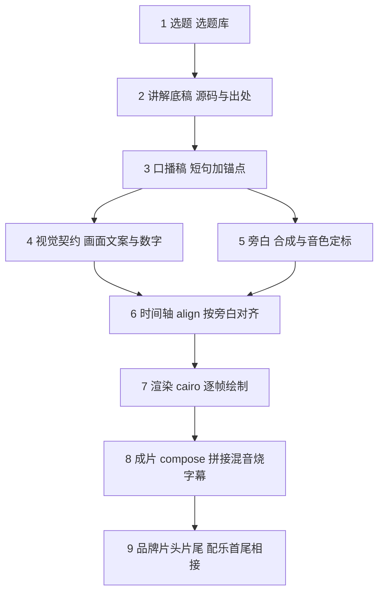

# AIV 视频生产线：九个环节、唯一契约与入库边界

> **入库的是事实，不入库的是产物。**
>
> 规范、契约、台账、口播稿、渲染代码与测试进仓库；
> 图像、音频、时间轴、片段与成片只留在本机。

这条线要解决的问题只有一个：

> **怎么把已经写过的技术文章，变成一条能持续产出、还能被复现的成片流水线。**

「可复现」是这条线的验收标准：换个人、换台机器、半年后重跑，出来的片子必须一样。
这比「做出一条片子」难得多，因为后者只需要一次成功。

---

## 一、一条视频的九个环节



| # | 环节 | 产物 | 入库 |
| --- | --- | --- | --- |
| 1 | 选题 | 一句话钩子 + 关联文档 + 出处 | ✅ 选题库 |
| 2 | 讲解底稿 | 源码路径、函数名、行号、异常分支 | ✅ 原文就在仓库里 |
| 3 | 口播稿 | 每行一个意群、每 15~20 秒一个锚 | ✅ `字幕-<主题>.md` |
| 4 | 视觉契约 | 画面上写什么：标题、副标题、标签、数字、枚举 | ✅ `contracts/<期>.json` |
| 5 | 旁白 | 定稿音色合成，句长与语速对齐口播稿 | ❌ 音频是产物 |
| 6 | 时间轴 | 旁白对齐算出的时间码、字幕断行、场景序列 | ❌ 跟着旁白走 |
| 7 | 渲染 | 各场景片段（cairo 逐帧绘制 + ffmpeg 编码） | ❌ 片段可重出 |
| 8 | 成片 | 拼接 + 混音 + 烧字幕 | ❌ 产物 |
| 9 | 品牌片头片尾 | 2.833 秒的两支片，配乐首尾相接成闭环 | ⚠️ 配乐窗口决策入库，音轨不入库 |

关键设计只有一条：**把「文案」和「契约」从「产物」里拆出来。**

前四步是**人写的内容**——体积小、可评审、可版本化，所以入库；
后五步是**机器生成的产物**——体积大、不可读、不可评审，所以不入库。
这条界线划在 §4。

---

## 二、技术画面为什么不用模型生成

这条线最早的做法是整片交给视频模型生成。核算下来，
H3 2K 实测 **120 积分/秒**，35 秒就是 **4200 积分**——
而技术讲解片的主体恰恰是技术图示：reader 到 worker 的数据流、
32 核、三层线程拓扑。这些东西：

- 用规则描述最准确，用模型生成最容易出错
- 文字和数字一旦生成错，**没法撤回**
- 改一句话要重生成整段，成本按秒计

于是改成「**技术图示全代码绘制，模型只出静态底板**」：

| 项 | 原方案（整片视频生成） | 现方案（代码渲染） |
| --- | --- | --- |
| 积分消耗 | 4200（按秒计） | **视频生成为 0** |
| 画面准确性 | 文字、数字由模型生成 | **文字、数字、机制图示零模型生成** |
| 改一处 | 重生成整段 | 只重渲一个场景 |
| 返修粒度 | 整片 | 单场景（`build/<期>/s03.mp4` 单独重出） |

连 3 秒的品牌片头也不用视频生成：**H3 视频生成最短 4 秒，做不出 3 秒以内的片头**。
所以品牌片改成「AI 出背景底板（静态图）+ 代码合成角色与文字」。

实现落在 `pipeline/pyv/`：`draw.py` 是 cairo 绘制封装，
`scenes/s*.py` 一个场景一个模块，场景是纯函数 `render(ctx, t, w, h)`，
`t ∈ [0,1]`，无全局状态——**所以它可单测、可重放、可并发**。

视觉规格是 `palette.py` 里的常量，启动时校验字体可加载，
**缺失即报错退出，不静默降级**（避免跨机渲染结果不一致）：

| 项 | 值 |
| --- | --- |
| 画布 | 1920×1080 / 24fps / 时间基 1/24000 / H.264 (yuv420p) / AAC 48kHz 立体声 |
| 背景 / 主色 | `#FFFFFF` / `#2B4C7E` |
| 强调 / 次强调 | `#F5A623` / `#4FD1C5` |
| 字体 | `PingFang SC`（启动即校验） |
| 字幕 | 底部居中，深蓝字 `#1B2A47` + 白描边，每行 **≤ 14 字**，无底板 |

---

## 三、唯一契约：画面上写什么，写在契约里

一条视频的**画面文案与数字**（标题、副标题、标签、核数、顺序号、性能倍数……）
全部写在 `contracts/<期>.json` 里，不写在场景代码里。

| | 放哪 | 谁定 |
| --- | --- | --- |
| 文案、数字、标签、枚举 | `contracts/<期>.json` | 每一期 |
| 位置、尺寸、配色、动效 | `pipeline/pyv/scenes/*.py` | 模板 |

这么分是为了让「换一期」不再等于「改一遍代码」：新一期只写契约，
场景渲染器一行都不用动。两条硬规矩：

- **参数缺失当场报错**。契约少给一个参数，渲染前就抛 `MissingParam`，
  绝不悄悄退回硬编码的旧文案——那会让契约与画面的不一致变得无声无息。
- **文案不许回流到代码**。`tests/test_contract.py` 会解析场景源码，
  只要契约里的文案还以字符串字面量的形式出现在场景里，测试就红。

契约还规定「哪几句旁白配哪张图」，句子必须**恰好被覆盖一次**：
漏了、重了都会在 `align` 之前就报错。

> **时间轴不是契约。** `storyboard_<期>.json` 是 `align` 按旁白算出来的**产物**，
> 跟着本机旁白走，不入库。入库的契约决定「画面上写什么」，
> 时间轴只决定「什么时候出现」——两者解耦，换稿时只重跑 `align`。

---

## 四、为什么音视频不入库

仓库根的 `.gitignore` 和 `aiv/.gitignore` 都把媒体挡在仓库外。
这不是洁癖，是算过账的：

| 理由 | 说明 |
| --- | --- |
| **体积** | 单条成片 15~35 MB，一期含旁白、片段、成片约 60 MB。100 期就是 6 GB |
| **不可读** | 二进制在 diff 里永远是 "Binary files differ"，评审和回溯都失效 |
| **CI 成本** | 每次部署都要 checkout 整个仓库，媒体会让 clone 时间线性膨胀 |
| **不可重建** | 成片是**产物**，不是**事实来源**。真正的事实来源是契约 + 口播稿 + 规范 + 引擎代码 |
| **归属风险** | 媒体里带着品牌色、吉祥物与形象原图，把它们塞进公开仓库，是把别人的物料放到个人名下 |

所以规则很简单：

> **入库的是「事实」，不入库的是「产物」。**

| 入库 | 不入库（留本机） |
| --- | --- |
| `contracts/<期>.json` 视觉分镜契约 | `narration_<期>.mp3` 旁白 |
| `字幕-<主题>.md` 口播稿与字幕表 | `storyboard_<期>.json` 时间轴 |
| `pipeline/pyv/scenes/*.py` 场景代码 | `build/<期>/*.mp4` 片段 |
| 三份规范（人格 / 形象音色 / 背景音乐） | `out/<期>.mp4` 成片 |
| `music/library.json` 曲库台账 | `brand/audio/*_mix.wav` 成品音轨 |
| `brand/brand_windows.json` 片头片尾的配乐窗口 | `brand/clips/*.mp4` 品牌片画面 |

需要成片时，本机跑 `make all` 重新生成即可——**这才是「可复现」的真正含义**。

---

## 五、名字要能三个月后还认得出来

成片文件名里**必须带期号 slug**。这条不是审美问题，是三个月后你自己都认不出来的问题：

| ✅ 好 | ❌ 坏 |
| --- | --- |
| `pg-parallel-decode.mp4` | `最终成片.mp4` |
| `csn-total-ordering.mp4` | `最终成片-修复音频.mp4` |
| `narration_csn-total-ordering.mp3` | `9-16-提高+logo尾版.mp4` |

规则：

1. **英文小写连字符**做 slug，不用中文、不用空格
2. **期号贯穿全链路**：契约、旁白、时间轴、片段目录、成片都按同一个 slug 命名
3. **版本号写进文件名**（`v2`），不要靠「最新」这种词
4. **片段目录按期分开**（`build/<期号>/`）：各期的段 id 会重名（`s01`…），共用一个目录会互相覆盖

流水线也按期号切，忘了换稿会**当场报错**，而不是静悄悄地拿上一期的稿子出片：

```bash
cd aiv/pipeline
make EP=csn-total-ordering align      # 按这一期的旁白对齐出时间轴
make EP=csn-total-ordering all         # validate → brand → render → compose
```

---

## 六、口径：独立开发者视角，以及可机检的那几条

成片里的口径不靠记性，靠**可机检的规则**。三份规范一共 35 条硬/倾向规则，
每条都有编号，编号与代码里的规则表一一对应，由测试盯着：

| 规范 | 规则数 | 守什么 |
| --- | --- | --- |
| 《人格规范》 | 9 | 营销腔禁词、机构自称、绝对化断言、能力域边界、量化依据、边界表达、方法论表达、句子宽度与长度 |
| 《选题库》 | 8 | 结构完整、关联文档真实存在、标题与钩子不命中禁词、能力域合法、实测类数字必须带作者本人归因、句数与字数硬指标 |
| 《背景音乐规范》 | 18 | 曲库技术规格、授权白名单、指纹、角色、混音 duck 深度与电平差、真峰值、片头片尾的窗口闭环 |

```bash
cd aiv/pipeline
make persona     # 按《人格规范》检查口播稿
make topics      # 按《选题库》的规则检查选题
make bgm         # 按《背景音乐规范》检查曲库台账
make mix-verify  # 成片级混音验收
```

口径上有一条**不能碰的红线**：内容只讲公开可验证的机制，
不站在任何产品或厂商的立场，也不把别的项目的物料说成自己的。

具体到已出的两期：

- **EP01**（openGauss 的并行逻辑解码）讲的是 **openGauss 的实现**，
  **不是 PostgreSQL 18 的能力**；里面的性能倍数必须标注是**作者本人在 openGauss 上
  本地压测**的，不是厂商结论；
- **EP02**（CSN 全序）讲的是 **openGauss 的实现**，
  **不是 PostgreSQL 18 的能力**——这句话收在口播稿的最后一句。

> EP01 在 2026-11-12 整期重做过一次：原来它把并行解码说成 PostgreSQL 18 的功能，
> 还把「按事务结束顺序输出」写进了本期。归属改成 openGauss，
> 顺序整段留给 EP02（那才是 openGauss 真正解决顺序的方式）。

---

## 七、片头片尾：一段音乐，两个窗口

系列感靠**同一首曲子反复出现**。但「同一首」不等于「同一段」——
早先片头片尾**各挑各的**窗口：片头取「起音明显」的位置，片尾取「尾部衰减」的位置。
实测片头落在 115.15 秒、片尾落在 31.80 秒，两段互不相干，
听上去基本是**两首不同的音乐**——这就是「结尾和片头对不上」的真正原因。

现在的口径是**片尾接回片头**：片头取 `s` 到 `s+D` 这一段，片尾取 `s-D` 到 `s` 这一段，
于是 `outro_start + D == intro_start`——两段在原曲里紧挨着，
拼起来是同一段连续音乐，形成闭环。

选窗的判据是**起音比**：窗口开头 50 ms 的能量 ÷ 紧邻之前 200 ms 的能量，
比值大 = 那里有个清楚的起音，片头才「起」得起来。阈值 4.0。
旧的两个窗口起音比只有 1.60 / 1.19，新窗口 13.71。

> **别用相关系数判断两段是否相接。** 有瞬态的音乐上这个指标没有意义
> （旧口径 +0.0543、新口径 -0.0655，两个数都说明不了任何问题）。
> 真判据是**两段在原曲里紧挨着**：逐样本验证原曲里从 `outro_start`
> 到 `intro_start+D` 这一段，前半等于片尾窗口、后半等于片头窗口。

窗口是**决策**，所以入库（`brand/brand_windows.json`）；音频是**产物**，所以不入库。
换曲子时重挑一次即可，不用改任何脚本。

还有一个容易踩的坑：**成品音轨必须真的接进成片**。
品牌片 mp4 里也烘焙了一份音轨，但那是渲染那一刻的版本——
换了配乐又没重渲 3D 形象的话，成片就会用回旧音乐。
所以品牌片的音轨以 `brand/audio/*_mix.wav` 为正本，mp4 里的只作兜底。

---

## 八、现在到哪了

第一季主线是**机制族**——同一个机制往下挖，观众跟着一条链路走完五期：

| 期 | 标题 | 主线位置 | 状态 |
| --- | --- | --- | --- |
| EP01 | openGauss 的并行逻辑解码 | 入口 | **已出片**（正文 32.436 秒） |
| EP02 | 一个 64 位计数器，决定所有事务的提交顺序 | 提交顺序怎么定 | **已出片**（正文 35.316 秒） |
| EP03 | WAL 里的顺序，不等于事务的顺序 | 提交顺序怎么保 | 待做 |
| EP04 | 并行接收之后，谁先应用 | 订阅端怎么落 | 待做 |
| EP05 | 为什么 DDL 同步不能直接把 SQL 文本发过去 | 链路怎么扩 | 待做 |

两期成片都是 1920×1080 / 24fps / H.264 yuv420p / AAC 48kHz 立体声，
外加 2.833 秒品牌片头与片尾（EP01 共 38.125 秒，EP02 共 41.000 秒）。

成片的验收也不靠耳朵：混音要量稳态 duck 深度（6.99 / 6.99 dB）、
旁白与 BGM 的电平差（23.32 / 23.08 dB）、真峰值（-2.50 / -2.80 dBTP）、
旁白增益偏差（-0.03 dB），超阈值直接不合格。

---

## 九、相关阅读

- 《[人格规范](人格规范.md)》——小象是谁、怎么想、怎么讲；9 条可机检规则
- 《[形象与音色规范](形象与音色规范.md)》——角色设定、铭牌文字的确定性、旁白音色定稿
- 《[背景音乐规范](背景音乐规范.md)》——选曲白名单、风格标准、技术规格、混音与 ducking 规则
- 《[数据库技术自媒体运营手册](../shehui/media-account/index.html)》——独立号的完整运营方法论：资产盘点、平台分工、选题金矿、合规红线
- 《[从 Hexo 博客到公众号与视频号](../blog-to-wechat/index.html)》——出片之后的分发链路
- [PostgreSQL 逻辑复制端到端链路拆解](../../database/postgresql-logical-replication-end-to-end-flow/index.html)——EP01 的源码底稿
- [openGauss CSN 全序机制](../../db/opengauss-csn-total-ordering/index.html)——EP02 的源码底稿
- [如何成为资深的 PostgreSQL 内核开发者](../../database/postgresql-senior-kernel-developer/index.html)——现成的选题库
