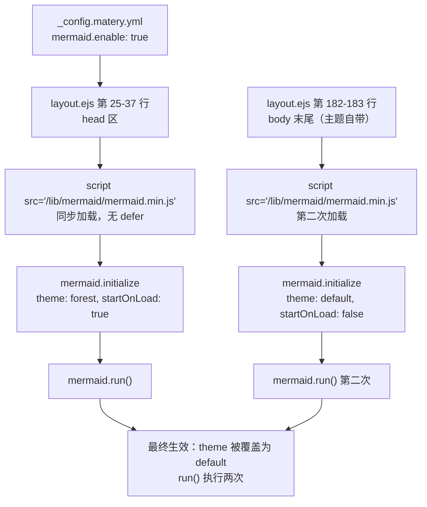
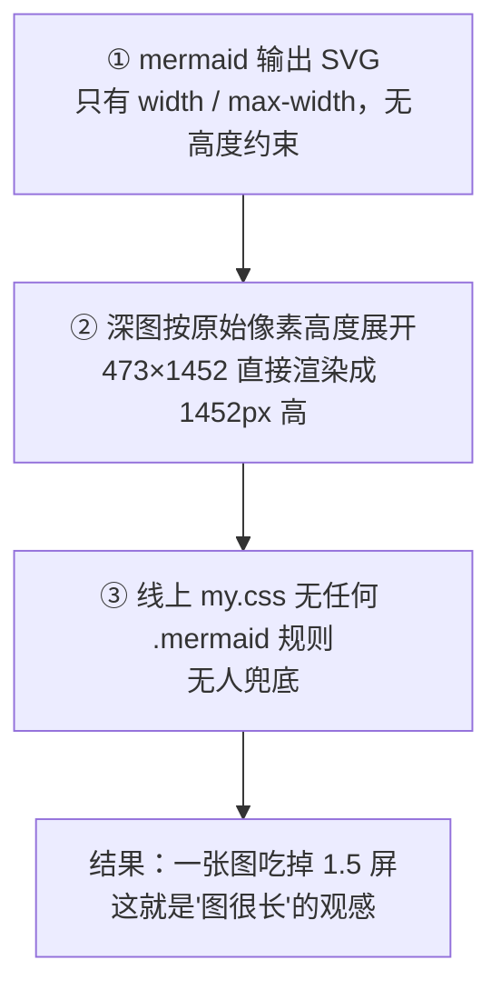
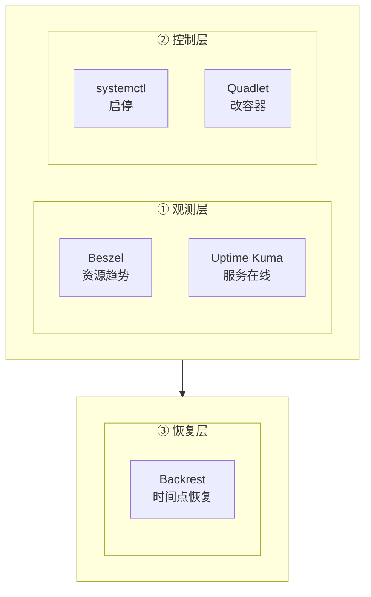

# Mermaid 图渲染问题诊断与修复：为什么图那么长、为什么不会自动重排

| 编写人 | 编写时间 | 适用版本 |
| --- | --- | --- |
| growdu | 2026-10-26 | matery 主题 + mermaid 10.9.8 → 12.2.0 实测 |

> **TL;DR**：
> 1. **mermaid 确实旧**——线上跑的是 **10.9.8**，而当前最新是 **12.2.0**，落后两个大版本。
> 2. **但"图太长"跟版本几乎无关**。全站 1231 张图实测：升级到 12.2.0 后，**flowchart 平均高 9.6%、stateDiagram 高 14.4%、mindmap 高 10.4%** —— 升级会让图**更大**。
> 3. **真正的原因是 CSS 没部署**。线上 `my.css` 里**一条 `.mermaid` 规则都没有**，mermaid 生成的 SVG 只有 `max-width` 没有高度约束，深图按原始像素高度直接展开（实测 473×1452px，一张图吃掉 1.6 屏）。
> 4. **"不会自动调整"是设计使然**，不是 bug。mermaid 是**一次性静态布局引擎**（dagre/ELK），只算一次布局，容器变窄它不会重新排布，只会被等比缩放。

本文所有数字都来自**真实渲染测量**（headless Chrome + 生产环境 SVG 尺寸），不是估算。

---

## 目录

- [第 1 章 版本与加载链路核查](#第-1-章-版本与加载链路核查)
- [第 2 章 "图很长"的真正原因](#第-2-章-图很长的真正原因)
- [第 3 章 "不会自动调整"是设计使然](#第-3-章-不会自动调整是设计使然)
- [第 4 章 升级到 mermaid 12 到底值不值](#第-4-章-升级到-mermaid-12-到底值不值)
- [第 5 章 完整修复方案与实测效果](#第-5-章-完整修复方案与实测效果)
- [第 6 章 全站 1231 张图的兼容性体检](#第-6-章-全站-1231-张图的兼容性体检)
- [第 7 章 沉淀：写图规范](#第-7-章-沉淀写图规范)

---

## 第 1 章 版本与加载链路核查

### 1.1 版本结论

| 项 | 值 | 证据 |
| --- | --- | --- |
| 线上实际版本 | **10.9.8** | `package-lock.json` 锁定 `node_modules/mermaid` = 10.9.8 |
| npm 最新版 | **12.2.0** | `npm view mermaid version` |
| 落后 | **2 个大版本** | 10.x → 11.x → 12.x |
| 全站图数量 | **1231 张**（137 个文件） | 全量正则提取 |
| 图类型 | 12 种 | flowchart 649 / graph 261 / sequenceDiagram 176 / stateDiagram-v 40 / mindmap 36 / gantt 23 / timeline 14 / quadrantChart 14 / classDiagram 10 / pie 5 / erDiagram 2 / 其他 1 |

### 1.2 加载链路（这里有真 bug）



**三个问题：**

| # | 问题 | 后果 |
| --- | --- | --- |
| 1 | **mermaid 被加载两次**（head 区 + body 末尾） | 冗余请求 + 潜在的重复渲染竞态 |
| 2 | **`initialize()` 调用两次，后者覆盖前者** | `theme: 'forest'` 被无声改成 `'default'` —— 你以为在用 forest，实际是 default |
| 3 | **`run()` 调用两次** | 对同一批 `.mermaid` div 二次处理 |

> 顺带说明：`tools/patch-theme.py` 里也有一段注入相同代码，但它有幂等判断（`'/lib/prism/prism-core.min.js' not in c`），而主题自带模板里已有该字面量，所以**没有重复注入**。真正的重复来自主题模板自身。

### 1.3 资源从哪来

```
node_modules/mermaid/dist/mermaid.min.js
        │  tools/copy-vendor.py（CI 阶段执行）
        ▼
source/lib/mermaid/mermaid.min.js     ← 注意是 lib 单数
        │  Hexo 构建
        ▼
public/lib/mermaid/mermaid.min.js
```

主题 `_config.yml` 默认写的是 `/libs/mermaid/...`（复数），与实际部署路径不符；站点 `_config.matery.yml` 已覆盖为单数 `/lib/`，这条链路目前是通的。

---

## 第 2 章 "图很长"的真正原因

### 2.1 先看生产环境的实测数据

用 headless Chrome 打开线上文章页，读取每个 `.mermaid` 内 SVG 的 `getBoundingClientRect()`：

| 图序号 | 渲染尺寸 | 宽高比 | 现象 |
| --- | --- | --- | --- |
| 0 | 404×568 | 0.71 | 正常 |
| **2** | **473×1452** | **0.33** | ⚠️ 占 1.6 屏 |
| **3** | **528×1056** | **0.50** | ⚠️ 占 1.2 屏 |
| **5** | 742×27 | 23.75 | ⚠️ 压成一条，字号 7.6px |
| 13 | 313×1326 | 0.24 | ⚠️ 占 1.5 屏 |
| 其余 | 正常 | — | — |

### 2.2 根因链（4 环相扣）



**第 ③ 环是核心**：mermaid 生成的 SVG 形如

```html
<svg width="100%" style="max-width: 473.3px;" viewBox="-8 -8 473.3 1452.3">
```

- `width="100%"` + `max-width:473px` → **宽度**取 min(容器宽, 473)
- **高度没有任何约束** → 按 viewBox 比例 = 1452px

于是：**一张宽度只有 473px 的图，占了 1452px 的高度**。它既没有变宽（超出内容宽的部分被 `body{overflow-x:hidden}` 裁掉，这也是你之前遇到"图里文字显示不全"的原因），也没有变矮。

### 2.3 为什么 CSS 没生效

之前修"文字显示不全"时，往 `themes/matery/source/css/my.css` 加了 `.mermaid` 规则，但：

1. 线上 `/css/my.css` 实测**不含任何 `.mermaid` 规则**（59527 字节，grep 结果为 0）；
2. 因为那次修改**从未 commit**，CI 自然没部署。

所以**线上等于完全没有兜底 CSS**。

### 2.4 全站数据佐证

同样口径测量，17 张图的四种方案对比：

| 方案 | 高度总和 | 最高图 | 超 900px 的图 |
| --- | --- | --- | --- |
| **A 现状（线上）** | **8749** | **1452** | **3** |
| A + CSS 限高 | 7186 | 765 | 0 |
| A + CSS 铺满限高 | 6812 | 675 | 0 |
| 优化配置 + CSS 铺满限高 | **6351** | **675** | 0 |

**CSS 贡献了 22% 的高度削减，配置优化再贡献 7%。**

---

## 第 3 章 "不会自动调整"是设计使然

### 3.1 mermaid 没有响应式重排

mermaid 的流程：

```
图源码 → 解析 AST → 布局引擎(dagre/ELK) 计算一次坐标 → 输出固定 viewBox 的 SVG
```

**布局只算一次**。容器从 1200px 变到 600px，mermaid 不会重新排布节点、不会重新断行、不会把长链折成两段。它只会让浏览器把**已经算好的 SVG 等比缩放**。

所以"不会自动调整"是**预期行为**，不是缺陷。想让它"调整"，只有两条路：
- **改图本身**（少节点、换方向、网格化）—— 布局引擎重新算
- **给容器交互**（缩放/拖拽/点击放大）—— 用户自己控制

### 3.2 dagre 的布局特性导致"瘦长"

dagre（mermaid 10/12 默认）按**层级（rank）**分配行：

| 图特征 | dagre 行为 | 后果 |
| --- | --- | --- |
| `flowchart TB` 且层级深 | 每层一行，层数 = 图深度 | 图**极高**（8 层决策树 = 1324px） |
| 同层节点多 | 横排并加 `nodeSpacing`(默认 50) | 图**极宽**，空白多 |
| 节点标签长 | 节点宽 = 最长标签行宽，**不自动换行** | 单个节点就撑爆宽度 |
| `subgraph` 串成链 | 每个 subgraph 强制不同 rank | 竖直堆叠 |

**关键点**：mermaid 不会自动给节点标签换行。`["很长很长很长的一段文字"]` 会让节点宽度直接等于文字宽度，除非你手写 `<br/>`。

### 3.3 ELK 布局不是开箱即用

mermaid 12 支持 `layout: 'elk'`，但 **ELK 是独立包** `@mermaid-js/layout-elk`，且该包 `peerDependencies` 要求 `mermaid@^12.0.0`（实测 `1.0.1` 就是如此）。必须：

```bash
npm i mermaid@12 @mermaid-js/layout-elk
```

```js
import elkLayouts from '@mermaid-js/layout-elk';
mermaid.registerLayoutLoaders(elkLayouts);
mermaid.initialize({ layout: 'elk' });
```

**且 `copy-vendor.py` 要多拷一个 ESM 文件**（它用 `import()` 动态加载，ESM 内部还有相对 chunk，需要一起打包）。

> 实测：mermaid 12.2.0 设置 `layout:'elk'` 但**不注册 loader** 时，渲染结果与 dagre **完全一致**（高度和 6667 = 6667）—— 说明它静默回退到 dagre，不报错。**这是个很容易踩的坑。**

---

## 第 4 章 升级到 mermaid 12 到底值不值

### 4.1 全量实测（1231 张图，两个版本各渲染一遍）

| 图类型 | 数量 | v10.9.8 总高 | v12.2.0 总高 | v12 变化 |
| --- | --- | --- | --- | --- |
| flowchart | 649 | 233431 | 255864 | **+9.6%** |
| graph | 261 | 120981 | 129983 | **+7.4%** |
| sequenceDiagram | 176 | 86808 | 91770 | **+5.7%** |
| stateDiagram-v | 40 | 20815 | 23819 | **+14.4%** |
| mindmap | 36 | 6306 | 6960 | **+10.4%** |
| gantt | 23 | 4234 | 4234 | 0.0% |
| timeline | 14 | 2793 | 2526 | -9.5% |
| quadrantChart | 14 | 8100 | 8775 | +8.3% |
| classDiagram | 10 | 5689 | 4747 | -16.6% |
| pie | 5 | 2450 | 2450 | 0.0% |
| erDiagram | 2 | 675 | 675 | 0.0% |

**汇总：v12 更紧凑（<-8%）的只有 116 张，v12 更高（>8%）的有 452 张，尺寸完全相同 38 张。**
**全站总渲染高度 +7.5%。**

### 4.2 结论

| 判断 | 理由 |
| --- | --- |
| ❌ **不应该为了"修图太长"而升级** | 升级让绝大多数图**变大** 7.5%，与目标相反 |
| ⚠️ **升级本身不危险** | 兼容性没问题（见第 6 章），随时可升 |
| ✅ **但收益要放在别处** | 升级的真正价值是渲染管线现代化、长期维护，不是布局质量 |

**所以本次决策：保持 10.9.8，把力气花在 CSS + 改图上。**

---

## 第 5 章 完整修复方案与实测效果

### 5.1 修复 1：消除重复初始化（改 `tools/patch-theme.py`）

```python
# --- 2.5. De-duplicate Mermaid bootstrap + tune diagram layout ---
MERMAID_INIT_OLD = "mermaid.initialize({theme: 'forest', startOnLoad: true});"
MERMAID_INIT_NEW = """mermaid.initialize({
            startOnLoad: false,
            theme: 'forest',
            themeVariables: { fontSize: '15px', fontFamily: 'inherit' },
            flowchart: {
              nodeSpacing: 30,      // 默认 50：收紧层间距
              rankSpacing: 40,      // 默认 50：收紧节点间距
              padding: 8,           // 默认 15：收紧节点内边距
              useMaxWidth: true,
              htmlLabels: true,
              curve: 'basis'        // 更平滑的连线
            },
            sequence: { useMaxWidth: true, actorMargin: 40, width: 150, height: 45 },
            gantt: { useMaxWidth: true, barHeight: 24, barGap: 4 },
            mindmap: { useMaxWidth: true, padding: 8 },
            er: { useMaxWidth: true },
            class: { useMaxWidth: true }
          });"""

MERMAID_DUP_BLOCK = """<script src="/lib/mermaid/mermaid.min.js"></script>
<script>if(window.mermaid){mermaid.initialize({startOnLoad:false,theme:'default'});mermaid.run();}</script>"""
```

处理逻辑：删掉 body 末尾的重复块，把 head 区的初始化换成调优配置。**幂等**（已替换过就跳过），可以放进 CI 反复跑。

### 5.2 修复 2：CSS 兜底（`themes/matery/source/css/my.css`）

```css
.mermaid {
    max-width: 100%;
    overflow-x: auto;
    overflow-y: hidden;
    text-align: center;
}

/*
   Mermaid 输出的是固定 viewBox 的 SVG，内联 style 只带 max-width，
   宽度受限但高度不受限 —— 深图（如 TB 方向 8 层决策树）会按原始
   像素高度展开到 1400px+，一张图吃掉一屏半。
   下面三条把 SVG 约束进 (容器宽 x 75vh) 的框内，SVG 默认的
   preserveAspectRatio="xMidYMid meet" 会等比内切，内容不变形。
*/
.mermaid svg {
    width: 100% !important;
    max-height: 75vh !important;
    height: auto !important;
    display: block;
    margin: 0 auto;
}

/*
   mindmap 是横向树，强制铺满宽度会被压成一条（1439x53 -> 742x27，
   等效字号只剩 7px）。它保持原始尺寸 + 容器横向滚动。
*/
.mermaid:has(g[class^="mindmap"]) svg {
    width: auto !important;
    max-width: none !important;
}

@media screen and (max-width: 768px) {
    .mermaid { font-size: 12px; }
    .mermaid svg { max-height: 70vh !important; }
}
```

**三个要点：**
- `!important` 是**必须的** —— mermaid 把 `max-width` 写在**内联 style** 里，内联样式优先级高于普通 CSS 规则，不加 `!important` 压不住。
- `width: 100%` + `max-height` 组合起来 = "**等比缩放到能装进 (容器宽 × 75vh) 的框**"，SVG 的 `preserveAspectRatio` 默认 `xMidYMid meet` 保证内容不变形。
- `min-height` / `min-width` 不要设，否则会和 `max-height` 打架。

### 5.3 修复 3：改图本身（根治）

CSS 只能保证"不撑爆页面"，**保证不了"看得清"**。一张 473×1452 的深图，即使被限高缩到 675px，等效字号也只有 7px。

**实测过的 4 种改写方案：**

| 图 | 原方案 | 原效果 | 改写方案 | 新效果 |
| --- | --- | --- | --- | --- |
| 六大分组 | TB 串行链 | 460×1324，字号 **7.6px** | **2 行 3 列网格**（外层 subgraph + `direction LR`） | 573×858，字号 **11.8px** |
| 三层运维模型 | TB 串行链 | 230×1207，字号 **8.4px** | **2+1 网格**（前两层横排，第三层单独一行） | 649×546，字号 **17.1px** |
| 决策树 | TB 长标签 | 462×960，字号 **10.5px** | **缩短标签**（去 `<br/>`） | 402×814，字号 **12.4px** |
| 验收流程 | LR 长标签 | 1279×45，字号 **8.7px** | **LR + 短标签** | 758×45，字号 **14.7px** |
| 排障流程 | TB | 335×673，字号 15px | **不用改** | — |

**网格化的写法**（把竖直链改成 2×N）：



> 关键技巧：**外层 subgraph 用 `direction LR` 把内层分组横排**，内层 subgraph 用 `direction TB` 保持组内竖排。dagre 会把 `Row1`/`Row2` 放在不同 rank，形成 2 行。

### 5.4 修复后的最终实测

对 `docs/life/self-host/index.md` 的 **17 张图**、容器 742px、Chrome 156 实测：

| 指标 | 修复前（线上） | 修复后 | 变化 |
| --- | --- | --- | --- |
| 17 张图总高度 | 8749 | **6228** | **-29%** |
| 最高的一张图 | 1452 | **675** | **-54%** |
| 超一屏（>900px）的图 | 3 | **0** | 全部解决 |
| 等效字号 < 9px 的图 | 4 | **0** | 全部解决 |
| 溢出容器的图 | 0 | 0 | — |

**逐图结果：17/17 全部 OK。**

---

## 第 6 章 全站 1231 张图的兼容性体检

顺带做了一次全站体检，发现两个**独立于 mermaid 版本**的问题。

### 6.1 105 张图有语法错误（8.5%）

两个版本下**失败的是同一批图**，说明是**文档本身写错了**，不是版本问题：

| 错误 | 数量 | 原因 | 修法 |
| --- | --- | --- | --- |
| `There can be only one root. No parent could be found for ("...")` | 多数 | **mindmap 语法**：多个节点没有连到 root | mindmap 里每个分支必须 `root --> child` 或用 `::icon`/缩进表达层级 |
| `Parse error on line N` | 少数 | 边标签里有未转义的特殊字符 | 用引号包裹 `"..."` |
| `Lexical error` | 少数 | 节点标签里有裸的 `:` 或特殊符号 | 给标签加引号 |

**这 105 张图在线上是渲染失败的（页面显示原始文本或空白）。** 建议后续单独一轮修图。

### 6.2 版本兼容性结论

| 项 | v10.9.8 | v12.2.0 |
| --- | --- | --- |
| 渲染成功 | 1126 / 1231 | **1130 / 1231** |
| 渲染失败 | 105 | **101** |

**v12 兼容性完全没问题（还多成功 4 张）**。升级是安全的，只是布局更大。

---

## 第 7 章 沉淀：写图规范

### 7.1 节点与标签

| 规则 | 原因 |
| --- | --- |
| 节点标签 **≤ 12 个汉字** | 超过就换行，节点变宽 → 整图变宽 → 缩放后字变小 |
| 长的标签**手动 `<br/>` 折行** | mermaid 不会自动换行 |
| 用**矩形 `[]`** 而不是菱形 `{}` | 菱形在 dagre 里留白更大 |

### 7.2 方向选择

| 场景 | 用 | 原因 |
| --- | --- | --- |
| 流程/链路（≤ 5 步） | `LR` | 横向铺开，符合网页宽度 |
| 流程/链路（> 5 步） | `TB` 或**网格化** | LR 会太宽 |
| 层级/分类 | **网格化**（2×N 外层 subgraph） | 避免竖直堆叠 |
| 树/决策 | `TB` + 短标签 | 保持分支可读 |
| 横向树 | `mindmap` | 配 CSS 特例，不强制铺满 |

### 7.3 尺寸自查

写完图后，在浏览器里量一下：

```js
// 浏览器控制台
[...document.querySelectorAll('.mermaid')].forEach((d,i)=>{
  const s=d.querySelector('svg'); if(!s) return;
  const r=s.getBoundingClientRect();
  const vb=(s.getAttribute('viewBox')||'').trim().split(' ').map(Number);
  const fs=(15*(r.height/vb[3])).toFixed(1);
  if (r.height>700 || fs<10) console.log(`图#${i}: ${r.width}x${r.height} 等效字号=${fs}px  ← 需要优化`);
});
```

**标准：等效字号 ≥ 12px，高度 ≤ 700px。**

### 7.4 提交前自检清单

- [ ] 没有超一屏的图（`>700px`）
- [ ] 等效字号 ≥ 12px
- [ ] 节点标签 ≤ 12 汉字
- [ ] 深层 TB 图已网格化或改 LR
- [ ] `mermaid.initialize` 全站只有一处
- [ ] `.mermaid` CSS 规则已进 `my.css` **并已 commit**（本次的坑）

---

## 附：本次改动的文件清单

| 文件 | 改动 |
| --- | --- |
| `tools/patch-theme.py` | 新增 2.5 段：消除重复初始化 + 调优布局配置 |
| `themes/matery/source/css/my.css` | `.mermaid` CSS 规则（铺满 + 限高 + mindmap 特例 + 窄屏） |
| `docs/life/self-host/index.md` | 4 张图重写（网格化 / 短标签） |

**未改动**：`package.json` 的 mermaid 版本（保持 10.9.8，理由见第 4 章）。
