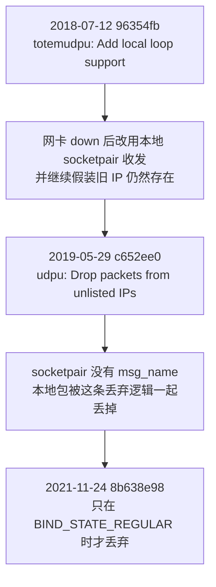

# corosync down网卡仍处于多数派问题分析

| 编写人 | 编写内容 | 编写时间 |
| --- | --- | --- |
| growdu | 修订：合并同目录的 -1 版；补上成因链与上游修复、修正 PR 链接、给出版本边界与故障注入对照表 | 2026-11-14 |

网卡 down 掉以后，corosync 已经和另外两个节点失去联系，却仍然报告自己是 quorate。
于是 fence 不动作，主库不停，跨中心的 observer 又把主库切到了灾备中心；
等网络恢复，两个中心各有一个主库。

本文要回答三个问题：为什么 down 掉网卡 corosync 还自报 quorate，上游是怎么修的，
这套集群该怎么改才不脑裂。文末给一张故障注入对照表，可以直接当测试用例用。

## 环境与边界

本文讨论的是这样一套环境：

| 项 | 值 |
| --- | --- |
| 集群规模 | 3 节点 |
| 传输层 | udpu（单播） |
| votequorum | 未启用 |
| qdevice | 无 |
| 集群形态 | 同城双中心，主库在本地中心 |

结论只对 **udpu 传输层**成立。udpu 在 corosync 2.4.6（2.x 最后一个 release）
和 3.x 里都还在，`exec/totemudpu.c` 至今可取——所以「升到新版就没这个问题」
不成立，问题就长在 udpu 上。corosync 3 起默认走 knet，默认配置不受影响。

现场的 corosync 具体版本以 `corosync -v` 的输出为准：本文的判断只依赖传输层，
不依赖小版本。

## 问题现象

复现步骤（上游 PR 685 的评论给的就是这套）：

```shell
# 在被隔离的那台节点上 down 掉网卡
ip link set eth0 down

# 看 quorum 状态
corosync-quorumtool -s
# 持续监视
corosync-quorumtool -m
# 看 membership 与 Ring ID
corosync-cfgtool -s
```

预期与实际对不上：网络已经不通了，被 down 的那台**仍然报告自己是 quorate**。

这里容易读反方向。三节点集群 down 掉一张网卡之后：

- 剩下两个节点仍然满足多数派，**它们本来就该是 quorate**；
- 该变成非 quorate 的是**被 down 的那台自己**，并且另外两台应该把它当成 offline。

原文那句「实际上网络不通应处于非 quorate 状态」缺个主语。缺了主语，读者
很容易理解成「集群应该失去 quorum」——照这个理解去停库，反而会把好端端的
集群停掉。

## 脑裂双主是怎么发生的

fence 依赖 corosync 的 quorum 状态：本中心的数据库只有在 corosync **连续非
quorate 超过 20 秒**之后才会被停掉。链路断掉之后，链条是这样走的：

1. 网卡 down，本中心与 observer、以及另一个中心全部失联；
2. corosync 仍自报 quorate → fence 的条件不成立 → **主库不停**；
3. observer 看到本中心失联，触发跨中心切换 → **灾备中心把主库切了过来**；
4. 网络恢复，本中心重新加入；
5. 本中心的旧主库一直没停 → **两个中心各有一个主库**。

第 5 步是结果，前四步是原因。第 3 步最容易漏掉主语：触发切换的是「本中心
失联」这件事，不是「网卡 down」这个动作本身。

20 秒这个阈值必须**慢于** corosync 判定自己失联所需的时间，否则正常的网络
抖动也会被当成故障停库。上游默认配置下，totem 的真实 token 超时是
`token + (节点数 - 2) × token_coefficient`，即 3000 ms + 650 ms，三节点约
3650 ms；现场的实际参数要以自己的 `corosync.conf` 为准。

## 为什么会这样

不是配置写错，是 udpu 传输层的一个真实缺陷，三次提交把它串了起来：



- `96354fba72b7e7065610f37df0c0547b1e93ad51`（2018-07-12）引入本地 loop：
  网卡 down 之后改用本地 socketpair 收发，好让节点还能和邻居通信；
- `c652ee0df8c1971cf9347c69d7ff3d78505dc9e9`（2019-05-29）加了「丢弃来自
  未列出 IP 的包」。socketpair 没有 `msg_name`，这条逻辑把本地包也丢了；
- 上游维护者 jfriesse 把根因归到第二条，ifdown 场景于是走不通。

源码入口在 `exec/totemudpu.c`：`timer_function_netif_check_timeout()` 负责
探测网卡状态，`totemudpu_build_sockets()` 按 `BIND_STATE_UNBOUND / LOOPBACK /
REGULAR` 三态决定用哪个 socket。

配置面上还有一个现成的开关 `block_unlisted_ips`（默认 yes），上游手册页写的是
「Allow UDPU and KNET to drop packets from IP addresses that are not known」。

## 上游的修复

修复落在 **PR 686**（[PR 页面](https://github.com/corosync/corosync/pull/686)），
2021-11-24 直接提交进 master。改动只有 **+1/-0** 一行：只在
`BIND_STATE_REGULAR` 时才丢弃未列出 IP 的包，本地 socketpair 不再被误伤。

补丁的 commit 是 [8b638e98](https://github.com/corosync/corosync/commit/8b638e98)，
完整 sha 是 `8b638e989c391860d0e0f8bcd83fed1ac0b50992`。

顺带说清楚一个容易踩的坑：**PR 685 从未合入**。它由 epenchev 于 2021-11-17
提交，2021-11-22 被作者自己关闭（`merged=false`、`mergeable_state=dirty`），
理由是 PR 686 已经验证有效。

照着 685 去 cherry-pick 会白忙一场——这个 commit 已经覆盖 v2.4.6、v3.1.7、
v3.1.10、v3.2.0。也就是说，**留在 udpu 也不是没有出路**：把这一行补丁合进
自己的 corosync 就能解决。

## 为什么换到 knet

上游维护者 jfriesse 在 PR 685 下给过依据：udpu 众所周知处理不好这种情况，
这正是 corosync 3 引入 knet 的原因，knet 是 default、recommended and only
supported transport，udpu/udp 只留作调试。

他随后补了一句限定，很重要：「only real solution is to use knet, because udpu
ifdown handling is not perfect (**but usually works**)」——所以结论不是「udpu
一律不可用」，而是「knet 是更该去的方向」。

相比 udpu，knet 多了链路级冗余、自动链路恢复和原生的 IP 压缩与加密。它自己
也有两条要说清楚：

- IP 传输层默认 udp，也可以选 sctp，但上游已标注 sctp **已弃用**，将在
  kronosnet v2.0 移除；
- 我们之前担心过「knet 会做广播」。这个担心在配置层面没有依据：`link_mode`
  只有 passive / active / rr 三个取值，没有 broadcast。

knet 的设计背景见 Christine Caulfield 在 Clusterlabs Summit 2017 的演讲
《Kronosnet - The new face of corosync communications》。

[演讲全文（PDF）](http://build.clusterlabs.org/corosync/presentations/2017-Kronosnet-The-new-face-of-corosync-communications.pdf)

## 结论与落地

1. **长期**：把通信方式从 udpu 迁到 knet，目标是 corosync 3.x，并按下面那张
   对照表做一次故障注入验证。
2. **紧急 POC**：改传输层这条路的**前提是 corosync 3.x**。在 2.x 上写
   `transport: knet` 不但不生效，还会**静默退化成组播 UDP**——集群从单播 UDPU
   变成组播 UDP，没有任何告警。2.x 上的紧急做法是合入 `8b638e98`。
3. **持续跟踪上游**：把 corosync 3.x + knet 作为目标版本，持续跟进社区版本
   与补丁。

切到 knet 有三条前提要一起满足：

1. 二进制带 knet：`corosync -v` 的 Built-in features 里要能看到它；
2. `nodelist` 里**每个节点都要有 `nodeid`**——上游手册页写的是「If KNET is
   set, this field must be set」；
3. knet 才支持加密：`secauth` 默认开启，密钥放在 `/etc/corosync/authkey`，
   从 udpu 切过来要一并准备。

配置落点是 `corosync.conf` 里 `totem { }` 段的 `transport:` 一行。

## 故障注入对照表

网络故障不能只靠关机、重启或者 chaos-blade 来模拟，得按实际使用场景来。
下面这张表既是测试用例，也是排查时能直接用的清单；判定标准始终是同一条：
**被隔离的那台应为非 quorate，集群其余节点应把它视为 offline。**

| 注入方式 | 期望的 quorum 状态 | 判定命令 | 需要现场确认的点 |
| --- | --- | --- | --- |
| `ip link set eth0 down` | 本机非 quorate，其余节点仍 quorate | `corosync-quorumtool -s` | udpu 下这一步会失败，就是本文的缺陷 |
| `ifdown eth0` | 本机非 quorate，其余节点仍 quorate | `corosync-quorumtool -s` | 现场实际用的注入方式 |
| iptables REJECT 丢包 | 本机非 quorate，其余节点仍 quorate | `corosync-quorumtool -s` | 上游 PR 685 的评论给的是这套注入 |
| 拔网线 | 本机非 quorate，其余节点仍 quorate | `corosync-quorumtool -s` | 物理层断开，链路检测路径与 ifdown 相同 |
| 停网卡服务 | 待确认 | `corosync-quorumtool -s` | corosync 可能感知不到网卡状态变化 |
| 关机 / 重启 | 节点离线，走成员变更流程 | `corosync-cfgtool -s` | 与网卡故障不是一回事，不能混着验收 |

这几种注入方式的语义各不相同，期望结果也各不相同，验收时逐条对照，别按
「网络故障」一个笼统结论验收。

## 延伸阅读

- [totem协议详解](../totem协议详解.md)
- [corosync qnet挂死场景分析解决](../corosync qnet挂死场景分析解决.md)
- [corosync-qdevice使用](../corosync-qdevice使用.md)
