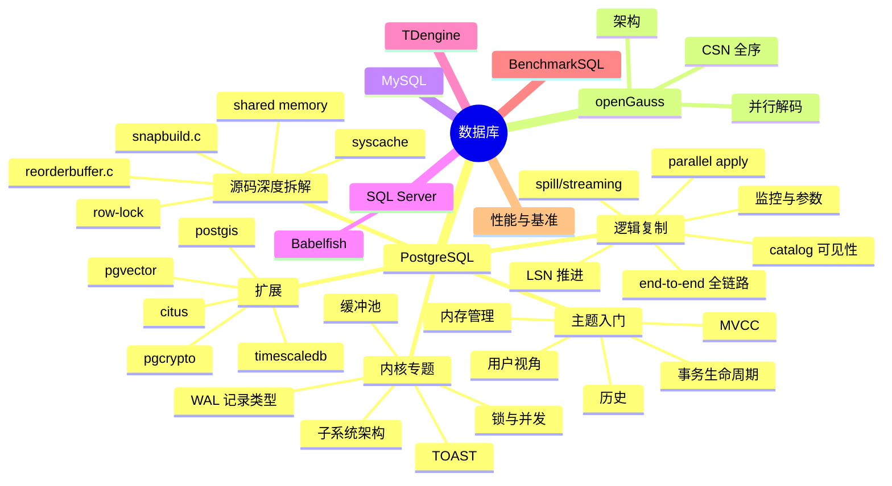

# 数据库

> 数据库相关专题的**总入口**。本页面聚合了博客中所有数据库方向的文章,按主题与深度分层。
>
> - 想**入门 / 了解全貌** → 看本文"1. 总览"与"2. PostgreSQL — 主题入门"
> - 想**深入研究 PostgreSQL 内核 / 逻辑复制源码** → 看"3. PostgreSQL — 内核专题"与"4. PostgreSQL — 源码深度拆解"
> - 想看**openGauss / MySQL / SQL Server / TDengine / BenchmarkSQL 等其他数据库** → 看"5. 其他数据库"与"6. 性能与基准"
> - 想看**职业规划 / 学习路线 / 内核贡献** → 看"7. 职业与成长"

---

## 1. 总览图

---

## 2. PostgreSQL — 主题入门(全貌 / 历史 / MVCC / 内存)

| 文章 | 一句话 |
|---|---|
| [PostgreSQL 前世今生](./postgresql-history/index.html) | 1986 Berkeley → 2026 全球基础设施的 39 年演化史 |
| [PostgreSQL 核心特性全景](./postgresql-core-features/index.html) | 12 大功能的设计动因 / 实现原理 / 版本演化 |
| [PostgreSQL 万能论](./postgresql-for-everything/index.html) | 为什么一家公司可以用它替代 Kafka / Redis / Elastic / ClickHouse |
| [PostgreSQL MVCC:一条数据是如何拥有"分身术"的](./postgresql-mvcc/index.html) | 多版本并发控制的入门 |
| [PostgreSQL 事务:一次 BEGIN 与 COMMIT 背后的双层世界](./postgresql-transaction-lifecycle/index.html) | 事务状态机 |
| [PostgreSQL 内存管理:一片共享内存,三座分配器,一座缓冲池](./postgresql-memory-management/index.html) | AllocSet / Slab / Generation 三套 ctx |
| [当我们在说"数据库"的时候,我们到底在说什么](./postgresql-user-capabilities/index.html) | 从用户视角看 PG 的能力与接口 |

---

## 3. PostgreSQL — 内核专题(中等深度)

### 3.1 进程 / 子系统
- [PostgreSQL Background Worker 全解](./postgresql-background-worker/index.html) — `RegisterBackgroundWorker` → 逻辑复制 4 类 worker
- [PostgreSQL 并行 Worker 机制全解](./postgresql-parallel-worker/index.html) — `ParallelContext` → `ParallelQueryMain`
- [PostgreSQL 模块架构](./postgresql-module-architecture/index.html) — 从 `postgres` 二进制到生产级守护

### 3.2 锁 / 并发
- [PostgreSQL 读一行数据源码级深度拆解](./postgresql-read-a-row-deep-dive/index.html) — MVCC 在 9 个环节的落点 + 目录快照 vs 事务快照
- [PostgreSQL 行锁机制源码级深度拆解](./postgresql-row-lock-deep-dive/index.html) — 4 种锁模式 + xmax + MultiXact
- [PostgreSQL Latch 机制详解](./postgresql-latch-mechanism/index.html) — `SetLatch` → epoll

### 3.3 存储 / 缓冲
- [PostgreSQL TOAST 机制源码级深度拆解](./postgresql-toast-deep-dive/index.html) — 8KB 页面限制 → chunked 分散存储
- [PostgreSQL 元数据存储机制](./postgresql-catalog-storage/index.html) — pg_class 撑起的系统表体系

### 3.4 WAL / 日志
- [PostgreSQL WAL 记录类型完全指南](./postgresql-wal-record-types/index.html) — 21 个 RMGR × 80+ 种记录的源码级拆解

### 3.5 协议 / 客户端
- [PostgreSQL libpq 机制与缓冲区详解](./postgresql-libpq-mechanism/index.html)

### 3.6 分区表
- [PostgreSQL 分区表:从 `PARTITION BY` 到路由热路径](./postgresql-partition-handling/index.html) — `PartitionBoundInfo` → `get_partition_for_tuple`
- [PostgreSQL vs SQL Server 分区表实战](./postgresql-vs-sqlserver-partitioning/index.html) — 对比与迁移

### 3.7 数据结构
- [PostgreSQL 18 内核数据结构全景:RangeVar 与 20+ 个核心数据结构](./postgresql-rangevar-and-data-structures/index.html)
- [PostgreSQL 内核开发:读取一张表的 9 步标准流程](./postgresql-read-catalog-table/index.html) — 缓存全景

### 3.8 横向
- [PostgreSQL 行锁机制深度解析](../db/postgresql/postgresql-row-lock/index.html) — 老版同主题文章(参见 4.5 节源码深度)

---

## 4. PostgreSQL — 逻辑复制专题(27+ 篇)

### 4.1 全链路与基础
- [PostgreSQL 逻辑复制全链路](./postgresql-logical-replication-end-to-end-flow/index.html) — 真实事务的 9 段全链路追踪
- [PostgreSQL 逻辑复制表的生命周期](./postgresql-logical-replication-tables-lifecycle/index.html) — `pg_replication_slots` → `pg_subscription_rel`
- [PostgreSQL 逻辑复制 Worker 模型](./postgresql-logical-replication-worker-model/index.html) — launcher / apply / tablesync 进程拓扑
- [PostgreSQL 逻辑复制 `RUNNING_XACTS` 写入机制与快照演化](./postgresql-running-xacts-snapshot/index.html) — `xmin / xmax / xip`
- [PostgreSQL 逻辑复制订阅参数全解](./postgresql-logical-replication-options/index.html) — run_as_owner → disable_on_error
- [PostgreSQL 逻辑复制集群搭建指北(Docker)](./postgresql-logical-replication-docker-setup/index.html) — `docker compose` 一键拉起

### 4.2 性能 / 监控
- [PostgreSQL 逻辑复制的监控](./postgresql-logical-replication-monitoring/index.html) — 六张视图 + 一组 SQL
- [PostgreSQL 逻辑复制性能与速率测试](./postgresql-logical-replication-throughput-benchmark/index.html) — 测量模型 + 11 个脚本

### 4.3 Spill 与 Streaming
- [PostgreSQL 逻辑复制 spill 文件深度剖析](./postgresql-logical-replication-spill-deep-dive/index.html) — TPC-C 100WH 实战
- [PostgreSQL 逻辑复制 streaming 与 spill](./postgresql-logical-replication-streaming-spill/index.html) — `<subid>-<xid>.changes` 全程真相
- [PostgreSQL 逻辑复制的 ReorderBuffer 与事务机制](./postgresql-logical-replication-reorderbuffer-transaction/index.html) — 一行 WAL 到一致性变更流

### 4.4 并行 Apply
- [PostgreSQL 18 逻辑复制的并行解码与并行 Apply](./postgresql-logical-replication-parallel-worker/index.html) — 源码全景

### 4.5 DDL 与分区表
- [PostgreSQL 逻辑复制支持 DDL 之后](./postgresql-logical-replication-ddl-dml-ordering/index.html) — DDL 与 DML 的时序难题
- [PostgreSQL 逻辑复制:DDL 同步后启动 apply worker 同步 DML](./postgresql-logical-replication-ddl-trigger-apply-worker/index.html) — 分区表专题
- [PostgreSQL 逻辑复制与分区表:从 publisher 到 partition leaf 的全链路](./postgresql-logical-replication-with-partitioned-tables/index.html)
- [PostgreSQL 逻辑复制下分区表的 INSERT](./postgresql-logical-replication-partitioned-insert-flow/index.html)
- [`publish_via_partition_root` 的完整行为分析](./postgresql-logical-replication-publish-via-partition-root/index.html)

### 4.6 实战 + 工具
- [PostgreSQL 逻辑复制常用诊断 SQL 与脚本](../db/postgresql/pg%E5%B8%B8%E7%94%A8%E5%87%BD%E6%95%B0/index.html) — `pg_stat_*` 系列视图(`pgstat_*`)
- [PostgreSQL 逻辑复制性能测试总结](../db/postgresql/%E9%80%BB%E8%BE%91%E5%A4%8D%E5%88%B6%E6%80%A7%E8%83%BD%E6%B5%8B%E8%AF%95/index.html) — 公开数据对比
- [PostgreSQL 逻辑复制性能分析:火焰图实战](../db/postgresql/postgresql-flame-graph/index.html) — perf + 火焰图定位

### 4.7 内核视角的"为什么不能"与"怎么改"
- [PostgreSQL 18 新增一个 GUC 参数](../db/postgresql/postgresql-logical-replication-add-guc/index.html) — 内核开发者视角
- [PostgreSQL 18 Injection Point 完整指南](../db/postgresql/postgresql-injection-points/index.html) — 原理 / API / 实战
- [Injection Point 与 PG 测试框架集成实战](../db/postgresql/postgresql-injection-points-test-framework/index.html)
- [用 Injection Point 测试无法到达的代码路径](../db/postgresql/postgresql-injection-points-test-unreachable/index.html) — 3 种改造模式

---

## 5. PostgreSQL — 源码深度拆解(专题目录)

> 本节进入 PG 18 仓库 `~/cwork/postgresql/src` 的源码级深拆。每篇都带 **文件:行号** 标注、**多张 mermaid 图**、可重现的 GDB 路径与输出示例。
>
> 详细目录见 [PostgreSQL 源码修炼之路:内核深度拆解专题](../db/postgresql/index.html)。

### 5.1 逻辑复制 — 入口与全链路
- [PostgreSQL 18 CREATE_REPLICATION_SLOT 全链路分析](../db/postgresql/postgresql-create-replication-slot-deep-dive/index.html)
- [PostgreSQL 逻辑复制端到端深度拆解](../db/postgresql/postgresql-logical-replication-end-to-end/index.html)
- [PostgreSQL 逻辑复制 LSN 推进全景](../db/postgresql/postgresql-logical-replication-lsn-flow/index.html)
- [PostgreSQL 逻辑复制:catalog 改动、可见性判定与 xmin/xmax 推进全景](../db/postgresql/postgresql-logical-replication-catalog-visibility/index.html) — **NEW_CID 全链路**
- [PostgreSQL 18 流式逻辑复制发布端深度解析](../db/postgresql/postgresql-logical-replication-stream-publisher/index.html)
- [PostgreSQL 逻辑复制性能分析:火焰图实战](../db/postgresql/postgresql-flame-graph/index.html)

### 5.2 逻辑复制 — SnapBuild / ReorderBuffer 子系统
- [PostgreSQL snapbuild.c 深度解析](../db/postgresql/postgresql-snapbuild-deep-dive/index.html)
- [PostgreSQL SnapBuildFindSnapshot 深度拆解](../db/postgresql/postgresql-snapbuild-find-snapshot-deep-dive/index.html)
- [reorderbuffer.c 源码深度解析](../db/postgresql/postgresql-reorder-buffer-code-analysis/index.html)
- [PostgreSQL reorderbuffer.c 函数级源码全集](../db/postgresql/postgresql-reorderbuffer-c-function-reference/index.html) — **95 函数 / 5615 行逐函数解析**

### 5.3 逻辑复制 — Apply / 并行 Apply
- [PostgreSQL 逻辑复制 Apply Parallel Worker 运行机制](../db/postgresql/postgresql-apply-parallel-worker/index.html)
- [applyparallelworker.c 源码深度解析(1646 行)](../db/postgresql/postgresql-apply-parallel-worker-code-analysis/index.html)
- [applyparallelworker.c 之 LA 端源码深度解析](../db/postgresql/postgresql-apply-leader-worker-code-analysis/index.html)
- [Apply Parallel Worker 的 lock_stream 与 unlock_stream](../db/postgresql/postgresql-apply-parallel-lock-stream/index.html)
- [PostgreSQL 逻辑复制 Apply Parallel Worker 参数调优实战](../db/postgresql/postgresql-logical-replication-apply-parallel-tuning/index.html)

### 5.4 缓存 / 锁 / 共享内存子系统
- [PostgreSQL syscache 模块源码深度拆解](../db/postgresql/postgresql-syscache-deep-dive/index.html) — CatCache / LRU / cache invalidation 全链路
- [PostgreSQL 行锁机制深度解析](../db/postgresql/postgresql-row-lock/index.html) — MVCC → 多级锁 → MultiXact
- [PostgreSQL 共享内存机制](../db/postgresql/postgresql-shared-memory/index.html) — DSM / DSA / 固定 MemoryContext

### 5.5 学习路径与早期专题
- [PostgreSQL 源码修炼之路 — 存储引擎内核开发者进阶地图](../db/postgresql/learning-path/index.html) — 主线 14 章框架
- [PostgreSQL 源码修炼之路:内核深度拆解专题](../db/postgresql/index.html) — 本节完整目录

---

## 6. openGauss

| 文章 | 一句话 |
|---|---|
| [openGaussCSN 全序保证机制](../db/opengauss-csn-total-ordering/index.html) | 从源码看为什么并行解码能保证全局一致性 |
| [openGauss 并行解码设计原理](../db/opengauss-parallel-decoding-design/index.html) | 整体架构与并行策略 |

**openGauss 全家桶** —— [完整目录](../../openguass/index.html):
- openGauss DCF 搭建详解
- openGauss DCF 启动详解
- openGauss 升级机制
- openGauss 架构详解

---

## 7. PostgreSQL 扩展与生态

| 扩展 | 文章 |
|---|---|
| Citus(分布式) | [Citus 深度拆解](./citus-deep-dive/index.html) / [Citus 列存深度拆解](./citus-columnar-deep-dive/index.html) |
| TimescaleDB(时序) | [TimescaleDB 深度拆解](./timescaledb-deep-dive/index.html) / [TimescaleDB 列存深度拆解](./timescaledb-columnstore-deep-dive/index.html) |
| PostGIS(地理) | [PostGIS 深度拆解](./postgis-deep-dive/index.html) |
| pgvector(向量) | [pgvector 深度拆解](./pgvector-deep-dive/index.html) |
| DuckDB(嵌入式 OLAP) | [DuckDB 深度拆解](./pg-duckdb-deep-dive/index.html) |
| cstore_fdw(列存 FDW) | [cstore_fdw 深度拆解](./cstore-fdw-deep-dive/index.html) |
| pgAudit(审计) | [pgAudit 深度拆解](./pgaudit-deep-dive/index.html) |
| pgBackRest(备份) | [pgBackRest 深度拆解](./pgbackrest-deep-dive/index.html) |
| pg_stat_statements(性能监控) | [pg_stat_statements 深度拆解](./pg-stat-statements-deep-dive/index.html) |
| pgBench(基准) | [pgbench internals](./pgbench-internals/index.html) |
| pgcrypto(加密) | [pgcrypto 深度拆解](./pgcrypto-deep-dive/index.html) |
| **PolarDB(阿里云)** | [PolarDB 竞争力分析](./polardb%E7%AB%9E%E4%BA%89%E5%8A%9B%E5%88%86%E6%9E%90/index.html) |
| **Babelfish**(SQL Server 兼容) | [Babelfish DDL 已知限制](../db/sqlserver/babelfish%20ddl%E5%B7%B2%E7%9F%A5%E9%99%90%E5%88%B6/index.html) / [BBF 创建分区表](../db/sqlserver/bbf%E5%88%9B%E5%BB%BA%E5%88%86%E5%8C%BA%E8%A1%A8/index.html) / [SQL Server 模式逻辑复制支持 DDL](../db/sqlserver/sqlserver%E6%A8%A1%E5%BC%8F%E9%80%BB%E8%BE%91%E5%A4%8D%E5%88%B6%E6%94%AF%E6%8C%81ddl/index.html) / [SQL Server 逻辑复制 DDL 文档](../db/sqlserver/sqlserver%E9%80%BB%E8%BE%91%E5%A4%8D%E5%88%B6ddl/index.html) |

---

## 8. 其他数据库

| 数据库 | 路径 | 一句话 |
|---|---|---|
| MySQL | [docs/db/mysql](../db/mysql/index.html) | [macOS 安装 MySQL](../db/mysql/macos%E5%AE%89%E8%A3%85mysql/index.html) |
| SQL Server / Babelfish | [docs/db/sqlserver](../db/sqlserver/index.html) | DDL / 分区表 / 兼容性对比 |
| TDengine | [docs/db/taos](../db/taos/index.html) | [TDengine 基本使用](../db/taos/taos%E5%9F%BA%E6%9C%AC%E4%BD%BF%E7%94%A8/index.html) |
| 跨库对比 | — | [数据库命名空间机制对比](../db/%E5%91%BD%E5%90%8D%E7%A9%BA%E9%97%B4/index.html) / [多数据库模式命名空间问题](../db/%E5%A4%9A%E6%95%B0%E6%8D%AE%E5%BA%93%E6%A8%A1%E5%BC%8F%E5%91%BD%E5%90%8D%E7%A9%BA%E9%97%B4%E9%97%AE%E9%A2%98/index.html) / [数据库选型维度](./database-selection-dimensions/index.html) |
| 数据库专精路径 | — | [数据库专精路径分类](./database-specialization-taxonomy/index.html) |

---

## 9. 性能与基准

- [PostgreSQL 逻辑复制性能与速率测试](./postgresql-logical-replication-throughput-benchmark/index.html)
- [PostgreSQL 逻辑复制性能测试总结](../db/postgresql/%E9%80%BB%E8%BE%91%E5%A4%8D%E5%88%B6%E6%80%A7%E8%83%BD%E6%B5%8B%E8%AF%95/index.html)
- [PostgreSQL 逻辑复制性能分析:火焰图实战](../db/postgresql/postgresql-flame-graph/index.html)
- [PostgreSQL 逻辑复制 spill 文件深度剖析:TPC-C 100WH](./postgresql-logical-replication-spill-deep-dive/index.html)
- [BenchmarkSQL 基准测试](../db/benchmarksql/index.html)
- [flame-graph-analysis](../db/performance/flame-graph-analysis/index.html) — 通用 perf / 火焰图分析

---

## 10. 架构与营销物料

- [DDL 同步架构](../db/ddl%E5%90%8C%E6%AD%A5%E6%9E%B6%E6%9E%84/index.html) — 内核原生支持 DDL 同步的设计文档
- [DDL 同步架构(美化版)](../db/ddl%E5%90%8C%E6%AD%A5%E6%9E%B6%E6%9E%84-html/index.html) — HTML 渲染版
- [营销物料(aiv)](../db/aiv/index.html) — 海报 / 视频脚本 / 短视频分镜

---

## 11. 职业与成长

- [如何成为资深的 PostgreSQL 内核开发者](./postgresql-senior-kernel-developer/index.html) — 0 → Committer 的 18 个月路线 + 36 个内核主题地图 + 12 大子系统架构
- [PostgreSQL 源码修炼之路 — 存储引擎内核开发者进阶地图](../db/postgresql/learning-path/index.html) — 主线 14 章框架
- [PostgreSQL 不要这样用](./pg-dont-do-this/index.html) — 反面教材
- [PostgreSQL Challahscript 实用技巧](./pg-challahscript-tips/index.html) — SQL / psql 实战技巧

---

## 12. 旁支与早期归档
- [PostgreSQL 部分专题(Part 1)](../db/postgresql/part1/index.html) — 早期草稿合集
- [PostgreSQL 常用函数速查](../db/postgresql/pg%E5%B8%B8%E7%94%A8%E5%87%BD%E6%95%B0/index.html) — 系统表 / 函数 / 视图
- [使用 meson 编译 PostgreSQL](../db/postgresql/%E4%BD%BF%E7%94%A8meson%E7%BC%96%E8%AF%91pg/index.html) — meson build 实战
- [PostgreSQL 源码修炼之路:内核深度拆解专题](../db/postgresql/index.html) — 完整专题目录
- [PostgreSQL 逻辑解码完整目录](../db/logical_decode/index.html) — 早期专题合集
- [PostgreSQL 共享内存机制(深入版)](../db/linux-shared-memory/index.html)
- [PostgreSQL 源码修炼之路专题](../db/postgresql/index.html) — 同上

---

## 13. 关联导航

| 页面 | 路径 |
|---|---|
| 首页 | [docs/](../../index.html) |
| 数据库深入(旧) | [docs/db/](../db/index.html) |
| PostgreSQL(旧) | [docs/pgsql/](../../pgsql/index.html) |
| openGauss(旧) | [docs/openguass/](../../openguass/index.html) |
| 集群 / HA | [docs/cluster/](../../cluster/index.html) |
| Linux 内核 | [docs/linux/](../../linux/index.html) |

## 参考
- PostgreSQL 官方文档 [postgresql.org/docs/18](https://www.postgresql.org/docs/18/)
- 源码:`~/cwork/postgresql` (PG 18.x) / `~/cwork/openGauss-server`(openGauss 5.x)
- 内核贡献指南:PostgreSQL CommitFest `commitfest.postgresql.org`
