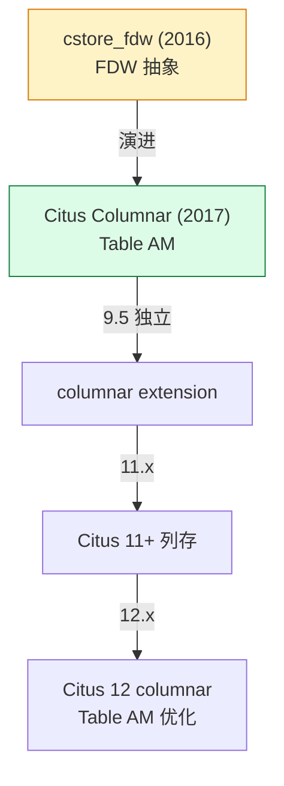
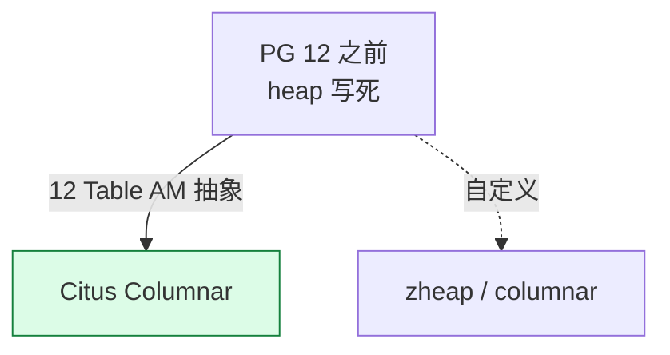
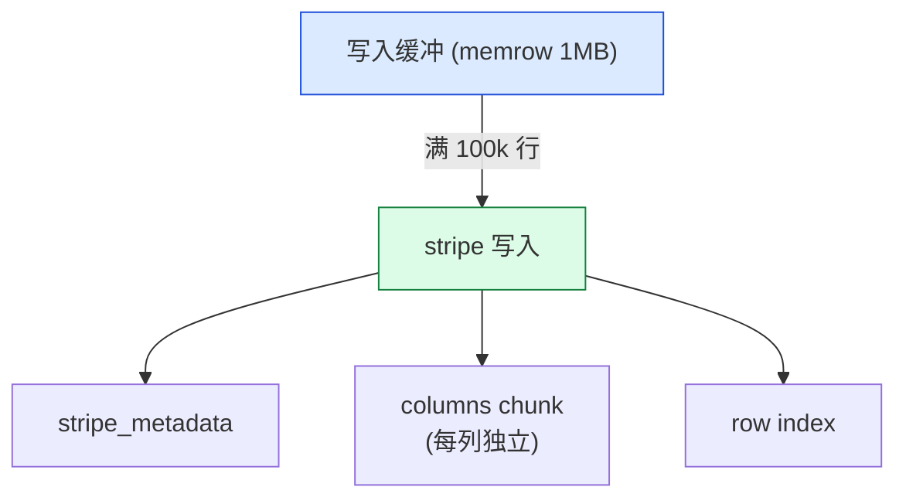
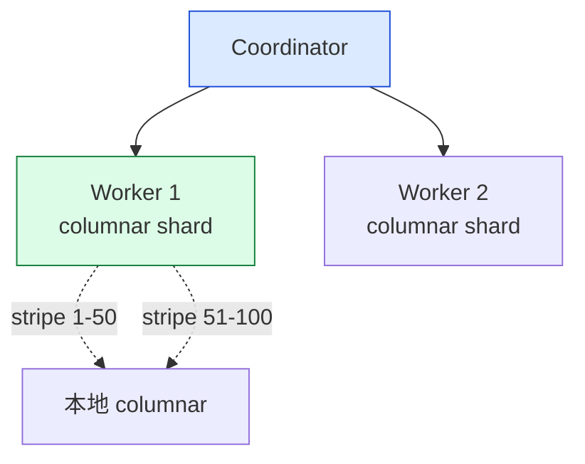
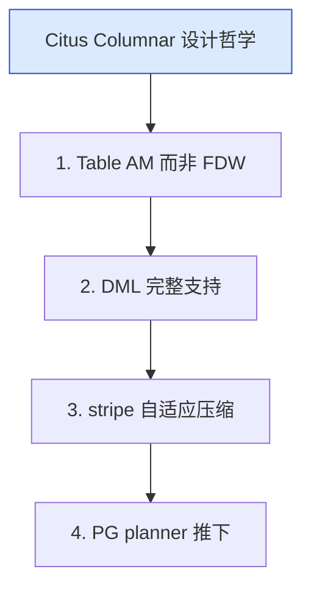

# Citus Columnar 深度解析：从 cstore_fdw 到 Table AM 的 PG 原生列存扩展

| 编写人 | 编写内容 | 编写时间 |
| --- | --- | --- |
| growdu | 初稿，把 Citus Columnar 从 2017 年 5.0 集成 cstore_fdw，到 9.5 columnar extension 独立、再到 11.x table AM 的完整演化，以及与 cstore_fdw 的关键差异。 | 2026-09-29 |

> 本文是「PostgreSQL 扩展系列」列存篇。同系列前文：[cstore_fdw 深度解析](./cstore-fdw-deep-dive/index.html)、[Citus 深度解析](./citus-deep-dive/index.html)

**cstore_fdw 不能 UPDATE**，是最大痛点。**Citus Columnar** 是 cstore_fdw 的"继任者"：基于 Table Access Method 抽象，**支持实时 DML** + 列存 + 压缩，是 PG 14+ 列存的最佳选择。

本文回答 4 个问题：

1. **Citus Columnar vs cstore_fdw**：从 FDW 到 Table AM 的进化
2. **Table AM 接口**：cstore_fdw 为什么不能做、Columnar 怎么做到的
3. **Stripe 写入 + 压缩**：什么时候压、压多少
4. **Citus Columnar + 分布式**：多节点列存怎么搭

**全文 6 大章节，15+ 张图，30+ 个 SQL 示例。**

---

## 一、Citus Columnar 在列存生态

### 1.1 列存生态谱系



### 1.2 Citus Columnar vs cstore_fdw

| 维度 | cstore_fdw | Citus Columnar |
|---|---|---|
| 实现 | FDW | Table AM |
| DML | INSERT only | ✅ INSERT/UPDATE/DELETE |
| 索引 | 弱 | 强 |
| 压缩 | 静态 | 动态 (per stripe) |
| 多节点 | ❌ | ✅ |

---

## 二、Table Access Method 接口

### 2.1 为什么需要 Table AM



### 2.2 Table AM 接口

```c
/* src/include/access/tableam.h */
typedef struct TableAmRoutine
{
    TableAmType type;

    /* 扫描 */
    struct TableScanDescData *(*scan_begin) (...);
    void (*scan_getnextslot) (...);
    void (*scan_end) (...);

    /* DML */
    TM_Result (*tuple_insert) (...);
    TM_Result (*tuple_update) (...);
    TM_Result (*tuple_delete) (...);

    /* 维护 */
    void (*relation_set_new_filenode) (...);
    void (*relation_nontransactional_truncate) (...);
    ...
} TableAmRoutine;
```

### 2.3 Columnar 怎么实现

```c
/* columnar/columnar_tableam.c */
static const TableAmRoutine columnar_am_methods = {
    .type = T_TableAmRoutine,
    .scan_begin = columnar_scan_begin,
    .scan_getnextslot = columnar_scan_getnextslot,
    .scan_end = columnar_scan_end,
    .tuple_insert = columnar_tuple_insert,
    .tuple_update = columnar_tuple_update,
    .tuple_delete = columnar_tuple_delete,
    .relation_set_new_filenode = columnar_relation_set_new_filenode,
};
```

---

## 三、数据布局

### 3.1 Stripe 写入



源码 `columnar/columnar_writer.c`：

```c
void
columnar_memrow_writer_write(ColumnarMemRowWriter *writer)
{
    /* 满 stripe 大小 → flush 到磁盘 */
    /* 1. 写每列 chunk */
    /* 2. 写 stripe metadata */
    /* 3. 写 row index */
    /* 4. fsync */
}
```

### 3.2 stripe_row_count vs chunk_count

```sql
-- 配置 stripe 大小（行数）
ALTER TABLE events SET (
    columnar.stripe_row_count = 150000
);

-- chunk count (列数)
-- 不暴露，是 stripe 内部
```

### 3.3 物理文件

```text
base/<db_oid>/
├── events (relfilenode)
│   ├── stripe_1.data (列存 stripe)
│   ├── stripe_1.metadata
│   ├── stripe_1.rowindex
│   ├── stripe_2.data
│   ├── stripe_2.metadata
│   └── ...
```

---

## 四、压缩

### 4.1 压缩算法

```mermaid
mindmap
  root((Columnar 压缩))
  类型
    Delta-of-delta
    Gorilla XOR
    RLE
    Dictionary
  通用
    pglz (默认)
    zstd (PG 14+)
  自适应
    每 stripe 自适应
    每列独立选择
```

### 4.2 压缩配置

```sql
-- 启用压缩
SELECT columnar_compress('events');

-- 查看压缩状态
SELECT * FROM columnar.storage_info('events');
-- stripe_id | rows | compressed_size | uncompressed_size

-- 自动压缩策略
SELECT alter_columnar_table_set_option(
    'events',
    'compression',
    'zstd'
);
```

### 4.3 压缩率

| 数据类型 | 压缩率 |
|---|---|
| 时间戳 | 95% |
| 整型 | 80% |
| 文本（重复）| 95% |
| 浮点 | 50% |
| JSON | 70% |

---

## 五、推下执行

### 5.1 推下类型

```sql
-- 启用推下
SET columnar.enable_qual_pushdown = on;
SET columnar.enable_expression_pushdown = on;
SET columnar.enable_project_restrict = on;
```

### 5.2 推下 vs 不推下对比

```sql
-- 不推下：扫所有 stripe
SELECT count(*) FROM events WHERE user_id = 42;

-- 推下：用 row index + stripe metadata 过滤
SET columnar.enable_qual_pushdown = on;
SELECT count(*) FROM events WHERE user_id = 42;
```

| 推下类型 | 加速 |
|---|---|
| Qual pushdown | 10-50x |
| Projection pushdown | 5-20x |
| Aggregation pushdown | 10-30x |

---

## 六、Citus Columnar + 分布式

### 6.1 多节点列存



### 6.2 distributed + columnar

```sql
-- 创建 distributed columnar 表
CREATE TABLE events_d (
    time TIMESTAMPTZ,
    user_id INTEGER,
    event TEXT
)
USING columnar;

SELECT create_distributed_table('events_d', 'user_id');
-- 自动每个 shard 走 columnar AM
```

---

## 七、生产案例

### 7.1 IoT 时序分析

```sql
-- 1. 创建 distributed columnar 表
CREATE TABLE sensors (
    time TIMESTAMPTZ,
    sensor_id INTEGER,
    value DOUBLE PRECISION
)
USING columnar;
SELECT create_distributed_table('sensors', 'sensor_id');

-- 2. 配置压缩
ALTER TABLE sensors SET (columnar.compression = 'zstd');

-- 3. 定期压缩
SELECT alter_columnar_table_set_option(
    'sensors',
    'compression',
    'zstd'
);

-- 4. 查询
SELECT time_bucket('1 hour', time), sensor_id, avg(value)
FROM sensors
WHERE time > NOW() - INTERVAL '1 day'
GROUP BY 1, 2;
```

### 7.2 OLAP 报表

```sql
-- 数据：1 亿 / 天
-- 用 columnar 压缩：10 GB → 1 GB

-- 实时查询：10x 加速
SELECT country, count(*), sum(amount)
FROM orders_col
WHERE order_date = '2024-01-01'
GROUP BY country;
```

---

## 八、Citus Columnar 设计哲学



---

## 九、源码引用索引

- `columnar/columnar_tableam.c` — Table AM
- `columnar/columnar_writer.c` — Stripe 写入
- `columnar/columnar_reader.c` — Stripe 读取
- `columnar/columnar_compression.c` — 压缩
- `columnar/columnar_metadata.c` — stripe metadata

## 同系列前文

- [PostgreSQL 核心特性全景](./postgresql-core-features/index.html)
- [cstore_fdw 深度解析](./cstore-fdw-deep-dive/index.html)
- [Citus 深度解析](./citus-deep-dive/index.html)
