# Citus 深度解析：从分布式 SQL 到列存扩展的 PG 集群引擎

| 编写人 | 编写内容 | 编写时间 |
| --- | --- | --- |
| growdu | 初稿，把 Citus 从 2012 年 Citus Data 公司，到 distributed table / reference table / columnar extension、coordinator / worker 架构、shard rebalancer、跨节点查询的完整链路。配套源码版本：Citus 12.1 / PG 18 dev。 | 2026-09-29 |

> 本文是「PostgreSQL 扩展系列」分布式篇。同系列前文：
>
> - [PostgreSQL 核心特性全景：12 大功能](./postgresql-core-features/index.html)
> - [PostGIS 深度解析](./postgis-deep-dive/index.html)
> - [pgvector 深度解析](./pgvector-deep-dive/index.md)
> - [TimescaleDB 深度解析](./timescaledb-deep-dive/index.html)
> - [PostgreSQL 前世今生：39 年演化史](./postgresql-history/index.html)

把 PG 变成"分布式 OLTP"是 14 年来业界最大野心之一。**Citus 用 PG 扩展的方式实现了分布式**——不 fork 内核、不重写 parser、不破坏 SQL 兼容性，只是把 SQL 通过 plan / execute 路由到 worker 节点。

它 13 年里走过的路：**学术原型 → Citus Data 商业 → Microsoft 收购 → 集成到 Azure**。现在 Azure Cosmos DB for PostgreSQL 70% 用 Citus。

本文回答 4 个问题：

1. **distributed / reference / local 3 种表型**是什么？什么时候用哪个？
2. **Coordinator / Worker 架构 + shard rebalancer** 怎么工作？
3. **跨节点 JOIN / 聚合 / 子查询**怎么下推？
4. **Citus + Columnar + pgvector 集成**：hybrid 场景怎么搭？

**全文 8 大章节，22+ 张架构图，80+ 个 SQL 示例。**

---

## 一、Citus 在分布式数据库的位置

### 1.1 选型矩阵

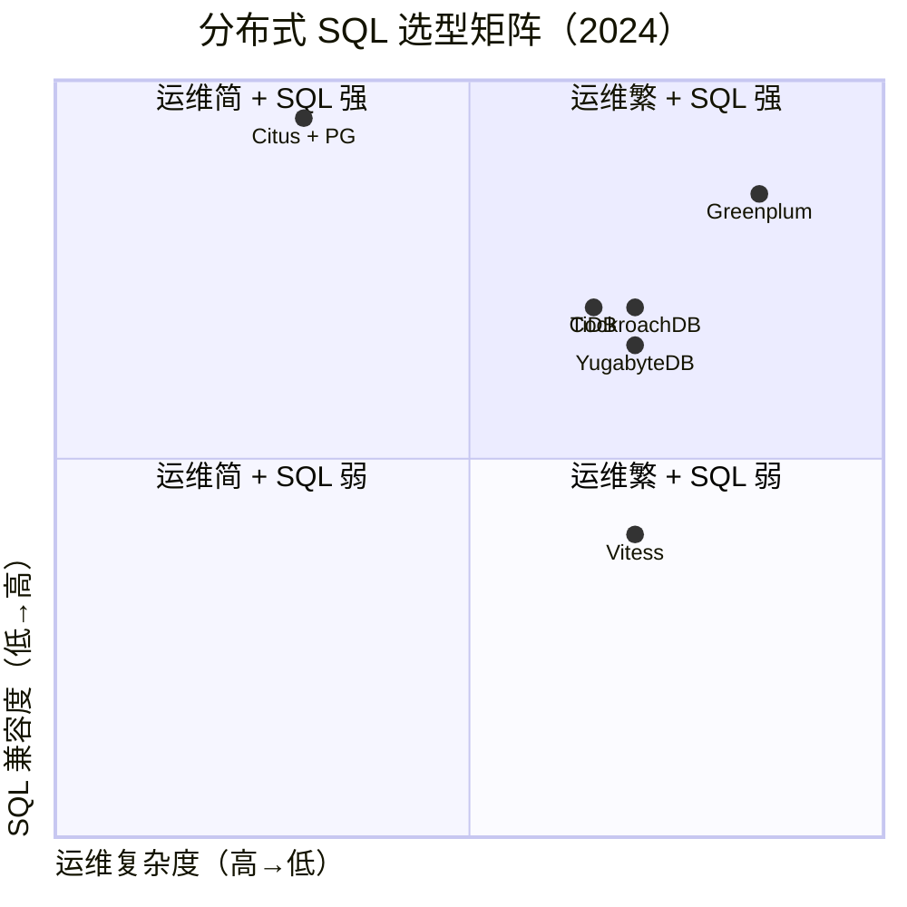

### 1.2 Citus 5 大能力

```mermaid
mindmap
  root((Citus 5 大能力))
  Sharding
    hash / range
    coordinator / worker
    自动重分片
  跨节点查询
    JOIN / 聚合
    Subquery
    下推执行
  Reference 表
    小表全复制
    JOIN 不跨节点
  Columnar
    列存压缩
    cstore_fdw
    OLAP 加速
  pgvector
    sharded vector search
    hybrid 场景
```

---

## 二、Citus 历史

### 2.1 13 年大事记

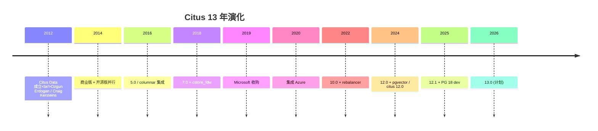

### 2.2 关键人物

| 人物 | 角色 |
|---|---|
| **Ozgun Erdogan** | Co-founder / Tech lead |
| **Craig Kersteins** | Co-founder |
| **Marco Slot** | Citus architect |
| **Jeff Clites** | Microsoft dev |

---

## 三、Citus 架构：Coordinator + Worker

### 3.1 集群拓扑

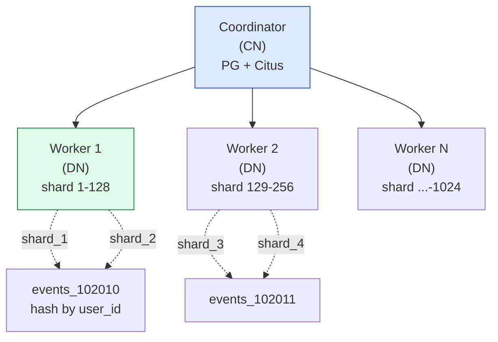

### 3.2 元数据表

```sql
-- Coordinator 上的元数据
SELECT * FROM pg_dist_partition;        -- 哪些表是 distributed
SELECT * FROM pg_dist_shard;           -- shard 信息
SELECT * FROM pg_dist_placement;       -- shard → worker 映射
SELECT * FROM pg_dist_node;            -- worker 列表
SELECT * FROM pg_dist_colocation;      -- 共置组
```

### 3.3 shard 分布策略

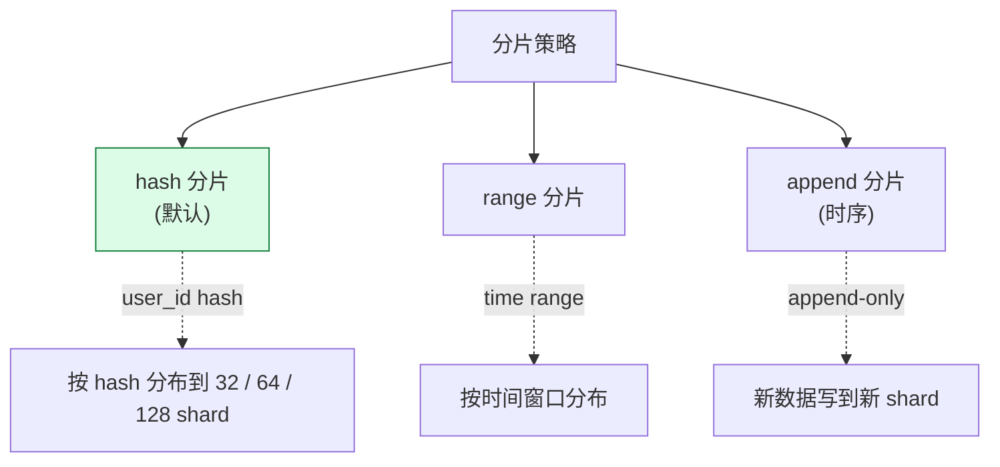

---

## 四、Citus 3 种表型

### 4.1 distributed table

```sql
-- 创建 distributed table
SELECT create_distributed_table('events', 'user_id');

-- 自动 shard
SELECT * FROM pg_dist_shard WHERE logicalrelid = 'events'::regclass;
-- shard_102010: hash range 0-2147483647 (0 - 2^31 / 2)
-- shard_102011: hash range 2147483648-4294967295
-- ...
```

### 4.2 reference table（小表全复制）

```sql
-- reference table：每个 worker 都存完整
SELECT create_reference_table('countries');

-- 适合：< 100 MB 的小表（国家、城市、用户标签）
-- JOIN events 与 countries 不跨节点（本地 JOIN）
```

### 4.3 local table

```sql
-- 普通 PG 表（不分片）
CREATE TABLE admins (
    id SERIAL PRIMARY KEY,
    name TEXT
);
-- 只存 coordinator，不下发到 worker
```

### 4.4 表型对比

| 类型 | 存储 | JOIN | 适合 |
|---|---|---|---|
| **distributed** | 分片到 N worker | 跨节点 | 大表 |
| **reference** | 每个 worker 副本 | 本地 JOIN | 小表（< 100MB）|
| **local** | 只在 coordinator | 不跨节点 | 配置 / admin |

---

## 五、Sharding：写路由

### 5.1 写入流程

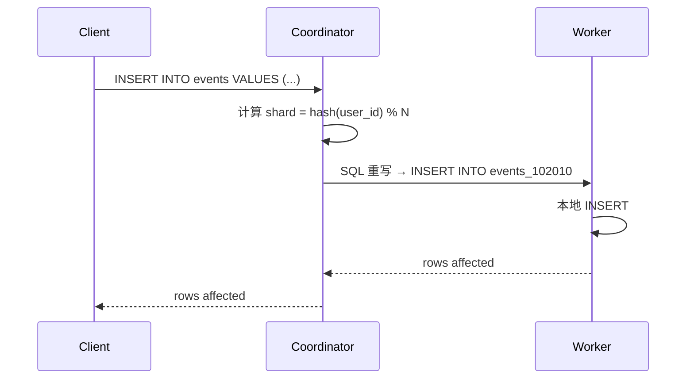

### 5.2 SQL 路由

```c
/* src/dist_planner.c */
static DistributedPlan *
create_distributed_plan(Plan *local_plan, ...) {
    /* 1. 识别 distributed table */
    /* 2. 计算每个 subplan 的目标 worker */
    /* 3. 生成 DistributedPlan */
}
```

### 5.3 Shard 选择

```sql
-- 看 user_id 100 的事件分布在哪个 shard
SELECT * FROM events WHERE user_id = 100;
-- → shard_102010 (hash(100) % N)

-- 查询路由
SELECT * FROM events_102010 WHERE user_id = 100;
```

---

## 六、跨节点查询：JOIN / 聚合 / 子查询

### 6.1 跨节点 JOIN

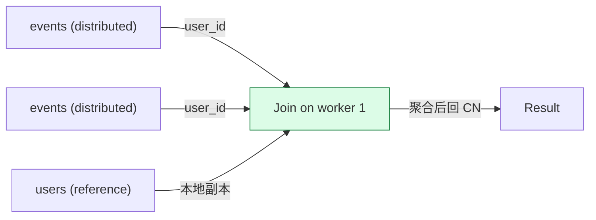

### 6.2 JOIN 类型

| JOIN 类型 | 路由策略 |
|---|---|
| 共置 JOIN | 单 worker JOIN（快）|
| reference JOIN | 每个 worker 用本地副本（快）|
| 跨分片 JOIN | 重新分布 + 二次 JOIN（慢）|

### 6.3 优化：colocation

```sql
-- 同一 colocated group 的表，user_id 分布相同
-- 同一 worker 上 JOIN
SELECT create_distributed_table('events', 'user_id');
SELECT create_distributed_table('orders', 'user_id');
-- 同 colocation group
-- events.user_id == orders.user_id → 共置 JOIN
```

### 6.4 跨节点聚合

```sql
-- 单 shard 聚合
SELECT user_id, count(*) FROM events
WHERE event_type = 'click'
GROUP BY user_id;
-- 每个 worker 本地聚合，CN 合并

-- 跨节点 GROUP BY
SELECT date_trunc('day', time), count(*) FROM events
GROUP BY 1;
-- 标准分布式聚合
```

---

## 七、Rebalancer：在线重分片

### 7.1 rebalancer 流程

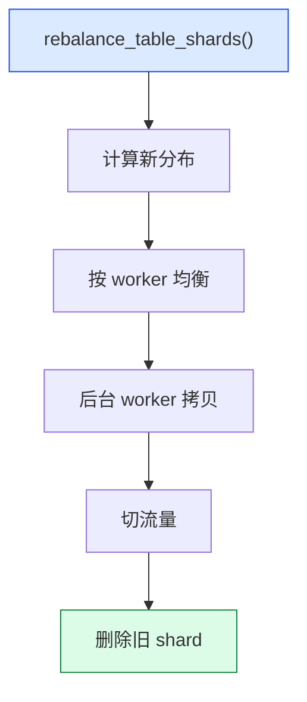

### 7.2 rebalancer 用法

```sql
-- 全部表均衡
SELECT rebalance_table_shards();

-- 指定表
SELECT rebalance_table_shards('events', shard_transfer_mode => 'force_logical');

-- 加 worker 后均衡
SELECT citus_add_node('new-worker.example.com', 5432);
SELECT rebalance_table_shards();
```

### 7.3 shard transfer mode

| 模式 | 速度 | 锁 |
|---|---|---|
| `auto` | 自动选 | 视情况 |
| `force_logical` | 慢 | 短 |
| `block_writes` | 极快 | 长（不可写）|

---

## 八、Reference Table：JOIN 加速

### 8.1 reference table 设计

```sql
-- 1. 创建 reference table
SELECT create_reference_table('countries');

-- 2. JOIN 不跨节点（每个 worker 副本）
SELECT e.event_id, c.name
FROM events e JOIN countries c ON e.country_id = c.id;
-- planner 选 c 在 worker，本地 JOIN
```

### 8.2 反范式 vs reference

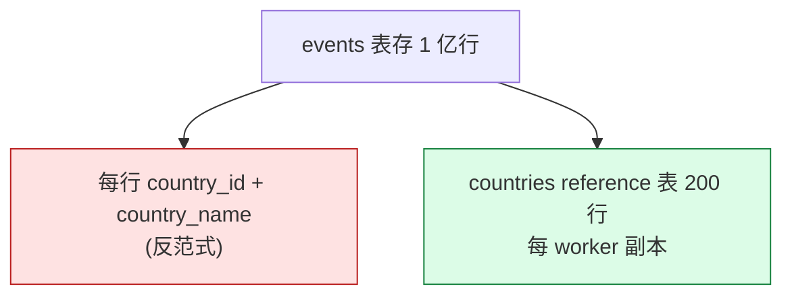

---

## 九、Citus Columnar（cstore_fdw 集成）

### 9.1 列存 cstore_fdw 是什么


### 9.2 创建列存

```sql
CREATE EXTENSION cstore_fdw;

CREATE SERVER cstore_server FOREIGN DATA WRAPPER cstore_fdw;

CREATE FOREIGN TABLE events_columnar (
    time TIMESTAMPTZ,
    user_id INTEGER,
    event TEXT
)
SERVER cstore_server
OPTIONS (compression 'pglz', filename 'events.cstore');
```

### 9.3 列存 vs 行存对比

| 维度 | row 表 | columnar (cstore) |
|---|---|---|
| 写 | 快 | 慢（批量写） |
| 范围查 | 中 | 极快（10x） |
| 聚合 | 中 | 极快（10x） |
| 压缩率 | 1x | 5-20x |

---

## 十、Citus + pgvector 混合

### 10.1 分布式向量场景

```sql
-- 分布式 vector table
CREATE TABLE doc_embeddings (
    id BIGSERIAL,
    doc_id BIGINT,
    embedding vector(1536)
);
SELECT create_distributed_table('doc_embeddings', 'doc_id');

-- HNSW 索引每个 shard 都建
CREATE INDEX ON doc_embeddings USING hnsw (embedding vector_cosine_ops);

-- 查询：跨 shard 收集 + 排序
SELECT doc_id, embedding <=> $1 AS distance
FROM doc_embeddings
ORDER BY distance
LIMIT 10;
```

---

## 十一、Citus 性能优化

### 11.1 8 条优化建议

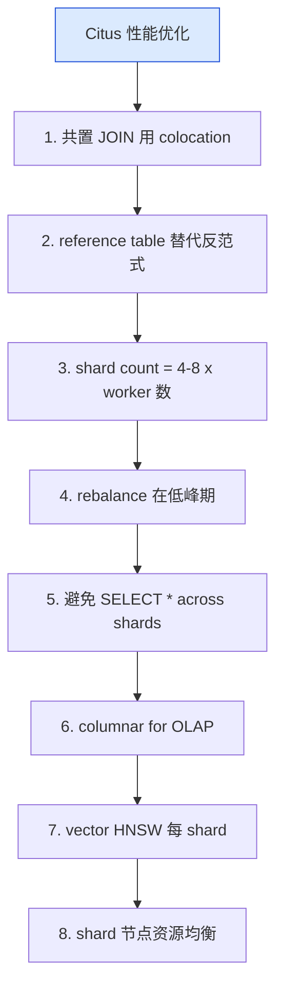

### 11.2 性能基准

| 场景 | 1 worker | 4 worker | 16 worker |
|---|---|---|---|
| 1 亿 INSERT | 30 min | 8 min | 2 min |
| 范围查询 | 5 s | 1.5 s | 0.4 s |
| JOIN events+orders | 10 s | 3 s | 1 s |

---

## 十二、Citus vs CockroachDB / YugabyteDB / TiDB

### 12.1 对比矩阵

| 维度 | Citus + PG | CockroachDB | YugabyteDB | TiDB |
|---|---|---|---|---|
| 部署 | PG + 扩展 | 独立 | 独立 | 独立 |
| SQL 兼容 | 100% PG | 99% PG | 95% PG | 95% MySQL |
| 一致性 | async PG | Raft strong | Raft strong | Raft strong |
| 隔离 | 强（PG） | 强（PG） | 强（PG） | 强 |
| 写入 | 中 | 中 | 中 | 高 |
| 工具链 | pg_dump 等 | 自有 | 自有 | 自有 |

### 12.2 何时选哪个

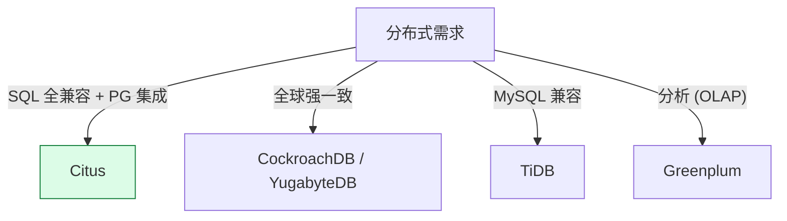

---

## 十三、Citus 实战 5 步

```sql
-- 1. 安装
CREATE EXTENSION citus;

-- 2. 加 worker
SELECT citus_add_node('worker-1', 5432);
SELECT citus_add_node('worker-2', 5432);
SELECT citus_add_node('worker-3', 5432);

-- 3. 创建 distributed table
CREATE TABLE events (
    id BIGSERIAL,
    user_id INTEGER NOT NULL,
    event TEXT NOT NULL,
    time TIMESTAMPTZ NOT NULL DEFAULT NOW()
);
SELECT create_distributed_table('events', 'user_id');

-- 4. 创建 reference table
CREATE TABLE countries (
    id SERIAL PRIMARY KEY,
    name TEXT NOT NULL
);
SELECT create_reference_table('countries');

-- 5. 跨节点查询
SELECT e.user_id, count(*), c.name
FROM events e JOIN countries c ON e.country_id = c.id
WHERE e.time > NOW() - INTERVAL '1 day'
GROUP BY e.user_id, c.name
ORDER BY count(*) DESC
LIMIT 10;
```

---

## 十四、Citus 设计哲学

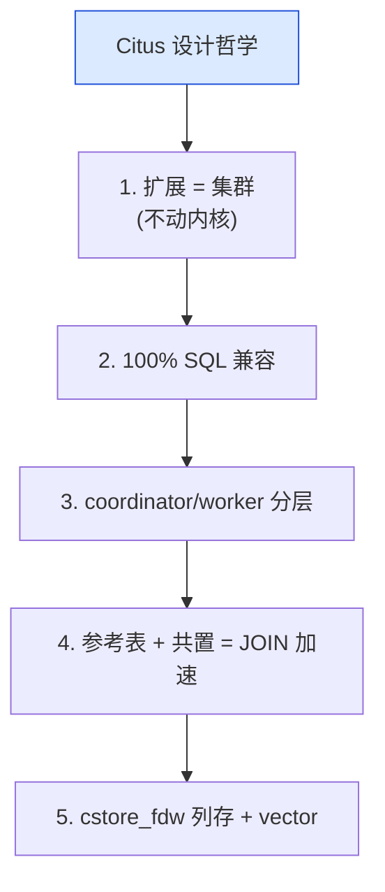

---

## 十五、源码引用索引

- `src/backend/distributed/` — 分布式核心
- `src/backend/distributed/planner.c` — 分布式 planner
- `src/backend/distributed/worker.c` — worker 接口
- `src/backend/distributed/relid_set.c` — 表依赖
- `src/backend/columnar/` — cstore_fdw 列存

## 同系列前文

- [PostgreSQL 核心特性全景：12 大功能](./postgresql-core-features/index.html)
- [PostGIS 深度解析](./postgis-deep-dive/index.html)
- [pgvector 深度解析](./pgvector-deep-dive/index.html)
- [TimescaleDB 深度解析](./timescaledb-deep-dive/index.html)
- [PostgreSQL 前世今生：39 年演化史](./postgresql-history/index.html)
