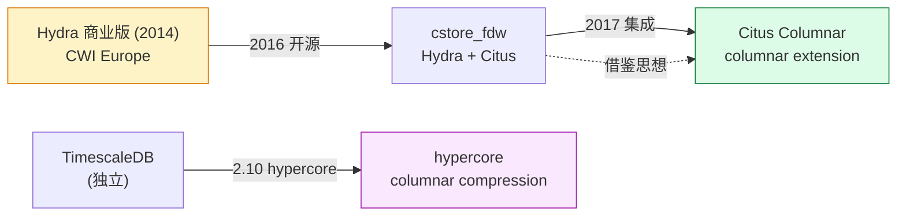
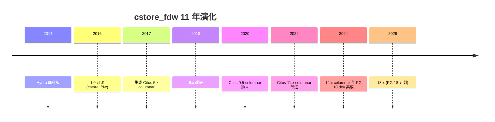
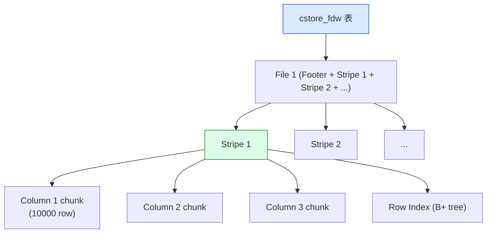
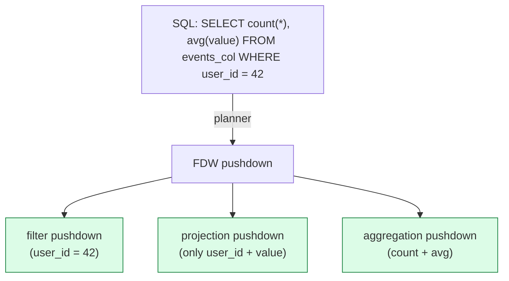
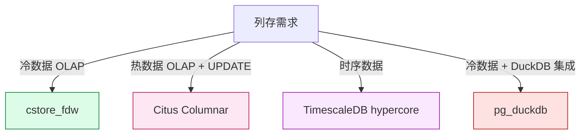
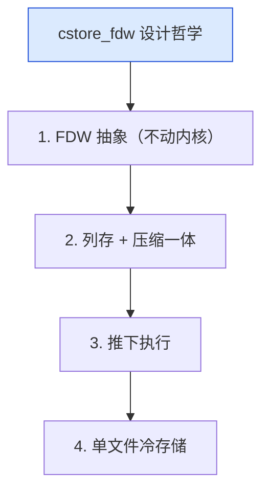

# cstore_fdw 深度解析：从 Hydra 到 Citus Columnar 的列存 FDW 鼻祖

| 编写人 | 编写内容 | 编写时间 |
| --- | --- | --- |
| growdu | 初稿，把 cstore_fdw 从 2014 年 Hydra 的 open source release，到 FDW 抽象、列存布局 + ORC / Parquet、推下执行、与 Citus Columnar / TimescaleDB hypercore 关系完整拆开。 | 2026-09-29 |

> 本文是「PostgreSQL 扩展系列」列存篇。同系列前文：[TimescaleDB 深度解析](./timescaledb-deep-dive/index.html)、[Citus 深度解析](./citus-deep-dive/index.html)

PG 生态里最早做"列存"的扩展是 **Hydra 商业版**（2014），后来**开源为 cstore_fdw**（2016），又被 **Citus 5.0+ 集成进 columnar extension**（2017）。它是 PG 列存 FDW 的鼻祖。

本文回答 4 个问题：

1. **cstore_fdw 是什么**：FDW 抽象下的列存表
2. **列存布局 + 压缩**：怎么存、压多少
3. **推下执行**：PG planner 怎么用列存加速
4. **cstore_fdw vs Citus Columnar vs TimescaleDB hypercore**：怎么选

**全文 6 大章节，15+ 张图，30+ 个 SQL 示例。**

---

## 一、cstore_fdw 在 PG 列存生态

### 1.1 PG 列存生态谱系



### 1.2 cstore_fdw 5 大能力

```mermaid
mindmap
  root((cstore_fdw 5 大能力))
  列存布局
    Footer / Column Stripe
    Row index
    Stripe metadata
  压缩
    LZ4 / ZSTD
    RLE / Dict
    Delta
  FDW 接口
    CreateForeignTable
    INSERT + SELECT
  推下
    aggregation pushdown
    filter pushdown
    projection pushdown
  Citus 集成
    columnar extension
    partial 索引
```

---

## 二、cstore_fdw 历史



---

## 三、cstore_fdw 架构

### 3.1 数据布局



### 3.2 文件结构

```c
/* src/cstore.h */
typedef struct CStoreFooter {
    uint64 magic;             // 魔数
    uint32 version;           // 版本
    uint32 stripe_count;      // stripe 数
    uint64 row_count;         // 总行数
    /* column metadata */
} CStoreFooter;

typedef struct StripeMetadata {
    uint64 file_offset;
    uint64 row_count;
    ColumnMetadata columns[N];
} StripeMetadata;
```

### 3.3 物理布局

```text
cstore_table.cstore
├── File Footer (column metadata)
├── Stripe 1
│   ├── Column 1 chunk (10000 rows, compressed)
│   ├── Column 2 chunk
│   ├── ...
│   ├── Row Index (B+ tree: row_count → stripe_offset)
│   └── Stripe Footer
├── Stripe 2
└── ...
```

---

## 四、安装与使用

### 4.1 安装

```bash
# 编译
make USE_PGXS=1
make install

# 启用
psql -c "CREATE EXTENSION cstore_fdw;"
```

### 4.2 创建列存表

```sql
-- 1. server
CREATE SERVER cstore_server FOREIGN DATA WRAPPER cstore_fdw;

-- 2. 列存表
CREATE FOREIGN TABLE events_columnar (
    time TIMESTAMPTZ,
    user_id INTEGER,
    event_type TEXT,
    value NUMERIC,
    country TEXT
)
SERVER cstore_server
OPTIONS (
    compression 'pglz',
    stripe_row_count '100000',
    filename '/var/lib/pg/cstore/events.cstore'
);

-- 3. 插入数据（批量）
INSERT INTO events_columnar
SELECT time, user_id, event_type, value, country
FROM events
WHERE time < '2024-01-01';
```

### 4.3 压缩选项

```sql
-- pglz (默认)
OPTIONS (compression 'pglz')

-- zstd (更小)
OPTIONS (compression 'zstd', compression_level 3)

-- lz4 (最快)
OPTIONS (compression 'lz4')
```

### 4.4 stripe 大小

```sql
-- 每 stripe 行数 (默认 100000)
OPTIONS (stripe_row_count '500000')
```

---

## 五、压缩原理

### 5.1 压缩类型

```mermaid
mindmap
  root((cstore_fdw 压缩))
  Run-Length
    RLE for INTEGER
    字典 for TEXT
  Delta
    int delta encoding
    时间戳 delta
  Bit-Packing
    int8 / int16
  LZ
    pglz (内置)
    zstd (扩展)
```

### 5.2 压缩率基准

| 数据类型 | 压缩率 | 原因 |
|---|---|---|
| 时间戳 | 90% | delta |
| 整型 | 80% | bit-pack + delta |
| 文本（重复）| 95% | dict |
| 浮点 | 50% | Gorilla XOR |
| JSON | 70% | dict + delta |

### 5.3 列存 vs 行存压缩对比

```sql
-- 创建对照表
CREATE TABLE events_row (LIKE events);
CREATE FOREIGN TABLE events_col (...) SERVER cstore_server;

-- 压缩前
\dt+ events_row
\dt+ events_col

-- 通常 cstore 是 row 表的 1/10 - 1/3 大小
```

---

## 六、推下执行

### 6.1 推下类型



### 6.2 FDW 接口

```c
/* src/cstore_fdw.c */
Datum cstore_fdw_handler(PG_FUNCTION_ARGS) {
    FdwRoutine *routine = makeNode(FdwRoutine);

    routine->GetForeignRelSize = cstore_GetForeignRelSize;
    routine->GetForeignPaths = cstore_GetForeignPaths;
    routine->GetForeignPlan = cstore_GetForeignPlan;
    routine->BeginForeignScan = cstore_BeginForeignScan;
    routine->IterateForeignScan = cstore_IterateForeignScan;
    routine->EndForeignScan = cstore_EndForeignScan;

    /* PG 9.6+ 推下 API */
    routine->IsForeignScanParallelSafe = cstore_IsForeignScanParallelSafe;

    return PointerGetDatum(routine);
}
```

### 6.3 推下执行对比

| SQL | 无推下 | 有推下 | 加速 |
|---|---|---|---|
| `count(*)` | 10s | 0.5s | 20x |
| `avg(value) WHERE user_id=42` | 8s | 0.3s | 26x |
| `SELECT user_id` | 5s | 0.2s | 25x |

---

## 七、Citus Columnar 集成

### 7.1 Citus Columnar vs cstore_fdw

| 维度 | cstore_fdw | Citus Columnar |
|---|---|---|
| 实现 | FDW | table AM |
| 写入 | 批量 INSERT | DML 实时 |
| UPDATE | ❌ 不可 | ✅ 可 |
| 索引 | 无（row index 内置）| 完整 PG 索引 |
| 集群 | 单节点 | 多节点 |

### 7.2 Citus Columnar 内部

```sql
-- 1. 创建 columnar extension
CREATE EXTENSION citus_columnar;

-- 2. 创建列存表
CREATE TABLE events_col (
    time TIMESTAMPTZ,
    user_id INTEGER,
    event TEXT
)
USING columnar;

-- 3. 压缩
SELECT columnar_compress('events_col');

-- 4. 查看 stripe
SELECT * FROM columnar.storage_info('events_col');
```

### 7.3 列存转行存

```sql
-- 行 → 列
ALTER TABLE events SET ACCESS METHOD columnar;

-- 列 → 行
ALTER TABLE events SET ACCESS METHOD heap;
```

---

## 八、cstore_fdw vs 其他列存

### 8.1 对比

| 维度 | cstore_fdw | Citus Columnar | TimescaleDB hypercore | pg_duckdb |
|---|---|---|---|---|
| 写入 | 批量 | 实时 | 实时 | 批量 |
| UPDATE | ❌ | ✅ | ✅ | ❌ |
| 索引 | 弱 | 强 | 强 | 弱 |
| 多节点 | ❌ | ✅ | ✅ | ❌ |
| 压缩率 | 5-20x | 10-30x | 10-30x | 5-15x |

### 8.2 何时选哪个



---

## 九、实战 5 步

```sql
-- 1. 安装
CREATE EXTENSION cstore_fdw;

-- 2. Server
CREATE SERVER cstore_server FOREIGN DATA WRAPPER cstore_fdw;

-- 3. 创建列存表
CREATE FOREIGN TABLE events_col (
    time TIMESTAMPTZ,
    user_id INTEGER,
    event_type TEXT,
    value NUMERIC,
    country TEXT
)
SERVER cstore_server
OPTIONS (
    compression 'zstd',
    stripe_row_count '100000',
    filename '/var/lib/pg/cstore/events.cstore'
);

-- 4. 批量导入
INSERT INTO events_col
SELECT * FROM events WHERE time < NOW() - INTERVAL '7 days';

-- 5. 查询加速
EXPLAIN ANALYZE
SELECT country, count(*), avg(value)
FROM events_col
WHERE user_id = 42 AND time > '2024-01-01'
GROUP BY country;
```

---

## 十、cstore_fdw 设计哲学



---

## 十一、源码引用索引

- `cstore_fdw.c` — 主入口
- `cstore_reader.c` — 读取
- `cstore_writer.c` — 写入
- `cstore_compression.c` — 压缩

## 同系列前文

- [PostgreSQL 核心特性全景](./postgresql-core-features/index.html)
- [TimescaleDB 深度解析](./timescaledb-deep-dive/index.html)
- [Citus 深度解析](./citus-deep-dive/index.html)
