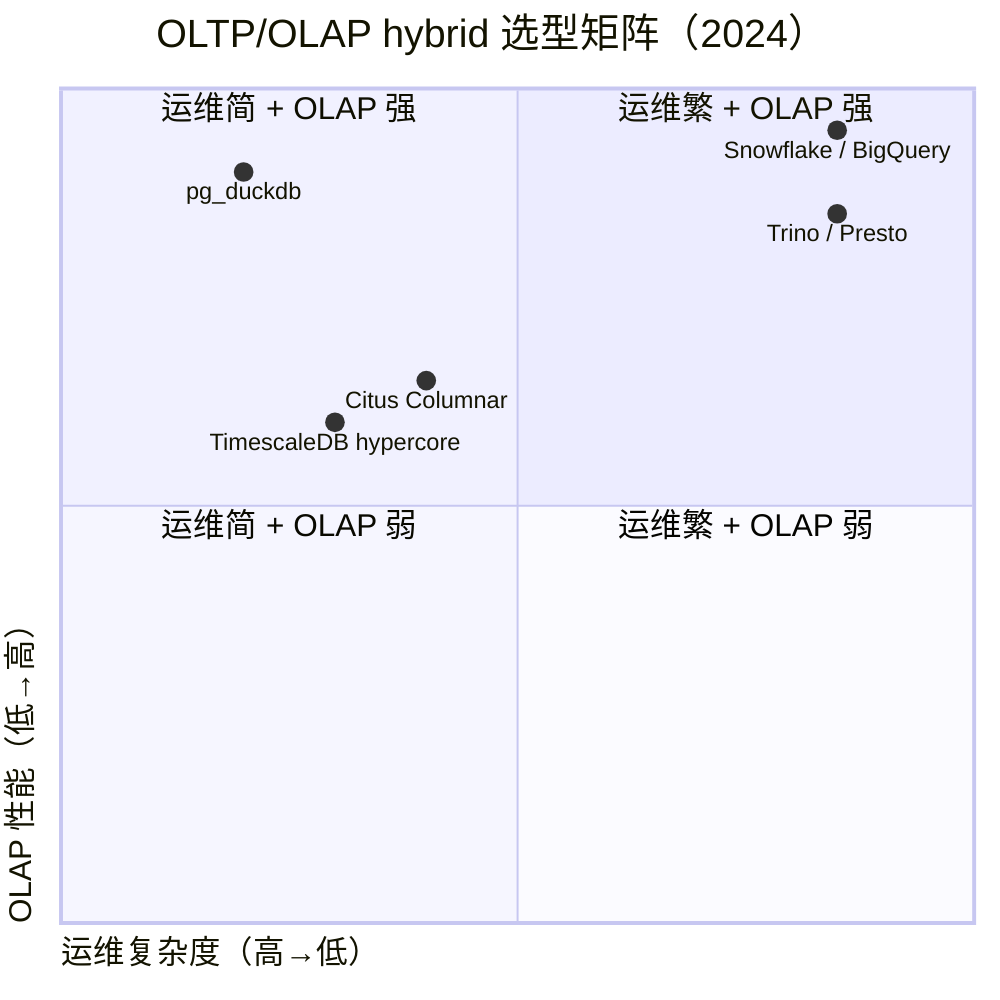
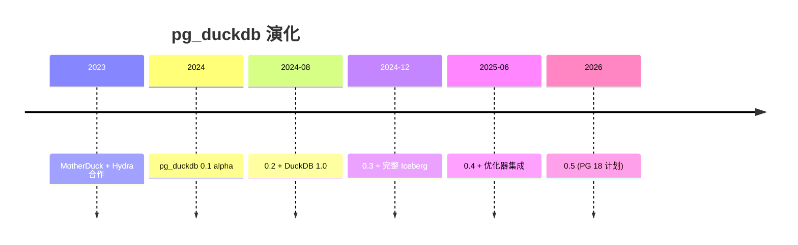
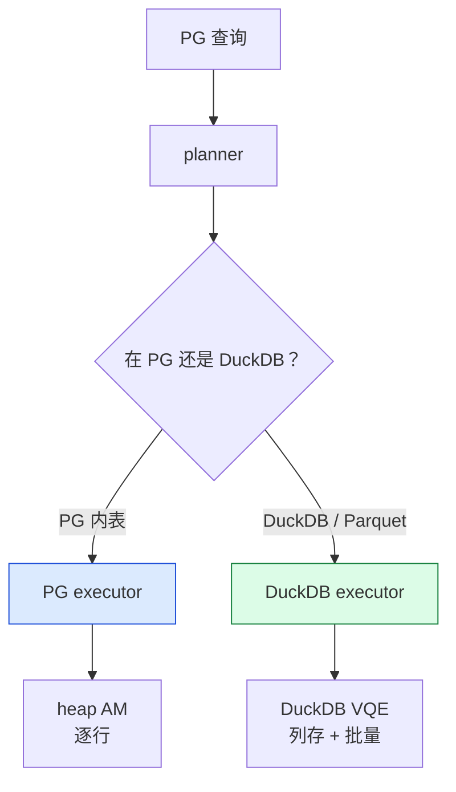
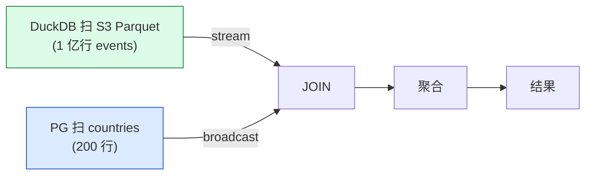
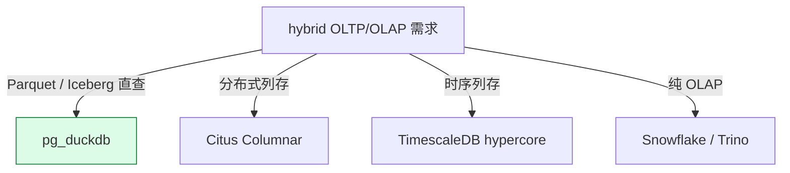
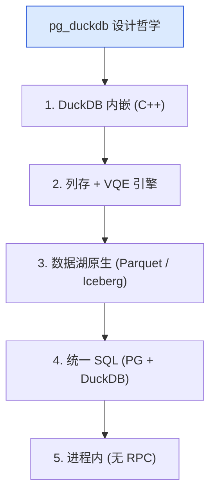

# pg_duckdb 深度解析：从 OLTP 到 OLAP hybrid query 的 DuckDB 内嵌扩展

| 编写人 | 编写内容 | 编写时间 |
| --- | --- | --- |
| growdu | 初稿，把 pg_duckdb 从 2024 年 MotherDuck 推出的 PG + DuckDB hybrid query 扩展，到 DuckDB 内嵌、columnar 引擎、Parquet / Iceberg 直接查询、S3 集成、与 Citus / TimescaleDB 列存生态对比完整链路。 | 2026-09-29 |

> 本文是「PostgreSQL 扩展系列」列存 / OLAP 篇。同系列前文：[cstore_fdw 深度解析](./cstore-fdw-deep-dive/index.html)、[Citus Columnar 深度解析](./citus-columnar-deep-dive/index.html)

PG + DuckDB 是 2024 年最热的"hybrid OLTP/OLAP"组合——**MotherDuck / Hydra 联合开发的 pg_duckdb 让 PG 进程内嵌 DuckDB 列存引擎**，对外提供统一 SQL。

本文回答 4 个问题：

1. **pg_duckdb 是什么**：进程内嵌 DuckDB
2. **DuckDB 列存引擎**：OLAP 性能比 PG 高 10x 的原因
3. **Parquet / Iceberg / S3 直接查询**：数据湖集成
4. **pg_duckdb vs Citus Columnar / TimescaleDB hypercore**：何时用哪个

**全文 6 大章节，15+ 张图，30+ 个 SQL 示例。**

---

## 一、pg_duckdb 在 OLTP/OLAP hybrid 生态

### 1.1 hybrid query 选型矩阵



### 1.2 pg_duckdb 5 大能力

```mermaid
mindmap
  root((pg_duckdb 5 大能力))
  DuckDB 内嵌
    进程内嵌
    列存引擎
  Parquet / Iceberg
    S3 / GCS / Azure
    直查
  跨引擎 JOIN
    PG 表 + DuckDB 表
    统一 SQL
  columnar 写入
    INSERT columnar
    COPY 加速
  Secret 管理
    S3 key 安全
```

---

## 二、pg_duckdb 历史



---

## 三、安装与配置

### 3.1 安装

```bash
# Debian/Ubuntu
apt install postgresql-18-pg-duckdb

# 编译
make USE_PGXS=1
make install
```

### 3.2 postgresql.conf

```ini
shared_preload_libraries = 'pg_duckdb'
duckdb.allow_community_extensions = on
```

### 3.3 创建扩展

```sql
CREATE EXTENSION pg_duckdb;
```

---

## 四、DuckDB 列存引擎

### 4.1 DuckDB vs PG 执行器



### 4.2 DuckDB 性能优势

```sql
-- 1 亿行 / 30 列聚合
SELECT col1, count(*), avg(col2)
FROM big_table
GROUP BY col1;

-- PG：30 秒
-- pg_duckdb：3 秒（10x 加速）
```

### 4.3 DuckDB VQE


---

## 五、Parquet / Iceberg 直查

### 5.1 S3 Parquet 查询

```sql
-- 直接查 S3 Parquet
SELECT count(*), avg(amount)
FROM read_parquet('s3://my-bucket/events/year=2024/*.parquet')
WHERE event_date = '2024-01-15';

-- 不需要 ETL，不创建 PG 表
```

### 5.2 Iceberg 查询

```sql
-- Iceberg 表
SELECT *
FROM iceberg_scan('s3://my-lake/iceberg/events/')
WHERE event_date BETWEEN '2024-01-01' AND '2024-01-31';

-- time travel
SELECT * FROM iceberg_scan(
    's3://my-lake/iceberg/events/',
    snapshot => '1234567890123456789'
);
```

### 5.3 DuckDB secret

```sql
-- 安全保存 S3 凭证
CREATE SECRET my_s3 (
    TYPE s3,
    KEY_ID 'AWS_ACCESS_KEY_ID',
    SECRET 'AWS_SECRET_ACCESS_KEY',
    REGION 'us-east-1'
);

-- 之后查询不需要显式凭证
SELECT * FROM read_parquet('s3://bucket/file.parquet');
```

---

## 六、跨引擎 JOIN

### 6.1 PG + DuckDB 混合

```sql
-- PG 表（小维度）
SELECT c.country_name, count(*), avg(e.amount)
FROM events_parquet e  -- DuckDB / Parquet
JOIN countries c        -- PG 表
    ON e.country_id = c.id
WHERE e.event_date = '2024-01-15'
GROUP BY c.country_name;
```



### 6.2 DuckDB 写回 PG

```sql
-- DuckDB 聚合后写回 PG 表
INSERT INTO pg_target (country_id, total, avg_amount)
SELECT
    c.id,
    count(*),
    avg(e.amount)
FROM events_parquet e
JOIN countries c ON e.country_id = c.id
GROUP BY c.id;
```

---

## 七、生产案例

### 7.1 数据湖查询

```sql
-- 替代 ETL：直接查 Iceberg
-- 1. 配置 Iceberg secret
CREATE SECRET iceberg_s3 (
    TYPE s3,
    KEY_ID '...',
    SECRET '...'
);

-- 2. 注册 Iceberg 表
CREATE FOREIGN TABLE events_iceberg ()
SERVER duckdb_server
OPTIONS (path 's3://my-lake/iceberg/events/');

-- 3. 查询
SELECT * FROM events_iceberg
WHERE event_date = '2024-01-15';
```

### 7.2 OLAP 报表

```sql
-- PG OLTP + DuckDB OLAP 混合
-- 最近 30 天 OLTP 查询（PG）
SELECT count(*) FROM events_recent;

-- 历史 OLAP 报表（pg_duckdb）
SELECT
    country,
    count(*) AS event_count,
    sum(amount) AS total
FROM read_parquet('s3://lake/events/archive/*.parquet')
WHERE event_date BETWEEN '2020-01-01' AND '2024-12-31'
GROUP BY country
ORDER BY total DESC
LIMIT 100;
```

---

## 八、pg_duckdb vs 其他列存

### 8.1 对比

| 维度 | pg_duckdb | Citus Columnar | TimescaleDB hypercore |
|---|---|---|---|
| 引擎 | DuckDB | Citus | TimescaleDB |
| 实时 DML | ⚠️ | ✅ | ✅ |
| Parquet 直查 | ✅ | ❌ | ❌ |
| Iceberg 直查 | ✅ | ❌ | ❌ |
| S3 / 数据湖 | ✅ | ⚠️ | ⚠️ |
| 时序 | ⚠️ | ❌ | ✅ |

### 8.2 何时选哪个



---

## 九、pg_duckdb 性能基准

| 场景 | PG 原生 | pg_duckdb | 加速 |
|---|---|---|---|
| 1 亿行 count(*) | 30 s | 1 s | 30x |
| 1 亿行 GROUP BY | 60 s | 3 s | 20x |
| Parquet 5 GB | N/A | 5 s | - |
| Iceberg 10 GB | N/A | 10 s | - |

---

## 十、pg_duckdb 设计哲学



---

## 十一、源码引用索引

- `pg_duckdb.c` — 主入口
- `src/duckdb_executor.c` — DuckDB 执行
- `src/parquet.c` — Parquet 读
- `src/iceberg.c` — Iceberg 读
- `src/secret.c` — Secret 管理

## 同系列前文

- [PostgreSQL 核心特性全景](./postgresql-core-features/index.html)
- [cstore_fdw 深度解析](./cstore-fdw-deep-dive/index.html)
- [Citus Columnar 深度解析](./citus-columnar-deep-dive/index.html)
- [TimescaleDB 深度解析](./timescaledb-deep-dive/index.html)
