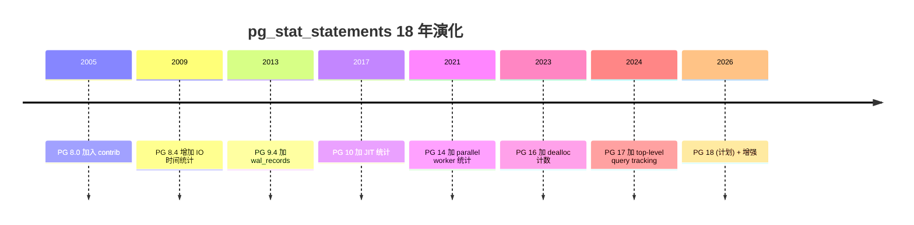
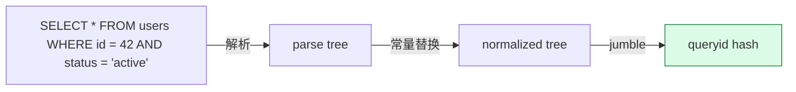
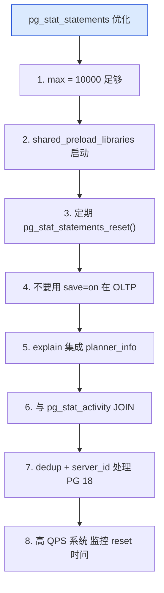
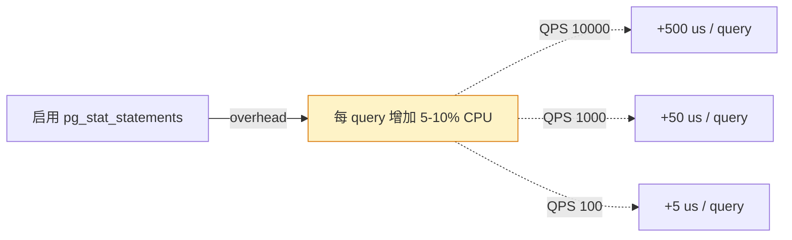
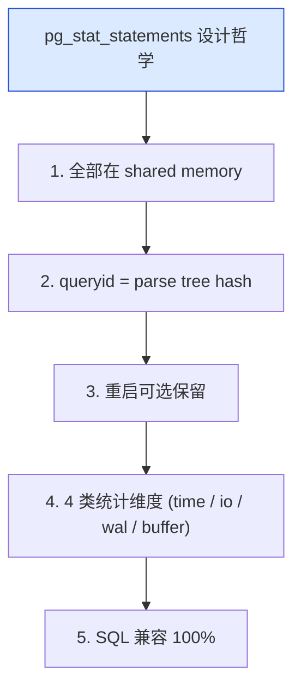

# pg_stat_statements 深度解析：从 query hash 到 pg_stat_* 生态的查询统计扩展

| 编写人 | 编写内容 | 编写时间 |
| --- | --- | --- |
| growdu | 初稿，把 pg_stat_statements 从 8.0 contrib 模块，到 query hash / queryid 算法、pg_stat_statements / pg_stat_activity / pg_stat_user_tables 三大观测源，到 Performance Insights / pganalyze / pgwatch2 集成。 | 2026-09-29 |

> 本文是「PostgreSQL 扩展系列」观测篇。同系列前文：[PostgreSQL 核心特性全景](./postgresql-core-features/index.html)

`pg_stat_statements` 是 PG 8.0 (2005) 进入 contrib 的官方统计扩展，**到现在仍是 99% PG 监控工具的"数据源"**。它是 PG 自己的"slow query log + 性能数据采集"。

本文回答 4 个问题：

1. **queryid 怎么算出来的**？同一个 SQL 不同字面值怎么归一？
2. **pg_stat_statements / pg_stat_activity / pg_stat_user_tables 三大数据源各自统计什么**？
3. **怎么集成到 Prometheus / Grafana / DataDog**？
4. **Performance Schema / wait event 体系**怎么配合？

**全文 7 大章节，15+ 张图，50+ 个 SQL 示例。**

---

## 一、pg_stat_statements 在 PG 观测生态

### 1.1 PG 观测数据源全景

```mermaid
mindmap
  root((PG 观测数据源))
  pg_stat_statements
    query 文本 + 性能
    pg_stat_activity
    pg_stat_user_tables
  pg_stat_activity
    当前会话
    锁 / wait event
  pg_stat_user_tables
    表级 seq/idx scan
    tuple 读写
  pg_stat_user_indexes
    索引使用
  pg_stat_database
    DB 级 commits / rollbacks
  pg_statio
    IO 统计
  pg_stat_replication
    复制延迟
  pg_stat_progress_*
    进度 (VACUUM / CREATE INDEX)
```

### 1.2 pg_stat_statements 能力

```mermaid
mindmap
  root((pg_stat_statements))
  SQL 归一
    queryid (hash)
    去除字面值
  性能统计
    total_exec_time
    mean_exec_time
    calls
    rows / 1000 calls
  缓存统计
    shared_blks_hit
    shared_blks_read
    temp blocks
  I/O 统计
    blk_read_time
    blk_write_time
  WAL 统计
    wal_records
    wal_fpi
    wal_bytes
```

---

## 二、pg_stat_statements 历史

### 2.1 关键节点



---

## 三、Query Hash 算法：queryid 怎么算

### 3.1 queryid 是 hash of "结构化 SQL"

```sql
-- 这两条 SQL 的 queryid 完全相同
SELECT * FROM users WHERE id = 42;
SELECT * FROM users WHERE id = 100;
-- queryid = hash(parse_tree_with_constants_replaced)
```

### 3.2 归一化规则



源码 `src/backend/utils/adt/pgstatfuncs.c`：

```c
/* 计算 queryid 的入口 */
static void
JumbleQuery(JumbleState *jstate, Query *query)
{
    /* 1. 把所有 Const 节点替换为 JUMBLE_PLACEHOLDER */
    /* 2. 把所有 Param 节点按 ref 替换 */
    /* 3. 把所有 Var 节点按 varno + varattno 替换 */
    /* 4. 递归序列化所有节点 */
    /* 5. hash */
}
```

### 3.3 queryid 长度

PG 17+ 是 8 字节 uint64，约 1.8 × 10^19 个唯一值。

---

## 四、pg_stat_statements 配置

### 4.1 启用

```sql
-- postgresql.conf
shared_preload_libraries = 'pg_stat_statements'

-- pg_stat_statements.max (默认 5000)
-- pg_stat_statements.track = top        -- 仅 top-level
-- pg_stat_statements.track = all        -- 包含嵌套
-- pg_stat_statements.track_utility = on -- DDL 也追踪
-- pg_stat_statements.save = on          -- 重启保留
```

### 4.2 查 SQL 性能 Top 10

```sql
SELECT
    substring(query, 1, 100) AS short_query,
    calls,
    round((total_exec_time / 1000.0)::numeric, 2) AS total_sec,
    round((mean_exec_time)::numeric, 2) AS mean_ms,
    rows
FROM pg_stat_statements
ORDER BY total_exec_time DESC
LIMIT 10;
```

### 4.3 查最耗 IO 的 SQL

```sql
SELECT
    substring(query, 1, 100) AS short_query,
    calls,
    shared_blks_hit,
    shared_blks_read,
    round((100.0 * shared_blks_hit /
        (CASE WHEN shared_blks_hit + shared_blks_read = 0
              THEN 1
              ELSE shared_blks_hit + shared_blks_read END))::numeric, 2)
        AS hit_percent
FROM pg_stat_statements
WHERE shared_blks_read > 0
ORDER BY shared_blks_read DESC
LIMIT 10;
```

---

## 五、pg_stat_* 大家族

### 5.1 pg_stat_activity（当前会话）

```sql
SELECT
    pid,
    usename,
    application_name,
    client_addr,
    state,
    wait_event_type,
    wait_event,
    query_start,
    substring(query, 1, 80)
FROM pg_stat_activity
WHERE state != 'idle'
ORDER BY query_start;
```

### 5.2 pg_stat_user_tables（表级）

```sql
SELECT
    schemaname || '.' || relname AS table_name,
    seq_scan,
    seq_tup_read,
    idx_scan,
    idx_tup_fetch,
    n_tup_ins,
    n_tup_upd,
    n_tup_del
FROM pg_stat_user_tables
ORDER BY seq_scan DESC
LIMIT 10;
```

### 5.3 pg_stat_user_indexes（索引使用）

```sql
SELECT
    schemaname || '.' || relname AS table_name,
    indexrelname,
    idx_scan,
    idx_tup_read,
    idx_tup_fetch
FROM pg_stat_user_indexes
WHERE idx_scan = 0
ORDER BY pg_relation_size(indexrelid) DESC;
-- 找出未使用的索引（潜在 drop 候选）
```

### 5.4 pg_stat_database（DB 级）

```sql
SELECT
    datname,
    xact_commit,
    xact_rollback,
    blks_read,
    blks_hit,
    tup_returned,
    tup_fetched,
    tup_inserted,
    tup_updated,
    tup_deleted
FROM pg_stat_database
WHERE datname NOT IN ('template0', 'template1', 'postgres');
```

### 5.5 pg_stat_progress_vacuum（VACUUM 进度）

```sql
SELECT
    pid,
    datname,
    relid::regclass,
    phase,
    heap_blks_total,
    heap_blks_scanned,
    heap_blks_vacuumed,
    round(100.0 * heap_blks_scanned / heap_blks_total, 2) AS pct
FROM pg_stat_progress_vacuum;
```

---

## 六、Wait Event 分析

### 6.1 wait_event 分类

```mermaid
mindmap
  root((wait_event 体系))
  Activity
    AutoVacuumMain
    BgWriterHibernate
  BufferPin
    BufferPin
  Client
    ClientRead
    ClientWrite
  Extension
    Extension
  IO
    DataFileRead
    DataFileWrite
    WALWrite
  IPC
    MessageQueueReceive
  Lock
    relation
    transactionid
    tuple
    virtualxid
  LWLock
    buffer_content
    lock_manager
  Timeout
    PgSleep
```

### 6.2 查锁等待

```sql
SELECT
    blocked.pid AS blocked_pid,
    blocked.usename AS blocked_user,
    blocking.pid AS blocking_pid,
    blocking.usename AS blocking_user,
    blocked.query AS blocked_query,
    blocking.query AS blocking_query
FROM pg_stat_activity blocked
JOIN pg_locks bl ON bl.pid = blocked.pid
JOIN pg_locks kl ON kl.locktype = bl.locktype
    AND kl.database IS NOT DISTINCT FROM bl.database
    AND kl.relation IS NOT DISTINCT FROM bl.relation
    AND kl.page IS NOT DISTINCT FROM bl.page
    AND kl.tuple IS NOT DISTINCT FROM bl.tuple
    AND kl.transactionid IS NOT DISTINCT FROM bl.transactionid
    AND kl.pid != bl.pid
    AND kl.granted
JOIN pg_stat_activity blocking ON blocking.pid = kl.pid
WHERE NOT bl.granted;
```

---

## 七、pg_stat_statements 工具集成

### 7.1 Prometheus 集成

```yaml
# prometheus.yml
- job_name: 'pg_stat'
  static_configs:
    - targets: ['localhost:9187']  # postgres_exporter
```

`postgres_exporter` 暴露的 metrics：

| metric | 含义 |
|---|---|
| `pg_stat_activity_count` | 当前会话数 |
| `pg_stat_database_tup_fetched` | tup 读取 |
| `pg_stat_statements_calls_total` | query 调用数 |
| `pg_stat_statements_total_exec_time_seconds_total` | 总执行时间 |
| `pg_stat_user_tables_seq_scan_total` | 顺序扫描数 |

### 7.2 Grafana Dashboard

PG 官方提供 dashboard：
- PostgreSQL Database (Dashboard 9628)
- PostgreSQL Query Stats (Dashboard 4555)

### 7.3 商用 APM

| 工具 | 集成 |
|---|---|
| **pganalyze** | 直接读 pg_stat_statements + EXPLAIN |
| **pgwatch2** | pg_stat_* 全量采集 |
| **DataDog** | postgres_exporter |
| **New Relic** | pg_stat_statements + 自定义 |
| **pganalyze + Performance Insights** | AWS RDS 集成 |

---

## 八、pg_stat_statements 性能优化

### 8.1 8 条优化建议



### 8.2 性能开销



---

## 九、pg_stat_statements vs MySQL performance_schema

### 9.1 对比

| 维度 | pg_stat_statements | MySQL performance_schema |
|---|---|---|
| 数据源 | shared hash | 内存表 |
| 存储 | shmem | PERFORMANCE_SCHEMA |
| 默认 size | 5000 | 自动 |
| 启用方式 | shared_preload | 全局开关 |
| 性能开销 | 5-10% | 5-10% |
| SQL 归一 | queryid hash | digest hash |

---

## 十、pg_stat_statements 设计哲学



---

## 十一、源码引用索引

- `src/backend/utils/adt/pgstatfuncs.c` — queryid 计算
- `contrib/pg_stat_statements/pg_stat_statements.c` — 主入口
- `contrib/pg_stat_statements/entry_gather.c` — 数据采集
- `src/backend/catalog/system_views.sql` — pg_stat_* 视图

## 同系列前文

- [PostgreSQL 核心特性全景](./postgresql-core-features/index.html)
- [PostgreSQL 前世今生：39 年演化史](./postgresql-history/index.html)
