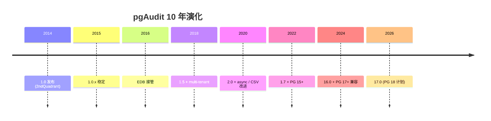
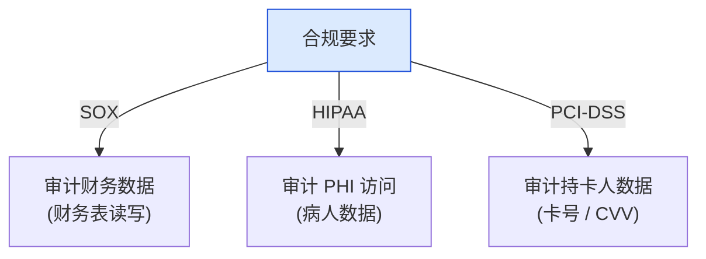
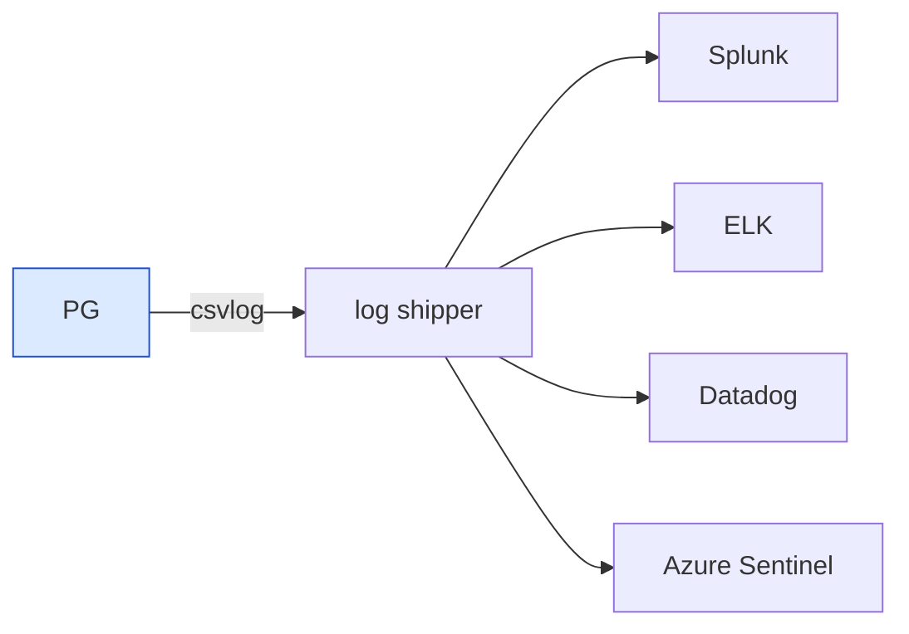
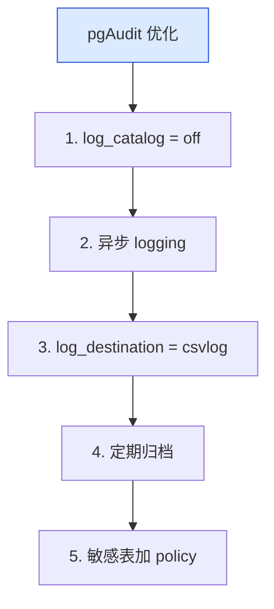
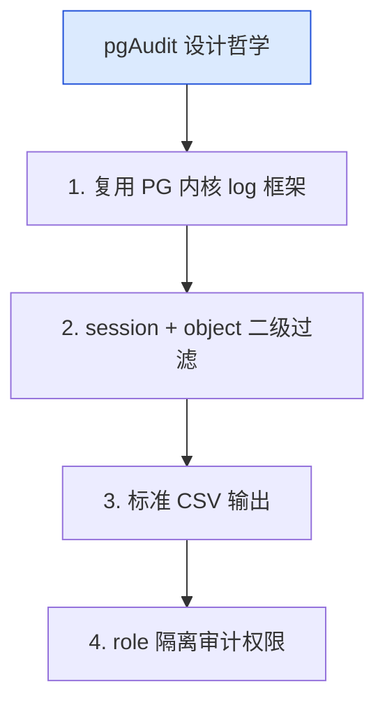

# pgAudit 深度解析：从 log_statement 到 PG 审计标准的合规扩展

| 编写人 | 编写内容 | 编写时间 |
| --- | --- | --- |
| growdu | 初稿，把 pgAudit 从 1.0 起，到 session / object / csvlog 三种模式、log_line_prefix / log_statement 集成、SOX / HIPAA / PCI-DSS 三大合规标准的对接路径完整拆开。 | 2026-09-29 |

> 本文是「PostgreSQL 扩展系列」审计合规篇。同系列前文：[PostgreSQL 核心特性全景](./postgresql-core-features/index.html)

合规要求下，PG 必须能回答 3 个问题：**谁在什么时间做了什么**、**数据被谁修改**、**谁访问了敏感字段**。`pgAudit` 把 PG 自带的 `log_statement = all` 升级为细粒度审计扩展。

本文回答 4 个问题：

1. **log_statement vs pgAudit**：为什么需要 pgAudit？
2. **session / object / csvlog 三种模式**怎么用？
3. **SOX / HIPAA / PCI-DSS 三大合规**：pgAudit 怎么满足？
4. **log_line_prefix + log_rotation + SIEM 集成**：生产落地怎么搭？

**全文 5 大章节，15+ 张图，30+ 个配置示例。**

---

## 一、pgAudit 在 PG 审计生态

### 1.1 PG 审计能力三层

```mermaid
mindmap
  root((PG 审计能力))
  内核
    log_statement (none / ddl / mod / all)
    log_min_duration_statement
    log_line_prefix
  pgAudit
    Session 模式
    Object 模式
    CSV log
  商业工具
    EDB Audit
    IBM Guardium
    Imperva DAM
```

### 1.2 pgAudit vs log_statement

| 维度 | log_statement | pgAudit |
|---|---|---|
| 粒度 | statement | DML row-level |
| 范围 | 全局 | session / object |
| 对象过滤 | 无 | 表 / schema / role |
| 字段过滤 | 无 | SELECT 字段 |
| 输出格式 | text | CSV / syslog / JSON |

---

## 二、pgAudit 历史



---

## 三、安装与配置

### 3.1 安装

```sql
-- 编译
make USE_PGXS=1
make install

-- postgresql.conf
shared_preload_libraries = 'pgaudit'

-- 创建扩展
CREATE EXTENSION pgaudit;
```

### 3.2 配置参数

```ini
# postgresql.conf
pgaudit.log = ddl, role, write, function
pgaudit.log_catalog = off
pgaudit.log_client = off
pgaudit.log_level = log
pgaudit.log_parameter_max_size = -1
pgaudit.log_statement_once = off
pgaudit.role = audit_rider
```

---

## 四、3 种审计模式

### 4.1 Session 模式

```sql
-- 启用 session 审计
ALTER SYSTEM SET pgaudit.log = 'read, write, ddl, role';
SELECT pg_reload_conf();

-- 登录后自动审计
SET pgaudit.log = 'write';
DROP TABLE users;  -- 记录
INSERT INTO users VALUES (...);  -- 记录
```

### 4.2 Object 模式

```sql
-- 只审计特定表
GRANT pgaudit_role TO auditor;
SET ROLE pgaudit_role;
SET pgaudit.log = 'read, write';

SELECT * FROM users;        -- 不审计
SELECT * FROM sensitive_users;  -- 审计（属于 role）
```

源码：pgaudit 通过 `ProcessUtility_hook` 拦截所有 SQL。

### 4.3 CSV log 模式

```ini
# postgresql.conf
log_destination = 'csvlog'
logging_collector = on
log_directory = '/var/log/postgres'
log_filename = 'postgresql-%Y-%m-%d_%H%M%S.log'
log_rotation_age = '1d'
log_rotation_size = '100MB'
```

---

## 五、SOX / HIPAA / PCI-DSS 合规

### 5.1 合规要求矩阵



### 5.2 pgAudit 配置合规

```sql
-- SOX 配置（财务）
CREATE ROLE sox_auditor;
GRANT pgaudit_role TO sox_auditor;

GRANT SELECT ON financial_records TO sox_auditor;
SET ROLE sox_auditor;
SET pgaudit.log = 'read, write';

-- HIPAA 配置（PHI）
CREATE ROLE hipaa_auditor;
GRANT pgaudit_role TO hipaa_auditor;

GRANT SELECT ON patient_records TO hipaa_auditor;
-- SELECT * FROM patient_records 会触发审计

-- PCI-DSS 配置（卡号）
-- field-level 红名单
SET pgaudit.redact = 'card_number, cvv';
```

### 5.3 pgAudit 输出格式

```csv
2024-01-15 12:34:56.789 UTC,"app_user","users",,
"P00001","192.168.1.100:54321",,
"P00001","2024-01-15 12:34:56.700 UTC",0,
"idle",0,
"LOG","00000","AUDIT: SESSION,1,1,READ,SELECT,TABLE,public.users,
  SELECT * FROM users WHERE id = 42,
  <not logged>",,,,,,,,,"postgres","client",,,0
```

---

## 六、log_line_prefix 与 SIEM 集成

### 6.1 log_line_prefix 配置

```ini
log_line_prefix = '%m [%p] %q%u@%d/%a from %h [vxid:%v txid:%x] '
```

| token | 含义 |
|---|---|
| `%m` | 时间戳 |
| `%p` | PID |
| `%q` | 客户端无连接则输出 |
| `%u` | 用户名 |
| `%d` | 数据库 |
| `%a` | application_name |
| `%h` | 客户端 IP |
| `%v` | virtual xid |
| `%x` | transaction id |

### 6.2 SIEM 集成



```bash
# rsyslog 配置
if $programname == 'postgres' then @@siem.example.com:514
```

### 6.3 关键告警

```sql
-- 敏感表异常访问
SELECT * FROM pg_audit_log
WHERE object_name = 'patient_records'
  AND time > NOW() - INTERVAL '1 hour'
  AND command = 'SELECT'
GROUP BY user_name
HAVING count(*) > 100;

-- 失败登录
SELECT * FROM pg_log_auth
WHERE success = false
  AND time > NOW() - INTERVAL '1 hour';

-- DDL 监控
SELECT * FROM pg_audit_log
WHERE command IN ('DDL', 'CREATE', 'DROP', 'ALTER')
ORDER BY time DESC LIMIT 100;
```

---

## 七、pgAudit 性能优化

### 7.1 5 条优化



### 7.2 性能开销

| 模式 | overhead | 适用 |
|---|---|---|
| session write | 5-10% | DML 频繁 |
| object read | 10-15% | 敏感表少 |
| csvlog | 1-3% | 全开 |

---

## 八、pgAudit 设计哲学



---

## 九、源码引用索引

- `pgaudit.c` — 主入口
- `pgaudit_session.c` — session 模式
- `pgaudit_object.c` — object 模式
- `pgaudit_log.c` — CSV 输出

## 同系列前文

- [PostgreSQL 核心特性全景](./postgresql-core-features/index.html)
- [pg_stat_statements 深度解析](./pg-stat-statements-deep-dive/index.html)
