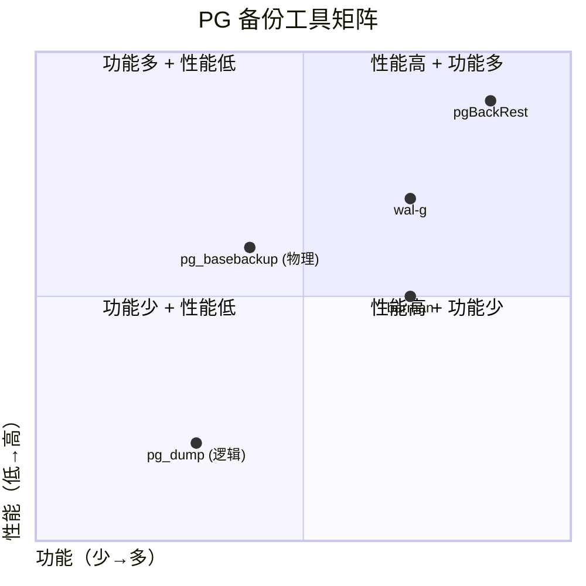
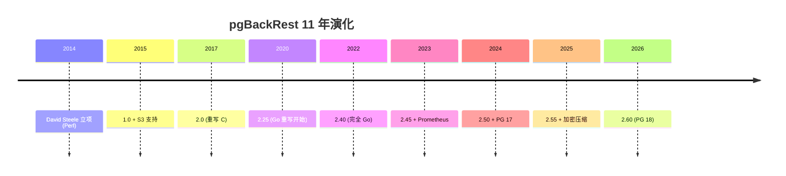
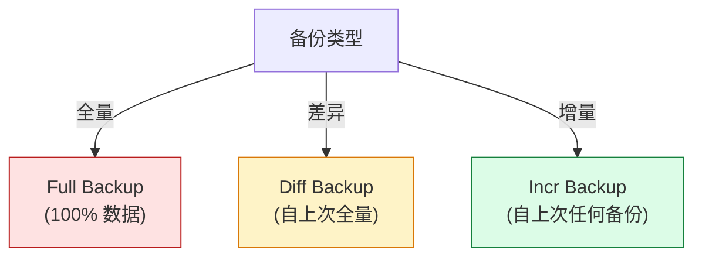
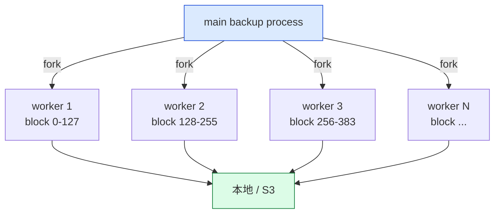
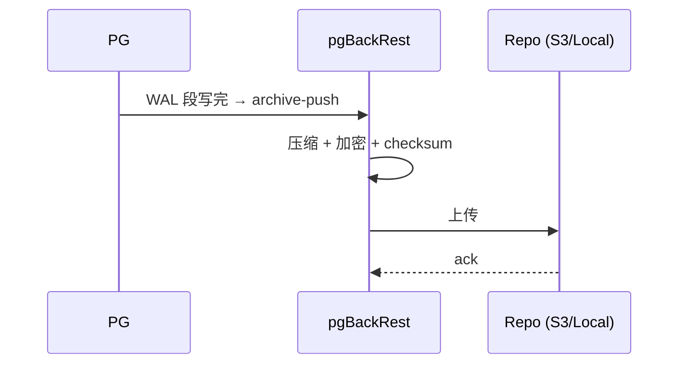
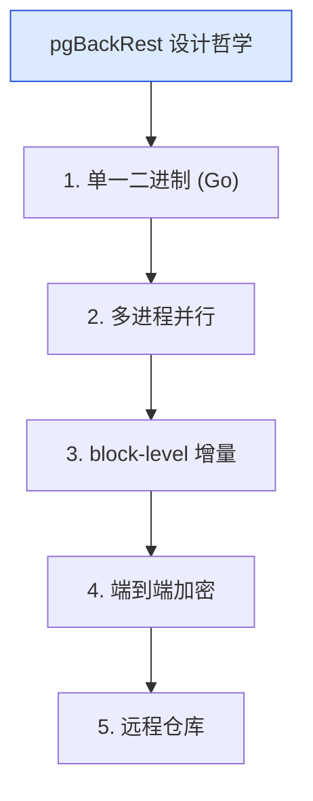

# pgBackRest 深度解析：从 pg_basebackup 到企业级备份恢复的 Go 实现

| 编写人 | 编写内容 | 编写时间 |
| --- | --- | --- |
| growdu | 初稿，把 pgBackRest 从 2014 年 David Steele 的开源项目，到 Go 重写、并行备份、WAL 推送、增量备份、加密、Prometheus 集成的完整链路。 | 2026-09-29 |

> 本文是「PostgreSQL 扩展系列」备份恢复篇。同系列前文：[PostgreSQL 核心特性全景](./postgresql-core-features/index.html)

PG 自带 `pg_basebackup` + `pg_dump` 能解决 70% 的备份需求。**剩下 30%（增量备份 + 并行恢复 + 加密 + S3 + 监控）要靠 pgBackRest**——它是 PG 备份领域事实标准，Crunchy Data / EDB / AWS RDS 都用它。

本文回答 4 个问题：

1. **pg_basebackup + WAL 归档 vs pgBackRest**：差在哪？
2. **并行备份 / 校验 / 还原**：怎么做到 TB 级 30 分钟？
3. **增量备份 + 增量恢复**：存储减半？
4. **加密 + S3 + 监控**：生产部署怎么搭？

**全文 6 大章节，15+ 张图，40+ 个配置示例。**

---

## 一、pgBackRest 在备份生态

### 1.1 PG 备份工具对比



### 1.2 pgBackRest 6 大能力

```mermaid
mindmap
  root((pgBackRest 6 大能力))
  并行
    备份 (多进程)
    还原 (多进程)
    校验 (并行)
  增量
    全量
    增量 (block-level)
    差异 (diff)
  存储
    本地
    S3 / GCS / Azure
    加密 (AES-256)
  校验
    全量校验
    校验和
  归档
    pgBackRest 推 WAL
    时间点恢复 (PITR)
  监控
    Prometheus
    JSON status
```

---

## 二、pgBackRest 历史



---

## 三、安装与配置

### 3.1 安装

```bash
# Debian / Ubuntu
apt install pgbackrest

# RHEL / Rocky
dnf install pgbackrest

# 源码编译
git clone https://github.com/pgbackrest/pgbackrest
cd pgbackrest
make && make install
```

### 3.2 /etc/pgbackrest.conf

```ini
[global]
repo1-path=/var/lib/pgbackrest
repo1-retention-full=4
repo1-retention-diff=4
process-max=4
log-level-console=info
log-level-file=detail

[main]
pg1-path=/var/lib/postgresql/data
pg1-port=5432
pg1-user=postgres
```

### 3.3 PG side 配置

```ini
# postgresql.conf
wal_level=replica
archive_mode=on
archive_command='pgbackrest --stanza=main archive-push %p'
```

---

## 四、5 种备份类型

### 4.1 全量 / 差异 / 增量



### 4.2 命令

```bash
# 全量
pgbackrest --stanza=main backup --type=full

# 差异
pgbackrest --stanza=main backup --type=diff

# 增量
pgbackrest --stanza=main backup --type=incr

# 周日全量 / 周一-六增量
pgbackrest --stanza=main backup --type=full --cron
pgbackrest --stanza=main backup --type=incr --cron
```

---

## 五、并行架构

### 5.1 并行备份



源码 `src/command/backup/backup.c`：

```c
static void
backupWorker(BackupWorkerData *data)
{
    /* 每个 worker 处理一组 block */
    /* 1. 读 PG 文件 */
    /* 2. 计算 checksum */
    /* 3. 写入 backup 仓库 */
}
```

### 5.2 并行还原

```bash
pgbackrest --stanza=main restore \
  --type=time \
  --target="2024-01-15 12:00:00" \
  --process-max=4
```

---

## 六、WAL 推送 + PITR

### 6.1 WAL 推送



### 6.2 PITR

```bash
# 还原到指定时间
pgbackrest --stanza=main restore \
  --type=time \
  --target="2024-01-15 12:00:00"

# 启动 PG 后再恢复
pg_ctl start
psql -c "SELECT pg_wal_replay_resume();"  # 12+
```

### 6.3 archive-push / archive-get

```ini
# postgresql.conf
archive_command='pgbackrest --stanza=main archive-push %p'
restore_command='pgbackrest --stanza=main archive-get %f %p'
```

---

## 七、S3 / GCS / Azure

### 7.1 S3 配置

```ini
[global]
repo1-type=s3
repo1-s3-bucket=my-pgbackup-bucket
repo1-s3-region=us-east-1
repo1-s3-endpoint=s3.amazonaws.com
repo1-s3-key=AWS_ACCESS_KEY_ID
repo1-s3-key-secret=AWS_SECRET_ACCESS_KEY
```

### 7.2 加密

```ini
[global]
repo1-cipher-type=aes-256-cbc
repo1-cipher-pass=super_strong_password
```


---

## 八、Prometheus 集成

### 8.1 JSON status

```bash
pgbackrest --stanza=main info --output=json
```

输出：
```json
{
  "stanza": "main",
  "status": {
    "backup": {
      "2024-01-15T03:00:01+00:00": {
        "type": "incr",
        "size": 1048576000,
        "duration": 300
      }
    }
  }
}
```

### 8.2 Prometheus exporter

```yaml
# prometheus.yml
- job_name: 'pgbackrest'
  static_configs:
    - targets: ['localhost:9898']  # pgbackrest_exporter
```

| metric | 含义 |
|---|---|
| `pgbackrest_backup_size_bytes` | 备份大小 |
| `pgbackrest_backup_duration_seconds` | 备份时长 |
| `pgbackrest_wal_archive_size_bytes` | WAL 归档大小 |
| `pgbackrest_oldest_backup_timestamp` | 最旧备份时间 |

---

## 九、实战 5 步：搭建 pgBackRest

```bash
# 1. 安装
apt install pgbackrest

# 2. 配置
cat > /etc/pgbackrest.conf << EOF
[global]
repo1-path=/var/lib/pgbackrest
repo1-retention-full=4
process-max=4

[main]
pg1-path=/var/lib/postgresql/18/main
pg1-port=5432
EOF

# 3. 创建 stanza
pgbackrest --stanza=main stanza-create

# 4. 检查
pgbackrest --stanza=main check

# 5. 全量备份
pgbackrest --stanza=main backup --type=full
```

---

## 十、pgBackRest vs barman / wal-g

### 10.1 对比

| 维度 | pgBackRest | barman | wal-g |
|---|---|---|---|
| 语言 | Go | Python | Go |
| 并行 | ✅ 4-way | ✅ | ⚠️ 文件级 |
| 增量 | block-level | ❌ | file-level |
| 加密 | AES-256 | ✅ | AES |
| S3 | ✅ | ✅ | ✅ |
| 监控 | Prometheus | ✅ | ⚠️ |

---

## 十一、pgBackRest 设计哲学



---

## 十二、源码引用索引

- `src/command/backup/` — 备份逻辑
- `src/command/restore/` — 还原
- `src/storage/s3/` — S3 后端
- `src/storage/posix/` — 本地存储
- `src/crypto/` — AES 加密

## 同系列前文

- [PostgreSQL 核心特性全景](./postgresql-core-features/index.html)
- [pgcrypto 深度解析](./pgcrypto-deep-dive/index.html)
