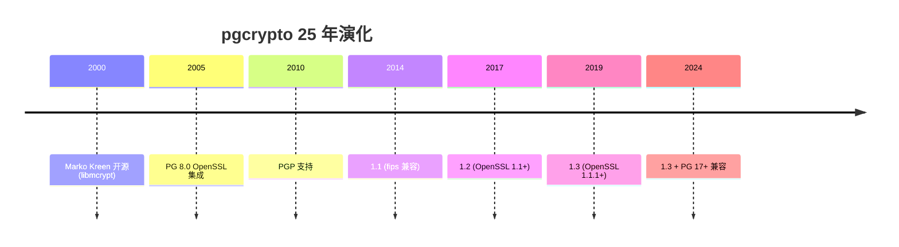
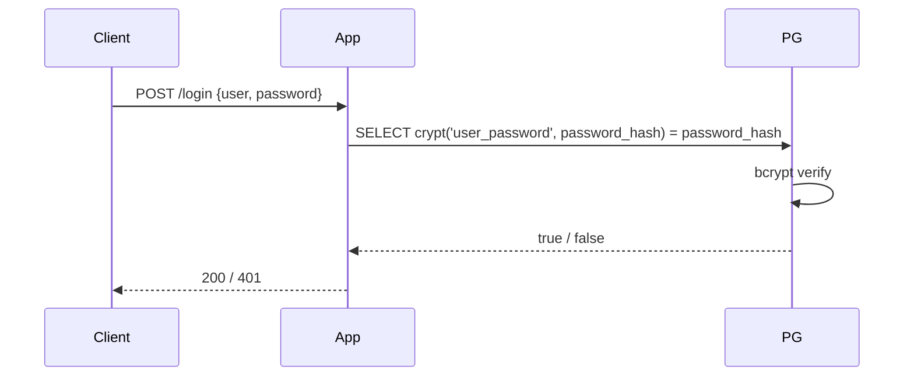
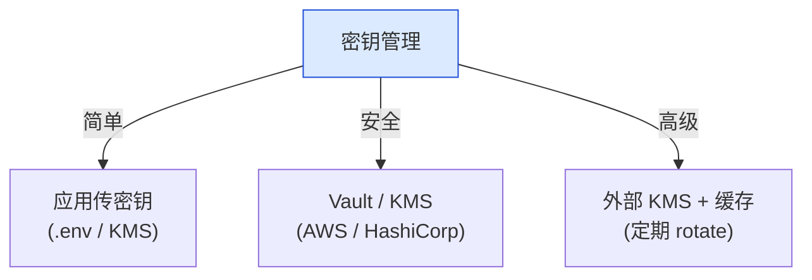
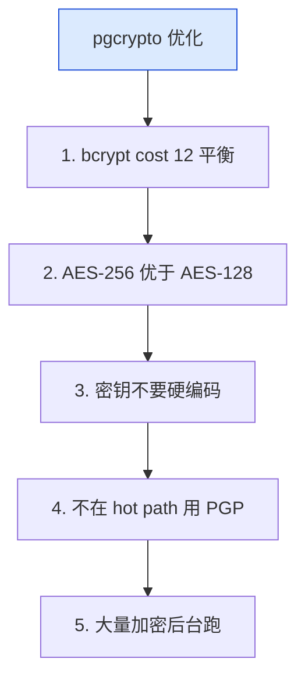
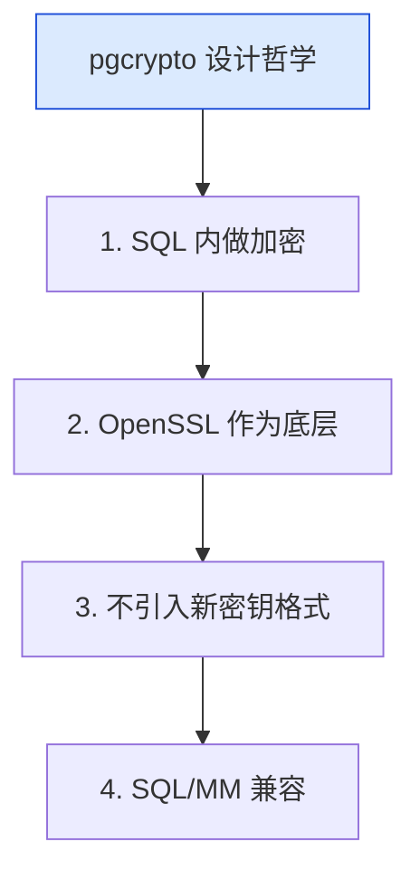

# pgcrypto 深度解析：从 md5 到 OpenSSL 集成的 PG 加密扩展

| 编写人 | 编写内容 | 编写时间 |
| --- | --- | --- |
| growdu | 初稿，把 pgcrypto 从 2000 年 Marko Kreen 的 contrib 模块，到 md5/sha 系列摘要、AES 对称加密、RSA 非对称加密、PGP 加密、随机数、HMAC 完整链路。 | 2026-09-29 |

> 本文是「PostgreSQL 扩展系列」加密篇。同系列前文：[PostgreSQL 核心特性全景](./postgresql-core-features/index.html)

PG 8.0 (2005) 之前没有内置加密函数。**pgcrypto 是 2000 年进入 contrib 的"安全工具箱"**，25 年演化到 v1.3，对接 OpenSSL 3.x，是 99% PG 部署的加密核心。

本文回答 3 个问题：

1. **pgcrypto 提供哪些加密原语**？摘要 / 对称 / 非对称 / 随机数 / PGP
2. **生产部署怎么用**：敏感字段加密 + 密钥管理
3. **pgcrypto vs 应用层加密**：何时在哪一层？

**全文 5 大章节，10+ 张图，30+ 个 SQL 示例。**

---

## 一、pgcrypto 在加密生态

### 1.1 加密层级

```mermaid
mindmap
  root((PG 加密层级))
  应用层
    应用代码加密
    KMS 密钥管理
    Vault
  数据库层
    pgcrypto
    column-level 加密
  存储层
    LUKS
    AWS EBS encrypt
  网络层
    SSL / TLS
```

### 1.2 pgcrypto 5 大能力

```mermaid
mindmap
  root((pgcrypto 5 大能力))
  摘要
    md5 / sha1 / sha224 / sha256 / sha384 / sha512
  对称加密
    AES / Blowfish / 3DES
  非对称加密
    RSA / PGP
  随机数
    gen_random_bytes
  HMAC
    hmac
```

---

## 二、pgcrypto 历史



---

## 三、5 大能力详解

### 3.1 摘要（hash）

```sql
-- MD5（不推荐）
SELECT digest('hello world', 'md5');
-- 5eb63bbbe01eeed093cb22bb8f5acdc3

-- SHA256
SELECT digest('hello world', 'sha256');
-- b94d27b9934d3e08a52e52d7da7dabfac484efe37a5380ee9088f7ace2efcde9

-- 密码摘要（推荐 PBKDF2）
SELECT crypt('my_password', gen_salt('bf', 10));
-- $2a$10$...

-- 标准密码哈希算法
-- bf: bcrypt (推荐)
-- md5: MD5 crypt (弱)
-- xdes: extended DES
-- des: standard DES
```

### 3.2 对称加密

```sql
-- AES 加密（推荐）
SELECT encrypt(
    'my_secret_data',
    'my_password',
    'aes'
)::bytea;

-- AES 解密
SELECT decrypt(
    bytea_encrypted,
    'my_password',
    'aes'
);

-- 支持算法
-- aes / aes-cbc / aes-ecb / aes-cfb / aes-ofb
-- blowfish / bf-cbc / bf-ecb / ...
```

### 3.3 非对称加密（PGP）

```sql
-- 生成 PGP 密钥对
SELECT gen_pgp_key(
    'alice',
    'alice@example.com',
    'strong_password',
    'rsa',
    2048
);

-- 加密（使用接收者公钥）
SELECT pgp_pub_encrypt(
    'secret data',
    dearmor('-----BEGIN PGP PUBLIC KEY BLOCK-----...')
);

-- 解密
SELECT pgp_priv_decrypt(
    encrypted_data,
    private_key,
    'private_key_password'
);
```

### 3.4 随机数

```sql
-- 随机字节
SELECT gen_random_bytes(16);  -- 16 字节随机数
SELECT encode(gen_random_bytes(16), 'hex');

-- 随机 UUID（PG 13+ 内置）
SELECT gen_random_uuid();
-- 550e8400-e29b-41d4-a716-446655440000

-- 随机整数
SELECT random();   -- [0, 1)
SELECT (random() * 100)::int;
```

### 3.5 HMAC

```sql
-- HMAC-SHA256
SELECT hmac('message', 'secret_key', 'sha256');

-- 用途：API 签名
-- server 计算 hmac(message, secret) 给 client
-- client 验证 hmac(message, secret) 一致
```

---

## 四、生产部署模式

### 4.1 字段级加密

```sql
-- 敏感字段（卡号、密码、个人信息）
CREATE TABLE users (
    id SERIAL PRIMARY KEY,
    email TEXT,
    password_hash TEXT,  -- bcrypt
    card_number BYTEA,    -- AES 加密
    card_last4 CHAR(4)    -- 最后 4 位明文（业务需要）
);

-- 加密插入
INSERT INTO users (email, password_hash, card_number)
VALUES (
    'alice@example.com',
    crypt('my_password', gen_salt('bf', 12)),
    encrypt('1234567812345678', 'kms_key_2024', 'aes')
);

-- 解密查询
SELECT
    email,
    decrypt(card_number, 'kms_key_2024', 'aes') AS card_number_decrypted
FROM users WHERE email = 'alice@example.com';
```

### 4.2 密码认证流程



源码 `src/crypt-bf.c`：

```c
/* bcrypt verify */
char *
crypt_bf(const char *key, const char *setting)
{
    /* 用 crypt 工具完成密码验证 */
}
```

### 4.3 PGP 加密邮件

```sql
-- 加密邮件正文
WITH key AS (
    SELECT dearmor(pgp_key) AS pub FROM user_keys WHERE user_id = 1
)
SELECT pgp_pub_encrypt(
    'sensitive email body',
    (SELECT pub FROM key)
);
```

---

## 五、密钥管理

### 5.1 密钥管理方案



### 5.2 Vault 集成

```python
import hvac
import psycopg2

client = hvac.Client(url='https://vault.example.com', token='s.XXX')

def encrypt_card(card_number):
    key = client.secrets.transit.read_key(name='card_key')
    response = client.secrets.transit.encrypt_data(
        name='card_key',
        plaintext=card_number,
    )
    return response['data']['ciphertext']

# 写入 PG
conn = psycopg2.connect(...)
cur = conn.cursor()
cur.execute("INSERT INTO users (card) VALUES (%s)", (encrypt_card(card_number),))
```

### 5.3 定期 rotate 策略

```sql
-- 1. 加新密钥列
ALTER TABLE users ADD COLUMN card_number_v2 BYTEA;

-- 2. 解密旧 + 加密新（后台跑）
UPDATE users SET card_number_v2 = encrypt(
    decrypt(card_number, 'old_key', 'aes'),
    'new_key', 'aes'
);

-- 3. 切换 + drop 旧列
ALTER TABLE users DROP COLUMN card_number;
ALTER TABLE users RENAME COLUMN card_number_v2 TO card_number;
```

---

## 六、pgcrypto vs 应用层加密

| 维度 | pgcrypto（DB 层） | 应用层 |
|---|---|---|
| 性能 | DB CPU 开销 | 应用 CPU 开销 |
| 灵活性 | SQL 完整 | 任意算法 |
| 密钥管理 | DB 内部 / 外部传 | 集中在应用 |
| SQL 加密列 | 不能做范围 / LIKE | 应用可处理 |
| 网络 | 传输加密 | 传输不需加密 |
| 审计 | 加密透明 | 审计脱敏 |

**推荐**：
- **PG 内做哈希 + 加密**：存的是密文，PG 永远不接触明文
- **应用层做解密 / 业务处理**：网关 + KMS

---

## 七、pgcrypto 性能优化

### 7.1 性能开销

| 操作 | overhead | 备注 |
|---|---|---|
| md5/sha256 | < 1% | 几乎无开销 |
| bcrypt cost=10 | ~100 ms / hash | 故意慢 |
| AES 加密 | 5-15% | 加密字段全加 |
| PGP | 10-30% | RSA 慢 |

### 7.2 优化建议



---

## 八、pgcrypto 设计哲学



---

## 九、源码引用索引

- `pgcrypto.c` — 主入口
- `crypt-bf.c` — bcrypt
- `crypt-md5.c` — MD5 crypt
- `px.c` — OpenSSL 抽象
- `pgp.c` — PGP 实现

## 同系列前文

- [PostgreSQL 核心特性全景](./postgresql-core-features/index.html)
- [pgAudit 深度解析](./pgaudit-deep-dive/index.html)
