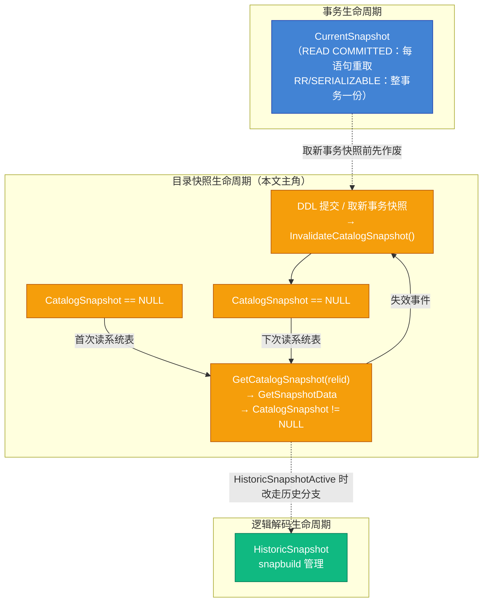
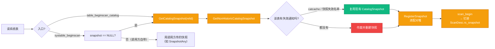
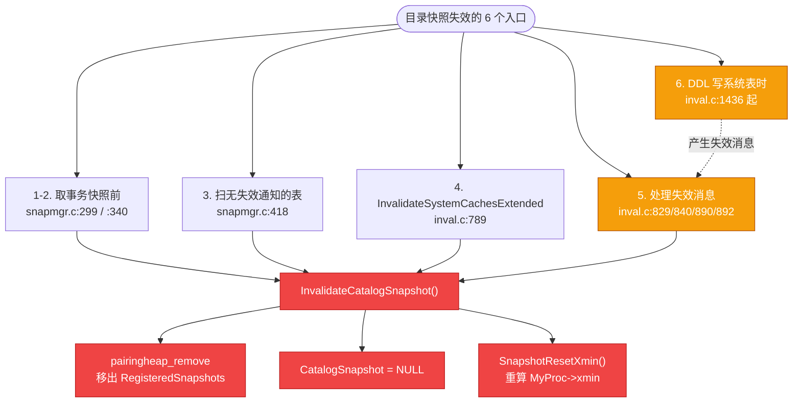
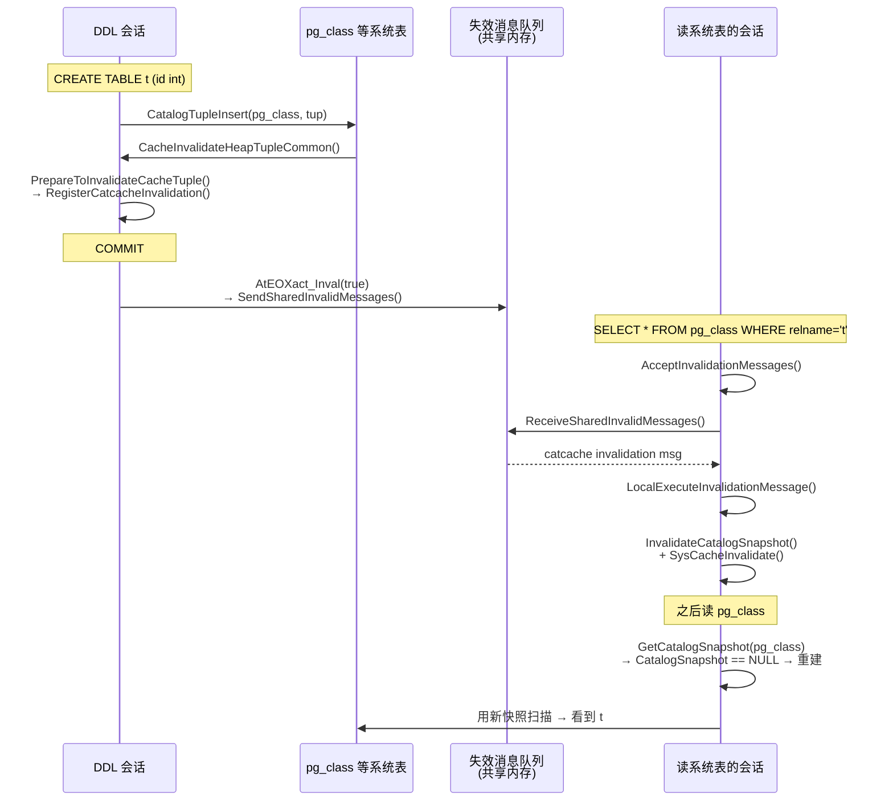
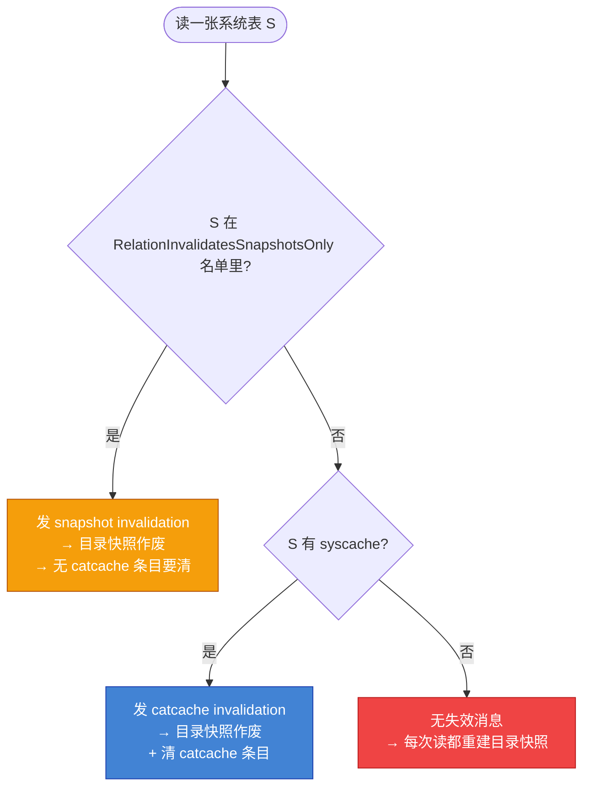
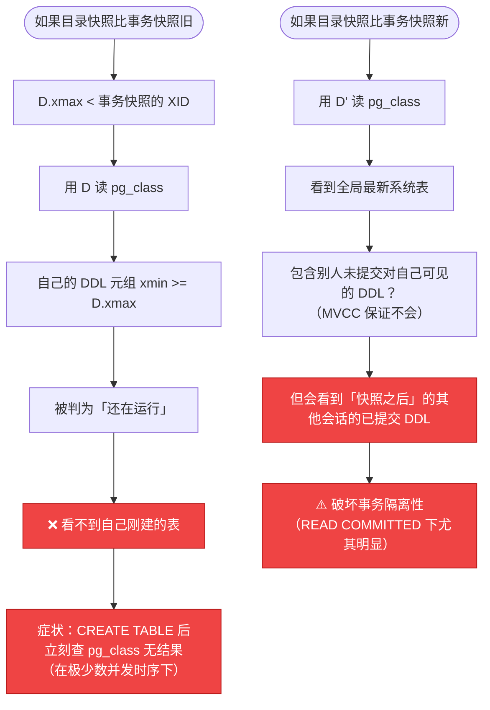
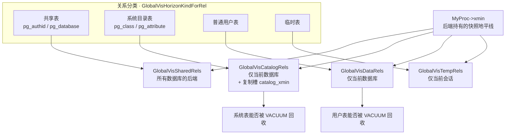
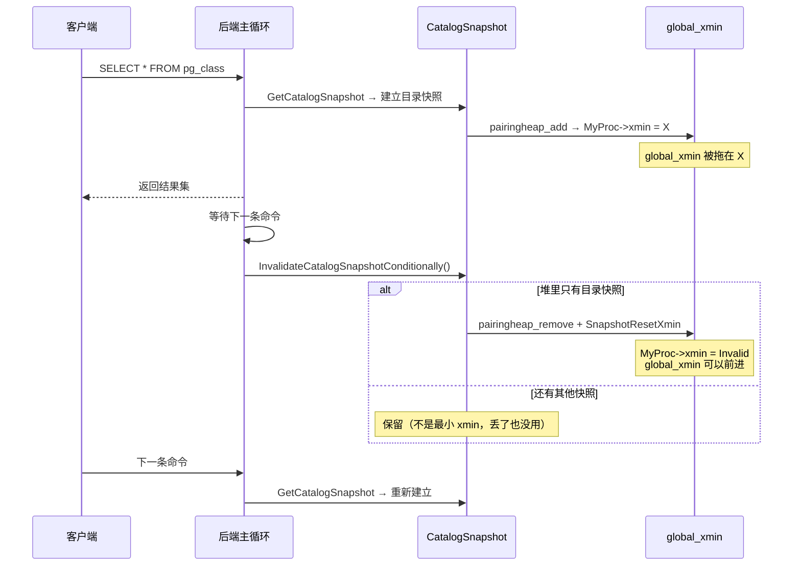
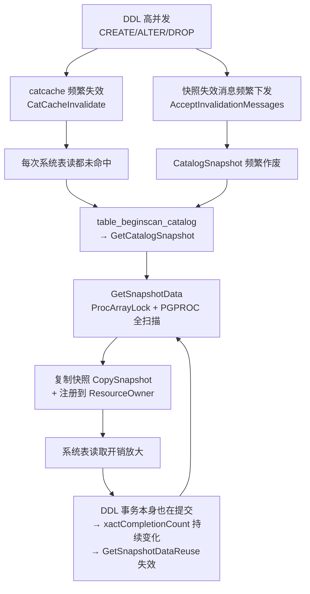

# PostgreSQL 目录快照源码级深度拆解：系统表读取的 MVCC 真相与失效机制

| 编写人 | 编写内容 | 编写时间 |
| --- | --- | --- |
| growdu | 初稿。从 PostgreSQL 18 dev（`~/cwork/postgresql`）源码出发，把 **PostgreSQL 目录快照（Catalog Snapshot）** **彻底拆解**：为什么系统表读不能用事务快照 / PostgreSQL 的四类快照（CurrentSnapshot / SecondarySnapshot / CatalogSnapshot / HistoricSnapshot）各自的定位 / `GetCatalogSnapshot` 的三条分支与 `RelationInvalidatesSnapshotsOnly` 的 7 张特殊表 / **目录快照的全部 14 个失效点逐个溯源** / DDL → invalidation message → 目录快照作废的完整链路 / catcache invalidation 与 snapshot invalidation 两条路径的分流 / **「目录快照永不旧于事务快照」这条硬约束** / 目录快照 `curcid` 不跟随 `CommandCounterIncrement` 的例外 / 目录快照如何拖住全局 xmin 推进 / **PG 18 的四套可见性地平线（共享 / 目录 / 数据 / 临时）** / 空闲期主动丢弃快照的机制 / 与逻辑复制 `HistoricSnapshot` 的交互 / DDL 高并发下的缓存抖动性能分析 / 12 个坑点速查。每个主题都给源码 + 关键字段 + mermaid 流程图。配套源码版本：PostgreSQL 18 dev。 | 2026-10-27 |

> 本文是「PostgreSQL 内核机制源码系列」。同系列前文：
>
> - [PostgreSQL 读一行数据源码级深度拆解：MVCC 在每个环节的落点](../postgresql-read-a-row-deep-dive/index.html) — 10 个阶段的 MVCC 落点全景
> - [PostgreSQL MVCC：从一行 UPDATE 到 5 个 HeapTuple 的演化](../postgresql-mvcc/index.html)
> - [PostgreSQL 读取系统表源码级深度拆解](../postgresql-read-catalog-table/index.html) — 9 步读取 catalog 表的完整流程
> - [PostgreSQL RUNNING_XACTS 与快照构建](../postgresql-running-xacts-snapshot/index.html)
> - [PostgreSQL 行锁机制源码级深度拆解](../postgresql-row-lock-deep-dive/index.html)

## 阅读指南

- **第一节 ~ 第三节**（**必读**）：问题引入 / 四类快照的分工 / 目录快照的诞生
- **第四节 ~ 第七节**（**核心**）：目录快照的全部 14 个失效点 / DDL → 失效消息 → 快照作废的完整链路 / 两条失效路径的分流 / 7 张特殊表
- **第八节 ~ 第十二节**（**源码精读**）：「目录快照永不旧于事务快照」硬约束 / `curcid` 的例外 / xmin 视角 / **PG 18 四套可见性地平线** / 空闲期丢弃 / 逻辑复制分支
- **第十三节 ~ 第十六节**（**收尾**）：DDL 高并发性能分析 / 坑点速查 / 源码索引 / 核心心智模型

---

## 一、引子：为什么系统表读要单独一个快照？

### 1.1 一个反直觉的现象

先看一段看起来平平无奇、但每个 PG 内核开发者都踩过的代码：

```sql
BEGIN;
CREATE TABLE t (id int);
SELECT * FROM pg_class WHERE relname = 't';   -- 能查到吗？
COMMIT;
```

**能查到**。新建的表确实出现在 `pg_class` 里。

但如果整个系统只有一份快照，这件事就没这么简单了。假设 PostgreSQL 只有**事务快照**这一个概念：

```text
BEGIN;                        -- 取事务快照 T0
                              --   T0.xmax = 500，此时 XID 501 还没分配
CREATE TABLE t (id int);     -- 分配 XID 501，往 pg_class 插一行
                              --   这行 xmin=501
SELECT * FROM pg_class ...;   -- 用 T0 读
                              --   T0.xmax=500 → XID 501 >= xmax → 视为"还在运行"
                              --   → 不可见！
                              --   → 查不到刚建的表 ❌
```

**这就是问题所在**：事务快照是"事务开始那一刻的世界"，而系统表读必须能看到**本事务自己刚做的 DDL**。

### 1.2 三种可能的解法

| 方案 | 做法 | 问题 |
| --- | --- | --- |
| A. 系统表读不走 MVCC | 读系统表时用 `SnapshotAny`，来者不拒 | 会读到**别人未提交**的 DDL，产生脏读 |
| B. 系统表读用事务快照 | 直接复用 `CurrentSnapshot` | 看不到自己刚做的 DDL（上面已证明） |
| C. **单独一份目录快照** | 系统表有自己的快照，由 DDL 事件驱动失效 | 需要一套失效机制 —— 这就是本文的主题 |

PostgreSQL 选的是 **C**。

### 1.3 目录快照的三个关键性质

```text
性质 1  它是一个标准的 MVCC 快照
        底层就是 GetSnapshotData()，有 xmin/xmax/xip
        → 绝不会读到别人未提交的数据（没有脏读）

性质 2  它的生命周期由「系统表变更事件」驱动
        任何 DDL 提交 → 发 invalidation message → 目录快照作废
        → 下次读系统表时重建

性质 3  它永远不旧于事务快照
        取新事务快照之前，必须先作废目录快照
        → 保证能看到本事务自己的 DDL
```

性质 1 保证**正确性**，性质 2 保证**新鲜度**，性质 3 保证**自洽性**。

> 本文要回答的核心问题：**这套失效机制到底是怎么实现的？它有哪些坑？**

---

## 二、全景：PostgreSQL 的四类快照

### 2.1 源码里的四张面孔

```c
/* src/backend/utils/time/snapmgr.c:139 */
static SnapshotData CurrentSnapshotData = {SNAPSHOT_MVCC};
static SnapshotData SecondarySnapshotData = {SNAPSHOT_MVCC};
static SnapshotData CatalogSnapshotData = {SNAPSHOT_MVCC};
SnapshotData SnapshotSelfData = {SNAPSHOT_SELF};
SnapshotData SnapshotAnyData = {SNAPSHOT_ANY};
SnapshotData SnapshotToastData = {SNAPSHOT_TOAST};

/* Pointers to valid snapshots */
static Snapshot CurrentSnapshot = NULL;
static Snapshot SecondarySnapshot = NULL;
static Snapshot CatalogSnapshot = NULL;
static Snapshot HistoricSnapshot = NULL;
```

**四类"活"的快照**（后面三个 `SnapshotSelf/Any/Toast` 是静态的特化快照，不参与这套生命周期管理）：

| 快照 | 定位 | 谁在用 | 何时失效 |
| --- | --- | --- | --- |
| `CurrentSnapshot` | 事务的主快照 | 执行器、用户表扫描 | 语句边界（READ COMMITTED）/ 事务结束（RR） |
| `SecondarySnapshot` | 始终是"当下"最新 | RI 触发器检查等特殊场景 | 每次重新取 |
| **`CatalogSnapshot`** | **给系统表扫描用** | `systable_beginscan`、`table_beginscan_catalog` | **DDL 事件 / 取新事务快照前** |
| `HistoricSnapshot` | 逻辑解码的历史视角 | 逻辑复制 | 由 snapbuild 管理 |

源码里的原话：

```c
/*
 * CurrentSnapshot points to the only snapshot taken in transaction-snapshot
 * mode, and to the latest one taken in a read-committed transaction.
 * SecondarySnapshot is a snapshot that's always up-to-date as of the current
 * instant, even in transaction-snapshot mode.  It should only be used for
 * special-purpose code (say, RI checking.)  CatalogSnapshot points to an
 * MVCC snapshot intended to be used for catalog scans; we must invalidate it
 * whenever a system catalog change occurs.
 */
```

> **注意 `CatalogSnapshot` 的注释措辞**：*"we must invalidate it whenever a system catalog change occurs"* —— 这是设计意图的第一次明确表述。

### 2.2 四类快照的生命周期图



### 2.3 三类快照的注册方式

快照有三套引用计数体系，**互不相通**：

```c
/* src/backend/utils/time/snapmgr.c:76 */
 *
 * Registered snapshots
 * --------------------
 *
 * In addition to snapshots pushed to the active snapshot stack, a snapshot
 * can be registered with a resource owner.
 *
 * The FirstXactSnapshot, if any, is treated a bit specially: we increment its
 * regd_count and list it in RegisteredSnapshots, but this reference is not
 * tracked by a resource owner.
 *
 * Likewise, any snapshots that have been exported by pg_export_snapshot
 * have regd_count = 1 and are listed in RegisteredSnapshots, but are not
 * tracked by any resource owner.
 *
 * Likewise, the CatalogSnapshot is listed in RegisteredSnapshots when it
 * is valid, but is not tracked by any resource owner.
 */
```

| 机制 | 计数 | 载体 | 谁在用 |
| --- | --- | --- | --- |
| 活动快照栈 | `active_count` | `ActiveSnapshot` 链表 | `PushActiveSnapshot` 压栈的 |
| 已注册快照 | `regd_count` | `RegisteredSnapshots` 配对堆 | `RegisterSnapshot` 注册的 |
| 资源属主 | `ResourceOwnerRememberCatCacheRef` | ResourceOwner | catcache 命中的元组 |

**目录快照走的是「已注册快照」这条路** —— 它进配对堆，但不挂资源属主。这意味着：

1. 它的 `xmin` 会参与 `MyProc->xmin` 的计算 → **会拖住全局可见性推进**（第十节详述）。
2. 它的释放是**手工**的 —— `InvalidateCatalogSnapshot` 里显式 `pairingheap_remove`。

```c
/* src/backend/utils/time/snapmgr.c:454 */
void
InvalidateCatalogSnapshot(void)
{
	if (CatalogSnapshot)
	{
		pairingheap_remove(&RegisteredSnapshots, &CatalogSnapshot->ph_node);
		CatalogSnapshot = NULL;
		SnapshotResetXmin();
	}
}
```

---

## 三、目录快照的诞生：GetCatalogSnapshot 的三条分支

### 3.1 入口函数

```c
/* src/backend/utils/time/snapmgr.c:384 */
Snapshot
GetCatalogSnapshot(Oid relid)
{
	/*
	 * Return historic snapshot while we're doing logical decoding, so we can
	 * see the appropriate state of the catalog.
	 *
	 * This is the primary reason for needing to reset the system caches after
	 * finishing decoding.
	 */
	if (HistoricSnapshotActive())
		return HistoricSnapshot;

	return GetNonHistoricCatalogSnapshot(relid);
}
```

**分支一：逻辑解码中** → 返回 `HistoricSnapshot`，完全不碰 `CatalogSnapshot`。

**分支二：正常路径** → `GetNonHistoricCatalogSnapshot(relid)`。

### 3.2 正常路径的核心逻辑

```c
/* src/backend/utils/time/snapmgr.c:406 */
Snapshot
GetNonHistoricCatalogSnapshot(Oid relid)
{
	/*
	 * If the caller is trying to scan a relation that has no syscache, no
	 * catcache invalidations will be sent when it is updated.  For a few key
	 * relations, snapshot invalidations are sent instead.  If we're trying to
	 * scan a relation for which neither catcache nor snapshot invalidations
	 * are sent, we must refresh the snapshot every time.
	 */
	if (CatalogSnapshot &&
		!RelationInvalidatesSnapshotsOnly(relid) &&
		!RelationHasSysCache(relid))
		InvalidateCatalogSnapshot();

	if (CatalogSnapshot == NULL)
	{
		/* Get new snapshot. */
		CatalogSnapshot = GetSnapshotData(&CatalogSnapshotData);

		/*
		 * Make sure the catalog snapshot will be accounted for in decisions
		 * about advancing PGPROC->xmin.  We could apply RegisterSnapshot, but
		 * that would result in making a physical copy, which is overkill; and
		 * it would also create a dependency on some resource owner, which we
		 * do not want for reasons explained at the head of this file. Instead
		 * just shove the CatalogSnapshot into the pairing heap manually. This
		 * has to be reversed in InvalidateCatalogSnapshot, of course.
		 *
		 * NB: it had better be impossible for this to throw error, since the
		 * CatalogSnapshot pointer is already valid.
		 */
		pairingheap_add(&RegisteredSnapshots, &CatalogSnapshot->ph_node);
	}

	return CatalogSnapshot;
}
```

**分支三：按表类型分流**。这里有一个精妙的设计：

```text
读一张系统表时：
  ├─ 该表有 syscache？         → catcache invalidation 会连带作废目录快照 → 可以复用
  ├─ 该表在「只发快照失效」的名单里？ → 快照失效消息会作废目录快照 → 可以复用
  └─ 两者都不是？               → 没有任何失效消息会通知我们 → 必须每次重建快照
```

第三种情况是"安全兜底"：既然没人会通知我们变了，那就每次读都重新取快照，保证正确性。

> **代价**：对于既无 syscache 又不在特殊名单里的系统表（比如 `pg_policy` / `pg_trigger` 这类），每次扫描都要重新 `GetSnapshotData` —— 一次 `ProcArrayLock` 共享锁 + 一次 `PGPROC` 数组扫描。这不是免费的。

### 3.3 目录快照的构造：和事务快照同一个函数

```c
		CatalogSnapshot = GetSnapshotData(&CatalogSnapshotData);
```

**和 `GetTransactionSnapshot` 用的是同一个 `GetSnapshotData`**。所以目录快照有完整的 xmin / xmax / xip，是标准 MVCC 快照。

两者的差异不在"怎么构造"，而在**"什么时候作废"**：

| 维度 | 事务快照 | 目录快照 |
| --- | --- | --- |
| 构造入口 | `GetTransactionSnapshot` | `GetCatalogSnapshot` |
| 底层构造 | `GetSnapshotData` | `GetSnapshotData`（同一个） |
| 快照类型 | `SNAPSHOT_MVCC` | `SNAPSHOT_MVCC` |
| 存储位置 | `CurrentSnapshotData`（静态） | `CatalogSnapshotData`（静态） |
| 注册方式 | `CopySnapshot` + 配对堆（RR 时） | 直接 `pairingheap_add` |
| 作废触发 | 语句边界 / 事务结束 | **DDL 失效事件** / 取新事务快照前 |
| `curcid` 更新 | 跟随 `CommandCounterIncrement` | **不跟随**（见第九节） |

### 3.4 谁在调用 GetCatalogSnapshot

```text
systable_beginscan(heapRelation, indexId, indexOK, snapshot=NULL, ...)
    └─ snapshot == NULL → RegisterSnapshot(GetCatalogSnapshot(relid))

table_beginscan_catalog(relation, nkeys, key)
    └─ RegisterSnapshot(GetCatalogSnapshot(relid))
```

```c
/* src/backend/access/table/tableam.c:113 */
TableScanDesc
table_beginscan_catalog(Relation relation, int nkeys, struct ScanKeyData *key)
{
	uint32		flags = SO_TYPE_SEQSCAN |
		SO_ALLOW_STRAT | SO_ALLOW_SYNC | SO_ALLOW_PAGEMODE | SO_TEMP_SNAPSHOT;
	Oid			relid = RelationGetRelid(relation);
	Snapshot	snapshot = RegisterSnapshot(GetCatalogSnapshot(relid));

	return relation->rd_tableam->scan_begin(relation, snapshot, nkeys, key,
											NULL, flags);
}
```

注意 `SO_TEMP_SNAPSHOT` 标志 —— 扫描结束时自动 `UnregisterSnapshot`，不需要调用方手动管理引用计数。

### 3.5 两条读取路径的快照来源对比



---

## 四、目录快照的失效：全部调用点逐个溯源

### 4.1 失效点总览

`InvalidateCatalogSnapshot()` 在 PG 18 源码里一共有 **14 处调用点**，分布在 7 个文件。另有 1 处 `InvalidateCatalogSnapshotConditionally()`（空闲期丢弃，第十一节详述）。

**按触发频率排序**：

| # | 文件:行号 | 场景 | 频率 |
| --- | --- | --- | :---: |
| 1 | `src/backend/utils/cache/inval.c:829/840/890/892` | **处理失效消息时** | **每条消息** |
| 2 | `src/backend/utils/time/snapmgr.c:340` | 取事务快照前（READ COMMITTED 后续语句） | 每语句 |
| 3 | `src/backend/utils/time/snapmgr.c:299` | 取事务快照前（`FirstSnapshotSet` 分支） | 每事务 |
| 4 | `src/backend/tcop/postgres.c:4551` | 空闲期主动丢弃（`Conditionally` 变体） | 每空闲周期 |
| 5 | `src/backend/utils/time/snapmgr.c:418` | 扫描"无失效通知"的表 | 罕见 |
| 6 | `src/backend/utils/cache/inval.c:1478` 附近 | DDL 写系统表时（`RegisterSnapshotInvalidation`） | 每 DDL |
| 7 | `src/backend/utils/cache/inval.c:789` | `InvalidateSystemCachesExtended` | 调试 |
| 8 | `src/backend/utils/time/snapmgr.c:1067` | 事务结束清理（`AtEOXact_Snapshot`） | 每事务 |
| 9 | `src/backend/utils/time/snapmgr.c:516` | 导入外部快照前（`SetTransactionSnapshot`） | 罕见 |
| 10 | `src/backend/utils/time/snapmgr.c:480` | `InvalidateCatalogSnapshotConditionally` 内部 | — |
| 11 | `src/backend/utils/init/postinit.c:1138` | 启动阶段（`MyDatabaseId` 未就绪） | 每后端启动 |
| 12 | `src/backend/access/heap/heapam.c:6489` | 原地更新 xwait 失败 | 罕见 |
| 13 | `src/backend/commands/copyfrom.c:896` | `COPY FREEZE` 前置检查 | 罕见 |
| 14 | `src/backend/replication/logical/snapbuild.c:452` / `tablesync.c:194` | 逻辑复制：建槽 / 表同步轮询 | 罕见 |

下面逐个溯源**主线上的 6 个**（#1、#2、#3、#4、#5、#6），其余在第十一节和第十二节逐一展开。

### 4.2 失效点 1-2：取事务快照前必须先作废

```c
/* src/backend/utils/time/snapmgr.c:296 */
	/* First call in transaction? */
	if (!FirstSnapshotSet)
	{
		/*
		 * Don't allow catalog snapshot to be older than xact snapshot.  Must
		 * do this first to allow the empty-heap Assert to succeed.
		 */
		InvalidateCatalogSnapshot();

		Assert(pairingheap_is_empty(&RegisteredSnapshots));
		Assert(FirstXactSnapshot == NULL);
		...
	}
```

```c
/* src/backend/utils/time/snapmgr.c:336 */
	if (IsolationUsesXactSnapshot())
		return CurrentSnapshot;

	/* Don't allow catalog snapshot to be older than xact snapshot. */
	InvalidateCatalogSnapshot();
```

**这两处是「目录快照永不旧于事务快照」这条硬约束的落地。**

先看注释里的一个细节：`"Must do this first to allow the empty-heap Assert to succeed."` —— 因为紧接着就有：

```c
		Assert(pairingheap_is_empty(&RegisteredSnapshots));
```

如果不先作废目录快照，`RegisteredSnapshots` 里还挂着它，这个 Assert 就会失败。**顺序不能反。**

**为什么必须"永不旧于"？** 回到第 1.1 节的那个场景：

```text
BEGIN;                          -- 事务快照 T0
CREATE TABLE t (id int);       -- XID 501，插入 pg_class
SELECT * FROM pg_class ...;     -- 用目录快照读
```

如果目录快照 D 比事务快照 T0 旧（D.xmax < 501），那么 D 会认为 XID 501 还在运行 → 看不到刚建的表。

作废目录快照后，下次读系统表会重建快照 D'，此时 D'.xmax 已经 ≥ 502，XID 501 已被识别 → 能看到。✅

### 4.3 失效点 3：无失效通知的表

```c
/* src/backend/utils/time/snapmgr.c:415 */
	if (CatalogSnapshot &&
		!RelationInvalidatesSnapshotsOnly(relid) &&
		!RelationHasSysCache(relid))
		InvalidateCatalogSnapshot();
```

这张表的任何变更都不会产生能作废目录快照的消息 → 只能靠"每次读都重建"来保证正确性。

**哪些表会命中这个分支？** 既不在 `RelationInvalidatesSnapshotsOnly` 名单里，又没有 syscache 的系统表。例如：

- `pg_attrdef`
- `pg_inherits`
- `pg_init_privs`
- `pg_largeobject` / `pg_largeobject_metadata`
- `pg_policy`
- `pg_trigger`

> 这份名单是从 `src/include/catalog/pg_*.h` 里的 `MAKE_SYSCACHE` 宏逐个统计出来的 —— **凡是声明了 `MAKE_SYSCACHE` 的 catalog 都有 syscache**，没声明的才可能落进上面这个分支。

**性能影响**：每次 `systable_beginscan` 扫这些表都要重建一次快照 = 一次 `ProcArrayLock` 共享锁 + 一次 `PGPROC` 扫描。

### 4.4 失效点 4：InvalidateSystemCachesExtended

```c
/* src/backend/utils/cache/inval.c:785 */
void
InvalidateSystemCachesExtended(bool debug_discard)
{
	int			i;

	InvalidateCatalogSnapshot();
	ResetCatalogCachesExt(debug_discard);
	RelationCacheInvalidate(debug_discard); /* gets smgr and relmap too */

	for (i = 0; i < syscache_callback_count; i++)
	{
		struct SYSCACHECALLBACK *ccitem = syscache_callback_list + i;

		ccitem->function(ccitem->arg, ccitem->id, 0);
	}
	...
}
```

这是"把所有缓存全清空"的粗暴接口。主要用于：

- 调试（`debug_discard_caches`）
- `DISCARD ALL`
- 某些恢复场景

### 4.5 失效点 5：处理失效消息时（最热的一条）

这是**最核心**的失效路径 —— 每收到一条与当前数据库相关的失效消息，就作废目录快照：

```c
/* src/backend/utils/cache/inval.c:823 */
void
LocalExecuteInvalidationMessage(SharedInvalidationMessage *msg)
{
	if (msg->id >= 0)
	{
		if (msg->cc.dbId == MyDatabaseId || msg->cc.dbId == InvalidOid)
		{
			InvalidateCatalogSnapshot();

			SysCacheInvalidate(msg->cc.id, msg->cc.hashValue);

			CallSyscacheCallbacks(msg->cc.id, msg->cc.hashValue);
		}
	}
	else if (msg->id == SHAREDINVALCATALOG_ID)
	{
		if (msg->cat.dbId == MyDatabaseId || msg->cat.dbId == InvalidOid)
		{
			InvalidateCatalogSnapshot();

			CatalogCacheFlushCatalog(msg->cat.catId);

			/* CatalogCacheFlushCatalog calls CallSyscacheCallbacks as needed */
		}
	}
	else if (msg->id == SHAREDINVALRELCACHE_ID)
	{
		if (msg->rc.dbId == MyDatabaseId || msg->rc.dbId == InvalidOid)
		{
			int			i;

			if (msg->rc.relId == InvalidOid)
				RelationCacheInvalidate(false);
			else
				RelationCacheInvalidateEntry(msg->rc.relId);
			...
		}
	}
	...
	else if (msg->id == SHAREDINVALSNAPSHOT_ID)
	{
		/* We only care about our own database and shared catalogs */
		if (msg->sn.dbId == InvalidOid)
			InvalidateCatalogSnapshot();
		else if (msg->sn.dbId == MyDatabaseId)
			InvalidateCatalogSnapshot();
	}
	...
}
```

**四种消息类型都会作废目录快照**：

| 消息类型 | 触发 | 同时清什么 |
| --- | --- | --- |
| `msg->id >= 0`（catcache） | 某个 syscache 条目失效 | `SysCacheInvalidate` + 回调 |
| `SHAREDINVALCATALOG_ID` | 整个 catalog 失效 | `CatalogCacheFlushCatalog` |
| `SHAREDINVALRELCACHE_ID` | relcache 条目失效 | `RelationCacheInvalidateEntry` |
| `SHAREDINVALSNAPSHOT_ID` | 快照失效（无 syscache 的表） | 只作废目录快照 |

> **关键设计**：目录快照的作废是"搭便车"的 —— 它不自己监听任何事件，而是**绑定在 catcache / relcache / snapshot 失效消息上**。这避免了为目录快照单独建一套消息通道。

### 4.6 失效点 6：DDL 写系统表时

```c
/* src/backend/utils/cache/inval.c:1436 */
CacheInvalidateHeapTupleCommon(Relation relation,
							   HeapTuple tuple,
							   HeapTuple newtuple,
							   InvalidationInfo *(*prepare_callback) (void))
{
	...
	/*
	 * We only need to worry about invalidation for tuples that are in system
	 * catalogs; user-relation tuples are never in catcaches and can't affect
	 * the relcache either.
	 */
	if (!IsCatalogRelation(relation))
		return;

	/*
	 * IsCatalogRelation() will return true for TOAST tables of system
	 * catalogs, but we don't care about those, either.
	 */
	if (IsToastRelation(relation))
		return;

	/* Allocate any required resources. */
	info = prepare_callback();

	/*
	 * First let the catcache do its thing
	 */
	tupleRelId = RelationGetRelid(relation);
	if (RelationInvalidatesSnapshotsOnly(tupleRelId))
	{
		databaseId = IsSharedRelation(tupleRelId) ? InvalidOid : MyDatabaseId;
		RegisterSnapshotInvalidation(info, databaseId, tupleRelId);
	}
	else
		PrepareToInvalidateCacheTuple(relation, tuple, newtuple,
									  RegisterCatcacheInvalidation,
									  (void *) info);
	...
}
```

**这是 DDL 的发起点**：任何对系统表元组的插入/更新/删除，最终都会走到 `CacheInvalidateHeapTuple` → `CacheInvalidateHeapTupleCommon`，在这里决定发哪种失效消息。

注意两个早退：

- `!IsCatalogRelation(relation)` → 用户表的元组改动**完全不产生**失效消息（用户表不在任何 catcache 里）。
- `IsToastRelation(relation)` → 系统表的 TOAST 表也不需要。

### 4.7 失效点全景图



---

## 五、DDL → 失效消息 → 目录快照作废：完整链路

### 5.1 写路径：DDL 改系统表

```c
/* src/backend/catalog/indexing.c:233 */
void
CatalogTupleInsert(Relation heapRel, HeapTuple tup)
{
	CatalogIndexState indstate;

	CatalogTupleCheckConstraints(heapRel, tup);

	indstate = CatalogOpenIndexes(heapRel);

	simple_heap_insert(heapRel, tup);

	CatalogIndexInsert(indstate, tup, TU_All);
	CatalogCloseIndexes(indstate);
}
```

所有系统表写入都走 `CatalogTupleInsert` / `CatalogTupleUpdate` / `CatalogTupleDelete`。`simple_heap_insert` 之后，系统表的元组通过 `CacheRegisterHeapTuple` 路径触发失效注册。

### 5.2 失效消息的注册：两种类型

```c
/* src/backend/utils/cache/catcache.c:2376 */
void
PrepareToInvalidateCacheTuple(Relation relation,
							  HeapTuple tuple,
							  HeapTuple newtuple,
							  void (*function) (int, uint32, Oid, void *),
							  void *context)
{
	slist_iter	iter;
	Oid			reloid;
	...
	reloid = RelationGetRelid(relation);

	/*
	 * for each cache
	 *   if the cache contains tuples from the specified relation
	 *     compute the tuple's hash value(s) in this cache,
	 *     and call the passed function to register the information.
	 */

	slist_foreach(iter, &CacheHdr->ch_caches)
	{
		CatCache   *ccp = slist_container(CatCache, cc_next, iter.cur);
		uint32		hashvalue;
		Oid			dbid;

		if (ccp->cc_reloid != reloid)
			continue;

		/* Just in case cache hasn't finished initialization yet... */
		ConditionalCatalogCacheInitializeCache(ccp);

		hashvalue = CatalogCacheComputeTupleHashValue(ccp, ccp->cc_nkeys, tuple);
		dbid = ccp->cc_relisshared ? (Oid) 0 : MyDatabaseId;

		(*function) (ccp->id, hashvalue, dbid, context);

		if (newtuple)
		{
			uint32		newhashvalue;

			newhashvalue = CatalogCacheComputeTupleHashValue(ccp, ccp->cc_nkeys, newtuple);

			if (newhashvalue != hashvalue)
				(*function) (ccp->id, newhashvalue, dbid, context);
		}
	}
}
```

**遍历所有 catcache，找出哪些缓存来自这张系统表，算出元组在这些缓存里的哈希值，注册失效消息。**

注意 `newtuple` 的处理：UPDATE 会同时注册旧哈希值和新哈希值两条消息 —— 因为旧缓存项按旧键值索引，新缓存项按新键值索引。

### 5.3 快照失效消息

```c
/* src/backend/utils/cache/inval.c:672 */
static void
RegisterSnapshotInvalidation(InvalidationInfo *info, Oid dbId, Oid relId)
{
	AddSnapshotInvalidationMessage(&info->CurrentCmdInvalidMsgs, dbId, relId);
}
```

### 5.4 提交时发送消息

```c
/* src/backend/utils/cache/inval.c:1199 */
void
AtEOXact_Inval(bool isCommit)
{
	inplaceInvalInfo = NULL;

	/* Quick exit if no transactional messages */
	if (transInvalInfo == NULL)
		return;

	/* Must be at top of stack */
	Assert(transInvalInfo->my_level == 1 && transInvalInfo->parent == NULL);

	INJECTION_POINT("transaction-end-process-inval", NULL);

	if (isCommit)
	{
		if (transInvalInfo->ii.RelcacheInitFileInval)
			RelationCacheInitFilePreInvalidate();

		AppendInvalidationMessages(&transInvalInfo->PriorCmdInvalidMsgs,
								   &transInvalInfo->ii.CurrentCmdInvalidMsgs);

		ProcessInvalidationMessagesMulti(&transInvalInfo->PriorCmdInvalidMsgs,
										 SendSharedInvalidMessages);

		if (transInvalInfo->ii.RelcacheInitFileInval)
			RelationCacheInitFilePostInvalidate();
	}
	else
	{
		ProcessInvalidationMessages(&transInvalInfo->PriorCmdInvalidMsgs,
									LocalExecuteInvalidationMessage);
	}

	/* Need not free anything explicitly */
	transInvalInfo = NULL;
}
```

**关键点**：

- **提交时**才把消息发给其他后端（`SendSharedInvalidMessages`）。
- **回滚时**只处理本地消息（`LocalExecuteInvalidationMessage`）—— 因为回滚了，别人根本没看见过这个 DDL，本地缓存也不需要清。

> 这就是 MVCC 与失效机制的分工：**可见性由 MVCC 快照决定，缓存新鲜度由失效消息决定**。事务回滚了，DDL 对别人不可见，但本地的 catcache 可能已经缓存了那个（未提交的）元组 —— 所以回滚路径也要清本地缓存。

### 5.5 接收端处理

```c
/* src/backend/utils/cache/inval.c:930 */
void
AcceptInvalidationMessages(void)
{
#ifdef USE_ASSERT_CHECKING
	/* message handlers shall access catalogs only during transactions */
	if (IsTransactionState())
		AssertCouldGetRelation();
#endif

	ReceiveSharedInvalidMessages(LocalExecuteInvalidationMessage,
								 InvalidateSystemCaches);
	...
}
```

`AcceptInvalidationMessages` 会在**每个命令的关键节点**被调用（每个命令开始、锁等待返回后、提交前等）。它读共享内存里的失效消息环形缓冲区，交给 `LocalExecuteInvalidationMessage` 逐条处理 —— 也就是第 4.5 节那张表。

### 5.6 完整链路图



**注意时序**：目录快照作废发生在**消息被处理时**，不是消息被发送时。所以在一个消息周期内，读到的可能还是旧快照 —— 但 MVCC 保证了不会读到脏数据。

### 5.7 catcache 的失效粒度：按哈希值

```c
/* src/backend/utils/cache/catcache.c:625 */
void
CatCacheInvalidate(CatCache *cache, uint32 hashValue)
{
	Index		hashIndex;
	dlist_mutable_iter iter;

	CACHE_elog(DEBUG2, "CatCacheInvalidate: called");

	/*
	 * Invalidate *all* CatCLists in this cache; it's too hard to tell which
	 * searches might still be correct, so just zap 'em all.
	 */
	for (int i = 0; i < cache->cc_nlbuckets; i++)
	{
		dlist_head *bucket = &cache->cc_lbucket[i];

		dlist_foreach_modify(iter, bucket)
		{
			CatCList   *cl = dlist_container(CatCList, cache_elem, iter.cur);

			if (cl->refcount > 0)
				cl->dead = true;
			else
				CatCacheRemoveCList(cache, cl);
		}
	}

	/*
	 * inspect the proper hash bucket for tuple matches
	 */
	hashIndex = HASH_INDEX(hashValue, cache->cc_nbuckets);
	dlist_foreach_modify(iter, &cache->cc_bucket[hashIndex])
	{
		CatCTup    *ct = dlist_container(CatCTup, cache_elem, iter.cur);

		if (hashValue == ct->hash_value)
		{
			if (ct->refcount > 0 ||
				(ct->c_list && ct->c_list->refcount > 0))
			{
				ct->dead = true;
				/* list, if any, was marked dead above */
				Assert(ct->c_list == NULL || ct->c_list->dead);
			}
			else
				CatCacheRemoveCTup(cache, ct);
			...
		}
	}

	/* Also invalidate any entries that are being built */
	for (CatCInProgress *e = catcache_in_progress_stack; e != NULL; e = e->next)
	{
		if (e->cache == cache)
		{
			if (e->list || e->hash_value == hashValue)
				e->dead = true;
		}
	}
}
```

注释里有一段很重要的历史说明：

```text
We used to try to match positive cache entries by TID, but that is
unsafe after a VACUUM FULL on a system catalog: an inval event could
be queued before VACUUM FULL, and then processed afterwards, when the
target tuple that has to be invalidated has a different TID than it
did when the event was created.  So now we just compare hash values and
accept the small risk of unnecessary invalidations due to false matches.
```

**"按哈希值失效"而非"按 TID 失效"** —— 代价是可能误伤（哈希碰撞），收益是免疫 VACUUM FULL。

还有一个容易忽略的点：**`refcount > 0` 的条目不会被真的删除，只是打上 `dead` 标记**。因为可能还有代码持有它的引用。

---

## 六、两条失效路径的分流：catcache vs snapshot

### 6.1 分流点

```c
/* src/backend/utils/cache/inval.c:1474 */
	tupleRelId = RelationGetRelid(relation);
	if (RelationInvalidatesSnapshotsOnly(tupleRelId))
	{
		databaseId = IsSharedRelation(tupleRelId) ? InvalidOid : MyDatabaseId;
		RegisterSnapshotInvalidation(info, databaseId, tupleRelId);
	}
	else
		PrepareToInvalidateCacheTuple(relation, tuple, newtuple,
									  RegisterCatcacheInvalidation,
									  (void *) info);
```

### 6.2 为什么需要两条路径

| | catcache invalidation | snapshot invalidation |
| --- | --- | --- |
| 消息类型 | `msg->id >= 0` | `SHAREDINVALSNAPSHOT_ID` |
| 携带信息 | cacheId + hashValue | dbId |
| 作用 | 清 catcache 条目 + **作废目录快照** | **只作废目录快照** |
| 适用表 | 有 syscache 的表 | 没有 syscache 但需要 MVCC 一致性的表 |
| 消息体大小 | 较大（带哈希值） | 很小 |

**关键**：两条路径**都会作废目录快照**。区别只在于 catcache 路径顺便清了缓存条目，而 snapshot 路径只作废快照。

### 6.3 那"两者都没有"的表怎么办？

```c
/* src/backend/utils/time/snapmgr.c:415 */
	if (CatalogSnapshot &&
		!RelationInvalidatesSnapshotsOnly(relid) &&
		!RelationHasSysCache(relid))
		InvalidateCatalogSnapshot();
```

**每次读都重建**。这是最保守也最安全的做法。

### 6.4 三类表 × 三种策略



---

## 七、7 张特殊表：RelationInvalidatesSnapshotsOnly

### 7.1 名单与理由

```c
/* src/backend/utils/cache/syscache.c:711 */
/*
 * Certain relations that do not have system caches send snapshot invalidation
 * messages in lieu of catcache messages.  This is for the benefit of
 * GetCatalogSnapshot(), which can then reuse its existing MVCC snapshot
 * for scanning one of those catalogs, rather than taking a new one, if no
 * invalidation has been received.
 *
 * Relations that have syscaches need not (and must not) be listed here.  The
 * catcache invalidation messages will also flush the snapshot.  If you add a
 * syscache for one of these relations, remove it from this list.
 */
bool
RelationInvalidatesSnapshotsOnly(Oid relid)
{
	switch (relid)
	{
		case DbRoleSettingRelationId:
		case DependRelationId:
		case SharedDependRelationId:
		case DescriptionRelationId:
		case SharedDescriptionRelationId:
		case SecLabelRelationId:
		case SharedSecLabelRelationId:
			return true;
		default:
			break;
	}

	return false;
}
```

### 7.2 七个表的中文对照

| OID 常量 | 表名 | 用途 |
| --- | --- | --- |
| `DbRoleSettingRelationId` | `pg_db_role_setting` | 数据库/角色级配置（`ALTER DATABASE ... SET`） |
| `DependRelationId` | `pg_depend` | 对象依赖关系 |
| `SharedDependRelationId` | `pg_shdepend` | 共享对象依赖 |
| `DescriptionRelationId` | `pg_description` | 对象注释（`COMMENT ON`） |
| `SharedDescriptionRelationId` | `pg_shdescription` | 共享对象注释 |
| `SecLabelRelationId` | `pg_seclabel` | 安全标签 |
| `SharedSecLabelRelationId` | `pg_shseclabel` | 共享安全标签 |

### 7.3 为什么偏偏是这 7 张表

看它们的共同特征：

```text
✓ 都不是「关系定义」类表（pg_class / pg_attribute / pg_type …）
✓ 变更频繁但影响面局部
✓ 都需要被 MVCC 正确读（不能脏读）
✓ 但没有必要为它们建 syscache（热点度低、查询模式简单）
✓ 需要跨数据库可见（pg_shdepend 等是共享表）
```

比如 `pg_description`（`COMMENT ON`）—— 注释变更是低频操作，但必须能被其他会话正确看到。给它建一个 catcache 值得吗？不值得。发一条 snapshot invalidation 就够了。

### 7.4 一个重要的维护约束

注释最后一句：

```text
If you add a syscache for one of these relations, remove it from this list.
```

**这是一个必须手工维护的耦合点**。如果有人给 `pg_description` 加了 syscache 却忘了从名单里移除，会发生什么？

```text
表在名单里 → 走 snapshot invalidation 路径
但它同时有 catcache → catcache 条目永远不会被失效！
→ catcache 里留着过期的注释内容 ❌
```

这是一个**很容易在扩展开发中踩到的坑**。扩展作者给某个系统表加 syscache 时，必须同步检查这个名单。

### 7.5 RelationHasSysCache：二分查找

```c
/* src/backend/utils/cache/syscache.c:741 */
/*
 * Test whether a relation has a system cache.
 */
bool
RelationHasSysCache(Oid relid)
{
	int			low = 0,
				high = SysCacheRelationOidSize - 1;

	while (low <= high)
	{
		int			middle = low + (high - low) / 2;

		if (SysCacheRelationOid[middle] == relid)
			return true;
		if (SysCacheRelationOid[middle] < relid)
			low = middle + 1;
		else
			high = middle - 1;
	}

	return false;
}
```

`SysCacheRelationOid` 是一个**排好序的 OID 数组**，用二分查找判断某张表有没有 syscache。

> **性能细节**：这个二分查找在**每次读「无失效通知」的表**时都会执行。而 `GetNonHistoricCatalogSnapshot` 的第一个条件就是 `!RelationHasSysCache(relid)` —— 注意求值顺序：`RelationInvalidatesSnapshotsOnly` 先判（switch，很快），`RelationHasSysCache` 后判（二分，O(log n)）。
>
> 更重要的是：**这个判断只在 `CatalogSnapshot != NULL` 时才执行**。如果目录快照已经是 NULL（刚被作废），整个 `if` 直接跳过 —— 连二分查找都省了。

### 7.6 SysCacheInvalidate：清 catcache 条目

```c
/* src/backend/utils/cache/syscache.c:698 */
void
SysCacheInvalidate(int cacheId, uint32 hashValue)
{
	if (cacheId < 0 || cacheId >= SysCacheSize)
		elog(ERROR, "invalid cache ID: %d", cacheId);

	/* if this cache isn't initialized yet, no need to do anything */
	if (!PointerIsValid(SysCache[cacheId]))
		return;

	CatCacheInvalidate(SysCache[cacheId], hashValue);
}
```

---

## 八、硬约束：目录快照永不旧于事务快照

### 8.1 约束的完整表达

把散落在各处的规则合起来：

```text
规则 A：取新事务快照之前，必须先 InvalidateCatalogSnapshot()
         实现：snapmgr.c:299（首次）、snapmgr.c:340（后续语句）

规则 B：目录快照的 xmin 必须 ≥ 当前事务快照的 xmin
         推论：作废重建后，新快照的 xmin 一定 ≥ 旧的

规则 C：读系统表必须用目录快照，不能用事务快照
         实现：systable_beginscan / table_beginscan_catalog

规则 D：DDL 事件必须作废目录快照
         实现：inval.c 的 4 类消息处理 + CacheInvalidateHeapTupleCommon
```

### 8.2 为什么不能反过来（"事务快照永不旧于目录快照"）

假设允许事务快照比目录快照新会怎样？

```text
T0: 事务快照（xmax=500）
D1: 目录快照（xmax=600，更新）
```

此时用 D1 读系统表。D1 更新说明"500 之后的事务已经结束"。

但 T0 是**这个事务自己**的快照，它必须反映"我自己刚做的 DDL"。如果用 D1（比 T0 新）读 pg_class，看到的是"全局最新"的系统表状态 —— 但这个事务还没提交，它的 DDL 对别人不可见，别人也看不到。用一个比自己事务快照更新的快照读系统表，会**破坏事务隔离性**。

> **所以规则 B 的方向是单向的**：目录快照可以比事务快照新（因为它只是"读系统表的工具"），但绝不能比事务快照旧。

### 8.3 违反约束会怎样



### 8.4 一条断言守护着这个不变量

```c
/* src/backend/utils/time/snapmgr.c:302 */
		InvalidateCatalogSnapshot();

		Assert(pairingheap_is_empty(&RegisteredSnapshots));
		Assert(FirstXactSnapshot == NULL);
```

`Assert(pairingheap_is_empty(&RegisteredSnapshots))` —— 断言在取事务快照的时刻，**配对堆必须是空的**。

这意味着：除了 `FirstXactSnapshot`（RR 模式下会注册），此刻不能有任何其他注册快照。目录快照如果还在，就会违反这个断言。

> **这是一条 debug 断言**（`USE_ASSERT_CHECKING` 下才编译进去）。生产环境不检查，但 debug 构建能立刻抓到违反不变量的 bug。

---

## 九、curcid 的例外：目录快照不跟随 CommandCounterIncrement

### 9.1 一个源码里的问号

```c
/* src/backend/utils/time/snapmgr.c:486 */
/*
 * SnapshotSetCommandId
 *		Propagate CommandCounterIncrement into the static snapshots, if set
 */
void
SnapshotSetCommandId(CommandId curcid)
{
	if (!FirstSnapshotSet)
		return;

	if (CurrentSnapshot)
		CurrentSnapshot->curcid = curcid;
	if (SecondarySnapshot)
		SecondarySnapshot->curcid = curcid;
	/* Should we do the same with CatalogSnapshot? */
}
```

**源码里留了一个问号**：`/* Should we do the same with CatalogSnapshot? */`

`CurrentSnapshot` 和 `SecondarySnapshot` 的 `curcid` 会跟随 `CommandCounterIncrement` 更新，但 `CatalogSnapshot` 不会。

### 9.2 为什么可以不管

`curcid` 用于判定"**我自己事务内**的改动可见性"（`cmin >= curcid` → 不可见）。

```text
场景：T1 执行 CREATE TABLE t（XID 501，cmin=0）
      然后 T1 读 pg_class
```

走哪条路？

```text
路径 1：catcache 命中 → 直接返回缓存条目（不做 MVCC 判定）→ curcid 无关
路径 2：catcache 未命中 → 扫 pg_class → HeapTupleSatisfiesMVCC
```

在路径 2 里，`HeapTupleSatisfiesMVCC` 会走到这一支：

```c
		else if (TransactionIdIsCurrentTransactionId(HeapTupleHeaderGetRawXmin(tuple)))
		{
			if (HeapTupleHeaderGetCmin(tuple) >= snapshot->curcid)
				return false;	/* inserted after scan started */
			...
		}
```

**这里 `snapshot->curcid` 就是关键**。如果 `CatalogSnapshot->curcid` 不更新，它会是什么值？

### 9.3 目录快照的 curcid 从哪来

`CatalogSnapshot` 由 `GetSnapshotData(&CatalogSnapshotData)` 创建。看 `GetSnapshotData`：

```c
		snapshot->curcid = GetCurrentCommandId(false);
```

在 `GetSnapshotDataReuse`（快路径）里也有这一行。而 `GetSnapshotData` 走完整路径时同样会设置 `curcid`。

**关键**：`CatalogSnapshot` 的 `curcid` 是**它被创建那一刻**的命令 ID。

### 9.4 为什么这样仍然正确

因为**每次 DDL 都会作废目录快照**：

```text
T1: CREATE TABLE t
    → CacheInvalidateHeapTupleCommon → 注册失效消息
    → 但注意：消息要等 COMMIT 才发出！

    等等 —— 那 T1 在提交前读 pg_class 怎么办？
```

这是关键问题。让我看 `CacheInvalidateHeapTuple` 的调用时机：

```c
/* src/backend/utils/cache/inval.c:1571 */
void
CacheInvalidateHeapTuple(Relation relation,
						 HeapTuple tuple,
						 HeapTuple newtuple)
{
	CacheInvalidateHeapTupleCommon(relation, tuple, newtuple,
								   PrepareInvalidationState);
}
```

失效消息的**注册**发生在写元组时，但**发送**发生在提交时。而**本地处理**呢？

```c
	ProcessInvalidationMessages(&transInvalInfo->PriorCmdInvalidMsgs,
								LocalExecuteInvalidationMessage);
```

这在 `AtEOXact_Inval(isCommit=false)` 时执行 —— 回滚路径。

那提交路径呢？提交时消息发给**其他**后端，**本地后端**怎么知道自己改了系统表？

答案在 `AcceptInvalidationMessages` 的本地部分 —— 实际上 PostgreSQL 的做法是：**本地后端在下一条命令开始时，通过 `CommandCounterIncrement` 和 `AcceptInvalidationMessages` 处理自己产生的消息**。

更准确地说，PostgreSQL 提交时会调用 `CommandCounterIncrement()`，进而 `SnapshotSetCommandId()`，同时 `AtEOXact_Inval` 发出消息。**本地后端在下一条语句开始执行时（`StartTransactionCommand` → 命令计数推进 → `AcceptInvalidationMessages`）会处理掉自己发出的消息**，从而作废自己的目录快照。

> 所以：**T1 在同一事务里 CREATE TABLE 后再读 pg_class**，走的是：catcache 未命中 → 目录快照（此时可能已经是重建过的）→ 扫描。
>
> 如果目录快照是**在 CREATE TABLE 之前**建的，它的 `curcid` 是旧的（比如 0），而新元组的 `cmin` 也是 0 → `cmin >= curcid` → `0 >= 0` → **返回 false（不可见）** ❌
>
> 但实际上，catcache 未命中路径之前，必然已经因为 CREATE TABLE 的失效消息被作废并重建过目录快照。新快照的 `curcid` = 当前命令 ID（≥1），新元组的 `cmin` = 0 → `0 >= 1` 为假 → **可见** ✅

**所以源码里那个问号的答案是**：目录快照的 `curcid` 不需要跟随 `CommandCounterIncrement`，因为**每次会导致可见性变化的 DDL 都会作废目录快照，重建时自然会取到最新的 `curcid`**。

> **但这是一个微妙的依赖**。如果有人给 `CatalogSnapshot` 也加上 `SnapshotSetCommandId` 的更新，也不会破坏正确性（只会更保守）。反过来，如果有人绕过失效机制直接改系统表，就会出问题。

### 9.5 结论

```text
事务快照的 curcid：必须跟随 CommandCounterIncrement
                   （因为用户表扫描要看到自己本事务的改动）

目录快照的 curcid：不需要跟随
                   （因为 DDL 会作废快照，重建时取到最新值）
```

---

---

## 十、xmin 视角：目录快照如何拖住全局可见性推进

前面九节讲的是「目录快照什么时候作废」，这一节换一个完全不同的视角：**目录快照活着的时候，它对整个集群的 MVCC 垃圾回收施加了什么压力**。

这是很多人忽略的一点：**一个被缓存的目录快照，不只是"读系统表快一点"，它还是一个"阻止全局 xmin 前进的锚点"**。

### 10.1 MyProc->xmin：后端对全局 xmin 地平线的承诺

PostgreSQL 的可见性判断依赖一个全局的 `xmin` 地平线：

```text
xid < global_xmin  →  一定已提交（或已中止），可以安全回收
xid >= global_xmin →  不确定，需要查 clog
```

`global_xmin` 的计算规则很简单：**所有后端的 `MyProc->xmin` 取最小值**。

而每个后端的 `MyProc->xmin` 表达的是：

> "我手上还有快照，其 xmin 是 X，所以 `xid < X` 的事务我还需要能查到状态，别急着回收。"

后端数量可以有几千，但真正**能挡住 `global_xmin` 前进的**，只有那些"持有快照的后端"。而目录快照，恰好就是其中之一。

> **注**：上面描述的是 PG 17 及更早的模型 —— 单一的全局 `xmin`。**PG 18 把它拆成了四套地平线**（共享 / 目录 / 数据 / 临时），10.6 节专门讲这个。这不改变「目录快照会拖住地平线」这个结论，但会改变「拖住的是哪一条」的答案。

### 10.2 目录快照是怎么进入 xmin 计算的

关键在于 `GetNonHistoricCatalogSnapshot` 里这一段：

```c
		/*
		 * Make sure the catalog snapshot will be accounted for in decisions
		 * about advancing PGPROC->xmin.  We could apply RegisterSnapshot, but
		 * that would result in making a physical copy, which is overkill; and
		 * it would also create a dependency on some resource owner, which we
		 * do not want for reasons explained at the head of this file. Instead
		 * just shove the CatalogSnapshot into the pairing heap manually. This
		 * has to be reversed in InvalidateCatalogSnapshot, of course.
		 *
		 * NB: it had better be impossible for this to throw error, since the
		 * CatalogSnapshot pointer is already valid.
		 */
		pairingheap_add(&RegisteredSnapshots, &CatalogSnapshot->ph_node);
```

源码注释说得很明白：

- **不用 `RegisterSnapshot`**：因为 `RegisterSnapshot` 会 `CopySnapshot()` 做一个**物理拷贝**（对目录快照是纯浪费），而且会引入对 `ResourceOwner` 的依赖 —— 这会导致资源释放顺序的循环依赖。
- **直接 `pairingheap_add`**：手动塞进 `RegisteredSnapshots` 配对堆。

`RegisteredSnapshots` 是一个**按 xmin 排序的小顶堆**：

```c
static pairingheap RegisteredSnapshots = {&xmin_cmp, NULL, NULL};
```

比较函数明确写着：

```c
/*
 * Comparison function for RegisteredSnapshots heap.  Snapshots are ordered
 * by xmin, so that the snapshot with smallest xmin is at the top.
 */
```

所以**堆顶永远是 xmin 最小的快照** —— 那就是真正决定 `MyProc->xmin` 的那一个。

### 10.3 失效时如何摘牌

作废目录快照时，三件事必须一起做：

```c
void
InvalidateCatalogSnapshot(void)
{
	if (CatalogSnapshot)
	{
		pairingheap_remove(&RegisteredSnapshots, &CatalogSnapshot->ph_node);
		CatalogSnapshot = NULL;
		SnapshotResetXmin();
	}
}
```

| 步骤 | 作用 |
| --- | --- |
| `pairingheap_remove` | 把目录快照从堆里摘掉，不再参与 xmin 计算 |
| `CatalogSnapshot = NULL` | 标记「当前没有目录快照」，下次读取会重建 |
| `SnapshotResetXmin()` | 重新计算 `MyProc->xmin`，可能让全局 xmin 地平线前进 |

第三步 `SnapshotResetXmin` 的实现：

```c
static void
SnapshotResetXmin(void)
{
	Snapshot	minSnapshot;

	if (ActiveSnapshot != NULL)
		return;

	if (pairingheap_is_empty(&RegisteredSnapshots))
	{
		MyProc->xmin = TransactionXmin = InvalidTransactionId;
		return;
	}

	minSnapshot = pairingheap_container(SnapshotData, ph_node,
										pairingheap_first(&RegisteredSnapshots));

	if (TransactionIdPrecedes(MyProc->xmin, minSnapshot->xmin))
		MyProc->xmin = TransactionXmin = minSnapshot->xmin;
}
```

逻辑很直白：

```text
还有 active snapshot？      → 不动（active snapshot 栈更复杂，不在这里维护）
RegisteredSnapshots 是空的？ → MyProc->xmin = Invalid（彻底放手）
否则                        → 取堆顶（xmin 最小的快照），抬升 MyProc->xmin
```

**注意最后一行的方向**：`TransactionIdPrecedes(MyProc->xmin, minSnapshot->xmin)` 为真才更新，也就是**只抬升、不降低**。这是保守的：如果堆里还有别的快照持有更老的 xmin，不能把 `MyProc->xmin` 往前推。

### 10.4 一个具体的例子

假设集群里只有 3 个后端：

| 后端 | 状态 | `MyProc->xmin` |
| --- | --- | --- |
| B1 | 空闲，无事务 | `Invalid` |
| B2 | 正在跑 `SELECT * FROM pg_class` | `100`（目录快照的 xmin） |
| B3 | 空闲，无事务 | `Invalid` |

B2 读 `pg_class` 时构造了目录快照，xmin = 100。这条记录进了 `global_xmin` 的计算：

```text
global_xmin = min(Invalid, 100, Invalid) = 100
```

意味着：**所有 xid < 100 的事务，其提交状态都必须保留在 clog 里**，不能被 VACUUM 清理。

如果 B2 一直保持这个目录快照不失效（后面第十一节会看到，PostgreSQL 特意在空闲时把它丢掉），那么：

- 一个长时间运行的 `pg_class` 查询 → 目录快照活着 → `global_xmin` 被卡住
- 一个空闲的连接 → 目录快照被主动丢弃 → `global_xmin` 可以前进

**这就是第十一节存在的全部理由。**

### 10.5 事务快照 vs 目录快照的 xmin 影响面

| 快照类型 | xmin 影响 | 典型持有时长 |
| --- | --- | --- |
| 事务快照（`CurrentSnapshot`） | 整个事务生命周期 | 可能几分钟到几小时 |
| 目录快照（`CatalogSnapshot`） | 从上次失效到下次失效 | 极短（DDL 密集时更短） |
| 导出快照（`pg_export_snapshot`） | 跨事务 | 不可控 |

事务快照是"业务需要"，拖住 xmin 是**不可避免的代价**。

目录快照是"实现细节"，拖住 xmin **纯属浪费** —— 所以 PostgreSQL 要么在 DDL 时把它作废，要么在空闲时主动丢掉。

### 10.6 PG 18 的四套可见性地平线：系统表有自己的 global xmin

上面讲的是 PG 17 及更早的模型 —— 一个全局 `xmin`。**但 PG 18 把它拆成了四套。**

这是本文最值得强调的一个新特性，因为它把「系统表的 MVCC 规则和用户表不同」这件事，从**可见性判断**层面推到了**垃圾回收**层面。

源码里有四个状态量：

```c
/* src/backend/storage/ipc/procarray.c:297 */
static GlobalVisState GlobalVisSharedRels;
static GlobalVisState GlobalVisCatalogRels;
static GlobalVisState GlobalVisDataRels;
static GlobalVisState GlobalVisTempRels;
```

它们的语义在源码注释里写得很清楚：

```c
/*
 * 1) GlobalVisSharedRels, which only considers an XID's
 *    effects visible-to-everyone if neither snapshots in any database, nor a
 *    replication slot's xmin, nor a replication slot's catalog_xmin might
 *    still consider XID as running.
 *
 * 2) GlobalVisCatalogRels, which only considers an XID's
 *    effects visible-to-everyone if neither snapshots in the current
 *    database, nor a replication slot's xmin, nor a replication slot's
 *    catalog_xmin might still consider XID as running.
 *
 *    I.e. the difference to GlobalVisSharedRels is that
 *    snapshot in other databases are ignored.
 *
 * 3) GlobalVisDataRels, which only considers an XID's
 *    effects visible-to-everyone if neither snapshots in the current
 *    database, nor a replication slot's xmin consider XID as running.
 *
 *    I.e. the difference to GlobalVisCatalogRels is that
 *    replication slot's catalog_xmin is not taken into account.
 *
 * 4) GlobalVisTempRels, which only considers the current session, as temp
 *    tables are not visible to other sessions.
 *
 * GlobalVisTestFor(relation) returns the appropriate state
 * for the relation.
 */
```

用一张表把差异摊开：

| 地平线 | 考虑哪些后端的快照 | 考虑复制槽 `xmin` | 考虑复制槽 `catalog_xmin` |
| --- | --- | --- | --- |
| `GlobalVisSharedRels` | **所有数据库**的所有后端 | ✅ | ✅ |
| `GlobalVisCatalogRels` | **仅当前数据库**的后端 | ✅ | ✅ |
| `GlobalVisDataRels` | **仅当前数据库**的后端 | ✅ | ❌ |
| `GlobalVisTempRels` | 只有当前会话 | ❌ | ❌ |



**关系是哪张表用哪条地平线？** 由 `GlobalVisHorizonKindForRel` 决定：

```c
/* src/backend/storage/ipc/procarray.c:1971 */
GlobalVisHorizonKindForRel(Relation rel)
{
	/*
	 * Other relkinds currently don't contain xids, nor always the necessary
	 * logical decoding markers.
	 */
	Assert(!rel ||
		   rel->rd_rel->relkind == RELKIND_RELATION ||
		   rel->rd_rel->relkind == RELKIND_MATVIEW ||
		   rel->rd_rel->relkind == RELKIND_TOASTVALUE);

	if (rel == NULL || rel->rd_rel->relisshared || RecoveryInProgress())
		return VISHORIZON_SHARED;
	else if (IsCatalogRelation(rel) ||
			 RelationIsAccessibleInLogicalDecoding(rel))
		return VISHORIZON_CATALOG;
	else if (!RELATION_IS_LOCAL(rel))
		return VISHORIZON_DATA;
	else
		return VISHORIZON_TEMP;
}
```

于是有了这张分类表：

| 关系类型 | 走哪条地平线 |
| --- | --- |
| 共享表（`pg_authid`、`pg_database` …） | `SHARED` |
| **系统目录表（`pg_class`、`pg_attribute` …）** | **`CATALOG`** |
| 声明为"附加目录表"的扩展表 | `CATALOG` |
| 普通用户表 | `DATA` |
| 临时表 | `TEMP` |

**关键结论**：catalog 地平线与 data 地平线唯一的差别，就是**复制槽的 `catalog_xmin`**：

```c
	/*
	 * The only difference between catalog / data horizons is that the slot's
	 * catalog xmin is applied to the catalog one (so catalogs can be accessed
	 * for logical decoding). Initialize with data horizon, and then back up
	 * further if necessary. Have to back up the shared horizon as well, since
	 * that also can contain catalogs.
	 */
	h->shared_oldest_nonremovable_raw = h->shared_oldest_nonremovable;
	h->shared_oldest_nonremovable =
		TransactionIdOlder(h->shared_oldest_nonremovable,
						   h->slot_catalog_xmin);
	h->catalog_oldest_nonremovable = h->data_oldest_nonremovable;
	h->catalog_oldest_nonremovable =
		TransactionIdOlder(h->catalog_oldest_nonremovable,
						   h->slot_catalog_xmin);
```

`catalog_xmin` 是**复制槽专用的、只针对目录表的 xmin** —— 它保证逻辑解码需要读到的历史目录版本不会被回收。

> **所以：系统表的 MVCC 规则，从「可见性判断」到「垃圾回收」，都是独立的一套。**
>
> - 可见性：目录快照用 `HeapTupleSatisfiesMVCC`，与事务快照同一套逻辑（第十二节）
> - 失效：目录快照有独立的失效链路（第四~七节）
> - 回收：**catalog 地平线独立于 data 地平线**（本节）
>
> 这三层叠加起来，才是「系统表读取也要考虑 MVCC」的完整含义。

**对第十节结论的修正**：前面说「目录快照卡住 `global_xmin` 会导致表膨胀」—— 更准确的说法是：

```text
目录快照 → MyProc->xmin → 影响所有四条地平线
   ├─ 卡住 SHARED  → 共享表（含 pg_authid）回收不了
   ├─ 卡住 CATALOG → 系统目录表回收不了
   ├─ 卡住 DATA    → 用户表回收不了
   └─ 卡住 TEMP    → 临时表回收不了（只影响本会话）
```

因为 `MyProc->xmin` 是**单一值**，一个后端持有的目录快照会**同时**卡住四条地平线 —— 除非该后端在**别的数据库**里（那只影响 SHARED）。

### 10.7 与 VACUUM 的关系

`global_xmin` 卡住的直接后果：

```text
global_xmin 卡住
   ↓
VACUUM 无法删除 xid < global_xmin 的死元组
   ↓
表膨胀（bloat）
   ↓
磁盘占用上升、全表扫描变慢
```

而目录快照失效又依赖失效消息，失效消息又依赖 DDL 提交 —— 这就形成了一条**从 DDL 频率到表膨胀的传导链**：

```text
DDL 高并发
   → 目录快照频繁失效重建
   → GetSnapshotData 频繁调用
   → ProcArrayLock 竞争 + PGPROC 全表扫描
   → 读性能下降
```

同时，如果某个连接**长时间空闲但不释放目录快照**，它会一个人卡住整个集群的 `global_xmin`。这在第十二节讲逻辑复制时会再遇到一次。

---

## 十一、空闲期主动丢弃：InvalidateCatalogSnapshotConditionally

第十节说明了目录快照会拖住 `global_xmin`。那么问题来了：**一个空闲的后端，凭什么一直攥着目录快照不放？**

PostgreSQL 的答案是：**不等别人来作废，自己主动扔。**

### 11.1 核心函数

```c
/*
 * InvalidateCatalogSnapshotConditionally
 *		Drop catalog snapshot if it's the only one we have
 *
 * This is called when we are about to wait for client input, so we don't
 * want to continue holding the catalog snapshot if it might mean that the
 * global xmin horizon can't advance.  However, if there are other snapshots
 * still active or registered, the catalog snapshot isn't likely to be the
 * oldest one, so we might as well keep it.
 */
void
InvalidateCatalogSnapshotConditionally(void)
{
	if (CatalogSnapshot &&
		ActiveSnapshot == NULL &&
		pairingheap_is_singular(&RegisteredSnapshots))
		InvalidateCatalogSnapshot();
}
```

三个条件**全部满足**才丢弃：

| 条件 | 含义 |
| --- | --- |
| `CatalogSnapshot != NULL` | 确实有一个目录快照 |
| `ActiveSnapshot == NULL` | 没有正在使用的快照栈（说明当前不在执行语句） |
| `pairingheap_is_singular(&RegisteredSnapshots)` | 注册快照堆里**只有这一个**快照 |

第三个条件是关键。堆里只有目录快照时，目录快照就是 `MyProc->xmin` 的**唯一决定者**，丢掉它 `global_xmin` 就能前进。

如果堆里还有别的（比如事务快照），那么目录快照的 xmin 很可能不是最小的，丢掉它对 `global_xmin` 毫无帮助 —— **留着反而省事**。

### 11.2 调用点：PostgreSQL 主循环

最重要的调用点在后端主循环里：

```c
		/*
		 * Also consider releasing our catalog snapshot if any, so that it's
		 * not preventing advance of global xmin while we wait for the client.
		 */
		InvalidateCatalogSnapshotConditionally();
```

位置在 `src/backend/tcop/postgres.c:4551`，也就是 `ReadCommand` 循环的**等待客户端输入之前**。

这个位置的选择非常讲究：

```text
后端主循环
   │
   ├─ 执行完一条语句
   │
   ├─ 等待客户端输入（此时可能长时间阻塞！）
   │      ↑
   │      └── InvalidateCatalogSnapshotConditionally()  ← 就插在这里
   │
   └─ 收到下一条语句
```

**只要后端进入等待状态，它就先把目录快照扔掉。** 这样即使客户端拿着一个空闲连接不放（比如人在终端里想事情），也不会白白卡住集群的 `global_xmin`。

### 11.3 调用点全景回顾

第四节已经把 14 个失效点全部列出。这里按「谁负责作废」再分一次类，方便对照：

| 责任方 | 调用点 | 作废理由 |
| --- | --- | --- |
| **事务边界** | `snapmgr.c:299` / `snapmgr.c:340` | 取事务快照前必须先作废（第八节的硬约束） |
| | `snapmgr.c:1067` | 事务结束，`AtEOXact_Snapshot` 统一清理 |
| | `snapmgr.c:516` | 导入外部快照前（`SetTransactionSnapshot`） |
| **失效消息** | `inval.c:829/840/890/892` | 处理 catcache / snapshot 失效消息时 |
| | `inval.c:789` | `InvalidateSystemCachesExtended` 全量清缓存 |
| **读取路径** | `snapmgr.c:418` | 遇到「既无 syscache 又无快照失效」的表 |
| **空闲期** | `postgres.c:4551` | 进入等待客户端输入，别拖住 `global_xmin` |
| **特殊场景** | `postinit.c:1138` | 启动阶段，`MyDatabaseId` 尚未设置 |
| | `heapam.c:6489` | 原地更新 xwait 失败 |
| | `copyfrom.c:896` | `COPY FREEZE` 前置检查 |
| | `snapbuild.c:452` / `tablesync.c:194` | 逻辑复制：建槽 / 表同步轮询 |

### 11.4 逐个溯源

#### 11.4.1 启动阶段：postinit.c

```c
	/*
	 * We established a catalog snapshot while reading pg_authid and/or
	 * pg_database; but until we have set up MyDatabaseId, we won't react to
	 * incoming sinval messages for unshared catalogs, so we won't realize it
	 * if the snapshot has been invalidated.  Assume it's no good anymore.
	 */
	InvalidateCatalogSnapshot();
```

启动时后端要读 `pg_authid`（找用户）和 `pg_database`（找数据库），这会建立目录快照。但此时 `MyDatabaseId` 还没设好，**后端不会去处理针对非共享 catalog 的失效消息** —— 也就是说，它根本不知道自己的快照已经过期了。

所以：**宁可假设它已经失效，直接扔掉重建**。

#### 11.4.2 原地更新失败：heapam.c

```c
	/*
	 * GetCatalogSnapshot() relies on invalidation messages to know when to
	 * take a new snapshot.  COMMIT of xwait is responsible for sending the
	 * invalidation.  We're not acquiring heavyweight locks sufficient to
	 * block if not yet sent, so we must take a new snapshot to ensure a later
	 * attempt has a fair chance.  While we don't need this if xwait aborted,
	 * don't bother optimizing that.
	 */
	if (!ret)
	{
		UnlockTuple(relation, &oldtup.t_self, InplaceUpdateTupleLock);
		ForgetInplace_Inval();
		InvalidateCatalogSnapshot();
	}
```

原地更新（`heap_inplace_update`）用于 `ALTER TABLE ... ALTER COLUMN TYPE` 这类需要重写元数据的操作。`xwait` 是在等并发事务的引用计数归零。

这里的关键是：**"COMMIT of xwait is responsible for sending the invalidation"** —— 别人提交的失效消息可能**还没送到**，但我们已经开始基于旧快照做决策了。所以保守起见，直接丢掉快照。

#### 11.4.3 COPY FREEZE：copyfrom.c

```c
		/*
		 * Tolerate one registration for the benefit of FirstXactSnapshot.
		 * Scan-bearing queries generally create at least two registrations,
		 * though relying on that is fragile, as is ignoring ActiveSnapshot.
		 * Clear CatalogSnapshot to avoid counting its registration.  We'll
		 * still detect ongoing catalog scans, each of which separately
		 * registers the snapshot it uses.
		 */
		InvalidateCatalogSnapshot();
		if (!ThereAreNoPriorRegisteredSnapshots() || !ThereAreNoReadyPortals())
			ereport(ERROR,
					(errcode(ERRCODE_INVALID_TRANSACTION_STATE),
					 errmsg("cannot perform COPY FREEZE because of prior transaction activity")));
```

这段是全文最"精细"的一处。`COPY FREEZE` 的前提条件是：**当前事务之前没有任何扫描在进行**，否则新写入的元组可能对并发事务可见，导致 freeze 不安全。

判定条件用的是 `ThereAreNoPriorRegisteredSnapshots()`：

```c
bool
ThereAreNoPriorRegisteredSnapshots(void)
{
	if (pairingheap_is_empty(&RegisteredSnapshots) ||
		pairingheap_is_singular(&RegisteredSnapshots))
		return true;
	...
}
```

也就是说：**注册快照堆里最多只能有 1 个**。

但目录快照会往这个堆里塞一个元素！所以必须先把它清掉，否则判定会被目录快照干扰。

> **这就是"注册计数语义"重要性的一个绝佳例子** —— 一个纯粹为了性能优化的缓存快照，因为登记在同一个账本上，影响了一个正确性判定。

#### 11.4.4 逻辑复制：snapbuild.c

```c
	/* don't allow older snapshots */
	InvalidateCatalogSnapshot();	/* about to overwrite MyProc->xmin */
	if (HaveRegisteredOrActiveSnapshot())
		elog(ERROR, "cannot build an initial slot snapshot when snapshots exist");
```

构建初始快照（创建复制槽时）必须**独占**全局 xmin 地平线。所以先作废目录快照，然后要求：**除了 `FirstXactSnapshot` 之外，不能有任何已注册或活跃的快照**。

注意注释 `/* about to overwrite MyProc->xmin */` —— 作废目录快照会触发 `SnapshotResetXmin()`，而接下来 `SnapBuildInitialSnapshot` 要手工设置 `MyProc->xmin`，所以必须先清理干净。

#### 11.4.5 逻辑复制的表同步：tablesync.c

```c
	for (;;)
	{
		...
		CHECK_FOR_INTERRUPTS();

		InvalidateCatalogSnapshot();
		state = GetSubscriptionRelState(MyLogicalRepWorker->subid,
										relid, &statelsn);
```

订阅端的表同步 worker 在**轮询**表状态。每轮循环都先作废目录快照，再读 `pg_subscription_rel`。

原因：`pg_subscription_rel` 属于那 7 张「快照失效专用表」之一（见第七节），它的更新**只发快照失效消息**。不主动作废的话，可能会一直用旧快照看到旧状态。

### 11.5 空闲期丢弃的完整时序



---

## 十二、与逻辑复制的交互：HistoricSnapshot 分支

前面所有讨论都假设"目录快照 = 当前的 MVCC 快照"。但**逻辑解码场景下不是这样**。

### 12.1 GetCatalogSnapshot 的第一个分支

```c
Snapshot
GetCatalogSnapshot(Oid relid)
{
	/*
	 * Return historic snapshot while we're doing logical decoding, so we can
	 * see the appropriate state of the catalog.
	 *
	 * This is the primary reason for needing to reset the system caches after
	 * finishing decoding.
	 */
	if (HistoricSnapshotActive())
		return HistoricSnapshot;

	return GetNonHistoricCatalogSnapshot(relid);
}
```

**逻辑解码期间，`GetCatalogSnapshot` 直接返回 `HistoricSnapshot`，根本不走 `GetNonHistoricCatalogSnapshot`。**

这意味着：

```text
正常路径：GetCatalogSnapshot → GetNonHistoricCatalogSnapshot → GetSnapshotData
解码路径：GetCatalogSnapshot → HistoricSnapshot（历史快照）
```

### 12.2 HistoricSnapshot 的建立与撤销

```c
/*
 * Setup a snapshot that replaces normal catalog snapshots that allows catalog
 * access to behave just like it did at a certain point in the past.
 *
 * Needed for logical decoding.
 */
void
SetupHistoricSnapshot(Snapshot historic_snapshot, HTAB *tuplecids)
{
	Assert(historic_snapshot != NULL);

	/* setup the timetravel snapshot */
	HistoricSnapshot = historic_snapshot;

	/* setup (cmin, cmax) lookup hash */
	tuplecid_data = tuplecids;
}
```

对应的撤销：

```c
void
TeardownHistoricSnapshot(bool is_error)
{
	HistoricSnapshot = NULL;
	tuplecid_data = NULL;
}
```

判定函数简单粗暴：

```c
bool
HistoricSnapshotActive(void)
{
	return HistoricSnapshot != NULL;
}
```

逻辑解码器在处理每个事务时 setup / teardown，代码在 `src/backend/replication/logical/reorderbuffer.c:916` 附近。

### 12.3 HistoricSnapshot 的类型标记

```c
	/*
	 * A tuple is visible iff it follows the rules of SNAPSHOT_MVCC, but
	 * supports being called in timetravel context (for decoding catalog
	 * contents in the context of logical decoding).
	 */
	SNAPSHOT_HISTORIC_MVCC,
```

定义在 `src/include/utils/snapshot.h:105`。

注意 `SnapshotType` 枚举里的注释串——`SNAPSHOT_MVCC` 的定义里明确列了"**不包含**在快照时刻正在进行的事务"，而 `SNAPSHOT_HISTORIC_MVCC` 是"遵循 `SNAPSHOT_MVCC` 的规则，但支持时间旅行上下文"。

### 12.4 语义反转：xip 存的是"已提交"的事务

这是 `SNAPSHOT_HISTORIC_MVCC` 最反直觉的地方。

**普通 MVCC 快照**：`xip` 数组存的是**正在进行中**的事务 —— "这些事务要么没提交，要么不知道结果"。

**历史 MVCC 快照**：`xip` 数组存的是**必须当作已提交**的事务。

源码注释写得非常清楚：

```c
	/*
	 * We misuse the original meaning of SnapshotData's xip and subxip fields
	 * to make the more fitting for our needs.
	 *
	 * In the 'xip' array we store transactions that have to be treated as
	 * committed. Since we will only ever look at tuples from transactions
	 * that have modified the catalog it's more efficient to store those few
	 * that exist between xmin and xmax (frequently there are none).
	 *
	 * Snapshots that are used in transactions that have modified the catalog
	 * also use the 'subxip' array to store their toplevel xid and all the
	 * subtransaction xids so we can recognize when we need to treat rows as
	 * visible that are not in xip but still need to be visible. Subxip only
	 * gets filled when the transaction is copied into the context of a
	 * catalog modifying transaction since we otherwise share a snapshot
	 * between transactions. As long as a txn hasn't modified the catalog it
	 * doesn't need to treat any uncommitted rows as visible, so there is no
	 * need for those xids.
	 *
	 * Both arrays are qsort'ed so that we can use bsearch() on them.
	 */
```

| 字段 | 普通 MVCC 快照 | 历史 MVCC 快照 |
| --- | --- | --- |
| `xip` | 进行中的事务 | **当作已提交**的事务 |
| `subxip` | 本事务的子事务 xid | 本事务的顶层 xid + 子事务 xid（用于识别"虽然不在 xip 里但必须可见"的行） |
| 排序 | 有序，可二分 | 有序，可二分 |

### 12.5 可见性判断：HeapTupleSatisfiesHistoricMVCC

```c
	/* check if it's one of our txids, toplevel is also in there */
	else if (TransactionIdInArray(xmin, snapshot->subxip, snapshot->subxcnt))
	{
		...
		if (cmin >= snapshot->curcid)
			return false;		/* inserted after scan started */
		/* fall through */
	}
	/* committed before our xmin horizon. Do a normal visibility check. */
	else if (TransactionIdPrecedes(xmin, snapshot->xmin))
	{
		...
	}
	/* beyond our xmax horizon, i.e. invisible */
	else if (TransactionIdFollowsOrEquals(xmin, snapshot->xmax))
	{
		return false;
	}
	/* check if it's a committed transaction in [xmin, xmax) */
	else if (TransactionIdInArray(xmin, snapshot->xip, snapshot->xcnt))
	{
		/* fall through */
	}
```

三条分支的判定顺序：

1. **`subxip` 命中** → 是"自己"的元组 → 按 `curcid` 判断是不是本命令插入的
2. **`xmin < snapshot->xmin`** → 早于地平线 → 正常可见性检查
3. **`xmin >= snapshot->xmax`** → 超出地平线 → 不可见
4. **落在 `[xmin, xmax)` 且在 `xip` 里** → 历史快照的特殊处理：**当作已提交**

分支 4 是历史快照独有的。普通 MVCC 快照走到这里会查 clog 确认状态；历史快照直接放行。

### 12.6 组合 CID 的处理

历史快照还有一个普通快照没有的东西：**组合 CID 解析**。

```c
		/*
		 * another transaction might have (tried to) delete this tuple or
		 * cmin/cmax was stored in a combo CID. So we need to lookup the
		 * actual values externally.
		 */
		resolved = ResolveCminCmaxDuringDecoding(HistoricSnapshotGetTupleCids(), snapshot,
												 htup, buffer,
												 &cmin, &cmax);
```

组合 CID 是 PostgreSQL 把 `cmin` 和 `cmax` 塞进一个 32 位字段的优化。解码时需要还原成两个独立的值，靠的就是 `SetupHistoricSnapshot` 时传进来的 `tuplecids` 哈希表。

**解不开怎么办？**

```c
		/*
		 * If we haven't resolved the combo CID to cmin/cmax, that means we
		 * have not decoded the combo CID yet. That means the cmin is
		 * definitely in the future, and we're not supposed to see the tuple
		 * yet.
		 ...
		 */
		if (!resolved)
			return false;
```

**保守返回 false（不可见）。** 这是 MVCC 可见性判断的通用原则：**宁可少看，不可多看**。

### 12.7 relcache 的特殊处理

`HistoricSnapshotActive()` 还会影响 relcache：

```c
		/*
		 * Even if we are using a decoding snapshot that doesn't represent the
		 * current state of the catalog we need to make sure the filenode
		 * points to the current file since the older file will be gone (or
		 * truncated). The new file will still contain older rows so lookups
		 * in them will work correctly. This wouldn't work correctly if
		 * rewrites were allowed to change the schema in an incompatible way,
		 * but those are prevented both on catalog tables and on user tables
		 * declared as additional catalog tables.
		 */
		if (HistoricSnapshotActive()
			&& RelationIsAccessibleInLogicalDecoding(relation)
			&& IsTransactionState())
```

这里体现了 MVCC 快照与**物理文件**的错配问题：历史快照看到的是"过去的目录"，但 `pg_class` 的 filenode 可能已经变了（表被重写）。所以 relcache 强制把 filenode 修正为当前的 —— 因为老文件可能已经被截断或删除，但新文件里保留了旧行。

### 12.8 解码结束后的系统缓存重置

`GetCatalogSnapshot` 的注释里提到：

```c
	 * This is the primary reason for needing to reset the system caches after
	 * finishing decoding.
```

原因很明显：解码期间，catcache 里可能缓存了**用历史快照读出来的元组**。这些元组对应的是"过去的目录状态"。解码结束后，如果继续用它们，就会看到过期的 schema 信息。

所以解码器在 `TeardownHistoricSnapshot` 之后必须**重置系统缓存**。

### 12.9 三类快照的全景对照

| 维度 | 事务快照 | 目录快照 | 历史快照 |
| --- | --- | --- | --- |
| 构造方式 | `GetSnapshotData` | `GetSnapshotData` | `SnapBuildBuildSnapshot` |
| 快照类型 | `SNAPSHOT_MVCC` | `SNAPSHOT_MVCC` | `SNAPSHOT_HISTORIC_MVCC` |
| `xip` 语义 | 进行中 | 进行中 | **当作已提交** |
| 生命周期 | 一个事务 | 直到被作废 | 一次解码事务 |
| 注册方式 | `RegisterSnapshot` | `pairingheap_add` 手动 | 不进 `RegisteredSnapshots` |
| 谁来作废 | 事务结束 | DDL / 失效消息 / 空闲期 | `TeardownHistoricSnapshot` |
| 可见性函数 | `HeapTupleSatisfiesMVCC` | `HeapTupleSatisfiesMVCC` | `HeapTupleSatisfiesHistoricMVCC` |
| 参与 `MyProc->xmin` | 是 | **是** | 否 |

---

## 十三、性能视角：DDL 高并发下的缓存抖动

前面讲的是正确性。这一节讲**代价**。

### 13.1 目录快照的重建成本

目录快照每次重建都要走 `GetSnapshotData`：

```c
Snapshot
GetSnapshotData(Snapshot snapshot)
```

这个函数的成本分三档：

| 成本项 | 说明 |
| --- | --- |
| `ProcArrayLock` 共享锁 | 全局锁，所有后端都要抢 |
| PGPROC 全量扫描 | 遍历 `numProcs` 个进程槽位，收集 xid |
| 内存分配 | `malloc` xip / subxip 数组（首次），后续复用 |

关键是那个 PGPROC 扫描：

```c
		for (int pgxactoff = 0; pgxactoff < numProcs; pgxactoff++)
		{
			/* Fetch xid just once - see GetNewTransactionId */
			TransactionId xid = UINT32_ACCESS_ONCE(other_xids[pgxactoff]);
```

**O(并发连接数)** 的扫描。后端越多、DDL 越频繁，这部分开销越大。

不过 PG18 加了一个优化：

```c
static bool
GetSnapshotDataReuse(Snapshot snapshot)
{
	...
	curXactCompletionCount = TransamVariables->xactCompletionCount;
	if (curXactCompletionCount != snapshot->snapXactCompletionCount)
		return false;
```

如果**自上次构建以来没有事务完成**（`xactCompletionCount` 未变），则可以直接复用旧快照内容，跳过全量扫描。

`xactCompletionCount` 的自增点在 `ProcArrayEndTransaction` 里 —— **任何带 xid 的事务结束都会让它 +1**，与是否 DDL 无关。

> 但注意：**DDL 本身就是要提交事务的**。在 DDL 高并发场景下，这个计数器几乎每时每刻都在变，这个优化基本失效。
>
> 反过来说，PG18 的这个复用优化在**单条语句内的多次目录快照重建**场景下很有价值 —— 那时窗口极短，计数器往往还没来得及变。

### 13.2 catcache 未命中 → 目录快照重建

系统表读的第一条路径是 catcache：

```text
SearchSysCache → SearchCatCacheInternal → 命中？
                                          ├─ 是 → 直接返回缓存的元组拷贝
                                          └─ 否 → SearchCatCacheMiss
                                                   → table_open
                                                   → systable_beginscan
                                                   → table_beginscan_catalog
                                                   → GetCatalogSnapshot(relid)
```

在 `table_beginscan_catalog` 里：

```c
	Oid			relid = RelationGetRelid(relation);
	Snapshot	snapshot = RegisterSnapshot(GetCatalogSnapshot(relid));
```

**注意这里用了 `RegisterSnapshot`** —— 目录快照在这里被**复制**了一份（`CopySnapshot`），注册到当前 `ResourceOwner` 上。扫描结束后由 `ResourceOwner` 释放。

这是和 `GetNonHistoricCatalogSnapshot` 内部那个"手动 `pairingheap_add`"并存的**两套注册机制**：

| 场景 | 注册方式 | 释放方式 |
| --- | --- | --- |
| 目录快照本体（`CatalogSnapshot`） | 手动 `pairingheap_add` | `InvalidateCatalogSnapshot` 手动 `pairingheap_remove` |
| 扫描用的副本 | `RegisterSnapshot`（会 `CopySnapshot`） | `ResourceOwner` 自动释放 |

### 13.3 最贵的情况：既无 syscache 又无快照失效

第七节和第六节讲过这个分支：

```c
	if (CatalogSnapshot &&
		!RelationInvalidatesSnapshotsOnly(relid) &&
		!RelationHasSysCache(relid))
		InvalidateCatalogSnapshot();

	if (CatalogSnapshot == NULL)
	{
		/* Get new snapshot. */
		CatalogSnapshot = GetSnapshotData(&CatalogSnapshotData);
```

对于这样的表：

- 它**没有** syscache → 每次读都是 catcache 未命中 → 每次都要扫描
- 它**不在** `RelationInvalidatesSnapshotsOnly` 名单里 → 没有快照失效消息
- 结论：**每次读都重建一次目录快照**

重建一次 = 一次 `GetSnapshotData` = 一次 `ProcArrayLock` + 一次 PGPROC 全量扫描。

在 `max_connections = 1000` 的环境下，这就是**每次读系统表都要扫 1000 个进程槽位**。

### 13.4 哪些表落在这一档

典型的例子：

| 表 | 有 syscache？ | 在快照失效名单？ | 每次读都重建？ |
| --- | --- | --- | --- |
| `pg_class` | ✅ | — | 否（syscache 失效会顺带作废快照） |
| `pg_attribute` | ✅ | — | 否 |
| `pg_index` | ✅ | — | 否 |
| `pg_depend` | ❌ | ✅ | 否（有快照失效消息） |
| `pg_shdepend` | ❌ | ✅ | 否 |
| `pg_description` | ❌ | ✅ | 否 |
| `pg_shdescription` | ❌ | ✅ | 否 |
| `pg_db_role_setting` | ❌ | ✅ | 否 |
| `pg_seclabel` / `pg_shseclabel` | ❌ | ✅ | 否 |
| `pg_attrdef` | ❌ | ❌ | **是** ⚠️ |
| `pg_inherits` | ❌ | ❌ | **是** ⚠️ |
| `pg_init_privs` | ❌ | ❌ | **是** ⚠️ |
| `pg_largeobject` / `pg_largeobject_metadata` | ❌ | ❌ | **是** ⚠️ |
| `pg_policy` | ❌ | ❌ | **是** ⚠️ |
| `pg_trigger` | ❌ | ❌ | **是** ⚠️ |

**`pg_policy` 是最值得注意的一个**：行级安全（RLS）策略存在 `pg_policy` 里，而 `RelationGetRowSecurityDesc` 每次构建 relcache 的 RLS 描述时都要扫这张表：

```c
/* src/backend/commands/policy.c:224 */
	catalog = table_open(PolicyRelationId, AccessShareLock);

	ScanKeyInit(&skey,
				Anum_pg_policy_polrelid,
				BTEqualStrategyNumber, F_OIDEQ,
				ObjectIdGetDatum(RelationGetRelid(relation)));

	sscan = systable_beginscan(catalog, PolicyPolrelidPolnameIndexId, true,
							   NULL, 1, &skey);
```

`systable_beginscan` → `table_beginscan_catalog` → `GetCatalogSnapshot(PolicyRelationId)` —— 因为 `pg_policy` 既没有 syscache 又不在快照失效名单里，**这一次扫描必然重建一次目录快照**。

实际影响：开启 RLS 的表在 relcache 失效重建（DDL 之后、或连接池重连后）会多付一次完整的 `GetSnapshotData`。

### 13.5 DDL 高并发下的完整抖动链路



第 9 步是个恶性循环：**DDL 事务的提交让 `xactCompletionCount` 持续变化，`GetSnapshotDataReuse` 的复用路径基本走不到**，而 DDL 又恰恰是触发目录快照重建的主因。

于是形成闭环：

```text
DDL 频繁 → 目录快照频繁作废 → GetSnapshotData 频繁全量重建
   ↑                                          │
   └──── DDL 提交让复用优化失效 ←──────────────┘
```

### 13.6 量化思路

衡量 DDL 场景下的系统表读开销，几个可用的观测点：

| 观测项 | 手段 | 含义 |
| --- | --- | --- |
| catcache 未命中 | `pg_stat_all_tables` 里系统表的 `seq_scan` | 未命中 = 全表扫描 = 缓存抖动 |
| 快照构建竞争 | `pg_stat_activity.wait_event_type = 'LWLock'` 且 `wait_event = 'ProcArrayLock'` | 大量后端卡在 `GetSnapshotData` |
| 全局 xmin 滞后 | `pg_stat_activity.backend_xmin` / `age(relfrozenxid)` | VACUUM 是否被拖住 |
| 失效消息量 | `pg_stat_database.conflicts` 无关，看 WAL 与共享内存 | 失效消息**不写 WAL** |

两点补充：

1. **`ProcArrayLock` 是 LWLock，不是 heavyweight lock** —— 它**不会**出现在 `pg_locks` 里。LWLock 的等待事件通过 `pg_stat_activity.wait_event_type = 'LWLock'` 暴露，具体锁名在 `wait_event` 字段。

2. **失效消息是共享内存消息，不写 WAL**。它走 `SIInsertDataEntries` 写进 `PGPROC` 的 `sharedInvalidationQueue`（共享内存环形缓冲），需要唤醒后端时用 `SendProcSignal(his_pid, PROCSIG_CATCHUP_INTERRUPT, his_procNumber)` 发信号。DDL 高并发时，这部分信号风暴也是可观开销 —— 但它不会体现在 `pg_stat_wal.wal_bytes` 上。

### 13.7 优化方向（源码级）

PostgreSQL 社区讨论过的方向：

| 方向 | 现状 | 说明 |
| --- | --- | --- |
| 细粒度失效 | ❌ 未实现 | 源码注释明说：「We could change this API to allow the caller to provide more fine-grained invalidation details, so that a change to relation A wouldn't prevent us from using our cached snapshot to scan relation B」 |
| 快照复用 | ✅ PG18 部分实现 | `GetSnapshotDataReuse`，靠 `xactCompletionCount` |
| 扩大快照失效名单 | ✅ 可行 | 把更多"只读不频繁"的表加进 `RelationInvalidatesSnapshotsOnly` |
| 缓存更多表 | ✅ 可行 | 给 `pg_policy` / `pg_trigger` 之类加 syscache |

`InvalidateCatalogSnapshot` 的注释很坦诚 —— PostgreSQL 团队**明确知道**粗粒度失效是次优的，但认为「目前没有证据表明精打细算的 CPU 周转值得」。

### 13.8 监控视角的收尾

回到第十节的结论：**目录快照是一个隐形的 `global_xmin` 持有者**。

一个真实运维场景：

```text
现象：某长连接空闲后，表的 `age(relfrozenxid)` 持续增长，VACUUM 回收不掉
原因：这个连接持有目录快照（或者更常见：一个长事务）
排查：pg_stat_activity 里的 xact_start、backend_xmin
```

`backend_xmin` 这个视图列，就是 `MyProc->xmin` 的直接暴露：

```sql
SELECT pid, backend_xmin, xact_start, state, query
FROM pg_stat_activity
WHERE backend_xmin IS NOT NULL
ORDER BY backend_xmin;
```

**`backend_xmin` 排第一的那个后端，就是拖住全局 xmin 的罪魁祸首。** 而目录快照，是这个罪魁祸首的常见组成之一。

---

## 十四、常见坑点速查

这一节把全文的关键结论浓缩成 12 条，每条都可以直接拿去用。

### 坑点 1：给"快照失效专用表"加 syscache，却忘了从名单里移除

`RelationInvalidatesSnapshotsOnly` 的源码注释已经明确警告：

```c
 * Relations that have syscaches need not (and must not) be listed here.  The
 * catcache invalidation messages will also flush the snapshot.  If you add a
 * syscache for one of these relations, remove it from this list.
```

**后果**：

- 这张表**同时**有 syscache 和快照失效消息
- syscache 命中时，返回的是**可能过期**的元组（因为快照失效路径和 catcache 路径互相独立）
- 实际上 syscache 失效消息会作废目录快照，所以两者都在时会安全
- 但如果只保留 syscache 而没有 catcache 失效（反之亦然），就会出现**缓存永久脏**

**检查清单**：给 `pg_depend` / `pg_shdepend` / `pg_description` / `pg_shdescription` / `pg_seclabel` / `pg_shseclabel` / `pg_db_role_setting` 加 syscache 时，**必须**同时从 `RelationInvalidatesSnapshotsOnly` 里删掉。

### 坑点 2：以为 `curcid` 会自动更新

`SnapshotSetCommandId` 里那行源码注释就是一个公开的疑问：

```c
	/* Should we do the same with CatalogSnapshot? */
```

**事实**：目录快照的 `curcid` **不跟随** `CommandCounterIncrement`。

**为什么安全**：因为目录快照每次重建都取当前命令 ID，而会导致可见性变化的 DDL 一定会先作废目录快照。

**风险**：如果有扩展绕过失效机制直接改系统表，就会出现"新元组不可见"的问题。第九节有完整的推演。

### 坑点 3：`refcount > 0` 的 catcache 条目不会被真正删除

`CatCacheInvalidate` 遇到引用计数非零的条目时，只是**标记为 dead**，不立即从哈希表里摘除。

**后果**：

- 正在被别的事务引用的元组，其缓存条目会一直"占位"
- 它会在后续某次查找中被真正移除
- 这不是 bug，是防止 use-after-free 的保护

**排查启示**：如果你在 `pg_stat_user_tables` 看到系统表的 `seq_scan` 偏高，可能是失效消息和 catcache 引用计数共同作用的结果。

### 坑点 4：VACUUM FULL 之后缓存条目失效方式不同

`CatCacheInvalidate` 是**按哈希值**失效的，不是按 TID：

```c
/*
 * CatCacheInvalidate
 *		Invalidate entries in the specified cache, given a hash value.
 ...
 * Note that this means that the tuple in the cache might have been
 * updated or deleted, or (in the case of a VACUUM FULL) might have been
 * moved to a different physical location.
 */
```

**原因**：`VACUUM FULL` 会重写整张表，所有元组的物理位置（TID）全变。按 TID 失效会漏掉。

**后果**：按哈希值失效是**粗粒度**的 —— 同一个哈希桶里的其他条目也会被连带作废。这是可接受的，因为重建成本远低于漏失效。

### 坑点 5：长事务拖住 `global_xmin`，目录快照是帮凶之一

**排查**：

```sql
SELECT pid, backend_xmin, xact_start, now() - xact_start AS duration, query
FROM pg_stat_activity
WHERE backend_xmin IS NOT NULL
ORDER BY backend_xmin
LIMIT 10;
```

**注意**：高 `backend_xmin` 的不一定是长事务 —— 可能是**持有旧目录快照的空闲后端**。PostgreSQL 已经在主循环里主动丢弃目录快照来缓解这个问题，但如果后端卡在某个中间状态（例如正在执行一条很长的语句），目录快照仍会存活。

### 坑点 6：在 `RegisteredSnapshots` 里手动塞东西的副作用

`GetNonHistoricCatalogSnapshot` 手动 `pairingheap_add` 的做法，是为了避免 `RegisterSnapshot` 的两个副作用：

| `RegisterSnapshot` 的副作用 | 为什么对目录快照不合适 |
| --- | --- |
| `CopySnapshot()` 物理拷贝 | 纯浪费，目录快照已经是静态存储 |
| 依赖 `ResourceOwner` | 引入循环依赖：快照模块变成资源管理器模块的下层，却反过来依赖它 |

**副作用**：目录快照的注册**不计入** `ResourceOwner` 的账，所以：

- `COPY FREEZE` 的前置检查必须先 `InvalidateCatalogSnapshot()`
- `ThereAreNoPriorRegisteredSnapshots()` 的语义是"排除目录快照后的注册数"

### 坑点 7：`SnapshotAny` 不能用在系统表扫描上

`SNAPSHOT_ANY` 的语义是"任何元组都可见"：

```c
	/*
	 * Any tuple is visible.
	 */
	SNAPSHOT_ANY,
```

**后果**：用它扫描系统表，会读到**未提交**和**已中止**事务写入的元组 —— 包括正在被 `CREATE TABLE` 写一半的 `pg_class` 条目。

**正确做法**：系统表扫描一律用 `GetCatalogSnapshot(relid)`。

### 坑点 8：以为 catcache 命中 = 最新的系统表状态

**反例**：

```sql
-- 会话 A
BEGIN;
CREATE TABLE t (id int);
-- 此时 A 的 catcache 里 pg_class 已经有 t 的条目
-- 但 A 还没提交，其他会话看不到
```

catcache 条目里有 `xmin` / `cmin`，**syscache 命中时并不重新做可见性判断**（`SearchSysCache` 找到就返回）。

**正确的心智模型**：catcache 的正确性完全依赖**失效消息的及时送达**，而不是依赖可见性检查。

### 坑点 9：并行查询里的目录快照

`table_parallelscan_estimate` 里：

```c
	if (IsMVCCSnapshot(snapshot))
		sz = add_size(sz, EstimateSnapshotSpace(snapshot));
	else
		Assert(snapshot == SnapshotAny);
```

并行 worker 拿到的必须是 MVCC 快照（或者 `SnapshotAny`）。

**推论**：如果你的扩展在并行查询里需要读系统表，**不能**自己造快照，必须走 `GetCatalogSnapshot()` 或 `table_beginscan_catalog()`。

### 坑点 10：`AcceptInvalidationMessages` 的调用时机决定可见性

失效消息**不是**在收到的那一刻就处理，而是攒到 `AcceptInvalidationMessages` 被调用时才处理。

**调用点**（主要在）：
- `StartTransactionCommand` 阶段
- `CommandCounterIncrement` 前后
- `AtEOXact_Inval`

**后果**：在一条语句的**执行中间**，别指望失效消息已经生效。这也是为什么"一个语句内多次读系统表"看到的是一致的视图。

### 坑点 11：`COPY FREEZE` 的前置条件包含"没有目录快照"

坑点 6 的直接后果：

```sql
BEGIN;
SELECT * FROM pg_class;   -- 建立目录快照
COPY FREEZE some_table FROM '...';  -- ERROR: cannot perform COPY FREEZE because of prior transaction activity
```

**原因**：目录快照的注册被计入 `RegisteredSnapshots`，而 `COPY FREEZE` 要求注册数 ≤ 1。

**解法**：源码里 `InvalidateCatalogSnapshot()` 就是为此存在的。

### 坑点 12：以为「所有系统表都有 syscache」

**事实**：有一批系统表**既没有 syscache，也不在快照失效名单里**。完整名单（从 `src/include/catalog/pg_*.h` 的 `MAKE_SYSCACHE` 宏逐个统计）：

```text
pg_attrdef
pg_inherits
pg_init_privs
pg_largeobject
pg_largeobject_metadata
pg_policy
pg_trigger
```

**后果**：

- 每次读都要 catcache 未命中 → 全表扫描
- 每次扫描都要重建目录快照 → 一次完整的 `GetSnapshotData`

**怎么判断某张系统表属于哪一类**：

```text
有 syscache 吗？          → RelationHasSysCache(relid)          [二分查找]
在快照失效名单里吗？      → RelationInvalidatesSnapshotsOnly(relid)  [switch]
```

对应的源码位置：

| 判断 | 位置 |
| --- | --- |
| `RelationHasSysCache` | `src/backend/utils/cache/syscache.c:745` |
| `RelationInvalidatesSnapshotsOnly` | `src/backend/utils/cache/syscache.c:722` |

两个都返回 false 的，就是"每次读都重建目录快照"的那一档。

**推论**：给 `pg_policy` / `pg_trigger` 之类加 syscache，或把它们加进 `RelationInvalidatesSnapshotsOnly`，都是可行的优化方向。

---

## 十五、源码引用索引

本文引用的全部 PostgreSQL 源码位置，按主题分组。源码版本：**PostgreSQL 18 dev**（`~/cwork/postgresql`）。

### 15.1 快照管理核心（snapmgr.c）

| 位置 | 内容 |
| --- | --- |
| `src/backend/utils/time/snapmgr.c:140` | 三张静态快照存储：`CurrentSnapshotData` / `SecondarySnapshotData` / `CatalogSnapshotData` |
| `src/backend/utils/time/snapmgr.c:189` | `RegisteredSnapshots` 配对堆，排序函数 `xmin_cmp` |
| `src/backend/utils/time/snapmgr.c:271` | `GetTransactionSnapshot` —— 取事务快照前先作废目录快照 |
| `src/backend/utils/time/snapmgr.c:384` | `GetCatalogSnapshot` —— 三个分支的总入口 |
| `src/backend/utils/time/snapmgr.c:406` | `GetNonHistoricCatalogSnapshot` —— 正常路径 + 「无 syscache 无快照失效」分支 |
| `src/backend/utils/time/snapmgr.c:454` | `InvalidateCatalogSnapshot` —— 作废 + 摘堆 + 重算 xmin |
| `src/backend/utils/time/snapmgr.c:475` | `InvalidateCatalogSnapshotConditionally` —— 空闲期主动丢弃 |
| `src/backend/utils/time/snapmgr.c:488` | `SnapshotSetCommandId` —— 那行「Should we do the same with CatalogSnapshot?」 |
| `src/backend/utils/time/snapmgr.c:680` | `PushActiveSnapshot` |
| `src/backend/utils/time/snapmgr.c:822` | `RegisterSnapshot` |
| `src/backend/utils/time/snapmgr.c:904` | `xmin_cmp` —— 按 xmin 排序，堆顶最小 |
| `src/backend/utils/time/snapmgr.c:935` | `SnapshotResetXmin` —— 重算 `MyProc->xmin` |
| `src/backend/utils/time/snapmgr.c:1624` | `ThereAreNoPriorRegisteredSnapshots` —— `COPY FREEZE` 前置检查 |
| `src/backend/utils/time/snapmgr.c:1667` | `SetupHistoricSnapshot` |
| `src/backend/utils/time/snapmgr.c:1690` | `HistoricSnapshotActive` |

### 15.2 失效消息与 catcache

| 位置 | 内容 |
| --- | --- |
| `src/backend/utils/cache/inval.c:533` | `AddSnapshotInvalidationMessage` —— 快照失效消息的构造 |
| `src/backend/utils/cache/inval.c:672` | `RegisterSnapshotInvalidation` —— 注册快照失效 |
| `src/backend/utils/cache/inval.c:682` | `PrepareInvalidationState` |
| `src/backend/utils/cache/inval.c:785` | `InvalidateSystemCachesExtended` —— 全量清缓存 |
| `src/backend/utils/cache/inval.c:823` | `LocalExecuteInvalidationMessage` —— 本地处理失效消息 |
| `src/backend/utils/cache/inval.c:930` | `AcceptInvalidationMessages` —— 消费失效消息的主入口 |
| `src/backend/utils/cache/inval.c:1199` | `AtEOXact_Inval` —— 提交/回滚时的消息分发 |
| `src/backend/utils/cache/inval.c:1436` | `CacheInvalidateHeapTupleCommon` |
| `src/backend/utils/cache/inval.c:1571` | `CacheInvalidateHeapTuple` |
| `src/backend/utils/cache/inval.c:1593` | `CacheInvalidateHeapTupleInplace` |
| `src/backend/utils/cache/catcache.c:386` | `CatalogCacheComputeTupleHashValue` |
| `src/backend/utils/cache/catcache.c:625` | `CatCacheInvalidate` —— 按哈希值失效 |
| `src/backend/utils/cache/catcache.c:1391` | `SearchCatCacheInternal` |
| `src/backend/utils/cache/catcache.c:1499` | `SearchCatCacheMiss` —— 未命中时的扫描路径 |
| `src/backend/utils/cache/catcache.c:2376` | `PrepareToInvalidateCacheTuple` |
| `src/backend/utils/cache/syscache.c:208` | `SearchSysCache` |
| `src/backend/utils/cache/syscache.c:698` | `SysCacheInvalidate` |
| `src/backend/utils/cache/syscache.c:722` | `RelationInvalidatesSnapshotsOnly` —— 7 张特殊表名单 |
| `src/backend/utils/cache/syscache.c:745` | `RelationHasSysCache` —— 二分查找 |

### 15.3 扫描入口与快照获取

| 位置 | 内容 |
| --- | --- |
| `src/backend/access/table/tableam.c:113` | `table_beginscan_catalog` —— `RegisterSnapshot(GetCatalogSnapshot(relid))` |
| `src/backend/catalog/indexing.c:233` | `CatalogTupleInsert` |
| `src/backend/utils/cache/relcache.c:380` | `GetNonHistoricCatalogSnapshot(RelationRelationId)` |
| `src/backend/utils/init/postinit.c:1320` | `RegisterSnapshot(GetCatalogSnapshot(DbRoleSettingRelationId))` |
| `src/backend/access/index/genam.c:414` | 系统表索引扫描取快照 |
| `src/backend/storage/ipc/procarray.c:134` | 四套 GlobalVis 地平线的语义说明 |
| `src/backend/storage/ipc/procarray.c:297` | `GlobalVisSharedRels` / `CatalogRels` / `DataRels` / `TempRels` |
| `src/backend/storage/ipc/procarray.c:1915` | `catalog_oldest_nonremovable` 的推导 |
| `src/backend/storage/ipc/procarray.c:1971` | `GlobalVisHorizonKindForRel` —— 关系归类到哪条地平线 |
| `src/backend/storage/ipc/procarray.c:2095` | `GetSnapshotDataReuse` —— 快照复用优化 |
| `src/backend/storage/ipc/procarray.c:2143` | `GetSnapshotData` —— 快照构造主体 |

### 15.4 作废调用点

| 位置 | 内容 |
| --- | --- |
| `src/backend/utils/time/snapmgr.c:299` | `GetTransactionSnapshot` —— 事务内首次取快照前 |
| `src/backend/utils/time/snapmgr.c:340` | `GetTransactionSnapshot` —— READ COMMITTED 后续语句前 |
| `src/backend/utils/time/snapmgr.c:418` | `GetNonHistoricCatalogSnapshot` —— 无 syscache 无快照失效的表 |
| `src/backend/utils/time/snapmgr.c:480` | `InvalidateCatalogSnapshotConditionally` 内部 |
| `src/backend/utils/time/snapmgr.c:516` | `SetTransactionSnapshot` —— 导入外部快照前 |
| `src/backend/utils/time/snapmgr.c:1067` | `AtEOXact_Snapshot` —— 事务结束清理 |
| `src/backend/utils/cache/inval.c:789` | `InvalidateSystemCachesExtended` —— 全量清缓存 |
| `src/backend/utils/cache/inval.c:829` | `LocalExecuteInvalidationMessage` —— 处理失效消息（4 处） |
| `src/backend/tcop/postgres.c:4551` | 主循环等待客户端输入前主动丢弃 |
| `src/backend/utils/init/postinit.c:1138` | 启动阶段作废 |
| `src/backend/access/heap/heapam.c:6489` | 原地更新 xwait 失败后作废 |
| `src/backend/commands/copyfrom.c:896` | `COPY FREEZE` 前作废 |
| `src/backend/commands/policy.c:224` | RLS 策略扫描 `pg_policy` —— 无 syscache 的典型 |
| `src/backend/replication/logical/snapbuild.c:452` | 构建初始复制槽快照前作废 |
| `src/backend/replication/logical/tablesync.c:194` | 订阅端表同步轮询前作废 |

### 15.5 逻辑复制与历史快照

| 位置 | 内容 |
| --- | --- |
| `src/include/utils/snapmgr.h:99` | `GlobalVisTestFor` —— 按关系类型选地平线 |
| `src/include/utils/snapshot.h:31` | `SnapshotType` 枚举定义 |
| `src/include/utils/snapshot.h:105` | `SNAPSHOT_HISTORIC_MVCC` |
| `src/backend/replication/logical/snapbuild.c:373` | `SnapBuildBuildSnapshot` —— `xip` 语义反转的注释 |
| `src/backend/replication/logical/reorderbuffer.c:916` | `SetupHistoricSnapshot` 调用点 |
| `src/backend/access/heap/heapam_visibility.c:1596` | `HeapTupleSatisfiesHistoricMVCC` |
| `src/backend/utils/cache/relcache.c:1368` | 历史快照下的 filenode 修正 |

---

## 十六、总结：四个核心心智模型

写到这里，终于可以收个尾了。把全文压缩成四个可以直接带走的模型。

### 模型一：目录快照是"普通 MVCC 快照"，只是"失效时机"不同

```text
构造方式：和事务快照完全相同的 GetSnapshotData
快照类型：完全相同的 SNAPSHOT_MVCC
可见性判断：完全相同的 HeapTupleSatisfiesMVCC

唯一区别：
  事务快照 → 作废于事务结束
  目录快照 → 作废于 DDL 事件 / 取事务快照前 / 空闲期
```

**推论**：不要把目录快照当成"某种特殊的、更弱的一致性"。它的**可见性语义和事务快照一样强**，只是**生命周期被 DDL 事件切碎了**。

### 模型二：失效机制是"两条腿走路"

```text
有 syscache 的表  →  catcache 失效消息（顺带作废目录快照）
无 syscache 的表  →  快照失效消息（只作废目录快照）

既无 syscache 又无快照失效的表
                  →  每次读都重建目录快照（最贵）
```

**推论**：判断"某张系统表读起来快不快"，先看它在 `RelationHasSysCache` 和 `RelationInvalidatesSnapshotsOnly` 这两个函数里的位置。

### 模型三：目录快照是全局 xmin 的隐形持有者

```text
目录快照 → pairingheap_add(RegisteredSnapshots)
         → 参与 MyProc->xmin 计算
         → 参与 global_xmin 计算
         → 决定 VACUUM 能不能回收旧版本
```

**推论**：`backend_xmin` 高的后端要重点排查，而 PostgreSQL 之所以在主循环里主动丢弃目录快照，就是为了避免**空闲后端白占 global_xmin**。

**PG 18 的补充**：全局 xmin 已经拆成四套地平线 —— `SHARED` / `CATALOG` / `DATA` / `TEMP`。系统目录表走 `CATALOG` 那条，**它和用户表的回收进度是分开计算的**。这意味着「系统表也有自己的一套 MVCC 规则」不只是可见性层面的事，连垃圾回收都是独立的。

### 模型四：历史快照的 xip 语义是反的

```text
普通 MVCC 快照：xip = 进行中的事务
历史 MVCC 快照：xip = 当作已提交的事务
```

**推论**：在逻辑解码场景下看到的一切目录状态，都是"历史时刻的状态"，连 relcache 都要为此做特殊修正（filenode 强制指向当前文件）。

### 最后一句

系统表读**不是**"查字典"，而是**"读一个活着的 MVCC 快照"**。

目录快照这套机制，是 PostgreSQL 为了让"DDL 频繁发生"和"系统表读要有确定的可见性"这两个目标同时成立，而付出的全部代价。它的每一个设计选择——粗粒度的失效、独立于 ResourceOwner 的注册、空闲期主动丢弃——都能在这个目标下找到解释。

读懂了这套机制，你就能解释：

- 为什么 `COPY FREEZE` 会因为"之前查过系统表"而失败
- 为什么一个空闲连接也能拖住 `global_xmin`
- 为什么 DDL 高并发会让系统表查询变慢
- 为什么逻辑解码器结束工作后必须重置系统缓存
- 为什么读 `pg_policy` / `pg_trigger` 会触发一次完整的快照重建

---

## 同系列前文

- [PostgreSQL 读一行数据源码级深度拆解：MVCC 在每个环节的落点](../postgresql-read-a-row-deep-dive/index.html) — 10 个阶段的 MVCC 落点全景
- [PostgreSQL MVCC：从一行 UPDATE 到 5 个 HeapTuple 的演化](../postgresql-mvcc/index.html)
- [PostgreSQL 读取系统表源码级深度拆解](../postgresql-read-catalog-table/index.html) — 9 步读取 catalog 表的完整流程
- [PostgreSQL RUNNING_XACTS 与快照构建](../postgresql-running-xacts-snapshot/index.html)
- [PostgreSQL 行锁机制源码级深度拆解](../postgresql-row-lock-deep-dive/index.html)
