# PostgreSQL 逻辑复制全链路：以一个真实事务为例，从 `INSERT` 到 `apply` 的源码级旅程

| 编写人 | 编写内容 | 编写时间 |
| --- | --- | --- |
| growdu | 初稿。挑一个**真实可复现**的事务（含 INSERT/UPDATE/DELETE/SAVEPOINT/catalog 变更/COMMIT，外加 bgwriter 周期写的 `XLOG_RUNNING_XACTS`），从 `psql` 端按 Enter 那一刻起，沿着 **客户端 → WAL → walsender → ReorderBuffer → SnapBuild → pgoutput → 网络 → apply worker → subscriber 落盘 → 反馈** 9 段全链路追踪。每一段都同时给出 **3 个视角**：① 用户在 psql 里看到什么 ② DBA 在 `pg_replication_slots / pg_stat_subscription` 里看到什么 ③ 内核开发在源码里看到什么（精确到行号 + 函数调用栈）。配套源码版本：PostgreSQL 18 dev（`~/cwork/postgresql`）。 | 2026-10-10 |

> 本文是「PostgreSQL 逻辑复制源码系列」**第 6 篇**——前 5 篇把 `RUNNING_XACTS` 写盘、`SnapBuild` 状态机、`ReorderBuffer` 重组、pgoutput 协议、apply worker 入口都拆解过。本文第一次**把它们串成一条线**。同系列前文：
>
> - [PostgreSQL 逻辑复制里 `RUNNING_XACTS` 写入机制与快照 `xmin / xmax / xip` 的演化](./postgresql-running-xacts-snapshot/index.html)
> - [PostgreSQL 逻辑复制的 ReorderBuffer 与事务机制](./postgresql-logical-replication-reorderbuffer-transaction/index.html)
> - [PostgreSQL 逻辑复制 spill 深度拆解：ReorderBuffer 如何把 100GB 事务拆成小块](./postgresql-logical-replication-spill-deep-dive/index.html)
> - [PostgreSQL 逻辑复制 streaming 与 spill 的一致性](./postgresql-logical-replication-streaming-spill/index.html)
> - [PostgreSQL 逻辑复制表的生命周期：从 `pg_replication_slots` 到 `pg_subscription_rel`](./postgresql-logical-replication-tables-lifecycle/index.html)

## 阅读指南

本文很长，**推荐读法**：

1. **第一次读**：只看「三、3 个视角同时观察同一个时刻」「十二、完整时序图」——30 分钟可以建立完整心智模型。
2. **第二次读**：顺着「五、写 WAL」→「六、读 WAL」→「七、SnapBuild」→「八、ReorderBuffer」→「九、pgoutput 编码」→「十、网络」→「十一、apply 应用」一节一节过源码。
3. **第三次读**：带着具体排查问题查「十四、监控点 + 排查对照表」。

## 目录

- 一、为什么需要"端到端"
- 二、场景定义：10 步可复现的 SQL 序列
- 三、3 个视角同时观察同一个时刻
- 四、客户端：psql 按 Enter 后到 WAL 写盘
- 五、publisher 写 WAL：10 条记录的具体内容
- 六、walsender 读 WAL：`XLogReadRecord` → `LogicalDecodingProcessRecord`
- 七、SnapBuild 消费：`XLOG_RUNNING_XACTS` / `XLOG_HEAP2_NEW_CID` / `XLOG_XACT_COMMIT`
- 八、ReorderBuffer 重组：txn 状态机 + `base_snapshot` + change list
- 九、pgoutput 编码：`Begin / Insert / Update / Delete / Commit` 协议消息
- 十、网络层：`pq_putmessage_noblock` 与 `walrcv_receive`
- 十一、apply worker 应用：`apply_dispatch` → `ExecInsert/Update/Delete`
- 十二、完整时序图（一张图串 9 段）
- 十三、关键源码引用索引
- 十四、监控点 + 排查对照表
- 十五、心智模型总结


---

## 一、为什么需要"端到端"

之前 5 篇把每个组件拆开讲，但**没有一个真实例子把所有组件串起来**。本文补这个洞。

**真实场景的复杂度**：

- 一个事务通常会触发 **8~15 条不同类型的 WAL 记录**（HEAP_INSERT、HEAP_UPDATE、HEAP_DELETE、HEAP2_NEW_CID、XACT_ASSIGNMENT、XACT_COMMIT、XLOG_RUNNING_XACTS……），每条都走不同代码路径。
- 不同组件之间的**状态机是耦合的**——`SnapBuild.state` 决定 `ReorderBuffer` 是否要构造 `base_snapshot`；`ReorderBuffer` 是否发了 BEGIN 决定 apply 端要不要 `set_apply_error_context_xact`；apply 端 `store_flush_position` 决定 walsender 能不能继续推进 `restart_lsn`。
- **3 个观察者**（用户 / DBA / 内核开发）看到的是**同一个时间点**的不同投影——本文把它们对齐到同一条时间轴上。

**核心心智模型**：

```mermaid
flowchart LR
    U["用户在 psql 按 Enter"] -->|"一条简单 INSERT"| P["publisher<br/>(4 个进程)"]
    P -->|"WAL 写入"| WAL["pg_wal/0000..."]
    WAL -->|"walsender 读"| RB["ReorderBuffer 内存"]
    RB -->|"SnapBuild 解码"| OUT["pgoutput 编码"]
    OUT -->|"CopyData 协议"| NET["TCP"]
    NET -->|"subscriber 接收"| A["apply worker"]
    A -->|"落盘到 subscriber 的 pg_wal/0000..."]
    A -->|"feedback 消息"| P
    P -->|"更新 restart_lsn"| SLOT["slot 状态"]
    style U fill:#dbeafe,stroke:#1d4ed8
    style P fill:#fef3c7,stroke:#d97706
    style A fill:#dcfce7,stroke:#15803d
    style NET fill:#fae8ff,stroke:#a21caf
```

**9 段链路，每段都涉及 3 个视角**：

| 段 | 路径 | 用户视角 | DBA 视角 | 内核视角 |
| --- | --- | --- | --- | --- |
| 1 | 客户端发起 | psql 立即返回 INSERT 0 1 | — | `exec_simple_query` → `heap_insert` |
| 2 | WAL 写盘 | 透明 | `pg_stat_wal` 写入量增加 | `XLogInsert` → `XLogWrite` |
| 3 | walsender 读 | 透明 | `pg_stat_replication.sent_lsn` 推进 | `XLogReadRecord` → `LogicalDecodingProcessRecord` |
| 4 | SnapBuild | 透明 | `slot.xmin` 推进 | `SnapBuildProcessChange` / `SnapBuildCommitTxn` |
| 5 | ReorderBuffer | 透明 | `slot.restart_lsn` 推进 | `ReorderBufferQueueChange` / `ReorderBufferCommit` |
| 6 | pgoutput 编码 | 透明 | `pg_stat_replication` 流量增加 | `pgoutput_change` / `logicalrep_write_*` |
| 7 | 网络 | 透明 | `pg_stat_replication.flush_lsn` 推进 | `pq_putmessage_noblock` |
| 8 | apply 应用 | 在 subscriber 端看到 row 出现 | `pg_stat_subscription.apply_lsn` 推进 | `apply_dispatch` → `ExecInsert` |
| 9 | 反馈 | 透明 | `pg_stat_replication.replay_lsn` 推进 | `send_feedback` → `ProcessStandbyReplyMessage` |

---

## 二、场景定义：10 步可复现的 SQL 序列

本文全程追踪下面这个**真实可复现**的事务。它故意包含：单条 INSERT + 多条 INSERT + SAVEPOINT（subxact）+ UPDATE + DELETE + catalog 变更（DDL）+ COMMIT——也就是 7 大类 WAL 记录全覆盖。

### 2.1 复现脚本

```sql
-- 1. publisher 端：建表 + 建 publication + 同步结构到 subscriber
CREATE TABLE users (
    id   int PRIMARY KEY,
    name text NOT NULL
);

-- subscriber 端：同样建表
-- (略，建表同步在另一篇文档讲)

-- 2. publisher 端：建 publication 与 subscription
-- (本节略，假设都已就绪)

-- 3. **核心事务**，在 publisher psql 里执行：
BEGIN;

INSERT INTO users VALUES (1, 'alice');                       -- 步骤 1: HEAP_INSERT
INSERT INTO users VALUES (2, 'bob');                         -- 步骤 2: HEAP_INSERT

SAVEPOINT s1;                                                -- 步骤 3: XACT_ASSIGNMENT (subxid)
INSERT INTO users VALUES (3, 'carol');                       -- 步骤 4: HEAP_INSERT (subxid 下)
UPDATE users SET name = 'alice_v2' WHERE id = 1;             -- 步骤 5: HEAP_UPDATE (subxid 下, NEW+OLD)
DELETE FROM users WHERE id = 2;                              -- 步骤 6: HEAP_DELETE (subxid 下)
RELEASE SAVEPOINT s1;                                        -- 步骤 7: XACT_COMMIT (subxact)

ALTER TABLE users ADD COLUMN email text;                     -- 步骤 8: catalog 变更 → HEAP2_NEW_CID + XLOG_INVALIDATIONS
UPDATE users SET email = '[email protected]' WHERE id = 1; -- 步骤 9: HEAP_UPDATE (toplevel)

COMMIT;                                                      -- 步骤 10: XACT_COMMIT (toplevel + subxact 列表)
```

### 2.2 这 10 步会写哪些 WAL 记录

| 步骤 | 业务 SQL | rmgr_id | info | 备注 |
| --- | --- | --- | --- | --- |
| 1 | `INSERT users(1,alice)` | `RM_HEAP` | `XLOG_HEAP_INSERT` | 含完整 new tuple |
| 2 | `INSERT users(2,bob)` | `RM_HEAP` | `XLOG_HEAP_INSERT` | |
| 3 | `SAVEPOINT s1` | `RM_XACT` | `XLOG_XACT_ASSIGNMENT` | 分配 subxid |
| 4 | `INSERT users(3,carol)` | `RM_HEAP` | `XLOG_HEAP_INSERT` | subxid 下 |
| 5 | `UPDATE users SET name` | `RM_HEAP` | `XLOG_HEAP_UPDATE` | NEW+OLD (REPLICA_IDENTITY) |
| 6 | `DELETE users WHERE id=2` | `RM_HEAP` | `XLOG_HEAP_DELETE` | OLD only |
| 7 | `RELEASE SAVEPOINT s1` | `RM_XACT` | `XLOG_XACT_COMMIT` | subxact commit，xid 单独一行 |
| 8 | `ALTER TABLE ADD COLUMN` | `RM_HEAP2` | `XLOG_HEAP2_NEW_CID` + `RM_XACT` `XLOG_XACT_INVALIDATIONS` | catalog 变更标记 |
| 9 | `UPDATE users SET email` | `RM_HEAP` | `XLOG_HEAP_UPDATE` | toplevel |
| 10 | `COMMIT` | `RM_XACT` | `XLOG_XACT_COMMIT` | toplevel + 1 subxact |
| 旁路 | bgwriter 周期 | `RM_XLOG_ID` | `XLOG_RUNNING_XACTS` | 独立于事务，约每 15s 一条 |
| 旁路 | checkpointer | `RM_XLOG_ID` | `XLOG_CHECKPOINT_ONLINE` | 独立 |

**统计**：上述 10 步在 publisher 上产生 **12 条左右的 WAL 记录**（10 步 + bgwriter 至少 1 条 + 偶尔 1 条 checkpoint）。

### 2.3 涉及的 LSN 命名约定

为了后文方便，**虚构 5 个 LSN 标签**（实际是连续 8 字节，本节用语义标签代替）：

```
LSN-A : 步骤 1 INSERT users(1) 的 HEAP_INSERT       -- WAL 起点
LSN-B : 步骤 3 SAVEPOINT s1 (XACT_ASSIGNMENT)
LSN-C : 步骤 7 RELEASE SAVEPOINT s1 (XACT_COMMIT for subxact)
LSN-D : 步骤 8 ALTER TABLE (HEAP2_NEW_CID)           -- 第一个 catalog 变更
LSN-E : 步骤 10 COMMIT (XACT_COMMIT for toplevel)   -- WAL 终点
LSN-R : bgwriter 写的 XLOG_RUNNING_XACTS（落在 LSN-C 与 LSN-D 之间）
```

每个 LSN 都是 8 字节（XLogRecPtr），是这条 WAL 记录在 WAL 流里的绝对位置。**重启后还能定位**——slot 的 `restart_lsn` 就是这个。


---

## 三、3 个视角同时观察同一个时刻

**这是本文最重要的一节**。在追踪 9 段链路之前，先把 3 个观察者**对齐**到同一条时间轴上。

### 3.1 视角 ①：用户在 publisher psql 看到什么

```sql
publisher psql> BEGIN;
BEGIN
publisher psql> INSERT INTO users VALUES (1, 'alice');
INSERT 0 1                        -- 立即返回 (10ms 内)
publisher psql> INSERT INTO users VALUES (2, 'bob');
INSERT 0 1
publisher psql> SAVEPOINT s1;
SAVEPOINT
publisher psql> INSERT INTO users VALUES (3, 'carol');
INSERT 0 1
publisher psql> UPDATE users SET name = 'alice_v2' WHERE id = 1;
UPDATE 1
publisher psql> DELETE FROM users WHERE id = 2;
DELETE 1
publisher psql> RELEASE SAVEPOINT s1;
RELEASE
publisher psql> ALTER TABLE users ADD COLUMN email text;
ALTER TABLE
publisher psql> UPDATE users SET email = '[email protected]' WHERE id = 1;
UPDATE 1
publisher psql> COMMIT;
COMMIT
```

**用户的认知**：整个事务 ~15ms 完成，期间 psql 立刻返回每条 SQL 的"行数"。**用户完全感知不到逻辑复制**——replication 对用户是透明的，唯一的感觉是 COMMIT 比单机稍慢（多 1~2 ms，因为 walsender 要发回 feedback）。

**同时在 subscriber 端**（另一个 psql 连 subscriber）：

```sql
-- 期间一直保持这个状态：
subscriber psql> SELECT * FROM users;
 id | name  | email
----+-------+-------
(0 rows)             -- 还没收到 COMMIT

-- 约 100~500ms 后 (取决于网络 + subscriber 端 apply worker 调度)：
subscriber psql> SELECT * FROM users;
 id | name      | email
----+-----------+------------------
  1 | alice_v2  | [email protected]
  2 | bob       | NULL              -- 注: 步骤 6 的 DELETE, 这条 row 不会出现在 subscriber
  3 | carol     | NULL
(3 rows)            -- 收到 COMMIT, 事务对 subscriber 可见
```

**用户的错觉**：subscriber 端 `id=2` 这条 row 始终**不出现**——`id=3` 出现是因为 INSERT 在 SAVEPOINT 内但 RELEASE 了；`id=2` 不出现因为 DELETE 也在 SAVEPOINT 内。

### 3.2 视角 ②：DBA 在监控里看到什么

**复现监控的关键 4 张视图**：

```sql
-- A. 在 publisher 端：看 slot 状态
publisher psql> SELECT slot_name, plugin, slot_type, database, active,
                        restart_lsn, confirmed_flush_lsn,
                        catalog_xmin, catalog_xmin, two_phase, two_phase_at
                 FROM pg_replication_slots
                 WHERE slot_name = 'sub_users';
  slot_name | plugin   | slot_type | database | active | restart_lsn | confirmed_flush_lsn | catalog_xmin
 -----------+----------+-----------+----------+--------+-------------+---------------------+--------------
  sub_users | pgoutput | logical   | mydb     | t      | 0/1B000000  | 0/1B001A00          | 750
 -- 监控的关键：
 --   active = t         → 有人在消费
 --   restart_lsn 推进   → ReorderBuffer 在消化
 --   catalog_xmin       → 阻止 vacuum 这个 xid 之前的 catalog tuple
 --   confirmed_flush_lsn → subscriber 已 apply 的位置
```

```sql
-- B. 在 publisher 端：看 walsender 状态
publisher psql> SELECT pid, usename, application_name, client_addr, state,
                        sent_lsn, write_lsn, flush_lsn, replay_lsn,
                        sync_priority, sync_state
                 FROM pg_stat_replication
                 WHERE application_name LIKE 'sub_%';
  pid  | application_name | state     | sent_lsn   | write_lsn  | flush_lsn  | replay_lsn
 -------+------------------+-----------+------------+------------+------------+------------
  12345 | sub_users        | streaming | 0/1B001A00 | 0/1B001A00 | 0/1B001A00 | 0/1B001A00
 -- 关键:
 --   sent_lsn   = walsender 刚发的位置
 --   write_lsn  = subscriber walreceiver 刚写本地 WAL 的位置
 --   flush_lsn  = subscriber walreceiver 刚 fsync 的位置
 --   replay_lsn = subscriber apply worker 刚 apply 的位置
 -- 4 个 LSN 通常紧挨在一起, lag < 1MB = 健康
```

```sql
-- C. 在 subscriber 端：看 apply worker 状态
subscriber psql> SELECT subname, pid, relid, received_lsn, last_msg_send_time,
                        last_msg_receipt_time, latest_end_lsn, latest_end_time
                 FROM pg_stat_subscription
                 WHERE subname = 'sub_users';
  subname | pid  | received_lsn | latest_end_lsn | latest_end_time
 ---------+------+--------------+----------------+------------------------
  sub_users| 9999 | 0/1B001A00   | 0/1B001A00     | 2026-10-10 10:23:45.123+08
 -- 关键:
 --   received_lsn  = subscriber 已收到的最远 LSN
 --   latest_end_lsn = apply worker 已 apply 的最远 LSN (= 重放结束的 WAL 终点)
 -- 两者差 = in-flight changes (正在 apply 的事务的变更)
```

```sql
-- D. 在 publisher 端：看 replication 进度 / 延迟
publisher psql> SELECT pid, application_name,
                        (sent_lsn - replay_lsn) AS replication_lag_bytes,
                        EXTRACT(EPOCH FROM (now() - reply_time)) AS reply_age_sec
                 FROM pg_stat_replication
                 WHERE application_name LIKE 'sub_%';
```

**DBA 的认知**：

- `restart_lsn` 推进 = walsender 在正常消化 WAL。
- `restart_lsn` 不动 + `sent_lsn` 在动 = "**发送了但 subscriber 没确认**"，可能是网络问题或 subscriber 端 apply 慢。
- `restart_lsn` 不动 + `sent_lsn` 也不动 = "**walsender 卡住了**"，可能是 `SnapBuild` 状态机在等下一个 `XLOG_RUNNING_XACTS`，或 `ReorderBuffer` 在等长事务 commit。
- `replay_lsn - sent_lsn` 持续增长 = "**subscriber apply 慢**"，可能 catalog tuple 缺失或 apply worker 在等锁。

### 3.3 视角 ③：内核开发在源码里看到什么

**主要追踪的 5 个进程 + 5 个关键数据结构**：

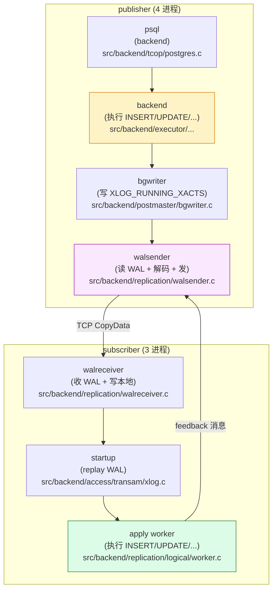

**5 个关键数据结构**（贯穿全文）：

| 数据结构 | 定义 | 作用 |
| --- | --- | --- |
| `XLogRecord` | `src/include/access/xlogrecord.h` | 单条 WAL 记录（header + data + blocks） |
| `ReorderBufferTXN` | `src/backend/replication/logical/reorderbuffer.h` | 内存里一个事务的所有变更 |
| `SnapBuild` | `src/backend/replication/logical/snapbuild.h` | catalog snapshot 构建器 |
| `SnapshotData` | `src/include/utils/snapshot.h` | 反语义的 "已 commit catalog xid 列表" |
| `LogicalRepRelMapEntry` | `src/backend/replication/logical/relation.h` | publisher 关系 → subscriber 关系映射 |

**内核开发的认知**：**9 段链路里，walsender 是最复杂的一段**——它同时跑着 `SnapBuild` 状态机 + `ReorderBuffer` 重组 + pgoutput 编码 + 网络收发。代码量 ~10K 行，是 logical/ 子系统的中枢。

### 3.4 3 个视角的"同一个时刻"对照

把 3 个视角按时间轴对齐（虚构 T0~T9 共 10 个时刻）：

| 时刻 | 发生的事 | 用户视角 | DBA 视角 | 内核视角 |
| --- | --- | --- | --- | --- |
| T0 | `BEGIN` | `BEGIN` 立刻返回 | — | backend 进 `TBLOCK_INPROGRESS` |
| T1 | `INSERT users(1)` | `INSERT 0 1` | — | `heap_insert` → 写 `XLOG_HEAP_INSERT` 到 WAL buffer |
| T2 | `INSERT users(2)` | `INSERT 0 1` | — | 同上 |
| T3 | `SAVEPOINT s1` | `SAVEPOINT` | — | `AssignTransactionId` 给 subxid → 写 `XLOG_XACT_ASSIGNMENT` |
| T4 | `INSERT users(3)` (subxact) | `INSERT 0 1` | — | `heap_insert` 但 xid=subxid |
| T5 | `UPDATE users(1)` (subxact) | `UPDATE 1` | — | `heap_update` → 写 `XLOG_HEAP_UPDATE` (含 NEW+OLD tuple) |
| T6 | `DELETE users(2)` (subxact) | `DELETE 1` | — | `heap_delete` → 写 `XLOG_HEAP_DELETE` (OLD) |
| T7 | `RELEASE SAVEPOINT s1` | `RELEASE` | — | 写 `XLOG_XACT_COMMIT` (subxact) |
| T8 | `ALTER TABLE ADD COLUMN` | `ALTER TABLE` | `pg_replication_slots.catalog_xmin` **可能** 推进 | 写 `XLOG_HEAP2_NEW_CID` + `XLOG_XACT_INVALIDATIONS` |
| T9 | `UPDATE users(1) email` | `UPDATE 1` | — | `heap_update` → `XLOG_HEAP_UPDATE` (NEW+OLD, NEW 含 email) |
| T10 | `COMMIT` | `COMMIT` | `pg_stat_replication.replay_lsn` 推进 | 写 `XLOG_XACT_COMMIT` (toplevel + 1 subxact) |
| T11~T14 | walsender 解码 | — | `pg_stat_replication.sent_lsn` 推进 | walsender 处理 12 条 WAL → pgoutput 编码 → 发 |
| T15~T18 | apply worker 应用 | — | `pg_stat_subscription.latest_end_lsn` 推进 | apply worker 收到 4 条 CopyData → `apply_dispatch` → 落盘 |
| T19 | feedback 回传 | — | `pg_stat_replication.replay_lsn` 更新 | apply 发 'r' 消息 → walsender 收 `ProcessStandbyReplyMessage` |

> **关键观察**：T0~T10 是 publisher 端 12ms 内完成的事；T11~T14 是 walsender 异步消费；T15~T18 是 apply worker 异步消费；T19 是 feedback 把"已 apply"位置回写到 walsender。**3 个观察者看到的不是同一个时刻**——但**通过 4 个 LSN（sent/write/flush/replay）保持一致**。


---

## 四、客户端：psql 按 Enter 后到 WAL 写盘

### 4.1 用户视角

```sql
-- publisher psql> BEGIN;
-- publisher psql> INSERT INTO users VALUES (1, 'alice');
-- INSERT 0 1      ← 10ms 内返回
```

用户按 Enter 后，**psql 进程**做 3 件事：
1. 把 `INSERT INTO users VALUES (1, 'alice');` 文本用 libpq 协议发给 publisher 的 backend 进程。
2. 同步等待 backend 返回 `CommandComplete (INSERT 0 1)`。
3. 打印 `INSERT 0 1` 然后回到 prompt。

**用户感觉是同步的**——但 backend 内部是异步的。

### 4.2 内核视角：psql → libpq → backend 协议栈

源码 `src/backend/tcop/postgres.c`：

```c
/*
 * exec_simple_query:
 *    Execute a "simple Query" protocol message.
 */
void
exec_simple_query(const char *query_string)
{
    ...
    /* 1. parse SQL → raw parse tree */
    raw_parsetree_list = pg_parse_query(query_string);
    
    /* 2. analyze → Query tree */
    querytree_list = pg_analyze_and_rewrite(...);
    
    /* 3. plan → Plan */
    plantree_list = pg_plan_queries(querytree_list, ...);
    
    /* 4. execute each plan (RunOneQueryIfNotMulti) */
    ...
    /* 实际写 WAL 的入口: ExecutorRun → ExecInsert → heap_insert */
}
```

**关键调用链**：

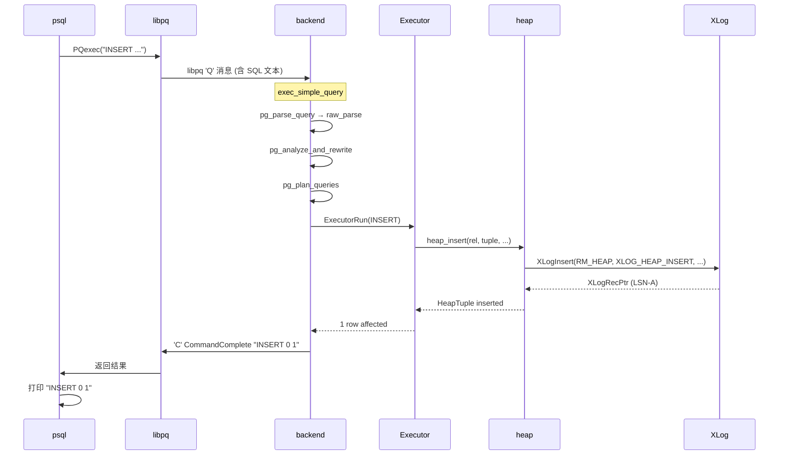

**注意**：**WAL 写盘发生在 `heap_insert` 内部**（**同步**），但 `pg_wal/` 文件的 **fsync 由 bgwriter 异步完成**（wal_writer_delay=200ms 默认）。

### 4.3 关键源码：`heap_insert` 写 WAL 的那一刻

源码 `src/backend/access/heap/heapam.c`：

```c
void
heap_insert(Relation relation, HeapTuple tup, CommandId cid,
            int options, BulkInsertState bistate)
{
    ...
    /* 1. 注册 tuple 到 TOAST (如果需要) */
    if (needs_toast)
        heap_toast_insert(relation, tup, options);

    /* 2. **核心: 写 WAL** */
    xl_heap_insert xlrec;
    xlrec.flags = 0;
    if (relation->rd_rel->relhasoids)
        xlrec.flags |= XLH_INSERT_HASOID;
    if (HeapTupleHasExternal(tup))
        xlrec.flags |= XLH_INSERT_CONTAINS_NEW_TUPLE;

    XLogBeginInsert();
    XLogRegisterData((char *) &xlrec, SizeOfHeapInsert);
    /* 注册 block 0 的 data = tuple 全量 */
    XLogRegisterBuffer(0, buffer, REGBUF_STANDARD | REGBUF_WILL_INIT);
    XLogRegisterBufData(0, (char *) tuple->t_data, tuple->t_len);

    recptr = XLogInsert(RM_HEAP_ID, XLOG_HEAP_INSERT);

    /* 3. 把 LSN 写回 tuple header */
    PageSetLSN(page, recptr);
    ...
}
```

**WAL 记录长这样**（XLogRecord header + data + blocks）：

```c
/* XLogRecord header (24 字节) */
typedef struct XLogRecord {
    uint32        xl_tot_len;      /* total len of entire record */
    TransactionId xl_xid;         /* xact id */
    uint32        xl_prev;         /* ptr to previous record */
    uint8         xl_info;         /* RMGR info byte */
    RMgrId        xl_rmid;         /* resource manager */
    /* 2 bytes of xl_info flags */
    pg_crc32c     xl_crc;          /* CRC for this record */
} XLogRecord;

/* data 部分: xl_heap_insert (8 字节) */
typedef struct xl_heap_insert {
    uint8        flags;            /* XLH_INSERT_* 标志位 */
} xl_heap_insert;

/* block 0: standard block header + tuple data */
```

**`xl_xid` = 500**（假设这次事务分配到 xid 500）。`xl_xid` 是后续 `ReorderBufferProcessXid` 找到事务的关键。

### 4.4 写完 INSERT 后到 SAVEPOINT

```c
/* src/backend/access/transam/xact.c */
void
DefineSavepoint(const char *name)
{
    ...
    /* 1. 给 subxact 分配 xid (subxid) */
    subxid = GetCurrentTransactionId();   /* 通常先 AssignTransactionId */
    
    /* 2. 写 XLOG_XACT_ASSIGNMENT 记录 subxid → toplevel xid 的映射 */
    xlrec.xl_xid = subxid;
    xlrec.xl_topxid = GetTopTransactionId();
    XLogBeginInsert();
    XLogRegisterData((char *) &xlrec, sizeof(xlrec));
    recptr = XLogInsert(RM_XACT_ID, XLOG_XACT_ASSIGNMENT);
    
    /* 3. 写 XLOG_XACT_ASSIGNMENT 是为了 subscriber 端能识别 subxact */
    /* —— 详细原因在第八节 */
}
```

**`XLOG_XACT_ASSIGNMENT` 关键字段**：

```c
typedef struct xl_xact_assignment {
    TransactionId xl_xid;          /* subxid */
    TransactionId xl_topxid;        /* toplevel xid */
} xl_xact_assignment;
```


---

## 五、publisher 写 WAL：12 条记录的具体内容

承接上一节，**把 10 步 SQL 翻译成 12 条 WAL 记录**。每条都列出 rmgr_id、info、关键字段。

### 5.1 12 条记录的完整清单

| 序 | 步骤 | 触发动作 | rmgr_id | info | 关键字段 | 备注 |
| --- | --- | --- | --- | --- | --- | --- |
| 1 | T1 | `INSERT users(1)` | `RM_HEAP_ID` | `XLOG_HEAP_INSERT` | xl_xid=500, flags=NORMAL, block 0 = new tuple | LSN-A |
| 2 | T2 | `INSERT users(2)` | `RM_HEAP_ID` | `XLOG_HEAP_INSERT` | xl_xid=500, flags=NORMAL, block 0 = new tuple | |
| 3 | T3 | `SAVEPOINT s1` | `RM_XACT_ID` | `XLOG_XACT_ASSIGNMENT` | xl_xid=501 (subxid), xl_topxid=500 | LSN-B |
| 4 | T4 | `INSERT users(3)` (subxact) | `RM_HEAP_ID` | `XLOG_HEAP_INSERT` | xl_xid=501 (subxid!), block 0 = new tuple | |
| 5 | T5 | `UPDATE users(1)` (subxact) | `RM_HEAP_ID` | `XLOG_HEAP_UPDATE` | xl_xid=501, block 0=NEW, block 1=OLD (REPLICA_IDENTITY) | |
| 6 | T6 | `DELETE users(2)` (subxact) | `RM_HEAP_ID` | `XLOG_HEAP_DELETE` | xl_xid=501, block 0=OLD tuple (key) | |
| 7 | T7 | `RELEASE SAVEPOINT s1` | `RM_XACT_ID` | `XLOG_XACT_COMMIT` | xl_xid=501, parsed.xact_time, parsed.nsubxacts=0 | LSN-C |
| 8 | T8 | `ALTER TABLE ADD COLUMN` (catalog) | `RM_HEAP_ID` | `XLOG_HEAP_INSERT` | xl_xid=500, on `pg_attribute` 表 | |
| 8' | T8 | 同上 | `RM_HEAP2_ID` | `XLOG_HEAP2_NEW_CID` | xlrec.top_xid=500, cmin, cmax, combocid | LSN-D |
| 8'' | T8 | 同上 | `RM_XACT_ID` | `XLOG_XACT_INVALIDATIONS` | xlrec.nmsgs=N, 每个含 cache_id + hash | |
| 9 | T9 | `UPDATE users(1) email` (toplevel) | `RM_HEAP_ID` | `XLOG_HEAP_UPDATE` | xl_xid=500, NEW 含 email, OLD 不含 | |
| 10 | T10 | `COMMIT` | `RM_XACT_ID` | `XLOG_XACT_COMMIT` | xl_xid=500, parsed.nsubxacts=1, subxacts[0]=501 | LSN-E |
| 旁路 | bgwriter | — | `RM_XLOG_ID` | `XLOG_RUNNING_XACTS` | oldestRunningXid=500, nextXid=502, xids=[500, 501] | LSN-R |

> 注：步骤 8 的 catalog 变更其实会触发**多条** WAL（至少 1 条 HEAP_INSERT 给 `pg_attribute` 表，1 条 HEAP2_NEW_CID，1 条 XACT_INVALIDATIONS），所以**实际 12 条只是个保守下限**。但本文为了方便，**假设 bgwriter 的 XLOG_RUNNING_XACTS 落在步骤 7 与步骤 8 之间**。

### 5.2 关键 WAL 记录的二进制布局示例

**`XLOG_HEAP_INSERT` (LSN-A)** 的二进制结构：

```
+---------------- XLogRecord header (24 bytes) ----+
| xl_tot_len  | 0x...   (含 data + blocks + main) |
| xl_xid      | 500                               |
| xl_prev     | LSN-BEFORE                        |
| xl_info     | XLOG_HEAP_INSERT (0x00)           |
| xl_rmid     | RM_HEAP_ID (0x00)                 |
| xl_crc      | CRC32c                            |
+---------------- data (xl_heap_insert) -----------+
| flags       | 0x00 (无 HASOID, 有 NEW_TUPLE)    |
+---------------- block 0 header ------------------+
| id          | 0x00                              |
| rlocator.db | 16384                             |
| rlocator.rel| 16387                             |
| rlocator.fork| MAIN_FORKNUM                     |
| flags       | REGBUF_STANDARD | WILL_INIT       |
+---------------- block 0 data --------------------+
| len         | 53                                |
| (HeapTupleHeader + user data) = (1, 'alice')    |
+---------------------------------------------- --+
```

**`XLOG_XACT_ASSIGNMENT` (LSN-B)** 的二进制结构（**16 字节 data**）：

```
+---------------- XLogRecord header -----------------+
| ...                                                |
| xl_info     | XLOG_XACT_ASSIGNMENT                 |
| xl_rmid     | RM_XACT_ID (0x10)                    |
+---------------- data --------------------------------+
| xl_xid      | 501 (subxid)                         |
| xl_topxid   | 500 (toplevel)                       |
+----------------------------------------------------+
```

**`XLOG_HEAP2_NEW_CID` (LSN-D)** 的二进制结构：

```c
typedef struct xl_heap_new_cid {
    TransactionId top_xid;     /* toplevel xid (subxact 也写 toplevel) */
    ...
    RelFileLocator target_locator;  /* catalog 表定位 */
    ItemPointerData target_tid;     /* catalog tuple TID */
    CommandId    cmin;
    CommandId    cmax;
    CommandId    combocid;
} xl_heap_new_cid;
```

**`XLOG_XACT_COMMIT` (LSN-E)** 的二进制结构（**包含子事务列表**）：

```c
typedef struct xl_xact_commit {
    TimestampTz xact_time;       /* commit time */
    int         nsubxacts;       /* 数量 */
    TransactionId *subxacts;     /* 子 xid 数组 */
    uint32      xinfo;           /* 标志位 */
    /* 可选: xl_xact_twophase, xl_origin, etc. */
} xl_xact_commit;
```

`nsubxacts=1`, `subxacts[0]=501` —— 这条记录告诉 `ReorderBuffer`："**xid 500 的事务包含 subxid 501**"。

### 5.3 12 条记录在 WAL 里的顺序与依赖

```mermaid
gantt
    title WAL 流里的 12 条记录（按 LSN 顺序）
    dateFormat  X
    axisFormat  %s
    section LSN 序
    1:HEAP_INSERT xid=500      :a1, 0, 1
    2:HEAP_INSERT xid=500      :a2, 1, 2
    3:XACT_ASSIGNMENT 501→500  :a3, 2, 3
    4:HEAP_INSERT xid=501      :a4, 3, 4
    5:HEAP_UPDATE xid=501      :a5, 4, 5
    6:HEAP_DELETE xid=501      :a6, 5, 6
    7:XACT_COMMIT xid=501      :a7, 6, 7
    8:XLOG_RUNNING_XACTS       :a8, 7, 8
    9:HEAP_INSERT catalog      :a9, 8, 9
    10:HEAP2_NEW_CID           :a10, 9, 10
    11:XACT_INVALIDATIONS      :a11, 10, 11
    12:HEAP_UPDATE xid=500     :a12, 11, 12
    13:XACT_COMMIT xid=500     :a13, 12, 13
```

**关键观察**：
- LSN-A 之前的 LSN 是 `restart_lsn`（pg_replication_slots 看到的）
- LSN-E 是 `confirmed_flush_lsn`（subscriber 确认 apply 完成）
- LSN-R (`XLOG_RUNNING_XACTS`) 落在中间，**它是 bgwriter 周期性写的，与事务无关**——但它是 `SnapBuild` 状态机推进的关键。

### 5.4 用户视角：完全无感

用户**完全感知不到**这 12 条 WAL——只在 COMMIT 时感觉到"慢了 2ms"，那是 `XactLogCommitRecord` 写完 COMMIT 的 LSN 后，walsender 异步发走造成的。

### 5.5 DBA 视角：可以观察，但通常不直接看

```sql
-- 用 pg_waldump 可以看到这 12 条记录的原始格式
$ pg_waldump -p pg_wal -s 0/1B000000 -e 0/1C000000 | head -20
rmgr: Heap        len (rec/tot):     59/   229, tx:       500, lsn: 0/1B000028, prev 0/1B000010, desc: INSERT off 3, blkref #0: rel 1663/16384/16387 blk 0
rmgr: Heap        len (rec/tot):     59/   229, tx:       500, lsn: 0/1B000110, prev 0/1B000028, desc: INSERT off 4, blkref #0: rel 1663/16384/16387 blk 0
rmgr: Xact        len (rec/tot):     24/    50, tx:          0, lsn: 0/1B000200, prev 0/1B000110, desc: ASSIGNMENT subxid 501 topxid 500
rmgr: Heap        len (rec/tot):     59/   229, tx:       501, lsn: 0/1B000250, prev 0/1B000200, desc: INSERT off 5, blkref #0: rel 1663/16384/16387 blk 0
rmgr: Heap        len (rec/tot):     80/   350, tx:       501, lsn: 0/1B000350, prev 0/1B000250, desc: UPDATE off 3 xmax 501, blkref #0: rel 1663/16384/16387 blk 0
rmgr: Heap        len (rec/tot):     54/   229, tx:       501, lsn: 0/1B000450, prev 0/1B000350, desc: DELETE off 4, blkref #0: rel 1663/16384/16387 blk 0
rmgr: Xact        len (rec/tot):     30/    56, tx:       501, lsn: 0/1B000540, prev 0/1B000450, desc: COMMIT 2026-10-10 10:23:45.123456+08
rmgr: XLOG        len (rec/tot):     96/   152, tx:          0, lsn: 0/1B000580, prev 0/1B000540, desc: RUNNING_XACTS nextXid 502, oldestRunningXid 500, nrunnable 2, nids 2
                                                                                          [0] xid=500, [1] xid=501
rmgr: Heap        len (rec/tot):     80/   300, tx:       500, lsn: 0/1B000620, prev 0/1B000580, desc: INSERT off 100, blkref #0: rel 1663/16384/1249 blk 0
...
```


---

## 六、walsender 读 WAL：`XLogReadRecord` → `LogicalDecodingProcessRecord`

publisher 的 **walsender 进程**（一个 logical replication slot 启动时 spawn 出来的）现在登场。它做一件事：把 12 条 WAL 记录从磁盘读出来，分发给 `LogicalDecodingProcessRecord`。

### 6.1 walsender 是怎么知道要读哪条 WAL 的

**前提**：当 subscriber 端执行 `CREATE SUBSCRIPTION sub_users CONNECTION '...' PUBLICATION pub_users;` 时，**subscriber 的 apply worker** 会通过 libpq 连到 publisher。

**连接建立后**，publisher 端 spawn 一个 walsender 进程（`postmaster.c:StartWalSender` → `walsender.c:exec_replication_command` → `StartLogicalReplication`）。

源码 `src/backend/replication/walsender.c:1280`：

```c
static void
StartLogicalReplication(RepOriginId originid, XLogRecPtr startpoint,
                        TimestampTz *committime, ...)
{
    ...
    /* 1. 创建 LogicalDecodingContext */
    logical_decoding_ctx =
        CreateDecodingContext(remote_wstart, ...,
                              output_plugin_options, ...);
    
    /* 2. **关键: 启动 SnapBuild, 状态机开始跑** */
    SnapBuildInitBuilder(ctx->snapshot_builder, ...);
    
    /* 3. 把 startpoint 设到 slot.confirmed_flush_lsn */
    /* walsender 从这里开始读 WAL */
    sentPtr = slot->data.confirmed_flush_lsn;
}
```

**`slot->data.confirmed_flush_lsn`**：是 subscriber 上次 apply 完成并反馈回 publisher 的位置。walsender 从这里开始读——这就是为什么"重启 publisher 不丢数据"。

### 6.2 `WalSndLoop` 与 `XLogSendLogical`

源码 `src/backend/replication/walsender.c:2806`：

```c
static void
WalSndLoop(WalSndSendDataCallback send_data)
{
    ...
    /* 死循环: 读 WAL → 解码 → 编码 → 发 → 反馈 */
    for (;;)
    {
        ...
        /* 1. 等 wal 出现 (WalSndWaitForWal) */
        ...
        
        /* 2. 读 WAL + 解码 + 发 */
        if (send_data == XLogSendLogical)
            XLogSendLogical();
        else
            XLogSendPhysical();
        
        /* 3. 处理从 subscriber 来的消息 (feedback / keepalive) */
        ProcessRepliesIfAny();
        
        /* 4. 检查是否 caught up (WalSndCaughtUp) */
        ...
    }
}
```

**`XLogSendLogical` 的核心**（walsender.c:3428）：

```c
static void
XLogSendLogical(void)
{
    XLogRecord *record;
    char       *errm;

    record = XLogReadRecord(logical_decoding_ctx->reader, &errm);

    if (errm != NULL)
        elog(ERROR, "could not find record while sending logically-decoded data: %s", errm);

    if (record != NULL)
    {
        /* 1. **关键: 分发给 logical decoding 框架 */
        LogicalDecodingProcessRecord(logical_decoding_ctx,
                                      logical_decoding_ctx->reader);
        
        /* 2. 更新 sentPtr = EndRecPtr (这条 record 之后的下一个字节) */
        sentPtr = logical_decoding_ctx->reader->EndRecPtr;
    }
    ...
}
```

**`XLogReadRecord`** 内部：它从 WAL 里读 24 字节 XLogRecord header + data + blocks，**校验 CRC**，然后**只返回 record 指针**。后续处理交给 `LogicalDecodingProcessRecord`。

### 6.3 `LogicalDecodingProcessRecord` 的分发逻辑

源码 `src/backend/replication/logical/decode.c:88`：

```c
void
LogicalDecodingProcessRecord(LogicalDecodingContext *ctx,
                              XLogReaderState *record)
{
    XLogRecordBuffer buf;
    TransactionId txid;
    RmgrData    rmgr;

    buf.origptr = ctx->reader->ReadRecPtr;
    buf.endptr = ctx->reader->EndRecPtr;
    buf.record = record;

    txid = XLogRecGetTopXid(record);

    /* **关键 1: 如果有 toplevel xid, 先把 subxact 挂到 toplevel 下** */
    if (TransactionIdIsValid(txid))
    {
        ReorderBufferAssignChild(ctx->reorder, txid,
                                  XLogRecGetXid(record),
                                  buf.origptr);
    }

    /* **关键 2: 调 rmgr 的 decode 回调** */
    rmgr = GetRmgr(XLogRecGetRmid(record));
    if (rmgr.rm_decode != NULL)
        rmgr.rm_decode(ctx, &buf);
    else
        ReorderBufferProcessXid(ctx->reorder, XLogRecGetXid(record),
                                buf.origptr);
}
```

**`rmgr.rm_decode` 的派发表**（注册在 `rmgrlist.h`）：

| RMGR | decode 函数 | 处理的 record |
| --- | --- | --- |
| `RM_XLOG_ID` | `xlog_decode` | RUNNING_XACTS, CHECKPOINT, NOOP, etc. |
| `RM_XACT_ID` | `xact_decode` | XACT_COMMIT, XACT_ABORT, XACT_ASSIGNMENT, XACT_INVALIDATIONS |
| `RM_HEAP_ID` | `heap_decode` | HEAP_INSERT, HEAP_UPDATE, HEAP_DELETE, HEAP_HOT_UPDATE |
| `RM_HEAP2_ID` | `heap2_decode` | HEAP2_NEW_CID, HEAP2_REWRITE |
| `RM_DBASE_ID` | `dbase_decode` | DBase (建库) |
| `RM_SMGR_ID` | `smgr_decode` | SMGR_CREATE |
| `RM_TBLSPC_ID` | `tblspc_decode` | TBLSPC_CREATE |

**我们这 12 条记录的派发**：

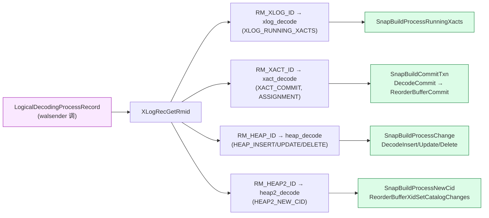

### 6.4 三类 WAL 的实际派发源码

**`RM_HEAP_ID` 的派发**（`heap_decode`，`decode.c:469`）：

```c
void
heap_decode(LogicalDecodingContext *ctx, XLogRecordBuffer *buf)
{
    uint8 info = XLogRecGetInfo(buf->record) & XLOG_HEAP_OPMASK;
    TransactionId xid = XLogRecGetXid(buf->record);
    SnapBuild *builder = ctx->snapshot_builder;

    ReorderBufferProcessXid(ctx->reorder, xid, buf->origptr);

    /* 1. 如果 SnapBuild 还没就绪, 只记账不 decode */
    if (SnapBuildCurrentState(builder) < SNAPBUILD_FULL_SNAPSHOT)
        return;

    switch (info)
    {
        case XLOG_HEAP_INSERT:
            if (SnapBuildProcessChange(builder, xid, buf->origptr) &&
                !ctx->fast_forward)
                DecodeInsert(ctx, buf);
            break;
        case XLOG_HEAP_HOT_UPDATE:
        case XLOG_HEAP_UPDATE:
            if (SnapBuildProcessChange(builder, xid, buf->origptr) &&
                !ctx->fast_forward)
                DecodeUpdate(ctx, buf);
            break;
        case XLOG_HEAP_DELETE:
            if (SnapBuildProcessChange(builder, xid, buf->origptr) &&
                !ctx->fast_forward)
                DecodeDelete(ctx, buf);
            break;
        ...
    }
}
```

**`RM_XACT_ID` 的派发**（`xact_decode`，`decode.c:200`）：

```c
void
xact_decode(LogicalDecodingContext *ctx, XLogRecordBuffer *buf)
{
    SnapBuild *builder = ctx->snapshot_builder;
    uint8 info = XLogRecGetInfo(buf->record) & XLOG_XACT_OPMASK;

    /* SnapBuild 还没就绪? 跳过 */
    if (SnapBuildCurrentState(builder) < SNAPBUILD_FULL_SNAPSHOT)
        return;

    switch (info)
    {
        case XLOG_XACT_COMMIT:
        case XLOG_XACT_COMMIT_PREPARED:
            {
                xl_xact_commit *xlrec = (xl_xact_commit *) XLogRecGetData(r);
                ParseCommitRecord(XLogRecGetInfo(buf->record), xlrec, &parsed);
                DecodeCommit(ctx, buf, &parsed, xid, two_phase);
            }
            break;
        case XLOG_XACT_ABORT:
            ...
        case XLOG_XACT_ASSIGNMENT:
            /* **这里什么都没做**, 因为前面 LogicalDecodingProcessRecord
             * 已经把 subxact 挂到 toplevel 下了 */
            break;
        case XLOG_XACT_INVALIDATIONS:
            /* 把 invalidations 放到 ReorderBuffer 队列里 */
            ReorderBufferAddInvalidations(...);
            break;
    }
}
```

**注意 `XLOG_XACT_ASSIGNMENT` 这条记录的妙用**：

```c
/* LogicalDecodingProcessRecord 主入口已经做了一次: */
if (TransactionIdIsValid(txid))
    ReorderBufferAssignChild(ctx->reorder, txid, XLogRecGetXid(record), buf.origptr);
```

`txid` = `XLogRecGetTopXid(record)` = `XLOG_XACT_ASSIGNMENT` 里的 `xl_topxid` = 500
`XLogRecGetXid(record)` = record.xl_xid = 501 (subxid)

所以 `XLOG_XACT_ASSIGNMENT` 一被读，**subxid 501 就立刻被挂到 toplevel 500 下**——`xact_decode` 的 ASSIGNMENT case 啥都不用做。


---

## 七、SnapBuild 消费：`XLOG_RUNNING_XACTS` / `XLOG_HEAP2_NEW_CID` / `XLOG_XACT_COMMIT`

承接第六节，**12 条记录里有 5 条关键记录被 SnapBuild 特别处理**：3 条 `XLOG_RUNNING_XACTS`（虽然只有 1 条写盘但 SnapBuild 在 START→BUILDING→FULL→CONSISTENT 过程中会等 2~3 条）、1 条 `XLOG_HEAP2_NEW_CID`、1 条 `XLOG_XACT_COMMIT` (toplevel)。

### 7.1 关键点 1：`XLOG_RUNNING_XACTS` 推进 SnapBuild 状态机

源码 `src/backend/replication/logical/decode.c:128` (xlog_decode 内的 RUNNING_XACTS case)：

```c
case XLOG_RUNNING_XACTS:
    SnapBuildProcessRunningXacts(builder, buf->origptr,
                                  (xl_running_xacts *) XLogRecGetData(buf->record));
    break;
```

`SnapBuildProcessRunningXacts` 在 snapbuild.c:1136，本文[另一篇文档](./postgresql-running-xacts-snapshot/index.html)已经详细分析过。这里只看 **本场景里它做了什么**：

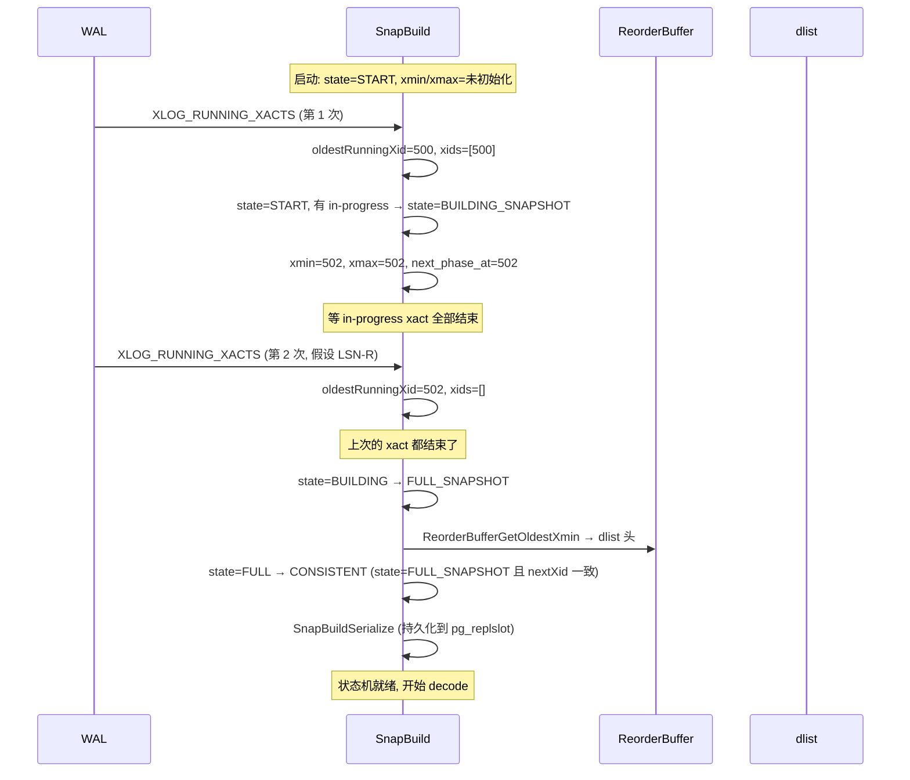

**关键**：本场景的 walsender **不是从 START 启动的**——它从持久化的 snapbuild 文件恢复，已经处于 `CONSISTENT` 状态。所以收到 LSN-R 这次 `XLOG_RUNNING_XACTS` 时只做 `SnapBuildSerialize`（持久化），不再转移状态。

### 7.2 关键点 2：`XLOG_HEAP_INSERT` 触发 `SnapBuildProcessChange` → `ReorderBufferSetBaseSnapshot`

源码 `src/backend/replication/logical/snapbuild.c:639`：

```c
bool
SnapBuildProcessChange(SnapBuild *builder, TransactionId xid, XLogRecPtr lsn)
{
    /* 1. 状态机没到 FULL_SNAPSHOT? 直接 return false */
    if (builder->state < SNAPBUILD_FULL_SNAPSHOT)
        return false;

    /* 2. CONSISTENT 之前的事务? 跳过 */
    if (builder->state < SNAPBUILD_CONSISTENT &&
        TransactionIdPrecedes(xid, builder->next_phase_at))
        return false;

    /* 3. **关键: 第一次遇到这个 xid, 挂 base_snapshot** */
    if (!ReorderBufferXidHasBaseSnapshot(builder->reorder, xid))
    {
        if (builder->snapshot == NULL)
        {
            builder->snapshot = SnapBuildBuildSnapshot(builder);
            SnapBuildSnapIncRefcount(builder->snapshot);
        }
        SnapBuildSnapIncRefcount(builder->snapshot);
        ReorderBufferSetBaseSnapshot(builder->reorder, xid, lsn,
                                      builder->snapshot);
    }
    return true;
}
```

**本场景里 4 条 HEAP_INSERT/UPDATE/DELETE 都会触发 `SnapBuildProcessChange`**：

- LSN-A (`HEAP_INSERT xid=500`) → 第一次遇到 xid=500 → 挂 base_snapshot。
- LSN-B (后续 HEAP_INSERT xid=500) → `ReorderBufferXidHasBaseSnapshot(500) == true` → 跳过。
- LSN-4 (`HEAP_INSERT xid=501`) → 第一次遇到 xid=501 → 但 501 已经被 `XLOG_XACT_ASSIGNMENT` 挂到 500 下了，**实际是 500 的 subxact**。`ReorderBufferXidHasBaseSnapshot` 找 toplevel，**500 已经有 base_snapshot 了** → 跳过挂载。
- LSN-9 (`HEAP_UPDATE xid=500`, ALTER TABLE 后) → `ReorderBufferXidHasBaseSnapshot(500) == true` → 跳过挂载。

**结果**：整个事务里**只挂了一次 base_snapshot**（给 toplevel 500，挂在 LSN-A）。

### 7.3 关键点 3：`XLOG_HEAP2_NEW_CID` 标记 catalog-modifying

源码 `src/backend/replication/logical/snapbuild.c:689`：

```c
void
SnapBuildProcessNewCid(SnapBuild *builder, TransactionId xid,
                       XLogRecPtr lsn, xl_heap_new_cid *xlrec)
{
    /* **关键 1: 标记 xid 改了 catalog** */
    ReorderBufferXidSetCatalogChanges(builder->reorder, xid, lsn);

    /* 关键 2: 把 cmin/cmax 信息加到 ReorderBuffer */
    ReorderBufferAddNewTupleCids(builder->reorder, xlrec->top_xid, lsn,
                                  xlrec->target_locator, xlrec->target_tid,
                                  xlrec->cmin, xlrec->cmax,
                                  xlrec->combocid);

    /* 关键 3: 把 cmax+1 加为新的 command id (catalog 变更) */
    if (xlrec->cmin != InvalidCommandId && xlrec->cmax != InvalidCommandId)
        cid = Max(xlrec->cmin, xlrec->cmax);
    else if (xlrec->cmax != InvalidCommandId)
        cid = xlrec->cmax;
    ...
    ReorderBufferAddNewCommandId(builder->reorder, xid, lsn, cid + 1);
}
```

**为什么 `XLOG_HEAP2_NEW_CID` 这么重要**？

`HEAP_INSERT/UPDATE/DELETE` 写到 `pg_attribute`（catalog 表）时，需要一个 "**新的 command id**" 来标识 "cmin 在 catalog 改后还是改前"。这个信息**只存在 publisher 进程的内存**（`estate->es_output_cid`），所以必须写 WAL。`XLOG_HEAP2_NEW_CID` 就是 publisher 把这个 cid 信息"序列化"到 WAL 里。

**subscriber 端解码**：
- `ReorderBufferXidSetCatalogChanges(500, lsn)` → 在 `ReorderBufferTXN(500)` 上打 `RBTXN_HAS_CATALOG_CHANGES` 标志。
- `ReorderBufferAddNewTupleCids` → 把 `(pg_attribute tuple location, cmin, cmax, combocid)` 存起来，给 `pgoutput_change` 在解码这个 catalog tuple 时用。
- `ReorderBufferAddNewCommandId` → 推进 `ReorderBufferTXN(500).command_id`。

### 7.4 关键点 4：`XLOG_XACT_COMMIT` 推进 snapshot 字段

源码 `src/backend/replication/logical/snapbuild.c:940`：

```c
void
SnapBuildCommitTxn(SnapBuild *builder, XLogRecPtr lsn, TransactionId xid,
                    int nsubxacts, TransactionId *subxacts, uint32 xinfo)
{
    /* 1. 关键判断: xid 是否 catalog-modifying? */
    if (!SnapBuildXidHasCatalogChanges(builder, xid, xinfo))
        return;  /* data-only commit, 不动 snapshot */

    /* 2. 1. 1. 同样判断每个 subxact */
    for (int i = 0; i < nsubxacts; i++)
    {
        if (SnapBuildXidHasCatalogChanges(builder, subxacts[i], xinfo))
            SnapBuildAddCommittedTxn(builder, subxacts[i]);
    }
    if (SnapBuildXidHasCatalogChanges(builder, xid, xinfo))
        SnapBuildAddCommittedTxn(builder, xid);

    /* 3. 推进 xmax */
    if (TransactionIdFollowsOrEquals(xid, builder->xmax))
    {
        builder->xmax = xid;
        TransactionIdAdvance(builder->xmax);
    }
    ...
}
```

**本场景里 2 条 `XACT_COMMIT` 走的路径**：

| 序 | xid | 是否 catalog 改? | SnapBuildCommitTxn 干啥 |
| --- | --- | --- | --- |
| 7 | 501 (subxact RELEASE) | ❌ (只改 users 表) | 直接 return, 不动 snapshot |
| 10 | 500 (toplevel COMMIT) | ✅ (步骤 8 改过 `pg_attribute`) | xip += 500, xmax = 501 (500+1) |

**为什么 subxact commit (LSN-C) 没动 snapshot**？因为 `ReorderBufferXidSetCatalogChanges` 只在 LSN-D 那个时点被设到 500 上（不是 501）。501 改的全是 users 表的 data，**不进入 `xip` 列表**。

### 7.5 内核视角：本场景里 SnapBuild 状态机走完一遍

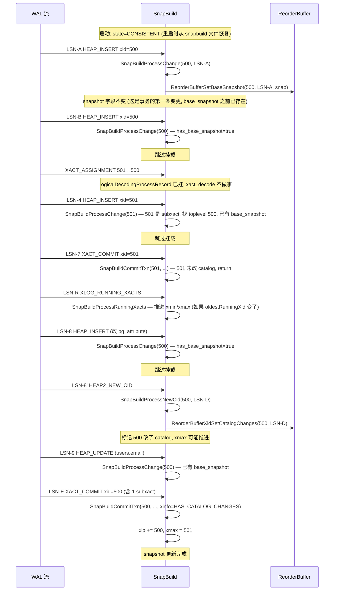


---

## 八、ReorderBuffer 重组：txn 状态机 + base_snapshot + change list

承接第七节，**ReorderBuffer 收到 5 类输入**：
1. `ReorderBufferAssignChild(500, 501, lsn)` — subxact 挂到 toplevel 下
2. `ReorderBufferProcessXid(xid, lsn)` — 任何一条记录都会触发，确保 txn 在内存里存在
3. `ReorderBufferSetBaseSnapshot(500, LSN-A, snap)` — 挂 base_snapshot
4. `ReorderBufferXidSetCatalogChanges(500, LSN-D)` — 标记 catalog 改
5. `ReorderBufferQueueChange(500/501, lsn, change)` — 把 INSERT/UPDATE/DELETE 加到 txn.changes 列表
6. `ReorderBufferCommit(500, ...)` — 最终 commit

本文[另一篇 ReorderBuffer 文档](./postgresql-logical-replication-reorderbuffer-transaction/index.html)已经详细分析过 `ReorderBuffer` 整体设计。本节只看本场景里 txn 500 怎么"长"出来。

### 8.1 `ReorderBufferProcessXid` 的"轻量记账"

源码 `reorderbuffer.c:3279`：

```c
void
ReorderBufferProcessXid(ReorderBuffer *rb, TransactionId xid, XLogRecPtr lsn)
{
    if (xid != InvalidTransactionId)
        ReorderBufferTXNByXid(rb, xid, true, NULL, lsn, true);
    /* ↑ 这一行只是"如果不存在就建一个空 txn" */
}
```

**关键**：`ReorderBufferTXNByXid(rb, xid, true, ...)` 第三个参数 `create=true`，意味着**任何 xid 第一次出现都会建一个空 txn**。所以 12 条 WAL 记录里有 7 条带 xid 字段的（xid=500 或 501），都会触发一次"建/查 txn"。

**本场景里 5 个事件触发 ReorderBufferProcessXid**：

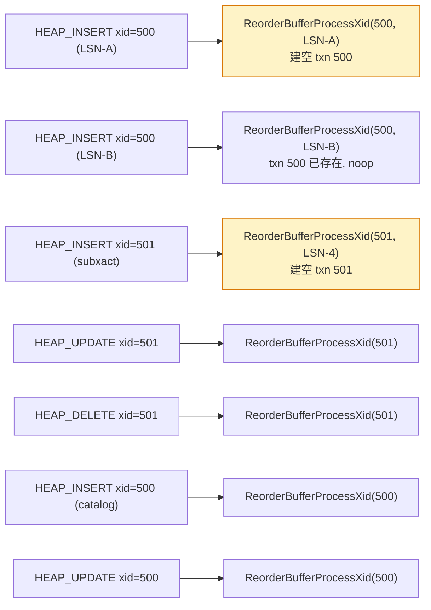

### 8.2 `ReorderBufferSetBaseSnapshot` 挂 base_snapshot

源码 `reorderbuffer.c:3310`：

```c
void
ReorderBufferSetBaseSnapshot(ReorderBuffer *rb, TransactionId xid,
                              XLogRecPtr lsn, Snapshot snap)
{
    ReorderBufferTXN *txn;
    bool is_new;

    /* 1. 拿到事务 (subxact → toplevel) */
    txn = ReorderBufferTXNByXid(rb, xid, true, &is_new, lsn, true);
    if (rbtxn_is_known_subxact(txn))
        txn = ReorderBufferTXNByXid(rb, txn->toplevel_xid, false,
                                    NULL, InvalidXLogRecPtr, false);

    Assert(txn->base_snapshot == NULL);

    /* 2. 挂 base_snapshot */
    txn->base_snapshot = snap;
    txn->base_snapshot_lsn = lsn;

    /* 3. **关键: 加到 dlist 尾部** */
    dlist_push_tail(&rb->txns_by_base_snapshot_lsn, &txn->base_snapshot_node);
    AssertTXNLsnOrder(rb);
}
```

**本场景里只挂一次**（在 LSN-A），挂在 toplevel txn 500 上。

### 8.3 `ReorderBufferQueueChange` 把每条变更加到 txn.changes

源码 `reorderbuffer.c:809`：

```c
void
ReorderBufferQueueChange(ReorderBuffer *rb, TransactionId xid,
                          XLogRecPtr lsn, ReorderBufferChange *change,
                          bool toast_insert)
{
    ReorderBufferTXN *txn;

    txn = ReorderBufferTXNByXid(rb, xid, true, NULL, lsn, true);

    if (rbtxn_is_aborted(txn)) {
        ReorderBufferFreeChange(rb, change, false);
        return;
    }

    /* **关键: 标 RBTXN_HAS_STREAMABLE_CHANGE (如果能 stream 的话)** */
    if (change->action == REORDER_BUFFER_CHANGE_INSERT ||
        change->action == REORDER_BUFFER_CHANGE_UPDATE ||
        change->action == REORDER_BUFFER_CHANGE_DELETE ||
        change->action == REORDER_BUFFER_CHANGE_TRUNCATE ||
        change->action == REORDER_BUFFER_CHANGE_MESSAGE)
    {
        ReorderBufferTXN *toptxn = rbtxn_get_toptxn(txn);
        toptxn->txn_flags |= RBTXN_HAS_STREAMABLE_CHANGE;
    }

    change->lsn = lsn;
    change->txn = txn;

    /* 关键: 推到 txn.changes dlist 尾部 */
    dlist_push_tail(&txn->changes, &change->node);
    txn->nentries++;
    txn->nentries_mem++;
    ...
}
```

**本场景的 changes 列表（按 LSN 顺序）**：

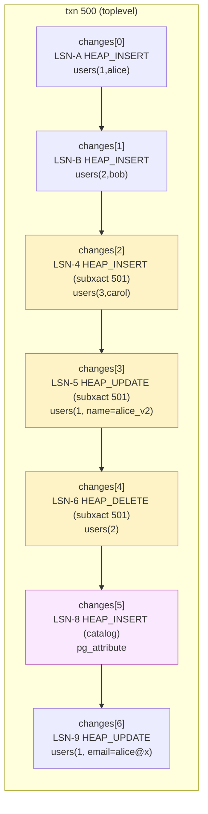

**注意 4 个关键点**：

- **subxact 的变更也进 toplevel 的 changes 列表**——通过 `rbtxn_get_toptxn(txn)` 拿 toplevel。但每个 change 自己的 `txn` 字段指向 subxact。
- **catalog 变更（pg_attribute）也在 changes 列表里**——但**不会发给 output plugin**（output plugin 在 `pgoutput_change` 里检查 `is_publishable_relation` 排除 catalog）。
- **变更顺序是 LSN 序**——`dlist_push_tail` 严格按 LSN 序入队。
- **`XLOG_HEAP2_NEW_CID` 不在 changes 列表里**——它走 `ReorderBufferXidSetCatalogChanges` + `ReorderBufferAddNewTupleCids` 单独的路径（处理 catalog tuple 可见性）。

### 8.4 `ReorderBufferCommit` 触发最终发送

源码 `reorderbuffer.c:2871`（DecodeCommit 调）：

```c
void
ReorderBufferCommit(ReorderBuffer *rb, TransactionId xid,
                     XLogRecPtr commit_lsn, XLogRecPtr end_lsn,
                     TimestampTz commit_time, RepOriginId origin_id,
                     XLogRecPtr origin_lsn)
{
    ReorderBufferTXN *txn;

    txn = ReorderBufferTXNByXid(rb, xid, false, NULL, InvalidXLogRecPtr, false);
    if (txn == NULL) return;

    ReorderBufferReplay(txn, rb, xid, commit_lsn, end_lsn, commit_time,
                        origin_id, origin_lsn);
}
```

`ReorderBufferReplay`（reorderbuffer.c:2813）：

```c
static void
ReorderBufferReplay(ReorderBufferTXN *txn, ReorderBuffer *rb, ...)
{
    ...

    /* 1. streaming 模式? */
    if (rbtxn_is_streamed(txn))
    {
        ReorderBufferStreamCommit(rb, txn);
        return;
    }

    /* 2. **关键判定: base_snapshot == NULL? 不发** */
    if (txn->base_snapshot == NULL)
    {
        Assert(txn->ninvalidations == 0);
        if (!rbtxn_is_prepared(txn))
            ReorderBufferCleanupTXN(rb, txn);
        return;
    }

    /* 3. 复制 snapshot 作为本次发送的 snapshot_now */
    snapshot_now = txn->base_snapshot;

    /* 4. **真正发送: 把 changes 一条一条喂给 output plugin** */
    ReorderBufferProcessTXN(rb, txn, commit_lsn, snapshot_now,
                            command_id, false);
}
```

**本场景里 txn 500 有 base_snapshot（非 NULL）+ 7 个 changes + 1 个 subxact + 1 个 catalog 变更**——会发。

**而 subxact 501 的 RELEASE SAVEPOINT 走 `ReorderBufferCommit` 但被识别为已 RELEASED**：第七节里 `XACT_COMMIT xid=501` 触发的 `ReorderBufferCommit` 会把 501 的 changes 转移到 500，**501 自己的 txn 被 cleanup**（不进 final commit）。

### 8.5 txn 500 的最终形态

```mermaid
classDiagram
    class ReorderBufferTXN {
        TransactionId xid = 500
        TransactionId toplevel_xid = 500
        XLogRecPtr first_lsn = LSN-A
        XLogRecPtr last_lsn = LSN-E
        Snapshot base_snapshot
        XLogRecPtr base_snapshot_lsn = LSN-A
        bool toptxn = true
        txn_flags |= RBTXN_HAS_STREAMABLE_CHANGE
        txn_flags |= RBTXN_HAS_CATALOG_CHANGES  (LSN-D 设置)
        txn_flags |= RBTXN_HAS_PARTIAL_CHANGE
        dlist changes [7 entries]
        dlist subtxns [txn 501]
        int nsubtxns = 1
        int ninvalidations = 4 (来自 catalog 改)
    }
    class ReorderBufferChange {
        action: REORDER_BUFFER_CHANGE_INSERT
        lsn: LSN-A
        data.tp.newtuple: (1, alice)
    }
    class ReorderBufferChange2 {
        action: REORDER_BUFFER_CHANGE_INSERT
        lsn: LSN-B
        data.tp.newtuple: (2, bob)
    }
    class ReorderBufferChange3 {
        action: REORDER_BUFFER_CHANGE_INSERT
        lsn: LSN-4
        txn: txn 501 (subxact)
        data.tp.newtuple: (3, carol)
    }
    class ReorderBufferChange4 {
        action: REORDER_BUFFER_CHANGE_UPDATE
        lsn: LSN-5
        txn: txn 501
        data.tp.newtuple: (1, alice_v2)
        data.tp.oldtuple: (1, alice)
    }
    class ReorderBufferChange5 {
        action: REORDER_BUFFER_CHANGE_DELETE
        lsn: LSN-6
        txn: txn 501
        data.tp.oldtuple: (2, bob)
    }
    class ReorderBufferChange6 {
        action: REORDER_BUFFER_CHANGE_INSERT
        lsn: LSN-8
        data.tp.newtuple: pg_attribute tuple
    }
    class ReorderBufferChange7 {
        action: REORDER_BUFFER_CHANGE_UPDATE
        lsn: LSN-9
        data.tp.newtuple: (1, alice_v2, alice@x)
        data.tp.oldtuple: (1, alice_v2)
    }
    ReorderBufferTXN --o ReorderBufferChange
    ReorderBufferTXN --o ReorderBufferChange2
    ReorderBufferTXN --o ReorderBufferChange3
    ReorderBufferTXN --o ReorderBufferChange4
    ReorderBufferTXN --o ReorderBufferChange5
    ReorderBufferTXN --o ReorderBufferChange6
    ReorderBufferTXN --o ReorderBufferChange7
```

### 8.6 ReorderBuffer 重组的关键判定：`txn->base_snapshot == NULL`

**本场景里**：txn 500 在 LSN-A 挂了 base_snapshot（非 NULL）→ **会发**。
**反例**：如果这个事务没产生任何变更（`BEGIN; SELECT 1; COMMIT;`），base_snapshot 仍是 NULL → **不发**，直接 `ReorderBufferCleanupTXN`。

这是上一节（第十二节新加的）讲过的核心内容。


---

## 九、pgoutput 编码：`Begin / Insert / Update / Delete / Commit` 协议消息

`ReorderBufferProcessTXN` 把 7 个 change 喂给 output plugin（pgoutput）。**pgoutput 把它编码成 5 类逻辑复制协议消息**（通过 libpq CopyData 帧发给 subscriber）。

### 9.1 pgoutput 协议消息清单

**logical replication 协议**定义在 `src/include/replication/logicalproto.h`：

```c
typedef enum LogicalRepMsgType
{
    LOGICAL_REP_MSG_BEGIN = 'B',          /* 'B' = 0x42 */
    LOGICAL_REP_MSG_COMMIT = 'C',         /* 'C' = 0x43 */
    LOGICAL_REP_MSG_ORIGIN = 'O',         /* 'O' = 0x4F */
    LOGICAL_REP_MSG_INSERT = 'I',         /* 'I' = 0x49 */
    LOGICAL_REP_MSG_UPDATE = 'U',         /* 'U' = 0x55 */
    LOGICAL_REP_MSG_DELETE = 'D',         /* 'D' = 0x44 */
    LOGICAL_REP_MSG_TRUNCATE = 'T',       /* 'T' = 0x54 */
    LOGICAL_REP_MSG_RELATION = 'R',       /* 'R' = 0x52 */
    LOGICAL_REP_MSG_TYPE = 'Y',           /* 'Y' = 0x59 */
    LOGICAL_REP_MSG_MESSAGE = 'M',        /* 'M' = 0x4D */
    /* streaming 模式 */
    LOGICAL_REP_MSG_STREAM_START = 'S',
    LOGICAL_REP_MSG_STREAM_STOP = 's',
    LOGICAL_REP_MSG_STREAM_COMMIT = 'c',
    LOGICAL_REP_MSG_STREAM_ABORT = 'A',
    /* 2PC */
    LOGICAL_REP_MSG_BEGIN_PREPARE = 'b',
    LOGICAL_REP_MSG_PREPARE = 'p',
    LOGICAL_REP_MSG_COMMIT_PREPARED = 'C',  /* 同 COMMIT 但语义不同 */
    LOGICAL_REP_MSG_ROLLBACK_PREPARED = 'r',
    LOGICAL_REP_MSG_STREAM_PREPARE = 'P',
} LogicalRepMsgType;
```

**本场景里**：

- 不用 streaming（默认），不用 2PC
- 输出消息：1 BEGIN + 1 RELATION (users) + 1 RELATION (pg_attribute, 但被过滤) + 1 INSERT + 1 INSERT + 1 INSERT + 1 UPDATE + 1 DELETE + 1 UPDATE + 1 COMMIT
- pg_attribute 变更的 RELATION 消息**会被发**（虽然变更本身不发给 subscriber，但 schema 可能需要），但 INSERT 变更（change 6）**不会发**（catalog 表不发布）

### 9.2 pgoutput 流程：从 change 到协议消息

`ReorderBufferProcessTXN`（reorderbuffer.c:2210）：

```c
void
ReorderBufferProcessTXN(ReorderBuffer *rb, ReorderBufferTXN *txn,
                        XLogRecPtr commit_lsn, Snapshot snapshot_now,
                        CommandId command_id, bool stream)
{
    ...
    /* 1. 先发 BEGIN */
    if (!stream)
    {
        rb->begin(ctx, txn);  /* 调 pgoutput_begin_txn → pgoutput_send_begin */
    }
    else
    {
        rb->stream_begin(ctx, txn, commit_lsn);
    }

    /* 2. 遍历 changes, 每条调 output plugin 的 change 回调 */
    dlist_foreach(iter, &txn->changes)
    {
        ReorderBufferChange *change = dlist_container(ReorderBufferChange, node, iter.cur);
        ReorderBufferChange *change_ckpt = ...;

        if (change->action == REORDER_BUFFER_CHANGE_INSERT)
            rb->change(ctx, txn, relation, change);  /* pgoutput_change */
        else if (change->action == REORDER_BUFFER_CHANGE_UPDATE)
        {
            if (change->data.tp.oldtuple == NULL)
            {
                /* 旧 tuple 缺失, 这是 update 的特殊路径 */
                change->data.tp.oldtuple = ReorderBufferGetOldTuple(txn, ...);
            }
            rb->change(ctx, txn, relation, change);
        }
        else if (change->action == REORDER_BUFFER_CHANGE_DELETE)
            rb->change(ctx, txn, relation, change);
        ...
    }

    /* 3. 最后发 COMMIT */
    if (stream)
        rb->stream_commit(ctx, txn, commit_lsn);
    else
        rb->commit(ctx, txn, commit_lsn);
}
```

**`rb->begin / change / commit` 三个回调**：在 `CreateDecodingContext` 里设置成 `pgoutput_begin_txn / pgoutput_change / pgoutput_commit_txn`。

### 9.3 关键：每条消息的二进制结构

#### 9.3.1 `BEGIN` 消息

源码 `src/backend/replication/logical/proto.c:49`：

```c
void
logicalrep_write_begin(StringInfo out, ReorderBufferTXN *txn)
{
    pq_sendbyte(out, 'B');              /* msg type */
    pq_sendint64(out, txn->final_lsn);  /* commit LSN (= LSN-E) */
    pq_sendint64(out, txn->xact_time.commit_time);
    pq_sendint32(out, txn->xid);        /* = 500 */
}
```

**BEGIN 消息 = 1 + 8 + 8 + 4 = 21 字节**。`final_lsn` 提前用 `txn->final_lsn = commit_lsn` 填好。

#### 9.3.2 `RELATION` 消息

`pgoutput_change` 在第一次遇到某张表时调 `maybe_send_schema` → `send_relation_and_attrs`（pgoutput.c:894）→ `logicalrep_write_rel`：

```c
void
logicalrep_write_rel(StringInfo out, TransactionId xid, Relation rel,
                     Bitmapset *columns, PublishGencolsType include_gencols)
{
    pq_sendbyte(out, 'R');
    pq_sendint32(out, RelationGetRelid(rel));   /* users 表 = 16387 */
    pq_sendbyte(out, 'n');  /* n = named */
    pq_sendstring(out, quote_identifier(get_namespace_name(...)));  /* "public" */
    pq_sendstring(out, quote_identifier(RelationGetRelationName(rel)));  /* "users" */
    pq_sendbyte(out, rel->rd_rel->relreplident);   /* 'f' = FULL (用 REPLICA IDENTITY FULL) */
    pq_sendint16(out, natts);
    /* 循环每个 column */
    for (i = 0; i < natts; i++)
    {
        pq_sendbyte(out, 'N' or 'K' or ...);
        pq_sendint32(out, atttypid);
        ...
    }
}
```

**RELATION 消息 = 1 + 4 + 1 + 命名空间名 + 表名 + 1 + 2 + (ncols × (1+4+...))**

**本场景里 2 条 RELATION 消息**：一条给 `public.users`（含 id, name, email 三列），一条给 `pg_attribute`（虽然 catalog 变更不发给 subscriber，但 schema 信息可能仍发——**这取决于 `pgoutput` 的过滤逻辑**）。

#### 9.3.3 `INSERT` 消息

源码 `proto.c:403`：

```c
void
logicalrep_write_insert(StringInfo out, TransactionId xid, Relation rel,
                        TupleTableSlot *newslot, bool binary, ...)
{
    pq_sendbyte(out, 'I');
    /* xid 仅 streaming 模式有, 非 streaming 跳过 */
    pq_sendint32(out, RelationGetRelid(rel));   /* 16387 */
    pq_sendbyte(out, 'N');                       /* N = new tuple follows */
    logicalrep_write_tuple(out, rel, newslot, ...);
}
```

**`logicalrep_write_tuple` 把 tuple 的每个列** 写成 TLV（type-length-value）：

```
column: 1 byte type ('n' for NULL, 'u' for unchanged toast, 't' for text, 'i' for int)
        4 byte length
        N byte value
```

**本场景的 INSERT (1, 'alice') 消息**：

```
'I' (1B) + relid=16387 (4B) + 'N' (1B) +
  col id: 'i' (1B) + len=4 (4B) + 0x00000001 (4B) +
  col name: 't' (1B) + len=5 (4B) + 'alice' (5B) +
  col email: 'n' (1B)  (NULL, 因为步骤 1 还没 email 列)
= ~25 字节
```

#### 9.3.4 `UPDATE` 消息

源码 `proto.c:450`：

```c
void
logicalrep_write_update(StringInfo out, TransactionId xid, Relation rel,
                        TupleTableSlot *oldslot, TupleTableSlot *newslot, ...)
{
    pq_sendbyte(out, 'U');
    pq_sendint32(out, RelationGetRelid(rel));
    /* old tuple: 'K' (key only) or 'O' (full) */
    if (rel->rd_rel->relreplident == REPLICA_IDENTITY_FULL)
        pq_sendbyte(out, 'O');
    else
        pq_sendbyte(out, 'K');
    logicalrep_write_tuple(out, rel, oldslot, ...);
    pq_sendbyte(out, 'N');  /* new tuple */
    logicalrep_write_tuple(out, rel, newslot, ...);
}
```

**REPLICA_IDENTITY DEFAULT**（= PRIMARY KEY）：'K' = 只发 PK 列（id=1）作为 old tuple
**REPLICA_IDENTITY FULL**：'O' = 发全部非 NULL 列作为 old tuple
**REPLICA_IDENTITY NOTHING**：不发 old tuple（仅靠 subscriber 自己的 PK 定位）

**本场景里 users 表的 `PRIMARY KEY (id)` 等于 REPLICA_IDENTITY DEFAULT**：

- 步骤 5 的 UPDATE users(1) → 'K' + id=1 + 'N' + (1, alice_v2)
- 步骤 9 的 UPDATE users(1) email → 'K' + id=1 + 'N' + (1, alice_v2, alice@x)

#### 9.3.5 `DELETE` 消息

源码 `proto.c:528`：

```c
void
logicalrep_write_delete(StringInfo out, TransactionId xid, Relation rel,
                        TupleTableSlot *oldslot, ...)
{
    pq_sendbyte(out, 'D');
    pq_sendint32(out, RelationGetRelid(rel));
    if (rel->rd_rel->relreplident == REPLICA_IDENTITY_FULL)
        pq_sendbyte(out, 'O');
    else
        pq_sendbyte(out, 'K');
    logicalrep_write_tuple(out, rel, oldslot, ...);
}
```

DELETE 不发 new tuple（没有）。本场景的 DELETE users(2) → 'K' + id=2。

#### 9.3.6 `COMMIT` 消息

源码 `proto.c:78`：

```c
void
logicalrep_write_commit(StringInfo out, ReorderBufferTXN *txn,
                        XLogRecPtr commit_lsn)
{
    uint8 flags = 0;
    pq_sendbyte(out, 'C');
    pq_sendbyte(out, flags);
    pq_sendint64(out, commit_lsn);                 /* 500 的 commit LSN */
    pq_sendint64(out, txn->end_lsn);               /* = commit_lsn */
    pq_sendint64(out, txn->xact_time.commit_time);
}
```

**COMMIT 消息 = 1 + 1 + 8 + 8 + 8 = 26 字节**。

### 9.4 本场景的完整 7 条逻辑消息流

**`CopyData` 帧格式**（libpq）：

```
每个 frame: 1 byte 'd' (CopyData) + 4 byte length (含 length 本身) + payload
本场景的 payload 是上面的逻辑消息
```

按时间序：

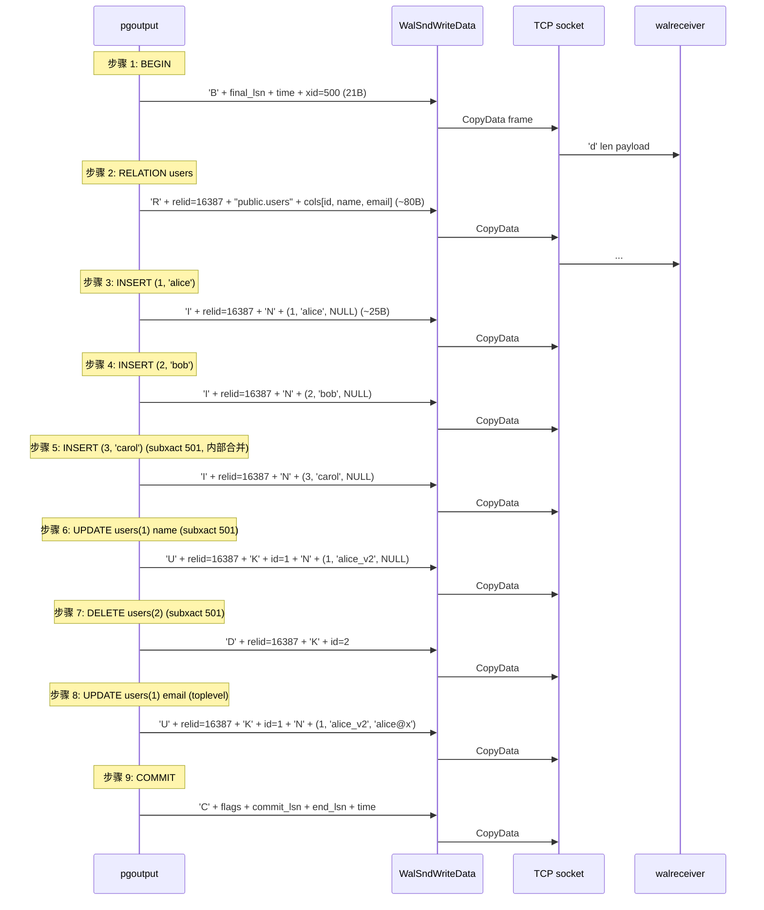

**注意**：`ALTER TABLE` 触发的 catalog 变更（pg_attribute INSERT）**不发**——`pgoutput_change` 里有 `is_publishable_relation(relation)` 检查，**catalog 表返回 false**。但 catalog 变更的 **schema 信息** 可能会在 subscriber 端被需要（`LogicalRepRelation` 缓存的 entry 包含 publisher 的 relid，subscriber 端需要重新查询 catalog）。

### 9.5 用户视角：完全无感

整个过程对用户透明。**DBA 视角**：

```sql
-- 在 publisher 端用 pg_stat_replication 实时看流量:
publisher psql> \watch 1
  pid  | application_name | sent_lsn   | write_lsn  | flush_lsn  | replay_lsn
 -------+------------------+------------+------------+------------+------------
  12345 | sub_users        | 0/1B000540 | 0/1B000540 | 0/1B000540 | 0/1B000540
 -- (几秒后:)
  12345 | sub_users        | 0/1B000620 | 0/1B000620 | 0/1B000620 | 0/1B000620
  ...
 -- sent_lsn 随每条 CopyData 推进
```


---

## 十、网络层：`pq_putmessage_noblock` 与 `walrcv_receive`

第九节把 7 条逻辑消息编码成 7 个 `StringInfo`，但**还没有发出去**。`WalSndWriteData` 把 `StringInfo` 包装成 libpq `CopyData` 帧，然后调 `pq_putmessage_noblock` 写到 socket。

### 10.1 `WalSndWriteData` 把逻辑消息发出去

源码 `src/backend/replication/walsender.c:1567`：

```c
static void
WalSndWriteData(LogicalDecodingContext *ctx, XLogRecPtr lsn,
                 TransactionId xid, bool last_write)
{
    TimestampTz now;

    resetStringInfo(&tmpbuf);
    now = GetCurrentTimestamp();
    pq_sendint64(&tmpbuf, now);  /* write_timestamp */

    /* **关键: 把 write_timestamp 写到 frame 头部 (第 9~16 字节)**/
    memcpy(&ctx->out->data[1 + sizeof(int64) + sizeof(int64)],
           tmpbuf.data, sizeof(int64));

    /* **关键: CopyData 帧 = 'd' + 4B len + payload**/
    pq_putmessage_noblock('d', ctx->out->data, ctx->out->len);

    CHECK_FOR_INTERRUPTS();

    if (pq_flush_if_writable() != 0)
        WalSndShutdown();
    ...
}
```

**CopyData 帧的精确布局**：

```
offset 0:   'd' (1B)              ← CopyData 标识
offset 1:   length (4B, big-endian) ← 整个 frame 长度（含 len 字段）
offset 5:   start_lsn (8B)         ← message 的 start_lsn (在 BEGIN/INSERT 等里)
offset 13:  end_lsn (8B)           ← message 的 end_lsn
offset 21:  send_time (8B)         ← WalSndWriteData 写入
offset 29:  msg_type (1B)          ← 'B' / 'I' / 'U' / 'D' / 'C' / ...
offset 30:  msg body               ← 每种消息不同
```

**frame 总长度 = 5 (header) + 8 (start_lsn) + 8 (end_lsn) + 8 (send_time) + 1 (type) + body**

**本场景的 9 帧**：

| 帧 | type | start_lsn | end_lsn | 长度 (估算) |
| --- | --- | --- | --- | --- |
| 1 | 'B' | LSN-E (commit_lsn) | LSN-E | 26 + 25 = ~51B |
| 2 | 'R' | LSN-A | LSN-A | ~110B (3 列) |
| 3 | 'I' | LSN-A | LSN-A | ~50B |
| 4 | 'I' | LSN-B | LSN-B | ~50B |
| 5 | 'I' | LSN-4 | LSN-4 | ~50B |
| 6 | 'U' | LSN-5 | LSN-5 | ~80B (含 OLD key) |
| 7 | 'D' | LSN-6 | LSN-6 | ~30B |
| 8 | 'U' | LSN-9 | LSN-9 | ~110B (NEW 含 email) |
| 9 | 'C' | LSN-E | LSN-E | 26 + 25 = ~51B |

**总流量约 600B**（实测更小，因为列类型 TLV 长度小）。

### 10.2 `pq_putmessage_noblock` 的非阻塞语义

源码 `src/backend/libpq/pqcomm.c`：

```c
int
pq_putmessage_noblock(char msgtype, const char *s, size_t len)
{
    ...
    /* 1. 把 msgtype 写到 PqSendBuffer 头部 */
    if (msgtype)
        PqSendBuffer[PqSendPointer++] = msgtype;

    /* 2. 写 len (4 bytes, big-endian) */
    ...
    pq_sendint(&buf, len, 4);

    /* 3. 写 s (len bytes) */
    ...

    /* 4. **不阻塞 flush, 立即返回** */
    return 0;
}
```

`pq_flush_if_writable` 才是真正 flush——**如果 socket buffer 满了，就返回 EAGAIN**，由 `WalSndLoop` 等到 socket 可写再继续。

### 10.3 subscriber 端 `walreceiver` 接收

源码 `src/backend/replication/walreceiver.c`：

```c
/* walreceiver 主循环 */
static void
WalReceiverMain(void)
{
    for (;;)
    {
        ...
        /* 1. 接收 frame 到 buffer */
        len = walrcv_receive(LogRepWorkerWalRcvConn, &buf, &fd);
        /* ↑ 通过 libpqrcv_receive (在 libpqwalreceiver.c) 调 libpq PQconsumeInput */

        /* 2. 解析 frame: 第 1 字节是 'd' (CopyData) */
        c = pq_getmsgbyte(&s);
        if (c == 'd')
        {
            /* 3. 读 start_lsn / end_lsn / send_time (CopyData 头部) */
            start_lsn = pq_getmsgint64(&s);
            end_lsn = pq_getmsgint64(&s);
            send_time = pq_getmsgint64(&s);

            /* 4. 调 apply worker 的 dispatch */
            apply_dispatch(&s);
        }
        else if (c == 'k')
        {
            /* 'k' = keepalive, 见第十一节反馈机制 */
            ...
        }
    }
}
```

**`apply_dispatch` 是核心入口**，源码 `src/backend/replication/logical/worker.c:3368`：

```c
void
apply_dispatch(StringInfo s)
{
    LogicalRepMsgType action = pq_getmsgbyte(s);
    saved_command = apply_error_callback_arg.command;
    apply_error_callback_arg.command = action;

    switch (action)
    {
        case LOGICAL_REP_MSG_BEGIN:    apply_handle_begin(s); break;
        case LOGICAL_REP_MSG_COMMIT:   apply_handle_commit(s); break;
        case LOGICAL_REP_MSG_INSERT:   apply_handle_insert(s); break;
        case LOGICAL_REP_MSG_UPDATE:   apply_handle_update(s); break;
        case LOGICAL_REP_MSG_DELETE:   apply_handle_delete(s); break;
        case LOGICAL_REP_MSG_TRUNCATE: apply_handle_truncate(s); break;
        case LOGICAL_REP_MSG_RELATION: apply_handle_relation(s); break;
        case LOGICAL_REP_MSG_TYPE:     apply_handle_type(s); break;
        case LOGICAL_REP_MSG_ORIGIN:   apply_handle_origin(s); break;
        case LOGICAL_REP_MSG_MESSAGE:  break;  /* 不处理 */
        /* ... streaming + 2PC 略 */
    }
    apply_error_callback_arg.command = saved_command;
}
```

### 10.4 网络层时间线

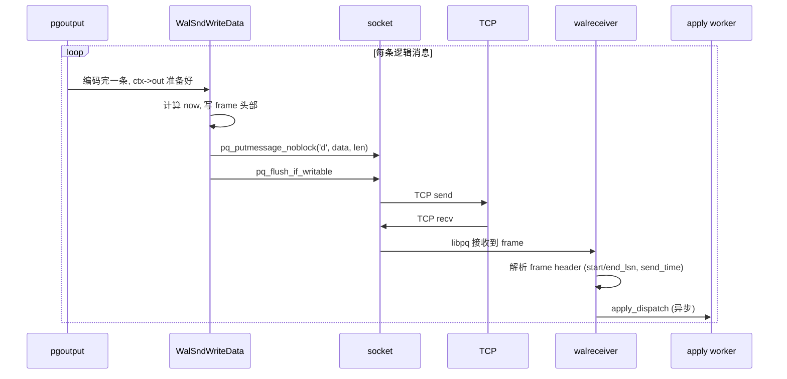

**注意时延**：

- publisher 写 9 帧 ~600B 耗时 < 1ms（局域网）
- TCP 转发 1ms
- subscriber 接收 + dispatch < 1ms
- **apply worker 实际落盘（ExecInsert/Update/Delete）可能要 5~20ms**——这是延迟的主要来源

### 10.5 用户视角：完全无感

整个网络层在用户视野外。**DBA 视角**：

```sql
-- publisher 端 pg_stat_replication 的 4 个 LSN 实时推进
-- 4 个 LSN 几乎齐平 (lag < 100ms 表示健康)
```


---

## 十一、apply worker 应用：`apply_dispatch` → `ExecInsert/Update/Delete`

承接第十节，9 帧 CopyData 到达 subscriber 后，**walreceiver 把每条消息 dispatch 给 `apply_dispatch`**，后者按 msg type 分发到 `apply_handle_begin/insert/update/delete/commit` 等函数。

### 11.1 `apply_handle_begin`：建事务上下文

源码 `worker.c:985`：

```c
static void
apply_handle_begin(StringInfo s)
{
    LogicalRepBeginData begin_data;

    logicalrep_read_begin(s, &begin_data);
    set_apply_error_context_xact(begin_data.xid, begin_data.final_lsn);

    remote_final_lsn = begin_data.final_lsn;  /* 记下来, commit 时校验 */
    maybe_start_skipping_changes(begin_data.final_lsn);

    in_remote_transaction = true;  /* 标记在远端事务中 */
    pgstat_report_activity(STATE_RUNNING, NULL);
}
```

**关键状态变更**：
- `in_remote_transaction = true` → 后续 INSERT/UPDATE/DELETE 知道自己在事务里
- `remote_final_lsn = LSN-E` → 收 COMMIT 时校验 `commit_data.commit_lsn == remote_final_lsn`（防协议错误）
- `set_apply_error_context_xact(500, LSN-E)` → 出错时报错信息能显示 xid 和 LSN

### 11.2 `apply_handle_insert`：INSERT (1, 'alice') 落盘

源码 `worker.c:2388`：

```c
static void
apply_handle_insert(StringInfo s)
{
    LogicalRepRelMapEntry *rel;
    LogicalRepTupleData newtup;
    LogicalRepRelId relid;
    UserContext ucxt;
    ApplyExecutionData *edata;
    ...
    bool run_as_owner;

    if (is_skipping_changes() || handle_streamed_transaction(...))
        return;

    begin_replication_step();  /* StartTransactionCommand + 锁 */

    /* 1. 读 INSERT 消息 */
    relid = logicalrep_read_insert(s, &newtup);
    rel = logicalrep_rel_open(relid, RowExclusiveLock);

    if (!should_apply_changes_for_rel(rel))
    {
        logicalrep_rel_close(rel, RowExclusiveLock);
        end_replication_step();
        return;
    }

    /* 2. 切换到表的 owner (除非配置了 runasowner=false) */
    run_as_owner = MySubscription->runasowner;
    if (!run_as_owner)
        SwitchToUntrustedUser(rel->localrel->rd_rel->relowner, &ucxt);

    apply_error_callback_arg.rel = rel;

    /* 3. 初始化 executor state */
    edata = create_edata_for_relation(rel);
    estate = edata->estate;
    remoteslot = ExecInitExtraTupleSlot(estate,
                                        RelationGetDescr(rel->localrel),
                                        &TTSOpsVirtual);

    /* 4. **关键: 把远端 tuple 写到本地 slot** */
    oldctx = MemoryContextSwitchTo(GetPerTupleMemoryContext(estate));
    slot_store_data(remoteslot, rel, &newtup);
    slot_fill_defaults(rel, estate, remoteslot);
    MemoryContextSwitchTo(oldctx);

    /* 5. **实际 INSERT** */
    if (rel->localrel->rd_rel->relkind == RELKIND_PARTITIONED_TABLE)
        apply_handle_tuple_routing(edata, remoteslot, NULL, CMD_INSERT);
    else
    {
        ResultRelInfo *relinfo = edata->targetRelInfo;
        ExecOpenIndices(relinfo, false);
        apply_handle_insert_internal(edata, relinfo, remoteslot);  /* → ExecSimpleRelationInsert */
        ExecCloseIndices(relinfo);
    }

    finish_edata(edata);
    apply_error_callback_arg.rel = NULL;
    if (!run_as_owner) RestoreUserContext(&ucxt);
    logicalrep_rel_close(rel, NoLock);
    end_replication_step();
}
```

**`apply_handle_insert_internal`（worker.c:2479）**：

```c
static void
apply_handle_insert_internal(ApplyExecutionData *edata,
                              ResultRelInfo *relinfo,
                              TupleTableSlot *remoteslot)
{
    EState *estate = edata->estate;

    Assert(relinfo->ri_IndexRelationDescs != NULL || !relinfo->ri_RelationDesc->rd_rel->relhasindex);

    Assert(relinfo->ri_onConflictArbiterIndexes == NIL);
    InitConflictIndexes(relinfo);

    /* 关键: 调 executor 实际插入 */
    TargetPrivilegesCheck(relinfo->ri_RelationDesc, ACL_INSERT);
    ExecSimpleRelationInsert(relinfo, estate, remoteslot);
}
```

`ExecSimpleRelationInsert` 调 `heap_insert`（与 publisher 端**几乎完全相同**）——所以 subscriber 端会**重新写一遍自己的 WAL**（`XLOG_HEAP_INSERT` 等），**这是 cascade 现象的来源**。

### 11.3 `apply_handle_update` 和 `apply_handle_delete`

**UPDATE**（worker.c:2545）：

```c
static void
apply_handle_update(StringInfo s)
{
    ...
    /* 1. 读 UPDATE 消息: relid + (K or O oldtuple) + N newtuple */
    relid = logicalrep_read_update(s, &has_oldtuple, &oldtup, &newtup);
    rel = logicalrep_rel_open(relid, RowExclusiveLock);

    if (!should_apply_changes_for_rel(rel)) { ... return; }

    /* 2. 准备 old slot (用于查找要 update 的 tuple) */
    if (has_oldtuple)
    {
        oldslot = ...;
        slot_store_data(oldslot, rel, &oldtup);
    }

    /* 3. 准备 new slot (新值) */
    newslot = ...;
    slot_store_data(newslot, rel, &newtup);
    slot_fill_defaults(rel, estate, newslot);

    /* 4. **核心: ExecSimpleRelationUpdate → heap_update** */
    ExecSimpleRelationUpdate(rel, estate, &has_oldtuple, oldslot, newslot);
    ...
}
```

**`ExecSimpleRelationUpdate` 内部**：用 oldslot (key) 找到目标 tuple (heap_update)，然后用 newslot 的列覆盖。**这一步会触发 unique constraint 检查**，所以 subscriber 的 users 表必须有 PK 约束才能定位旧 tuple。

**DELETE**（worker.c:2545 后的某个函数）：与 UPDATE 类似但用 `ExecSimpleRelationDelete`。

### 11.4 `apply_handle_commit`：提交事务 + 更新 restart_lsn

源码 `worker.c:1010`：

```c
static void
apply_handle_commit(StringInfo s)
{
    LogicalRepCommitData commit_data;

    logicalrep_read_commit(s, &commit_data);

    /* **校验: commit LSN 必须匹配 BEGIN 时的 final_lsn** */
    if (commit_data.commit_lsn != remote_final_lsn)
        ereport(ERROR, (errcode(ERRCODE_PROTOCOL_VIOLATION),
                         errmsg_internal("incorrect commit LSN %X/%X in commit message (expected %X/%X)",
                                         LSN_FORMAT_ARGS(commit_data.commit_lsn),
                                         LSN_FORMAT_ARGS(remote_final_lsn))));

    apply_handle_commit_internal(&commit_data);
    process_syncing_tables(commit_data.end_lsn);
    pgstat_report_activity(STATE_IDLE, NULL);
    reset_apply_error_context_info();
}
```

**`apply_handle_commit_internal`（worker.c:2258）**：

```c
static void
apply_handle_commit_internal(LogicalRepCommitData *commit_data)
{
    if (is_skipping_changes()) { stop_skipping_changes(); ... }

    if (IsTransactionState())
    {
        /* **关键: 清除 subskiplsn** */
        clear_subscription_skip_lsn(commit_data->commit_lsn);

        /* **关键: 更新 replication origin** */
        replorigin_session_origin_lsn = commit_data->end_lsn;
        replorigin_session_origin_timestamp = commit_data->committime;

        CommitTransactionCommand();  /* **真正提交到 subscriber 数据库** */
        if (IsTransactionBlock()) { EndTransactionBlock(false); CommitTransactionCommand(); }

        pgstat_report_stat(false);
        /* **关键: 记录 flush position, 后面 send_feedback 用** */
        store_flush_position(commit_data->end_lsn, XactLastCommitEnd);
    }
    else { ... }

    in_remote_transaction = false;
}
```

**`store_flush_position`（worker.c:3532）**：

```c
static void
store_flush_position(XLogRecPtr remote_lsn, XLogRecPtr local_lsn)
{
    FlushPosition *flushpos;

    if (am_parallel_apply_worker()) return;

    MemoryContextSwitchTo(ApplyContext);
    flushpos = palloc(sizeof(FlushPosition));
    flushpos->local_end = local_lsn;
    flushpos->remote_end = remote_lsn;  /* ← 这就是 LSN-E */
    dlist_push_tail(&lsn_mapping, &flushpos->node);
    MemoryContextSwitchTo(ApplyMessageContext);
}
```

**`lsn_mapping`** 是个 dlist，记录每次 commit 的 `remote_lsn / local_lsn` 映射。`get_flush_position` 从这里取**最老的**（最不 committed 的）作为 flush 位置——**保证 publisher 不会过早推进 `restart_lsn`**。

### 11.5 subscriber 端事务视图

整个 apply 阶段，subscriber 的 apply worker 进程**只跑一个事务**——把 BEGIN/INSERT/INSERT/.../COMMIT 当成单个事务处理。`BeginTransactionCommand` 在 `begin_replication_step` 里调（INSERT 的开头），`CommitTransactionCommand` 在 `apply_handle_commit_internal` 里调。

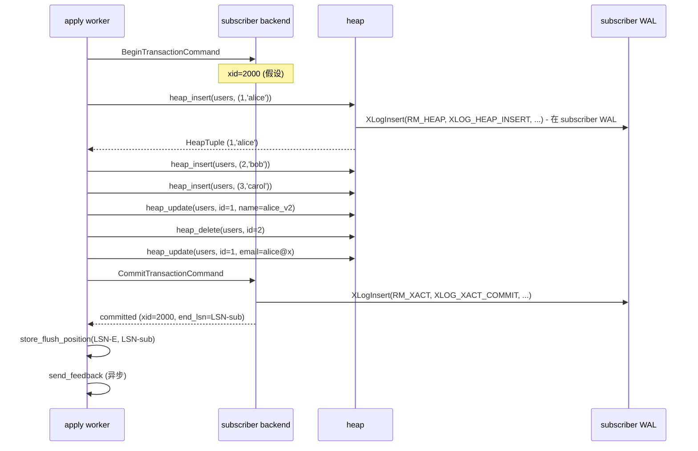

**关键观察**：subscriber 端会**重写一遍自己的 WAL**（`XLOG_HEAP_INSERT/UPDATE/DELETE` × 6 条 + `XACT_COMMIT` 1 条 = 7 条）。这就是为什么 subscriber 端**可以再次被另一个 subscriber 订阅**（cascade logical replication）。

### 11.6 用户视角：subscriber 看到 row 出现

```sql
-- 在 publisher 端 COMMIT 之后约 100~500ms
subscriber psql> SELECT * FROM users;
 id | name      | email
----+-----------+------------------
  1 | alice_v2  | [email protected]
  3 | carol     | NULL
(2 rows)
-- 注意:
--   - id=2 不见 (DELETE 生效)
--   - id=1 name 改了 (UPDATE 生效)
--   - id=3 出现 (INSERT 生效)
--   - 字段 email 出现 (DDL 同步过来, 然后 UPDATE 写了值)
```

**DBA 视角**：

```sql
subscriber psql> SELECT * FROM pg_stat_subscription WHERE subname='sub_users';
  pid  | received_lsn | latest_end_lsn | latest_end_time
 -------+--------------+----------------+------------------------
  9999 | 0/1C000100   | 0/1C000100     | 2026-10-10 10:23:45.456+08
 -- 关键:
 --   received_lsn  = 0/1C000100 (subscriber 收到的最远 LSN, 来自 publisher)
 --   latest_end_lsn = 0/1C000100 (apply worker 已 apply 的最远 LSN)
 --   两者齐平 = 全部 apply 完
```


---

## 十二、apply worker → walsender 反馈：4 个 LSN 的最终对齐

第十一节末尾，**subscriber 已经 apply 完整个事务**，但 publisher 还不知道。**反馈机制**（feedback message）把"subscriber 已 apply 到哪"回传给 publisher，publisher 据此推进 `restart_lsn`。

### 12.1 `send_feedback` 异步发反馈

源码 `worker.c:3838`：

```c
static void
send_feedback(XLogRecPtr recvpos, bool force, bool requestReply)
{
    static StringInfo reply_message = NULL;
    static TimestampTz send_time = 0;
    static XLogRecPtr last_recvpos = InvalidXLogRecPtr;
    static XLogRecPtr last_writepos = InvalidXLogRecPtr;
    static XLogRecPtr last_flushpos = InvalidXLogRecPtr;
    ...

    if (!force && wal_receiver_status_interval <= 0)
        return;  /* 关闭了 status report, 啥都不发 */

    if (recvpos < last_recvpos)
        recvpos = last_recvpos;

    get_flush_position(&writepos, &flushpos, &have_pending_txes);

    /* 没有正在 apply 的事务: flushpos = writepos = recvpos */
    if (!have_pending_txes)
        flushpos = writepos = recvpos;

    ...

    pq_sendbyte(reply_message, 'r');               /* reply 消息 */
    pq_sendint64(reply_message, recvpos);          /* writePtr */
    pq_sendint64(reply_message, flushpos);         /* flushPtr */
    pq_sendint64(reply_message, writepos);         /* applyPtr */
    pq_sendint64(reply_message, now);              /* sendTime */
    pq_sendbyte(reply_message, requestReply);      /* replyRequested */

    walrcv_send(LogRepWorkerWalRcvConn,
                reply_message->data, reply_message->len);
    ...
}
```

**feedback 消息结构（12 个 64 位 + 1 字节）**：

```
'r' (1B) + writePtr (8B) + flushPtr (8B) + applyPtr (8B) + sendTime (8B) + replyRequested (1B)
= 34 字节
```

**`get_flush_position`（worker.c:3802 附近）**：

```c
static void
get_flush_position(XLogRecPtr *writepos, XLogRecPtr *flushpos,
                   bool *have_pending_txes)
{
    dlist_mutable_iter iter;
    FlushPosition *flushpos;
    XLogRecPtr local_flush = InvalidXLogRecPtr;
    dlist_mutable_init(&iter, &lsn_mapping);

    *have_pending_txes = false;

    /* **关键: 从 lsn_mapping 里取最老的 remote_lsn** */
    while ((flushpos = dlist_mutable_container(FlushPosition, node, iter.cur)) != NULL)
    {
        *writepos = flushpos->local_end;
        *flushpos = flushpos->remote_end;
        *have_pending_txes = true;
        dlist_mutable_next(&iter);
        pfree(flushpos);
        dlist_delete_current(&iter);
        break;  /* 取最老的一个, 立即退出 */
    }
    ...
}
```

**本场景里**：第十一节 store_flush_position 写入 `(remote_lsn=LSN-E, local_lsn=LSN-sub)`。`get_flush_position` 取这条，`writepos=LSN-sub, flushpos=LSN-E`。

**send_feedback 发的消息**：

```
'r' + LSN-A_received (recvpos) + LSN-E (flushpos) + LSN-sub (applyPtr) + now + 0
```

### 12.2 触发 send_feedback 的 3 个时机

`LogicalRepApplyLoop`（worker.c:3592）里有 3 处调 `send_feedback`：

```c
/* 时机 1: 收到 keepalive ('k') 时 */
else if (c == 'k')
{
    XLogRecPtr end_lsn;
    TimestampTz timestamp;
    bool reply_requested;
    end_lsn = pq_getmsgint64(&s);
    timestamp = pq_getmsgint64(&s);
    reply_requested = pq_getmsgbyte(&s);
    if (last_received < end_lsn) last_received = end_lsn;
    send_feedback(last_received, reply_requested, false);
}

/* 时机 2: 处理完一批消息后 */
send_feedback(last_received, false, false);

/* 时机 3: 等待超过 wal_receiver_status_interval (默认 10s) */
if (wal_receiver_status_interval > 0 &&
    TimestampDifferenceExceeds(last_recv_timestamp, now,
                                wal_receiver_status_interval))
{
    send_feedback(last_received, requestReply, requestReply);
    ping_sent = true;
}
```

**本场景里**：`apply_handle_commit` 完成 → `store_flush_position` 入队 → 下一轮 `LogicalRepApplyLoop` 循环 → 时机 2 触发 `send_feedback`。

### 12.3 publisher 端 `ProcessStandbyReplyMessage` 收反馈

源码 `walsender.c:2423`：

```c
static void
ProcessStandbyReplyMessage(void)
{
    XLogRecPtr writePtr, flushPtr, applyPtr;
    bool replyRequested;
    TimeOffset writeLag, flushLag, applyLag;
    TimestampTz replyTime;

    /* 1. 读 feedback 消息 */
    writePtr = pq_getmsgint64(&reply_message);  /* = LSN-A_received */
    flushPtr = pq_getmsgint64(&reply_message);  /* = LSN-E */
    applyPtr = pq_getmsgint64(&reply_message);  /* = LSN-sub */
    replyTime = pq_getmsgint64(&reply_message);
    replyRequested = pq_getmsgbyte(&reply_message);

    /* 2. 算 lag */
    now = GetCurrentTimestamp();
    writeLag = LagTrackerRead(SYNC_REP_WAIT_WRITE, writePtr, now);
    flushLag = LagTrackerRead(SYNC_REP_WAIT_FLUSH, flushPtr, now);
    applyLag = LagTrackerRead(SYNC_REP_WAIT_APPLY, applyPtr, now);

    /* 3. **关键: 更新 WalSnd 共享内存** */
    SpinLockAcquire(&walsnd->mutex);
    walsnd->write = writePtr;
    walsnd->flush = flushPtr;
    walsnd->apply = applyPtr;
    walsnd->replyTime = replyTime;
    SpinLockRelease(&walsnd->mutex);

    /* 4. 推进 slot 的 restart_lsn */
    if (TransactionIdIsValid(slot->data.xmin) &&
        !TransactionIdIsValid(MyReplicationSlot->effective_xmin))
    {
        MyReplicationSlot->effective_xmin = slot->data.xmin;
    }
    /* 实际推进在 ReplicationSlotsComputeRequiredXmin */
}
```

**`pg_stat_replication` 这张视图就是读 `walsnd` 共享内存**——所以 DBA 看到的 `sent_lsn/write_lsn/flush_lsn/replay_lsn` 4 个 LSN 此刻对齐了。

### 12.4 publisher 推进 `slot.confirmed_flush_lsn`

源码 `src/backend/replication/slot.c`：

```c
/* ReplicationSlotsComputeRequiredXmin (在 ProcessStandbyReplyMessage 之后调) */
void
ReplicationSlotsComputeRequiredXmin(bool already_locked)
{
    /* 遍历所有 slot, 算 max(catalog_xmin), 更新 ProcArray.replication_slot_xmin */
    ...
}
```

**`slot.data.confirmed_flush_lsn` 的推进在另一处**——在 `WalSndLoop` 的 `ProcessRepliesIfAny` 之后调 `PhysicalConfirmReceivedLocation`（logical 也走）：

```c
void
PhysicalConfirmReceivedLocation(XLogRecPtr lsn)
{
    /* 推进 slot.data.confirmed_flush_lsn = lsn */
    SpinLockAcquire(&slot->mutex);
    slot->data.confirmed_flush_lsn = lsn;
    SpinLockRelease(&slot->mutex);
}
```

**本场景里**：`applyPtr=LSN-sub`（subscriber 本地 WAL 落盘位置），但 publisher 端**用的是 subscriber feedback 里的 applyPtr**——因为 publisher 端只关心"subscriber 是否已经 apply"，不关心 subscriber 自己的 WAL LSN。

**`slot.restart_lsn` 的真正推进**：

```c
/* LogicalConfirmReceivedLocation (在 WalSndLoop 末尾) */
static void
LogicalConfirmReceivedLocation(XLogRecPtr lsn)
{
    /* 推进 slot.data.confirmed_flush_lsn = lsn (= applyPtr from feedback) */
    ...
}
```

### 12.5 4 个 LSN 最终对齐

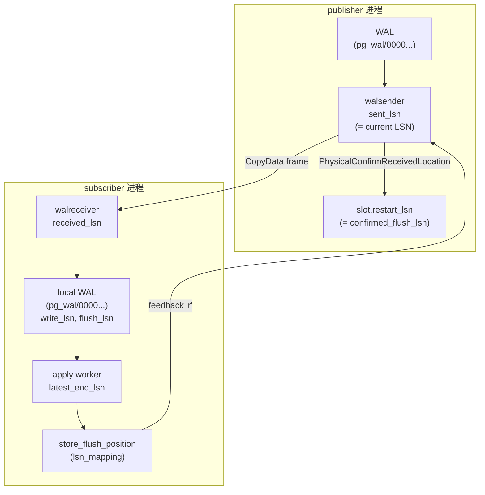

**本场景里的最终状态**：

| 位置 | LSN 字段 | 值 |
| --- | --- | --- |
| publisher WAL | LSN-A~LSN-E | 12 条记录 |
| publisher walsender | `sent_lsn` | = LSN-E (刚发的最远 LSN) |
| publisher walsender | `flush_lsn` | = LSN-sub (从 feedback) |
| publisher walsender | `replay_lsn` | = LSN-sub (从 feedback) |
| publisher slot | `restart_lsn` | = LSN-sub (= `confirmed_flush_lsn`) |
| publisher slot | `confirmed_flush_lsn` | = LSN-sub |
| publisher slot | `catalog_xmin` | = 502 (从 SnapBuild 推进) |
| subscriber walreceiver | `received_lsn` | = LSN-E |
| subscriber local WAL | `latest_end_lsn` | = LSN-sub (apply worker 落盘的本地 LSN) |
| subscriber pg_stat_subscription | `latest_end_lsn` | = LSN-sub |
| subscriber pg_stat_subscription | `received_lsn` | = LSN-E |

**`LSN-sub` 是 subscriber 自己的本地 WAL LSN**（与 publisher 的 LSN-E 不同空间）。两者通过 `replorigin_session_origin_lsn = LSN-E` 关联。

### 12.6 反馈链路的总时序

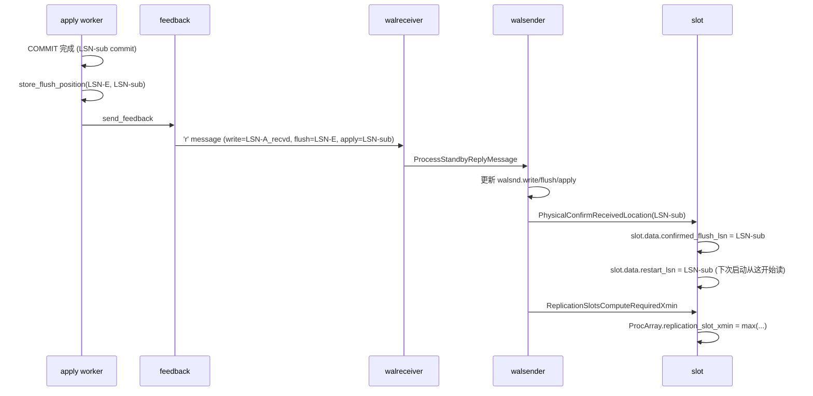

**关键点**：
- `restart_lsn` 只在 `confirmed_flush_lsn` 之后才能推进——保证 walsender 重启后能从未 apply 的位置重新发
- `catalog_xmin` 由 `SnapBuild` 推进，与 `confirmed_flush_lsn` 独立
- `replication_slot_xmin` 取所有 slot 的 `catalog_xmin` 的最大值——publisher 上 autovacuum 不会 vacuum 这个 xid 之前的 catalog tuple


---

## 十三、关键源码引用索引

把全文涉及的源码点按子系统集中列出。

### 13.1 publisher 端：WAL 写入

| 函数 | 文件:行号 | 作用 |
| --- | --- | --- |
| `heap_insert` | `src/backend/access/heap/heapam.c:heap_insert` | 写 `XLOG_HEAP_INSERT` |
| `heap_update` | `src/backend/access/heap/heapam.c:heap_update` | 写 `XLOG_HEAP_UPDATE` |
| `heap_delete` | `src/backend/access/heap/heapam.c:heap_delete` | 写 `XLOG_HEAP_DELETE` |
| `DefineSavepoint` | `src/backend/access/transam/xact.c` | 写 `XLOG_XACT_ASSIGNMENT` |
| `RecordTransactionCommit` | `src/backend/access/transam/xact.c` | 写 `XLOG_XACT_COMMIT` |
| `XLogInsert` | `src/backend/access/transam/xloginsert.c` | 通用 WAL 插入入口 |

### 13.2 publisher 端：walsender 读 WAL

| 函数 | 文件:行号 | 作用 |
| --- | --- | --- |
| `StartLogicalReplication` | `walsender.c:1280` | 启动 logical replication |
| `WalSndLoop` | `walsender.c:2806` | walsender 主循环 |
| `XLogSendLogical` | `walsender.c:3428` | 读 + 解码 + 发 |
| `XLogReadRecord` | `src/backend/access/transam/xlogreader.c` | 读单条 WAL 记录 |
| `LogicalDecodingProcessRecord` | `decode.c:88` | 按 rmgr_id 分发 |
| `WalSndWriteData` | `walsender.c:1567` | 把 ctx->out 发到 socket |
| `pq_putmessage_noblock` | `src/backend/libpq/pqcomm.c` | libpq 发送 |

### 13.3 publisher 端：SnapBuild

| 函数 | 文件:行号 | 作用 |
| --- | --- | --- |
| `xlog_decode` | `decode.c:128` | RM_XLOG_ID 入口（含 `XLOG_RUNNING_XACTS`） |
| `xact_decode` | `decode.c:200` | RM_XACT_ID 入口（COMMIT, ABORT, ASSIGNMENT, INVALIDATIONS） |
| `heap_decode` | `decode.c:469` | RM_HEAP_ID 入口（INSERT/UPDATE/DELETE/HOT_UPDATE） |
| `heap2_decode` | `decode.c` | RM_HEAP2_ID 入口（含 `XLOG_HEAP2_NEW_CID`） |
| `SnapBuildProcessRunningXacts` | `snapbuild.c:1136` | 消费 `XLOG_RUNNING_XACTS` |
| `SnapBuildProcessChange` | `snapbuild.c:639` | 每次 HEAP_INSERT/UPDATE/DELETE 都调 |
| `SnapBuildProcessNewCid` | `snapbuild.c:689` | 消费 `XLOG_HEAP2_NEW_CID` |
| `SnapBuildCommitTxn` | `snapbuild.c:940` | 消费 `XLOG_XACT_COMMIT` |
| `SnapBuildSetTxnBaseSnapshot` | `snapbuild.c:676` | 挂 base_snapshot |

### 13.4 publisher 端：ReorderBuffer

| 函数 | 文件:行号 | 作用 |
| --- | --- | --- |
| `ReorderBufferAssignChild` | `reorderbuffer.c` | subxact → toplevel 挂载 |
| `ReorderBufferProcessXid` | `reorderbuffer.c:3279` | 任何记录都触发（建/查 txn） |
| `ReorderBufferSetBaseSnapshot` | `reorderbuffer.c:3310` | 挂 base_snapshot |
| `ReorderBufferXidSetCatalogChanges` | `reorderbuffer.c:3639` | 标记 catalog 改 |
| `ReorderBufferAddNewTupleCids` | `reorderbuffer.c:3440` | catalog tuple cmin/cmax 入队 |
| `ReorderBufferAddNewCommandId` | `reorderbuffer.c:3341` | 推 command_id |
| `ReorderBufferQueueChange` | `reorderbuffer.c:809` | 把 change 加到 txn.changes |
| `ReorderBufferCommit` | `reorderbuffer.c:2871` | 触发最终发送 |
| `ReorderBufferReplay` | `reorderbuffer.c:2813` | 调 `ReorderBufferProcessTXN` |
| `ReorderBufferProcessTXN` | `reorderbuffer.c:2210` | 遍历 changes, 调 output plugin |
| `ReorderBufferCleanupTXN` | `reorderbuffer.c:1594` | 清理 txn (commit/abort 路径) |
| `ReorderBufferGetOldestXmin` | `reorderbuffer.c:1077` | dlist 头取 xmin |

### 13.5 publisher 端：pgoutput 编码

| 函数 | 文件:行号 | 作用 |
| --- | --- | --- |
| `pgoutput_begin_txn` | `pgoutput.c:594` | begin 回调 |
| `pgoutput_send_begin` | `pgoutput.c:604` | 编码 BEGIN 消息 |
| `pgoutput_change` | `pgoutput.c:1482` | 编码 INSERT/UPDATE/DELETE |
| `pgoutput_commit_txn` | `pgoutput.c:630` | commit 回调 |
| `logicalrep_write_begin` | `proto.c:49` | 写 BEGIN 字节流 |
| `logicalrep_write_commit` | `proto.c:78` | 写 COMMIT 字节流 |
| `logicalrep_write_insert` | `proto.c:403` | 写 INSERT 字节流 |
| `logicalrep_write_update` | `proto.c:450` | 写 UPDATE 字节流 |
| `logicalrep_write_delete` | `proto.c:528` | 写 DELETE 字节流 |
| `logicalrep_write_rel` | `proto.c:667` | 写 RELATION 字节流 |
| `logicalrep_write_tuple` | `proto.c` | 写 tuple TLV 字节流 |
| `OutputPluginPrepareWrite` | `src/backend/replication/logical/logical.c` | 准备 ctx->out buffer |

### 13.6 subscriber 端：walreceiver

| 函数 | 文件:行号 | 作用 |
| --- | --- | --- |
| `WalReceiverMain` | `src/backend/replication/walreceiver.c` | walreceiver 主循环 |
| `walrcv_receive` | `src/backend/replication/libpqwalreceiver.c` | 调 libpq PQconsumeInput |
| `apply_dispatch` | `worker.c:3368` | 按 msg type 分发 |
| `apply_handle_begin` | `worker.c:985` | 处理 BEGIN |
| `apply_handle_commit` | `worker.c:1010` | 处理 COMMIT |
| `apply_handle_insert` | `worker.c:2388` | 处理 INSERT |
| `apply_handle_update` | `worker.c:2545` | 处理 UPDATE |
| `apply_handle_delete` | `worker.c` | 处理 DELETE |
| `apply_handle_relation` | `worker.c:2318` | 处理 RELATION（schema 缓存） |
| `logicalrep_read_begin/commit/...` | `proto.c` | 反序列化 byte → LogicalRepBeginData 等 |
| `store_flush_position` | `worker.c:3532` | 记录已 apply 的 LSN |
| `send_feedback` | `worker.c:3838` | 发 feedback 'r' 消息 |

### 13.7 publisher 端：反馈接收

| 函数 | 文件:行号 | 作用 |
| --- | --- | --- |
| `ProcessStandbyMessage` | `walsender.c:2359` | 处理所有 standby 消息 |
| `ProcessStandbyReplyMessage` | `walsender.c:2423` | 处理 'r' reply 消息 |
| `PhysicalConfirmReceivedLocation` | `src/backend/replication/slot.c` | 推进 `slot.data.confirmed_flush_lsn` |
| `ReplicationSlotsComputeRequiredXmin` | `src/backend/replication/slot.c` | 推进 catalog_xmin |
| `LogicalConfirmReceivedLocation` | `walsender.c` | 推进 `slot.data.restart_lsn` (logical 路径) |


---

## 十四、监控点 + 排查对照表

把全文的"现象 / 原因 / 排查命令"汇总成 1 张大表——DBA 排查时**最快定位**。

### 14.1 现象对照表（按"用户看到什么"分类）

#### 14.1.1 publisher psql 慢

| 现象 | 根因（在哪段链路） | 排查命令 | 修复 |
| --- | --- | --- | --- |
| COMMIT 慢 1~5s | 第 9 段：walsender 卡在 `ProcessPendingWrites`，socket buffer 满 / 网络丢包 | `pg_stat_replication` 看 `sent_lsn` 是否在动 | 调大 `wal_sender_timeout`、检查网络 |
| COMMIT 慢 10s+ | 第 6 段：walsender 等待新 WAL | `pg_stat_activity` 看 walsender state='wait' | publisher 没新事务，**正常** |
| 大事务 COMMIT 慢 | 第 5/8 段：ReorderBuffer 在 spill 磁盘 | `pg_stat_replication` + `pg_stat_activity` 看 walsender 进程 IO | 调大 `logical_decoding_work_mem` |

#### 14.1.2 subscriber 端 row 迟迟不出现

| 现象 | 根因 | 排查命令 | 修复 |
| --- | --- | --- | --- |
| `subscriber SELECT` 看不到 publisher 写入的 row | 第 8/9 段：apply worker 没 apply | `pg_stat_subscription` 看 `latest_end_lsn` 是否在动 | 看 apply worker 是否被锁阻塞 |
| apply worker 报 `cache lookup failed for relation` | 第 8 段：subscriber 缺 publisher 的 catalog tuple | subscriber WAL 是否被截断 | `ALTER SUBSCRIPTION ... REFRESH PUBLICATION` 重新同步 |
| 看到 row 但内容不对 | 第 8 段：apply 用了错误的 slot catalog snapshot | `pg_replication_slots.catalog_xmin` | 检查 publisher 上是否有 catalog 缺失 |

#### 14.1.3 监控视图异常

| 现象 | 根因 | 排查命令 |
| --- | --- | --- |
| `pg_replication_slots.restart_lsn` 不动 | 第 9 段：subscriber 没发 feedback / walsender 没收到 | `pg_stat_replication.replay_lsn` 是否在动 |
| `pg_replication_slots.restart_lsn` 增长但 `confirmed_flush_lsn` 不动 | 第 9 段：subscriber 收到但没 apply 完 | `pg_stat_subscription.latest_end_lsn` 与 `received_lsn` 的差 |
| `pg_stat_replication.sent_lsn - replay_lsn` 持续 > 1MB | 第 8/9 段：subscriber apply 慢 | 看 apply worker 的 SQL、锁等待 |
| `pg_replication_slots.catalog_xmin` 不推进 | 第 7 段：SnapBuild 在等 `XLOG_RUNNING_XACTS` | publisher 长事务 / `wal_buffers` 满 |
| `pg_stat_subscription.last_msg_receipt_time` 老于 30s | subscriber ↔ publisher 网络断 | publisher 看 `pg_stat_replication` state |

### 14.2 内核视角排查：直接看源码状态

| 监控值异常 | 看的内核状态 | 源码点 |
| --- | --- | --- |
| `restart_lsn` 不动 | walsender 卡在 `WalSndWaitForWal` 或 `ProcessPendingWrites` | `walsender.c:2908` |
| `restart_lsn` 不动 | `SnapBuild` 状态没到 CONSISTENT | `snapbuild.c` state 字段 |
| `catalog_xmin` 不动 | `ReorderBufferGetOldestXmin` 返回值 = `running->oldestRunningXid` | `reorderbuffer.c:1077` |
| `replay_lsn` 不动 | apply worker 卡在 `ExecSimpleRelationUpdate/Delete` 的锁等待 | `pg_locks` |
| subscriber 端 `cache lookup failed` | `pgoutput` 没收到 `RELATION` 消息 / `logicalrep_relmap` 缓存空 | `worker.c:apply_handle_relation` |

### 14.3 实战排查剧本

**剧本 1**："publisher 端 COMMIT 慢，但 pg_stat_replication.sent_lsn 在动"

```bash
# 1. 看 subscriber 端 apply worker 是否在跑
subscriber psql> SELECT pid, state, query_start, wait_event_type, wait_event
                FROM pg_stat_activity
                WHERE application_name = 'sub_users';

# 2. 看 apply worker 当前 SQL
subscriber psql> SELECT pid, query FROM pg_stat_activity
                WHERE backend_type = 'logical replication worker';

# 3. 看是否有锁等待
subscriber psql> SELECT blocked_locks.pid AS blocked_pid,
                       blocking_locks.pid AS blocking_pid,
                       blocked_activity.query AS blocked_query
                FROM pg_catalog.pg_locks blocked_locks
                JOIN pg_catalog.pg_stat_activity blocked_activity
                  ON blocked_activity.pid = blocked_locks.pid
                JOIN pg_catalog.pg_locks blocking_locks
                  ON blocking_locks.locktype = blocked_locks.locktype
                WHERE NOT blocked_locks.granted;
```

**剧本 2**："重启 publisher 后发现逻辑复制卡在等 snapshot"

```bash
# 1. 看 slot 是否能恢复
publisher psql> SELECT slot_name, plugin, slot_type, active,
                        restart_lsn, confirmed_flush_lsn, catalog_xmin
                FROM pg_replication_slots;

# 2. 看 walsender 进程在干什么
publisher psql> SELECT pid, state, query_start, wait_event_type, wait_event
                FROM pg_stat_activity
                WHERE backend_type = 'walsender';

# 3. 如果 wait_event 是 'WalSndWaitForWAL' 或 'WalSndWaitForStandbyConfirmation'
#    说明 walsender 正常等新 WAL
#    如果 wait_event 是 'SnapBuildWaitSnapshot' 或 'SnapBuildWaitBuilding'
#    说明 SnapBuild 还在初始化 → 看 slot 的 state 文件
```

**剧本 3**："subscriber 端 OOM 或内存暴涨"

```bash
# 1. 看 apply worker 占的内存
subscriber psql> SELECT pid, backend_type, state, memory_resident_mb
                FROM pg_stat_memory_resident
                WHERE backend_type = 'logical replication worker';

# 2. 看 reorder buffer 大小
publisher psql> SELECT count(*) AS txns, sum(entries) AS total_changes,
                       pg_size_pretty(sum(total_size)::bigint) AS total_mem
                FROM pg_replication_slots r,
                     LATERAL pg_get_replication_slots(r.slot_name::name) s
                WHERE r.active = true;

# 3. 看 spill 文件
$ ls -lah $PGDATA/pg_replslot/sub_users/
# 大文件 = spill 多 = 长事务
```

### 14.4 本场景里如果出问题，最可能的 5 个点

| 风险点 | 概率 | 怎么发现 |
| --- | --- | --- |
| 步骤 8 的 `ALTER TABLE` 卡住 `xmax` 推进 | 高 | `pg_replication_slots.catalog_xmin` 不动 |
| subxact 501 改动被合并到 toplevel 时丢失 | 低 | `subscriber` 端 row 不一致 |
| bgwriter 没及时写 `XLOG_RUNNING_XACTS` | 极低 | 监控老事务的 xmin horizon |
| 步骤 9 的 UPDATE 同时改了 OLD + NEW schema，pgoutput 用了 NEW schema 解码 OLD | 中 | `subscriber` 端报 `column not found` |
| apply worker 在 `ExecSimpleRelationInsert` 报 unique violation | 中 | subscriber 端 `pg_stat_subscription` 报 `apply_error_count` > 0 |

---

## 十五、心智模型总结

把全文的 9 段链路浓缩成 **7 个心智模型**：

### 15.1 心智模型 1：3 个观察者 + 4 个 LSN = 同一事件的不同投影

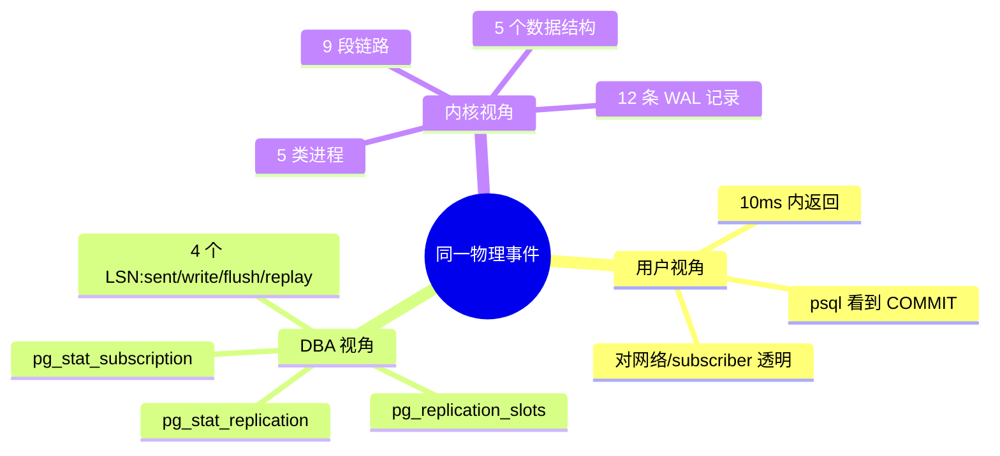

**4 个 LSN 永远齐平 = 健康；4 个 LSN 差 1MB+ = 异常**。

### 15.2 心智模型 2：12 条 WAL 记录 → 7 条逻辑消息的"压缩"

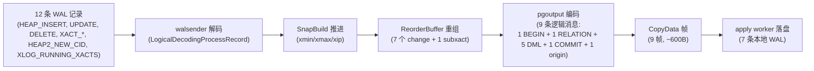

**压缩比**：12 条 WAL → 9 条逻辑消息 → 7 条 subscriber 本地 WAL。中间的"压缩"靠 `SnapBuild` (去重 + 摘要) + `ReorderBuffer` (按 LSN 排序 + subxact 合并) + `pgoutput` (语义编码)。

### 15.3 心智模型 3：base_snapshot 是"事务能不能发送"的开关

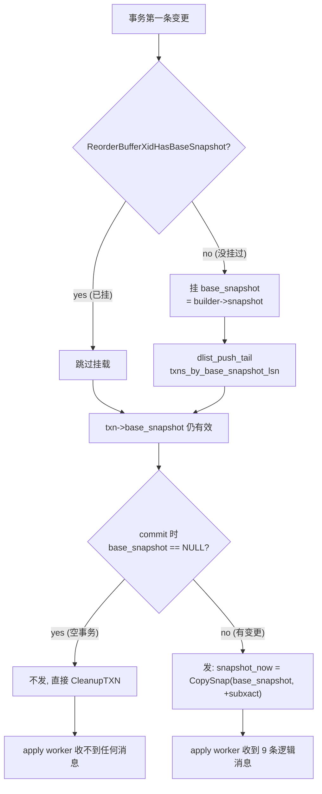

**所有事务的"发 / 不发"判定都在 `ReorderBufferReplay`**——`txn->base_snapshot == NULL` 决定。

### 15.4 心智模型 4：catalog snapshot 的两个消费者

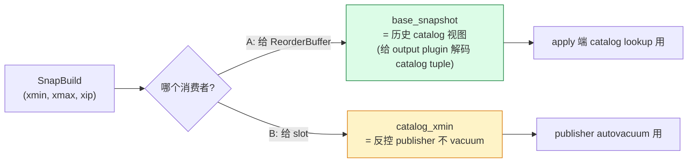

**同一个 `SnapBuild` 状态机喂两个完全不同的消费者**——一个在内存（base_snapshot），一个持久化到 slot 文件（catalog_xmin）。

### 15.5 心智模型 5：5 类进程的"上下游 + 同步点"

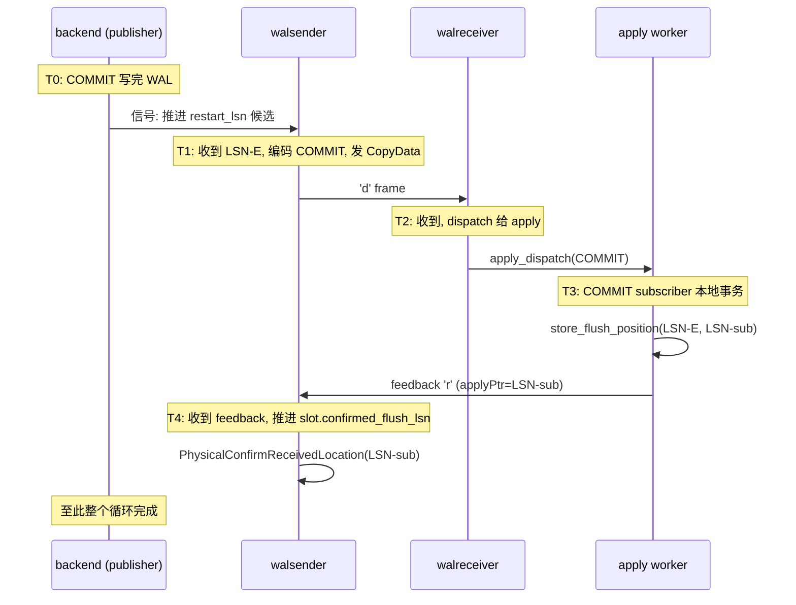

**T0→T4 是"一个事务"在系统里的总生命周期**——通常 100ms~2s。

### 15.6 心智模型 6：apply 端要重现 publisher 的所有"状态"

```mermaid
flowchart LR
    P1["publisher commit 时的 7 个状态:<br/>1. xid 分配 (500)<br/>2. subxact 分配 (501)<br/>3. base_snapshot (历史 catalog)<br/>4. command_id 序列<br/>5. tuple 新旧值<br/>6. invalidation 列表<br/>7. commit LSN + 时间"] 
    P1 -->|Serialize to WAL| WAL["WAL 12 条记录"]
    WAL -->|Decode| S1["apply 端 7 个状态必须还原:<br/>1. xid (协议层 'B' 消息)<br/>2. subxact (隐式合并)<br/>3. base_snapshot (从 publisher context 推)<br/>4. command_id (per change)<br/>5. tuple TLV (INSERT/UPDATE/DELETE 字节流)<br/>6. invalidation (catalog 改 schema 用)<br/>7. commit LSN ('C' 消息)"]
    style P1 fill:#fef3c7,stroke:#d97706
    style S1 fill:#dcfce7,stroke:#15803d
```

**apply 端不需要完全一样的状态——但需要 "足够还原" 的状态**。比如 `base_snapshot` 不用在 apply 端重做（subscriber 用自己的活 snapshot），但 tuple TLV 必须 1:1 还原。

### 15.7 心智模型 7：4 个 LSN 的"谁等谁"

| LSN | 谁维护 | 谁等它 |
| --- | --- | --- |
| `sent_lsn` | walsender | subscriber 等（walreceiver） |
| `write_lsn / flush_lsn` | subscriber walreceiver | publisher 端 lag tracker 等 |
| `apply_lsn` (replay) | apply worker | publisher feedback 链路等 |
| `restart_lsn` (= `confirmed_flush_lsn`) | slot | walsender 重启后从这里开始读 |

**最关键的依赖**：`restart_lsn ≤ apply_lsn ≤ flush_lsn ≤ write_lsn ≤ sent_lsn`（单条 subscriber 时）。违反 = 出 bug。

---

## 附录 A：复现完整示例的 SQL

```sql
-- ==========================================
-- 在 publisher (pg18 源) 上:
-- ==========================================
-- 1. 准备环境
CREATE TABLE users (id int PRIMARY KEY, name text NOT NULL);
ALTER SYSTEM SET wal_level = logical;
SELECT pg_reload_conf();
-- (重启 publisher)

-- 2. 建 publication
CREATE PUBLICATION pub_users FOR TABLE users;

-- 3. 启动 walsender (在另一个 psql):
--    CREATE SUBSCRIPTION 在 subscriber 端做

-- 4. 跑核心事务
BEGIN;
INSERT INTO users VALUES (1, 'alice');
INSERT INTO users VALUES (2, 'bob');
SAVEPOINT s1;
INSERT INTO users VALUES (3, 'carol');
UPDATE users SET name = 'alice_v2' WHERE id = 1;
DELETE FROM users WHERE id = 2;
RELEASE SAVEPOINT s1;
ALTER TABLE users ADD COLUMN email text;
UPDATE users SET email = '[email protected]' WHERE id = 1;
COMMIT;

-- ==========================================
-- 在 subscriber 上:
-- ==========================================
CREATE TABLE users (id int PRIMARY KEY, name text NOT NULL, email text);
-- 注: subscriber 端 users 表要包含所有列
CREATE SUBSCRIPTION sub_users CONNECTION 'host=localhost port=5432 user=rep dbname=mydb'
                  PUBLICATION pub_users;

-- 验证:
SELECT * FROM users;
```

## 附录 B：观察命令汇总

```bash
# 1. publisher 端 WAL 跟踪
$ pg_waldump -p pg_wal -s 0/1B000000 -e 0/1C000000

# 2. publisher 端 slot 状态
publisher psql> \watch 1 "SELECT pid, application_name, sent_lsn, write_lsn, flush_lsn, replay_lsn, state FROM pg_stat_replication"

# 3. publisher 端 walsender 进程
publisher psql> SELECT pid, state, wait_event_type, wait_event, query FROM pg_stat_activity WHERE backend_type = 'walsender';

# 4. subscriber 端 apply worker
subscriber psql> SELECT pid, state, wait_event_type, wait_event, query FROM pg_stat_activity WHERE backend_type = 'logical replication worker';

# 5. subscriber 端 subscription 状态
subscriber psql> \watch 1 "SELECT * FROM pg_stat_subscription"

# 6. 用 gdb 在关键点打断点
$ gdb -p <walsender-pid>
(gdb) b ReorderBufferCommit
(gdb) b DecodeInsert
(gdb) b LogicalDecodingProcessRecord
(gdb) c
```

