# PostgreSQL 18 内核数据结构全景：RangeVar 与 20+ 个核心数据结构源码级拆解

| 编写人 | 编写内容 | 编写时间 |
| --- | --- | --- |
| growdu | 初稿。从 PostgreSQL 18 dev（`~/cwork/postgresql`）源码出发，把**所有 PG 内核常用的数据结构**逐一拆解：**RangeVar（关系引用的统一抽象）**、Node / Expr / Var / Const（表达式树 IR）、List / dlist（双链表）、HTAB（哈希表）、HeapTuple / HeapTupleHeader（堆元组）、SnapshotData（MVCC 快照）、RelOptInfo / Path / Plan（规划器与执行器）、LOCK（锁管理器）、Buffer / Page / XLogRecord（存储与 WAL）、ReorderBufferTXN（逻辑复制专用）、dsa / dsa_pointer（并行查询共享内存）、FormData_pg_class（catalog 表的 C 结构）。每个结构给出：源码定义位置、关键字段语义、典型使用函数、与上下游的耦合、mermaid 架构/流程图。配套源码版本：PostgreSQL 18 dev。 | 2026-10-13 |

> 本文是「PostgreSQL 内核机制源码系列」。同系列前文：
>
> - [PostgreSQL WAL 记录类型完全指南：21 个 RMGR × 80+ 种记录](./postgresql-wal-record-types/index.html)
> - [PostgreSQL 逻辑复制全链路](./postgresql-logical-replication-end-to-end-flow/index.html)
> - [PostgreSQL 逻辑复制里 `RUNNING_XACTS` 写入机制与快照 `xmin / xmax / xip` 的演化](./postgresql-running-xacts-snapshot/index.html)
> - [PostgreSQL MVCC：从一行 UPDATE 到 5 个 HeapTuple 的演化](./postgresql-mvcc/index.html)
> - [PostgreSQL 事务生命周期：从 BEGIN/COMMIT 到 CLOG 一条链路](./postgresql-transaction-lifecycle/index.html)

## 阅读指南

- **第一节 ~ 第四节**：RangeVar 源码与生命周期（**必读，全读**）——本文重点主题
- **第五节 ~ 第十二节**：PG 内核通用数据结构（**选读精读**）——按子系统分组的 8 类核心容器
- **第十三节 ~ 第十六节**：PG 专用数据结构（**选读**）——ReorderBuffer / dsa / catalog FormData
- **第十七节 ~ 第十八节**：选型矩阵 + 总结（**速查**）

## 目录

- 一、为什么内核开发者必须吃透数据结构
- 二、RangeVar 源码定义
- 四、RangeVar 的填充路径（`parse_relation.c` + `namespace.c`）
- 五、RangeVarGetRelidExtended：名字 → OID 的核心调用
- 六、RangeVar 的 4 大常见陷阱
- 七、RangeVar 与上下游（parser → planner → executor → DDL）
- 八、Node / 表达式树 IR
- 九、List / dlist：内核的两套链表
- 十、HTAB：内核的高性能哈希表
- 十一、HeapTuple / HeapTupleHeader / MinimalTuple
- 十二、SnapshotData：MVCC 的灵魂
- 十三、RelOptInfo / Path / Plan / PlanState
- 十四、LOCK / lock manager
- 十五、Buffer / Page / XLogRecord
- 十六、ReorderBufferTXN（逻辑复制专用）
- 十七、dsa / dsa_pointer（并行查询共享内存）
- 十八、FormData_pg_class 与 catalog C struct
- 十九、数据结构选型决策矩阵
- 二十、源码引用索引

---

## 一、为什么内核开发者必须吃透数据结构

PG 内核的代码风格和"面向对象/面向接口"的现代语言不一样——它用 C 写，几乎**没有继承、没有接口**，每个子系统就是**一组紧密耦合的结构体 + 一组函数**。**所有模块的边界都靠结构体字段来划**。

比如：

| 你想了解的事 | 关键结构体 |
|---|---|
| 一条 SQL 怎么变成执行计划 | `RangeVar` → `Query` → `PlannedStmt` → `Plan` |
| 一行 UPDATE 在内存里长什么样 | `HeapTuple` → `HeapTupleHeader` → `HeapTupleFields` |
| 一个事务可见哪些行 | `SnapshotData`（`xmin/xmax/xip`） |
| 一个关系如何被锁住 | `LOCK` + `LOCKTAG` |
| 一次 WAL 写入是什么格式 | `XLogRecord` + `XLogRecordBlockHeader` |
| 逻辑复制缓存了多少变更 | `ReorderBufferTXN` + `ReorderBufferChange` |

**不会看结构体 = 看不懂 PG 内核**。本文就是把这些结构体一次性梳理清楚。

### 1.1 PG 数据结构的分层全景

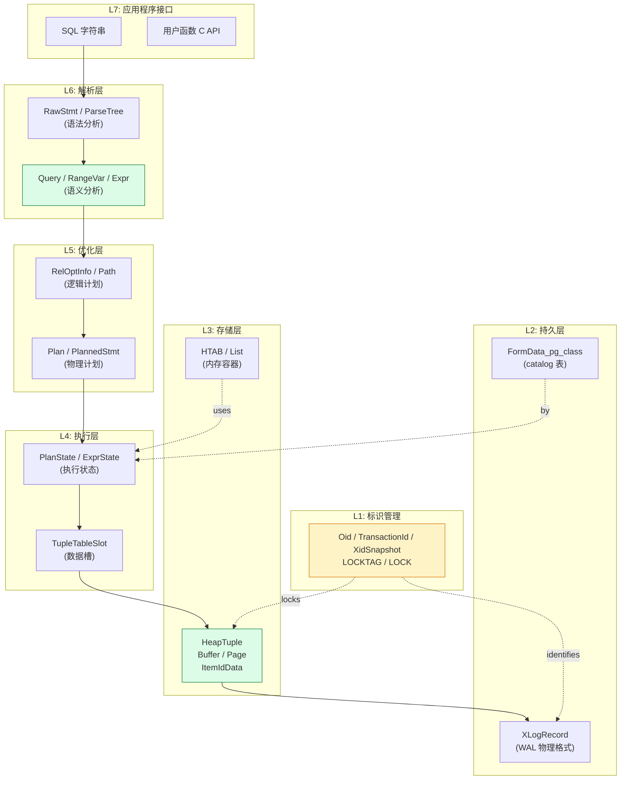


---

## 二、RangeVar 源码定义

**位置**：`src/include/nodes/primnodes.h:72`

```c
/*
 * RangeVar - range variable, used in FROM clauses and also
 * for functions returning rows of a relation (which are NOT
 * a TEMP table indication here).
 */
typedef struct RangeVar
{
    NodeTag     type;

    /* the catalog (database) name, or NULL */
    char       *catalogname;

    /* the schema name, or NULL */
    char       *schemaname;

    /* the relation/sequence name */
    char       *relname;

    /* expand rel by inheritance? recursively act on children? */
    bool        inh;

    /* see RELPERSISTENCE_* in pg_class.h */
    char        relpersistence;

    /* table alias & optional column aliases */
    Alias      *alias;

    /* token location, or -1 if unknown */
    ParseLoc    location;
} RangeVar;
```

### 2.1 8 个字段逐一拆解

| # | 字段 | 类型 | 来源 | 含义 |
|---|---|---|---|---|
| 1 | `type` | `NodeTag` | 自动 | 节点类型标识，`T_RangeVar` |
| 2 | `catalogname` | `char*` | SQL `db.schema.table` | 数据库名（PG 不支持跨库引用，必须 NULL 或同库） |
| 3 | `schemaname` | `char*` | SQL `schema.table` | 模式名（可为 NULL → 用 `search_path` 解析） |
| 4 | `relname` | `char*` | SQL `table` | 表/索引/序列/视图名（必填） |
| 5 | `inh` | `bool` | 是否带 `ONLY` 关键字 | `true` = 包含继承子表 `false` = 仅本表 |
| 6 | `relpersistence` | `char` | 是否 `TEMP` / `UNLOGGED` | `'p'` permanent / `'t'` temp / `'u'` unlogged |
| 7 | `alias` | `Alias*` | SQL `t AS alias` | 表别名 + 列别名 |
| 8 | `location` | `ParseLoc` | Bison token 位置 | 报错定位用（语法错误时告诉用户报在哪） |

### 2.2 为什么这个结构这么"瘦"

**设计原则**：RangeVar **只携带名字**，不携带 OID。它是**纯语法层的占位符**。


**为什么不存 OID**：
1. **重命名导致 OID 失效**：DDL `ALTER TABLE users RENAME TO accounts` 会换 OID
3. **延迟绑定**：很多场景在解析时还不知道要 use OID（视图、规则、partition）

### 2.3 RangeVar 的 4 个构造函数

| 函数 | 源码位置 | 何时调用 |
|---|---|---|
| `makeRangeVar(schemaname, relname, location)` | `nodes/makefuncs.c:473` | 大多数情况手工构造 |
| `makeRangeVarFromAnyName(names, position, yyscanner)` | `parser/gram.y:19331` | Bison 语法 |
| `makeRangeVarFromQualifiedName(name, namelist, location, ...)` | `parser/gram.y:19372` | Bison 语法，处理 `db.schema.table` 三段式 |
| `makeRangeVarFromNameList(names)` | `catalog/namespace.c:3557` | 从 List 构造 |

**源码 `makeRangeVar`**（`nodes/makefuncs.c:473`）：

```c
RangeVar *
makeRangeVar(char *schemaname, char *relname, int location)
{
    RangeVar   *r = makeNode(RangeVar);

    r->catalogname = NULL;
    r->schemaname = schemaname;
    r->relname = relname;
    r->inh = true;                    // 默认包含子表
    r->relpersistence = RELPERSISTENCE_PERMANENT;  // 默认普通表
    r->alias = NULL;
    r->location = location;

    return r;
}
```

### 2.4 在哪里产生 RangeVar

**全部 5 个场景**：

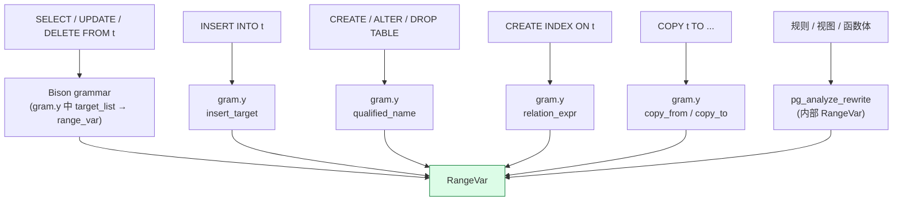


---

## 三、RangeVar 的生命周期：5 个阶段

RangeVar 不是一个"用完即扔"的节点——它在 PG 内核中**走过 5 个阶段**，每阶段被不同的模块加工。

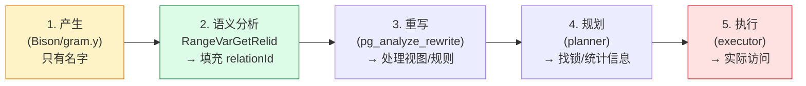

### 3.1 阶段 1：语法分析 → 只有名字

**`gram.y` 段选**（`gram.y` 内），Bison 在解析 SQL 时把 `users` / `public.users` 转换为 `RangeVar`：

```
qualified_name:
          ColId                          { $$ = makeRangeVar(NULL, $1, @1); }
        | ColId '.' IDENT                   { $$ = makeRangeVar($1, $3, @2); }
        ;
```

此时 `relationId` **字段在 PG 原型上面没有这个字段**——只有 PG 内核看到的 `Query. rte->relid`，那是 RTE（Range Table Entry）层级。

**RTE 与 RangeVar 的关系**：

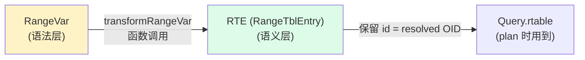

**注意**：PG 在 parse 阶段后，**RangeVar 不直接被使用**，而是转换为 `RangeTblEntry`。`RangeVar` 主要保留在 DDL 路径上。

### 3.2 阶段 2：语义分析 → 解析 OID + 权限检查

**函数**：`transformRangeVar` 在 `parser/parse_clause.c`，调用 `RangeVarGetRelidExtended` 拿到 OID。

**关键点**：语义分析会把 RangeVar 转成 RTE，**保留 RangeVar 仅作为 DDL 触发**。RangeVarGetRelidExtended 是所有路径都要走的**中心节点**（详见 第五节）。

### 3.3 阶段 3：重写 → 视图展开

**函数**：`pg_analyze_rewrite` 在 `rewrite/rewriteHandler.c`。

- 如果 RangeVar 指向**视图**，则把视图定义展开成子查询
- 如果 RangeVar 在**规则**（`pg_rewrite`）中被涉及，调用对应规则

### 3.4 阶段 4：规划 → `Relation` 缓存 + 统计信息

**关键调用**：
- `relation_open(rte->relid, lockmode)` —— 拿到内存中的 `RelationData`（struct）
- `get_rel_name(rte->relid)` —— 反查 name
- `getRelationStatistics(...)` —— 走 `pg_statistic` / `pg_class` 读 reltuples 等

### 3.5 阶段 5：执行 → 实际访问

**关键调用**：
- `table_open(rte->relid, lockmode)` —— PG 12+ 推荐用 `table_open`/新版接口
- `table_beginscan(...)` / `table_insert()` / `table_delete()`

---

## 四、RangeVar 的填充路径：从语法树到 OID

整个填充路径涉及 **3 个核心函数**：

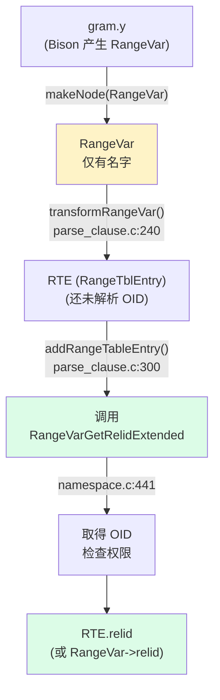

### 4.1 阶段 2 源码（`transformRangeVar`）

```c
/*
 * transformRangeVar - transform a RangeVar?
 *
 *   Produce a RTE, but don't fill the OID yet. Lock will be taken.
 */
RangeTblEntry *
transformRangeVar(RangeVar *r, ParseState *pstate, bool resolveList = true)
{
    ... common fields ...

    /* 主要函数：addRangeTableEntry */
    rte = addRangeTableEntry(pstate, r, r->alias, inh, true);

    return rte;
}
```

**注意**：PG 故意**先填 RTE 再加锁**，把权限检查和锁分离。

### 4.2 RTE 填充（`addRangeTableEntry`）

源码 `parser/parse_clause.c` 中调用了：

```c
relid = RangeVarGetRelidExtended(r->relation, lockmode,
                                 RVR_MISSING_OK,
                                 callback, callback_arg);
```

→ 调用 `RangeVarGetRelidExtended`（在 `catalog/namespace.c:441`）完成解析。

---

## 五、RangeVarGetRelidExtended 源码解析

**位置**：`src/backend/catalog/namespace.c:441`

这是 PG 中 **"名字 → OID"** 的**唯一定义点**。99% 的 DDL/DML 都走它。

### 5.1 函数签名

```c
Oid RangeVarGetRelidExtended(const RangeVar *relation,
                              LOCKMODE lockmode,
                              uint32 flags,
                              RangeVarGetRelidCallback callback,
                              void *callback_arg);
```

**参数表**：

| 参数 | 作用 |
|---|---|
| `relation` | RangeVar 输入 |
| `lockmode` | `AccessShareLock` / `RowExclusiveLock` / `AccessExclusiveLock` 等 |
| `flags` | `RVR_MISSING_OK` / `RVR_NOWAIT` / `RVR_SKIP_LOCKED` |
| `callback` | 拿到 OID 后调用的回调（一般做权限检查） |
| `callback_arg` | 回调参数 |

### 5.2 源码逐段解读

```c
RangeVarGetRelidExtended(const RangeVar *relation, LOCKMODE lockmode,
                         uint32 flags,
                         RangeVarGetRelidCallback callback, void *callback_arg)
{
    uint64      inval_count;
    Oid         relId;
    Oid         oldRelId = InvalidOid;
    bool        retry = false;
    bool        missing_ok = (flags & RVR_MISSING_OK) != 0;

    /* 1. 跨库引用检查（PG 不支持跨库） */
    if (relation->catalogname)
    {
        if (strcmp(relation->catalogname, get_database_name(MyDatabaseId)) != 0)
            ereport(ERROR,
                    (errcode(ERRCODE_FEATURE_NOT_SUPPORTED),
                     errmsg("cross-database references are not implemented: ...")));
    }

    /* 2. DDL 可能让查找结果过期，循环重试 */
    for (;;)
    {
        /* 3. 调 callback 拿到 OID */
        relId = RangeVarGetRelid(relation, lockmode, missing_ok);

        /* 4. 拿到 OID 后，调用 callback 做权限检查 */
        if (callback)
            callback(relation, relId, oldRelId, callback_arg);

        /* 5. 检 DDL invalidation，若有则重试 */
        inval_count = InvalidateRelcacheByRelid(relId);  // 简略
        if (inval_count == 0 || retry)
            break;
        oldRelId = relId;
        retry = true;
    }

    return relId;
}
```

### 5.3 内部子函数 `RangeVarGetRelid`

**位置**：`catalog/namespace.c:330`

```c
Oid
RangeVarGetRelid(const RangeVar *relation, LOCKMODE lockmode, bool missing_ok)
{
    Oid         relId;

    /* 优先用 RangeVar 上缓存的 OID（如果有） */
    if (relation->relationId != InvalidOid)
        return relation->relationId;

    /* 走名字解析：schema 解析 + 名字查找 */
    relId = RangeVarGetRelidInternal(relation, ...);

    /* 加锁 */
    if (lockmode != NoLock)
        LockRelationOid(relId, lockmode);

    return relId;
}
```

**3 个关键点**：

1. **缓存 OID**：如果 RangeVar 上次解析过 `relationId`，直接返回（**性能优化**）
2. **`search_path` 解析**：如果 schemaname 是 NULL，按 `search_path` 找
3. **拿锁**：拿不到锁就等（除非 NOWAIT）

### 5.4 完整调用流程图

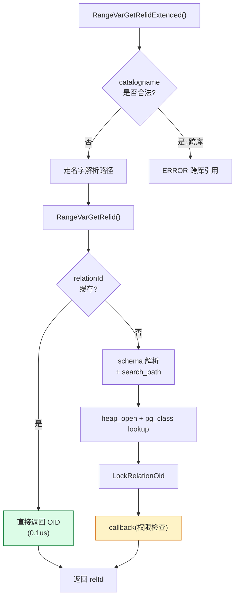

### 5.5 加锁的 4 种组合

| lockmode | 何时用 | 兼容性 |
|---|---|---|
| `NoLock` | DDL 内部多次解析时 | 不阻塞 |
| `AccessShareLock` | SELECT / 读 DDL | 与所有写锁冲突 |
| `RowExclusiveLock` | INSERT / UPDATE / DELETE | 与 EXCLUSIVE 冲突 |
| `AccessExclusiveLock` | DROP / TRUNCATE / ALTER | 排他，阻塞一切 |

**关键**：DDL 大多用 `AccessExclusiveLock`，这意味着 **DDL 在执行时会阻塞所有 DML**——这就是为什么生产环境要谨慎用 DDL。

### 5.6 性能优化：缓存 OID 复用

```c
typedef struct RangeVar
{
    ...
    Oid         relationId;  // ← 0 的部分：解析过的缓存
} RangeVar;
```

**重要**：PG 内核中有几处会**自己填充** RangeVar.relationId（如 DDL 路径），后续调用就**跳过解析**。

### 5.7 callback 的实际作用

**示例**（`src/backend/catalog/heap.c` 中的 `heap_create_with_catalog`）：

```c
static void
HeapCreateTagCallback(const RangeVar *rv, Oid relid, Oid oldrelid, void *arg)
{
    /* 检查用户是否有 CREATE 权限 */
    AclResult   aclresult;

    aclresult = pg_class_aclcheck(relid, GetUserId(), ACL_CREATE);
    if (aclresult != ACLCHECK_OK)
        aclcheck_error(aclresult, ACL_KIND_CLASS, rv->relname);
}
```

**职责**：拿到 OID 后做权限检查。**这条线索决定了 PG 的权限模型。**

---

## 六、RangeVar 的 4 大常见陷阱

### 6.1 陷阱 1：跨库引用直接报错

```sql
-- 这条 SQL 在 PG 中直接 ERROR
SELECT * FROM other_db.public.users;
-- ERROR: cross-database references are not implemented
```

**源码定位**：`RangeVarGetRelidExtended` 中检查 `relation->catalogname`。

**绕过：FDW**（跨库查询通过 `postgres_fdw` 走，RangeVar 走到 FDW 后转换）。

### 6.2 陷阱 2：race condition（DDL 中名字不存在但被并发建出）


**解决**：PG 内部使用 `inval_count` 重试机制（详见 5.2 中的循环）。

### 6.3 陷阱 3：`ONLY` 关键字反转 `inh`

```sql
SELECT * FROM ONLY parent_t;  -- inh = false
SELECT * FROM parent_t;        -- inh = true (默认)
SELECT * FROM parent_t *;      -- inh = false (显式 ONLY)
```

**源码**：Bison 产生 RangeVar 时根据 SQL 语法设置 `inh`。

### 6.4 陷阱 4：分区表的 root vs leaf

```sql
-- 在分区表上, RangeVar->relname 是子表名, 但 OID 是父表的 partition OID
SELECT * FROM users;       -- users 本身是分区表
SELECT * FROM users_2024;  -- users_2024 是子 partition
```

RangeVarGetRelid 返回的是 **leaf partition OID**，但 RangeVar->relname 是子表名——这个对 SQL 透明，但是内核插件（如逻辑复制 partition）需要处理。

---

## 七、RangeVar 与上下游

### 7.1 全景图：RangeVar → RTE → Plan → ExecState

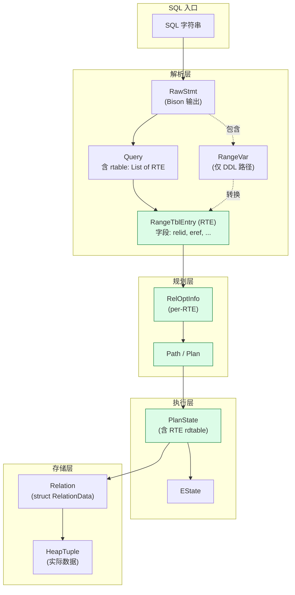

### 7.2 关键 RTE 字段

**位置**：`src/include/nodes/primnodes.h` 内 `RangeTblEntry`

```c
typedef struct RangeTblEntry
{
    NodeTag     type;

    RTEKind     rtekind;          /* RTE_RELATION, RTE_SUBQUERY, ... */

    /* Fields valid for a plain relation RTE (RTEKind == RTE_RELATION) */
    Oid         relid;            /* OID of the relation; 这里是 range_table 也对应填入 */
    char        relkind;          /* 'r'=ordinary table, 'i'=index, 'S'=sequence, ... */
    bool        inh;              /* inheritance flag */
    bool        relhasrules;       /* 是否存在 relation */
    LOCKMODE    rellockmode;      /* 拿锁的模式 */

    /* Fields valid for all RTEs */
    Index       eref;             /* reference name */
    Alias      *alias;
    List       *eref;             /* column names */
    ...
} RangeTblEntry;
```

**RangeVar 与 RTE 的字段对照**：

| RangeVar 字段 | 对应 RTE 字段 |
|---|---|
| `relname` | `eref` (alias 内) |
| `schemaname` | `schemaname`（自定义字段） |
| `inh` | `inh` |
| `alias` | `alias` |

### 7.4 RangeVar 的 4 种典型生命周期路径

```mermaid
graph LR
    subgraph "路径 A: SELECT"
        A1[SQL] --> A2[gram.y] --> A3[RawStmt + RangeVar] --> A4[transformRangeVar] --> A5[RTE]
        A5 --> A6[Planner] --> A7[Plan] --> A8[Executor]
    end
    subgraph "路径 B: DDL (CREATE TABLE)"
        B1[SQL] --> B2[gram.y] --> B3[CreateStmt + RangeVar]
        B3 --> B4[RangeVarGetRelidExtended<br/>拿 OID]
        B4 --> B5[ExecuteUtilityStmt]
        B5 --> B6[DDL executor]
    end
    subgraph "路径 C: COPY"
        C1[SQL] --> C2[gram.y] --> C3[CopyStmt + RangeVar]
        C3 --> C4[ProcessCopy]
    end
    subgraph "路径 D: 逻辑复制"
        D1[pgoutput plugin] --> D2[OpenTable<br/>(RangeVar 重新构造)]
        D2 --> D3[table_open]
    end

    style A5 fill:#dcfce7
    style B4 fill:#dcfce7
```


---

## 八、Node / 表达式树 IR：所有数据结构的基础

### 8.1 Node 的设计哲学

PG 几乎所有运行时结构都继承自一个统一的基础：

**位置**：`src/include/nodes/nodes.h`

```c
typedef struct Node
{
    NodeTag     type;       /* 节点类型 T_PID */
} Node;
```

**为什么需要 `NodeTag`**：
- 编译器不知道运行时是什么类型
- 但所有函数接收 `Node*` 参数
- 运行时通过 `type` 字段 dispatch 到具体类型

```c
typedef enum NodeTag
{
    T_Invalid = 0,
    T_IndexInfo,
    T_ExprContext,
    T_ProjectionInfo,
    T_JunkFilter,
    T_MemoryContextSet,
    T_ResultRelInfo,
    T_LockGate,
    T_Plan,
    T_PlanGenerator,
    T_PlanInvalItem,
    T_PlanState,
    T_EState,
    T_ProcessUtilityContext,
    /* ... 共 200+ 个 NodeTag ... */
    T_RangeVar,
    T_Var,
    T_Const,
    T_Param,
    /* ... */
} NodeTag;
```

### 8.2 Node 的 5 大子系统

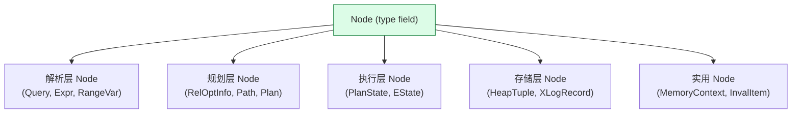

### 8.3 Node 的 5 个核心操作函数

| 函数 | 位置 | 作用 |
|---|---|---|
| `makeNode(T)` | `nodes.h` | 分配一个零填充的 T 节点 |
| `nodeTag(node)` | `nodes.h` | 取 type 字段 |
| `IsA(node, T)` | `is_a.h` | 类型检查宏 |
| `copyObject(obj)` | `copyfuncs.c` | 深拷贝节点树（**含所有子节点**） |
| `equal(a, b)` | `equalfuncs.c` | 递归比较两棵树是否相同 |

**`copyObject` 是 PG 内核的关键工具**：planner 经常需要修改 `Query`，但**不能动原 Query**（会被缓存复用），所以 `copyObject` 后再改。

### 8.4 Expr / Var / Const：表达式树

**位置**：`src/include/nodes/primnodes.h`

```c
typedef struct Expr
{
    NodeTag     type;       /* T_Expr ... */
} Expr;

typedef struct Var
{
    Expr        xpr;
    Index       varattno;   /* 列编号（从 1 开始，0 是整个行） */
    Oid         vartype;    /* 列类型 OID */
    int32       vartypmod;  /* 类型修饰符（如 VARCHAR(100)） */
    Index       varlevelsup;/* 上层 query level */
    Index       varnosyn;   /* 语法层 varno */
    Index       varreturningtid; /* 报表中的行标识 */
    Oid         vartype;      /* 类型 OID */
    int         varno;        /* 表的 rtable 索引 */
    int         varattno;      /* 列编号 */
    Oid         vartype;       /* 列类型 */
    int32       vartypmod;
    /* ... */
} Var;

typedef struct Const
{
    Expr        xpr;
    Oid         consttype;
    int32       consttypmod;
    int         constlen;
    Datum       constvalue;   /* 实际值 */
    bool        constisnull;  /* 是否 NULL */
    bool        constbyval;   /* 是否按值传递 */
    LocationIndex location;   /* token location */
} Const;
```

### 8.5 Var 树形态

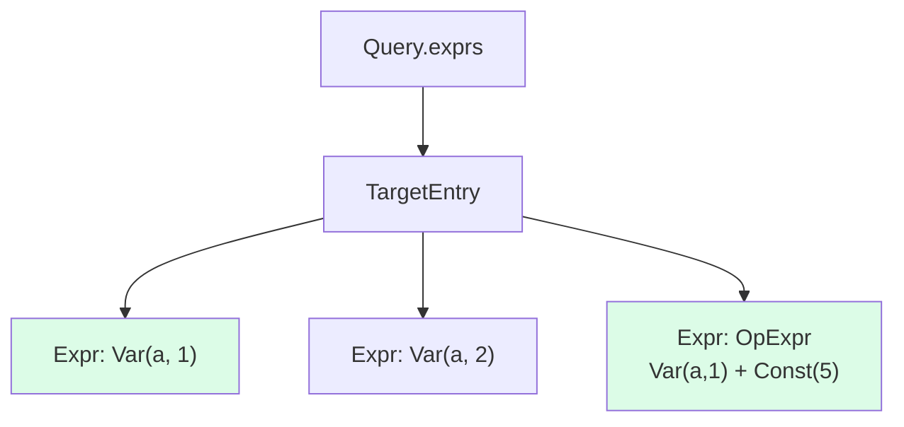

**关键**：`Var` 携带**`varno`（RT index）和 `varattno`（列号）**——它是一个**指向具体数据列的指针**。

---

## 九、List / dlist：内核的两套链表

PG 中有两种数组/链表**并存**：

| 特点 | List | dlist / slist |
|---|---|---|
| 位置 | `nodes/pg_list.h` | `lib/ilist.h` |
| 元素类型 | 任意 `void*` | 嵌入结构体内 |
| 内存 | 单独 `palloc` | 嵌入结构体 |
| 用法 | parser/executor 大量用 | 共享内存、LWLock 队列 |
| 性能 | O(N) 遍历 | O(1) 删除 |

### 9.1 List 定义

```c
typedef struct List
{
    NodeTag     type;        /* T_List / T_IntList / T_OidList */
    int         length;      /* 元素个数 */
    ListCell   *head;         /* 第一个元素 */
    ListCell   *tail;         /* 最后一个元素 */
} List;

typedef struct ListCell
{
    union
    {
        void       *ptr_value;
        int         int_value;
        Oid         oid_value;
    }           data;
    ListCell   *next;
} ListCell;
```

### 9.2 List 的 5 种构造

| API | 作用 |
|---|---|
| `list_make1(x)` / `list_make2(x, y)` / ... | 构造 1~N 个元素 |
| `lappend(list, x)` | 末尾追加 |
| `lcons(x, list)` | 头部追加 |
| `linitial(list)` | 取首元素 |
| `llast(list)` | 取尾元素 |
| `list_concat(a, b)` | 拼接两个 list |
| `lsearch(key, list, cmp)` | 顺序查找 |
| `list_nth(list, n)` | 按索引取 |
| `foreach(cell, list) { ... }` | 宏迭代 |

### 9.3 dlist 定义（共享内存友好）

```c
typedef struct dlist_node dlist_node;
typedef struct dlist_head dlist_head;

struct dlist_node
{
    dlist_node *prev;
    dlist_node *next;
};

struct dlist_head
{
    dlist_node  head;       /* sentinel */
};
```

**关键**：**嵌入结构体内**——**内存里就是结构体一部分，不需要单独 palloc**。

### 9.4 List 的典型使用场景

| 场景 | 用什么 | 例子 |
|---|---|---|
| 表达式树 | `List*` | `Query->targetList`、`Expr->args` |
| RTE 列表 | `List*` | `Query->rtable` |
| 路径列表 | `List*` | `RelOptInfo->pathlist` |
| 共享内存中的等待者 | `dlist_head` | `Lock->waitProcs` |
| 待处理 invalidation | `dlist_head` | `InvalBackendId` 队列 |

### 9.5 List 的陷阱

**陷阱 1**：`palloc` 的 list **不能跨 palloc 拷贝**——必须 `copyObject`。
**陷阱 2**：跨 memory context 移动后，list 内部指针会失效。
**陷阱 3**：共享内存中**绝不能用 list**——必须用 dlist。

---

## 十、HTAB：内核的高性能哈希表

### 10.1 HTAB 定义

**位置**：`src/include/utils/hsearch.h`

```c
typedef struct HTAB HTAB;

/* 创建时填的 control 结构 */
typedef struct HASHCTL
{
    long        num_partitions;/* 分区数 */
    long        ssize;          /* segment size */
    long        dsize;          /* 初始目录大小 */
    Size        keysize;        /* key 长度 */
    Size        entrysize;      /* entry 大小 */
    HashValueFunc hash;         /* hash 函数 */
    HashCompareFunc match;      /* 比较函数 */
    HashCopyFunc keycopy;       /* key 拷贝函数 */
    HashAllocFunc alloc;        /* 分配函数 */
    MemoryContext hcxt;         /* 内存上下文 */
    HASHHDR    *hctl;           /* 共享内存头 */
} HASHCTL;
```

### 10.2 HTAB 的 3 种模式

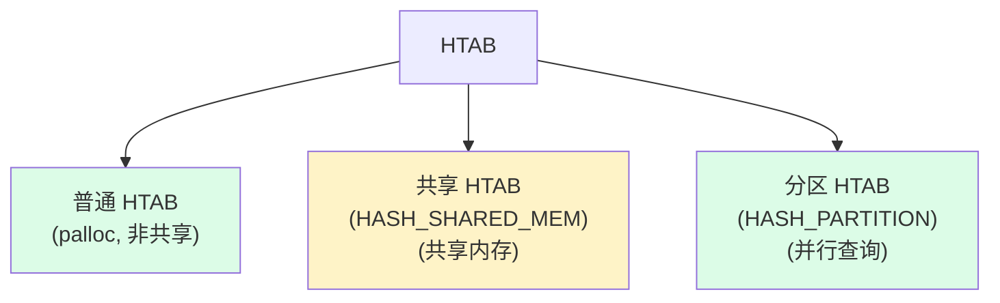

### 10.3 典型用法（locate cache）

```c
HTAB *locator_hash;

HTAB *
InitLocatorHash(void)
{
    HASHCTL     ctl;

    ctl.keysize = sizeof(LocatorHashKey);
    ctl.entrysize = sizeof(LocatorHashEntry);
    ctl.hcxt = CurrentMemoryContext;
    locator_hash = hash_create("Locator Hash",
                                32,         /* initial size */
                                &ctl,
                                HASH_ELEM | HASH_CONTEXT);
    return locator_hash;
}

/* 查找 */
entry = hash_search(locator_hash, &key, HASH_FIND, NULL);

/* 插入 */
entry = hash_search(locator_hash, &key, HASH_ENTER, &found);

/* 删除 */
hash_search(locator_hash, &key, HASH_REMOVE, NULL);
```

### 10.4 HTAB 的典型场景

| 场景 | 路径 | 说明 |
|---|---|---|
| **locache（关系缓存）** | `utils/cache/relcache.c` | 把 `pg_class` 元组缓存为 `Relation` |
| **catcache（catalog 缓存）** | `utils/cache/catcache.c` | 系统表的查询缓存 |
| **LockManager 锁表** | `storage/lmgr/lock.c` | `LOCK` 的哈希索引 |
| **Proc 数组** | `storage/lmgr/proc.c` | 按 BackendId 找 PGPROC |
| **hash join 执行** | `executor/nodeHashjoin.c` | 哈希 join 的内部表 |
| **HTAB for parser/analyze** | `parser/parse_*.c` | 列名/对象名查找 |

### 10.5 性能特征

| 模式 | 平均查找 | 最坏 | 内存 |
|---|---|---|---|
| 普通 HTAB | O(1) | O(N) 退化 | 进程内 |
| 分区 HTAB | O(1) + 锁竞争 | O(N) | 进程内，多分区 |
| 共享 HTAB | O(1) + LWLock | O(N) | 跨进程 |

### 10.6 HTAB 的关键 API

```c
/* 创建 */
HTAB *hash_create(const char *tabname, long nelem, HASHCTL *info, int flags);

/* 查找/插入/删除 */
void *hash_search(HTAB *hashp, const void *keyPtr, HASHACTION action, bool *foundPtr);
/* action = HASH_FIND / HASH_ENTER / HASH_REMOVE / HASH_ENTER_NULL */

/* 顺序遍历 */
hash_seq_init(hash_seq_state *state, HTAB *hashp);
hash_seq_search(hash_seq_state *state);
```

---

## 十一、HeapTuple / HeapTupleHeader / MinimalTuple

### 11.1 三种元组（heap 元组族）

PG 中 3 种 tuple 在不同层次：

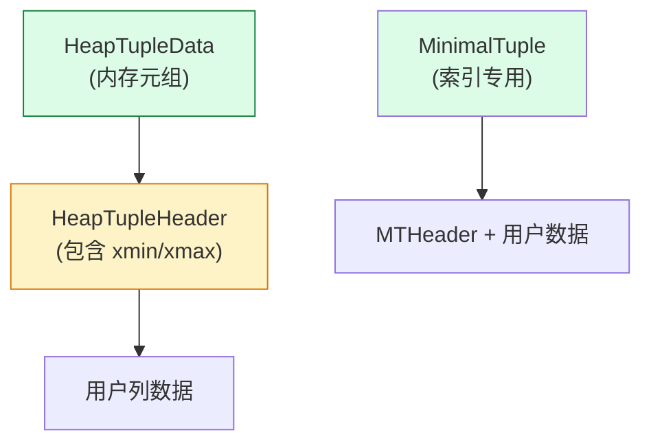

### 11.2 HeapTupleData 定义

**位置**：`src/include/access/htup.h`

```c
typedef struct HeapTupleData
{
    uint32      t_len;          /* length of *t_data */
    ItemPointerData t_self;      /* TID: which page/offset */
    Oid         t_tableOid;     /* table's OID */
    HeapTupleHeader t_data;      /* → 真正的 header + 数据 */
} HeapTupleData;
```

### 11.3 HeapTupleHeader（最核心）

```c
typedef struct HeapTupleHeaderData
{
    union
    {
        HeapTupleFields t_heap;
        DatumTupleFields t_datum;
    }           t_choice;

    ItemPointerData t_ctid;       /* 当前行的 TID（UPDATE 后会变） */
    uint16      t_infomask2;     /* 多个 flag 的组合 */
    uint16      t_infomask;      /* 多个 flag 的组合 */
    uint8       t_hoff;          /* header 大小 */
    /* 后面是 bitmap + user data */
} HeapTupleHeaderData;

/* HeapTupleFields 含 3 个事务字段 */
typedef struct HeapTupleFields
{
    TransactionId t_xmin;        /* 插入此行的事务 */
    TransactionId t_xmax;        /* 删除/锁此行的事务（0 = 未删除） */
    CommandId     t_field3;      /* cmin/cmax（在同一事务内的命令） */
} HeapTupleFields;
```

**这是 MVCC 的灵魂**——一行 UPDATE 涉及 5 个 HeapTuple，正是因为 `t_xmin` / `t_xmax` / `t_ctid` 在链式变化。

### 11.4 HeapTuple 的生命周期


### 11.5 MinimalTuple（索引专用）

**位置**：`src/include/access/htup_details.h`

```c
typedef struct MinimalTupleData
{
    uint32      t_len;            /* length */
    /* 后面是 mt_header + data */
} MinimalTupleData;
```

**与 HeapTuple 区别**：MinimalTuple **没有 xmin/xmax**（索引行不参与 MVCC），更紧凑。

### 11.6 HeapTuple 的关键 API

| API | 位置 | 作用 |
|---|---|---|
| `heap_form_tuple(...)` | `access/heap/heapam.c` | Datum[] → HeapTuple |
| `heap_deform_tuple(...)` | 同上 | HeapTuple → Datum[] |
| `heap_freetuple(...)` | 同上 | 释放 HeapTuple |
| `heap_insert(...)` | 同上 | 插入 HeapTuple（写 WAL） |
| `heap_update(...)` | 同上 | UPDATE（含 xmax 处理） |
| `heap_delete(...)` | 同上 | DELETE（设 xmax + 写 WAL） |

---

## 十二、SnapshotData：MVCC 的灵魂

### 12.1 SnapshotData 定义

**位置**：`src/include/utils/snapshot.h`

```c
typedef struct SnapshotData
{
    SnapshotType snapshot_type;     /* MVCC / HistoricMVCC / ... */

    /* * MVCC snapshots: xmin/xmax/xip */
    TransactionId xmin;             /* all XID < xmin are visible */
    TransactionId xmax;             /* all XID >= xmax are invisible */

    TransactionId *xip;             /* in-progress XIDs */
    uint32        xcnt;             /* count */

    TransactionId *subxip;          /* sub-transaction in-progress */
    int           subxcnt;
    bool           takenDuringRecovery;

    /* * Catalog snapshot fields */
    uint32        curcid;
    /* * ... */
} SnapshotData;
```

### 12.2 5 种 Snapshot

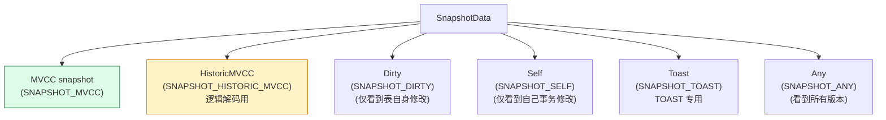

### 12.3 Snapshot 的关键概念：`xmin / xmax / xip`

| 字段 | 含义 | 怎么用 |
|---|---|---|
| `xmin` | 小于此 XID 的都已提交 | `< xmin` → 可见 |
| `xmax` | 大于等于此 XID 的都未开始 | `>= xmax` → 不可见 |
| `xip[]` | 在 xmin..xmax 之间未提交的事务 | 在此 → 不可见 |

**MVCC 可见性判定**（简化）：

```c
bool HeapTupleSatisfiesMVCC(HeapTuple tup, Snapshot snap, Buffer buf)
{
    if (HeapTupleHeaderGetRawXmin(tup) < snap->xmin)
        return true;                  /* 早于 xmin，已提交 */

    if (HeapTupleHeaderXminInvalid(tup))
        return false;                 /* xmin 无效 */

    if (HeapTupleHeaderXminCommitted(tup))
        return true;                  /* 已提交 */

    if (HeapTupleHeaderXminFrozen(tup))
        return true;                  /* 已冻结（VACUUM 后） */

    if (XidInArray(HeapTupleHeaderGetRawXmin(tup), snap->xip))
        return false;                 /* 在进行中 */

    /* 否则：未提交，不可见 */
    return false;
}
```

### 12.4 Snapshot 的获取

| API | 位置 | 场景 |
|---|---|---|
| `GetActiveSnapshot()` | `snapmgr.c` | 当前事务的活动 snapshot |
| `GetTransactionSnapshot()` | 同上 | 事务级 snapshot（首次 SELECT 时建立） |
| `RegisterSnapshot(snap)` | 同上 | 注册（多语句用） |
| `PopActiveSnapshot()` | 同上 | 取消注册 |
| `CopySnapshot(snap)` | 同上 | 复制 |
| `FreeSnapshot(snap)` | 同上 | 释放 |

### 12.5 HistoricSnapshot（逻辑解码专用）

**关键差异**：HistoricMVCC 的 `xip[]` 表示 **已提交事务**（不是 in-progress）—— 这是逻辑复制的语义。

```c
/*
 * For historic MVCC snapshots, the meaning is inverted, i.e.
 * it contains *committed* transactions between xmin and xmax.
 */
```


---

## 十三、RelOptInfo / Path / Plan / PlanState：查询处理的 4 个层级

PG 的查询处理流程分 **4 个阶段**，每个阶段都有**对应的核心结构体**：

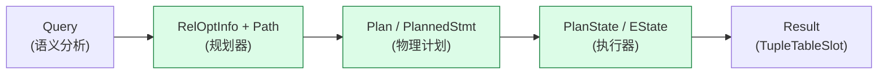

### 13.1 RelOptInfo：每个关系的逻辑信息

**位置**：`src/include/nodes/relation.h`

```c
typedef struct RelOptInfo
{
    NodeTag     type;            /* T_RelOptInfo */
    RelOptKind  reloptkind;      /* RELOPT_BASEREL, RELOPT_JOINREL, ... */
    Index       relid;           /* RTE index in rtable */
    /* size estimate */
    double         tuples;         /* 行数估计 */
    double         pages;         /* pagesize estimate */
    /* indexes */
    List       *indexlist;      /* 拟用 IndexOptInfo list */
    /* paths */
    List       *pathlist;      /* Path list (SeqScan / IndexScan / ...) */
    Path       *cheapest;              /* cheapest_total_path */
    Path       *cheapest_unique_path;
    /* ... */
} RelOptInfo;
```

### 13.2 Path：候选执行路径

```c
typedef struct Path
{
    NodeTag     type;            /* T_Path */
    NodeTag     pathtype;          /* T_SeqScan, T_IndexScan, T_HashJoin ... */

    double      rows;              /* 行数估计 */
    double      startup_cost;      /* 启动成本 */
    double      total_cost;        /* 总成本 */
    Path       *pathparent;
    List       *pathkeys;            /* 排序顺序 */
    /* 子类添加字段，如 IndexPath 加 indexid */
} Path;

/* 各种 Path 子类型 */
typedef struct SeqScanPath { Path path; } SeqScanPath;
typedef struct IndexPath
{
    Path         path;
    IndexOptInfo *indexinfo;
    List       *indexclauses;     /* 索引条件 */
    /* ... */
} IndexPath;
typedef struct HashJoinPath { Path jpath; ...} HashJoinPath;
typedef struct NestPath    { Path jpath; ...} NestPath;
typedef struct MergePath    { Path jpath; ...} MergePath;
```

### 13.3 Plan：物理执行计划

```c
typedef struct Plan
{
    NodeTag     type;            /* T_SeqScan, T_HashJoin, ... */
    Cost        startup_cost;
    Cost        total_cost;
    Plan       *lefttree;        /* left child */
    Plan       *righttree;       /* right child */
    int         plan_node_id;
    List       *targetlist;      /* TargetEntry list */
    /* 子类填充 fields */
} Plan;

typedef struct SeqScan
{
    Plan        plan;
    Index       scanrelid;       /* RTE index */
} SeqScan;

typedef struct IndexScan
{
    Plan        plan;
    Index       scanrelid;
    Oid         indexid;
    List       *indexqual;
    /* ... */
} IndexScan;

typedef struct HashJoin
{
    Plan        plan;
    List       *hashclauses;
    /* ... */
} HashJoin;
```

### 13.4 PlanState：执行时的状态

```c
typedef struct PlanState
{
    NodeTag     type;
    Plan       *plan;             /* 对应 Plan 节点 */
    EState     *state;            /* current ExecutorState */
    /* 子类按需填充 */
} PlanState;

typedef struct SeqScanState
{
    PlanState   ps;
    Relation    ss_currentRelation;
    HeapScanDesc ss_currentScanDesc;
    /* ... */
} SeqScanState;
```

### 13.5 全景对比

| 阶段 | 结构 | 用途 | 生命周期 |
|---|---|---|---|
| 语义分析 | `Query` | SQL 已分析 | parser 输出 |
| 规划（逻辑） | `RelOptInfo` + `Path` | 候选路径 | planner 内部 |
| 规划（物理） | `Plan` | 选定路径 | PlannedStmt 内 |
| 执行 | `PlanState` + `EState` | 运行时 | executor 内部 |

### 13.6 Planner 的关键函数

| 函数 | 位置 | 作用 |
|---|---|---|
| `planner(Query)` | `optimizer/plan/planner.c` | 入口 |
| `query_planner(...)` | 同上 | 拆解为 RelOptInfo |
| `make_one_rel(...)` | 同上 | 为基表找最优路径 |
| `create_plan(...)` | `createplan.c` | Path → Plan |

### 13.7 TupleTableSlot：执行期的"数据槽"

```c
typedef struct TupleTableSlot
{
    NodeTag     type;             /* T_TupleTableSlot */
    bool        tts_isempty;      /* empty slot? */
    /* 几种 slot subtype */
    HeapTuple   tts_tuple;        /* 内存 HeapTuple */
    MinimalTuple tts_minimal;     /* MinimalTuple */
    Datum      *tts_values;        /* 反序列化的列值 */
    bool       *tts_isnull;
    /* ... */
} TupleTableSlot;
```

**Executor 全部靠 TupleTableSlot 流转**——不直接持有 HeapTuple。

---

## 十四、LOCK / lock manager：并发控制

### 14.1 LOCKTAG 设计

PG 的锁不是 pthread mutex——是基于 **Hash Table + 队列 + LWLock** 的完整 lock manager。

**位置**：`src/include/storage/lock.h`

```c
typedef struct LOCKTAG
{
    uint32        locktag_field1;     /* 可能是 dbOid */
    uint32        locktag_field2;     /* 可能是 relOid */
    uint32        locktag_field3;     /* 可能是 page/block */
    uint16        locktag_field4;
    uint8         locktag_type;       /* LOCKTAG_RELATION / LOCKTAG_TUPLE / ... */
    uint8         locktag_lockmethodid; /* DEFAULT_LOCK_METHOD */
} LOCKTAG;
```

### 14.2 LOCKTAG 的 8 种类型

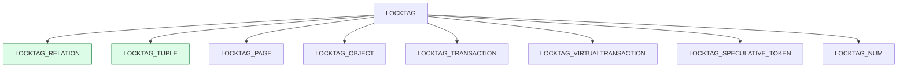

### 14.3 LOCK 结构（共享内存中的锁记录）

```c
typedef struct LOCK
{
    /* hash key */
    LOCKTAG      tag;

    /* data */
    LOCKMASK    grantMask;       /* 哪些 mode 已被授予 */
    int         requested;       /* 等待计数 */
    int         nRequested;       /* 请求总数 */
    int         granted;          /* 已授予计数 */
    Queue      *waitProcs;        /* 等待的 PGPROC 队列 */
    PROCLOCK   *proclocks;        /* 持有者列表 */
    SHM_QUEUE   lock_links;       /* 哈希链表 */
} LOCK;
```

### 14.4 锁的 8 种模式

| Mode | 兼容性 | 场景 |
|---|---|---|
| `AccessShareLock` | 几乎一切 | SELECT |
| `RowShareLock` | SELECT 不冲突 | SELECT FOR UPDATE |
| `RowExclusiveLock` | 与 EXCLUSIVE 冲突 | INSERT/UPDATE/DELETE |
| `ShareUpdateExclusiveLock` | 自我排斥 | VACUUM, ANALYZE |
| `ShareLock` | 不与 SHARE/UPDATE 冲突 | CREATE INDEX |
| `ShareRowExclusiveLock` | 严格独占 | DDL |
| `ExclusiveLock` | 几乎互斥 | 高级 DDL |
| `AccessExclusiveLock` | 完全独占 | DROP/ALTER/REINDEX |

### 14.5 LockManager 工作流

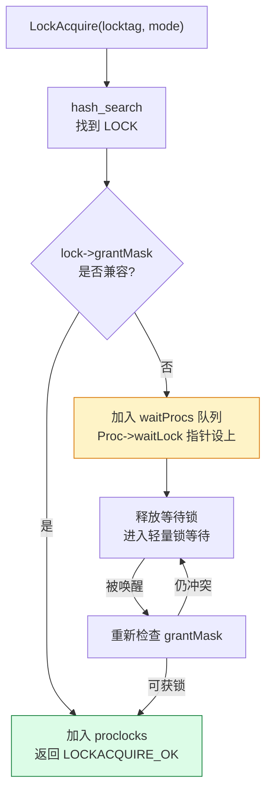

### 14.6 死锁检测

PG 的锁管理器**不主动检测死锁**，而是：
- 进程在等待锁时设置 `WaitOnLock()` 计时器
- 超时后抛 `ERROR:  deadlock detected` 并 abort 事务

```c
/* DeadLockCheck 在 proc.c 中 */
while (check deadlock in graph)
{
    if (cycle found)
        abort one of the transactions;
}
```

### 14.7 锁的快速 API

| API | 作用 |
|---|---|
| `LockRelationOid(relOid, mode)` | 锁表（按 OID） |
| `LockRelation(rel, mode)` | 锁表（按 Relation） |
| `UnlockRelationOid(...)` | 解锁 |
| `LockAcquire(locktag, mode, ...)` | 通用加锁 |
| `ConditionalLockAcquire(...)` | 尝试加锁（NOWAIT） |

---

## 十五、Buffer / Page / XLogRecord

### 15.1 Buffer：共享缓冲池中的页

**位置**：`src/include/storage/buf.h`

```c
typedef struct BufferDesc
{
    BufferTag   tag;             /* 第几页，db oid, rel oid */
    pg_atomic_uint32 state;      /* 状态（BM_LOCKED / BM_DIRTY / ...） */
    int         buf_id;           /* 数组下标 */
    /* 包含：usage_count, refcount, waitlist 等 */
} BufferDesc;

/* BufferTag：buffer 唯一标识 */
typedef struct BufferTag
{
    RelFileNode rnode;           /* db+tablespace+rel */
    ForkNumber  forkNum;          /* MAIN / FSM / VM / INIT */
    BlockNumber blockNum;         /* 页号 */
} BufferTag;
```

### 15.2 Page：8KB 数据页

**位置**：`src/include/storage/bufpage.h`

```c
typedef struct PageHeaderData
{
    XLogRecPtr  pd_lsn;          /* 最后修改此页的 WAL LSN */
    uint16      pd_checksum;     /* 校验和 */
    uint16      pd_flags;
    LocationIndex pd_lower;      /* 空闲空间起始 */
    LocationIndex pd_upper;       /* 空闲空间末尾 */
    LocationIndex pd_special;     /* 特殊数据起始 */
    uint16      pd_pagesize_version;
    TransactionId pd_prune_xid; /* VACUUM 提示 */
    /* ItemIdData pd_linp[] 在 lower 之前 */
    /* ... 之后是 pd_upper → pd_special 之间的 row data */
} PageHeaderData;
```

**典型结构**：

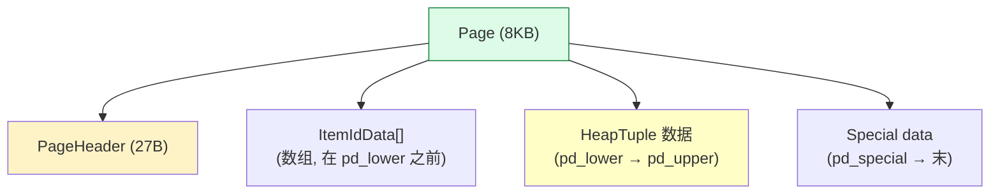

### 15.3 ItemIdData：行指针

```c
typedef struct ItemIdData
{
    unsigned    t_self_blkid:24,  /* page offset (line pointer) */
                t_self_off:11,    /* offset in page */
                lp_flags:6;
} ItemIdData;

#define LP_UNUSED  0  /* 未使用 */
#define LP_NORMAL  1  /* 正常行 */
#define LP_REDIRECT 2  /* HOT redirect */
#define LP_DEAD    3  /* 死行 */
```

### 15.4 XLogRecord：WAL 物理格式

**位置**：`src/include/access/xlogrecord.h`

```c
typedef struct XLogRecord
{
    uint32      xl_tot;        // total length
    XLogRecPtr  xl_prev;       // prev WAL record pointer
    TransactionId xl_xid;       // 产生此记录的事务
    XLogRecPtr  xl_curr;       // 当前位置
    uint8       xl_info;        // flags
    RmgrId      xl_rmgr;        // 0=heap, 1=btree, ...
    /* 后面是 data + blocks[] + block header */
} XLogRecord;

/* 块引用（xlogrecord block） */
typedef struct XLogRecordBlockHeader
{
    uint8       id;              // 块 ID
    uint8       fork_flags;
    pg_crc32c   data_checksum;
    RelFileNode rnode;
    BlockNumber block;
} XLogRecordBlockHeader;
```

### 15.5 BufferPool / XLog 写入时序

```mermaid
graph LR
    A["executor INSERT"] --> B["heap_insert<br/>(写数据 + WAL)"]
    B --> C["XLogBeginInsert"]
    C --> D["XLogRegisterBuf(0, buf)"]
    D --> E["XLogRegisterBuf(1, newbuf)"]
    E --> F["XLogInsert(rmgr=RM_HEAP_ID, info=XLOG_HEAP_INSERT)"]
    F --> G["生成 XLogRecord"]
    G --> H["XLogWrite → wal_buffers → disk"]

    H -.recovery.-> I["STARTUP process<br/>read WAL → PageSetData"]

    style F fill:#dcfce7,stroke:#15803d
```

---

## 十六、ReorderBufferTXN：逻辑复制专用

### 16.1 定义

**位置**：`src/include/replication/reorderbuffer.h`

```c
typedef struct ReorderBufferTXN
{
    NodeTag     type;

    TransactionId xid;              /* 事务 XID */
    XLogRecPtr  first_lsn;          /* 事务的第一条 WAL */
    XLogRecPtr  final_lsn;          /* COMMIT/ABORT 的 LSN */
    XLogRecPtr  end_lsn;             /* 事务结束的 LSN */

    XLogRecPtr  base_snapshot_lsn;  /* 决定了 stream 的顺序 */
    Snapshot     base_snapshot;        /* 第一次看到时的快照 */
    Snapshot     snapshot_now;       /* 当前快照（每次 update） */

    /* streaming/big-end-time determination */
    dlist_node  node;                /* ReorderBuffer->txns */

    /* changes 队列 */
    dlist_head  changes;               /* ReorderBufferChange list */

    /* subtransactions */
    ListCell   *subtxns;            /* 嵌套事务 */

    /* 状态 */
    bool        toplevel;            /* 是否顶层事务 */
    bool        is_commit;             /* 已 COMMIT */
    bool        is_known_as_subxact;
    bool        serialised;

    /* tuple decoding cache */
    HTAB  *tuplecids;                /* (relfilenode, cmin) → tuple */
} ReorderBufferTXN;
```

### 16.2 ReorderBufferChange

```c
typedef struct ReorderBufferChange
{
    NodeTag     type;
    enum ReorderBufferChangeType action;  /* XLOG_HEAP_INSERT / UPDATE / DELETE */
    Relation    relation;             /* 已解析的关系 */
    ReorderBufferTXN *txn;
    HeapTuple   tuple;
    /* ... */
} ReorderBufferChange;
```

### 16.3 ReorderBuffer 主结构

```c
typedef struct ReorderBuffer
{
    HTAB  *by_txn;                    /* xid → TXN */
    HTAB  *by_base_snapshot_lsn;      /* snapshotLsn → TXN */
    dlist_head txns;                   /* 全部 TXN */
    dlist_head frequent_access_txns;   /* 频繁访问的 */
    Relation *indexed_relids;
    Size n_indexed_relids;
    ReorderBufferTXN *current_txn;
    XLogRecPtr current_restart_lsn;
    /* ... */
} ReorderBuffer;
```

### 16.4 ReorderBuffer 的工作流

```mermaid
graph LR
    A["STARTUP 读 WAL"] --> B["Decode 触发<br/>pgoutput plugin"]
    B --> C["ReorderBufferProcessXid"]
    C --> D{"ReorderBufferGetTXN<br/>+ 队列"}
    D --> E["ReorderBufferQueueChange<br/>(add to TXN.changes)"]
    E --> F["SET up 已经到 COMMIT"]
    F --> G{"BASE_SNAPSHOT<br/>已就绪?"}
    G -->|"否"| H["等待快照"]
    G -->|"是"| I["ReorderBufferReplay<br/>逐 change 调用 pgoutput"]
    I --> J["输出到 apply"]

    style I fill:#dcfce7,stroke:#15803d
```


---

## 十七、dsa / dsa_pointer：并行查询共享内存

### 17.1 背景：parallel scan 共享内存需求

PG 9.6 起的 parallel scan 需要：
- **多个 worker 进程** 共享数据
- 共享内存**可以动态增长**（不像 fixed-size SHM）
- **并行查询结束自动释放**

为此 PG 引入 **Dynamic Shared Area (dsa)**。

### 17.2 dsa 的 3 层结构

```mermaid
graph TB
    A["dsa_area (顶层)"] --> B["dsa_segment_pool<br/>(动态增长段池)"]
    B --> C["dsa_segment_control<br/>(每段控制块)"]
    C --> D["实际分配内存<br/>(page-aligned)"]
    A --> E["dsa_segment_index<br/>(B-tree 索引 by pointer)"]

    style A fill:#dcfce7,stroke:#15803d
    style B fill:#fef3c7
    style C fill:#dcfce7
```

### 17.3 dsa_pointer 与普通指针的对比

| 特性 | 普通指针 | dsa_pointer |
|---|---|---|
| 大小 | 8 字节 | 4 字节（uint32） |
| 语义 | 进程虚拟地址 | dsa 内部的 slot index |
| 跨进程 | ❌（每个进程不同） | ✅（所有 dsa 进程都可解析） |

```c
typedef uint32 dsa_pointer;        /* 跨进程可达的“指针” */

void *dsa_get_address(dsa_area *area, dsa_pointer dp);
/* dp → 实际地址 */

dsa_pointer dsa_allocate(dsa_area *area, size_t size);
/* 申请，返回 dsa_pointer */
```

### 17.4 dsa 的使用流程

```c
/* 1. 在 leader 上创建 dsa */
dsa_area *area = dsa_create(LWTRANCHE_PARALLEL_APPEND,
                              /* tranche_size */ 1024 * 1024,
                              /* toc_n_shared */ NWorkers,
                              /* init_size */ 0,
                              /* max_size */ 50 * 1024 * 1024);

/* 2. attach 到 worker */
dsa_area *area_worker = dsa_attach(area_shared_ptr);

/* 3. 在 dsa 中分配结构 */
dsa_pointer p = dsa_allocate(area, sizeof(MyStruct));
MyStruct *s = dsa_get_address(area, p);

/* 4. 写数据（跨进程可见） */
s->count = 42;

/* 5. worker 读 */
dsa_area *w_area = dsa_attach(area_shared);
MyStruct *ws = dsa_get_address(w_area, p);
```

### 17.5 dsa 的典型场景

| 场景 | dsa 用途 |
|---|---|
| **Parallel Hash** | shared hash table |
| **Parallel Bitmap Heap Scan** | shared bitmap |
| **Parallel Append** | 共享 partial 计划 |
| **Logical streaming** | 共享 TXN change buffer |

### 17.6 dsa vs 普通共享内存

| 维度 | 普通 shm | dsa |
| -------- | --- | --- |
| 大小固定 | ✅ | ❌ 动态 |
| 跨进程指针 | ✅ (固定 shm) | ✅ (dsa_pointer) |
| 释放复杂度 | 需手动 free | 自动（段池） |
| 用途 | 锁、cache | 并行查询临时数据 |

---

## 十八、FormData_pg_class 与 catalog C struct

### 18.1 为什么需要专门的 C struct

**问题**：`pg_class` 是一个表，有若干列。如果每次都 `heap_getattr` 取列，**低效**。

**解决**：PG 把 catalog 表的固定列结构 `Form_pg_class` 作为 C struct，提供快速访问。

### 18.2 FormData_pg_class

**位置**：`src/include/catalog/pg_class.h`

```c
/*
 * CATALOG(pg_class,1259)  -> 触发 bootstrap 时建表
 */
typedef FormData_pg_class
{
    Oid         oid;                    /* 0 */
    NameData    relname;                /* 1 */
    Oid         relnamespace;           /* 2 */
    Oid         reltype;                /* 3 */
    Oid         reloftype;              /* 4 */
    Oid         relowner;                /* 5 */
    Oid         relam;                  /* 6 */
    Oid         relfilenode;            /* 7 */
    Oid         reltablespace;          /* 8 */
    int32       relpages;                /* 9 */
    float4      reltuples;               /* 10 */
    int32       relallvisible;           /* 11 */
    Oid         reltoastrelid;           /* 12 */
    bool        relhasindex;             /* 13 */
    bool        relisshared;             /* 14 */
    char        relpersistence;          /* 15 */
    char        relkind;                  /* 16: r/i/S/v/m/c/f/t/p */
    char        relnatts;                 /* 18 */
    char        relchecks;                /* 19 */
    bool        relhasrules;              /* 20 */
    bool        relhastriggers;            /* 21 */
    bool        relhassubclass;            /* 22 */
    bool        relrowsecurity;             /* 23 */
    bool        relforcerowsecurity;        /* 24 */
    TransactionId relfrozenxid;          /* 25 */
    TransactionId relminmxid;             /* 26 */
    /* ... */
} FormData_pg_class;

typedef FormData_pg_class *Form_pg_class;
```

### 18.3 快速取字段

```c
/* 拿到 Relation 后 */
Relation rel = relation_open(oid, AccessShareLock);

Form_pg_class rd_rel = rel->rd_rel;     /* 直接拿 Form_pg_class 结构 */

/* 字段访问 */
char *relname = NameStr(rd_rel->relname);
Oid   am = rd_rel->relam;
char     relkind = rd_rel->relkind;       /* 'r', 'i', ... */
```

### 18.4 所有 catalog 表都有 Form

```mermaid
graph TB
    A["Catalog 表"] --> B["pg_class<br/>→ FormData_pg_class"]
    A --> C["pg_attribute<br/>→ FormData_pg_attribute"]
    A --> D["pg_type<br/>→ FormData_pg_type"]
    A --> E["pg_proc<br/>→ FormData_pg_proc"]
    A --> F["pg_database<br/>→ FormData_pg_database"]
    A --> G["pg_index<br/>→ FormData_pg_index"]
    A --> H["pg_constraint<br/>→ FormData_pg_constraint"]
    A --> I["pg_inherits<br/>→ FormData_pg_inherits"]

    style B fill:#dcfce7,stroke:#15803d
    style F fill:#fef3c7
```

### 18.5 Form 的限制**：
- Form 字段顺序 **由 `pg_class.h` 中 CATALOG 宏定义**，不要改动
- 增加字段要修改 **BKI 字段编号**，触发 bootstrap 重做
- 修改字段要 `pg_upgrade` 兼容

---

## 十九、数据结构选型决策矩阵

### 19.1 5 大决策维度

| 维度 | 选项 |
|---|---|
| **作用域** | 进程内 / 共享内存 / 跨进程（dsa） |
| **大小** | 固定 / 动态 |
| **生命周期** | 一次性 / 事务级 / 长生命周期 |
| **并发** | 无 / LWLock / SpinLock |
| **元素类型** | 同构 / 异构 |

### 19.2 选型矩阵（"想用 X？用哪个？"）

```mermaid
graph TB
    Q1["需要存储什么?"] --> Q2{"作用域?"}
    Q2 -->|"进程内"| Q3{"大小?"}
    Q2 -->|"跨进程 (共享)"| Q4{"动态?"}

    Q3 -->|"固定"| Q5["palloc<br/>+ struct"]
    Q3 -->|"动态, 少量"| Q6["List"]
    Q3 -->|"动态, O(1) 查找"| Q7["HTAB"]
    Q3 -->|"嵌入结构体"| Q8["dlist"]

    Q4 -->|"是"| Q9["dsa<br/>(并行查询)"]
    Q4 -->|"否"| Q10["普通 shm + HTAB<br/>(共享缓存)"]

    Q5 --> Q5A["HeapTuple<br/>PlanState<br/>Relation"]
    Q6 --> Q6A["Query.rtable<br/>Path.pathlist<br/>RelOptInfo.indexlist"]
    Q7 --> Q7A["Relcache / Catcache<br/>Lock hash<br/>Hash Join"]
    Q8 --> Q8A["Lock.waitProcs<br/>InvalBackend queue"]
    Q9 --> Q9A["Parallel Hash<br/>Parallel Bitmap"]
    Q10 --> Q10A["syscache<br/>relcache"]

    style Q1 fill:#dcfce7,stroke:#15803d
```

### 19.3 按子系统的数据结构使用对照表

| 子系统 | 主要数据结构 | 跨进程？ |
|---|---|---|
| **Parser** | `List`, `Query`, `RangeVar`, `Expr` | 否 |
| **Analyzer** | `List`, `RTE`, `Expr`, `HeapTuple` | 否 |
| **Planner** | `List`, `RelOptInfo`, `Path`, `Plan` | 否 |
| **Catalog** | `FormData_pg_*`, `HeapTuple` | 否（catcache 可共享） |
| **Executor** | `PlanState`, `EState`, `TupleTableSlot` | 否 |
| **Storage** | `Page`, `ItemIdData`, `XLogRecord` | 共享（buffer pool） |
| **Lock** | `LOCK`, `PROCLOCK` | 共享 |
| **Replication** | `ReorderBufferTXN`, `ReorderBufferChange` | 否（per slot） |
| **Parallel** | `dsa`, `dsa_pointer` | 共享 |

### 19.4 性能特征对比

| 数据结构 | 创建/插入 | 查找 | 删除 | 内存 |
|---|---|---|---|---|
| `List` | O(1) | O(N) | O(N) | 多 1 层 indirection |
| `dlist` | O(1) | O(N) | O(1) | 紧凑，嵌入 |
| `HTAB` | O(1) | O(1) | O(1) | 预分配 + 链表 |
| `HeapTuple` | O(1) | N/A | O(1) | palloc 一次 |

---

## 二十、源码引用索引

### 20.1 主要头文件路径

| 数据结构 | 头文件 |
|---|---|
| `Node` | `src/include/nodes/nodes.h` |
| `RangeVar` | `src/include/nodes/primnodes.h` |
| `Query` | `src/include/nodes/parsenodes.h` |
| `RangeTblEntry` | `src/include/nodes/primnodes.h` |
| `Expr` / `Var` / `Const` | `src/include/nodes/primnodes.h` |
| `List` / `ListCell` | `src/include/nodes/pg_list.h` |
| `dlist` / `slist` | `src/include/lib/ilist.h` |
| `HTAB` | `src/include/utils/hsearch.h` |
| `HeapTupleData` / `HeapTupleHeader` | `src/include/access/htup.h` |
| `MinimalTupleData` | `src/include/access/htup_details.h` |
| `SnapshotData` | `src/include/utils/snapshot.h` |
| `RelOptInfo` / `Path` / `Plan` | `src/include/nodes/relation.h` |
| `PlanState` | `src/include/executor/executor.h` |
| `LOCK` / `LOCKTAG` / `PROCLOCK` | `src/include/storage/lock.h` |
| `BufferDesc` / `BufferTag` | `src/include/storage/buf.h` |
| `PageHeaderData` | `src/include/storage/bufpage.h` |
| `XLogRecord` | `src/include/access/xlogrecord.h` |
| `ReorderBufferTXN` / `ReorderBuffer` | `src/include/replication/reorderbuffer.h` |
| `dsa_area` / `dsa_pointer` | `src/include/utils/dsa.h` |
| `FormData_pg_class` | `src/include/catalog/pg_class.h` |

### 20.2 主要实现文件路径

| 模块 | `.c` |
|---|---|
| RangeVar 解析 | `src/backend/catalog/namespace.c` |
| Parser | `src/backend/parser/gram.y` |
| Parser 分析 | `src/backend/parser/parse_*.c` |
| Analyzer | `src/backend/parser/analyze.c` |
| Planner | `src/backend/optimizer/plan/` |
| Optimizer path | `src/backend/optimizer/path/` |
| Executor | `src/backend/executor/` |
| Heap access | `src/backend/access/heap/heapam.c` |
| Buffer pool | `src/backend/storage/buffer/` |
| WAL | `src/backend/access/transam/xlog.c` |
| LockManager | `src/backend/storage/lmgr/lock.c` |
| ReorderBuffer | `src/backend/replication/logicallauncher.c` 等 |
| DSA | `src/backend/utils/mmgr/dsa.c` |

### 20.3 进阶学习路线

```mermaid
graph TB
    A["1. Node / List / RangeVar<br/>(1 周)"] --> B["2. HeapTuple / SnapshotData<br/>(1 周)"]
    B --> C["3. RelOptInfo / Path / Plan<br/>(2 周)"]
    C --> D["4. Lock / Buffer / XLog<br/>(2 周)"]
    D --> E["5. ReorderBuffer / DSA<br/>(2 周)"]
    E --> F["6. 开始读 PG 内核代码修改"]

    style A fill:#dcfce7,stroke:#15803d
```

---

## 附录 A：RangeVar 与上下游的完整对照表

| RangeVar 字段 | Bison 产生位置 | 解析后去向 |
|---|---|---|
| `catalogname` | `qualified_name` 语法 | 跨库检查 → 大多 NULL |
| `schemaname` | 同上 | `RTE.schemaname` |
| `relname` | 同上 | `RTE.eref->aliasname` |
| `inh` | `opt_only` 或 `opt_*` | `RTE.inh` |
| `relpersistence` | `temp_clause` | `RTE.relpersistence` |
| `alias` | `opt_alias_clause` | `RTE.alias` |
| `location` | Bison token location | 报错时用 |

---

## 附录 B：3 套链表的对比

| 维度 | List | dlist | slist |
|---|---|---|---|
| 位置 | `nodes/pg_list.h` | `lib/ilist.h` | `lib/ilist.h` |
| 类型 | 通用 T（Node/palloc） | 嵌入 | 嵌入 |
| 删除 | O(N) | O(1) | O(1) |
| 场景 | parser/planner/exec | 共享内存/高并发 | 单向即可 |
| 用法 | `lappend` | `dlist_push_tail` | `slist_push_tail` |

---

## 附录 C：HeapTuple 的 5 种状态

| 状态 | `t_infomask` flag | 含义 |
|---|---|---|
| HeapTupleHeaderXminCommitted | 0x0100 | xmin 已提交 |
| HeapTupleHeaderXminInvalid | 0x0080 | xmin 无效（被 abort） |
| HeapTupleHeaderXmaxCommitted | 0x0800 | xmax 已提交 |
| HeapTupleHeaderXmaxInvalid | 0x0400 | xmax 无效 |
| HeapTupleHeaderUpdated | 0x2000 | 被 UPDATE |

**判断一行是否对你可见**：

```c
if (tupdata->inm_committed && !tupdata->inx_committed)
    return true;  // xmin 已提交，xmax 未提交或未设置
```

---

## 附录 D：扩展阅读

| 主题 | 推荐文档 |
|---|---|
| RangeVar 与解析 | 本博客《PostgreSQL WAL 记录类型完全指南》 |
| RangeVar → OID | 本博客《PostgreSQL 逻辑复制全链路》 |
| LockManager | 官方 `src/backend/storage/lmgr/README` |
| Buffer pool | 官方 `src/backend/storage/buffer/README` |
| ReorderBuffer | 本博客《PostgreSQL 逻辑复制里 RUNNING_XACTS》 |
| DSA | `src/backend/utils/mmgr/README` |

---

**全文完**

