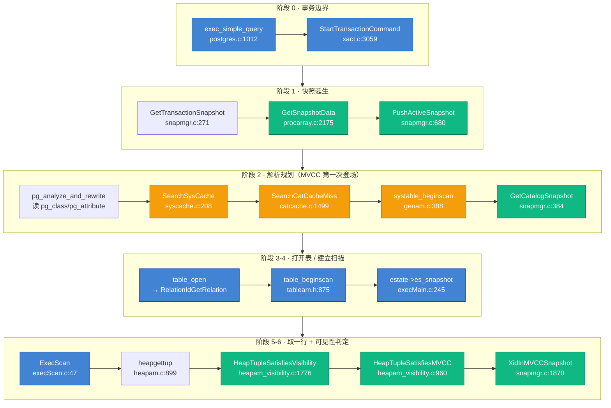
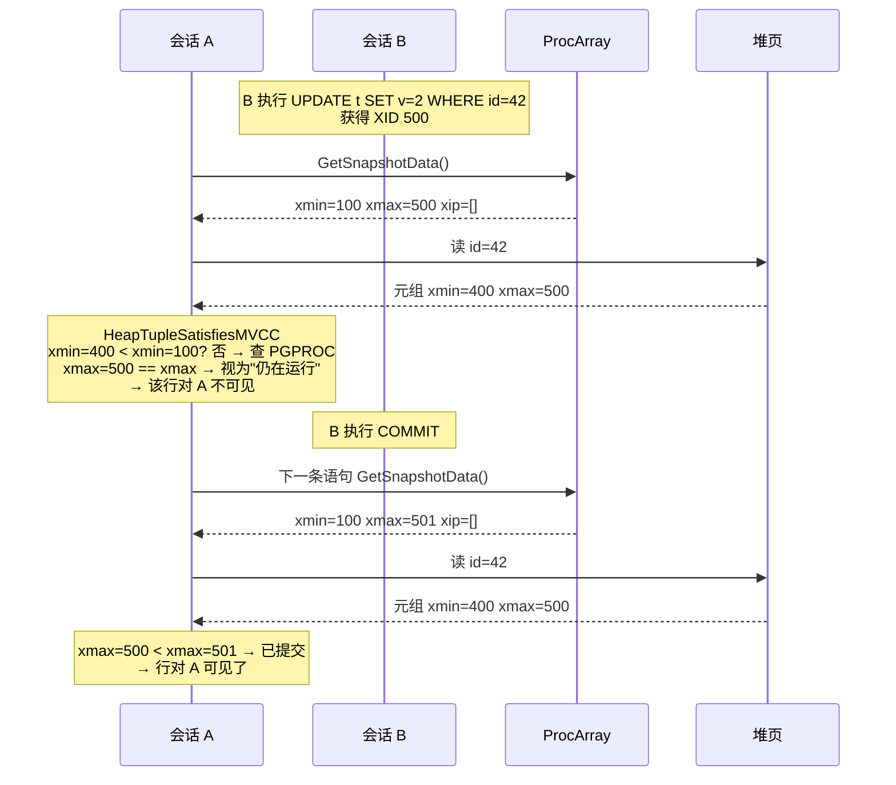
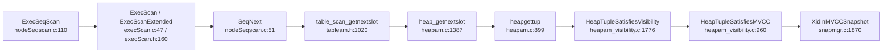
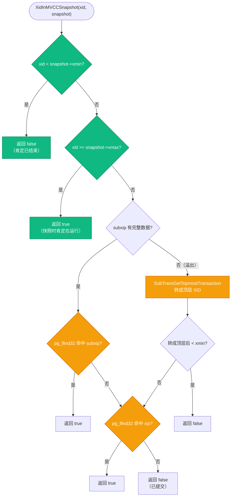
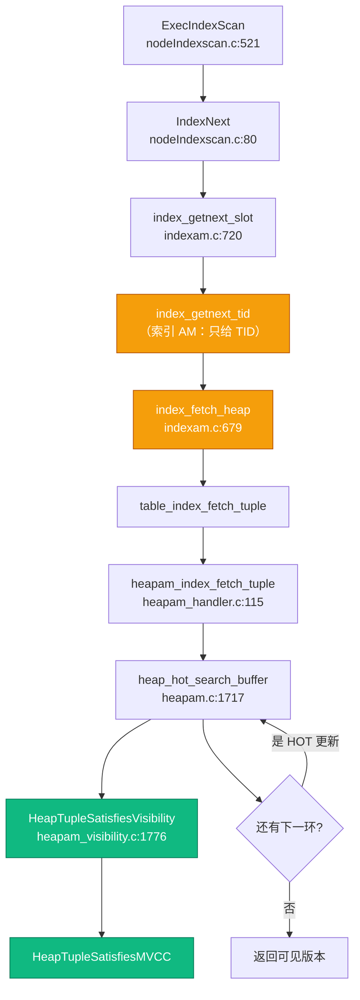
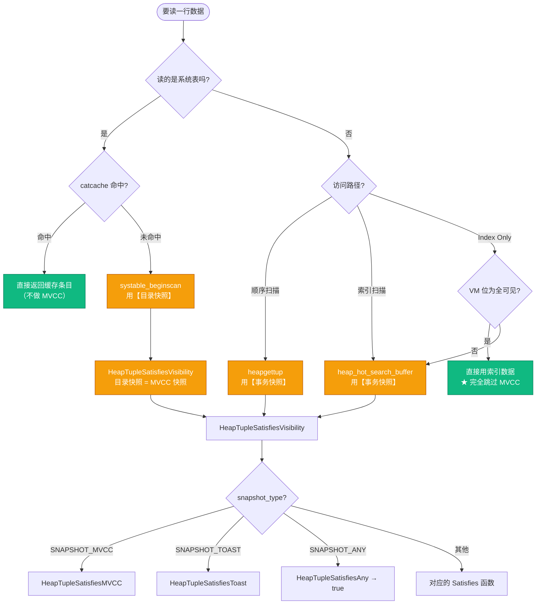
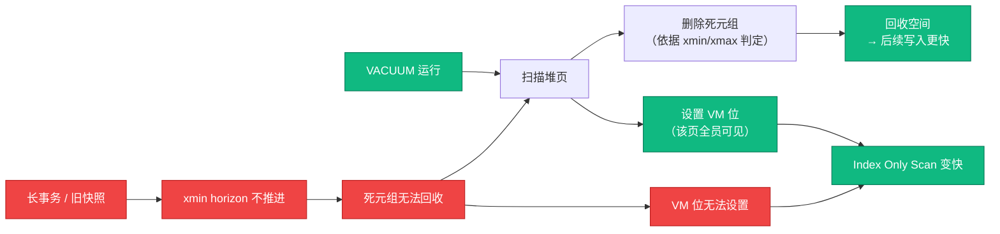

# PostgreSQL 读一行数据源码级深度拆解：MVCC 在每个环节的落点

| 编写人 | 编写内容 | 编写时间 |
| --- | --- | --- |
| growdu | 初稿。从 PostgreSQL 18 dev（`~/cwork/postgresql`）源码出发，把 **PostgreSQL 读一行数据** **彻底拆解**：一条 `SELECT` 从进程入口到返回客户端要穿过 9 个阶段 / **每个阶段的 MVCC 落点** / 事务快照的诞生（`GetTransactionSnapshot` → `GetSnapshotData` 的 xmin/xmax/xip 三件套）/ **系统表读取为什么也走 MVCC** / 目录快照（`GetCatalogSnapshot`）与事务快照的分工 / catcache 三层缓存的未命中路径 / 顺序扫描的可见性闸门（`heapgettup`）/ **可见性判定的七路分派**（`HeapTupleSatisfiesVisibility`）/ `HeapTupleSatisfiesMVCC` 逐行拆解 / `XidInMVCCSnapshot` 的三级短路 / 索引扫描的 HOT 链追踪（`heap_hot_search_buffer`）/ Index Only Scan 如何用可见性图「跳过」MVCC / TOAST 大字段的独立快照语义 / 七种快照类型全景对照 / 三条读取路径的 MVCC 对照 / 性能视角 / 9 个坑点速查。每个主题都给源码 + 关键字段 + mermaid 流程图。配套源码版本：PostgreSQL 18 dev。 | 2026-10-26 |

> 本文是「PostgreSQL 内核机制源码系列」。同系列前文：
>
> - [PostgreSQL MVCC：从一行 UPDATE 到 5 个 HeapTuple 的演化](../postgresql-mvcc/index.html)
> - [PostgreSQL 行锁机制源码级深度拆解](../postgresql-row-lock-deep-dive/index.html)
> - [PostgreSQL 读取系统表源码级深度拆解](../postgresql-read-catalog-table/index.html)
> - [PostgreSQL RUNNING_XACTS 与快照构建](../postgresql-running-xacts-snapshot/index.html)
> - [PostgreSQL 18 内核数据结构全景](../postgresql-rangevar-and-data-structures/index.html)

## 阅读指南

- **第一节 ~ 第三节**（**必读**）：全景图 + 9 个阶段的路线图 + 事务边界
- **第四节 ~ 第六节**（**核心**）：快照如何诞生（xmin/xmax/xip）/ **系统表读取如何走 MVCC** / 目录快照与事务快照的分工
- **第七节 ~ 第十一节**（**源码精读**）：扫描建立 / 顺序扫描取一行 / 可见性判定七路分派 / `HeapTupleSatisfiesMVCC` 逐行拆解 / 索引扫描与 HOT 链
- **第十二节 ~ 第十四节**（**进阶**）：Index Only Scan 的可见性图 / TOAST 快照 / 七种快照类型全景
- **第十五节 ~ 第十八节**（**收尾**）：三条路径对照 / 性能视角 / 坑点速查 / 源码索引

---

## 一、引子：一次 `SELECT * FROM t WHERE id = 42` 的完整旅程

想象你在一家极简的图书馆。规则很怪：

- 书**从来不封箱**。你想读第 42 页，管理员直接把那一页摊开给你。
- 但如果有人正在重写这本书，管理员不会把书收走，而是**把他写的那一版放在旁边**，然后按你进门时的时间戳挑一版给你。
- 更妙的是，你进来之后整个世界就**冻结**了。你在图书馆待一小时，这一小时里别人怎么改这本书都跟你无关 —— 你走出图书馆时看到的那一版，和你进门时一模一样。

这套规则就是 MVCC。而一个常见误解是：**"MVCC 只在读数据行的时候起作用"**。

事实上，从一条 SQL 进入后端进程开始，到结果行被序列化发回客户端，MVCC 的影子出现在**每一个环节**：

- 快照是什么时候被"冻结"的？
- 解析 SQL 时去查 `pg_class`，这次查系统表用的是什么快照？
- 系统表的缓存没命中时，兜底的全表扫描用的是什么快照？
- 走索引扫描时，可见性判定发生在索引里还是堆表里？
- Index Only Scan 什么时候可以**完全绕过**可见性判定？
- 行里存着一个大文本，实际数据在 TOAST 表里，TOAST 表的读取归谁管？

本文的答案是一张路线图：**9 个阶段，每个阶段都标注了 MVCC 在哪里出场、用的是哪种快照**。

```text
阶段 0  事务边界      StartTransactionCommand          → 还没有快照
阶段 1  快照诞生      GetTransactionSnapshot            → ★ 事务快照（MVCC 主快照）
阶段 2  解析规划      analyze/rewrite/plan             → ★ 读系统表，用目录快照
阶段 3  打开表        table_open → relcache             → ★ relcache 读 pg_class
阶段 4  建立扫描      table_beginscan                   → 快照被钉进 ScanDesc
阶段 5  取一行        heapgettup / heap_hot_search_buffer → ★ 可见性判定
阶段 6  判定          HeapTupleSatisfiesVisibility      → ★ MVCC 的心脏
阶段 7  返回          slot 投影 → 序列化               → 无关
阶段 8  结束          CommitTransactionCommand          → 快照被释放
```

---

## 二、全景图：读一行的 9 个阶段



### 2.1 环节速查表

| # | 阶段 | 关键入口 | MVCC 是否参与 | 使用的快照 |
| --- | --- | --- | :---: | --- |
| 0 | 事务边界 | `StartTransactionCommand` | 否 | 无 |
| 1 | 快照诞生 | `GetTransactionSnapshot` | **是** | `SNAPSHOT_MVCC` |
| 2 | 解析 / 规划读系统表 | `SearchSysCache` → `systable_beginscan` | **是** | `SNAPSHOT_MVCC`（目录快照） |
| 3 | 打开表 / relcache | `RelationIdGetRelation` | **是** | 目录快照 |
| 4 | 建立扫描 | `table_beginscan` | 间接 | 事务快照被钉入 `rs_snapshot` |
| 5 | 取一行 | `heapgettup` / `heap_hot_search_buffer` | **是** | 事务快照 |
| 6 | 可见性判定 | `HeapTupleSatisfiesVisibility` | **是** | 按 `snapshot_type` 七路分派 |
| 7 | 返回 / 投影 | `ExecProject` → `DestReceiver` | 否 | 无 |
| 8 | 事务结束 | `CommitTransactionCommand` | 间接 | 释放快照 |

> **一句话结论**：MVCC 不只在"读数据行"时出现。**读系统表、读 TOAST 表、规划器读 `pg_statistic`、 甚至 relcache 初始化读 `pg_class`，全都是 MVCC 读**。区别只在于用的是哪种快照。

---

## 三、阶段 0：事务边界 —— 没有快照就没有 MVCC

### 3.1 事务是怎么开始的

一条 SQL 到达后端进程后，第一件事不是解析，而是**确认自己在哪个事务里**：

```c
/* src/backend/access/transam/xact.c:3059 */
void
StartTransactionCommand(void)
{
	TransactionState s = CurrentTransactionState;

	switch (s->blockState)
	{
		case TBLOCK_DEFAULT:
			StartTransaction();
			s->blockState = TBLOCK_STARTED;
			break;
		...
	}
}
```

`StartTransactionCommand` 会根据 `TransactionState.blockState` 决定是新开一个事务、还是延续已有的事务块（`BEGIN ... COMMIT` 显式块）、还是延续子事务。

关键点：**这一步还没有任何快照**。MVCC 快照不是"事务开始时"取的，而是**第一次有语句真的需要看数据时**才取。这在 PostgreSQL 里叫 `FirstSnapshotSet`。

```c
/* src/backend/utils/time/snapmgr.c:271 */
Snapshot
GetTransactionSnapshot(void)
{
	...
	/* First call in transaction? */
	if (!FirstSnapshotSet)
	{
		/*
		 * Don't allow catalog snapshot to be older than xact snapshot.
		 */
		InvalidateCatalogSnapshot();
		...
		if (IsolationUsesXactSnapshot())
		{
			CurrentSnapshot = GetSerializableTransactionSnapshot(&CurrentSnapshotData);
			CurrentSnapshot = CopySnapshot(CurrentSnapshot);
			FirstXactSnapshot = CurrentSnapshot;
			FirstXactSnapshot->regd_count++;
			pairingheap_add(&RegisteredSnapshots, &FirstXactSnapshot->ph_node);
		}
		else
			CurrentSnapshot = GetSnapshotData(&CurrentSnapshotData);

		FirstSnapshotSet = true;
		return CurrentSnapshot;
	}
	...
}
```

这里已经能看到两个关键分支：

- **REPEATABLE READ / SERIALIZABLE**（`IsolationUsesXactSnapshot()` 为真）：整个事务共用**同一份**快照。快照必须"活到事务结束"，所以要做 `CopySnapshot` 物理拷贝，并登记进 `RegisteredSnapshots` 配对堆。
- **READ COMMITTED**：每条语句可以取新快照。`CurrentSnapshot` 指向静态存储，后续 `CommandCounterIncrement` 会改写它的 `curcid`。

还有一个容易被忽略的动作：`InvalidateCatalogSnapshot()`。**事务快照永远比目录快照新**，所以拿新事务快照之前必须先把可能过期的目录快照扔掉。这一点在第五节会展开。

---

## 四、阶段 1：快照的诞生 —— xmin / xmax / xip 三件套

### 4.1 GetSnapshotData：去 ProcArray 里要账

真正干活的是 `GetSnapshotData`：

```c
/* src/backend/storage/ipc/procarray.c:2175 */
Snapshot
GetSnapshotData(Snapshot snapshot)
{
	...
	LWLockAcquire(ProcArrayLock, LW_SHARED);

	if (GetSnapshotDataReuse(snapshot))
	{
		LWLockRelease(ProcArrayLock);
		return snapshot;
	}

	latest_completed = TransamVariables->latestCompletedXid;
	...
	/* xmax is always latestCompletedXid + 1 */
	xmax = XidFromFullTransactionId(latest_completed);
	TransactionIdAdvance(xmax);
	...
	/* initialize xmin calculation with xmax */
	xmin = xmax;
	...
}
```

它拿 `ProcArrayLock` 的**共享锁**，扫一遍 `PGPROC` 数组，算出三样东西：

| 字段 | 含义 | 判定语义 |
| --- | --- | --- |
| `xmin` | 快照时刻最老的、仍在运行的事务 ID | **所有 `< xmin` 的 XID 都已结束**（提交或回滚），对快照而言"已完成" |
| `xmax` | 快照时刻已分配的最大 XID + 1 | **所有 `>= xmax` 的 XID 对快照而言都还在运行**（还没提交） |
| `xip[]` | 区间 `[xmin, xmax)` 内所有仍在运行的 XID 列表 | 需要逐个查表才能判定 |

注释里写得非常清楚：

```text
All xact IDs < xmin are considered finished.
All xact IDs >= xmax are considered still running.
For an xact ID xmin <= xid < xmax, consult list to see whether
it is considered running or not.
```

**这就是 MVCC 的全部魔法**：一张快照只是一组数字，它把"世界"切成了三段 —— 更早的已完成、更晚的未开始、中间一小撮需要单独点名。

### 4.2 快照复用的黑魔法：xactCompletionCount

`GetSnapshotData` 里有个容易被跳过的优化 —— `GetSnapshotDataReuse`：

```c
/* src/backend/storage/ipc/procarray.c:2095 */
static bool
GetSnapshotDataReuse(Snapshot snapshot)
{
	uint64		curXactCompletionCount;

	Assert(LWLockHeldByMe(ProcArrayLock));

	if (unlikely(snapshot->snapXactCompletionCount == 0))
		return false;

	curXactCompletionCount = TransamVariables->xactCompletionCount;
	if (curXactCompletionCount != snapshot->snapXactCompletionCount)
		return false;
	...
	snapshot->curcid = GetCurrentCommandId(false);
	snapshot->active_count = 0;
	snapshot->regd_count = 0;
	snapshot->copied = false;

	return true;
}
```

`xactCompletionCount` 是一个**全局单调计数器**，每有一个带 XID 的事务结束（提交或回滚）就 +1（且是在持有 `ProcArrayLock` **排他锁**时加的）。

因此：如果这个计数器没变，说明**自上次建快照以来，没有任何带 XID 的事务结束**，那么"哪些事务在运行"这个集合必然没变，快照内容也必然没变 —— 于是**只更新 `curcid`（命令计数器）就返回**，省掉整个 `PGPROC` 扫描。

> 这是 `CommandCounterIncrement` 能高效工作的底层原因。语句级快照"看起来变了"（curcid 变了），但事务集合没变。

### 4.3 PushActiveSnapshot：把快照钉在栈上

快照建好之后要压栈：

```c
/* src/backend/utils/time/snapmgr.c:680 */
void
PushActiveSnapshot(Snapshot snapshot)
{
	PushActiveSnapshotWithLevel(snapshot, GetCurrentTransactionNestLevel());
}

void
PushActiveSnapshotWithLevel(Snapshot snapshot, int snap_level)
{
	ActiveSnapshotElt *newactive;

	Assert(snapshot != InvalidSnapshot);
	Assert(ActiveSnapshot == NULL || snap_level >= ActiveSnapshot->as_level);

	newactive = MemoryContextAlloc(TopTransactionContext, sizeof(ActiveSnapshotElt));

	if (snapshot == CurrentSnapshot || snapshot == SecondarySnapshot ||
		!snapshot->copied)
		newactive->as_snap = CopySnapshot(snapshot);
	else
		newactive->as_snap = snapshot;

	newactive->as_next = ActiveSnapshot;
	newactive->as_level = snap_level;

	newactive->as_snap->active_count++;

	ActiveSnapshot = newactive;
}
```

注意这个分支：如果传进来的快照**可能是静态存储**（`CurrentSnapshot`）或者**可能被 `CommandCounterIncrement` 改写**，就必须 `CopySnapshot` 物理拷贝一份。因为 `CurrentSnapshot->curcid` 会被后续命令覆盖。

### 4.4 SnapshotData 结构

```c
/* src/include/utils/snapshot.h:138 */
typedef struct SnapshotData
{
	SnapshotType snapshot_type; /* type of snapshot */

	TransactionId xmin;			/* all XID < xmin are visible to me */
	TransactionId xmax;			/* all XID >= xmax are invisible to me */

	TransactionId *xip;
	uint32		xcnt;			/* # of xact ids in xip[] */

	TransactionId *subxip;
	int32		subxcnt;		/* # of xact ids in subxip[] */
	bool		suboverflowed;	/* has the subxip array overflowed? */

	bool		takenDuringRecovery;	/* recovery-shaped snapshot? */
	bool		copied;			/* false if this is a static snapshot */

	CommandId	curcid;			/* in my xact, CID < curcid are visible */

	uint32		speculativeToken;
	struct GlobalVisState *vistest;

	uint32		active_count;	/* refcount on ActiveSnapshot stack */
	uint32		regd_count;		/* refcount on RegisteredSnapshots */
	pairingheap_node ph_node;	/* link in the RegisteredSnapshots heap */

	uint64		snapXactCompletionCount;
} SnapshotData;
```

`curcid` 是 MVCC 里最容易被忽略的一环：**同一个事务自己插入/更新的行，靠 `cmin`/`cmax` 和 `curcid` 比较来判定可见性**，不依赖 `xip`。第九节会详细讲。

### 4.5 两个事务的视角



---

## 五、阶段 2：解析阶段就已经在读系统表了 —— MVCC 第一次登场

### 5.1 一个反直觉的事实

很多人以为"系统表"是特殊的、不走 MVCC 的东西。**错**。

`pg_class`、`pg_attribute`、`pg_type` 这些都是**普通的堆表**（heap table），有 `HeapTupleHeaderData`、有 `xmin`/`xmax`、有 HOT 链。`CREATE TABLE` 往 `pg_class` 里插一行，本质上和往业务表插一行一模一样。

所以读系统表 = 读普通表 = 要过 MVCC 可见性判定。

### 5.2 解析阶段就发起了快照

```c
/* src/backend/tcop/postgres.c:1163 */
		/*
		 * Set up a snapshot if parse analysis/planning will need one.
		 */
		if (analyze_requires_snapshot(parsetree))
		{
			PushActiveSnapshot(GetTransactionSnapshot());
			snapshot_set = true;
		}
```

`pg_analyze_and_rewrite_fixedparams` 随后会去查：

- `pg_class` —— 这个名字对应哪张表、什么类型、什么 owner
- `pg_attribute` —— 这张表有哪些列、列的类型、默认值
- `pg_type` —— 列类型的 OID 解析
- `pg_namespace` —— schema 名到 OID
- `pg_proc` —— 函数签名匹配

**这些查询全部是 MVCC 读**。

### 5.3 三层缓存：relcache → catcache → syscache

PostgreSQL 读系统表有三条路径，从快到慢：

```text
                    SearchSysCache1(RELOID, 42)
                              │
                              ▼
        ┌───────────────────────────────────────┐
        │  第 1 层：catcache 哈希桶命中         │  ← 最快，纯内存
        │  SearchCatCacheInternal               │     catcache.c:1391
        │  (按 hash 值 + key 比较)              │
        └───────────────────────────────────────┘
                              │ 未命中
                              ▼
        ┌───────────────────────────────────────┐
        │  第 2 层：SearchCatCacheMiss          │  ← 兜底查表
        │  catcache.c:1499                      │
        └───────────────────────────────────────┘
                              │
                              ▼
        ┌───────────────────────────────────────┐
        │  第 3 层：systable_beginscan          │  ← 真正读堆
        │  genam.c:388                          │
        │  走索引 or 全表扫描                   │
        └───────────────────────────────────────┘
```

外层还有一个 **relcache**（关系级缓存，缓存 `Relation` 结构体本身），它和 catcache 是正交的。

### 5.4 第 1 层：catcache 命中

```c
/* src/backend/utils/cache/syscache.c:208 */
HeapTuple
SearchSysCache(int cacheId,
			   Datum key1,
			   Datum key2,
			   Datum key3,
			   Datum key4)
{
	Assert(cacheId >= 0 && cacheId < SysCacheSize &&
		   PointerIsValid(SysCache[cacheId]));

	return SearchCatCache(SysCache[cacheId], key1, key2, key3, key4);
}
```

注意 `SearchSysCache` 自己**完全不含快照逻辑**。它纯粹是 catcache 的包装。

catcache 的核心是 `SearchCatCacheInternal`：

```c
/* src/backend/utils/cache/catcache.c:1391 */
static inline HeapTuple
SearchCatCacheInternal(CatCache *cache, int nkeys, Datum v1, ...)
{
	...
	hashValue = CatalogCacheComputeHashValue(cache, nkeys, v1, v2, v3, v4);
	hashIndex = HASH_INDEX(hashValue, cache->cc_nbuckets);

	bucket = &cache->cc_bucket[hashIndex];
	dlist_foreach(iter, bucket)
	{
		ct = dlist_container(CatCTup, cache_elem, iter.cur);

		if (ct->dead)
			continue;
		if (ct->hash_value != hashValue)
			continue;
		if (!CatalogCacheCompareTuple(cache, nkeys, ct->keys, arguments))
			continue;

		dlist_move_head(bucket, &ct->cache_elem);

		if (!ct->negative)
		{
			ct->refcount++;
			ResourceOwnerRememberCatCacheRef(CurrentResourceOwner, &ct->tuple);
			return &ct->tuple;
		}
		...
	}
	...
}
```

**这里没有任何 MVCC 检查**。catcache 命中时返回的是缓存里存的那个元组副本（`ct->tuple`），它的可见性在**入缓存的时候**就已经确定了。

> **关键理解**：catcache 是一个"内容快照"缓存。它的正确性依赖 **invalidation 机制**（第四节会讲）而不是每次查询都做 MVCC 检查。DDL 改了 `pg_class`，会发 catcache invalidation 消息把对应条目清掉。

### 5.5 第 3 层：未命中时的兜底扫描 —— 这里 MVCC 正式登场

```c
/* src/backend/utils/cache/catcache.c:1499 */
static pg_noinline HeapTuple
SearchCatCacheMiss(CatCache *cache, int nkeys, uint32 hashValue,
				   Index hashIndex, Datum v1, Datum v2, Datum v3, Datum v4)
{
	...
	relation = table_open(cache->cc_reloid, AccessShareLock);

	memcpy(cur_skey, cache->cc_skey, sizeof(ScanKeyData) * nkeys);
	cur_skey[0].sk_argument = v1;
	...
	do
	{
		scandesc = systable_beginscan(relation,
									  cache->cc_indexoid,
									  IndexScanOK(cache),
									  NULL,
									  nkeys,
									  cur_skey);
		while (HeapTupleIsValid(ntp = systable_getnext(scandesc)))
		{
			...
		}
		systable_endscan(scandesc);
	} while (stale);
	...
}
```

注意第三个参数 `NULL` —— **snapshot 传的是 NULL**。

再看 `systable_beginscan` 怎么处理 NULL：

```c
/* src/backend/access/index/genam.c:388 */
SysScanDesc
systable_beginscan(Relation heapRelation,
				   Oid indexId,
				   bool indexOK,
				   Snapshot snapshot,
				   int nkeys, ScanKey key)
{
	...
	if (snapshot == NULL)
	{
		Oid			relid = RelationGetRelid(heapRelation);

		snapshot = RegisterSnapshot(GetCatalogSnapshot(relid));
		sysscan->snapshot = snapshot;
	}
	else
	{
		/* Caller is responsible for any snapshot. */
		sysscan->snapshot = NULL;
	}
	...
	if (irel)
	{
		...
		sysscan->iscan = index_beginscan(heapRelation, irel,
										 snapshot, NULL, nkeys, 0);
		index_rescan(sysscan->iscan, idxkey, nkeys, NULL, 0);
		sysscan->scan = NULL;
	}
	else
	{
		sysscan->scan = table_beginscan_strat(heapRelation, snapshot,
											  nkeys, key, true, false);
		sysscan->iscan = NULL;
	}
	...
}
```

**这就是答案**：系统表读**确实走 MVCC**，用的是 `GetCatalogSnapshot(relid)` 返回的**目录快照**。

而且注意：无论走索引还是走堆表扫描，用的都是同一个 `snapshot` 变量 —— 目录快照。

### 5.6 走索引读系统表，MVCC 检查发生在哪

`systable_getnext` 走索引路径：

```c
/* src/backend/access/index/genam.c:514 */
HeapTuple
systable_getnext(SysScanDesc sysscan)
{
	HeapTuple	htup = NULL;

	if (sysscan->irel)
	{
		if (index_getnext_slot(sysscan->iscan, ForwardScanDirection, sysscan->slot))
		{
			bool		shouldFree;

			htup = ExecFetchSlotHeapTuple(sysscan->slot, false, &shouldFree);
			Assert(!shouldFree);
			...
		}
	}
	...
}
```

`index_getnext_slot` → `index_fetch_heap` → `table_index_fetch_tuple` → `heapam_index_fetch_tuple` → `heap_hot_search_buffer` → **`HeapTupleSatisfiesVisibility`**。

**结论和普通表索引扫描完全一样**：索引里只有 TID，可见性判定必须回到堆表做。第九、第十节会详细展开这条链路。

### 5.7 catcache 的 MVCC 边界在哪

| 环节 | 是否做 MVCC 判定 | 说明 |
| --- | :---: | --- |
| catcache 命中 | 否 | 依赖 invalidation 保证正确性 |
| catcache 未命中 → 扫 `pg_class` | **是** | 用目录快照 + `HeapTupleSatisfiesVisibility` |
| 扫到的元组入 catcache | — | 入缓存后由 invalidation 负责失效 |
| relcache 命中 | 否 | 靠 `CacheInvalidateRelcache` 消息失效 |

> **坑点**：catcache 里的条目可能来自一个**已经过期的目录快照**。PostgreSQL 的解法不是每次读都做 MVCC 检查，而是靠 invalidation 消息把可能过期的条目主动清掉。DDL 高频时这条路径会有缓存抖动。

---

## 六、阶段 2.5：目录快照 vs 事务快照 —— 两种 MVCC 视角

### 6.1 为什么要分两种快照

回到 `GetCatalogSnapshot`：

```c
/* src/backend/utils/time/snapmgr.c:384 */
Snapshot
GetCatalogSnapshot(Oid relid)
{
	/*
	 * Return historic snapshot while we're doing logical decoding, so we can
	 * see the appropriate state of the catalog.
	 */
	if (HistoricSnapshotActive())
		return HistoricSnapshot;

	return GetNonHistoricCatalogSnapshot(relid);
}

/*
 * GetNonHistoricCatalogSnapshot
 *		Get a snapshot that is sufficiently up-to-date for scan of the
 *		system catalog with the specified OID, even while historic snapshots are
 *		set up.
 */
Snapshot
GetNonHistoricCatalogSnapshot(Oid relid)
{
	/*
	 * If the caller is trying to scan a relation that has no syscache, no
	 * catcache invalidations will be sent when it is updated.  For a few key
	 * relations, snapshot invalidations are sent instead.  If we're trying to
	 * scan a relation for which neither catcache nor snapshot invalidations
	 * are sent, we must refresh the snapshot every time.
	 */
	if (CatalogSnapshot &&
		!RelationInvalidatesSnapshotsOnly(relid) &&
		!RelationHasSysCache(relid))
		InvalidateCatalogSnapshot();

	if (CatalogSnapshot == NULL)
	{
		/* Get new snapshot. */
		CatalogSnapshot = GetSnapshotData(&CatalogSnapshotData);

		pairingheap_add(&RegisteredSnapshots, &CatalogSnapshot->ph_node);
	}

	return CatalogSnapshot;
}
```

注意：`GetNonHistoricCatalogSnapshot` 里调用的是 **`GetSnapshotData`** —— 和事务快照走的是**同一个函数**！所以目录快照在本质上**也是一个标准 MVCC 快照**，也有 xmin/xmax/xip。

区别在于**生命周期**和**失效时机**：

```c
/* src/backend/utils/time/snapmgr.c:454 */
void
InvalidateCatalogSnapshot(void)
{
	if (CatalogSnapshot)
	{
		pairingheap_remove(&RegisteredSnapshots, &CatalogSnapshot->ph_node);
		CatalogSnapshot = NULL;
		SnapshotResetXmin();
	}
}
```

### 6.2 两者的分工

| 维度 | 事务快照 | 目录快照 |
| --- | --- | --- |
| 获取入口 | `GetTransactionSnapshot()` | `GetCatalogSnapshot(relid)` |
| 底层构造 | `GetSnapshotData()` | `GetSnapshotData()`（同一个） |
| 快照类型 | `SNAPSHOT_MVCC` | `SNAPSHOT_MVCC` |
| 生命周期 | 语句级 / 事务级 | 直到被 invalidate |
| 失效触发 | `CommandCounterIncrement` / 事务结束 | **DDL 提交时 invalidate** |
| 谁在用 | 业务表扫描、执行器 | 系统表扫描、relcache、catcache 兜底 |
| 读到自己未提交的系统表改动 | ✅（靠 cmin/cmax） | ✅ |

### 6.3 事务快照必须比目录快照新

回到 `GetTransactionSnapshot`：

```c
	/* First call in transaction? */
	if (!FirstSnapshotSet)
	{
		/*
		 * Don't allow catalog snapshot to be older than xact snapshot.  Must
		 * do this first to allow the empty-heap Assert to succeed.
		 */
		InvalidateCatalogSnapshot();
		...
	}
```

以及：

```c
	if (IsolationUsesXactSnapshot())
		return CurrentSnapshot;

	/* Don't allow catalog snapshot to be older than xact snapshot. */
	InvalidateCatalogSnapshot();
```

**为什么？** 场景：

```text
T1: CREATE TABLE t (id int);
    → 往 pg_class 插了一行，事务还没提交
T1: SELECT * FROM pg_class WHERE relname='t';
    → 事务快照必须能看到自己刚建的表
    → 如果目录快照比事务快照旧，就看不到自己刚插入的 pg_class 行
```

所以**每次取新事务快照之前，先把目录快照作废**，下次读系统表时重建。

> 这解释了一个有趣的现象：在同一个事务里连续执行两条 DDL + 查询，第二条 DDL 会重新构造目录快照，代价就是一次 `GetSnapshotData`。

### 6.4 目录快照的失效点

`InvalidateCatalogSnapshot` 的调用者主要有：

| 调用点 | 触发场景 |
| --- | --- |
| `GetTransactionSnapshot` | 取新事务快照前 |
| `GetNonHistoricCatalogSnapshot` | 扫的表既无 syscache 也无 snapshot invalidation |
| `CacheInvalidateHeapTuple` / `AtEOXact` | 系统表发生变更后 |
| `InvalidateCatalogSnapshotConditionally` | 等待客户端输入前，释放快照以免卡住 xmin 推进 |

```c
/*
 * InvalidateCatalogSnapshotConditionally
 *		Drop catalog snapshot if it's the only one we have
 *
 * This is called when we are about to wait for client input, so we don't
 * want to continue holding the catalog snapshot if it might mean that the
 * global xmin horizon can't advance.
 */
```

这一段特别值得注意：**为了不让全局 xmin 推进被卡住，PG 会在 idle 之前主动丢掉目录快照**。这是 MVCC 与全局可见性（GlobalVisState）之间的一个精妙平衡点。

### 6.5 规划器读 pg_statistic 也是 MVCC 读

规划器要做选择性估算，就得读 `pg_statistic`：

```c
/* src/backend/utils/adt/selfuncs.c:5712 */
		vardata->statsTuple = SearchSysCache3(STATRELATTINH,
											  ObjectIdGetDatum(rte->relid),
											  Int16GetDatum(var->varattno),
											  BoolGetDatum(rte->inh));
		vardata->freefunc = ReleaseSysCache;
```

注意它走的是 **`SearchSysCache3`** —— 和 5.4 节完全同一条路：catcache 命中就返回缓存条目；**未命中就 `systable_beginscan` 扫 `pg_statistic`，用目录快照做 MVCC 判定**。

relcache 初始化读 `pg_opclass` 也是同一套路：

```c
/* src/backend/utils/cache/relcache.c:1755 */
	scan = systable_beginscan(rel, OpclassOidIndexId, indexOK,
							  NULL, 1, skey);
```

所以 `EXPLAIN` 一个带复杂条件的查询时，**规划阶段的行数估算本身也是 MVCC 可见的**。

> 这解释了一个经典问题：`ANALYZE` 之后 `EXPLAIN` 的行数估算变了 —— 因为 `pg_statistic` 的内容变了，而读它用的是当下时刻的目录快照。反过来，如果此刻有另一个未提交的事务刚 `ANALYZE` 过，估算用的仍是"提交前"的统计信息。

---

## 七、阶段 3-4：打开表与建立扫描 —— 快照被钉进 ScanDesc

### 7.1 打开表

```c
/* src/backend/executor/nodeSeqscan.c:51 */
static TupleTableSlot *
SeqNext(SeqScanState *node)
{
	TableScanDesc scandesc;
	...
	scandesc = node->ss.ss_currentScanDesc;
	...
	if (scandesc == NULL)
	{
		scandesc = table_beginscan(node->ss.ss_currentRelation,
								   estate->es_snapshot,
								   0, NULL);
		node->ss.ss_currentScanDesc = scandesc;
	}

	if (table_scan_getnextslot(scandesc, direction, slot))
		return slot;
	return NULL;
}
```

`estate->es_snapshot` 从哪来？

```c
/* src/backend/executor/execMain.c:245 */
	estate->es_snapshot = RegisterSnapshot(queryDesc->snapshot);
```

而 `queryDesc->snapshot` 来自 `PortalStart`：

```c
/* src/backend/commands/portalcmds.c */
	PortalStart(portal, params, 0, GetActiveSnapshot());
```

也就是**当前活动快照** —— 也就是第四节的 `PushActiveSnapshot(GetTransactionSnapshot())` 压上去的那一份。

完整链路：

```text
GetTransactionSnapshot()
    → PushActiveSnapshot()          [栈顶 ActiveSnapshot]
        → PortalStart(..., GetActiveSnapshot())
            → queryDesc->snapshot
                → ExecutorStart: estate->es_snapshot = RegisterSnapshot(queryDesc->snapshot)
                    → SeqNext: table_beginscan(rel, estate->es_snapshot, ...)
                        → scan->rs_snapshot = snapshot
```

**事务快照在这一刻被"钉"进了 ScanDesc**，之后整个扫描过程都用它。

### 7.2 两种 table_beginscan

```c
/* src/include/access/tableam.h:875 */
static inline TableScanDesc
table_beginscan(Relation rel, Snapshot snapshot,
				int nkeys, struct ScanKeyData *key)
{
	uint32		flags = SO_TYPE_SEQSCAN |
		SO_ALLOW_STRAT | SO_ALLOW_SYNC | SO_ALLOW_PAGEMODE;

	return rel->rd_tableam->scan_begin(rel, snapshot, nkeys, key, NULL, flags);
}
```

对比目录扫描版本：

```c
/* src/backend/access/table/tableam.c:113 */
TableScanDesc
table_beginscan_catalog(Relation relation, int nkeys, struct ScanKeyData *key)
{
	uint32		flags = SO_TYPE_SEQSCAN |
		SO_ALLOW_STRAT | SO_ALLOW_SYNC | SO_ALLOW_PAGEMODE | SO_TEMP_SNAPSHOT;
	Oid			relid = RelationGetRelid(relation);
	Snapshot	snapshot = RegisterSnapshot(GetCatalogSnapshot(relid));

	return relation->rd_tableam->scan_begin(relation, snapshot, nkeys, key,
											NULL, flags);
}
```

| 入口 | 快照来源 | 用途 |
| --- | --- | --- |
| `table_beginscan(rel, snapshot, ...)` | 调用方传入 | 普通业务表扫描 |
| `table_beginscan_catalog(rel, ...)` | `GetCatalogSnapshot(relid)` | 系统表扫描 |

`SO_TEMP_SNAPSHOT` 标志让扫描结束时自动 `UnregisterSnapshot`，免得手动管理引用计数。

### 7.3 快照的注册与生命周期

```c
/* src/backend/utils/time/snapmgr.c:822 */
Snapshot
RegisterSnapshot(Snapshot snapshot)
```

注册进 `RegisteredSnapshots` 配对堆。这件事很重要 —— 它让 `PGPROC->xmin` 知道"这个事务还持有快照，快照的 xmin 不能推进过界"，从而**阻止 VACUUM 删掉还被别人看到的行**。

> **MVCC 与 VACUUM 的连接点**：快照的 `xmin` 会注册进 `PGPROC` 数组，VACUUM 通过 `GetOldestNonRemovableTransactionId()` 拿到全局最老活跃 XID，比它老的行才能回收。

---

## 八、阶段 5：顺序扫描取一行 —— heapgettup 的可见性闸门

### 8.1 执行器骨架



`ExecScanExtended` 负责取到元组后做**投影**（只保留需要的列）和 **qual 过滤**。

### 8.2 heapgettup：逐行过闸门

```c
/* src/backend/access/heap/heapam.c:899 */
static void
heapgettup(HeapScanDesc scan, ScanDirection dir, int nkeys, ScanKey key)
{
	HeapTuple	tuple = &(scan->rs_ctup);
	Page		page;
	OffsetNumber lineoff;
	int			linesleft;

	if (likely(scan->rs_inited))
	{
		LockBuffer(scan->rs_cbuf, BUFFER_LOCK_SHARE);
		page = heapgettup_continue_page(scan, dir, &linesleft, &lineoff);
		goto continue_page;
	}

	while (true)
	{
		heap_fetch_next_buffer(scan, dir);
		if (!BufferIsValid(scan->rs_cbuf))
			break;

		LockBuffer(scan->rs_cbuf, BUFFER_LOCK_SHARE);
		page = heapgettup_start_page(scan, dir, &linesleft, &lineoff);
continue_page:

		for (; linesleft > 0; linesleft--, lineoff += dir)
		{
			bool		visible;
			ItemId		lpp = PageGetItemId(page, lineoff);

			if (!ItemIdIsNormal(lpp))
				continue;

			tuple->t_data = (HeapTupleHeader) PageGetItem(page, lpp);
			tuple->t_len = ItemIdGetLength(lpp);
			ItemPointerSet(&(tuple->t_self), scan->rs_cblock, lineoff);

			visible = HeapTupleSatisfiesVisibility(tuple,
												   scan->rs_base.rs_snapshot,
												   scan->rs_cbuf);

			HeapCheckForSerializableConflictOut(visible, scan->rs_base.rs_rd,
												tuple, scan->rs_cbuf,
												scan->rs_base.rs_snapshot);

			/* skip tuples not visible to this snapshot */
			if (!visible)
				continue;

			/* skip any tuples that don't match the scan key */
			if (key != NULL &&
				!HeapKeyTest(tuple, RelationGetDescr(scan->rs_base.rs_rd),
							 nkeys, key))
				continue;

			LockBuffer(scan->rs_cbuf, BUFFER_LOCK_UNLOCK);
			scan->rs_coffset = lineoff;
			return;
		}

		LockBuffer(scan->rs_cbuf, BUFFER_LOCK_UNLOCK);
	}

	/* end of scan */
	if (BufferIsValid(scan->rs_cbuf))
		ReleaseBuffer(scan->rs_cbuf);

	scan->rs_cbuf = InvalidBuffer;
	scan->rs_cblock = InvalidBlockNumber;
	scan->rs_prefetch_block = InvalidBlockNumber;
	tuple->t_data = NULL;
	scan->rs_inited = false;
}
```

逐行拆解，每个细节都有讲究：

| 步骤 | 动作 | 为什么 |
| --- | --- | --- |
| 1 | `heap_fetch_next_buffer` | 拿到下一个块，`ReadBuffer` 读进共享缓冲池 |
| 2 | `LockBuffer(BUFFER_LOCK_SHARE)` | 共享锁：允许多个读者并发，但排斥 VACUUM 改页 |
| 3 | `ItemIdIsNormal(lpp)` | 跳过未使用行（`LP_UNUSED`）、重定向行（`LP_REDIRECT`）、死行（`LP_DEAD`） |
| 4 | `PageGetItem` | 拿到 `HeapTupleHeader` 指针（**不拷贝**，直接指向页内内存） |
| 5 | **`HeapTupleSatisfiesVisibility`** | ★ **MVCC 判定** |
| 6 | `HeapCheckForSerializableConflictOut` | SERIALIZABLE 隔离级别下检测写冲突 |
| 7 | `HeapKeyTest` | 扫描键过滤（顺序扫描一般没有） |
| 8 | 解锁、返回 | 元组仍然指向页内内存，靠 buffer pin 保护 |

> **注意第 4 步**：`tuple->t_data` 是**指向共享缓冲池页内存的裸指针**。所以在整个扫描期间，必须持有 buffer 的 pin。这是 PG 内存管理的核心约束之一。

> **注意第 6 步**：SSI（可串行化）检查紧跟在可见性判定之后。**先判可见，再判冲突** —— 顺序不能反，因为冲突检测要拿到"这个元组对我可见"这个前提。

### 8.3 缓冲锁的粒度

```text
LockBuffer(cbuf, BUFFER_LOCK_SHARE)   ← 读页时加共享锁
    ... 可见性判定（可能要 SetHintBits → MarkBufferDirty）...
LockBuffer(cbuf, BUFFER_LOCK_UNLOCK) ← 立刻解锁
```

锁的粒度是**一页**，但只在处理这一页的行时持有。这是 PG 高并发读的关键：读锁不会跨越整个扫描。

而 `SetHintBits` 会在共享锁下修改页内容 —— 这时页被标脏，但**共享锁下不允许做物理结构变更**，改 hint bit 是安全的。

---

## 九、阶段 6：可见性判定 —— MVCC 的心脏

### 9.1 七路分派

```c
/* src/backend/access/heap/heapam_visibility.c:1776 */
bool
HeapTupleSatisfiesVisibility(HeapTuple htup, Snapshot snapshot, Buffer buffer)
{
	switch (snapshot->snapshot_type)
	{
		case SNAPSHOT_MVCC:
			return HeapTupleSatisfiesMVCC(htup, snapshot, buffer);
		case SNAPSHOT_SELF:
			return HeapTupleSatisfiesSelf(htup, snapshot, buffer);
		case SNAPSHOT_ANY:
			return HeapTupleSatisfiesAny(htup, snapshot, buffer);
		case SNAPSHOT_TOAST:
			return HeapTupleSatisfiesToast(htup, snapshot, buffer);
		case SNAPSHOT_DIRTY:
			return HeapTupleSatisfiesDirty(htup, snapshot, buffer);
		case SNAPSHOT_HISTORIC_MVCC:
			return HeapTupleSatisfiesHistoricMVCC(htup, snapshot, buffer);
		case SNAPSHOT_NON_VACUUMABLE:
			return HeapTupleSatisfiesNonVacuumable(htup, snapshot, buffer);
	}

	return false;				/* keep compiler quiet */
}
```

快照类型定义在：

```c
/* src/include/utils/snapshot.h:31 */
typedef enum SnapshotType
{
	SNAPSHOT_MVCC = 0,
	...
	SNAPSHOT_SELF,
	...
	SNAPSHOT_ANY,
	...
	SNAPSHOT_TOAST,
	...
	SNAPSHOT_DIRTY,
	...
	SNAPSHOT_HISTORIC_MVCC,
	...
	SNAPSHOT_NON_VACUUMABLE,
} SnapshotType;
```

| 快照类型 | 判定函数 | 语义 | 谁在用 |
| --- | --- | --- | --- |
| `SNAPSHOT_MVCC` | `HeapTupleSatisfiesMVCC` | 标准 MVCC 规则 | 业务表扫描、目录扫描 |
| `SNAPSHOT_SELF` | `HeapTupleSatisfiesSelf` | 只看自己事务的改动 | `SnapshotSelf` |
| `SNAPSHOT_ANY` | `HeapTupleSatisfiesAny` | **全部可见** | `SnapshotAny` |
| `SNAPSHOT_TOAST` | `HeapTupleSatisfiesToast` | 主表行可见则 TOAST 值可见 | `get_toast_snapshot()` |
| `SNAPSHOT_DIRTY` | `HeapTupleSatisfiesDirty` | 最新版本，不管提交与否 | `heap_get_latest_tid` |
| `SNAPSHOT_HISTORIC_MVCC` | `HeapTupleSatisfiesHistoricMVCC` | 逻辑解码用历史快照 | 逻辑复制 |
| `SNAPSHOT_NON_VACUUMABLE` | `HeapTupleSatisfiesNonVacuumable` | 判"能否被回收" | VACUUM |

### 9.2 HeapTupleSatisfiesMVCC 逐段拆解

这是全文最核心的函数：

```c
/* src/backend/access/heap/heapam_visibility.c:960 */
static bool
HeapTupleSatisfiesMVCC(HeapTuple htup, Snapshot snapshot, Buffer buffer)
{
	HeapTupleHeader tuple = htup->t_data;

	Assert(snapshot->regd_count > 0 || snapshot->active_count > 0);
	Assert(ItemPointerIsValid(&htup->t_self));
	Assert(htup->t_tableOid != InvalidOid);

	if (!HeapTupleHeaderXminCommitted(tuple))
	{
		if (HeapTupleHeaderXminInvalid(tuple))
			return false;
		...
		else if (TransactionIdIsCurrentTransactionId(HeapTupleHeaderGetRawXmin(tuple)))
		{
			if (HeapTupleHeaderGetCmin(tuple) >= snapshot->curcid)
				return false;	/* inserted after scan started */

			if (tuple->t_infomask & HEAP_XMAX_INVALID)	/* xid invalid */
				return true;

			if (HEAP_XMAX_IS_LOCKED_ONLY(tuple->t_infomask))	/* not deleter */
				return true;

			if (tuple->t_infomask & HEAP_XMAX_IS_MULTI)
			{
				...
				if (!TransactionIdIsCurrentTransactionId(xmax))
					return true;
				else if (HeapTupleHeaderGetCmax(tuple) >= snapshot->curcid)
					return true;	/* updated after scan started */
				else
					return false;	/* updated before scan started */
			}

			if (!TransactionIdIsCurrentTransactionId(HeapTupleHeaderGetRawXmax(tuple)))
			{
				/* deleting subtransaction must have aborted */
				SetHintBits(tuple, buffer, HEAP_XMAX_INVALID, InvalidTransactionId);
				return true;
			}

			if (HeapTupleHeaderGetCmax(tuple) >= snapshot->curcid)
				return true;	/* deleted after scan started */
			else
				return false;	/* deleted before scan started */
		}
		else if (XidInMVCCSnapshot(HeapTupleHeaderGetRawXmin(tuple), snapshot))
			return false;
		else if (TransactionIdDidCommit(HeapTupleHeaderGetRawXmin(tuple)))
			SetHintBits(tuple, buffer, HEAP_XMIN_COMMITTED,
						HeapTupleHeaderGetRawXmin(tuple));
		else
		{
			/* it must have aborted or crashed */
			SetHintBits(tuple, buffer, HEAP_XMIN_INVALID, InvalidTransactionId);
			return false;
		}
	}
	else
	{
		/* xmin is committed, but maybe not according to our snapshot */
		if (!HeapTupleHeaderXminFrozen(tuple) &&
			XidInMVCCSnapshot(HeapTupleHeaderGetRawXmin(tuple), snapshot))
			return false;		/* treat as still in progress */
	}

	/* by here, the inserting transaction has committed */

	if (tuple->t_infomask & HEAP_XMAX_INVALID)	/* xid invalid or aborted */
		return true;

	if (HEAP_XMAX_IS_LOCKED_ONLY(tuple->t_infomask))
		return true;

	if (tuple->t_infomask & HEAP_XMAX_IS_MULTI)
	{
		...
		if (TransactionIdIsCurrentTransactionId(xmax))
		{
			if (HeapTupleHeaderGetCmax(tuple) >= snapshot->curcid)
				return true;	/* deleted after scan started */
			else
				return false;	/* deleted before scan started */
		}
		if (XidInMVCCSnapshot(xmax, snapshot))
			return true;
		if (TransactionIdDidCommit(xmax))
			return false;		/* updating transaction committed */
		/* it must have aborted or crashed */
		return true;
	}

	if (!(tuple->t_infomask & HEAP_XMAX_COMMITTED))
	{
		if (TransactionIdIsCurrentTransactionId(HeapTupleHeaderGetRawXmax(tuple)))
		{
			if (HeapTupleHeaderGetCmax(tuple) >= snapshot->curcid)
				return true;	/* deleted after scan started */
			else
				return false;	/* deleted before scan started */
		}

		if (XidInMVCCSnapshot(HeapTupleHeaderGetRawXmax(tuple), snapshot))
			return true;

		if (!TransactionIdDidCommit(HeapTupleHeaderGetRawXmax(tuple)))
		{
			/* it must have aborted or crashed */
			SetHintBits(tuple, buffer, HEAP_XMAX_INVALID, InvalidTransactionId);
			return true;
		}

		/* xmax transaction committed */
		SetHintBits(tuple, buffer, HEAP_XMAX_COMMITTED,
					HeapTupleHeaderGetRawXmax(tuple));
	}
	else
	{
		/* xmax is committed, but maybe not according to our snapshot */
		if (XidInMVCCSnapshot(HeapTupleHeaderGetRawXmax(tuple), snapshot))
			return true;		/* treat as still in progress */
	}

	/* xmax transaction committed */

	return false;
}
```

### 9.3 拆成三块来看

**第一块：xmin 侧 —— 这一行是谁插的？**

```text
if (!HeapTupleHeaderXminCommitted(tuple))     ← 快速路径：hint bit 说 xmin 已提交
    if (HeapTupleHeaderXminInvalid(tuple))    ← hint bit 说 xmin 无效（回滚）
        return false;                          ← 不可见
    else if (TransactionIdIsCurrentTransactionId(xmin))  ← 是我自己插的
        if (cmin >= snapshot->curcid) return false;  ← 插在本次扫描开始之后 → 不可见
        ...                                     ← 可见（还要看 xmax）
    else if (XidInMVCCSnapshot(xmin, snapshot)) return false;  ← 快照时还在跑 → 不可见
    else if (TransactionIdDidCommit(xmin))
        SetHintBits(tuple, buffer, HEAP_XMIN_COMMITTED, xmin);  ← 提交了，标 hint
    else
        SetHintBits(tuple, buffer, HEAP_XMIN_INVALID, ...);
        return false;                          ← 回滚了 → 不可见
else                                            ← hint bit 已说 xmin 提交
    if (!HeapTupleHeaderXminFrozen(tuple) &&
        XidInMVCCSnapshot(xmin, snapshot))
        return false;                          ← 提交了但快照时还没提交 → 不可见
```

**"我自己插的"这一支为什么用 `cmin` 而不是 `xmin`？**

因为自己的 XID 不在快照的 `xip` 里（`GetSnapshotData` 明确排除了自己的 XID），所以 `XidInMVCCSnapshot` 对自己的 XID 永远返回 false。必须靠 `cmin`/`curcid` 来区分：

| `cmin` vs `curcid` | 含义 | 可见性 |
| --- | --- | --- |
| `cmin < curcid` | 插入发生在本次命令之前 | 可见 |
| `cmin >= curcid` | 插入发生在本次命令之后 | 不可见 |

`curcid` 就是 `CommandCounterIncrement` 维护的**命令计数器**。`CommandCounterIncrement()` 每执行完一条 SQL 就 +1，让同一事务内后续语句能看到前面的改动。

**第二块：xmax 侧 —— 这一行被谁改/删了？**

```text
if (HEAP_XMAX_INVALID)         return true;   ← 没有删除者 → 可见
if (HEAP_XMAX_IS_LOCKED_ONLY)  return true;   ← 只是被加锁（SELECT FOR UPDATE）→ 可见
if (HEAP_XMAX_IS_MULTI)        → 走 MultiXact 分支
if (!HEAP_XMAX_COMMITTED) {
    if (xmax 是我) {
        if (cmax >= curcid) return true;   ← 我在本命令之后删的 → 仍然可见
        else              return false;    ← 我在本命令之前删的 → 不可见
    }
    if (XidInMVCCSnapshot(xmax)) return true;   ← 快照时还没删 → 可见
    if (!TransactionIdDidCommit(xmax)) {
        SetHintBits(... HEAP_XMAX_INVALID ...);
        return true;                            ← 删除了但回滚 → 可见
    }
    SetHintBits(... HEAP_XMAX_COMMITTED ...);
} else {
    if (XidInMVCCSnapshot(xmax)) return true;   ← 提交了但快照时还没提交 → 可见
}
return false;   ← xmax 已提交且在快照前提交 → 不可见
```

> **关键洞察**：删除者是否"已提交"和"删除者对快照是否可见"是**两个独立的问题**。一个事务提交了，但快照是在它提交前取的，那么对快照来说删除还没发生 —— 行仍然可见。这就是 `xmax < snapshot->xmax` 但要额外查 `xip` 的原因。

**第三块：Hint bits**

`SetHintBits` 在判定过程中顺手做的事：把 `xmin`/`xmax` 的提交状态**缓存进 `t_infomask`**。下次再有读者访问这一行，就走快速路径（`HeapTupleHeaderXminCommitted` 为真直接跳过大部分判断）。

代价是：改了 hint bit 的页会被标脏，需要 WAL 记录（`XLOG_HINT_BIT`）。

### 9.4 可见性判定决策表

| xmin 状态 | xmax 状态 | 对快照可见？ |
| --- | --- | :---: |
| 回滚（INVALID） | — | ❌ |
| 快照时仍在运行（`xip` 中） | — | ❌ |
| 已提交但快照后才提交 | — | ❌ |
| 自己插入且 `cmin >= curcid` | — | ❌ |
| 自己插入且 `cmin < curcid` | 无删除者 | ✅ |
| 已提交（快照前） | 无删除者（INVALID） | ✅ |
| 已提交（快照前） | 仅被加锁（LOCKED_ONLY） | ✅ |
| 已提交（快照前） | 删除者回滚 | ✅ |
| 已提交（快照前） | 删除者已提交（快照前） | ❌ |
| 已提交（快照前） | 删除者在快照后才提交 | ✅ |

### 9.5 XidInMVCCSnapshot：三级短路

```c
/* src/backend/utils/time/snapmgr.c:1870 */
bool
XidInMVCCSnapshot(TransactionId xid, Snapshot snapshot)
{
	/* Any xid < xmin is not in-progress */
	if (TransactionIdPrecedes(xid, snapshot->xmin))
		return false;
	/* Any xid >= xmax is in-progress */
	if (TransactionIdFollowsOrEquals(xid, snapshot->xmax))
		return true;

	if (!snapshot->takenDuringRecovery)
	{
		if (!snapshot->suboverflowed)
		{
			/* we have full data, so search subxip */
			if (pg_lfind32(xid, snapshot->subxip, snapshot->subxcnt))
				return true;

			/* not there, fall through to search xip[] */
		}
		else
		{
			xid = SubTransGetTopmostTransaction(xid);
			if (TransactionIdPrecedes(xid, snapshot->xmin))
				return false;
		}

		if (pg_lfind32(xid, snapshot->xip, snapshot->xcnt))
			return true;
	}
	...
}
```

三级短路：



**前两级是纯数值比较，不需要碰 `xip` 数组**。绝大多数元组在第一级或第二级就返回了 —— 这就是为什么 MVCC 判定的平均成本很低。

只有落在 `[xmin, xmax)` 这个"窄窗口"里的 XID 才需要查数组。窗口的宽度 ≈ 系统中并发运行的事务数，通常很小（个位数到几十）。

### 9.6 自己插入的行：cmin/cmax 与 curcid

```text
事务 T1:
  INSERT INTO t VALUES (1);        → 命令 1, cmin=0, cmax=0
  SELECT * FROM t;                 → curcid=1 → cmin(0) < curcid(1) → 可见 ✅
  INSERT INTO t VALUES (2);        → 命令 2, cmin=1
  SELECT * FROM t;                 → curcid=2 → cmin(1) < curcid(2) → 可见 ✅
```

```text
  DELETE FROM t WHERE id=1;        → cmax=2
  SELECT * FROM t;                 → curcid=3 → cmax(2) < curcid(3) → 不可见 ❌
```

而**同一个快照内**（比如 `SELECT` 语句中途另一个地方发了命令），`curcid` 是固定的，所以不会出现"扫着扫着行自己消失了"的情况。

> 这就是为什么 `GetSnapshotDataReuse` 只更新 `curcid` 而不动 `xip`：**事务集合没变，但命令计数器会变**，后者正是用来处理自己事务内可见性的。

---

## 十、阶段 7：索引扫描取一行 —— 可见性检查在"追 HOT 链"时发生

### 10.1 索引没有 MVCC

这是一个必须先讲清楚的事实：**索引页里的索引项（IndexTuple）没有 MVCC**。

索引项只存两样东西：键值 + 指向堆表的 TID（`BlockNumber` + `OffsetNumber`）。它不记录 `xmin`/`xmax`，也没有事务可见性概念。

所以索引扫描必然是两步走：

```text
第一步：索引扫描 → 拿到一堆 TID（可能包含已经死掉的行）
第二步：逐个回堆表取元组 → 在堆表里做 MVCC 可见性判定
```

这就是"索引扫描比顺序扫描慢"的根本原因之一 —— 随机 IO + 逐行 MVCC 判定。

### 10.2 调用链



### 10.3 index_fetch_heap

```c
/* src/backend/access/index/indexam.c:679 */
bool
index_fetch_heap(IndexScanDesc scan, TupleTableSlot *slot)
{
	bool		all_dead = false;
	bool		found;

	found = table_index_fetch_tuple(scan->xs_heapfetch, &scan->xs_heaptid,
									scan->xs_snapshot, slot,
									&scan->xs_heap_continue, &all_dead);

	if (found)
		pgstat_count_heap_fetch(scan->indexRelation);

	/*
	 * If we scanned a whole HOT chain and found only dead tuples, tell index
	 * AM to kill its entry for that TID (this will take effect in the next
	 * amgettuple call, in index_getnext_tid).
	 */
	if (!scan->xactStartedInRecovery)
		scan->kill_prior_tuple = all_dead;

	return found;
}
```

两个关键点：

- `scan->xs_snapshot` —— **索引扫描用的快照**。它就是 `table_beginscan` 时钉进去的同一个事务快照。
- `kill_prior_tuple` —— 如果整条 HOT 链全死，就通知索引 AM 把这个索引项标记为待删除（下次 `index_getnext_tid` 时真正清掉）。这是**索引清理**与 MVCC 的连接点。

### 10.4 heapam_index_fetch_tuple

```c
/* src/backend/access/heap/heapam_handler.c:115 */
static bool
heapam_index_fetch_tuple(struct IndexFetchTableData *scan,
						 ItemPointer tid,
						 Snapshot snapshot,
						 TupleTableSlot *slot,
						 bool *call_again, bool *all_dead)
{
	IndexFetchHeapData *hscan = (IndexFetchHeapData *) scan;
	...
	if (!*call_again)
	{
		Buffer		prev_buf = hscan->xs_cbuf;

		hscan->xs_cbuf = ReleaseAndReadBuffer(hscan->xs_cbuf,
											  hscan->xs_base.rel,
											  ItemPointerGetBlockNumber(tid));

		if (prev_buf != hscan->xs_cbuf)
			heap_page_prune_opt(hscan->xs_base.rel, hscan->xs_cbuf);
	}

	/* Obtain share-lock on the buffer so we can examine visibility */
	LockBuffer(hscan->xs_cbuf, BUFFER_LOCK_SHARE);
	got_heap_tuple = heap_hot_search_buffer(tid,
											hscan->xs_base.rel,
											hscan->xs_cbuf,
											snapshot,
											&bslot->base.tupdata,
											all_dead,
											!*call_again);
	bslot->base.tupdata.t_self = *tid;
	LockBuffer(hscan->xs_cbuf, BUFFER_LOCK_UNLOCK);
	...
}
```

注意 `heap_page_prune_opt` —— 读的时候顺手做页内空间回收（prune）。这是 PG 读路径上少见的"写"操作。

### 10.5 heap_hot_search_buffer：沿 HOT 链找可见版本

```c
/* src/backend/access/heap/heapam.c:1717 */
bool
heap_hot_search_buffer(ItemPointer tid, Relation relation, Buffer buffer,
					   Snapshot snapshot, HeapTuple heapTuple,
					   bool *all_dead, bool first_call)
{
	Page		page = BufferGetPage(buffer);
	TransactionId prev_xmax = InvalidTransactionId;
	...
	/* Scan through possible multiple members of HOT-chain */
	for (;;)
	{
		ItemId		lp;

		/* check for bogus TID */
		if (offnum < FirstOffsetNumber || offnum > PageGetMaxOffsetNumber(page))
			break;

		lp = PageGetItemId(page, offnum);

		/* check for unused, dead, or redirected items */
		if (!ItemIdIsNormal(lp))
		{
			if (ItemIdIsRedirected(lp) && at_chain_start)
			{
				/* Follow the redirect */
				offnum = ItemIdGetRedirect(lp);
				at_chain_start = false;
				continue;
			}
			break;
		}

		heapTuple->t_data = (HeapTupleHeader) PageGetItem(page, lp);
		heapTuple->t_len = ItemIdGetLength(lp);
		heapTuple->t_tableOid = RelationGetRelid(relation);
		ItemPointerSet(&heapTuple->t_self, blkno, offnum);

		/* Shouldn't see a HEAP_ONLY tuple at chain start. */
		if (at_chain_start && HeapTupleIsHeapOnly(heapTuple))
			break;

		/*
		 * The xmin should match the previous xmax value, else chain is
		 * broken.
		 */
		if (TransactionIdIsValid(prev_xmax) &&
			!TransactionIdEquals(prev_xmax,
								 HeapTupleHeaderGetXmin(heapTuple->t_data)))
			break;

		if (!skip)
		{
			/* If it's visible per the snapshot, we must return it */
			valid = HeapTupleSatisfiesVisibility(heapTuple, snapshot, buffer);
			HeapCheckForSerializableConflictOut(valid, relation, heapTuple,
												buffer, snapshot);

			if (valid)
			{
				ItemPointerSetOffsetNumber(tid, offnum);
				PredicateLockTID(relation, &heapTuple->t_self, snapshot,
								 HeapTupleHeaderGetXmin(heapTuple->t_data));
				if (all_dead)
					*all_dead = false;
				return true;
			}
		}
		skip = false;

		/*
		 * If we can't see it, maybe no one else can either.
		 */
		if (all_dead && *all_dead)
		{
			if (!vistest)
				vistest = GlobalVisTestFor(relation);

			if (!HeapTupleIsSurelyDead(heapTuple, vistest))
				*all_dead = false;
		}

		/*
		 * Check to see if HOT chain continues past this tuple.
		 */
		if (HeapTupleIsHotUpdated(heapTuple))
		{
			Assert(ItemPointerGetBlockNumber(&heapTuple->t_data->t_ctid) ==
				   blkno);
			offnum = ItemPointerGetOffsetNumber(&heapTuple->t_data->t_ctid);
			at_chain_start = false;
			prev_xmax = HeapTupleHeaderGetUpdateXid(heapTuple->t_data);
		}
		else
			break;				/* end of chain */
	}

	return false;
}
```

### 10.6 HOT 链的形状

```text
一次 UPDATE 导致同一页内的行被"原地"更新（Heap Only Tuple）：

  页 100
  ─────────────────────────────────────────────────
  行 1 (offset 1):  xmin=100 xmax=200  t_ctid→(100,2)   ← 老版本，已死
  行 2 (offset 2):  xmin=200 xmax=0    HEAP_ONLY=true    ← 新版本
  ─────────────────────────────────────────────────
        ↑
   索引里只有一条索引项，指向 (100,1)
```

读的时候：

1. 索引给出 TID `(100,1)`。
2. `heap_hot_search_buffer` 拿到行 1，做 MVCC 判定 —— **不可见**（`xmax=200` 已提交且在快照前提交）。
3. 发现 `t_ctid` 指向 `(100,2)`，是 HOT 更新 → 继续。
4. 拿到行 2，做 MVCC 判定 —— **可见**（`xmin=200` 在快照前已提交）。
5. 返回行 2。

**HOT 链越长，MVCC 判定次数越多**。这是 HOT 更新过于频繁时的性能陷阱。

### 10.7 all_dead 与索引清理

```c
			if (!HeapTupleIsSurelyDead(heapTuple, vistest))
				*all_dead = false;
```

`HeapTupleIsSurelyDead` 判断"这一行是不是对所有人都死了"。如果是，说明整条 HOT 链都死透了 → `all_dead = true` → 回到 `index_fetch_heap` → `scan->kill_prior_tuple = true` → 索引 AM 下次扫描时把这条索引项清理掉。

PG 18 引入了 `GlobalVisState`（`GlobalVisTestFor(relation)`）来加速这个判断。注释里明确警告：

```text
Note: if you change the criterion here for what is "dead", fix the
planner's get_actual_variable_range() function to match.
```

> **注意**：`kill_prior_tuple` **在恢复期间不做**（`if (!scan->xactStartedInRecovery)`）。因为在恢复期间提前清理索引项可能违反 MVCC 语义。

---

## 十一、阶段 8：Index Only Scan —— 用可见性图"跳过"MVCC

### 11.1 思路

Index Only Scan 的想法很直接：**如果索引里已经包含所有需要的列，而且这一页的所有行对所有人都可见，那就没必要回堆表了** —— 直接从索引返回元组，连 MVCC 判定都省了。

判断"这一页对所有人都可见"的依据是**可见性图（Visibility Map, VM）**。

### 11.2 代码

```c
/* src/backend/executor/nodeIndexonlyscan.c:337 */
static TupleTableSlot *
ExecIndexOnlyScan(PlanState *pstate)
{
	IndexOnlyScanState *node = castNode(IndexOnlyScanState, pstate);
	...
	return ExecScan(&node->ss,
					(ExecScanAccessMtd) IndexOnlyNext,
					(ExecScanRecheckMtd) IndexOnlyRecheck);
}
```

`IndexOnlyNext` 的核心：

```c
/* src/backend/executor/nodeIndexonlyscan.c:161 */
		if (!VM_ALL_VISIBLE(scandesc->heapRelation,
							ItemPointerGetBlockNumber(tid),
							&node->ioss_VMBuffer))
		{
			/*
			 * Rats, we have to visit the heap to check visibility.
			 */
			InstrCountTuples2(node, 1);
			if (!index_fetch_heap(scandesc, node->ioss_TableSlot))
				continue;		/* no visible tuple, try next index entry */

			ExecClearTuple(node->ioss_TableSlot);

			/*
			 * Only MVCC snapshots are supported here, so there should be no
			 * need to keep following the HOT chain once a visible entry has
			 * been found.
			 */
			if (scandesc->xs_heap_continue)
				elog(ERROR, "non-MVCC snapshots are not supported in index-only scans");
			...
			tuple_from_heap = true;
		}
```

**两条路径**：

| VM 状态 | 行为 | MVCC 判定 |
| --- | --- | :---: |
| `VM_ALL_VISIBLE` 为真 | 直接用索引里的数据填 slot，**不回堆表** | **完全跳过** |
| 为假 | `index_fetch_heap` 回堆表 → `heap_hot_search_buffer` → `HeapTupleSatisfiesVisibility` | 照常做 |

### 11.3 VM 位为什么可信

`VM_ALL_VISIBLE` 读 VM 位时**不加锁**。源码注释里用了整整四段来论证这个优化的安全性：

```text
Note on Memory Ordering Effects: visibilitymap_get_status does not
lock the visibility map buffer, and therefore the result we read
here could be slightly stale.  However, it can't be stale enough to
matter.

We need to detect clearing a VM bit due to an insert right away,
because the tuple is present in the index page but not visible. The
reading of the TID by this scan (using a shared lock on the index
buffer) is serialized with the insert of the TID into the index
(using an exclusive lock on the index buffer). Because the VM bit
is cleared before updating the index, and locking/unlocking of the
index page acts as a full memory barrier, we are sure to see the
cleared bit if we see a recently-inserted TID.

Deletes do not update the index page (only VACUUM will clear out
the TID), so the clearing of the VM bit by a delete is not
serialized with this test below, and we may see a value that is
significantly stale. However, we don't care about the delete right
away, because the tuple is still visible until the deleting
transaction commits or the statement ends (if it's our transaction).
...
It's worth going through this complexity to avoid needing to lock
the VM buffer, which could cause significant contention.
```

三个关键点：

1. **插入**的 VM 位清除与索引页加锁构成 happens-before 关系，所以**不会漏掉新插入的行**。
2. **删除**不清索引页，VM 位可能读到旧值 —— 但删除的行在被删事务提交前本来就可见，所以不影响正确性。
3. 值得付出这套论证的代价，因为**不加锁读 VM** 能避免共享缓冲区的争用。

### 11.4 VM 位的维护者：VACUUM

VM 的每一位对应一个页，标记"这一页的所有行对所有事务都可见"。**只有 VACUUM 会设置 VM 位**（`visibilitymap_set`）。

```text
VM 位的生命周期：
  INSERT/UPDATE  → 清掉对应页的 VM 位
  VACUUM         → 扫描整页，确认无死元组后设置 VM 位
```

所以：

> **想让 Index Only Scan 走满性能，必须定期跑 VACUUM。** 否则 VM 位永远是 0，每次 Index Only Scan 都要回堆表，等于白优化。

可以用 `pg_visibility` 扩展查看：

```sql
SELECT relname, heap_blks_read, heap_blks_hit, all_visible
FROM pg_stat_user_tables, pg_visibility_map_summary(reltoidrelid)
WHERE relname = 't';
```

### 11.5 Index Only Scan 的三个前提

| 前提 | 不满足会怎样 |
| --- | --- |
| 索引包含所有需要的列 | 规划器不会选 Index Only Scan |
| VM 位大部分是 1 | 退化成 Index Scan（回堆表） |
| 快照是 MVCC 快照 | `elog(ERROR, "non-MVCC snapshots are not supported in index-only scans")` |

第三条尤其重要：**`REPEATABLE READ` 之外的非 MVCC 快照（如 `SnapshotDirty`）在 Index Only Scan 里直接报错**。

---

## 十二、阶段 9：TOAST 大字段 —— 去 TOAST 表也要过 MVCC

### 12.1 一行数据里的指针

当一个字段太大放不进页面时，PG 会把它挪到 TOAST 表，主表里只留一个 18 字节的指针（`VarBytesExternal`）。

```text
主表 t 的行（page 100）：
  ┌────────────────────────────────────────┐
  │ id=42  name='alice'  bio=<TOAST 指针>  │  ← bio 是 18 字节的外部指针
  └────────────────────────────────────────┘
            │
            ▼
TOAST 表 pg_toast.pg_toast_12345 的行（page 7）：
  ┌────────────────────────────────────────┐
  │ id=42  chunk_id=0  data='...' (2KB)     │
  │ id=42  chunk_id=1  data='...' (2KB)     │
  └────────────────────────────────────────┘
```

### 12.2 detoast 时用的快照

```c
/* src/backend/access/common/toast_internals.c:638 */
Snapshot
get_toast_snapshot(void)
{
	/*
	 * We cannot directly check that detoasting happens in the same
	 * transaction that originally fetched the toast pointer, but at least
	 * check that the session has some active snapshots.
	 */
	if (!HaveRegisteredOrActiveSnapshot())
		elog(ERROR, "cannot fetch toast data without an active snapshot");

	return &SnapshotToastData;
}
```

```c
/* src/backend/utils/time/snapmgr.c:145 */
SnapshotData SnapshotToastData = {SNAPSHOT_TOAST};
```

### 12.3 HeapTupleSatisfiesToast：TOAST 专用语义

```c
/* src/backend/access/heap/heapam_visibility.c:362 */
static bool
HeapTupleSatisfiesToast(HeapTuple htup, Snapshot snapshot, Buffer buffer)
{
	...
	/*
	 * This is a simplified version that only checks for VACUUM moving
	 * conditions.  It's appropriate for TOAST usage because TOAST really
	 * doesn't want to do its own time qual checks; if you can see the main
	 * table row that contains a TOAST reference, you should be able to see
	 * the TOASTed value.  However, vacuuming a TOAST table is independent of
	 * the main table, and in case such a vacuum fails partway through, we'd
	 * better do this much checking.
	 */
```

**TOAST 的可见性语义非常特殊**：

> **"你能看到主表那行，就一定能看到 TOAST 值。"**

所以 TOAST 快照**不做完整的时间限定检查**，只检查 VACUUM 移动相关的条件（`HEAP_MOVED_OFF` / `HEAP_MOVED_IN`）。

**为什么这样设计是安全的？** 因为 TOAST 值的生命周期绑定在主表行上：

1. 谁能访问主表行，必须先通过主表的 MVCC 判定。
2. TOAST 数据由触发 TOAST 的那个事务写入，随主表行一起提交/回滚。
3. VACUUM 回收 TOAST 行时，也遵守 `xmin` 规则。

所以主表行的可见性已经蕴含了 TOAST 值的可见性，再查一遍就是浪费。

### 12.4 SnapshotAny 在 TOAST 里的另一处用法

```c
/* src/backend/access/common/toast_internals.c:487 */
								   true, SnapshotAny, 1, &toastkey);
```

这里用 `SnapshotAny`（全部可见）是因为这条路径是 **`toast_relation_fetch_datum` 的"取当前值"场景**（比如 `ALTER TABLE ... SET STORAGE`、或者清理孤儿 chunk），不是面向用户的读。

### 12.5 detoast 的触发点

detoast 发生在**元组被"解压"到 slot 的时候**，也就是：

```text
heapgettup 返回元组（页内内存）
    ↓
ExecStoreHeapTuple / slot_getsomeattrs
    ↓
slot_getattr → 需要访问 bio 字段
    ↓
pg_detoast_datum → 发现是外部指针
    ↓
toast_fetch_datum → 按 chunk 逐个读 TOAST 表
    ↓
每读一个 chunk：heap_fetch → HeapTupleSatisfiesToast（用 SnapshotToastData）
    ↓
拼装成完整值，palloc 出来
```

> **性能影响**：读一个大 TOAST 字段 = N 次 TOAST 表读取（N = chunk 数）。每个 chunk 都要过一次 TOAST 可见性判定。TOAST 读路径上的 MVCC 判定次数，是**按字节数放大**的。

---

## 十三、七种快照语义全景

### 13.1 静态快照

```c
/* src/include/utils/snapmgr.h:32 */
#define SnapshotSelf		(&SnapshotSelfData)
#define SnapshotAny			(&SnapshotAnyData)
```

```c
/* src/backend/utils/time/snapmgr.c:143 */
SnapshotData SnapshotSelfData = {SNAPSHOT_SELF};
SnapshotData SnapshotAnyData = {SNAPSHOT_ANY};
SnapshotData SnapshotToastData = {SNAPSHOT_TOAST};
```

### 13.2 全景对照表

| 快照类型 | 判定函数 | 语义 | 典型使用者 |
| --- | --- | --- | --- |
| `SNAPSHOT_MVCC` | `HeapTupleSatisfiesMVCC` | 标准 MVCC：xmin/xmax/xip + cmin/cmax | 业务表扫描、**目录扫描**、规划器读 `pg_statistic` |
| `SNAPSHOT_SELF` | `HeapTupleSatisfiesSelf` | 只看自己事务的改动，忽略别人的 | `SnapshotSelf`，如 `heapam_tuple_satisfies_snapshot` 的自检场景 |
| `SNAPSHOT_ANY` | `HeapTupleSatisfiesAny` | **无条件返回 true** | 找"任何版本"、TOAST 内部清理 |
| `SNAPSHOT_TOAST` | `HeapTupleSatisfiesToast` | 主表可见则 TOAST 可见 | `get_toast_snapshot()` |
| `SNAPSHOT_DIRTY` | `HeapTupleSatisfiesDirty` | 最新版本，不管是否提交 | `heap_get_latest_tid`（用于唯一性检查） |
| `SNAPSHOT_HISTORIC_MVCC` | `HeapTupleSatisfiesHistoricMVCC` | 逻辑解码用的历史快照 | 逻辑复制 apply worker、`pg_logical_slot_get_changes` |
| `SNAPSHOT_NON_VACUUMABLE` | `HeapTupleSatisfiesNonVacuumable` | 判"是否已无人可见，可回收" | VACUUM、freeze |

### 13.3 SnapshotAny：什么时候可以"不要 MVCC"

```c
/* src/backend/access/heap/heapam_visibility.c:340 */
static bool
HeapTupleSatisfiesAny(HeapTuple htup, Snapshot snapshot, Buffer buffer)
{
	return true;
}
```

只有一个函数体 —— `return true`。

用 `SnapshotAny` 的场景必须**明确知道**"我要找的是最新/任意版本，而不是可见版本"：

| 场景 | 为什么可以用 SnapshotAny |
| --- | --- |
| `heap_get_latest_tid` | 目的就是找链上最新一版 |
| 唯一性检查 | 需要知道"物理上是否存在"，哪怕未提交 |
| TOAST chunk 清理 | 回收孤儿 chunk |
| 并行扫描 | `table_parallelscan_initialize` 里 `phs_snapshot_any = true` |

> **并行扫描**这里值得单说：`table_parallelscan_initialize` 里：
>
> ```c
> 	if (IsMVCCSnapshot(snapshot))
> 	{
> 		SerializeSnapshot(snapshot, (char *) pscan + pscan->phs_snapshot_off);
> 		pscan->phs_snapshot_any = false;
> 	}
> 	else
> 	{
> 		Assert(snapshot == SnapshotAny);
> 		pscan->phs_snapshot_any = true;
> 	}
> ```
>
> 也就是说，**并行扫描只支持 MVCC 快照或 SnapshotAny**，其他类型直接 Assert 失败。

### 13.4 SnapshotDirty：唯一性检查专用

`HeapTupleSatisfiesDirty` 语义特殊：**不看 `xip`，只看"是不是我"以及"是不是已提交"**。

它存在的唯一理由是**唯一索引冲突检测**：当插入一个重复键时，需要知道"物理上是否已经有一行存在（哪怕对方还没提交）"。这时候如果用 MVCC 快照，"对方未提交所以不可见"会导致重复键被漏检。

所以 `heap_get_latest_tid` 用 `SnapshotDirty` 造一个扫描：

```c
/*
 * heap_get_latest_tid -  get the latest tid of a specified tuple
 *
 * Actually, this gets the latest version that is visible according to the
 * scan's snapshot.  Create a scan using SnapshotDirty to get the very latest,
 * possibly uncommitted version.
 */
```

### 13.5 SnapshotHistoricMVCC：逻辑复制的历史视角

`SNAPSHOT_HISTORIC_MVCC` 的 `xip` 语义是**反的** —— 见 `snapshot.h` 的注释：

```c
	/*
	 * For normal MVCC snapshot this contains the all xact IDs that are in
	 * progress, unless the snapshot was taken during recovery in which case
	 * it's empty. For historic MVCC snapshots, the meaning is inverted, i.e.
	 * it contains *committed* transactions between xmin and xmax.
	 */
```

原因是逻辑复制要看到"解码时刻已经提交的所有事务"，而不是"正在运行的事务"。

这也解释了 `GetCatalogSnapshot` 里的特殊分支：

```c
	if (HistoricSnapshotActive())
		return HistoricSnapshot;
```

逻辑解码期间，读系统表必须用**历史快照**，否则会看到"解码时刻之后"的 DDL，破坏一致性。

---

## 十四、三条读取路径的 MVCC 对照

### 14.1 五条路径全表

| 维度 | 业务表顺序扫描 | 业务表索引扫描 | Index Only Scan | 系统表 catcache 兜底 | 目录表直接扫描 |
| --- | --- | --- | --- | --- | --- |
| 入口 | `table_beginscan` | `index_beginscan` | `index_beginscan` | `systable_beginscan` | `table_beginscan_catalog` |
| 快照 | 事务快照 | 事务快照 | 事务快照 | **目录快照** | **目录快照** |
| 判定位置 | `heapgettup` | `heap_hot_search_buffer` | **VM 全可见时跳过** | `heap_hot_search_buffer` 或 `heapgettup` | `heapgettup` |
| 是否可能跳过 MVCC | 否 | 否 | **是** | 否 | 否 |
| 是否追 HOT 链 | 否（顺序遍历所有版本） | 是 | 是（仅当 VM 位失效） | 是（走索引时） | 否 |
| 特有机制 | — | `kill_prior_tuple` 清理死索引项 | VM 位 + `visibilitymap_get_status` | catcache invalidation | `InvalidateCatalogSnapshot` |

### 14.2 决策树



### 14.3 一张表说清"谁用哪个快照"

| 快照 | 获取方式 | 谁在用 | MVCC 判定发生吗 |
| --- | --- | --- | :---: |
| 事务快照 | `GetTransactionSnapshot()` | 执行器里的业务表扫描 | ✅ |
| 目录快照 | `GetCatalogSnapshot(relid)` | `systable_beginscan`、`table_beginscan_catalog` | ✅ |
| `SnapshotSelf` | 静态 | 自己事务的自我检查 | ✅（简化规则） |
| `SnapshotAny` | 静态 | 找任意版本、唯一性检查 | ❌ 直接 true |
| `SnapshotToast` | `get_toast_snapshot()` | detoast 读 TOAST 表 | ✅（简化规则） |
| `SnapshotDirty` | 动态构造 | `heap_get_latest_tid` | ✅（宽松规则） |
| `SnapshotHistoricMVCC` | 逻辑解码时构造 | 逻辑复制 apply worker | ✅ |

---

## 十五、性能视角：MVCC 检查到底花在哪

### 15.1 三笔开销

一次可见性判定的成本可以拆成三块：

| 开销 | 来源 | 优化手段 |
| --- | --- | --- |
| 读元组头 | 页已在 buffer 里，几乎免费 | — |
| `XidInMVCCSnapshot` | 两次数值比较 + 偶尔查数组 | 快照的 `xmin`/`xmax` 窄窗口 |
| `TransactionIdDidCommit` | 需要读 CLOG（`pg_xact`） | **Hint bit** |
| `SetHintBits` | 改页 + 标脏 + 写 WAL | 一次写，之后所有读者都走快速路径 |

### 15.2 Hint bit：把判定结果缓存进元组头

`SetHintBits` 在判定时顺手把结论写进 `t_infomask`：

```text
HEAP_XMIN_COMMITTED  → xmin 已提交
HEAP_XMIN_INVALID    → xmin 无效（回滚）
HEAP_XMAX_COMMITTED  → xmax 已提交
HEAP_XMAX_INVALID    → xmax 无效
HEAP_XMAX_IS_MULTI   → xmax 是 MultiXact
```

之后所有读者走快速路径：

```c
	if (!HeapTupleHeaderXminCommitted(tuple))
	{
		/* 慢路径：完整判定 */
	}
	else
	{
		/* 快速路径：只确认快照里这个 XID 是否还在运行 */
		if (!HeapTupleHeaderXminFrozen(tuple) &&
			XidInMVCCSnapshot(HeapTupleHeaderGetRawXmin(tuple), snapshot))
			return false;
	}
```

**代价**：改 hint bit 需要持共享锁改页 → 标脏 → **写一条 `XLOG_HINT_BIT` WAL 记录**。所以 hint bit 的设置是"一次付费、长期受益"的。

> **冷表为什么慢？** 一张很久没被访问的表，所有 hint bit 都是 0。第一次读时每行都要走慢路径，还要写一堆 hint bit WAL。这正是 autovacuum 频繁跑的一个隐形收益：给 hint bit 预热。

### 15.3 HOT 链长度的代价

```text
一次 HOT 更新 = 堆页里多一行，多一次可见性判定
N 次 HOT 更新 = N+1 行，N+1 次可见性判定
```

而且索引扫描路径更糟：每次都要重新走一遍链。

```sql
-- 找出 HOT 链很长的表
SELECT relname, n_tup_upd, n_tup_hot_upd,
       round(100.0 * n_tup_hot_upd / nullif(n_tup_upd,0), 2) AS hot_pct
FROM pg_stat_user_tables
WHERE n_tup_upd > 10000
ORDER BY hot_pct DESC;
```

`hot_pct` 接近 100% 说明该表的 `fillfactor` 设置不合理（默认 100），每次更新都变成"先删后插"，索引也要跟着更新。

### 15.4 Index Only Scan 的收益上限

| 场景 | 效果 |
| --- | --- |
| VM 位全 1 | Index Only Scan ≈ Index Scan 快 2-5 倍（省掉随机 IO） |
| VM 位全 0 | Index Only Scan ≈ Index Scan（甚至更慢，多了 VM 查询） |
| 混合 | 按比例折中 |

判断当前状态：

```sql
SELECT relname,
       heap_blks_read, heap_blks_hit,
       heap_blks_read::numeric / NULLIF(heap_blks_read + heap_blks_hit, 0) AS heap_read_ratio
FROM pg_statio_user_tables
ORDER BY heap_read_ratio DESC;
```

> Index Only Scan 下 `heap_blks_read` 应该非常低。如果很高，说明 VM 位没设置 —— 去跑 VACUUM。

### 15.5 VACUUM 与 MVCC 的双向关系



**长事务是头号杀手**：一个跑了几小时的事务会持有旧快照，把 `xmin` 拖住，导致：

- 死元组无法回收 → 表膨胀
- VM 位无法设置 → Index Only Scan 退化
- 磁盘空间暴涨

---

## 十六、常见坑点速查

| # | 坑 | 现象 | 根因 | 排查 |
| --- | --- | --- | --- | --- |
| 1 | 以为系统表不走 MVCC | 找不到"自己刚建但未提交的表" | 目录快照比事务快照旧 | 取新事务快照前会 `InvalidateCatalogSnapshot()` |
| 2 | 同事务内 DDL 后查系统表看不到 | `CREATE TABLE t` 后 `SELECT * FROM pg_class` 无结果 | 目录快照过期 | 实际会 invalidate；若是并发 DDL 导致，看 `pg_class` 的锁等待 |
| 3 | catcache 返回"过期"数据 | 看到已被改掉的 `pg_class` 行 | 靠 invalidation 而非每次 MVCC 检查 | 检查是否有失效消息未处理 |
| 4 | Index Only Scan 不快 | `heap_blks_read` 很高 | VM 位没设置 | 跑 `VACUUM`；查 `pg_visibility_map_summary` |
| 5 | Index Only Scan 报错 | `non-MVCC snapshots are not supported` | 用了非 MVCC 快照 | 检查是否在 `SnapshotDirty` 等场景下 |
| 6 | HOT 链变长导致读变慢 | 少量 UPDATE 拖慢全表扫描 | `fillfactor` 默认 100 | 查 `n_tup_hot_upd` 比例，调 `fillfactor` |
| 7 | 长事务导致表膨胀 | 表/索引暴涨，VACUUM 收不回 | 旧快照拖住 `xmin` | `SELECT * FROM pg_stat_activity WHERE xact_start < now() - interval '1 hour'` |
| 8 | 大 TOAST 字段读很慢 | 单行读取耗时高 | 每次读 N 个 chunk，每次过 TOAST 可见性判定 | 调 `TOAST_TUPLE_THRESHOLD` / 减少大字段 |
| 9 | Hint bit 导致 WAL 暴涨 | WAL 量远超预期 | 冷表首次扫描批量设 hint bit | 定期 autovacuum 预热 |
| 10 | `EXPLAIN` 行数估算不准 | 估算与实际差很多 | 规划器读 `pg_statistic` 用的是当下目录快照 | 重新 `ANALYZE` |
| 11 | 快照串味（snapshotting） | 看不到自己事务的改动 | `curcid` 未推进 | 检查是否在同一事务内多次 `CommandCounterIncrement` |
| 12 | 逻辑复制解码看到未来 DDL | apply 端报错 | 没用 `HistoricSnapshot` | 检查是否绕过了 `GetCatalogSnapshot` |

---

## 十七、源码引用索引

| 文件 | 行号 | 内容 |
| --- | --- | --- |
| `src/backend/tcop/postgres.c` | 1012 | `exec_simple_query` 入口 |
| `src/backend/tcop/postgres.c` | 1163 | `PushActiveSnapshot(GetTransactionSnapshot())` |
| `src/backend/tcop/postgres.c` | 1511 | 扩展协议下的快照设置 |
| `src/backend/access/transam/xact.c` | 3059 | `StartTransactionCommand` |
| `src/backend/utils/time/snapmgr.c` | 271 | `GetTransactionSnapshot` |
| `src/backend/utils/time/snapmgr.c` | 384 | `GetCatalogSnapshot` |
| `src/backend/utils/time/snapmgr.c` | 409 | `GetNonHistoricCatalogSnapshot` |
| `src/backend/utils/time/snapmgr.c` | 454 | `InvalidateCatalogSnapshot` |
| `src/backend/utils/time/snapmgr.c` | 680 | `PushActiveSnapshot` |
| `src/backend/utils/time/snapmgr.c` | 822 | `RegisterSnapshot` |
| `src/backend/utils/time/snapmgr.c` | 143 | `SnapshotSelfData` / `SnapshotAnyData` |
| `src/backend/utils/time/snapmgr.c` | 145 | `SnapshotToastData` |
| `src/backend/utils/time/snapmgr.c` | 1870 | `XidInMVCCSnapshot` |
| `src/backend/storage/ipc/procarray.c` | 2095 | `GetSnapshotDataReuse` |
| `src/backend/storage/ipc/procarray.c` | 2175 | `GetSnapshotData` |
| `src/backend/commands/portalcmds.c` | 380 | `PushActiveSnapshot(queryDesc->snapshot)` |
| `src/backend/executor/execMain.c` | 245 | `estate->es_snapshot = RegisterSnapshot(...)` |
| `src/backend/executor/execScan.c` | 47 | `ExecScan` |
| `src/include/executor/execScan.h` | 160 | `ExecScanExtended` |
| `src/backend/executor/nodeSeqscan.c` | 45 | `SeqNext` |
| `src/backend/executor/nodeSeqscan.c` | 110 | `ExecSeqScan` |
| `src/backend/executor/nodeIndexscan.c` | 80 | `IndexNext` |
| `src/backend/executor/nodeIndexscan.c` | 521 | `ExecIndexScan` |
| `src/backend/executor/nodeIndexonlyscan.c` | 161 | `VM_ALL_VISIBLE` 检查 |
| `src/backend/executor/nodeIndexonlyscan.c` | 337 | `ExecIndexOnlyScan` |
| `src/include/access/tableam.h` | 875 | `table_beginscan` |
| `src/include/access/tableam.h` | 1020 | `table_scan_getnextslot` |
| `src/backend/access/table/tableam.c` | 113 | `table_beginscan_catalog` |
| `src/backend/access/index/genam.c` | 388 | `systable_beginscan` |
| `src/backend/access/index/indexam.c` | 679 | `index_fetch_heap` |
| `src/backend/access/index/indexam.c` | 723 | `index_getnext_slot` |
| `src/backend/access/heap/heapam.c` | 899 | `heapgettup` |
| `src/backend/access/heap/heapam.c` | 1338 | `heap_getnext` |
| `src/backend/access/heap/heapam.c` | 1387 | `heap_getnextslot` |
| `src/backend/access/heap/heapam.c` | 1597 | `heap_fetch` |
| `src/backend/access/heap/heapam.c` | 1717 | `heap_hot_search_buffer` |
| `src/backend/access/heap/heapam_handler.c` | 115 | `heapam_index_fetch_tuple` |
| `src/backend/access/heap/heapam_handler.c` | 182 | `heapam_tuple_satisfies_snapshot` |
| `src/backend/access/heap/heapam_visibility.c` | 170 | `HeapTupleSatisfiesSelf` |
| `src/backend/access/heap/heapam_visibility.c` | 340 | `HeapTupleSatisfiesAny` |
| `src/backend/access/heap/heapam_visibility.c` | 362 | `HeapTupleSatisfiesToast` |
| `src/backend/access/heap/heapam_visibility.c` | 458 | `HeapTupleSatisfiesUpdate` |
| `src/backend/access/heap/heapam_visibility.c` | 743 | `HeapTupleSatisfiesDirty` |
| `src/backend/access/heap/heapam_visibility.c` | 960 | `HeapTupleSatisfiesMVCC` |
| `src/backend/access/heap/heapam_visibility.c` | 1171 | `HeapTupleSatisfiesVacuum` |
| `src/backend/access/heap/heapam_visibility.c` | 1438 | `HeapTupleSatisfiesNonVacuumable` |
| `src/backend/access/heap/heapam_visibility.c` | 1596 | `HeapTupleSatisfiesHistoricMVCC` |
| `src/backend/access/heap/heapam_visibility.c` | 1776 | `HeapTupleSatisfiesVisibility` |
| `src/backend/access/common/toast_internals.c` | 487 | `SnapshotAny` 的 TOAST 用法 |
| `src/backend/access/common/toast_internals.c` | 638 | `get_toast_snapshot` |
| `src/backend/utils/cache/syscache.c` | 208 | `SearchSysCache` |
| `src/backend/utils/cache/catcache.c` | 1388 | `SearchCatCacheInternal` |
| `src/backend/utils/cache/catcache.c` | 1499 | `SearchCatCacheMiss` |
| `src/backend/utils/cache/relcache.c` | 1755 | relcache 读 `pg_opclass`（目录快照） |
| `src/backend/utils/cache/relcache.c` | 4836 | `RelationGetIndexList` |
| `src/backend/utils/adt/selfuncs.c` | 5712 | 规划器经 `SearchSysCache3(STATRELATTINH)` 读 `pg_statistic` |
| `src/include/utils/snapshot.h` | 31 | `SnapshotType` 枚举 |
| `src/include/utils/snapshot.h` | 138 | `SnapshotData` 结构 |
| `src/include/utils/snapmgr.h` | 32 | `SnapshotSelf` / `SnapshotAny` 宏 |

---

## 十八、总结：9 个核心心智模型

### 18.1 九句话

1. **快照不是一个对象，是三个数字**（xmin / xmax / xip）+ 一个命令计数器（curcid）。它把世界切成"更早的已完成 / 更晚的未开始 / 中间需要点名"三段。
2. **MVCC 判定永远问两个问题**：这行是谁插的（xmin）？谁删的（xmax）？两个问题都先查 hint bit，再查快照数组。
3. **系统表就是普通表**。读 `pg_class` 走的是和读业务表一模一样的 `HeapTupleSatisfiesVisibility`。
4. **目录快照和事务快照是两回事**。两者底层都是 `GetSnapshotData`，但生命周期和失效时机完全不同：目录快照在 DDL 提交时失效，事务快照在语句/事务边界变化时失效。
5. **catcache 不做 MVCC 检查，它靠 invalidation 保证正确性**。只有未命中时的兜底扫描才真正走 MVCC。
6. **索引没有 MVCC**。索引只给 TID，可见性判定必然回堆表。唯一能跳过 MVCC 的是 Index Only Scan —— 靠可见性图。
7. **自己的改动靠 cmin/cmax + curcid 判定**，不靠 xip。因为快照从来不含自己的 XID。
8. **TOAST 有专门的宽松语义**：主表可见则 TOAST 可见。因为 TOAST 值的生命周期绑在主表行上。
9. **MVCC 的代价可以被 VACUUM 摊平**：hint bit 预热 + VM 位设置 + 死元组回收，三件事都指向同一个动作。

### 18.2 读一行数据的最终清单

```text
执行前：
  [ ] 事务边界已建立（StartTransactionCommand）
  [ ] 快照已取（GetTransactionSnapshot → GetSnapshotData）
  [ ] 快照已压栈（PushActiveSnapshot）
  [ ] 需要时目录快照已准备（GetCatalogSnapshot）

执行中：
  [ ] 表已打开（table_open → relcache）
  [ ] 扫描已建立（table_beginscan，rs_snapshot 已钉住）
  [ ] 取到行（heapgettup / heap_hot_search_buffer）
  [ ] 可见性已判定（HeapTupleSatisfiesVisibility → HeapTupleSatisfiesMVCC）
  [ ] 必要字段已 detoast（get_toast_snapshot → SnapshotToastData）

执行后：
  [ ] 快照已释放（CommitTransactionCommand）
  [ ] 目录快照已失效（InvalidateCatalogSnapshot）
```

### 18.3 一句话回答"读取系统表要不要考虑 MVCC"

> **要，而且比读业务表更需要考虑。**
>
> 因为系统表的**写入是 DDL**，频率低但影响面大；系统表的**缓存层级多**（relcache / catcache / syscache），一旦缓存失效策略和快照语义配合不好，就会出现"看到旧 DDL 结果"这类极难排查的问题。
>
> 记住三条：
>
> 1. **目录快照永远不旧于事务快照** —— `GetTransactionSnapshot` 里先 `InvalidateCatalogSnapshot()`。
> 2. **catcache 不查 MVCC，靠 invalidation** —— 所以 DDL 风暴时缓存会抖。
> 3. **目录快照在等客户端输入前会被主动丢弃** —— 为了不让全局 xmin 推进被卡住。

---

## 同系列前文

- [PostgreSQL MVCC：从一行 UPDATE 到 5 个 HeapTuple 的演化](../postgresql-mvcc/index.html) — MVCC 基础原理与元组生命周期
- [PostgreSQL 行锁机制源码级深度拆解](../postgresql-row-lock-deep-dive/index.html) — xmax 的另一面：锁与 MultiXact
- [PostgreSQL 读取系统表源码级深度拆解](../postgresql-read-catalog-table/index.html) — 9 步读取 catalog 表的完整流程
- [PostgreSQL RUNNING_XACTS 与快照构建](../postgresql-running-xacts-snapshot/index.html) — xip 数组的来龙去脉
- [PostgreSQL 18 内核数据结构全景](../postgresql-rangevar-and-data-structures/index.html) — HeapTuple / SnapshotData / RangeVar
- [PostgreSQL TOAST 机制源码级深度拆解](../postgresql-toast-deep-dive/index.html) — 大字段的存储与读取
