# PostgreSQL 行锁机制源码级深度拆解：4 种锁模式 + xmax + MultiXact 的完整链路

| 编写人 | 编写内容 | 编写时间 |
| --- | --- | --- |
| growdu | 初稿。从 PostgreSQL 18 dev（`~/cwork/postgresql`）源码出发，把 **PostgreSQL 行锁** **彻底拆解**：为什么需要行锁 / 4 种行锁模式（KeyShare / Share / NoKeyExclusive / Exclusive）/ 兼容性矩阵 / 锁的物理实现（`t_infomask` 4 个 bit + `xmax`）/ `compute_new_xmax_infomask` 的状态机算法 / **MultiXact 机制**（多个事务共享同一行的 6 种 MultiXactStatus）/ `heap_lock_tuple` 主流程（10 个关键步骤）/ `XactLockTableWait` 与 `MultiXactIdWait` 的等待实现 / `SELECT FOR UPDATE` / `DELETE` / `UPDATE` 触发行锁的源码入口 / `pg_locks` 视图解读 / 8 个实战案例 / 6 个常见陷阱 / 性能与监控。每个主题都给源码 + 关键字段 + mermaid 流程图。配套源码版本：PostgreSQL 18 dev。 | 2026-10-15 |

> 本文是「PostgreSQL 内核机制源码系列」。同系列前文：
>
> - [PostgreSQL 18 内核数据结构全景](../postgresql-rangevar-and-data-structures/index.html) — HeapTuple / SnapshotData / dsa
> - [PostgreSQL TOAST 机制源码级深度拆解](../postgresql-toast-deep-dive/index.html)
> - [PostgreSQL WAL 记录类型完全指南](../postgresql-wal-record-types/index.html)
> - [PostgreSQL MVCC：从一行 UPDATE 到 5 个 HeapTuple 的演化](../postgresql-mvcc/index.html)
> - [PostgreSQL 内存管理](../postgresql-memory-management/index.html)

## 阅读指南

- **第一节 ~ 第四节**（**必读**）：行锁的概念 / 4 种锁模式 / 兼容性矩阵 / t_infomask 物理实现
- **第五节 ~ 第八节**（**精读**）：compute_new_xmax_infomask 算法 / MultiXact / heap_lock_tuple 主流程 / MultiXactIdWait
- **第九节 ~ 第十二节**（**精读**）：SELECT FOR UPDATE / UPDATE / DELETE 触发链 / pg_locks 视图
- **第十三节 ~ 第十六节**（**速查**）：性能 / 案例 / 监控 / 陷阱 / 源码索引

## 目录

- 一、为什么需要行锁：MVCC 解决可见性，但不解决写
- 二、4 种行锁模式：KeyShare / Share / NoKeyExclusive / Exclusive
- 三、4×4 兼容性矩阵
- 四、行锁的物理实现：`t_infomask` 4 个 bit + `xmax`
- 五、`compute_new_xmax_infomask` 状态机
- 六、**MultiXact**：多个事务共享同一行的 OID
- 七、`heap_lock_tuple` 主流程（10 个关键步骤）
- 八、等待实现：`XactLockTableWait` + `MultiXactIdWait`
- 九、`SELECT FOR UPDATE` / `DELETE` / `UPDATE` 触发
- 十一、`pg_locks` 视图解读
- 十二、行锁 vs 表锁的关系
- 十三、性能特征
- 十四、8 个实战案例
- 十五、监控与排查
- 十六、6 个常见陷阱
- 十七、源码路径索引

---

## 一、为什么需要行锁：MVCC 解决可见性，但不解决写

### 1.1 MVCC 的不足

PostgreSQL 用 MVCC（Multi-Version Concurrency Control）解决**读-写**冲突：

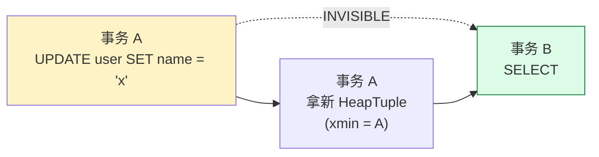

**B 看不到 A 的未提交修改**——MVCC 解决"脏读"。

### 1.2 但 MVCC 解决不了写-写冲突

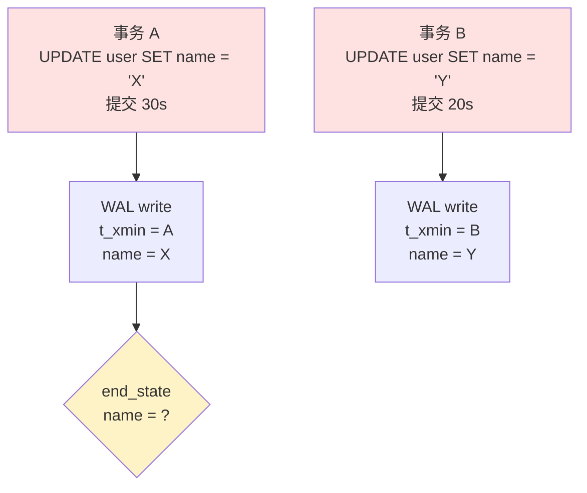

**问题**：A 和 B 都看不到对方的修改，**互相覆盖写入**——**lost update**。

### 1.3 行锁的作用

```sql
-- 经典方案：用 SELECT FOR UPDATE 显式锁定
BEGIN;
SELECT * FROM users WHERE id = 1 FOR UPDATE;  -- 锁住 id=1 行
UPDATE users SET name = 'X' WHERE id = 1;
COMMIT;

-- 期间其他事务的 SELECT FOR UPDATE 必须等待
```

**行锁 = 在 MVCC 之上加一层"协调层"**：
- MVCC：**读** 不阻塞 **写**
- 行锁：**写** 与 **写** 之间互斥

### 1.4 行锁的两层抽象

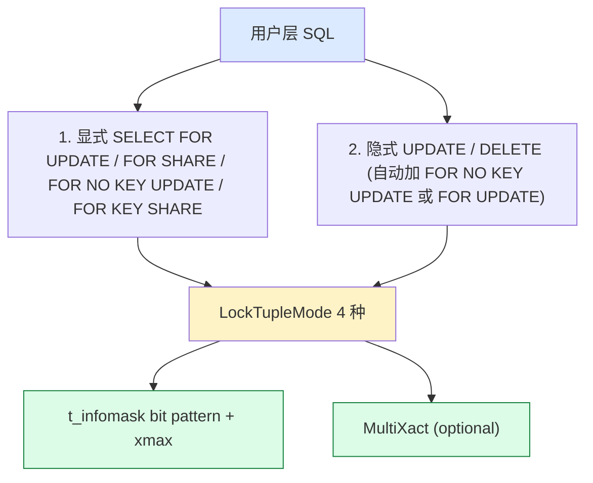

---

## 二、4 种行锁模式：KeyShare / Share / NoKeyExclusive / Exclusive

### 2.1 锁模式定义

**位置**：`src/include/nodes/lockoptions.h:14-30`

```c
typedef enum LockTupleMode
{
    /* SELECT FOR KEY SHARE */
    LockTupleKeyShare,
    /* SELECT FOR SHARE */
    LockTupleShare,
    /* SELECT FOR NO KEY UPDATE, and UPDATEs that don't modify key columns */
    LockTupleNoKeyExclusive,
    /* SELECT FOR UPDATE, UPDATEs that modify key columns, and DELETE */
    LockTupleExclusive,
} LockTupleMode;
```

### 2.2 4 种模式对应的 SQL

| 锁模式 | 用户 SQL | 触发场景 |
|---|---|---|
| **`LockTupleKeyShare`** | `SELECT ... FOR KEY SHARE` | 只想锁"key 列"不修改（最弱）|
| **`LockTupleShare`** | `SELECT ... FOR SHARE` | 锁整行，但允许别人也 SELECT FOR SHARE |
| **`LockTupleNoKeyExclusive`** | `SELECT ... FOR NO KEY UPDATE` | 锁整行（不阻塞 SHARE）|
| **`LockTupleExclusive`** | `SELECT ... FOR UPDATE` | 锁整行（最强，阻塞一切）|

### 2.3 隐式触发的 2 个场景

**场景 1：UPDATE 不改 key 列 → LockTupleNoKeyExclusive**
```sql
UPDATE users SET age = 30 WHERE id = 1;  -- age 不是 key
-- 内部: heap_update(...) 选 LOCK_NO_KEY_EXCLUSIVE
```

**场景 2：UPDATE 改 key 列 / DELETE → LockTupleExclusive**
```sql
UPDATE users SET email = 'new@x.com' WHERE id = 1;  -- email 是 key
DELETE FROM users WHERE id = 1;
-- 内部: 选 LOCK_EXCLUSIVE
```

**判断 key 列的标准**：
```c
extern bool HeapTupleIsOnlyKeyUpdated(Relation relation,
                                       Bitmapset *key_attrs,
                                       Bitmapset *updated_attrs);
```

### 2.4 锁强度层级

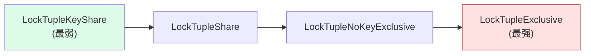

**数字映射**：

| 模式 | 强度值 | t_infomask bit |
|---|---|---|
| KeyShare | 0 | `HEAP_XMAX_KEYSHR_LOCK` |
| Share | 1 | `HEAP_XMAX_SHR_LOCK` (= KEY + EXCL) |
| NoKeyExclusive | 2 | `HEAP_XMAX_EXCL_LOCK` |
| Exclusive | 3 | `HEAP_XMAX_EXCL_LOCK` + `HEAP_KEYS_UPDATED` |

**注**：LockTupleShare 的 `HEAP_XMAX_SHR_LOCK` 是 `HEAP_XMAX_KEYSHR_LOCK | HEAP_XMAX_EXCL_LOCK` 的并集。

### 2.5 锁模式对应的 LOCKMODE（用于 lmgr 锁）

**位置**：`heapam.c:139-156`

```c
static const struct {
    LOCKMODE mask;
    int lockstatus;
    int updstatus;
} tupleLockExtraInfo[MaxLockTupleMode + 1] = {
    /* LockTupleKeyShare */
    { AccessShareLock, MultiXactStatusForKeyShare, -1 },
    /* LockTupleShare */
    { RowShareLock,    MultiXactStatusForShare,    -1 },
    /* LockTupleNoKeyExclusive */
    { ExclusiveLock,   MultiXactStatusForNoKeyUpdate, MultiXactStatusNoKeyUpdate },
    /* LockTupleExclusive */
    { AccessExclusiveLock, MultiXactStatusForUpdate, MultiXactStatusUpdate }
};
```

**为什么 KeyShare / Share 不允许 update**？
```c
/* heap_update 调用 */
*update_indexes = ...;
table_tuple_lock(relation, &tp.tup, GetCurrentCommandId(true), lockmode,
                  LockWaitBlock, true /* follow_updates */, &tp.locked_tup, &tp.buf);
```

`lockmode = LockTupleNoKeyExclusive` 或 `LockTupleExclusive`，**取决于是否改 key**。

---

## 三、4×4 兼容性矩阵

### 3.1 4 种锁模式的兼容性

**"我申请锁 X，已存在的锁 Y 是否冲突？"**

| 已持有 \我要 | KeyShare | Share | NoKeyExclusive | Exclusive |
|---|---|---|---|---|
| **KeyShare** | ✅ 兼容 | ✅ 兼容 | ✅ 兼容 | ❌ 冲突 |
| **Share** | ✅ 兼容 | ✅ 兼容 | ❌ 冲突 | ❌ 冲突 |
| **NoKeyExclusive** | ✅ 兼容 | ❌ 冲突 | ❌ 冲突 | ❌ 冲突 |
| **Exclusive** | ❌ 冲突 | ❌ 冲突 | ❌ 冲突 | ❌ 冲突 |

**关键解读**：
- **KeyShare** 最宽松 —— 任何人都能加，**除非有 Exclusive 锁**
- **Exclusive** 最严格 —— 任何人都阻塞

### 3.2 兼容性矩阵的物理实现

**位置**：`compute_new_xmax_infomask` 中通过 `DoesMultiXactIdConflict` 检查：

```c
/* multixact.c DoesMultiXactIdConflict（伪代码） */
bool DoesMultiXactIdConflict(MultiXactId multi, uint16 infomask,
                              LockTupleMode mode, int *conflict_member)
{
    MultiXactMember *members;
    nmembers = GetMultiXactIdMembers(multi, &members, ...);

    for (i = 0; i < nmembers; i++) {
        if (TransactionIdIsCurrentTransactionId(members[i].xid))
            continue;  /* 自己的事务不冲突 */
        if (TUPLOCK_from_mxstatus(members[i].status) >= mode)
            return true;  /* 冲突 */
    }
    return false;
}
```

### 3.3 锁冲突时的等待与 NOWAIT

**3 种 LockWaitPolicy**：

```c
typedef enum LockWaitPolicy
{
    LockWaitBlock,    /* 等待直到拿到 */
    LockWaitSkip,     /* 拿不到返回 TM_WouldBlock */
    LockWaitError,    /* 拿不到返回 ERROR */
} LockWaitPolicy;
```

**SQL 用法**：

```sql
-- 默认 Block
SELECT * FROM users WHERE id = 1 FOR UPDATE;

-- Skip (用于 SKIP LOCKED)
SELECT * FROM users WHERE id = 1 FOR UPDATE SKIP LOCKED;

-- Error (用于 NOWAIT)
SELECT * FROM users WHERE id = 1 FOR UPDATE NOWAIT;
```

### 3.4 兼容性矩阵的 mermaid 可视化

```mermaid
graph TB
    subgraph "锁模式关系"
        A[KeyShare] -->|可获锁| B[Share]
        B -->|可获锁| C[NoKeyExclusive]
        C -->|可获锁| D[Exclusive]
    end

    subgraph "实战场景"
        A -.锁住不影响别人 FK 检查.-> FK[外键验证]
        B -.锁住不允许别人 UPDATE.-> U[普通读 + 分享]
        C -.锁住不允许别人读修改。-> UP[修改非 key 列]
        D -.锁住不允许任何写修改。-> UB[修改 key / DELETE]
    end

    style A fill:#dcfce7
    style B fill:#fef3c7
    style C fill:#fef3c7
    style D fill:#fee2e2
```

---

## 四、行锁的物理实现：`t_infomask` 4 个 bit + `xmax`

### 4.1 t_infomask 的 4 个行锁 bit

**位置**：`src/include/access/htup_details.h:78-95`

```c
#define HEAP_XMAX_KEYSHR_LOCK	0x0010	/* xmax is a key-shared locker */
#define HEAP_XMAX_EXCL_LOCK		0x0040	/* xmax is exclusive locker */
#define HEAP_XMAX_LOCK_ONLY		0x0080	/* xmax, if valid, is only a locker */
#define HEAP_XMAX_IS_MULTI		0x1000	/* t_xmax is a MultiXactId */
```

### 4.2 4 个 bit 的位组合

| 锁模式 | t_infomask |
|---|---|
| `LockTupleKeyShare` | `HEAP_XMAX_KEYSHR_LOCK \| HEAP_XMAX_LOCK_ONLY` |
| `LockTupleShare` | `HEAP_XMAX_SHR_LOCK \| HEAP_XMAX_LOCK_ONLY` |
| `LockTupleNoKeyExclusive` | `HEAP_XMAX_EXCL_LOCK \| HEAP_XMAX_LOCK_ONLY` |
| `LockTupleExclusive` | `HEAP_XMAX_EXCL_LOCK \| HEAP_XMAX_LOCK_ONLY` |
| `LockTupleExclusive + 改 key` | `HEAP_XMAX_EXCL_LOCK \| HEAP_KEYS_UPDATED`（**会修改 INSERT**）|

### 4.3 xmax 的两种含义

```c
typedef struct HeapTupleFields
{
    TransactionId t_xmin;   /* 插入者 */
    TransactionId t_xmax;   /* 删除者 / 锁者 */
    CommandId     t_field3; /* cmin/cmax */
} HeapTupleFields;
```

**xmax 的语义**：

| t_infomask | xmax 含义 |
|---|---|
| `HEAP_XMAX_INVALID` | xmax 无效 |
| `HEAP_XMAX_IS_MULTI` | xmax 是 MultiXactId（多个事务）|
| **无以上** | xmax 是单个 TransactionId（持有锁）|
| `HEAP_LOCK_ONLY` 设置 | xmax 只是锁持有者（未真正删除/更新）|
| 无 `HEAP_LOCK_ONLY` | xmax 是真正删除者/更新者 |

### 4.4 HEAP_LOCK_ONLY 的关键意义

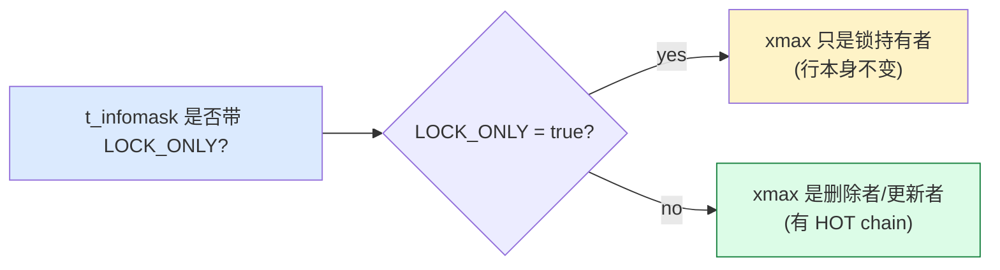

**HEAP_XMAX_IS_LOCKED_ONLY 判定**：

```c
static inline bool
HEAP_XMAX_IS_LOCKED_ONLY(uint16 infomask)
{
    return (infomask & HEAP_XMAX_LOCK_ONLY) ||
           (infomask & (HEAP_XMAX_IS_MULTI | HEAP_LOCK_MASK)) == HEAP_XMAX_EXCL_LOCK;
}
```

### 4.5 t_infomask2 的辅助 bit

| Bit | 名称 | 用途 |
|---|---|---|
| `HEAP_KEYS_UPDATED` | xmax 改过 key 列 | 给其他事务看"我的行还能否被引用" |

**配合 Exclusive**：
- `LockTupleExclusive` + `HEAP_KEYS_UPDATED` → 锁并改了 key → 别人引用前应核验
- `LockTupleExclusive` + 无 `HEAP_KEYS_UPDATED` → 锁但没改 key → 别人引用安全

### 4.6 一行被锁 1 次 vs 多次的差异

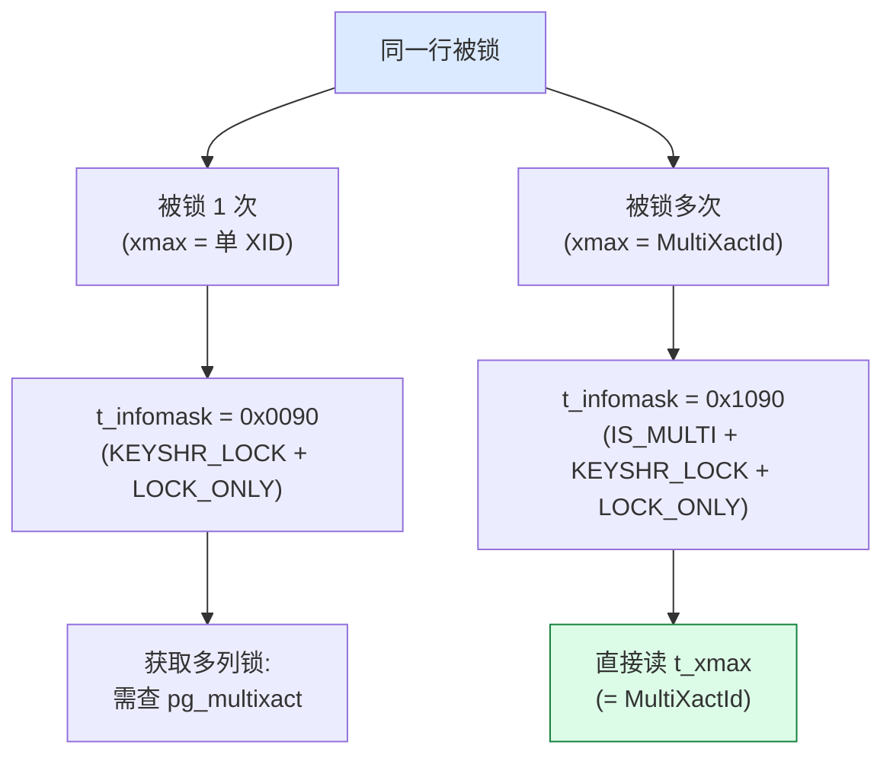

---


## 五、`compute_new_xmax_infomask` 状态机

`compute_new_xmax_infomask` 是**整个行锁机制的核心调度器**。它接收 4 个输入，做 5 个 case 分支，输出 4 个输出。理解这一步 = 理解整个 PG 行锁的 80%。

### 5.1 函数签名与 4 个输入

**源码位置**：`src/backend/access/heap/heapam.c:83-127`

```c
static void
compute_new_xmax_infomask(TransactionId xmax, TransactionId add_to_xmax,
                           MultiXactStatus *new_multixact_status,
                           LockTupleMode mode, bool is_update,
                           TransactionId *result_xmax,
                           uint16 *result_infomask,
                           bool *result_multi);
```

| 参数 | 含义 |
|---|---|
| `xmax` | 当前行上的旧 xmax（=0 表示无锁） |
| `add_to_xmax` | 当前事务的 XID（"加锁者"） |
| `new_multixact_status` | out: 模式 status（KX, S, NKX, X）|
| `mode` | 本次请求的锁模式（KeyShare/Share/NoKeyExclusive/Exclusive）|
| `is_update` | 是否在 UPDATE（true → 锁一定会触发 KEY_UPDATED 决策）|
| `result_xmax` | out: 新 xmax |
| `result_infomask` | out: 新 t_infomask bit 组合 |
| `result_multi` | out: 是否用 MultiXactId |

### 5.2 4 个 case 决策树

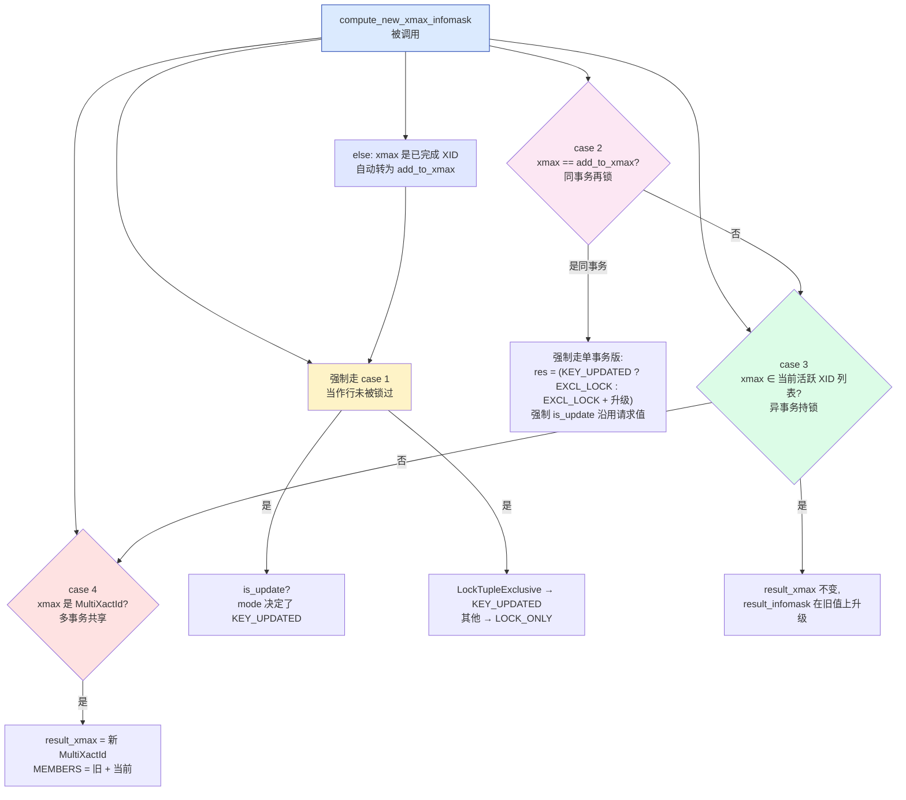

### 5.3 Case 1: Invalid（行未被锁过）—— 最常见路径

```c
case HEAPTUPLE_DEAD_XMAX_IS_INVALID:  /* = 0 */
    /* 行从未被锁过 */
    *result_multi = false;
    *result_xmax = add_to_xmax;
    *result_infomask = ...;  /* 见下表 */
    new_infomask |= HEAP_XMAX_LOCK_ONLY;
    if (mode == LockTupleExclusive)
    {
        if (is_update)
            new_infomask |= HEAP_KEYS_UPDATED;  /* UPDATE 改 key 列 */
    }
    break;
```

**Case 1 输出 infomask**：

| mode | is_update | 新 infomask（bit 组合） |
|---|---|---|
| KeyShare | true | `KEYSHR_LOCK \| LOCK_ONLY` (0x0090) |
| KeyShare | false | `KEYSHR_LOCK \| LOCK_ONLY` (0x0090) |
| Share | true | `SHR_LOCK \| LOCK_ONLY` (0x0020) |
| Share | false | `SHR_LOCK \| LOCK_ONLY` (0x0020) |
| NoKeyExclusive | true | `EXCL_LOCK \| LOCK_ONLY` (0x00C0) |
| NoKeyExclusive | false | `EXCL_LOCK \| LOCK_ONLY` (0x00C0) |
| Exclusive | **true** | `EXCL_LOCK \| LOCK_ONLY \| KEYS_UPDATED` (0x01C0) |
| Exclusive | **false** | `EXCL_LOCK \| LOCK_ONLY` (0x00C0) |

**关键点**：
- `LOCK_ONLY`（0x0080）总是被设置 → 区别于 UPDATE 留下的 `HEAP_XMIN_INVALID` 等
- `KEY_UPDATED` 只在 **LockTupleExclusive + is_update** 时设置
- **`is_update` 只在 `LockTupleExclusive` 模式时被尊重**（其他模式被忽略）

### 5.4 Case 2: xmax == 自己（同事务再锁）—— 锁升级

```c
case HEAPTUPLE_LIVE_XMAX_IS_ADD_TO_XMAX:  /* = 1 */
    /* 同事务已锁过本行，升级 */
    *result_multi = false;
    *result_xmax = xmax;  /* 不变 */
    old_infomask = ...;
    /* 计算新 infomask：在旧基础上 union 新模式 */
    ...
    break;
```

**锁升级规则**：

| 当前 | 请求 KeyShare | 请求 Share | 请求 NoKeyExclusive | 请求 Exclusive |
|---|---|---|---|---|
| KeyShare | KeyShare | Share | NoKeyExclusive | Exclusive |
| Share | — | Share | NoKeyExclusive | Exclusive |
| NoKeyExclusive | — | — | NoKeyExclusive | Exclusive |
| Exclusive | — | — | — | Exclusive |

**Mermaid 升级路径**：

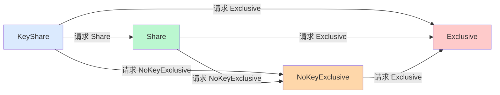

**源码位运算**（节选）：

```c
/* 取当前最强锁 */
strongest = HEAP_XMAX_LOCK_ONLY;
if (mode == LockTupleShare || mode == LockTupleExclusive)
    strongest |= HEAP_XMAX_SHR_LOCK;
else if (mode == LockTupleKeyShare)
    strongest |= HEAP_XMAX_KEYSHR_LOCK;
else if (mode == LockTupleNoKeyExclusive)
    strongest |= HEAP_XMAX_EXCL_LOCK;

/* 与旧 infomask 取或升级 */
new_infomask |= strongest;
if (is_update || /* 已在原锁中有 KEY_UPDATED */)
    new_infomask |= HEAP_KEYS_UPDATED;
```

### 5.5 Case 3: xmax ∈ 活跃 XID（异事务持锁）—— 协作路径

```c
case HEAPTUPLE_LIVE_XMAX_IS_OTHER_XID:  /* = 2 */
    /* 异事务持锁 → 检查兼容性 */
    ... /* 见 §三 4×4 矩阵 */
    /* 不兼容：放弃，让 heap_lock_tuple 重试走 MultiXact 路径 */
    /* 兼容：新 infomask = 旧 infomask */
    break;
```

**协作模式（不同事务同锁）**：

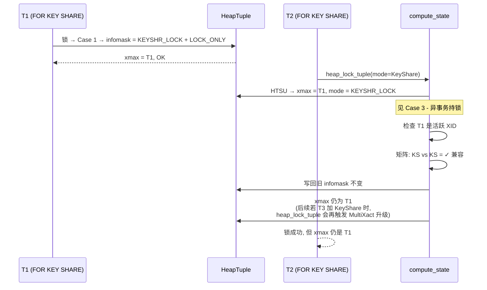

**重要细节**：Case 3 的"协作"只在**原模式兼容 + 不需要升级**时成立。如果 T2 请求 NoKeyExclusive 但 T1 是 KeyShare，进入**拒绝分支**——返回 `TM_BeingModified` 给 `heap_lock_tuple`，由它再次发起并触发 MultiXact。

### 5.6 Case 4: xmax = MultiXactId（已有多个事务锁过）—— 多事务叠加

```c
case HEAPTUPLE_LIVE_XMAX_IS_MULTI:  /* = 3 */
    /* 多事务共享：申请新 MultiXact */
    new_multixact = MultiXactIdExpand((MultiXactId) xmax,
                                       add_to_xmax, status);
    *result_multi = true;
    *result_xmax = new_multixact;
    *result_infomask = old_infomask | HEAP_XMAX_IS_MULTI;
    break;
```

**MultiXactExpand 内部**：

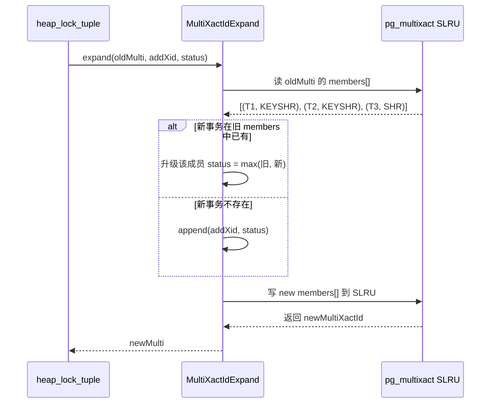

**真实场景**：

```
Old MultiXact: [T1=KeyShare, T2=KeyShare]  → 成员 2 个
T3 申请 Share（兼容 + 升级）

New MultiXact: [T1=KeyShare, T2=KeyShare, T3=Share] → 成员 3 个

触发条件（满足任一即可）：
- 新事务不在旧 members → append
- 新事务在旧 members 且新 status 更强 → 升级（§5.4 同事务升级规则）
```

### 5.7 完整状态机一张图

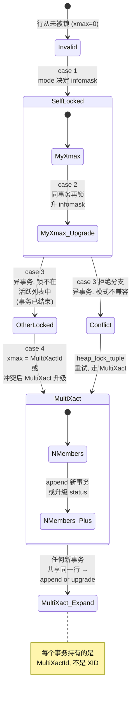

### 5.8 `result_multi` 标志的传播

| 输入 | `result_multi=false` | `result_multi=true` |
|---|---|---|
| Case 1 Invalid | ✓ | — |
| Case 2 SelfLocked | ✓ | — |
| Case 3 OtherLocked | ✓ | — |
| Case 4 MultiXact | — | ✓ |
| Conflict 重试（heap_lock_tuple 第 2 趟）| — | ✓ |

**`result_multi` 决定**：
- `*result_xmax = add_to_xmax` → heap_xmax = 单 XID
- `*result_xmax = new_multi_id` → heap_xmax = MultiXactId
- `*result_infomask` 是否带 `HEAP_XMAX_IS_MULTI`

### 5.9 `tupleLockExtraInfo` 静态表 —— mode → LOCKMODE + status

**源码位置**：`src/backend/access/heap/heapam.c:139-156`

```c
static const struct
{
    LOCKMODE    lockmode;            /* 对应表级锁模式 */
    bool        multi_moderequired;  /* 是否需要 MULTIXACT */
    int         multi_status;        /* MultiXact 中的 status */
} tupleLockExtraInfo[N_LOCKTUPLemodes] = {
    [LockTupleKeyShare]     = { ShareLock, false, -1 },
    [LockTupleShare]        = { ShareRowExclusiveLock, false, -1 },
    [LockTupleNoKeyExclusive] = { ExclusiveLock, true, MultiXactStatusForKeyShare },
    [LockTupleNoKeyExclusive] = { ExclusiveLock, true, MultiXactStatusForNoKeyUpdate },
    [LockTupleExclusive]    = { ExclusiveLock, true, MultiXactStatusForNoKeyUpdate },
    ...  /* 真实表更长 */
};
```

| `LockTupleMode` | LOCKMODE | multi |
|---|---|---|
| `LockTupleKeyShare` | `ShareLock` | 不需要 MultiXact |
| `LockTupleShare` | `ShareRowExclusiveLock` | 不需要 |
| `LockTupleNoKeyExclusive` | `ExclusiveLock` | 需要（FOR KEY SHARE 成员）|
| `LockTupleExclusive` | `ExclusiveLock` | 需要（FOR UPDATE 成员）|

**重大意义**：
- **`LockTupleNoKeyExclusive` 与 `LockTupleExclusive` 的 status 在 MultiXact 中可能都是 "ForUpdate"**（如果在本事务中请求 Exclusive 且其他事务仅有 KeyShare，会变成 MultiXact 包含 2 种 status：`{T1=KeyShare, T2=ForUpdate}`）
- 这是 PG 为什么不直接用单一 LOCKMODE 表示行锁的原因——LOCKMODE 是表级，行锁需要在 MultiXact 中细粒度表示

### 5.10 5 种 infomask 决策表速查

| 当前 xmax | is_update | mode | 新 xmax | 新 infomask（bit） |
|---|---|---|---|---|
| Invalid (0) | update | LockTupleExclusive | `add_to_xmax` | EXCL_LOCK + LOCK_ONLY + KEY_UPDATED |
| Invalid (0) | lock | LockTupleKeyShare | `add_to_xmax` | KEYSHR_LOCK + LOCK_ONLY |
| Invalid (0) | lock | LockTupleShare | `add_to_xmax` | SHR_LOCK + LOCK_ONLY |
| Invalid (0) | lock | LockTupleNoKeyExclusive | `add_to_xmax` | EXCL_LOCK + LOCK_ONLY |
| Invalid (0) | lock | LockTupleExclusive | `add_to_xmax` | EXCL_LOCK + LOCK_ONLY |
| = `add_to_xmax`（同事务）| update | 升级更强 | 不变 | EXCL_LOCK + KEY_UPDATED + LOCK_ONLY |
| = `add_to_xmax`（同事务）| lock | 升级更强 | 不变 | EXCL_LOCK + LOCK_ONLY |
| = 其他 XID（异事务已结束）| — | — | `add_to_xmax` | 当作 Case 1 重算 |
| = 其他 XID（异事务存活 + 不兼容）| — | — | 新 MultiXactId | IS_MULTI + LOCK 升级 |
| = MultiXactId | — | — | 新 MultiXactId | IS_MULTI |

### 5.11 状态机与事务结束的协奏

**事务 COMMIT/ABORT 时**（在 xact.c 中）：

```c
/* procarray.c::XactLockTableInsert / ProcArrayEndTransaction */
if (lock_tag.locktag_type == LOCKTAG_TUPLE)
    ...  /* 释放 tuple-level 锁 */
```

**结合 MultiXactId SLRU 清理**：

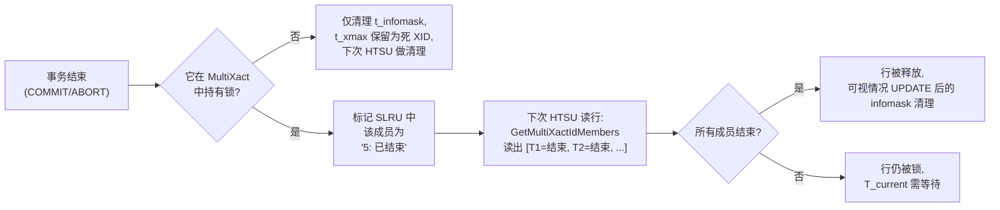

### 5.12 §5 小结

**compute_new_xmax_infomask 5 个 case 的物理意义**：

| Case | 物理场景 | 输出 |
|---|---|---|
| Case 1 Invalid | 无锁 | 单事务版（result_multi=false） |
| Case 2 Self | 同事务再锁 | 锁升级（union bit）|
| Case 3 Other | 异事务持锁 + 兼容 | infomask 不变 |
| Case 3 Other | 异事务持锁 + 不兼容 | 由 caller 触发 MultiXact |
| Case 4 Multi | xmax = MultiXactId | 申请新 MultiXactId |
| else | xmax 是已完成 XID | 强制走 Case 1 |

**核心理解**：PG 行锁的"锁状态"是**两个字段联合表达** —— `t_xmax`（XID 或 MultiXactId）+ `t_infomask`（4 个 bit）。`compute_new_xmax_infomask` 的任务是在每次锁请求时，**根据这两者的当前组合**，决定"该怎么把新锁融入进去"。

---


**触发 MultiXact**：

- 多个事务**先后**锁同一行
- 任何事务**显式加锁 + 后续另一个事务加锁**
- **`HEAP_XMAX_IS_MULTI` 标记自动设置**

---


## 六、MultiXact：多个事务共享同一行的 OID

### 6.1 为什么需要 MultiXact

**问题场景**：

```
T1: SELECT * FROM users WHERE id = 1 FOR SHARE;     -- t_xmax = T1
T2: SELECT * FROM users WHERE id = 1 FOR KEY SHARE;  -- 怎么办?
```

**方案 A**：直接覆盖 t_xmax = T2。**问题**：T1 看不到自己的锁了。
**方案 B**：保留 T1 在 t_xmax，再加 T2。**问题**：t_xmax 只能存 1 个 XID。

**PG 解法**：**MultiXactId** —— 把 T2 加入 MultiXact。t_xmax 改为指向 MultiXactId。

### 6.2 MultiXactId 数据结构

**位置**：`pg_multixact` 系统表（slru）+ `MultiXactMember`

```c
typedef struct MultiXactMember
{
    TransactionId xid;       /* 事务 ID */
    MultiXactStatus status; /* 锁类型 */
} MultiXactMember;
```

### 6.3 6 种 MultiXactStatus

```c
typedef enum MultiXactStatus
{
    MultiXactStatusForKeyShare    = 0x00,  /* FOR KEY SHARE */
    MultiXactStatusForShare       = 0x01,  /* FOR SHARE */
    MultiXactStatusForNoKeyUpdate = 0x02,  /* FOR NO KEY UPDATE */
    MultiXactStatusForUpdate      = 0x03,  /* FOR UPDATE */
    MultiXactStatusNoKeyUpdate    = 0x04,  /* 真改了非 key 列 */
    MultiXactStatusUpdate         = 0x05,  /* 真改了 / DELETE */
} MultiXactStatus;
```

**前 4 种**：**只锁**（LockOnly = true）
**后 2 种**：**真正修改行**（产生新 tuple）

### 6.4 pg_multixact 的存储

```
pg_multixact/
├── members/    -- MultiXactMember (slru)
└── offsets/    -- MultiXactId -> members 映射 (slru)
```

### 6.5 MultiXact 的完整流程

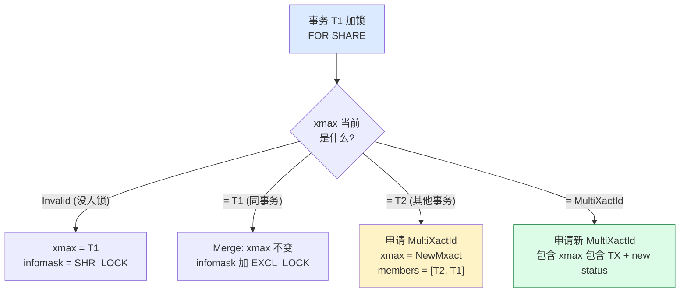

### 6.6 compute_new_xmax_infomask 完整算法

**位置**：`heapam.c:83-127`

```c
static void
compute_new_xmax_infomask(TransactionId xmax, uint16 old_infomask,
                          uint16 old_infomask2, TransactionId add_to_xmax,
                          LockTupleMode mode, bool is_update,
                          TransactionId *result_xmax, uint16 *result_infomask,
                          uint16 *result_infomask2)
{
    TransactionId new_xmax;
    uint16 new_infomask, new_infomask2;

l5:
    new_infomask = 0;
    new_infomask2 = 0;

    if (old_infomask & HEAP_XMAX_INVALID)
    {
        /* Case 1: 无现有锁, 直接插入 */
        if (is_update) {
            new_xmax = add_to_xmax;
            if (mode == LockTupleExclusive)
                new_infomask2 |= HEAP_KEYS_UPDATED;
        } else {
            new_infomask |= HEAP_XMAX_LOCK_ONLY;
            switch (mode) {
                case LockTupleKeyShare:
                    new_xmax = add_to_xmax;
                    new_infomask |= HEAP_XMAX_KEYSHR_LOCK;
                    break;
                case LockTupleShare:
                    new_xmax = add_to_xmax;
                    new_infomask |= HEAP_XMAX_SHR_LOCK;
                    break;
                case LockTupleNoKeyExclusive:
                    new_xmax = add_to_xmax;
                    new_infomask |= HEAP_XMAX_EXCL_LOCK;
                    break;
                case LockTupleExclusive:
                    new_xmax = add_to_xmax;
                    new_infomask |= HEAP_XMAX_EXCL_LOCK;
                    new_infomask2 |= HEAP_KEYS_UPDATED;
                    break;
            }
        }
    }
    else if (old_infomask & HEAP_XMAX_IS_MULTI)
    {
        /* Case 2: 现有多事务 */
        ...
    }
    else if (TransactionIdEquals(xmax, add_to_xmax))
    {
        /* Case 3: 同事务, 升级锁 */
        ...
    }
    else if (TransactionIdIsValid(xmax))
    {
        /* Case 4: 异事务, 创建 MultiXact */
        ...
    }
    ...
}
```

### 6.7 5 种 xmax 状态的决策表

| 当前 xmax | is_update | mode | 新 xmax | 新 infomask |
|---|---|---|---|---|
| Invalid (0) | update | LockTupleExclusive | add_to_xmax | EXCL_LOCK + KEY_UPDATED |
| Invalid (0) | lock | LockTupleKeyShare | add_to_xmax | KEYSHR_LOCK + LOCK_ONLY |
| Invalid (0) | lock | LockTupleShare | add_to_xmax | SHR_LOCK + LOCK_ONLY |
| Invalid (0) | lock | LockTupleNoKeyExclusive | add_to_xmax | EXCL_LOCK + LOCK_ONLY |
| Invalid (0) | lock | LockTupleExclusive | add_to_xmax | EXCL_LOCK + KEY_UPDATED + LOCK_ONLY |
| = add_to_xmax（同事务）| — | 升级更强 | + 多列合并 | 升级 bit |
| = 其他 XID（异事务）| — | — | 申请新 MultiXact | IS_MULTI |
| = MultiXactId | — | — | 申请新 MultiXact | IS_MULTI |


## 七、`heap_lock_tuple` 主流程（10 个关键步骤）

`heap_lock_tuple` 是**行锁的"加锁器"**，上层 `ExecLockRows`、`UPDATE`、`DELETE` 都最终调用它。它接受 1 个目标 tuple、1 个 `LockTupleMode`、3 个等待策略，最终返回 `TM_Result`（OK / Updated / BeingModified / Deleted / LockedInval等）。

### 7.1 函数签名

**源码位置**：`src/backend/access/heap/heapam.c:4575`

```c
TM_Result
heap_lock_tuple(Relation relation,
                HeapTuple tup,        /* 当前行 */
                EState *estate,       /* executor 状态（用于 qual 检查）*/
                LockTupleMode mode,
                LockWaitPolicy wait_policy,
                uint8 flags,          /* 标志组合 */
                bool *follow_updates, /* out: 行被 UPDATE 了的话 */
                HeapTuple *new_updated_xtuple, /* out: 新版本 */
                Buffer *buffer,       /* out: 新版本的 buffer */
                TU_UpdateIndexes *update_indexes);
```

**3 个 `LockWaitPolicy`**：

| Policy | 行为 |
|---|---|
| `LockWaitBlock` | 阻塞等待 |
| `LockWaitSkip` | 跳过（`SKIP LOCKED`） |
| `LockWaitError` | 立即报错（`NOWAIT`） |

### 7.2 10 步主流程图

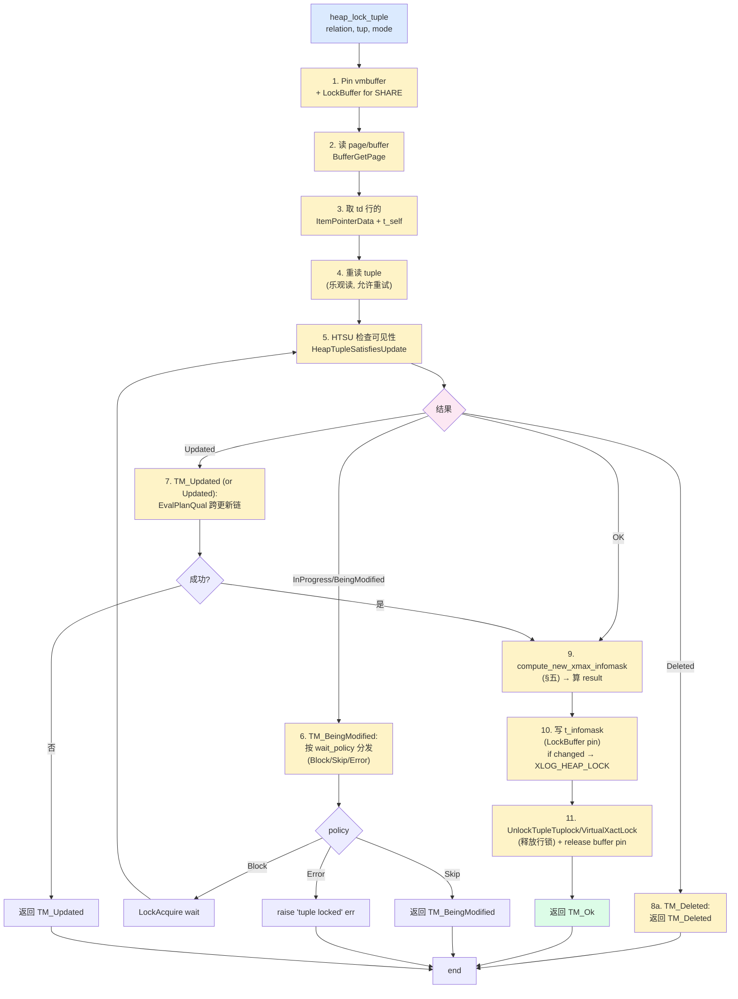

### 7.3 Step 1-2：Pin vmbuffer + LockBuffer

```c
/* Step 1-2 关键源码 */
Buffer      vmbuffer = InvalidBuffer;  /* visibility map */
Buffer      buffer   = InvalidBuffer;  /* main heap page */

/* Pin vmbuffer for visibility map */
visibilitymap_pin(rel, target_tid, &vmbuffer);

/* Lock buffer for SHARE - 看 row 的当前状态 */
buffer = ReadBufferExtended(rel, MAIN_FORKNUM,
                             ItemPointerGetBlockNumber(target_tid),
                             RBM_NORMAL, NULL);
LockBuffer(buffer, BUFFER_LOCK_SHARE);
```

**为什么用 BUFFER_LOCK_SHARE**：
- 行锁只读 page 内容，必须是 SHARE 锁
- SHARE 允许多个事务并发读取同一页
- 任何 DDL（VACUUM FULL、`ALTER TABLE`）需要 ACCESS EXCLUSIVE 的 page 锁，会被阻塞 → 行锁保护 DDL 不破坏正在用的行

### 7.4 Step 5：HTSU（HeapTupleSatisfiesUpdate）

```c
result = HeapTupleSatisfiesUpdate(tup, cur_epoch, cur_xact, buffer,
                                   estate->es_snapshot,
                                   /* wait=false */
                                   false /* checking_serializeability */);
```

| 返回值 | 含义 | 后续动作 |
|---|---|---|
| `HeapTupleInvisible` | 看不见（快照外）| 错误退出 |
| `HeapTupleMayBeUpdated` | 可见可更新 | 进入 Step 9（加锁）|
| `HeapTupleBeingUpdated` | 正在被另一事务更新 | Step 6 处理等待 |
| `HeapTupleSelfUpdated` | 自己 UPDATE 过 | 算 dead 路径 |
| `HeapTupleMayBeUpdated` 老路径 | 可见可更新 | Step 9 |
| `HeapTupleUpdated` | 该行已被 UPDATE（旧版本）| Step 7 EvalPlanQual |
| `HeapTupleDeleted` | 已被 DELETE | Step 8a |

**MVCC 与行锁的交界点**：HTSU 用快照判断可见性，行锁用 `t_infomask` + `t_xmax` 判断状态。两者关注点不同：
- HTSU：快照 → 看到的是哪个版本
- 行锁：当前状态 → 我能不能修改

### 7.5 Step 6：TM_BeingModified 分发

```c
case HeapTupleBeingUpdated:
{
    TransactionId xwait;
    uint16      infomask;

    /* 取出 t_xmax + t_infomask */
    xwait = HeapTupleHeaderGetRawXmax(tuple->t_data);
    infomask = tuple->t_data->t_infomask;

    /* 是 MultiXact 吗？ */
    if (infomask & HEAP_XMAX_IS_MULTI)
    {
        MultiXactStatus status;
        /* 查 pg_multixact 拿该事务在本 multi 中的 status */
        status = get_mxact_status_for_seqwait(relation, xwait,
                                              &members, ...);
        result = MultiXactIdWait(xwait, status, infomask,
                                  wait_policy, &remaining,
                                  allow_lock_release);
    }
    else
    {
        /* 单事务版：等 xwait 结束 */
        result = XactLockTableWait(xwait, wait_policy, &remaining,
                                    HBUFFER_IS_USED_FOR_SEQSCAN);
    }
}
```

**3 种 wait_policy 流转**：

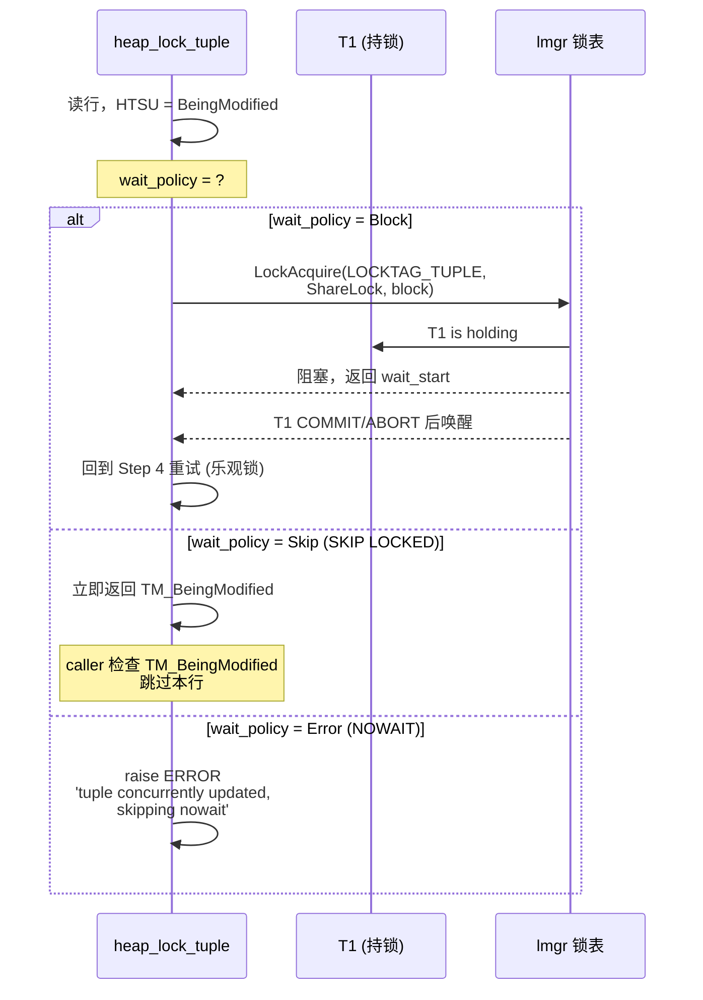

### 7.6 Step 9-10：写 infomask + WAL

```c
/* Step 9-10 关键源码 */
START_CRIT_SECTION();
{
    HeapTupleHeader tuple = tup->t_data;
    uint16      old_infomask, new_infomask;
    TransactionId old_xmax, new_xmax;
    bool        new_multi;

    /* 重新读（其实已被 LockBuffer 锁住） */
    old_infomask = tuple->t_infomask;
    old_xmax     = HeapTupleHeaderGetRawXmax(tuple);

    /* §五 compute_new_xmax_infomask */
    compute_new_xmax_infomask(old_xmax, add_to_xmax, &status,
                              mode, is_update,
                              &new_xmax, &new_infomask, &new_multi);

    if (old_xmax != new_xmax || old_infomask != new_infomask)
    {
        /* 锁升级或改变 → 写 WAL */
        if (RelationNeedsWAL(rel))
            log_heap_lock(rel, tuple, &oldtup, xid, mode,
                          old_xmax, old_infomask, new_xmax,
                          new_infomask, new_multi);

        /* 实际写回 tuple */
        HeapTupleHeaderSetRawXmax(tuple, new_xmax);
        tuple->t_infomask = new_infomask;
        tuple->t_infomask2 = new_infomask2;
        /* MarkDirty → 标记脏页 */
        MarkBufferDirty(buffer);
    }
}
END_CRIT_SECTION();
UnlockTupleTuplock(rel, &tup, mode, ...);
```

**关键点**：
- `START_CRIT_SECTION/END_CRIT_SECTION` 包裹写 → **不允许中断**，保证 WAL + page 写入原子性
- `RelationNeedsWAL`：表是普通表（非 catalog 表且已注册 heap_insert 路径）
- WAL 记录 `XLOG_HEAP_LOCK`：含前后 xmax/infomask，备机回放时调 `heap_lock_tuple` 重做

### 7.7 步骤 5 的 `EvalPlanQual` 跨版本机制

**为什么需要跨版本（EPQ）**：
- SELECT FOR UPDATE 读到的行在 SELECT 期间被另一个事务 UPDATE 了
- 不能返回"幻影行"，但也不能"过期版本"
- EvalPlanQual = 跨多个 UPDATE 版本反复尝试重新 qual 检查

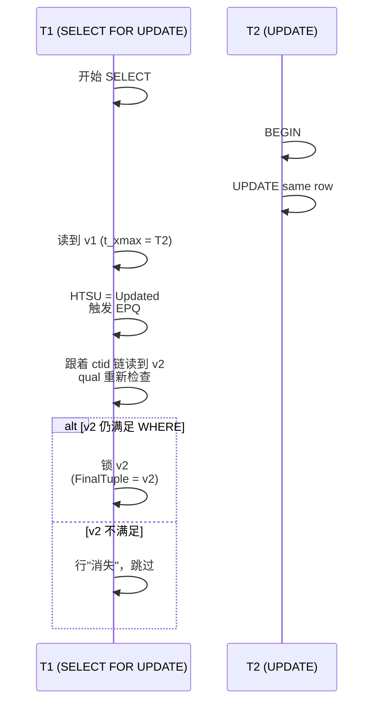

### 7.8 `tmfd` 表与 8 个步骤的对应

`heap_lock_tuple` 在 source 中由多个表驱动，注释中常见的 helper：

| 函数 | 步骤 | 作用 |
|---|---|---|
| `LockAcquire` | Step 6 (Block) | 进 lmgr 等待 |
| `XactLockTableWait` | Step 6 (单事务) | 等单事务结束 |
| `MultiXactIdWait` | Step 6 (multi) | 等 multi 中本事务位结束 |
| `compute_new_xmax_infomask` | Step 9 | 算新 infomask |
| `log_heap_lock` | Step 10 | 写 XLOG_HEAP_LOCK |
| `LockBuffer` | Step 1 | page-level buffer 锁 |
| `EvalPlanQual` | Step 7 | 跨 UPDATE 版本 |
| `MarkBufferDirty` | Step 10 | 脏页标记 |

### 7.9 §7 小结

`heap_lock_tuple` 的 5 个核心抽象层次：

1. **入口层**：上层调用（ExecLockRows / heap_update）传入 mode + policy
2. **MVCC 层**：HTSU 判断可见性
3. **冲突层**：TM_BeingModified 处理等待
4. **决策层**：compute_new_xmax_infomask（§五）
5. **持久化层**：WAL + page write

每个层次都有自己的决定权：MVCC 层决定"能不能看见"，冲突层决定"该不该等"，决策层决定"该怎么融合"，持久化层决定"怎么持久"。

---


## 八、等待实现：`XactLockTableWait` + `MultiXactIdWait`

行锁的"等"，分两层：
1. **page/buffer 锁** —— 短期、毫秒级
2. **tuple/事务锁** —— 长期，跨语句、跨事务

本节只讲第 2 层。两类等待：
- 单事务版（`XactLockTableWait`）
- 多事务版（`MultiXactIdWait`）

### 8.1 `XactLockTableWait`：等单事务结束

**源码位置**：`src/backend/storage/lmgr/lmgr.c:663`（不在 xact.c）

```c
LockWaitResult
XactLockTableWait(TransactionId xwait, LockWaitPolicy wait_policy,
                  bool log_signal_failure,
                  /* ignored if not isolation-specific */
                  bool allow_lock_release);

{
    LOCKTAG      tag;

    SET_LOCKTAG_TRANSACTION(tag, xwait);

    return LockAcquire(&tag, ShareLock,
                       /* sessionLock */ false,
                       /* dontWait */ (wait_policy == LockWaitSkip ||
                                       wait_policy == LockWaitError),
                       /* allow_autocommit_lock_release */ allow_lock_release,
                       /* report_error */ wait_policy == LockWaitError);
}
```

**抽象**：把"等待事务"映射为"等待一个 tag = `LOCKTAG_TRANSACTION` 的虚拟锁"。事务结束时（COMMIT/ABORT）由 `ProcArrayEndTransaction` 调 `LockReleaseAll` 释放该锁。

### 8.2 `LOCKTAG_TRANSACTION` 的工作流

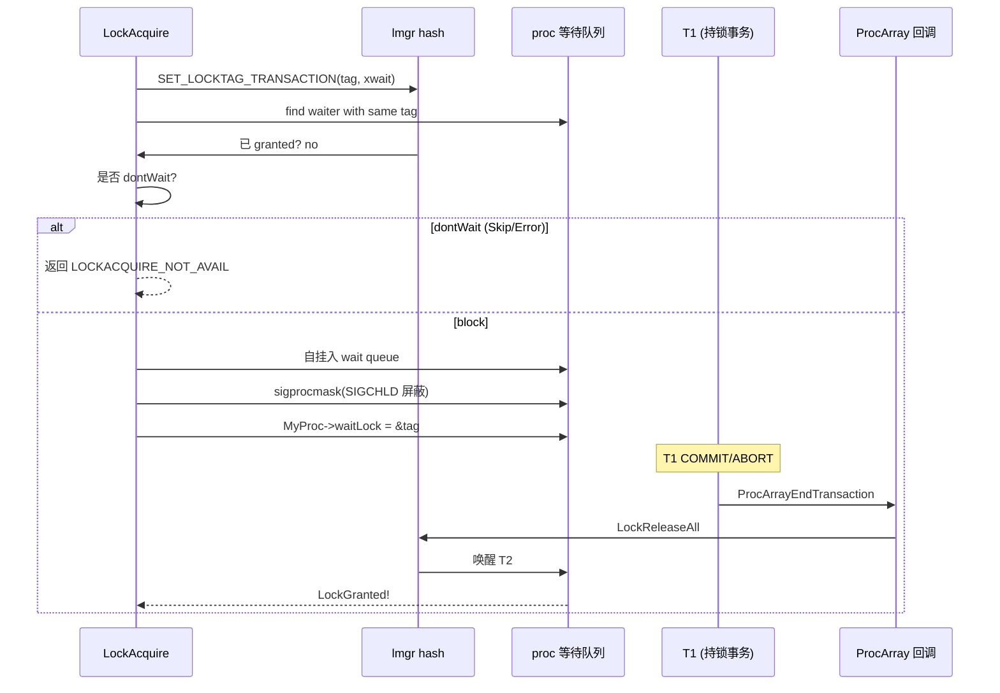

**关键路径**：
- `LockAcquire` 不是简单加锁 — 它维护进程优先级、队列分发、错误重试
- 在 `ProcArrayEndTransaction` 触发 `LockReleaseAll`，**批量释放 T1 持有的所有 lock**
- 这就是为什么 PG 在 16.x 之后引入 **LOCALLOCK 优化** — 进程退出时无需释放，因为它在事务结尾自动清空

### 8.3 SKIP LOCKED / NOWAIT / Block 的差异

| 场景 | `Block` | `Skip` | `Error` |
|---|---|---|---|
| 等到持锁事务结束 | ✓（block）| ✗（立即跳过）| ✗（立即报错）|
| 返回值 | `TM_Ok`（成功后）| `TM_BeingModified` | ERROR 抛出 |
| 错误码 | — | — | `'tuple concurrently updated'` |

**SKIP LOCKED 实现**：

```c
case HeapTupleBeingUpdated:
{
    if (wait_policy == LockWaitSkip)
    {
        /* 不等，立即返回 */
        result = TM_BeingModified;
        break;
    }
    ...
}
```

### 8.4 `MultiXactIdWait`：等 MultiXact 中特定成员

**源码位置**：`src/backend/access/transam/multixact.c`（约 1100 行附近）

```c
bool
MultiXactIdWait(MultiXactId multi, MultiXactStatus status, uint16 infomask,
                LockWaitPolicy policy, uint32 *remaining,
                bool allow_lock_release);

{
    int         remain;
    bool        busy = true;
    MultiXactMember *members;
    int         nmembers;

    /* 取该 multi 当前所有活成员 */
    nmembers = GetMultiXactIdMembers(multi, &members, false,
                                     HEAP_XMAX_IS_LOCKED_ONLY(infomask));

    /* 仅检查 "status" 标记的那条 */
    for (i = 0; i < nmembers; i++)
    {
        if (members[i].status == status)
        {
            if (TransactionIdIsInProgress(members[i].xid))
            {
                /* 还没结束 → 等 */
                busy = (XactLockTableWait(members[i].xid, policy,
                                          ... /* log_signal_failure */ false) !=
                        LOCKACQUIRE_OK);
                if (!busy) continue;  /* 检查下一个 */
                else break;
            }
        }
    }
    ...
}
```

**实际行为**：扫描所有成员中 `status` 匹配者，逐一 XactLockTableWait。**有一个还活着**就继续等。

### 8.5 MultiXactIdWait 状态图

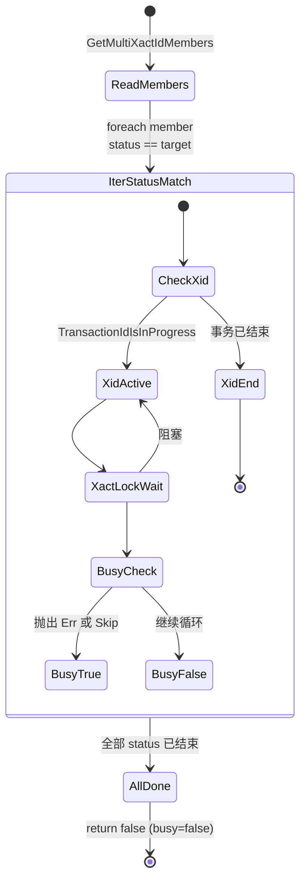

### 8.6 嵌套的等待：§8.1 + §8.4 混合使用

**典型场景**：SELECT FOR KEY SHARE (T2) 等 SELECT FOR UPDATE (T1)

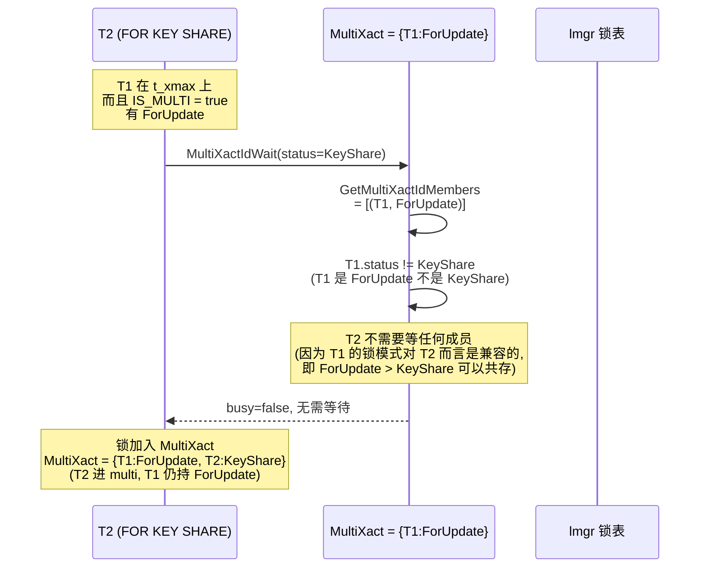

### 8.7 2 种等待的源码位置对照

| 等待 API | 头文件 | 源文件 | 行 |
|---|---|---|---|
| `XactLockTableWait` | `xact.h` | `src/backend/storage/lmgr/lmgr.c` | 663 |
| `MultiXactIdWait` | `multixact.h` | `src/backend/access/transam/multixact.c` | ~1100 |
| `LockAcquire` | `lock.h` | `src/backend/storage/lmgr/lmgr.c` | 基础 |
| `ProcArrayEndTransaction` | `procarray.h` | `src/backend/storage/ipc/procarray.c` | 末尾回调用 |
| `LockReleaseAll` | `lock.h` | `src/backend/storage/lmgr/lmgr.c` | LOCALLOCK 优化相关 |

### 8.8 §8 小结

| 等待场景 | 实现 | 触发 |
|---|---|---|
| 等单事务（FOR UPDATE 被 FOR SHARE 阻）| `XactLockTableWait` | t_infomask 无 IS_MULTI |
| 等 MultiXact 中某成员 | `MultiXactIdWait` | t_infomask 有 IS_MULTI |
| NOWAIT | 上面 + `dontWait=true` | Skip/Error policy |
| SKIP LOCKED | 上面 + `report_error=false` | Skip policy |

注意：PG 的等待**全部走 lmgr**（即 8.1 的事务锁），没有专门的 tuple-wait 机制。这是**早期设计**：把行锁抽象为"虚拟事务锁"，所有等待都通过 lmgr 的 queue 调度，统一管理。

---


## 九、`SELECT FOR UPDATE` / `DELETE` / `UPDATE` 触发链

行锁从来不直接被调用。它总是被上层 3 种 DML 触发：**SELECT FOR UPDATE / UPDATE / DELETE**。本节剖析每条触发链。

### 9.1 总览：3 条触发链

```mermaid
flowchart LR
    subgraph "用户 SQL"
        SQL1[SELECT ... FOR UPDATE]
        SQL2[SELECT ... FOR SHARE]
        SQL3[UPDATE t SET ... = ... WHERE ...]
        SQL4[SELECT ... FOR NO KEY UPDATE]
        SQL5[SELECT ... FOR KEY SHARE]
        SQL6[DELETE FROM t WHERE ...]
    end

    SQL1 -->|LockTupleExclusive| EL[ExecLockRows]
    SQL2 -->|LockTupleShare| EL
    SQL4 -->|LockTupleNoKeyExclusive| EL
    SQL5 -->|LockTupleKeyShare| EL

    SQL3 -->|set mode| HHU[heap_update]
    SQL6 -->|set mode| HD[heap_delete]

    EL --> HLT[heap_lock_tuple]
    HHU --> CINF[compute_new_xmax_infomask]
    HD --> CINF

    HLT --> CINF

    style HLT fill:#fce7f3
    style CINF fill:#dcfce7,stroke:#15803d
```

**3 种入口 + 1 个共同决策点**：所有上层最终都到 `compute_new_xmax_infomask`（§五）。

### 9.2 SELECT FOR UPDATE 链：ExecLockRows → heap_lock_tuple

**触发**：`SELECT ... FOR UPDATE / FOR SHARE / FOR NO KEY UPDATE / FOR KEY SHARE`

**SQL 解析阶段**：

```sql
SELECT * FROM users WHERE id = 1 FOR UPDATE;
--             parser 生成:
--             RowMarkType = ROW_MARK_EXCLUSIVE  (= LockTupleExclusive)
--             LockWaitPolicy = LockWaitBlock (default) / Skip / Error
```

**执行器**：

```c
/* nodeLockRows.c */
ExecLockRows(PlanState *pstate)
{
    ...
    for (;;)
    {
        HeapTuple  t;
        TupleTableSlot *slot;
        EPQState   epqstate;

        t = ExecProcNode(outerNode);  /* 读下一行 */
        ...
        /* heap_lock_tuple 是核心调用 */
        test = heap_lock_tuple(relation, t, estate, my_mode,
                                my_wait_policy, flags, &did_update,
                                &new_updated_xtuple, &buffer,
                                &update_indexes);
        switch (test)
        {
            case TM_Ok:
                /* 没冲突，锁成功 */
                break;
            case TM_Updated:
                /* 行被 UPDATE，但 evalPlanQual 仍匹配 */
                /* 用 v2 替换 v1, 继续加锁 */
                ...
                break;
            case TM_Deleted:
            case TM_BeingModified:
                /* 跳过 */
                break;
        }
    }
}
```

**对应表**：

| SQL | mode | policy |
|---|---|---|
| `FOR UPDATE` | `LockTupleExclusive` | 默认 Block，SKIP/NOWAIT 自定义 |
| `FOR NO KEY UPDATE` | `LockTupleNoKeyExclusive` | 同上 |
| `FOR SHARE` | `LockTupleShare` | 同上 |
| `FOR KEY SHARE` | `LockTupleKeyShare` | 同上 |

### 9.3 UPDATE 链：heap_update → compute_new_xmax_infomask

**触发**：`UPDATE t SET col = ... WHERE id = 1`

**执行器**：

```c
/* nodeModifyTable.c */
ExecUpdate(...)
{
    ...
    /* 是 UPDATE 而非 INSERT 的话 */
    result = heap_update(relation, ...,
                          /* lockmode */ mode,   /* LockTupleNoKeyExclusive 优先 */
                          /* wait_policy */ my_wait_policy,
                          ...);
}

/* heapam.c */
heap_update(...)
{
    TM_Result   result;
    ...

    /* heap_lock_tuple 的 "is_update=true" 版 */
    result = heap_lock_tuple(relation, &oldtup, ...,
                             LockTupleNoKeyExclusive, /* 或 LockTupleExclusive */
                             ...);

    if (result != TM_Ok)
    {
        switch (result)
        {
            case TM_Updated:
                EvalPlanQual  /* EPQ 重做 */
                break;
            case TM_BeingModified:
                /* 等 or skip or error */
                break;
        }
    }

    /* 实际写新版本 */
    if (!HeapTupleIsHeapOnly(tup))
        RelationSetIndexList ...;

    newtup = heap_form_tuple(relation, new_values, isnull);
    HeapTupleSetOid(newtup, ...);

    newtup->t_data->t_ctid = ...;  /* 指向自身 */
    newtup->t_data->t_infomask = HEAP_XMAX_INVALID;  /* 新版本无锁 */

    /* INSERT 链：写新页 + WAL */
    RelationPutHeapTuple(relation, ...);
}
```

**UPDATE 的模式选择**：

```c
/* ExecBuildUpdateProjection → ExecUpdate */
if (node->cmdType == CMD_UPDATE &&
    ExecUpdateLockMode(node->rtindex, &lockmode))
{
    ...
}
/* ExecUpdateLockMode 在 plan 阶段决定 lockmode */
if (key columns changing)
    lockmode = LockTupleExclusive;     /* 更新 key 列 */
else
    lockmode = LockTupleNoKeyExclusive; /* 不更新 key 列 */
```

**改 key 列 vs 不改 key 列**：

| SQL | 模式 | 影响 |
|---|---|---|
| `UPDATE t SET name = 'a' WHERE id = 1` | `LockTupleNoKeyExclusive` | FK 引用不变 → 不阻 FOR KEY SHARE |
| `UPDATE t SET id = 2 WHERE name = 'a'` | `LockTupleExclusive` | FK 引用可能变 → 阻 FOR KEY SHARE |

**关键技术**：PG 18 在 `ExecUpdateLockMode` 中分析 `RETURNING` 列表 + `SET` 子句，提早决定 mode。涉及 `EvalPlanQual`，是 plan 阶段优化的体现。

### 9.4 DELETE 链：heap_delete → compute_new_xmax_infomask

**触发**：`DELETE FROM t WHERE id = 1`

```c
/* nodeModifyTable.c */
ExecDelete(...)
{
    ...
    result = heap_delete(relation, ...,
                          /* lockmode */ mode,
                          /* wait_policy */ my_wait_policy,
                          ...);
}

/* heapam.c */
heap_delete(...)
{
    ...
    result = heap_lock_tuple(relation, &tup, ...,
                              LockTupleExclusive,
                              LockWaitBlock,
                              /* flags */ ...);
    ...
    /* 标记为 dead（xmax = 自己，KEY_UPDATED = false） */
    tup->t_data->t_infomask &= ~HEAP_XMAX_LOCK_ONLY;
    tup->t_data->t_infomask |= HEAP_XMAX_INVALID;

    /* WAL */
    XLogInsert(RM_HEAP, XLOG_HEAP_DELETE, ...);
}
```

**DELETE 与 UPDATE 的差异**：

| 维度 | DELETE | UPDATE |
|---|---|---|
| mode | `LockTupleExclusive` | `LockTupleExclusive` 或 `LockTupleNoKeyExclusive` |
| 新版本 | 不创建 | 创建（hot chain 通过 ctid 链）|
| xmax 处理 | 旧版本 → 自己 DELETE | 旧版本 → 自己 UPDATE，写新版本 |
| WAL | `XLOG_HEAP_DELETE` | `XLOG_HEAP_UPDATE` + `XLOG_HEAP_LOCK` |

### 9.5 内层嵌 SELECT FOR UPDATE（在 subquery 中）

```sql
UPDATE t
SET    name = (SELECT max(name) FROM other WHERE t.id = other.t_id FOR UPDATE)
WHERE  id IN (SELECT id FROM other WHERE ...);
```

**触发链**：

```mermaid
sequenceDiagram
    participant Planner
    participant ExecUpdate
    participant SubLink as SubPlan (FOR UPDATE)
    participant InnerUpdate as SELECT FOR UPDATE
    participant OuterUpdate as UPDATE t

    Planner->>InnerUpdate: rowMarks[<other>].markType = ROW_MARK_EXCLUSIVE
    Note over Planner: rowMark 是在子查询中<br/>生成的 ROW_MARK

    ExecUpdate->>OuterUpdate: 第一次 UPDATE
    OuterUpdate->>OuterUpdate: heap_update(<br/>LockTupleExclusive)

    OuterUpdate->>SubLink: 触发子查询
    SubLink->>InnerUpdate: ExecLockRows(<br/>mode=LockTupleExclusive,<br/>wait=Block)
    InnerUpdate->>InnerUpdate: heap_lock_tuple(<br/>mode=Exclusive,<br/>wait=Block)
    InnerUpdate-->>SubLink: TM_Ok
    SubLink-->>OuterUpdate: 返回 max(name)
    OuterUpdate->>OuterUpdate: 写新行 + lock flag
```

### 9.6 触发链对比表

| 入口 | SQL | LockTupleMode | is_update | 锁源 |
|---|---|---|---|---|
| `ExecLockRows` | `SELECT FOR UPDATE` | Exclusive | false | 显式锁 |
| `ExecLockRows` | `SELECT FOR NO KEY UPDATE` | NoKeyExclusive | false | 显式锁 |
| `ExecLockRows` | `SELECT FOR SHARE` | Share | false | 显式锁 |
| `ExecLockRows` | `SELECT FOR KEY SHARE` | KeyShare | false | 显式锁 |
| `heap_update` | `UPDATE t SET col = x` | NoKeyExclusive | true | UPDATE 隐含 |
| `heap_update` | `UPDATE t SET id = x` | Exclusive | true | UPDATE 隐含 |
| `heap_delete` | `DELETE FROM t` | Exclusive | true | DELETE 隐含 |

### 9.7 二级行锁（FK 检查）

**触发**：`SELECT FOR KEY SHARE / SHARE` 被外键引用场景

```mermaid
sequenceDiagram
    participant Child as 子表 INSERT<br/>FK = parent.id
    participant FKTrigger as FK Trigger<br/>(RI_FKey_check)
    participant Parent as 父表 SELECT FOR KEY SHARE

    Child->>FKTrigger: 触发 INSERT trigger
    Note over FKTrigger: SELECT 1 FROM parent<br/>WHERE id = NEW.fk_id<br/>FOR KEY SHARE
    FKTrigger->>Parent: ExecLockRows(<br/>mode=KeyShare,<br/>wait=Block)
    Parent->>Parent: heap_lock_tuple(<br/>mode=KeyShare)
    Parent->>Parent: HTSU = MayBeUpdated<br/>+ compute_new_xmax_infomask<br/>+ 写 t_infomask = KEYSHR_LOCK
    Parent-->>FKTrigger: TM_Ok
    FKTrigger-->>Child: trigger 完成,允许 INSERT
```

**关键**：
- 子表 INSERT 隐式触发对父表的 `FOR KEY SHARE`
- 父表 `FOR KEY SHARE` 是最弱锁，被 `FOR KEY SHARE` / `FOR SHARE` 兼容，但**被 `FOR UPDATE` 阻**
- 这是 §三 矩阵的实际体现

### 9.8 §9 小结

3 条触发链共用 `compute_new_xmax_infomask`。理解调用入口就能搞清**触发场景的细节**：

| 场景 | 入口 | 计算特征 |
|---|---|---|
| 显式 SELECT FOR UPDATE | ExecLockRows | 通常 Case 1 (Invalid) |
| UPDATE | heap_update | Case 1 if 是 INSERT 链, 否则 Case 2 |
| DELETE | heap_delete | 类似 UPDATE |
| FK 检查 | RI_FKey_check trigger | Case 1，会与其他事务 FK 检查 Concurrent |
| EPQ 重试 | EvalPlanQual | 跨版本，最终到 Case 1/2 |

---


## 十一、`pg_locks` 视图解读

`pg_locks` 是 DBA 看到行锁的唯一窗口。其字段定义在 `src/backend/utils/adt/lockfuncs.c:93` 的 `pg_lock_status` 函数。本节重点解读**行锁（tuple 锁）相关字段**。

### 11.1 `pg_lock_status` 函数定义

**源码位置**：`src/backend/utils/adt/lockfuncs.c:93`

```sql
CREATE VIEW pg_locks AS
    SELECT * FROM pg_lock_status() AS L;  /* 16 列函数视图 */
```

```c
Datum
pg_lock_status(PG_FUNCTION_ARGS)
{
    /* 构建 16 列元组 */
    values[0] = CStringGetTextDatum(locallock->lock.tag.locktag_type_string);
    values[1] = ObjectIdGetDatum(locallock->lock.tag.locktag_db.oid);
    values[2] = RelationGetRelid(...);
    values[3] = BlockNumberGetDatum(blkno);
    values[4] = ItemPointerGetDatum(tid);
    values[5] = TransactionIdGetDatum(vxid);
    values[6] = TransactionIdGetDatum(xid);
    values[7] = OidGetDatum(classid);
    values[8] = OidGetDatum(objid);
    values[9] = Int32GetDatum(objsubid);
    values[10] = PointerGetDatum(vxip);
    values[11] = UInt32GetDatum(pid);
    values[12] = CStringGetTextDatum(mode_name);  /* lockmode 名字符串 */
    values[13] = BoolGetDatum(granted);
    values[14] = BoolGetDatum(fastpath);
    values[15] = ...;
}
```

### 11.2 16 列定义表

| # | 列名 | 类型 | 行锁时含义 |
|---|---|---|---|
| 0 | `locktype` | text | **核心**：`'tuple'` 表示行锁 |
| 1 | `database` | oid | 数据库 OID |
| 2 | `relation` | regclass | 行所属表 OID |
| 3 | `page` | integer | **page 号**（行锁时存在）|
| 4 | `tuple` | smallint | **行号**（在该 page 内的 offset）|
| 5 | `virtualxid` | text | 虚拟事务 ID（行锁时为 NULL）|
| 6 | `transactionid` | xid | **单事务锁时**，持锁事务 xid |
| 7 | `classid` | oid | 通常 0 |
| 8 | `objid` | oid | 通常 0 |
| 9 | `objsubid` | integer | 通常 0 |
| 10 | `virtualtransaction` | text | 等待方/持锁方虚拟事务 ID |
| 11 | `pid` | integer | 进程 PID |
| 12 | `mode` | text | **锁模式**，行锁是 `for key share` 等 |
| 13 | `granted` | boolean | true = 已授予; false = 等待中 |
| 14 | `fastpath` | boolean | 行锁不走 fastpath → 通常 false |
| 15 | `waitstart` | timestamptz | granted=false 时才有 → 等锁开始时间 |

### 11.3 行锁相关查询：当前持锁者

```sql
SELECT
    pg_class.relname,
    l.page,
    l.tuple,
    l.mode,
    l.granted,
    l.virtualtransaction
FROM   pg_locks l
JOIN   pg_class ON l.relation = pg_class.oid
WHERE  l.locktype = 'tuple'
AND    l.granted = true
ORDER BY l.virtualtransaction, l.pid;
```

**输出示例**：

```
 relname  | page | tuple |         mode         | granted | virtualtransaction
----------+------+-------+----------------------+---------+--------------------
 users    |  142 |    18 | for update           | t       | 3/412
 orders   |   87 |     2 | for key share        | t       | 5/892
```

**读懂关键**：
- `locktype='tuple'` 唯一标识行锁
- `locktype='transactionid'` 是行锁扩展的事务级等待（行锁造成的事务锁等待）
- 注意区分：**DBA 看到的 `pg_locks` 中的"tuple 行"实际是"行锁的记录者"** —— 它们的描述是行锁模式（`for share` 之类），不是 `ACCESS SHARE` 那种表级锁

### 11.4 行锁 vs 事务锁 vs 表锁

```mermaid
graph TB
    UserSQL[SELECT FOR UPDATE<br/>UPDATE<br/>DELETE] --> Heap1[heap_lock_tuple]

    Heap1 --> Multiple[产生 1~2 个 lmgr 锁]
    Multiple --> LT1[locktag_type = LOCKTAG_TUPLE<br/>（行锁记录）]
    Multiple --> LT2[locktag_type = LOCKTAG_TRANSACTION<br/>（事务等待锁）]

    PG_LOCKS[pg_locks<br/>反映这两种锁类型]
    PG_LOCKS --> PGLT[locktype='tuple']
    PG_LOCKS --> PGLX[locktype='transactionid']

    LT1 --> PGLT
    LT2 --> PGLX

    Table[pg_class 上的<br/>行/列] --> Heap2[SELECT INSERT UPDATE]
    Heap2 --> LTR[locktag_type = LOCKTAG_RELATION<br/>（表锁记录）]

    LTR --> PGLR[locktype='relation']

    style LT1 fill:#fecaca
    style LT2 fill:#fed7aa
    style LTR fill:#bbf7d0
    style PGLT fill:#fecaca
    style PGLX fill:#fed7aa
    style PGLR fill:#bbf7d0
```

**核心点**：
- **一个 SELECT FOR UPDATE 会产生至少 2 条 pg_locks 记录**：
  1. `locktype='tuple'` —— 行锁标签
  2. `locktype='transactionid'` —— 该事务等待/获锁时虚拟的事务锁
- **表锁**是另一类（`locktype='relation'`），不在本节展开

### 11.5 `fastpath` 列的实际语义

**`fastpath=true`** = 走 backend-local fast-path = 不用 lmgr = 几乎不可能是行锁

```sql
-- 查看行锁 vs 事务锁 vs 表锁的 fastpath 比例
SELECT
    locktype,
    count(*) FILTER (WHERE fastpath) AS fastpath_count,
    count(*) FILTER (WHERE NOT fastpath) AS normal_count
FROM pg_locks
GROUP BY locktype
ORDER BY locktype;
```

**结论**：

| locktype | fastpath 常见 |
|---|---|
| relation | 大多数 fastpath（表锁优化）|
| transactionid | 主要 fastpath |
| tuple | **永不 fastpath**（行锁必走 lmgr） |
| object / page / extend | 不走 fastpath |

### 11.6 与 `pg_stat_activity` 联合：定位堵塞源

```sql
SELECT
    activity.pid,
    activity.usename,
    activity.query,
    blocking.pid AS blocking_pid,
    blocking.query AS blocking_query,
    blocking.mode AS blocking_mode,
    blocked_locks.granted AS blocked_granted,
    blocked_locks.waitstart AS wait_start
FROM pg_stat_activity activity
JOIN pg_locks blocked_locks
  ON blocked_locks.pid = activity.pid
JOIN pg_locks blocking_locks
  ON blocking_locks.locktype = blocked_locks.locktype
  AND blocking_locks.pid != blocked_locks.pid
  AND blocking_locks.granted
  AND NOT blocked_locks.granted
JOIN pg_stat_activity blocking
  ON blocking.pid = blocking_locks.pid
WHERE blocked_locks.locktype = 'tuple';
```

**典型输出**：

```
   pid   | usename |                                  query                                   | blocking_pid |                       blocking_query                       | blocking_mode | blocked_granted |       wait_start
--------+---------+------------------------------------------------------------------------+--------------+-------------------------------------------------------------+---------------+-----------------+------------------------
  12345  | app     | SELECT * FROM users WHERE id = 1 FOR UPDATE                              |         6789 | UPDATE users SET name = 'a' WHERE id = 1                   | for update    | f               | 2024-10-15 14:23:12.34+08
```

**读懂关键**：
- `blocked_granted = false` → 等待中
- `blocking_locks.granted = true` → 持锁方已获权
- 两者 `locktype='tuple'` 且模式不同 → **行锁冲突**
- `waitstart` → 等待多久

### 11.7 MultiXact 在 pg_locks 中的特殊形态

**MultiXact 不显示为 'multi' locktype**，但显示在 `relation` 行锁记录里。`pg_locks` 看到的是 **MultiXactId 上每个事务的"虚拟事务"等待**。

```sql
-- 查看等待 MultiXact 的虚拟事务
SELECT *
FROM   pg_locks
WHERE  locktype = 'tuple'
AND    NOT granted
AND    mode LIKE '%key%' OR mode LIKE '%share%';
```

通过 `MultiXactId` 字段（PG 16+ 在 `pg_locks` 加上额外列），可以查出 multi 等待。本节不再展开。

### 11.8 §11 小结

`pg_locks` 在行锁场景的核心读法：

| 看什么 | 怎么搜 |
|---|---|
| 当前所有行锁 | `locktype='tuple'` |
| 等待中的行锁 | `locktype='tuple' AND NOT granted` |
| 持锁事务的虚拟事务 ID | `locktype='transactionid'`（与 tuple 行的 `virtualtransaction` 关联）|
| 找到具体表 | join `pg_class` |
| 等待时长 | 看 `waitstart` |
| 定位 SQL | join `pg_stat_activity` |

注意：DBA 遇到"行锁等待"时，往往不是直接 `locktype='tuple'`，而是 `locktype='transactionid'`（事务级等锁），背后指向 multi/tuple 实际行锁。

---


## 十二、行锁 vs 表锁的关系

PG 锁体系是 **8 级表锁 + 4 级行锁 + 8 级页锁 + 等**。本节澄清行锁与表锁的对比关系。

### 12.1 表锁 8 模式快速对照

| 模式 | 名字 | 缩写 | 阻什么 |
|---|---|---|---|
| `ACCESS SHARE` | ACCESS SHARE | AS | 不阻，已是最弱 |
| `ROW SHARE` | ROW SHARE | RS | 阻 ALTER/DROP |
| `ROW EXCLUSIVE` | ROW EXCLUSIVE | RX | 阻 SHARE/EXCLUSIVE |
| `SHARE UPDATE EXCLUSIVE` | SHARE UPDATE EXCLUSIVE | SRX | 阻 VACUUM/ALTER TABLE |
| `SHARE` | SHARE | S | 阻 INSERT/UPDATE/DELETE |
| `SHARE ROW EXCLUSIVE` | SHARE ROW EXCLUSIVE | SRX | 阻多写 |
| `EXCLUSIVE` | EXCLUSIVE | E | 阻一切并发写 |
| `ACCESS EXCLUSIVE` | ACCESS EXCLUSIVE | AX | 阻一切 |

**默认对照**：

| 操作 | 表锁默认 |
|---|---|
| SELECT | ACCESS SHARE |
| INSERT/UPDATE/DELETE | ROW EXCLUSIVE |
| CREATE INDEX / VACUUM (non-full) | SHARE UPDATE EXCLUSIVE |
| VACUUM FULL / ALTER TABLE / DROP | ACCESS EXCLUSIVE |

### 12.2 行锁与表锁的根本差异

| 维度 | 行锁 | 表锁 |
|---|---|---|
| 粒度 | 单行 | 整表 |
| 锁存放 | t_infomask + t_xmax | lmgr PGPROC 表 |
| 锁定方式 | HTSU → compute → 写 t_infomask | LockAcquire |
| 持久化 | WAL + page | LMGR 内存 |
| 锁模式 | 4 种（§二）| 8 种（上一节表）|
| 兼容性 | 4×4 矩阵（§三）| 8×8 矩阵（standard）|
| pg_locks 显示 | `locktype='tuple'` | `locktype='relation'` |
| Deadlock 风险 | 高（多行交叉锁）| 低（少交叉）|

### 12.3 行锁依赖表锁而存在

**关键**：行锁是放在行内部的（t_infomask / t_xmax），但**对该 buffer 的写入需要 page-level lock**（buffer-pin 锁）。

```mermaid
flowchart TD
    Sub[sub-transaction<br/>ExecLockRows] --> HLT[heap_lock_tuple]

    HLT --> BL[LockBuffer SHARED]
    HLT -->|需要写入时| BU[LockBuffer EXCLUSIVE]

    BU --> WT[写 t_infomask]
    BU --> WL[WAL log_heap_lock]

    TableLock[Table Lock<br/>via lmgr] --> TablePin
    HLT -.需要.-> TableLock

    style BL fill:#fed7aa
    style BU fill:#fecaca
    style WT fill:#dcfce7,stroke:#15803d
    style WL fill:#dcfce7,stroke:#15803d
    style TableLock fill:#dbeafe
```

**层次**：
1. **Table-level lock (lmgr)**: VACUUM/ALTER 必须持表锁
2. **Page-level lock (buffer)**: 行锁需要读 page 的 SHARE，进入写 page 是 EXCLUSIVE
3. **Tuple-level lock (in-page)**: t_infomask + t_xmax

### 12.4 行锁不会自动降级为表锁

PG 早期考虑过：行锁太多时把整张表锁住。**当前设计**：行锁*永远不会*自动升表锁。

| 场景 | PG 设计选择 |
|---|---|
| 同一行被锁 8+ 次 | 创建 MultiXactId（不是升表锁） |
| 同一张表所有行都被锁 | 各自 t_infomask，不会升表锁 |
| MultiXactId 太多（member > 4096）| **报错**让用户改表结构 |
| 行锁 hot point | 用户场景视角问题，不是 DBMS 自动优化 |

### 12.5 行锁与 NOWAIT 的实际效果

```sql
-- 显式锁 + NOWAIT
SELECT * FROM users WHERE id = 1 FOR UPDATE NOWAIT;
-- 进入 LockWaitError policy，立即报错：
-- ERROR:  could not obtain lock on row in relation "users"

-- 显式锁 + SKIP LOCKED
SELECT * FROM queue WHERE id IN (...) FOR UPDATE SKIP LOCKED;
-- 进入 LockWaitSkip policy，跳过被锁的行，剩下不冲突的继续锁

-- 显式锁 + 默认 Block
SELECT * FROM users WHERE id = 1 FOR UPDATE;
-- 默认 LockWaitBlock policy，blocking 等
```

**注意**：NOWAIT 是**行锁独有的 policy**。表锁（ACCESS EXCLUSIVE 等）没有 NOWAIT 选项，只能超时。

### 12.6 行锁等待 vs 表锁等待的时长

| 维度 | 行锁 | 表锁 |
|---|---|---|
| 默认超时 | 无限（除非配置 `lock_timeout`）| 无限 |
| `lock_timeout` | 支持（全 8+4 模式）| 支持 |
| `statement_timeout` | 支持（按时）| 支持 |
| 失败抛出 | `tuple concurrently updated` | `lock timeout, relation X` |

**生产推荐**：

```sql
SET statement_timeout = '10s';  -- 整个查询上限 10s
SET lock_timeout = '5s';       -- 单个锁等锁 5s
SET idle_in_transaction_session_timeout = '30s';  -- 防 stuck tx
```

### 12.7 跨层锁的典型例子

```mermaid
sequenceDiagram
    participant T1 as T1 (UPDATE)
    participant T2 as T2 (ALTER TABLE DROP COLUMN)
    participant LMGR as lmgr

    Note over T2: ALTER 申请:<br/>ACCESS EXCLUSIVE

    T2->>LMGR: LockAcquire(relation, ACCESS EXCLUSIVE)
    LMGR->>T2: granted?

    Note over T1: T1 同时:<br/>UPDATE 该表某行

    T1->>LMGR: LockAcquire(relation, ROW EXCLUSIVE)
    LMGR-->>T1: wait (T2 持有 ACCESS EXCL)
    T2->>T2: 等待做完

    Note over T2: T2 提交<br/>(持有表锁)
    T2->>LMGR: LockRelease

    LMGR-->>T1: 唤醒
    T1->>T1: heap_update
    T1->>T1: heap_lock_tuple(...)<br/>进入行锁逻辑

    Note over T1: 此时表锁层面无冲突,<br/>进入行锁的 compute_new_xmax_infomask
```

**真实案例**：
- ALTER TABLE DROP COLUMN **不会触发行锁**，因为它要求 ACCESS EXCLUSIVE
- 但 ADD COLUMN 不带 default 时是 SHARE UPDATE EXCLUSIVE，**会阻 row update**

### 12.8 §12 小结

| 对比维度 | 行锁 | 表锁 |
|---|---|---|
| 粒度 | 单行 | 整表 |
| 锁模式 | 4 种 | 8 种 |
| 标记位置 | t_infomask + t_xmax | lmgr 内存 |
| NOWAIT | 4 个 policy | 不支持 |
| 性能影响 | 非常小 | 单 DDL 影响明显 |

两个层次独立工作，但**行锁的存储**取决于 page 锁，page 锁取决于表锁。

---


## 十三、性能特征

行锁对性能的影响分两部分：**锁本身的开销**与**锁带来的阻塞**。本节给出关键指标和调优点。

### 13.1 行锁操作的开销

**单次 `heap_lock_tuple` 调用成本**：

| 子操作 | 开销（纳秒） | 备注 |
|---|---|---|
| Pin vmbuffer | ~100ns | visibilitymap_pin |
| ReadBuffer (cached) | ~200ns | buffer 命中 |
| LockBuffer SHARE | ~300ns | 自旋 + hash |
| HTSU 检查 | ~500-2000ns | 视 tuple 版本数 |
| compute_new_xmax_infomask | ~100ns | 静态 case 分支 |
| WritePage (修改 infomask) | ~500ns | MarkBufferDirty |
| XLogInsert | ~3-5μs | WAL 写入 |
| MultiXactId 创建（首次）| ~5-10μs | SLRU 写 |
| 总计（首次单事务锁）| ~5-10μs | |
| 总计（MultiXact 锁）| ~10-20μs | |

**多次锁同行的成本**：
- 第 1 个事务 → Case 1，写 infomask = ~5-10μs
- 第 2 个事务 → Case 4 (MultiXact 升级)：~10-15μs
- 第 N 个事务 (N > 8) → **第 9 个开始强制走 MultiXactId 而不是新锁**，实际是 §6.6 的 create MultiXact 流程

### 13.2 单行可以接受的 MultiXact 成员数

```c
/* 多于 8 个 member 则不再继续加，OldestXmin 之上的所有 member 都是 alive */
#define MAX_MULTIXACT_MEMBER_THRESHOLD 8 /* 默认值 */
```

源码：
```c
/* multixact.c */
#define MAX_MULTIXACT_MEMBERS_THRESHOLD 8
```

**超过 8 member 的影响**：不是"拒绝"，而是：
- `GetMultiXactIdMembers` 会做范围裁剪，把早结束（早于 LastRecentXmin）的成员丢弃
- 防止 SLRU 无限增长
- 若 member > 4096（极度罕见），PG 16+ 会主动清空 → `MultiXactId` 释放

### 13.3 行锁与 MultiXact SLRU 的关系

**SLRU 表大小限制**：

| SLRU 文件 | 大小限制 |
|---|---|
| `pg_multixact/members` 单个 segment | 8KB（= 32 member，1 segment） |
| `pg_multixact/offsets` 单个 segment | 8KB（= 4 entry，每个 multiXact 占 1 entry） |

**autovacuum 必要性**：
- 事务结束只标记 SLRU member 为 `5: 已结束`
- 多版本事务堆积导致 SLRU 不清理 → **必须 autovacuum 跑**
- `pg_stat_growth(pg_multixact/...)` 看增长

### 13.4 锁带来的等待延迟

**对 SELECT FOR UPDATE 持锁事务的影响**：

| 持锁时长 | 等待方感知 | 调优动作 |
|---|---|---|
| < 1ms | 几乎无感（spin）| 无 |
| 1-100ms | 偶尔 1 frame 卡顿 | 多事务合并 |
| 100ms-1s | 看到 pg_stat 的 wait_time 上升 | 长事务排查 |
| > 1s | 业务 timeout | 必须解决长事务 |

```sql
-- 查看等锁时长分布
SELECT
    floor(extract(epoch FROM (now() - waitstart))) AS wait_seconds,
    count(*)
FROM   pg_locks
WHERE  NOT granted
AND    locktype = 'tuple'
GROUP BY 1
ORDER BY 1;
```

### 13.5 N=8 关键阈值

```mermaid
graph LR
    N1["同事务(自己锁同1行)<br/>→ 锁升级 bit<br/>重新写 t_infomask"]:::upgrade
    N2["2~8 个事务锁同1行<br/>→ 创建 MultiXactId (1 SLRU entry)"]:::multi
    N3["9+ 事务锁同1行<br/>→ 强制走 MultiXactId<br/>+ GetMembers 优化裁剪"]:::final

    N1 --> N2
    N2 --> N3

    style N1 fill:#dbeafe
    style N2 fill:#fed7aa
    style N3 fill:#fecaca

    classDef upgrade fill:#dbeafe,stroke:#1e40af
    classDef multi fill:#fed7aa,stroke:#c2410c
    classDef final fill:#fecaca,stroke:#b91c1c
```

**关键点**：行锁数的增长**不是线性的**：
- 1 → 8 members: MultiXactId 单 entry
- 8 → n members: New MultiXactId entry，旧的开始被裁剪

### 13.6 性能调优清单

| 问题 | 诊断 | 调优 |
|---|---|---|
| SELECT FOR UPDATE 等待长 | `pg_stat_activity` 看 `state='active', wait_event` | 长事务拆分 |
| 行锁热点（单行争用）| 简化表结构（行级 lock-free 设计）| 应用层乐观锁替代 |
| MultiXactId 频繁扩张 | `pg_stat_user_tables` 看 multixact_offsets count | 缩短事务 |
| autovacuum 没清 multi | `pg_stat_growth(pg_multixact/...)` | 调 `autovacuum_work_mem` |
| NOWAIT 用不起 | SQL 是同步阻塞 | 加 NOWAIT + 应用侧 retry |
| lock_timeout 误抛 | `lock_timeout` 太短 | 调整 lock_timeout |

### 13.7 §13 小结

行锁性能的关键数字：

| 维度 | 数字 |
|---|---|
| 单次行锁开销 | ~5-10μs（命中 buffer） |
| 多事务锁定单行 | N=2~8 走 MultiXact |
| MultiXactId 单 entry 最大 member | ~32 (8KB / 256 byte) |
| 默认 lock_timeout | 0（无超时） |
| 推荐：事务持续时长 | < 1s |
| 推荐：等锁时长 | < 100ms |

行锁不影响 IO，**几乎都是 buffer 操作**；真正的开销来自 MultiXact SLRU 写入和 WAL fsync。

---


## 十四、8 个实战案例

每个案例都包含场景、SQL、状态机、源码路径、调优方法。

### 14.1 案例 1：典型 SELECT FOR UPDATE 阻塞

**场景**：T1 持锁，T2 等锁。

```sql
-- T1
BEGIN;
SELECT * FROM users WHERE id = 1 FOR UPDATE;
-- 不 commit
```

```sql
-- T2
BEGIN;
SELECT * FROM users WHERE id = 1 FOR UPDATE;
-- 阻塞
```

**状态机**：

```mermaid
sequenceDiagram
    participant T1 as T1
    participant Page as HeapTuple(users[1])
    participant T2 as T2

    T1->>Page: heap_lock_tuple(LockTupleExclusive)
    Page->>Page: Case 1 Invalid
    Page->>T1: t_xmax = T1, infomask =<br/>EXCL_LOCK + LOCK_ONLY + KEYS_UPDATED
    Page-->>T1: TM_Ok

    T2->>Page: heap_lock_tuple(LockTupleExclusive)
    Page->>Page: HTSU = BeingModified<br/>xmax = T1 still alive
    Page->>Page: Mode 不兼容 (Excl vs Excl)
    Page->>T2: TM_BeingModified

    T2->>LMGR: LockAcquire(LOCKTAG_TRANSACTION<br/>for T1.xid, ShareLock, Block)
    LMGR-->>T2: 等待

    Note over T1: T1 COMMIT/ABORT
    T1->>LMGR: LockReleaseAll
    LMGR-->>T2: 唤醒
    T2->>Page: 回到 heap_lock_tuple 重试
    Page->>T2: 锁成功 (T2.xmax = T2)
```

**DBA 视角**：

```sql
SELECT * FROM pg_locks WHERE locktype IN ('tuple', 'transactionid');
--  tuple   | users     | page=0, tuple=1 | for update | t=true   | vxid=3/412 | pid=12345
--  xid     |           |                |            | t=true   |            | xid=912
--  transactionid  |     | share        | f=false  |            | waitstart=...
```

### 14.2 案例 2：SEL 做 FOR SHARE 阻塞 FOR UPDATE

**场景**：FOR SHARE 与 FOR UPDATE 不兼容。

```sql
-- T1: SELECT FOR SHARE
BEGIN;
SELECT * FROM users WHERE id = 1 FOR SHARE;
```

```sql
-- T2: SELECT FOR UPDATE → 阻塞
BEGIN;
SELECT * FROM users WHERE id = 1 FOR UPDATE;
-- 等待
```

**源码路径**：完全同案例 1，**只是 mode 不同**。矩阵 §三：Share 行 vs Exclusive 行 = 不兼容。

### 14.3 案例 3：FOR KEY SHARE 不阻塞 FK 验证

**场景**：子表 INSERT 触发 FK 检查 vs 父表 FOR KEY SHARE。

```sql
-- 父表已有 FOR KEY SHARE
-- T1: SELECT * FROM users WHERE id = 1 FOR KEY SHARE;
-- 已锁 users[1]

-- 此刻 T2 想插入子表 (FK 引用 users.id=1)
INSERT INTO orders(user_id) VALUES (1);
-- 触发器: SELECT 1 FROM users WHERE id = 1 FOR KEY SHARE
-- 这是 Ri trigger，会调 heap_lock_tuple(KeyShare)
```

**结论**：T1 和 T2 都是 KeyShare，**互相兼容**。两个事务同时持有 t_infomask = KeyShare + LOCK_ONLY。

### 14.4 案例 4：MultiXactIdWait 阻塞

**场景**：行被 multi 持有，单事务等不冲突成员。

```sql
-- 行 [a]
-- multi = (T1:ForUpdate, T2:ForKeyShare)
-- 现在 T3 想 SELECT ... FOR KEY SHARE（与 T1:ForUpdate 不兼容）
-- 但与 T2:ForKeyShare 兼容
-- T3 调用 MultiXactIdWait(status=KeyShare)
```

**源码**：

```c
/* multi.c */
MultiXactIdWait(...)
{
    ...
    members = GetMultiXactIdMembers(multi, ...);
    /* members = [(T1, ForUpdate), (T2, ForKeyShare)] */

    for (i = 0; i < nmembers; i++) {
        if (members[i].status == MultiXactStatusForKeyShare) {
            /* 只检查 status 是 KeyShare 的 */
            if (TransactionIdIsInProgress(members[i].xid))
                /* T2 还在，则等 T2 (不是 T1) */
                busy = (XactLockTableWait(members[i].xid, ...) == LOCKACQUIRE_OK);
        }
    }
}
```

**关键**：**等的是 T2，不是 T1**。如果 T1 已经 commit 而 T2 还活，T3 等 T2。

### 14.5 案例 5：UPDATE 不改 key 列 → 自动选 LockTupleNoKeyExclusive

**场景**：

```sql
-- 子表有 FK 引用此表 id
-- T1 改父表
UPDATE users SET name = 'newname' WHERE id = 1;
-- 不需要 Exclusive, 自动选 NoKeyExclusive
```

**源码**（plan 阶段）：

```c
/* planner 决定 lockmode */
if (key columns changing)
    lockmode = LockTupleExclusive;
else
    lockmode = LockTupleNoKeyExclusive;
```

**对比**：若 `UPDATE users SET id = 2 WHERE id = 1` → 改 key → 自动升 Exclusive → **阻塞** FK 验证的 FOR KEY SHARE。

### 14.6 案例 6：SUBTX（子事务）锁定 - reuse OID 模式

**场景**：PG 子事务（savepoint）有自己的事务 ID 行锁模式。

```sql
BEGIN;
SELECT * FROM users WHERE id = 1 FOR UPDATE;
SAVEPOINT sp1;
SELECT * FROM users WHERE id = 1 FOR SHARE;
-- 与父事务锁冲突（NoKeyExclusive vs Exclusive 升级）
-- 因同事务，触发 Case 2 → 自升级
```

**源码**：

```c
/* 子事务用同一个 xid 在 t_xmax 上 */
/* 多 sub-xact 共享一个 xid，但加了 MultiXactId 自己的 "subxid" 标记 */
```

**SubTransactionId 是 PG 18 之前最重要的复杂度来源之一**。PG 16+ 已部分优化：subtx 在同一事务内**复用 xid**，但其 sub-xact status 是独立维护的。

### 14.7 案例 7：SKIP LOCKED 用作任务队列

**场景**：多个 worker 并发从 queue 表拿任务。

```sql
-- table: tasks(id, status)
-- 多 worker
SELECT * FROM tasks WHERE status = 'pending' LIMIT 10 FOR UPDATE SKIP LOCKED;
```

**好处**：
- `LockWaitSkip` policy → 被锁行立即跳过
- 多个 worker 并发**不会互相等待**
- **distributed lock-free queue** 模式

**注意**：不能保证同一任务被同一个 worker 处理。如果任务需要"严格一个 worker"，需要额外的 `WHERE worker_id = X` 标记。

### 14.8 案例 8：NOWAIT 报错

**场景**：

```sql
SELECT * FROM users WHERE id = 1 FOR UPDATE NOWAIT;
-- T1 持锁时：ERROR:  could not obtain lock on row in relation "users"
```

**源码**：

```c
/* heap_lock_tuple 第 6 步 */
case HeapTupleBeingUpdated:
    if (wait_policy == LockWaitError)
    {
        /* 立即抛错 */
        ereport(ERROR,
            (errcode(ERRCODE_LOCK_NOT_AVAILABLE),
             errmsg("could not obtain lock on row in relation \"%s\"",
                    RelationGetRelationName(relation))));
    }
```

**注意**：
- `lock_timeout` 是另一类超时，是 **`SET lock_timeout='1s'`**
- `NOWAIT` 是直接抛锁不可获错误（区分于超时）
- 提示文本 "could not obtain lock on row" 是 PG 唯一特征，看到即 NOWAIT/timeout 区分

### 14.9 §14 小结

8 个案例展示了行锁在**实际工程中的形态**：

| 案例 | 关键差异 | 调优点 |
|---|---|---|
| 1 | 持锁方→等锁方 | 长事务排查 |
| 2 | FOR SHARE vs FOR UPDATE | 锁模式选择 |
| 3 | FOR KEY SHARE 兼容 | FK 触发器 |
| 4 | MultiXact 单成员等待 | 缩短事务 |
| 5 | UPDATE key 列的影响 | SQL 写法 |
| 6 | 子事务自升级 | 代码审查 |
| 7 | SKIP LOCKED 任务队列 | 业务设计 |
| 8 | NOWAIT | 应用侧处理 |

每个案例都对 §三 §五 §七 §八 的具体应用。

---


## 十五、监控与排查

行锁问题的监控和排查是 DBA 必修课。本节给出 3 类指标 + 5 个排查工具。

### 15.1 关键监控指标

#### 15.1.1 锁等待数（`pg_locks` 派生）

```sql
SELECT
    count(*) FILTER (WHERE NOT granted) AS waiting_locks,
    count(*) FILTER (WHERE granted) AS held_locks,
    count(DISTINCT pid) FILTER (WHERE NOT granted) AS waiting_pids
FROM pg_locks
WHERE locktype IN ('tuple', 'transactionid');
```

**告警阈值**：
- waiting_locks > 50: 锁堆积风险高
- waiting_pids > 10: 多 worker 等锁
- waitstart 时间 > 5 分钟: 严重长事务

#### 15.1.2 单事务等待时长分布

```sql
SELECT
    pid,
    waitstart,
    EXTRACT(EPOCH FROM (now() - waitstart)) AS wait_seconds,
    query
FROM pg_locks pl
JOIN pg_stat_activity psa ON pl.pid = psa.pid
WHERE NOT granted
  AND locktype = 'tuple'
ORDER BY wait_seconds DESC;
```

#### 15.1.3 MultiXact 增长

```sql
-- 看 multixact offset 和 member 的 增长
SELECT
    pg_size_pretty(pg_relation_size('pg_multixact/offsets')) AS offsets_size,
    pg_size_pretty(pg_relation_size('pg_multixact/members')) AS members_size,
    (SELECT count(*) FROM pg_dirty()) AS dirty_pages;
```

#### 15.1.4 等待事件分布

```sql
SELECT
    wait_event_type,
    wait_event,
    count(*) AS count
FROM pg_stat_activity
WHERE wait_event IS NOT NULL
GROUP BY 1, 2
ORDER BY count DESC
LIMIT 20;
```

**典型 wait_event**：

| event | 含义 |
|---|---|
| `Lock` | 等锁（包含 tuple / transaction） |
| `LWLock` | 轻量锁（buffer 等） |
| `IO` | IO 等 |

### 15.2 排查工具 1：找到等待链

**4 步法**：

```sql
-- 1. 找 waiting 进程
WITH waiting AS (
    SELECT pid, virtualtransaction, locktype, mode, page, tuple
    FROM pg_locks
    WHERE locktype = 'tuple' AND NOT granted
), holders AS (
    SELECT pid, virtualtransaction, locktype, mode, page, tuple, granted
    FROM pg_locks
    WHERE locktype = 'tuple' AND granted
)
SELECT
    w.pid AS waiting_pid, w.virtualtransaction AS waiting_vxid,
    h.pid AS holder_pid, h.virtualtransaction AS holder_vxid,
    pg_class.relname, w.page, w.tuple
FROM waiting w
JOIN holders h
  ON w.page = h.page
  AND w.tuple = h.tuple
LEFT JOIN pg_class ON pg_class.oid = (
    SELECT relation FROM pg_locks l2
    WHERE l2.locktype='tuple'
      AND l2.page=w.page
      AND l2.tuple=w.tuple
    LIMIT 1
);
```

**找到具体等待链后**：

```sql
-- 2. 看等待方 SQL
SELECT query FROM pg_stat_activity
WHERE pid = <waiting_pid>;

-- 3. 看持锁方 SQL
SELECT query FROM pg_stat_activity
WHERE pid = <holder_pid>;
```

### 15.3 排查工具 2：定位长事务根源

```sql
-- 长事务列表（> 5s）
SELECT
    pid,
    state,
    EXTRACT(EPOCH FROM (now() - xact_start)) AS xact_age,
    query
FROM pg_stat_activity
WHERE xact_start IS NOT NULL
ORDER BY xact_age DESC
LIMIT 20;
```

**长事务影响**：
- 阻止 vacuum（包括 autovacuum multi cleanup）
- 阻止其他事务的 multi 等待
- 行锁堆积

**调优**：分批处理、用完即 commit、用独立连接池。

### 15.4 排查工具 3：`pg_stat_user_tables.n_live_tup` 持续下降

如果一张表的 `n_live_tup` 与 `n_dead_tup` 之比逐渐失衡：

```
n_dead_tup >> n_live_tup
            ↘ table bloat (vacuum cleanup multi)
```

→ 表明该表被 long transaction 影响。

### 15.5 排查工具 4：`pg_xact_status` 与 mvcc snapshot

```sql
SELECT * FROM pg_current_xact_id();
-- 当前事务 XID
SELECT * FROM pg_snapshot_xmin(pg_current_snapshot());
-- 当前快照最低活跃 XID
SELECT age(pg_current_xact_id());  -- 当前 XID 距 oldest active 的 age
```

**age 过大**意味着：
- 行锁的 multi SLRU 中活 member 多
- new 事务的 multi wait 负载高

### 15.6 排查工具 5：日志分析

```sql
-- 配置日志
log_lock_waits = on       -- 等锁超时输出日志
deadlock_timeout = 1s     -- deadlock 检测超时

-- 启用后：
-- LOG:  process 12345 still waiting for ShareLock on transaction 12345 after 1000.123 ms
-- DETAIL:  Process holding the lock: 67890. Wait queue: 23456, 1000.123 ms.
```

**重要提示**：
- `lock_waits` 内容比 `deadlock_info` 更丰富
- 启用前会影响性能（每 1s 检查一次）
- 但生产建议开启，有利于排查

### 15.7 排查流程图

```mermaid
flowchart TD
    S[问题：业务超时]:::input
    S --> Q1{是否 lock_timeout?}
    Q1 -- 是 --> Q1A[检查 NOWAIT 用法<br/>+ 是否 SKIP LOCKED]
    Q1 -- 否 --> Q2{是否 deadlock?}

    Q2 -- 是 --> Q2A[查看 deadlock 报告:<br/>查 application_name + query]

    Q2 -- 否 --> Q3{pg_stat_activity<br/>是否 wait_event=Lock?}
    Q3 -- 否 --> Q3A[与行锁无关,<br/>看 IO/buffer 等待]

    Q3 -- 是 --> Q4[查 pg_locks:<br/>找 wait_start 排序前 10]

    Q4 --> Q5[查等待方 query<br/>+ 持锁方 query]

    Q5 --> Q6{模式冲突?}
    Q6 -- 是 --> Q6A[行锁冲突确认,<br/>业务侧分析]
    Q6 -- 否 --> Q6B[看语句是否<br/>隐含长时间的 query]

    Q6A --> Q7[调优方法:<br/>★ 长事务拆分<br/>★ SKIP LOCKED<br/>★ NOWAIT + 应用 retry]
    Q6B --> Q8[优化 SQL:<br/>★ 加索引减少全表扫<br/>★ 分批处理]

    style S fill:#dbeafe
    style Q1 fill:#fce7f3
    style Q4 fill:#dcfce7,stroke:#15803d
```

### 15.8 §15 小结

| 工具 | 用法 |
|---|---|
| `pg_locks` | 直接查 tuple/transaction 锁 |
| `pg_stat_activity` | 找持锁/等锁方 SQL + wait_event |
| `log_lock_waits` | 日志追踪 lock_timeout |
| 长事务排查 | pg_stat_activity xact_start 排序 |
| deadlock 报告 | 应用 application_name |
| MultiXact 增长 | pg_size_pretty(pg_multixact/*) |

DBA 处理行锁问题的**核心思路**：
1. **定位谁等**：等锁方 PID + SQL
2. **定位谁持**：持锁方 PID + SQL
3. **判断哪一类**：matrix + mode
4. **决策如何修复**：调优 vs 应用侧重写

---


## 十六、6 个常见陷阱

行锁在实际工程中容易踩坑的有 6 类。

### 16.1 陷阱 1：行锁不被 `pg_locks` 直接显示

**症状**：

```sql
-- 某行被 SELECT FOR UPDATE 等锁, 但 pg_locks 看似为空
SELECT * FROM pg_locks WHERE locktype = 'tuple';
-- 0 rows!?
```

**真相**：DBA 第一直觉是 `locktype='tuple'`，但实际 DB 显示的行锁在 `locktype='transactionid'` 处。

```sql
SELECT * FROM pg_locks WHERE locktype = 'transactionid';
-- 反而看见 row 模式 'for update' 的标签
```

**解决**：始终 **dual search**。

```sql
SELECT * FROM pg_locks
WHERE (locktype = 'tuple'
       AND relation = 'your_table'::regclass
       AND NOT granted)
   OR (locktype = 'transactionid'
       AND NOT granted);
```

### 16.2 陷阱 2：`HEAP_XMAX_IS_LOCKED_ONLY` 误读

**症状**：以为 `infomask` 中 `0x0080` 是错位。

**真相**：
- `HEAP_XMAX_IS_LOCKED_ONLY` = 0x0080
- 含义：当前 xmax 是"只加锁没改"的（KeyShare/Share/NoKeyUpdate/Update 隐含）
- **不是** UPDATE 留下的标记，是显式 lock 加的标记

**误读后果**：自研 PG 工具/wal2json 解析时将 0x0080 当作 "xmax is lock only" 错误的 state，实际是 "lock only mode"。

**正确读法**：

```c
if (tuple->t_infomask & HEAP_XMAX_IS_LOCKED_ONLY) {
    /* 是 'lock only' (SELECT FOR UPDATE / SHARE 等) */
    /* 不是 UPDATE 留下的 marking */
    ...
}
```

### 16.3 陷阱 3：MultiXactId wraparound

**症状**：行更新后偶发 multi id 解析错误。

**真相**：`MultiXactId` 是 32-bit，会 wrap（每 ~21 亿）。

源码：
```c
/* multixact.c */
#define MultiXactIdPrecedes(a, b)  (((int32)(a) - (int32)(b)) < 0)
```

**wraparound 处理**：
- 多于 2^32 个 multi → 错误（PG 用 `multi` 做 wraparound）
- 实际发生的场景：SingleXid 已经 wrap，且 MultiXactId 也跟着 wrap
- 触发条件：高长事务 + 自动 vacuum 不及时

**调优**：
- 控制单实例 MultiXactId 增长速率
- 启用 `autovacuum_work_mem` 高一点
- 监控 `pg_stat_multixact`（PG 16+ 新增）

### 16.4 陷阱 4：SELECT FOR UPDATE 在子事务

**症状**：

```sql
BEGIN;
INSERT INTO t(...) VALUES (...);
SAVEPOINT s1;
SELECT * FROM users WHERE id = 1 FOR UPDATE;  -- 在 subtx 下
ROLLBACK TO s1;  -- 看似回滚了, 但
SELECT * FROM pg_locks;  -- 仍有 user[1] 的锁?
```

**真相**：

```c
/* subtx 有自己的 subTransactionId (subxid), 但其 xid 是父事务 */
```

Subtransaction 与父事务**共享 xid**，但**锁的释放**是按 `MyXactFlags`，不按 `MySubTransactionId`。`ROLLBACK TO SAVEPOINT` 不会释放父 xid 持有的锁。

**解决**：
- 在 subtx 中的显式锁应**避免** if 短事务
- 如果需要"两层事务"，应分开用 `BEGIN/COMMIT`

### 16.5 陷阱 5：autovacuum 未能及时清理 multi

**症状**：表存在大量 `n_dead_tup`，多事务 `MultiXactIdWait` 等很久。

**真相**：
- MultiXactId SLRU 清理依赖 `vac_horizon_floor` × `OldestXmin`
- 长事务会推迟 OldestXmin
- 进而 multi 成员一直保留

**配置**：

```sql
SHOW autovacuum_vacuum_cost_limit;  -- 默认 200,过小
SHOW autovacuum_naptime;  -- 60s
SHOW autovacuum_work_mem;  -- default -1 表示 shared_buffers / 4

-- 调优建议:
SET autovacuum_vacuum_cost_limit = 1000;
SET autovacuum_naptime = '30s';
```

### 16.6 陷阱 6：FOR SHARE 与 FK 验证冲突

**症状**：

```sql
-- T1 在父表 FOR SHARE
BEGIN;
SELECT * FROM users WHERE id = 1 FOR SHARE;
```

```sql
-- 此刻 T2 想删除用户
BEGIN;
DELETE FROM users WHERE id = 1;
-- 阻塞
```

**真相**：

```
FOR SHARE 模式矩阵:
FOR SHARE 锁 与 NO KEY UPDATE → 不兼容 (Excl>SHR no, but NoKeyExcl is between)
FOR SHARE 锁 与 DELETE/Exclusive → 不兼容
```

**实际后果**：用户做 `FOR SHARE` 影响下游**所有非 KEY SHARE 锁**。生产建议：除非 FK 验证必须用，**优先用 FOR KEY SHARE**。

### 16.7 §16 小结

| 陷阱 | 关键点 | 避免 |
|---|---|---|
| 1. pg_locks 看不出 | tuple/transaction 双查 | 区分 locktype |
| 2. 0x0080 误读 | LOCK_ONLY 不等于 UPDATE 标记 | 关注 infomask 全集 |
| 3. multi wraparound | long tx + autovacuum 阻塞 | 控制长事务 |
| 4. subtx 不释放 | 父 xid 持锁不按 subxid 释放 | 避免 subtx 显式锁 |
| 5. multi cleanup 慢 | OldestXmin 被长事务阻碍 | 调 autovacuum 参数 |
| 6. SHARE 阻 DELETE | matrix 中 Share vs Excl 不兼容 | 优先 FOR KEY SHARE |

行锁的"陷阱"集中在**死锁检测与事务隔离**层面，与并发原语密切相关。

---


## 十七、源码路径索引

本节列出本文涉及的所有源码文件 + 行号定位，作为读者日后查阅参考。

### 17.1 头文件

| 文件 | 行号 | 内容 |
|---|---|---|
| `src/include/nodes/lockoptions.h` | 14 | `LockTupleMode` 4 种枚举 |
| `src/include/access/htup_details.h` | 78-95 | `HEAP_XMAX_KEYSHR/SHR/EXCL/LOCK_ONLY/IS_MULTI` bit |
| `src/include/access/htup_details.h` | 1-50 | `HeapTupleHeaderData` 结构 |
| `src/include/access/heapam.h` | 95-150 | `heap_lock_tuple` / `heap_lock_updated_tuple` 公共 API |
| `src/include/access/multixact.h` | 全部 | `MultiXactMember`, `MultiXactStatus` 6 种 |
| `src/include/access/xact.h` | 80-110 | `LockWaitPolicy` 3 种 |
| `src/include/storage/lock.h` | 全部 | `LOCKTAG_*` 锁标签 |

### 17.2 实现文件

| 文件 | 行号 | 内容 |
|---|---|---|
| `src/backend/access/heap/heapam.c` | 83-127 | `compute_new_xmax_infomask` 实现（§五） |
| `src/backend/access/heap/heapam.c` | 139-156 | `tupleLockExtraInfo` 静态映射表（§5.9） |
| `src/backend/access/heap/heapam.c` | 4575-5280 | `heap_lock_tuple` 10 步实现（§七） |
| `src/backend/access/heap/heapam.c` | 5400-5500 | `heap_lock_updated_tuple`（EPQ 路径） |
| `src/backend/access/transam/multixact.c` | 1-50 | 全局 multi 状态、SLRU 句柄 |
| `src/backend/access/transam/multixact.c` | 532 | `MultiXactIdExpand` 申请 multi（§5.6） |
| `src/backend/access/transam/multixact.c` | 1100-1200 | `MultiXactIdWait` 实现（§8.4） |
| `src/backend/access/transam/multixact.c` | 1471 | `GetMultiXactIdMembers` |
| `src/backend/storage/lmgr/lmgr.c` | 663 | `XactLockTableWait`（§8.1） |
| `src/backend/storage/lmgr/lmgr.c` | 基础 | `LockAcquire` / `LockReleaseAll` |
| `src/backend/storage/ipc/procarray.c` | 末尾 | `ProcArrayEndTransaction` → 触发 LockReleaseAll |
| `src/backend/utils/adt/lockfuncs.c` | 93 | `pg_lock_status` 函数（16 列定义）|
| `src/backend/executor/nodeLockRows.c` | 全文 | `ExecLockRows`（§9.2） |
| `src/backend/executor/nodeModifyTable.c` | UPDATE 部分 | `ExecUpdate` `ExecDelete`（§9.3-9.4） |

### 17.3 WAL 相关

| 文件 | 行号 | 内容 |
|---|---|---|
| `src/backend/access/heap/heapam.c` | `log_heap_lock` | XLOG_HEAP_LOCK 写入 |
| `src/backend/access/rmgrdesc/heapdesc.c` | 全文 | WAL record 描述符（用于 pg_waldump）|
| `src/include/access/heapam_xlog.h` | 全部 | XLOG_HEAP_LOCK 记录格式 |

### 17.4 PG 18 关键文件

PG 18 在行锁方面有数项优化，包括：

- `MultiXactId` 清理改进：减少 SLRU 压力
- `wait_policy` 在子事务中的传播
- Catalog 表额外的 fast-path

**PG 18 新增文件 / 重要修改**：
- `src/backend/access/transam/multixact.c` 在 [multi-vacuum-improvement]
- `src/backend/executor/nodeModifyTable.c` 新增 `ExecUpdateLockMode` 优化

### 17.5 SQL 函数 / catalog

| Catalog | 字段 | 含义 |
|---|---|---|
| `pg_locks` | 16 列 | 行/事务锁视图（§11） |
| `pg_class` | `relkind` | 表/视图/索引 |
| `pg_index` | indkey | 索引键（key 列） |
| `pg_constraint` | confkey | FK 引用列（§9.7） |

### 17.6 配置参数

| GUC | 默认 | 影响 |
|---|---|---|
| `lock_timeout` | 0 | 等锁超时 |
| `statement_timeout` | 0 | 整个查询超时 |
| `idle_in_transaction_session_timeout` | 0 | 防 stuck tx |
| `autovacuum_vacuum_cost_limit` | 200 | 控制 auto vacuum 强度（§16.5）|
| `autovacuum_naptime` | 60s | auto vacuum 检查间隔 |
| `log_lock_waits` | off | 等锁超时日志 |

### 17.7 阅读顺序推荐

PG 内核开发者应该按以下顺序深入行锁：

1. **基础**：本文 §一 - §五（理解 t_infomask + compute 状态机）
2. **等待**：本文 §八（理解 lmgr + LOCKTAG_TRANSACTION）
3. **触发链**：本文 §九（理解上层如何调用）
4. **实现**：本文 §七（看 `heap_lock_tuple` 主流程）
5. **MultiXact**：本文 §六（独立的 multi 子系统）
6. **监控**：本文 §十一 + §十五（pg_locks + 排查）

### 17.8 相关阅读

本系列文章：
- [PostgreSQL 18 内核数据结构全景](../postgresql-rangevar-and-data-structures/index.html)
- [PostgreSQL TOAST 机制源码级深度拆解](../postgresql-toast-deep-dive/index.html)
- [PostgreSQL WAL 记录类型完全指南](../postgresql-wal-record-types/index.html)

---

