# PostgreSQL 逻辑复制里 `RUNNING_XACTS` 写入机制与快照 `xmin / xmax / xip` 的演化：源码级深度拆解

| 编写人 | 编写内容 | 编写时间 |
| --- | --- | --- |
| growdu | 初稿，从 `LogStandbySnapshot` → `GetRunningTransactionData` → `xl_running_xacts` 写 WAL 的全链路，到 `SnapBuildProcessRunningXacts` / `SnapBuildCommitTxn` / `SnapBuildSerialize` 怎么消费它，再到 `SnapBuild` 状态机（START / BUILDING_SNAPSHOT / FULL_SNAPSHOT / CONSISTENT）里 `xmin / xmax / xip` 字段的演化规则，最后 apply 端怎么用 snapshot 解码 catalog 变更，源码级别 + 25+ 张架构图。配套源码版本：PostgreSQL 18 dev（`~/cwork/postgresql`）。 | 2026-09-29 |

> 本文是「PostgreSQL 逻辑复制源码系列」。同系列前文：
>
> - [PostgreSQL MVCC：从一行 UPDATE 到 5 个 HeapTuple 的演化](./postgresql-mvcc/index.html)
> - [PostgreSQL 事务生命周期：从 BEGIN/COMMIT 到 CLOG 一条链路](./postgresql-transaction-lifecycle/index.html)
> - [PostgreSQL 逻辑复制表的生命周期：从 `pg_replication_slots` 到 `pg_subscription_rel`](./postgresql-logical-replication-tables-lifecycle/index.html)
> - [PostgreSQL 逻辑复制 spill 深度拆解：ReorderBuffer 如何把 100GB 事务拆成小块](./postgresql-logical-replication-spill-deep-dive/index.html)
> - [PostgreSQL 元数据存储机制：从磁盘文件到内存缓存，`pg_class` 撑起的整个系统表体系](./postgresql-catalog-storage/index.html)

逻辑复制里最容易出 bug 的事不是 decode（`pgoutput` 已经写得相当稳定），也不是 apply（无脑 INSERT/UPDATE/DELETE），而是 **snapshot 怎么从 WAL 里"长"出来**——也就是 `RUNNING_XACTS` + `SnapBuild` 状态机 + `xmin / xmax / xip` 三个字段的更新规则。

很多 PG DBA 在用 `SELECT * FROM pg_replication_slots;` 看到 `restart_lsn` 不动时，第一反应是"复制停了"；**但其实 90% 的 case 是 `SnapBuild` 在等 `running->oldestRunningXid` 推进**，或者 `xmax` 被某个长 catalog DDL 卡住。

本文回答 5 个问题：

1. **`xl_running_xacts` 这条 WAL 记录到底写的是什么？谁触发？频率多少**？
2. **`SnapBuild` 状态机有 4 个状态**，它怎么从 WAL 里"长"出一个能 decode catalog 的 snapshot？
3. **`xmin` / `xmax` 在 `SnapBuild` 里和 `SnapshotData` 里语义完全不一样**——到底怎么演化？
4. **`xip` 数组在 `SnapBuild` 里被"重新定义"为"catalog-modifying xid 列表"**，这是怎么做到的？
5. **apply 端（worker）怎么消费这个 snapshot 决定"一条 tuple 对我可见吗"**？

全文 11 节，**25+ 张架构图 / 状态机 / 时序图**，**80+ 个源码引用**。

---

## 一、为什么 `RUNNING_XACTS` 是逻辑复制的"枢纽"

### 1.1 一条逻辑复制 SQL 走到后台，要经过 6 道关卡

```mermaid
flowchart LR
    A["INSERT INTO t VALUES (1)"] --> B["PG backend<br/>heap_insert"]
    B --> C["XLogInsert<br/>WAL: XLOG_HEAP_INSERT"]
    C --> D["WAL segment<br/>pg_wal/0000..."]
    D -->|"reorderbuffer 读"| E["ReorderBuffer 内存"]
    E -->|"SnapBuild 解码"| F["pgoutput plugin"]
    F -->|"subscriber 端 apply worker"| G["subscriber INSERT"]
    G --> H["订阅侧 heap_insert"]

    style D fill:#fee2e2,stroke:#b91c1c
    style E fill:#fef3c7,stroke:#d97706
    style F fill:#dcfce7,stroke:#15803d
    style H fill:#dbeafe,stroke:#1d4ed8
```

**6 道关卡里，`SnapBuild` 是最容易被忽略但最难调的一环**——它需要从 WAL 里**反推出"在某个时间点，哪些 xact 已经提交、哪些还在跑"**。这个反推的"原材料"就是 `xl_running_xacts` 记录。

### 1.2 没有 `RUNNING_XACTS` 的世界会怎样

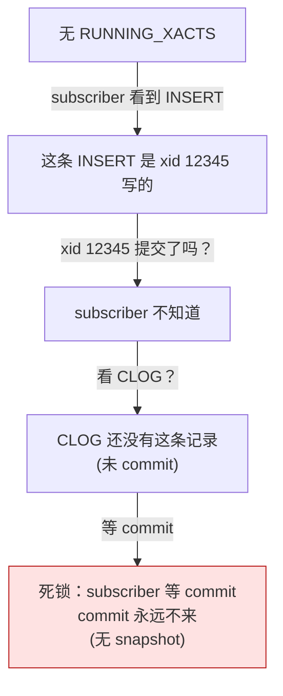

> **核心问题**：subscriber / decoder 需要一个 **catalog snapshot** 来判断"我能不能看见 tuple X"，但 PG 没有"future CLOG"——所以必须有一个"在某个 LSN 时刻，已经完成提交的所有 catalog-modifying xid 的列表"。这个列表**就是 `SnapBuild` 用 `RUNNING_XACTS` 攒出来的**。

---

## 二、`SnapshotData` 基础：xmin / xmax / xip 到底存什么

### 2.1 `SnapshotData` 数据结构

源码 `src/include/utils/snapshot.h`：

```c
typedef struct SnapshotData
{
    SnapshotType snapshot_type;   /* SNAPSHOT_MVCC / TOAST / SELF / ANY */
    TransactionId xmin;           /* 还在跑的最早 xid */
    TransactionId xmax;           /* 下一个即将分配 xid */
    TransactionId *xip;           /* [xmin, xmax) 范围内已提交 xid */
    TransactionId *subxip;        /* subxid 数组 */
    uint32        xcnt;           /* xip 数量 */
    uint32        subxcnt;        /* subxip 数量 */
    bool          suboverflowed;  /* subxid 是否溢出 */
    ...
} SnapshotData;
```

### 2.2 `xmin` / `xmax` / `xip` 的语义

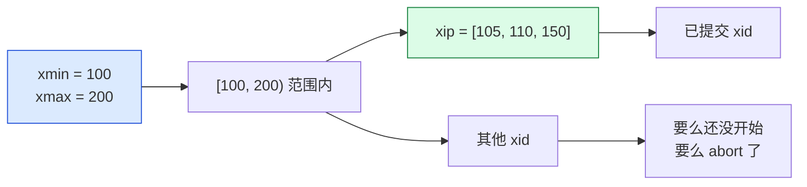

**判定规则**（`heapam_visibility.c:HeapTupleSatisfiesMVCC`）：

```text
tuple_xid  ∈ [xmin, xmax):
  ├─ in xip？  → 可见（已提交）
  └─ not in xip？  → 不可见（运行中 / 中止）

tuple_xid < xmin：
  → 可见（已 commit 或 abort，事务早已结束）

tuple_xid ≥ xmax：
  → 不可见（"未来"的 xid）
```

### 2.3 `xip` 是 sparse array，不是 dense array

```c
/* xip 中的 xid 必须满足: */
/* 1. xmin <= xip[i] < xmax */
/* 2. 已经 commit / 即将被判断 */
/* 不一定连续 */
```

> **重点**：`xip` 不是"[xmin, xmax) 范围内所有 xid"，而是"其中**已 commit** 的 xid 的稀疏集合"。`HeapTupleSatisfiesMVCC` 通过 `bsearch(xip, ...)` 来 O(log n) 查找。

---

## 三、`xl_running_xacts` 数据结构：WAL 写什么

### 3.1 `xl_running_xacts` 定义

源码 `src/include/storage/standbydefs.h:47`：

```c
typedef struct xl_running_xacts
{
    int            xcnt;             /* xid 数量 */
    int            subxcnt;          /* subxid 数量 */
    bool           subxid_overflow;  /* subxid 是否溢出 */
    TransactionId  nextXid;          /* 下一个即将分配 xid */
    TransactionId  oldestRunningXid; /* 当前跑着的最早 xid */
    TransactionId  latestCompletedXid; /* 已完成的最晚 xid */
    TransactionId  xids[FLEXIBLE_ARRAY_MEMBER]; /* xcnt + subxcnt 个 xid */
} xl_running_xacts;
```

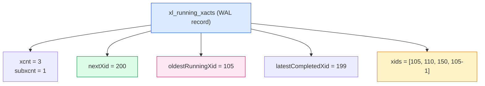

### 3.2 `nextXid` / `oldestRunningXid` 的语义

| 字段 | 含义 |
|---|---|
| `nextXid` | TransamVariables->nextXid（未来分配的 xid） |
| `oldestRunningXid` | procArray 里最小的 xid（正在跑的最早 xid）|
| `latestCompletedXid` | 已完成的最晚 xid（用于设置 xmax） |

### 3.3 `xids` 数组的组成

```c
/* xids[0 .. xcnt-1]                    = toplevel xids */
/* xids[xcnt .. xcnt+subxcnt-1]         = subxids */
```

源码 `LogCurrentRunningXacts`：

```c
recptr = XLogInsert(RM_STANDBY_ID, XLOG_RUNNING_XACTS);
```

`xids` 数组前 `xcnt` 个元素是 toplevel running xid，后 `subxcnt` 个是 subxid。decoder 端会按这个顺序重建。

---

## 四、`LogStandbySnapshot`：谁触发 `RUNNING_XACTS` 写入

### 4.1 `LogStandbySnapshot` 触发点

源码 `src/backend/storage/ipc/standby.c:1282`：

```c
XLogRecPtr LogStandbySnapshot(void)
{
    RunningTransactions running;
    xl_standby_lock *locks;
    int nlocks;

    Assert(XLogStandbyInfoActive());

    /* 1. 取所有 AccessExclusiveLock */
    locks = GetRunningTransactionLocks(&nlocks);
    if (nlocks > 0)
        LogAccessExclusiveLocks(nlocks, locks);

    /* 2. 取所有 running xact 状态 */
    running = GetRunningTransactionData();

    /* 3. 不同 wal_level 不同处理 */
    if (wal_level < WAL_LEVEL_LOGICAL)
        LWLockRelease(ProcArrayLock);

    /* 4. 写 RUNNING_XACTS WAL */
    recptr = LogCurrentRunningXacts(running);

    /* 5. logical 模式下保留 lock 到写完 */
    if (wal_level >= WAL_LEVEL_LOGICAL)
        LWLockRelease(ProcArrayLock);

    LWLockRelease(XidGenLock);
    return recptr;
}
```

### 4.2 触发场景

`LogStandbySnapshot` 由 4 类调用方触发：

```mermaid
mindmap
  root((LogStandbySnapshot 触发点))
  Checkpointer
    每个 checkpoint
  BgWriter
    bgwriter_delay 周期
  Logical decode
    SnapBuildWaitSnapshot
    SnapBuildExportSnapshot
  Replication slot
    推进 xmin horizon
```

源码中实际调用点（`grep LogStandbySnapshot`）：

| 调用方 | 路径 | 频率 |
|---|---|---|
| **Checkpointer** | `CheckpointerMain → LogStandbySnapshot` | 每次 checkpoint（默认 5 min）|
| **BgWriter** | `BackgroundWriterMain → LogStandbySnapshot` | bgwriter_delay（默认 100 ms）|
| **SnapBuild** | `SnapBuildWaitSnapshot → LogStandbySnapshot` | 等到目标 cutoff 强制写 |
| **SnapBuildSerialize** | `SnapBuildSerialize → LogStandbySnapshot` | 进入 CONSISTENT 状态后 |
| **SnapBuildExport** | `SnapBuildExportSnapshot → LogStandbySnapshot` | 导出 snapshot 时 |

### 4.3 `wal_level` 与 lock 释放顺序

```c
if (wal_level < WAL_LEVEL_LOGICAL)
    LWLockRelease(ProcArrayLock);   /* 物理复制可立即释放 */
...
recptr = LogCurrentRunningXacts(running);
if (wal_level >= WAL_LEVEL_LOGICAL)
    LWLockRelease(ProcArrayLock);   /* logical 复制必须保留到 WAL 写完 */
```

**为什么 logical 模式要保留 `ProcArrayLock`？**

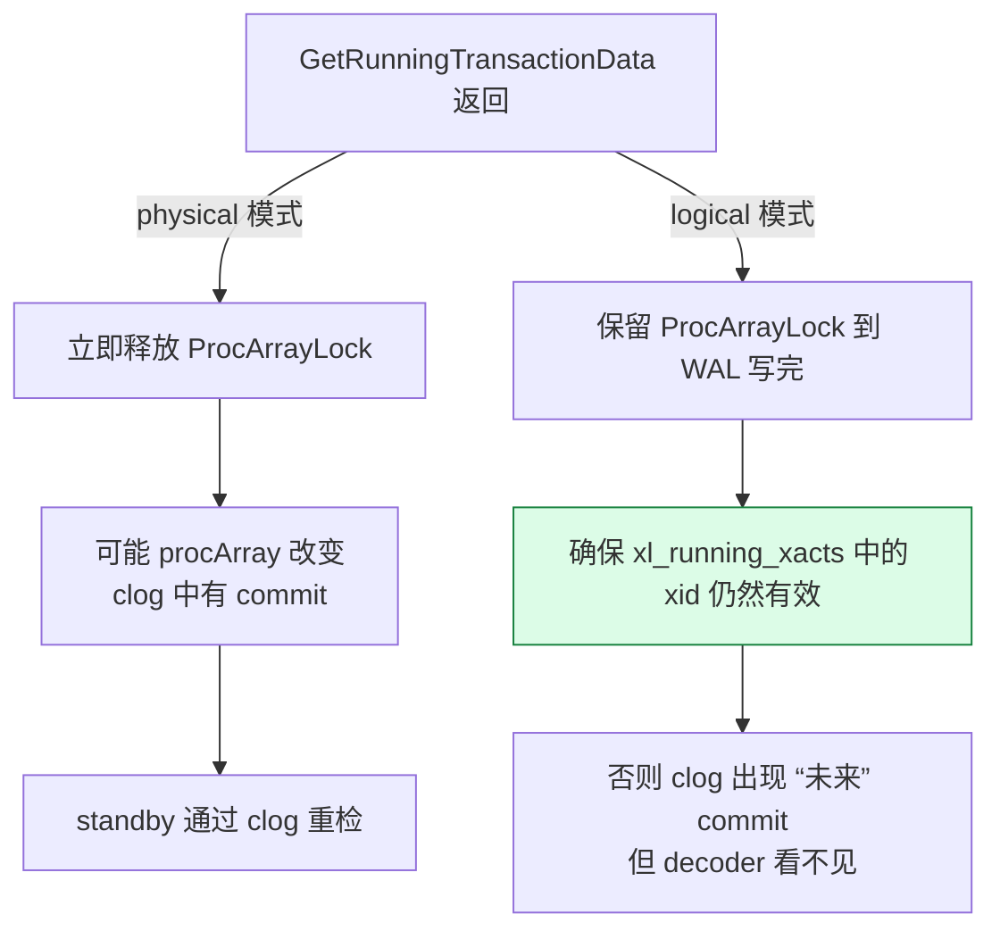

源码注释很关键：

```c
/*
 * For logical decoding, the lock can't be released early because the clog
 * might be "in the future" from the POV of the historic snapshot. This would
 * allow for situations where we're waiting for the end of a transaction
 * listed in the xl_running_xacts record which, according to the WAL, has
 * committed before the xl_running_xacts record.
 */
```

---

## 五、`GetRunningTransactionData`：扫 ProcArray 收 running xact

### 5.1 函数入口

源码 `src/backend/storage/ipc/procarray.c:2689`：

```c
RunningTransactions GetRunningTransactionData(void)
{
    static RunningTransactionsData CurrentRunningXactsData;
    ProcArrayStruct *arrayP = procArray;
    TransactionId *other_xids = ProcGlobal->xids;
    RunningTransactions CurrentRunningXacts = &CurrentRunningXactsData;
    TransactionId latestCompletedXid;
    TransactionId oldestRunningXid;
    TransactionId oldestDatabaseRunningXid;
    TransactionId *xids;
    int index, count, subcount;
    bool suboverflowed;
    ...
}
```

### 5.2 全流程图

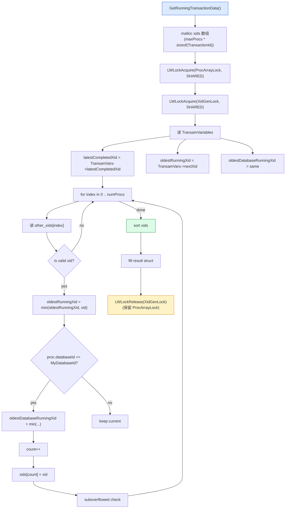

### 5.3 三种 oldestXid

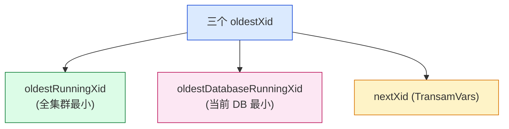

**关键代码**（procarray.c:2780+）：

```c
/* 1. 初始化 */
oldestDatabaseRunningXid = oldestRunningXid = 
    XidFromFullTransactionId(TransamVariables->nextXid);

/* 2. 扫 procArray */
for (index = 0; index < arrayP->numProcs; index++)
{
    int pgprocno = arrayP->pgprocnos[index];
    PGPROC *proc = &allProcs[pgprocno];
    TransactionId xid = UINT32_ACCESS_ONCE(other_xids[index]);
    
    if (!TransactionIdIsValid(xid))
        continue;
    
    if (TransactionIdPrecedes(xid, oldestRunningXid))
        oldestRunningXid = xid;
    
    if (proc->databaseId == MyDatabaseId &&
        TransactionIdPrecedes(xid, oldestDatabaseRunningXid))
        oldestDatabaseRunningXid = xid;
    
    /* 3. 记录 subxid 溢出 */
    if (ProcGlobal->subxidStates[index].overflowed)
        suboverflowed = true;
}
```

### 5.4 `oldestDatabaseRunningXid` 没用？

> **在 `xl_running_xacts` 里**只用 `oldestRunningXid`，**不用** `oldestDatabaseRunningXid`。后者在 `GetOldestXmin` / `ProcArrayApplyXidAssignment` 等地方使用。

### 5.5 结果填到 `xl_running_xacts`

源码 `LogCurrentRunningXacts`（standby.c:1353）：

```c
xl_running_xacts xlrec;
xlrec.xcnt = CurrRunningXacts->xcnt;
xlrec.subxcnt = CurrRunningXacts->subxcnt;
xlrec.subxid_overflow = CurrRunningXacts->suboverflowed;
xlrec.nextXid = CurrRunningXacts->nextXid;
xlrec.oldestRunningXid = CurrRunningXacts->oldestRunningXid;
xlrec.latestCompletedXid = CurrRunningXacts->latestCompletedXid;
/* 然后 memcpy xids[0..xcnt-1] + subxids */

recptr = XLogInsert(RM_STANDBY_ID, XLOG_RUNNING_XACTS);
```

---

## 六、`SnapBuild` 状态机：4 个状态怎么演

### 6.1 4 个状态

```c
typedef enum
{
    SNAPBUILD_START,              /* 起始 */
    SNAPBUILD_BUILDING_SNAPSHOT,  /* 攒 catalog snapshot */
    SNAPBUILD_FULL_SNAPSHOT,      /* 完整 catalog snapshot */
    SNAPBUILD_CONSISTENT          /* 全局一致 + 能用 */
} SnapBuildState;
```

### 6.2 状态机全景

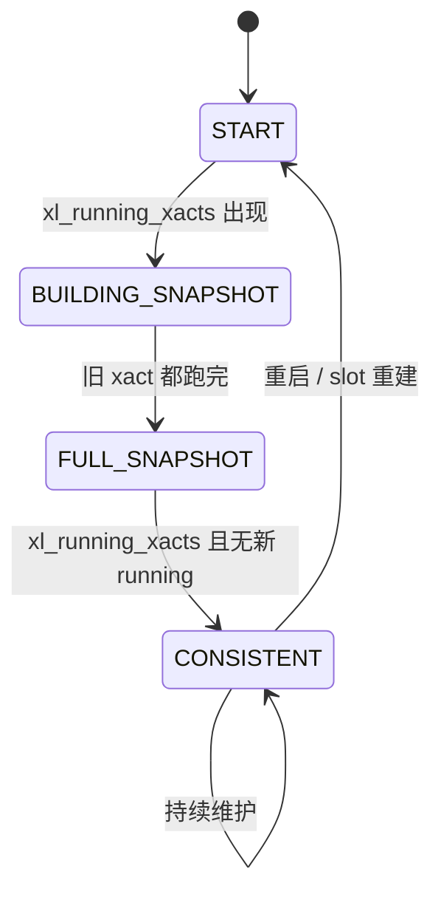

### 6.3 `SnapBuild` 主结构

源码 `src/backend/replication/logical/snapbuild.h`：

```c
typedef struct SnapBuild
{
    SnapBuildState state;            /* 状态 */
    
    /* 重建的 snapshot */
    TransactionId xmin;              /* catalog 视角的 xmin */
    TransactionId xmax;              /* catalog 视角的 xmax */
    
    /* 已知 catalog-modifying xid */
    TransactionId *xip;              /* 动态分配 */
    int xcnt;
    int xcnt_allocated;              /* 预分配容量 */
    
    /* full snapshot 时也要记 in-progress 的 xid */
    TransactionId *subxip;
    int subxcnt;
    int subxcnt_allocated;
    
    /* catchange tracking */
    ReorderBufferTXN by_txn[...];
    ...
    
    ReorderBuffer *reorder;
    bool building_full_snapshot;
    bool in_slot_creation;
    TransactionId next_phase_at;
    XLogRecPtr start_decoding_at;
    ...
} SnapBuild;
```

---

## 七、`SnapBuildProcessRunningXacts`：snapbuild 怎么消费 RUNNING_XACTS

### 7.1 函数入口

源码 `src/backend/replication/logical/snapbuild.c:1136`：

```c
void
SnapBuildProcessRunningXacts(SnapBuild *builder, XLogRecPtr lsn,
                              xl_running_xacts *running)
{
    ReorderBufferTXN *txn;
    TransactionId xmin;

    /* 1. 还不是 CONSISTENT？尝试找 snapshot */
    if (builder->state < SNAPBUILD_CONSISTENT)
    {
        if (!SnapBuildFindSnapshot(builder, lsn, running))
            return;
    }
    else
        SnapBuildSerialize(builder, lsn);  /* 序列化当前 snapshot */

    /* 2. 更新 xmin = oldestRunningXid（重要！）*/
    builder->xmin = running->oldestRunningXid;

    /* 3. 清理不需要的 xid */
    SnapBuildPurgeOlderTxn(builder);

    /* 4. 推进 slot 的 xmin horizon（让 vacuum 回收 tuple）*/
    xmin = ReorderBufferGetOldestXmin(builder->reorder);
    if (xmin == InvalidTransactionId)
        xmin = running->oldestRunningXid;

    LogicalIncreaseXminForSlot(lsn, xmin);

    /* 5. 推进 slot 的 restart_lsn */
    ...
}
```

### 7.2 `SnapBuildFindSnapshot` 的 3 个分支

源码 `snapbuild.c:1238-1430` 是 4 个 `if/else if` 分支，对应状态机：

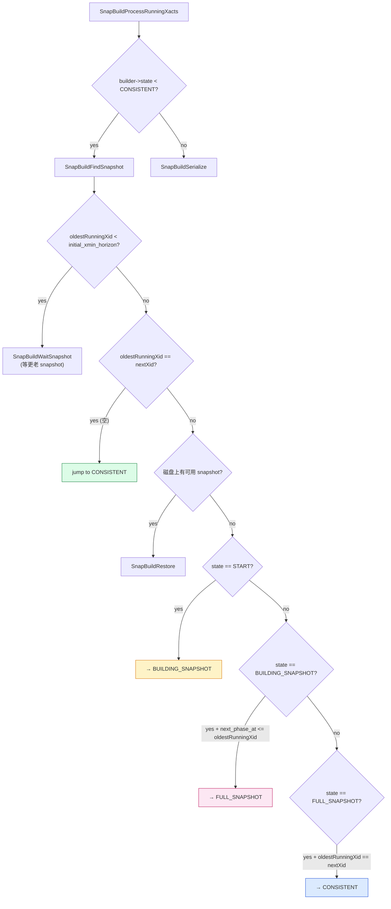

### 7.3 case a: 无 running xact（oldestRunningXid == nextXid）

```c
if (running->oldestRunningXid == running->nextXid)
{
    /* 此时没有任何 running xact */
    if (builder->start_decoding_at == InvalidXLogRecPtr ||
        builder->start_decoding_at <= lsn)
        builder->start_decoding_at = lsn + 1;

    /* xmin = xmax = nextXid */
    builder->xmin = running->nextXid;
    builder->xmax = running->nextXid;

    builder->state = SNAPBUILD_CONSISTENT;
    builder->next_phase_at = InvalidTransactionId;

    ereport(LOG, (errmsg("logical decoding found consistent point at %X/%X",
                          LSN_FORMAT_ARGS(lsn))));
    return false;
}
```

> **瞬间到 CONSISTENT**——如果系统在某个时间点完全没有 running xact，就不用 BUILDING_SNAPSHOT 阶段。

### 7.4 case c: START → BUILDING_SNAPSHOT

```c
else if (builder->state == SNAPBUILD_START)
{
    builder->state = SNAPBUILD_BUILDING_SNAPSHOT;
    builder->next_phase_at = running->nextXid;  /* 关键：记录切换点 */

    builder->xmin = running->nextXid;   /* < 都已经结束 */
    builder->xmax = running->nextXid;   /* >= 都还在跑 */

    SnapBuildWaitSnapshot(running, running->nextXid);
}
```

### 7.5 推进 xmin 后的 `xip` 处理

```c
/* xmin 更新后，需要把 xip 中比 xmin 小的 xid 删除 */
builder->xmin = running->oldestRunningXid;
SnapBuildPurgeOlderTxn(builder);
```

`SnapBuildPurgeOlderTxn` 干了什么？

```c
static void
SnapBuildPurgeOlderTxn(SnapBuild *builder)
{
    int off;
    TransactionId *newxip;
    int newxcnt = 0;
    
    /* 1. 计算新 xip 数组大小 */
    newxip = palloc(builder->xcnt * sizeof(TransactionId));
    
    /* 2. 保留 >= xmin 的 xid */
    for (off = 0; off < builder->xcnt; off++)
    {
        if (TransactionIdPrecedes(builder->xip[off], builder->xmin))
            continue;
        newxip[newxcnt++] = builder->xip[off];
    }
    
    /* 3. 替换 */
    memcpy(builder->xip, newxip, newxcnt * sizeof(TransactionId));
    builder->xcnt = newxcnt;
    pfree(newxip);
}
```

---

## 八、xip 数组的"重新定义"：catalog-modifying xid 列表

### 8.1 重要事实：`SnapBuild.xip` 不是 running xid，是**已提交的 catalog-modifying xid**

源码 `snapbuild.c:31` 的注释明确说：

```c
/*
 * In the 'xip' array we store transactions that have to be treated as
 * committed for the purpose of decoding (i.e. catalog-modifying transactions
 * that we have seen commits for).  We don't store running xacts in xip
 * because they can abort.
 */
```

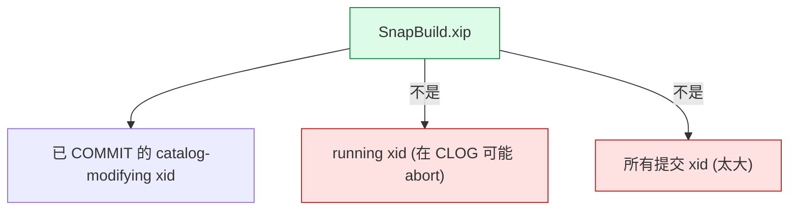

### 8.2 `xip` 何时被加入：`SnapBuildCommitTxn`

源码 `snapbuild.c:940`：

```c
void SnapBuildCommitTxn(SnapBuild *builder, XLogRecPtr lsn, TransactionId xid,
                        int nsubxacts, TransactionId *subxacts, uint32 xinfo)
{
    /* 1. 如果不是 catalog-modifying，跳过 */
    if (!SnapBuildXidHasCatalogChanges(builder, xid, xinfo))
        return;
    
    /* 2. 加到 committed.xip（SnapBuild 的 xip）*/
    SnapBuildAddCommittedTxn(builder, xid);
    
    /* 3. 更新 xmax = max(committed.xmax, xid) + 1 */
    if (TransactionIdFollowsOrEquals(xid, builder->xmax))
    {
        builder->xmax = xid;
        TransactionIdAdvance(builder->xmax);  /* xmax 永远 > 任何 commit xid */
    }
}
```

### 8.3 `SnapBuildAddCommittedTxn` 实现

```c
static void
SnapBuildAddCommittedTxn(SnapBuild *builder, TransactionId xid)
{
    /* 满了就 realloc */
    if (builder->xcnt == builder->xcnt_allocated)
    {
        builder->xcnt_allocated = builder->xcnt_allocated ? 
            builder->xcnt_allocated * 2 : 128;
        builder->xip = repalloc(builder->xip,
                                builder->xcnt_allocated * sizeof(TransactionId));
    }
    
    builder->xip[builder->xcnt++] = xid;
}
```

> **重要**：`SnapBuild.xip` 数组**只增不减**（除了 `SnapBuildPurgeOlderTxn` 剔除 < xmin 的）。这是为什么说"xmax > xmin"是允许的——`xip` 数组里可能有 `>= xmin` 的 xid。

### 8.4 全景图：`xip` 演化

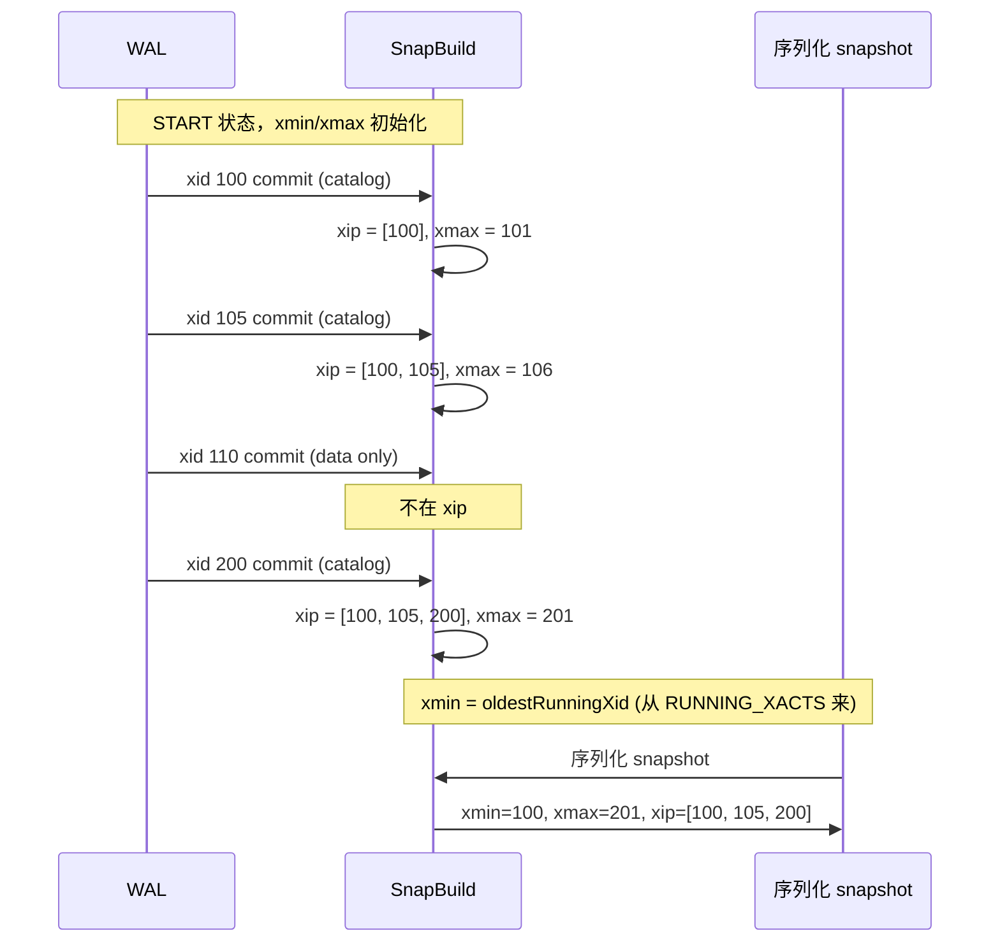

---

## 九、`xmax` 的双轨更新：RUNNING_XACTS 之外还有 SnapBuildCommitTxn

### 9.1 `xmax` 由谁更新？

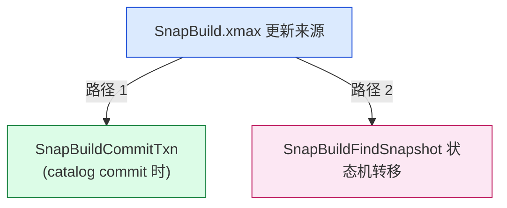

**路径 1: SnapBuildCommitTxn**（snapbuild.c:1055-1059）：

```c
if (needs_timetravel &&
    (!TransactionIdIsValid(builder->xmax) ||
     TransactionIdFollowsOrEquals(xmax, builder->xmax)))
{
    builder->xmax = xmax;
    TransactionIdAdvance(builder->xmax);
}
```

> 关键：**`xmax` 只在 catalog-modifying xact commit 时推进**，其他 commit 不会动它。

**路径 2: 状态机转移**（snapbuild.c:1301, 1405 等）：

```c
/* START → BUILDING_SNAPSHOT */
builder->xmin = running->nextXid;
builder->xmax = running->nextXid;

/* BUILDING_SNAPSHOT → FULL_SNAPSHOT */
builder->next_phase_at = running->nextXid;

/* FULL_SNAPSHOT → CONSISTENT */
... xmax 不再被重置
```

### 9.2 注释里的"奇怪"事实

源码 `snapbuild.c:1163`：

```c
/*
 * NB: We only increase xmax when a catalog modifying transaction commits
 * (see SnapBuildCommitTxn).  Because of this, xmax can be lower than
 * xmin, which looks odd but is correct and actually more efficient, since
 * we hit fast paths in heapam_visibility.c.
 */
```

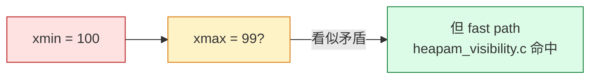

> **xmax < xmin 是合法的**！这是因为 `xip` 数组里都是"已 commit 的 catalog xid"，`xmax` 只看 commit 的最新一个 catalog xid。如果中间有 data-only xid commit，`xmax` 不动。

### 9.3 `xmax` 的双轨

```mermaid
gantt
    title xmax 双轨演化
    dateFormat X
    axisFormat %s
    section 时间线
    xmax=99 (START)        :milestone, m1, 0, 1
    xmax=99 (BUILDING)     :milestone, m2, 2, 3
    xmax=99 (FULL_SNAPSHOT):milestone, m3, 5, 6
    xmax=110 (catalog commit):crit, m4, 7, 8
    xmax=110 (持久化)        :milestone, m5, 9, 10
```

---

## 十、`SnapBuildSerialize`：snapshot 持久化

### 10.1 序列化入口

源码 `snapbuild.c:1470`：

```c
static void
SnapBuildSerialize(SnapBuild *builder, XLogRecPtr lsn)
{
    Snapshot snap;
    
    /* 1. 分配 SnapshotData */
    snap = palloc0(sizeof(SnapshotData));
    snap->xmin = builder->xmin;
    snap->xmax = builder->xmax;
    snap->xcnt = builder->xcnt;
    
    /* 2. 复制 xip 数组 */
    snap->xip = palloc(builder->xcnt * sizeof(TransactionId));
    memcpy(snap->xip, builder->xip, builder->xcnt * sizeof(TransactionId));
    
    /* 3. 排序（fast path 优化）*/
    qsort(snap->xip, snap->xcnt, sizeof(TransactionId), xidComparator);
    
    /* 4. 写文件 */
    SnapBuildRestoreSnapshot(builder, snap);
}
```

### 10.2 持久化格式

```c
/* SnapBuildOnDisk */
typedef struct SnapBuildOnDisk
{
    SnapBuildOnDiskConstantSize;
    int magic;          /* 魔数 */
    TransactionId xmin;
    TransactionId xmax;
    int xcnt;
    int subxcnt;
    TransactionId xip[FLEXIBLE_ARRAY_MEMBER];
} SnapBuildOnDisk;
```

### 10.3 序列化时机

```c
void SnapBuildProcessRunningXacts(...)
{
    if (builder->state < SNAPBUILD_CONSISTENT)
        SnapBuildFindSnapshot(builder, lsn, running);
    else
        SnapBuildSerialize(builder, lsn);  /* ← CONSISTENT 状态每次 RUNNING_XACTS 都序列化 */
}
```

> **CONSISTENT 状态后，每次 RUNNING_XACTS 都会序列化**。这是为什么 `restart_lsn` 能快速回放。

---

## 十一、apply 端怎么用这个 snapshot

### 11.1 apply worker 端 decode

源码 `src/backend/replication/logical/worker.c`：

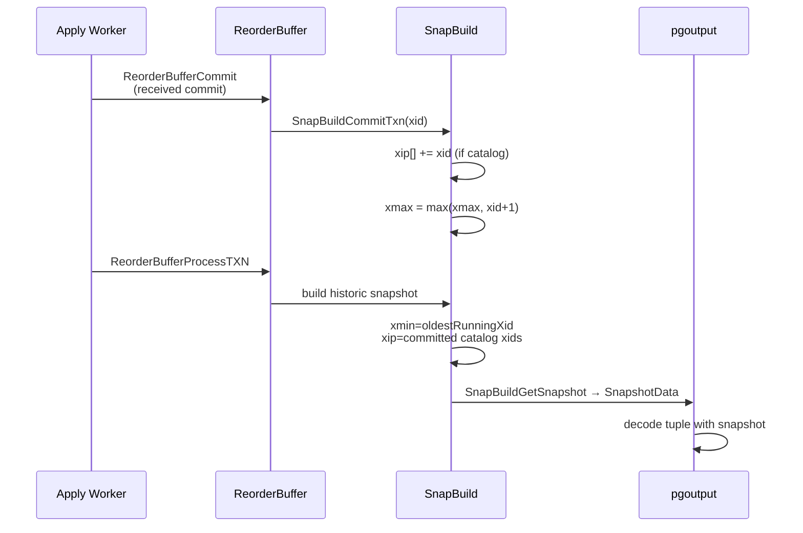

### 11.2 `SnapBuildGetSnapshot` 返回给 decoder

源码 `snapbuild.c:380`：

```c
Snapshot SnapBuildGetSnapshot(SnapBuild *builder)
{
    Snapshot snap = palloc(sizeof(SnapshotData));
    
    snap->xmin = builder->xmin;
    snap->xmax = builder->xmax;
    snap->xcnt = builder->xcnt;
    
    snap->xip = palloc(builder->xcnt * sizeof(TransactionId));
    memcpy(snap->xip, builder->xip, builder->xcnt * sizeof(TransactionId));
    qsort(snap->xip, snap->xcnt, sizeof(TransactionId), xidComparator);
    
    /* subxip 初始为空 */
    snap->subxip = NULL;
    snap->subxcnt = 0;
    
    return snap;
}
```

### 11.3 `GetTupleVisibility`：用 snapshot 判断 tuple 可见

源码 `decode.c:GetTupleVisibility`：

```c
XLogRecPtr GetTupleVisibility(LogicalDecodingContext *ctx, ...,
                                Snapshot *snapshot)
{
    ...
    /* 关键：systable_endscan 中要传 snapshot */
    if (RelationGetRelid(relation) == RelationRelationId)
    {
        /* pg_class */
        *snapshot = SnapBuildGetSnapshot(ctx->snapshot_builder);
    }
    else if (...)
        ...
}
```

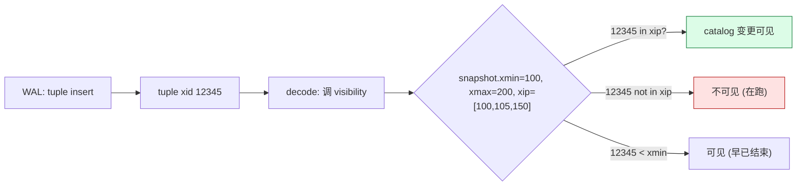

### 11.4 `RelationBuildTupleDesc` 用 snapshot 读 catalog

源码 `relcache.c:RelationBuildTupleDesc`：

```c
/* 1. 打开 pg_attribute */
attrdesc = table_open(AttributeRelationId, AccessShareLock);

/* 2. 传 snapshot（由 logical context 提供）*/
scan = systable_beginscan(attrdesc, AttributeRelidNameIndexId, true,
                          snapshot, 1, skey);

/* 3. 逐条读 */
while (HeapTupleIsValid(tup = systable_getnext(scan)))
    ...
```

**这就是 `rd_rel` 和 `rd_att` 怎么从 WAL 中"长"出来**。

---

## 十二、5 个最常见坑 + 排查

### 12.1 坑 1: `restart_lsn` 长时间不动

```sql
-- 现象
SELECT slot_name, restart_lsn, confirmed_flush_lsn 
FROM pg_replication_slots;

-- slot_name | restart_lsn | confirmed_flush_lsn
-- s1        | 0/1A4D0000 | 0/1A4D0000
-- restart_lsn 一直不动
```

**原因**：`SnapBuildFindSnapshot` 卡在 `oldestRunningXid` 上。可能是：

- 旧 xact 没 commit（应用层长事务）
- 旧 xact 已 commit 但 commit 记录没被 decoder 看到（reorderbuffer spill）
- `wal_level = replica` 而不是 `logical`

**排查**：

```sql
-- 找长 xact
SELECT pid, age(now(), xact_start), query
FROM pg_stat_activity
WHERE state = 'active'
ORDER BY xact_start LIMIT 5;
```

### 12.2 坑 2: xmax < xmin 导致 decode 失败

**现象**：

```text
ERROR: snapshot xmin 100 > xmax 99
```

**原因**：状态机转移时，`xmin = running->nextXid`，`xmax = running->nextXid`，`xmax` 暂时落后于 `xmin`。后续 commit 推进 `xmax`。

**修复**：等 commit 推进 `xmax`。

### 12.3 坑 3: 磁盘上 `snapbuild` 文件被锁

```sql
ERROR: could not open file "pg_replslot/s1/snapbuild": Resource busy
```

**原因**：另一个 worker 在用 slot。

### 12.4 坑 4: `committed.includes_all_transactions = false`

源码里 `builder->committed.includes_all_transactions` 在 `!needs_timetravel` 时设为 `false`：

```c
if (!needs_timetravel)
    builder->committed.includes_all_transactions = false;
```

**含义**：如果某个 xact 不是 catalog-modifying，**不会被记录在 xip**，所以导出的 snapshot 不能用于 export（pg_export_snapshot）。

### 12.5 坑 5: `subxid_overflow`

源码里 `subxid_overflow=true` 时，subxid 数组可能丢失：

```c
typedef struct xl_running_xacts {
    ...
    bool subxid_overflow;  /* subxids 丢失了 */
    ...
} xl_running_xacts;
```

**后果**：snapshot 不准，可能 decode 漏。**修复**：扩大 `subxid` cache（调 PG `PROC_MAX_CACHED_SUBXIDS`）。

---

## 十三、源码引用索引

**xl_running_xacts 定义**：
- `src/include/storage/standbydefs.h:47` — `xl_running_xacts` struct
- `src/include/storage/standbydefs.h:39` — `xl_standby_lock`

**LogStandbySnapshot**：
- `src/backend/storage/ipc/standby.c:1282` — `LogStandbySnapshot`
- `src/backend/storage/ipc/standby.c:1353` — `LogCurrentRunningXacts`
- `src/backend/storage/ipc/standby.c:1455` — `LogAccessExclusiveLocks`
- `src/backend/storage/ipc/procarray.c:2689` — `GetRunningTransactionData`
- `src/backend/storage/ipc/procarray.c:2658` — `GetOldestXmin` (相关)
- `src/backend/storage/ipc/procarray.c:1547` — `GetRunningTransactionLocks`

**SnapBuild 主逻辑**：
- `src/backend/replication/logical/snapbuild.c:1136` — `SnapBuildProcessRunningXacts`
- `src/backend/replication/logical/snapbuild.c:1238` — `SnapBuildFindSnapshot`
- `src/backend/replication/logical/snapbuild.c:1435` — `SnapBuildWaitSnapshot`
- `src/backend/replication/logical/snapbuild.c:940` — `SnapBuildCommitTxn`
- `src/backend/replication/logical/snapbuild.c:1470` — `SnapBuildSerialize`
- `src/backend/replication/logical/snapbuild.c:380` — `SnapBuildGetSnapshot`
- `src/backend/replication/logical/snapbuild.c:282` — `SnapBuildRestore`
- `src/backend/replication/logical/snapbuild.c:177` — `SnapBuildAddCommittedTxn`
- `src/backend/replication/logical/snapbuild.c:267` — `SnapBuildPurgeOlderTxn`

**Snapshot 内部**：
- `src/include/utils/snapshot.h` — `SnapshotData`
- `src/backend/utils/time/snapmgr.c` — snapshot manager
- `src/backend/access/heap/heapam_visibility.c` — `HeapTupleSatisfiesMVCC`

**apply 端**：
- `src/backend/replication/logical/worker.c` — apply worker
- `src/backend/replication/logical/decode.c` — `GetTupleVisibility`
- `src/backend/replication/logical/relation.c` — relation map
- `src/backend/utils/cache/relcache.c:RelationBuildTupleDesc` — 用 snapshot 读 catalog

---

## 十四、总结：6 个核心心智模型

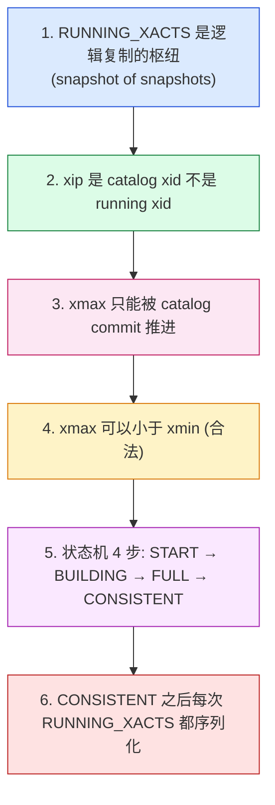

### 14.1 6 个心智模型详解

| # | 原则 | 实际体现 |
|---|---|---|
| 1 | **RUNNING_XACTS 是"快照的快照"** | 写 WAL 才能在 decoder 重放 |
| 2 | **`xip` 是 catalog-modifying xid 列表** | 不在 `xip` 里的 xid = 不可见 |
| 3 | **`xmax` 只被 catalog commit 推进** | data-only commit 不会动 xmax |
| 4 | **`xmax < xmin` 是合法的** | 状态机初始化期间可出现 |
| 5 | **状态机 4 步** | `START → BUILDING_SNAPSHOT → FULL_SNAPSHOT → CONSISTENT` |
| 6 | **CONSISTENT 后持续序列化** | `restart_lsn` 才能快速回放 |

### 14.2 一图总览：`xl_running_xacts` → `SnapBuild` → snapshot

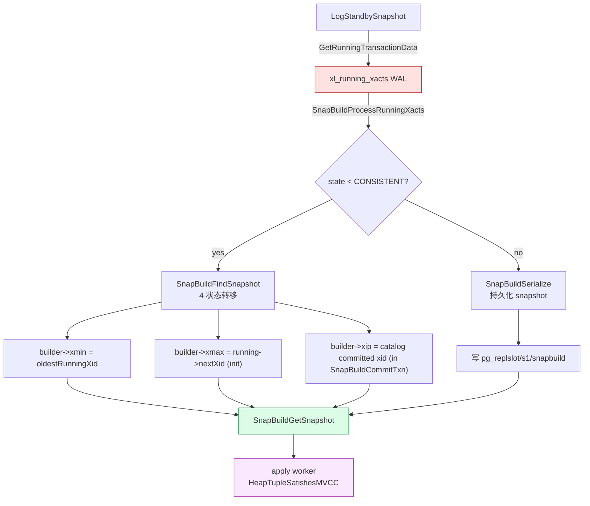

### 14.3 apply worker 端时序图

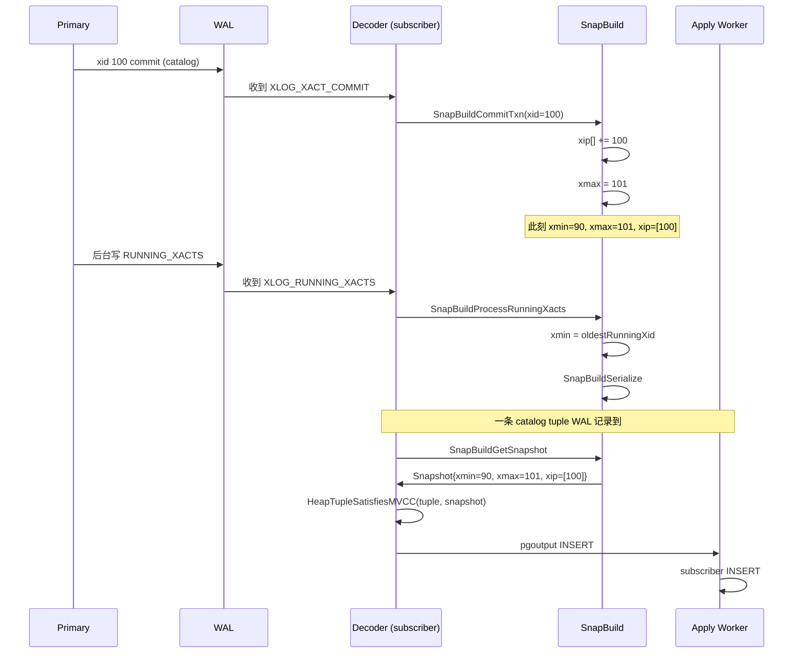

## 同系列前文

- [PostgreSQL MVCC：从一行 UPDATE 到 5 个 HeapTuple 的演化](./postgresql-mvcc/index.html)
- [PostgreSQL 事务生命周期：从 BEGIN/COMMIT 到 CLOG 一条链路](./postgresql-transaction-lifecycle/index.html)
- [PostgreSQL 逻辑复制表的生命周期：从 `pg_replication_slots` 到 `pg_subscription_rel`](./postgresql-logical-replication-tables-lifecycle/index.html)
- [PostgreSQL 逻辑复制 spill 深度拆解：ReorderBuffer 如何把 100GB 事务拆成小块](./postgresql-logical-replication-spill-deep-dive/index.html)
- [PostgreSQL 元数据存储机制](./postgresql-catalog-storage/index.html)
