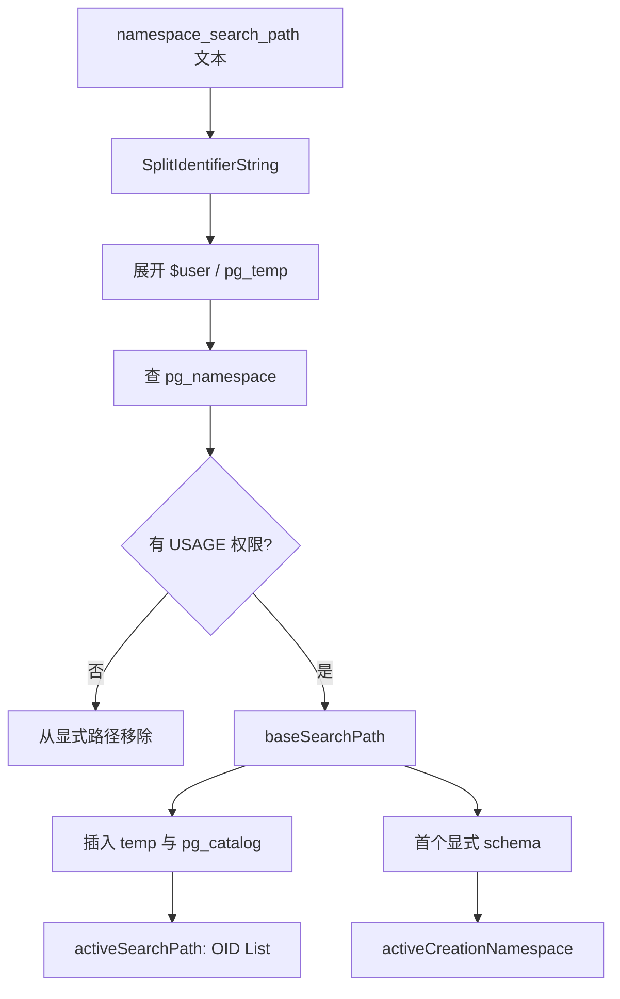
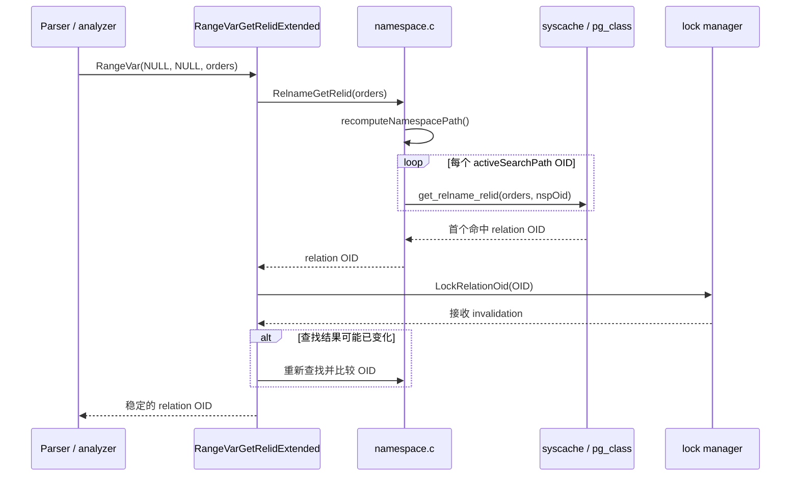
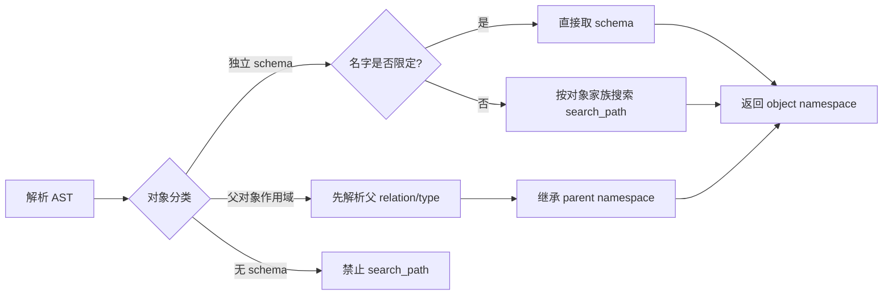

# PostgreSQL Schema 与 search_path：从名称解析源码到 DDL 对象归属

| 编写人 | 编写内容 | 编写时间 |
| --- | --- | --- |
| growdu | 基于 PostgreSQL 17 源码梳理 schema、`search_path`、DDL AST 与系统目录归属 | 2026-11-10 |

`schema` 常被理解为“表的目录”。这不够准确。

在 PostgreSQL 内核中，schema 是一个由 `pg_namespace` 表示的命名空间；它为一组独立命名对象提供名字隔离、权限边界与默认创建位置。

而 `search_path` 既不是简单字符串，也不是所有 DDL 统一套用的一条规则。

它是一套在后端会话中惰性计算、带权限过滤、带缓存失效与临时 schema 特例的 OID 路径。

本文回答四个问题：

1. 未限定对象名如何沿 `search_path` 找到 schema？
2. 创建对象时为何不是“找到第一个对象”，而是选择默认创建 schema？
3. 哪些 PostgreSQL 对象真正拥有独立 schema？
4. Utility NodeTag、`ObjectType` 与目录对象之间应如何映射？

## 一、先给结论：不要把 NodeTag 当作 schema 分类

`NodeTag` 是 PostgreSQL 所有内部节点的运行时类别标签。

它覆盖原始语法树、查询树、规划器节点、执行计划节点以及辅助节点。

因此，`T_Var`、`T_Const`、`T_Query`、`T_SelectStmt` 和 `T_CreateStmt` 都是 NodeTag，但只有其中一小部分与 DDL 有关。

判断“对象是否需要 schema”的可靠标准是系统目录中是否保存指向 `pg_namespace` 的独立 OID。

建议在解析器、血缘系统或 DDL 审计系统中使用三态模型：

| 分类 | 含义 | 名称解析方式 |
| --- | --- | --- |
| `INDEPENDENT_SCHEMA_OBJECT` | 自己保存 namespace OID | 未限定名走 `search_path` |
| `PARENT_SCOPED_OBJECT` | schema 由父对象决定 | 先解析 relation/type，再继承 |
| `NON_SCHEMA_OBJECT` | 不属于 schema | 不得套用 `search_path` |

例如索引在 `pg_class.relnamespace` 中有 schema，但 `CREATE INDEX` 不允许把索引独立创建到另一 schema。

它的 schema 固定继承目标表。

所以“目录有 namespace 字段”与“DDL 可用 `schema.name` 指定独立创建位置”也不是完全等价的概念。

## 二、核心数据结构

### 2.1 `RangeVar`：关系名的原始语法表示

关系名在 raw parse tree 中使用 `RangeVar`。

定义位于 `~/cwork/postgresql/src/include/nodes/parsenodes.h:1002`。

关键字段是：

```c
char *catalogname;
char *schemaname;
char *relname;
char relpersistence;
```

SQL：

```sql
SELECT * FROM orders;
SELECT * FROM sales.orders;
SELECT * FROM app.sales.orders;
```

会分别形成如下语义：

| 输入 | `catalogname` | `schemaname` | `relname` |
| --- | --- | --- | --- |
| `orders` | `NULL` | `NULL` | `orders` |
| `sales.orders` | `NULL` | `sales` | `orders` |
| `app.sales.orders` | `app` | `sales` | `orders` |

第三种写法不会跨数据库。

内核只接受 `catalogname == 当前数据库名`，随后忽略该字段。

跨数据库引用在 `RangeVarGetRelidExtended()` 中报 `FEATURE_NOT_SUPPORTED`。

源码见 `~/cwork/postgresql/src/backend/catalog/namespace.c:441`。

### 2.2 会话级有效路径

`namespace.c` 保存如下核心状态：

| 变量 | 含义 |
| --- | --- |
| `namespace_search_path` | GUC 中的原始文本 |
| `baseSearchPath` | 由文本、角色与 ACL 派生的基础 OID 列表 |
| `activeSearchPath` | 实际查询使用的 OID 列表 |
| `activeCreationNamespace` | 默认创建目标 schema OID |
| `activeTempCreationPending` | 第一个位置为 `pg_temp` 但尚未初始化 |
| `activePathGeneration` | 路径变化代数，用于快速判断状态变化 |

这些变量定义在 `~/cwork/postgresql/src/backend/catalog/namespace.c:123`。

`activeSearchPath` 中放的是 OID，而非 schema 名称。

因此，查找的热路径不需要反复把每一段名称转换为 OID。

### 2.3 搜索路径缓存

缓存键为：

```text
(search_path 文本, current role OID)
```

缓存项包含：

| 字段 | 含义 |
| --- | --- |
| `oidlist` | 通过 ACL 的显式 namespace 列表 |
| `finalPath` | 加上隐式项后的最终路径 |
| `firstNS` | 可作为默认创建目标的第一个显式 schema |
| `temp_missing` | `pg_temp` 是否要求但尚未创建 |

结构定义在 `~/cwork/postgresql/src/backend/catalog/namespace.c:154`。

`pg_namespace` 或 `pg_authid` 的 syscache invalidation 到达后，路径与缓存都会失效。

失效回调位于 `~/cwork/postgresql/src/backend/catalog/namespace.c:4760`。

## 三、有效 search_path 如何构造

设定：

```sql
SET search_path = "$user", sales, public;
```

后端的结果不是机械地保留这三个 token。

构造过程是：

1. 解析 GUC 文本为标识符列表；
2. 将 `$user` 展开为当前角色同名 schema；
3. 去掉不存在的 schema；
4. 去掉当前角色无 `USAGE` 权限的 schema；
5. 加入临时 schema 与 `pg_catalog` 等隐式项；
6. 记录第一个显式可用 schema 为默认创建位置。



### 3.1 隐式顺序

有效顺序可概括为：

```text
已初始化的 pg_temp_N
→ 显式指定位置的 pg_catalog，或者隐式 pg_catalog
→ 通过 ACL 的显式 search_path 项
```

若用户显式将 `pg_catalog` 写在后面，内核尊重其相对位置。

若没有写，它会隐式加入到 temp 后、显式路径前。

这解释了为什么普通 SQL 未限定引用可以直接使用内建函数、内建类型和系统表。

实现说明位于 `~/cwork/postgresql/src/backend/catalog/namespace.c:62`。

### 3.2 临时 schema 的安全边界

temp schema 不会对所有类型对象生效。

对 relation 和 type，临时 schema 会被搜索。

对函数、操作符、opclass、collation、conversion、全文检索对象等，搜索时会跳过 temp schema。

这是安全设计。

否则攻击者可以在临时 schema 创建同名函数，诱导安全定义函数或运维语句解析到恶意对象。

源码注释位于 `~/cwork/postgresql/src/backend/catalog/namespace.c:78`。

### 3.3 `pg_temp` 的懒创建

如果路径第一个有效项是 `pg_temp`，但会话尚未创建临时对象，真实 `pg_temp_N` 还不存在。

此时 `activeTempCreationPending` 为真。

第一次真正需要默认创建位置时，`AccessTempTableNamespace(true)` 初始化临时 schema。

这避免了仅执行 `SHOW search_path` 就创建临时 schema 的副作用。

相关逻辑在 `~/cwork/postgresql/src/backend/catalog/namespace.c:654`。

## 四、查询关系：从未限定名到 OID

以：

```sql
SELECT * FROM orders;
```

为例。

解析器产生 `RangeVar(schemaname = NULL, relname = "orders")`。

后续语义分析或 Utility/DML 路径调用 `RangeVarGetRelidExtended()`。

该函数定义于 `~/cwork/postgresql/src/backend/catalog/namespace.c:441`。



### 4.1 显式 schema

`sales.orders` 不遍历 search path。

函数先调用 `LookupExplicitNamespace("sales", missing_ok)`，再调用：

```c
get_relname_relid("orders", namespaceId)
```

逻辑见 `~/cwork/postgresql/src/backend/catalog/namespace.c:519`。

显式限定解决的是“选定哪个 schema”，不是绕过权限检查。

之后仍会在需要时检查对象权限。

### 4.2 未限定 schema

`RelnameGetRelid()` 的循环非常直接：

```c
recomputeNamespacePath();
foreach(l, activeSearchPath)
{
    relid = get_relname_relid(relname, lfirst_oid(l));
    if (OidIsValid(relid))
        return relid;
}
```

函数位于 `~/cwork/postgresql/src/backend/catalog/namespace.c:885`。

它的语义是“第一个命中获胜”。

同名表后面的 schema 不会导致歧义错误。

这与列名解析不同；列名在同一可见层级存在多个候选时常需要报歧义。

### 4.3 可见性与命名遮蔽

`RelationIsVisible()` 不只判断对象 schema 是否在 path 中。

它还必须确认此前没有同名 relation 遮蔽它。

例如：

```sql
SET search_path = tenant_a, public;
CREATE TABLE tenant_a.orders (...);
CREATE TABLE public.orders (...);
```

`public.orders` 的 namespace 在 path 中，但 `RelationIsVisible(public.orders_oid)` 为 false。

原因是 `tenant_a.orders` 更早被找到。

相关代码从 `~/cwork/postgresql/src/backend/catalog/namespace.c:911` 开始。

### 4.4 并发 DDL 的重试

名称查找和对象锁之间可能有并发窗口。

另一个事务可以在查到 OID 后、当前事务锁定前执行重命名、删除或重建对象。

`RangeVarGetRelidExtended()` 记录 invalidation 计数。

获得 relation lock 后如果计数变化，函数重新查找。

如果新旧 OID 不同，释放旧锁后再锁定新对象。

这保证返回的 OID 与最终名字解析结果一致。

实现位于 `~/cwork/postgresql/src/backend/catalog/namespace.c:482`。

## 五、创建对象：默认 namespace 与查找不同

以下 SQL：

```sql
SET search_path = tenant_a, public;
CREATE TABLE invoices (id bigint);
```

不会尝试在 `tenant_a` 和 `public` 中寻找同名对象并选择一个。

它直接将 `tenant_a` 作为默认创建 schema。

关系对象走 `RangeVarGetCreationNamespace()`。

定义在 `~/cwork/postgresql/src/backend/catalog/namespace.c:654`。

其他采用 `List<String>` qualified name 的对象通常走 `QualifiedNameGetCreationNamespace()`。

定义在 `~/cwork/postgresql/src/backend/catalog/namespace.c:3490`。

| 写法 | 创建 namespace |
| --- | --- |
| `CREATE TABLE t` | `activeCreationNamespace` |
| `CREATE TABLE s.t` | `s` |
| `CREATE TEMP TABLE t` | 当前 backend 的 temp schema |
| `CREATE TABLE pg_temp.t` | 初始化后当前 temp schema |
| `CREATE FUNCTION f()` | 默认创建 schema |
| `CREATE FUNCTION s.f()` | `s` |

创建路径还需完成：

1. 检查 `CREATE` 权限；
2. 在 namespace 上加 `AccessShareLock`；
3. 检查同名 relation 是否已存在；
4. 并发 invalidation 时重试。

`RangeVarGetAndCheckCreationNamespace()` 实现以上步骤，位于 `~/cwork/postgresql/src/backend/catalog/namespace.c:730`。

### 5.1 `pg_catalog` 不等于默认创建位置

假设：

```sql
SET search_path = public;
```

查询有效路径会包含 `pg_catalog, public`。

但 `CREATE TABLE t (...)` 应创建于 `public`，而不是 `pg_catalog`。

这正是内核同时维护 `activeSearchPath` 与 `activeCreationNamespace` 的原因。

### 5.2 空路径的行为

如果没有任何可作为创建目标的显式 schema，未限定创建会报：

```text
no schema has been selected to create in
```

这不是因为找不到对象。

而是因为找不到允许默认创建的 namespace。

报错逻辑见 `~/cwork/postgresql/src/backend/catalog/namespace.c:701`。

## 六、所有独立 schema 对象的目录清单

以下表是实现 schema 支持时应作为白名单的完整核心集合。

### 6.1 relation 家族

| SQL 对象 | 目录 | schema 字段 | 备注 |
| --- | --- | --- | --- |
| table | `pg_class` | `relnamespace` | 普通表 |
| partitioned table | `pg_class` | `relnamespace` | 分区根表 |
| sequence | `pg_class` | `relnamespace` | 与 table 共用 relation namespace |
| view | `pg_class` | `relnamespace` | relation kind 为 view |
| materialized view | `pg_class` | `relnamespace` | relation kind 为 matview |
| foreign table | `pg_class` | `relnamespace` | relation kind 为 foreign table |
| index | `pg_class` | `relnamespace` | 继承目标表 schema |

`pg_class.relnamespace` 定义于 `~/cwork/postgresql/src/include/catalog/pg_class.h:41`。

唯一索引为 `(relname, relnamespace)`，见 `~/cwork/postgresql/src/include/catalog/pg_class.h:156`。

这说明 table、sequence、index、view、materialized view、foreign table 共用同一命名空间。

不能在同一 schema 同时创建同名表与同名索引。

### 6.2 type 家族

| SQL 对象 | 目录 | schema 字段 | 名称解析 |
| --- | --- | --- | --- |
| base type | `pg_type` | `typnamespace` | `search_path` |
| composite type | `pg_type` | `typnamespace` | `search_path` |
| domain | `pg_type` | `typnamespace` | `search_path` |
| enum | `pg_type` | `typnamespace` | `search_path` |
| range | `pg_type` | `typnamespace` | `search_path` |
| multirange | `pg_type` | `typnamespace` | `search_path` |

`pg_type.typnamespace` 位于 `~/cwork/postgresql/src/include/catalog/pg_type.h:44`。

唯一索引 `(typname, typnamespace)` 位于 `~/cwork/postgresql/src/include/catalog/pg_type.h:266`。

temp schema 被允许搜索类型，因为临时表需要其 row type。

### 6.3 routine 与 operator 家族

| SQL 对象 | 目录 | schema 字段 | 唯一性额外维度 |
| --- | --- | --- | --- |
| function | `pg_proc` | `pronamespace` | 参数类型 |
| procedure | `pg_proc` | `pronamespace` | 参数类型 |
| aggregate | `pg_proc` | `pronamespace` | 参数类型 |
| operator | `pg_operator` | `oprnamespace` | 左右操作数类型 |

`pg_proc.pronamespace` 定义于 `~/cwork/postgresql/src/include/catalog/pg_proc.h:38`。

`pg_operator.oprnamespace` 定义于 `~/cwork/postgresql/src/include/catalog/pg_operator.h:39`。

函数调用解析不仅按路径查名称，还会进行参数数目、默认参数、命名参数、可隐式转换候选筛选与歧义诊断。

因此不能用“第一个 `proname` 命中”模拟函数解析。

操作符的精确匹配入口为 `OpernameGetOprid()`，位于 `~/cwork/postgresql/src/backend/catalog/namespace.c:1785`。

### 6.4 索引访问方法扩展对象

| SQL 对象 | 目录 | schema 字段 |
| --- | --- | --- |
| operator class | `pg_opclass` | `opcnamespace` |
| operator family | `pg_opfamily` | `opfnamespace` |

`pg_opclass.opcnamespace` 位于 `~/cwork/postgresql/src/include/catalog/pg_opclass.h:60`。

`pg_opfamily.opfnamespace` 位于 `~/cwork/postgresql/src/include/catalog/pg_opfamily.h:40`。

opclass lookup 会跳过 temp schema，相关循环见 `~/cwork/postgresql/src/backend/catalog/namespace.c:2121`。

### 6.5 国际化、转换与统计对象

| SQL 对象 | 目录 | schema 字段 |
| --- | --- | --- |
| collation | `pg_collation` | `collnamespace` |
| conversion | `pg_conversion` | `connamespace` |
| extended statistics | `pg_statistic_ext` | `stxnamespace` |

对应字段分别定义于：

- `~/cwork/postgresql/src/include/catalog/pg_collation.h:35`
- `~/cwork/postgresql/src/include/catalog/pg_conversion.h:38`
- `~/cwork/postgresql/src/include/catalog/pg_statistic_ext.h:42`

`CREATE STATISTICS` 创建的是独立命名对象，但其中 `stxrelid` 又关联目标表。

所以它既有独立 schema，又有 relation 依赖。

### 6.6 全文检索对象

| SQL 对象 | 目录 | schema 字段 |
| --- | --- | --- |
| text search parser | `pg_ts_parser` | `prsnamespace` |
| text search template | `pg_ts_template` | `tmplnamespace` |
| text search dictionary | `pg_ts_dict` | `dictnamespace` |
| text search configuration | `pg_ts_config` | `cfgnamespace` |

对应字段位于：

- `~/cwork/postgresql/src/include/catalog/pg_ts_parser.h:37`
- `~/cwork/postgresql/src/include/catalog/pg_ts_template.h:37`
- `~/cwork/postgresql/src/include/catalog/pg_ts_dict.h:38`
- `~/cwork/postgresql/src/include/catalog/pg_ts_config.h:39`

这四类对象应和 type、function 一样列入 schema-aware 的 DDL 解析器。

## 七、由父对象决定 schema 的对象

以下对象不应单独用 `search_path` 解析。

| DDL / 对象 | 父对象 | schema 推导 |
| --- | --- | --- |
| column | relation | `pg_class.relnamespace` |
| table constraint | relation | relation schema |
| domain constraint | domain | `pg_type.typnamespace` |
| trigger | relation | `tgrelid` 对应 relation |
| rule | relation | `ev_class` 对应 relation |
| row security policy | relation | `polrelid` 对应 relation |
| table inheritance | child / parent relation | 各 relation schema |
| partition bound | partition relation | relation schema |
| attribute default | column / relation | relation schema |
| transform | type + language | type schema，不独立命名 |
| user mapping | server + role | 无 schema |

### 7.1 Trigger

`CREATE TRIGGER trg BEFORE INSERT ON s.t ...` 中，`trg` 不存在独立的 `schema.trg` 名称空间。

schema 限定的是目标表 `s.t`。

触发器名仅需在同一 relation 内满足唯一性。

AST 为 `CreateTrigStmt`，定义于 `~/cwork/postgresql/src/include/nodes/parsenodes.h:3001`。

### 7.2 Policy

`CREATE POLICY p ON s.t ...` 的 policy 名称只在 relation 范围内唯一。

`CreatePolicyStmt` 定义于 `~/cwork/postgresql/src/include/nodes/parsenodes.h:2959`。

policy schema 应由 `s.t` 的 `relnamespace` 推导。

### 7.3 Rule

`CREATE RULE r AS ON SELECT TO s.v ...` 中 rule 是 relation 的附属对象。

`RuleStmt.relation` 明确保存其 relation，定义于 `~/cwork/postgresql/src/include/nodes/parsenodes.h:3606`。

### 7.4 Constraint

同名约束可以存在于不同 relation。

即使 PostgreSQL 某些约束实现创建了底层 index，约束命名空间和 index 命名空间也不是一回事。

审计工具应同时记录：

```text
constraint → owning relation → relation namespace
constraint → supporting index → index namespace
```

## 八、不属于 schema 的对象

以下对象不可写成“通过 `search_path` 找到的 schema 对象”。

| 范围 | 对象 |
| --- | --- |
| cluster | role、user、group、database、tablespace |
| database | schema、extension、language、cast、access method |
| database | foreign data wrapper、foreign server、user mapping |
| database | event trigger、publication、subscription |
| 会话 / 事务 | prepared statement、cursor、savepoint、listen channel |

### 8.1 Schema 自身

`CREATE SCHEMA s` 创建的就是 namespace 容器。

它没有父 schema。

`CreateSchemaStmt` 定义于 `~/cwork/postgresql/src/include/nodes/parsenodes.h:2320`。

`DROP SCHEMA` 也不是先在 `search_path` 中找 schema；它按 schema 名直接查 `pg_namespace`。

### 8.2 Extension

extension 名称本身不按 `search_path` 查找。

但 extension 可被安装到指定 schema，`pg_extension.extnamespace` 记录安装位置。

这是“扩展成员归属 / 安装位置”，而不是 extension 名称空间。

不能因此把 extension 标为独立 schema object。

### 8.3 Publication 与 subscription

publication、subscription 是 database-wide 对象。

publication 可以包含“某 schema 中的表”，但 publication 自身不属于 schema。

这与 policy、trigger 一样，是引用 schema object，不是 schema object 本身。

## 九、DDL AST 与 ObjectType 统计口径

### 9.1 Utility Statement NodeTag

常见 DDL 语句不是一条语句一个简单类别。

部分 AST 节点与其目标字段如下：

| AST struct | 主要 SQL | schema 信息承载方式 |
| --- | --- | --- |
| `CreateStmt` | `CREATE TABLE` | `RangeVar *relation` |
| `AlterTableStmt` | `ALTER TABLE` | `RangeVar *relation` |
| `IndexStmt` | `CREATE INDEX` | 目标 relation + index name |
| `CreateFunctionStmt` | `CREATE FUNCTION/PROCEDURE` | qualified `funcname` list |
| `CreateSchemaStmt` | `CREATE SCHEMA` | schema 名，不属于父 schema |
| `CreateStatsStmt` | `CREATE STATISTICS` | qualified stats name + relation |
| `CreatePolicyStmt` | `CREATE POLICY` | relation 决定 schema |
| `CreateTrigStmt` | `CREATE TRIGGER` | relation 决定 schema |
| `DropStmt` | 多类 `DROP` | `removeType + objects` |
| `RenameStmt` | 多类 `ALTER ... RENAME` | `renameType + relation/object` |
| `CommentStmt` | `COMMENT ON` | `ObjectType + ObjectWithArgs` |
| `RuleStmt` | `CREATE RULE` | relation 决定 schema |

`CreateStmt` 定义于 `~/cwork/postgresql/src/include/nodes/parsenodes.h:2648`。

`AlterTableStmt` 定义于 `~/cwork/postgresql/src/include/nodes/parsenodes.h:2339`。

`DropStmt` 定义于 `~/cwork/postgresql/src/include/nodes/parsenodes.h:3226`。

`IndexStmt` 定义于 `~/cwork/postgresql/src/include/nodes/parsenodes.h:3348`。

`CreateFunctionStmt` 定义于 `~/cwork/postgresql/src/include/nodes/parsenodes.h:3427`。

### 9.2 `DropStmt` 为什么必须看 `removeType`

`DropStmt` 是典型的反例。

它用一个 NodeTag 同时承载 table、index、view、sequence、type、domain、conversion、schema 等删除操作。

因此下面两种实现都不正确：

```text
DropStmt 一律需要 schema
DropStmt 一律不需要 schema
```

正确实现是按 `ObjectType` 分派：

```text
OBJECT_TABLE        → INDEPENDENT_SCHEMA_OBJECT
OBJECT_INDEX        → INDEPENDENT_SCHEMA_OBJECT
OBJECT_TYPE         → INDEPENDENT_SCHEMA_OBJECT
OBJECT_SCHEMA       → NON_SCHEMA_OBJECT
OBJECT_TRIGGER      → PARENT_SCOPED_OBJECT
OBJECT_ROLE          → NON_SCHEMA_OBJECT
```

`DropStmt.removeType` 的定义可见 `~/cwork/postgresql/src/include/nodes/parsenodes.h:3230`。

### 9.3 建议的 ObjectType 分类表

| ObjectType 组 | 分类 |
| --- | --- |
| table、foreign table、sequence、view、materialized view、index | 独立 schema，对 index 加继承规则 |
| type、domain、function、procedure、aggregate、operator | 独立 schema |
| collation、conversion、opclass、opfamily、statistics | 独立 schema |
| TS parser、template、dictionary、configuration | 独立 schema |
| column、attribute、constraint、trigger、rule、policy | 父对象 schema |
| database、role、tablespace、schema、extension、language | 无 schema |
| FDW、server、user mapping、publication、subscription、event trigger | 无 schema |
| cast、access method、transform、default ACL | 无独立 schema |

`ObjectType` 枚举位于 `~/cwork/postgresql/src/include/nodes/parsenodes.h:2256`。

### 9.4 统计结果

以“最终持久化对象的独立 namespace 字段”为口径：

| 类别 | 数量 |
| --- | ---: |
| relation 子类 | 7 |
| type 子类 | 6 |
| routine / operator 子类 | 4 |
| opclass / opfamily | 2 |
| collation / conversion / statistics | 3 |
| text search 子类 | 4 |
| 独立 schema 对象子类合计 | 26 |

这里的 26 是 DDL 概念子类数量。

按系统目录表计数，则是 13 个独立 namespace 目录：

```text
pg_class
pg_type
pg_proc
pg_operator
pg_collation
pg_conversion
pg_opclass
pg_opfamily
pg_statistic_ext
pg_ts_parser
pg_ts_template
pg_ts_dict
pg_ts_config
```

## 十、类型、函数与操作符的差异

### 10.1 Type

未限定类型名按 path 查找。

例如：

```sql
CREATE DOMAIN money AS numeric;
SET search_path = tenant_a, public;
CREATE TABLE invoice (amount money);
```

解析到哪个 `money` 取决于类型 namespace 的路径顺序。

因为临时表需要临时 row type，type lookup 可以使用 temp schema。

### 10.2 Function

函数解析首先收集可能的 namespace，再依据参数列表筛选候选。

例如：

```sql
SELECT f(1);
```

不能只比较 `proname = 'f'`。

还需要处理：

1. 参数数目；
2. 默认参数；
3. 命名参数；
4. variadic 参数；
5. 隐式类型转换；
6. 多候选歧义。

因此 schema 仅是函数解析的第一层过滤条件。

### 10.3 Operator

操作符的唯一键包含名称、左右输入类型与 namespace。

`OpernameGetOprid()` 先选择 namespace，再由 `(oprleft, oprright)` 找精确匹配。

相关源码入口是 `~/cwork/postgresql/src/backend/catalog/namespace.c:1785`。

### 10.4 Relation

relation lookup 的唯一键仅为 `(relname, relnamespace)`。

所以 relation 的规则最接近“目录查文件名”。

函数和 operator 则是带签名的重载集合。

## 十一、实现 schema-aware DDL 解析器的算法

建议将名称解析分成五步。



伪代码如下：

```text
resolve_object(statement):
  target = extract_target(statement)
  kind = classify(target.object_type)

  if kind == NON_SCHEMA_OBJECT:
      return GlobalName(target)

  if kind == PARENT_SCOPED_OBJECT:
      parent = resolve_relation_or_type(target.parent)
      return ChildName(parent.namespace, target.name)

  if target.has_explicit_schema:
      return LookupInNamespace(target.schema, target.name, target.signature)

  path = EffectiveSearchPathForObjectFamily(target.family)
  return LookupFirstVisible(path, target.name, target.signature)
```

`EffectiveSearchPathForObjectFamily` 必须能表达“是否包含 temp schema”。

不要把 `SHOW search_path` 的文本直接作为解析结果。

必须以角色权限过滤后、含隐式项的 OID path 为准。

## 十二、常见陷阱速查

| 误区 | 后果 | 正确处理 |
| --- | --- | --- |
| schema 只包含表 | 漏掉 type/function/operator | 以目录 namespace 字段分类 |
| 所有 NodeTag 都要 schema | AST 逻辑混乱 | 只在 Utility/ObjectType 分派层处理 |
| 所有 DDL 都跑 search_path | role/database 等解析错误 | 使用三态分类 |
| `pg_catalog` 是默认创建位置 | 创建到错误 namespace | 单独使用 `activeCreationNamespace` |
| path 内同名对象应报歧义 | 与 PostgreSQL 不兼容 | relation 采用首个命中 |
| temp schema 对所有对象可见 | 安全漏洞 | 仅 relation/type 可搜索 temp |
| index 可独立指定 schema | 生成非法 DDL | 从目标表继承 schema |
| trigger 有 `schema.trigger` | 误建唯一键 | 使用 relation 局部唯一性 |
| extension 是 schema object | 错误生成限定名 | 区分安装位置与对象名称 |
| 函数只按名称匹配 | 重载解析错误 | 连同签名与候选规则处理 |

## 十三、排障 SQL

查看当前路径：

```sql
SHOW search_path;
SELECT current_schema();
SELECT current_schemas(true);
SELECT current_schemas(false);
```

`current_schemas(true)` 显示包含隐式 schema 的有效路径。

`current_schemas(false)` 排除隐式 schema。

查 relation 的 schema：

```sql
SELECT c.oid, n.nspname, c.relname, c.relkind
FROM pg_class AS c
JOIN pg_namespace AS n ON n.oid = c.relnamespace
WHERE c.relname = 'orders';
```

查 type 的 schema：

```sql
SELECT t.oid, n.nspname, t.typname, t.typtype
FROM pg_type AS t
JOIN pg_namespace AS n ON n.oid = t.typnamespace
WHERE t.typname = 'money';
```

查 function 的 schema 与签名：

```sql
SELECT p.oid, n.nspname, p.proname,
       pg_get_function_identity_arguments(p.oid)
FROM pg_proc AS p
JOIN pg_namespace AS n ON n.oid = p.pronamespace
WHERE p.proname = 'f';
```

查所有独立 namespace 目录的对象数量，可按目录分别 `JOIN pg_namespace`。

不要使用名称字符串拼接来推断对象身份。

应优先保存 OID、对象类型与 namespace OID。

## 十四、修改 PostgreSQL 时的文件导航

| 需求 | 首先阅读的文件 |
| --- | --- |
| 修改 search_path 行为 | `src/backend/catalog/namespace.c` |
| 添加新的 raw utility statement | `src/backend/parser/gram.y` |
| 添加 AST struct / ObjectType | `src/include/nodes/parsenodes.h` |
| 添加 NodeTag | `src/include/nodes/nodes.h` |
| 为对象增加目录 schema 字段 | `src/include/catalog/pg_*.h` |
| 创建 schema 对象 | `src/backend/catalog/` 下对象实现 |
| 解析函数与类型引用 | `src/backend/parser/parse_func.c`、`parse_type.c` |
| 回归测试 | `src/test/regress/sql/` |

新增一种独立 schema 对象时，至少检查：

1. catalog 是否保存并约束 namespace OID；
2. `CREATE` 是否能选择默认或显式 namespace；
3. 未限定 `ALTER`、`DROP`、`COMMENT` 是否走正确路径；
4. 是否需要 `...IsVisible()`；
5. temp schema 是否应参与该对象家族搜索；
6. `pg_dump`、依赖跟踪、ACL、schema move 是否覆盖；
7. `search_path` 攻击面是否被安全定义函数隔离。

## 十五、总结

PostgreSQL 的 schema 机制可以压缩成三句话：

1. 查询时，未限定名在对象家族允许的有效 `activeSearchPath` 中首个命中获胜。
2. 创建时，未限定名使用 `activeCreationNamespace`，它不同于完整查询路径。
3. schema 归属应由最终目录模型决定：独立 namespace、父对象作用域、无 schema 三类。

因此，任何 DDL 解析、SQL 血缘、迁移工具或兼容层都应先按对象语义分类，再选择名称解析规则。

只根据语句关键字、NodeTag 名称或字符串里是否带点号来决定 schema，都会在 trigger、index、extension、function overload、temp schema 和 `pg_catalog` 等场景中产生错误。
