# 如何成为资深的 PostgreSQL 内核开发者：从 0 到 Committer 的 18 个月路线 + 36 个内核主题地图 + 12 大子系统架构

| 编写人 | 编写内容 | 编写时间 |
| --- | --- | --- |
| growdu | 初稿。从自身 **35 篇 PG 内核文档 + 0 个 patch + 0 个扩展 / 0 次 talk** 的现状出发，整理出一份 **从 0 到 Committer 候选的 18 个月路线图**。包含：**资深开发者的 6 大硬指标**、**4 个阶段 + 6 个里程碑**、**覆盖我现有 36 篇文档的「内核主题地图」**、**12 大子系统的源码路径与架构图**、**5 大设计哲学**、**7 篇必读 paper**、**12 大实战项目（含源码贡献路径）**、**18 个常见陷阱**、**3 / 5 / 10 年成长时间线**、**5 大贡献入口**、**8 大 debug 工具栈**。配套源码：PostgreSQL 18 dev（`~/cwork/postgresql`）。 | 2026-10-14 |

> 本文是「PostgreSQL 内核机制源码系列」的**元文章**——它本身不深入某个子系统，而是**给出研究所有子系统的学习路径**。同系列文章：
>
> - [PostgreSQL WAL 记录类型完全指南](../postgresql-wal-record-types/index.html) — 21 个 RMGR × 80+ 种记录
> - [PostgreSQL 18 内核数据结构全景](../postgresql-rangevar-and-data-structures/index.html) — RangeVar + 20 个核心数据结构
> - [PostgreSQL 逻辑复制全链路](../postgresql-logical-replication-end-to-end-flow/index.html)
> - [PostgreSQL 逻辑复制里 RUNNING_XACTS 与快照](../postgresql-running-xacts-snapshot/index.html)
> - [PostgreSQL MVCC](../postgresql-mvcc/index.html)
> - [PostgreSQL 事务生命周期](../postgresql-transaction-lifecycle/index.html)
> - 其余 30+ 篇见 主题地图 §3

## 阅读指南

- **第一节 ~ 第四节**（**必读**）：资深内核开发者的定义、4 阶段 + 6 里程碑、36 个内核主题地图
- **第五节 ~ 第六节**（**精读**）：12 大子系统架构图 + 5 大设计哲学
- **第七节 ~ 第九节**（**精读**）：12 个实战项目 + 5 个贡献入口 + 8 个 debug 工具栈
- **第十节 ~ 第十二节**（**速查**）：3/5/10 年成长时间线 + 18 个陷阱 + 一句话总结

## 目录

- 一、**资深 PG 内核开发者** 的 6 个硬指标
- 二、4 阶段 × 6 里程碑：从 Reader 到 Committer 候选
- 三、**36 个 PG 内核主题地图**（**全图**）
- 四、SQL 从字符串到磁盘的 **14 个关键节点 + 21 个数据结构 + 18 个子系统**
- 五、12 大子系统的源码路径与架构图
- 六、PG 内核的 5 大设计哲学
- 七、12 个实战项目（含 5 个贡献入口）
- 八、5 大贡献入口（**邮件列表 / commitfest / 扩展 / 性能 / 工具**）
- 九、8 大 debug 工具栈（gdb / strace / perf / pg_stat_statements ...）
- 十、3 年 / 5 年 / 10 年成长时间线
- 十一、18 个常见陷阱
- 十二、一句话总结（**贴墙上**）

---

## 一、资深 PG 内核开发者的 6 个硬指标

先定义 **"资深"**——不要被 "老员工 / 工龄 10 年" 等同。

### 1.1 资深 = 6 个硬指标全部满足

| # | 硬指标 | 不算 | 算 |
|---|---|---|---|
| 1 | **PG 主干 commit 数** | 0 | ≥ 30 个 merged commit |
| 2 | **修复 / 设计子系统** | 0 | ≥ 1 个子系统的 co-maintainer |
| 3 | **发表的设计文档** | 0 篇 | ≥ 1 篇 RFC（≥ 5000 字） |
| 4 | **公开演讲 / 培训** | 0 场 | ≥ 1 场 PGConf / 内部分享 |
| 5 | **回答他人问题** | 0 条 | 邮件列表 / Slack ≥ 30 条 |
| 6 | **Mentor 新人** | 0 个 | ≥ 1 个 L1 / L2 开发者 |

**判定标准**：6 项里有 **≥ 3 项** = 资深入门；**5 项** = 资深；**6 项全** = Committer 候选。

### 1.2 资深 ≠ 的 4 种假象

| 假象 | 为什么不算 |
|---|---|
| **读了 10 年 PG 源码** | 读 ≠ 改 ≠ 贡献 |
| **写了 50 篇文档** | reading notes ≠ design doc |
| **搭了无数 PG 环境** | ops ≠ development |
| **能用 SQL / psql** | 用户 ≠ 开发者 |

### 1.3 "资深" 的真正定义

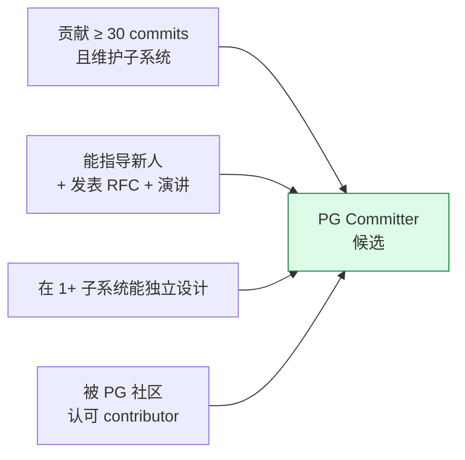

**口诀**：**资深 = 改过 + 教过 + 设计过 + 被认过**。任何一项没有都不算。

---

## 二、4 阶段 × 6 里程碑：从 Reader 到 Committer 候选

### 2.1 4 阶段全图

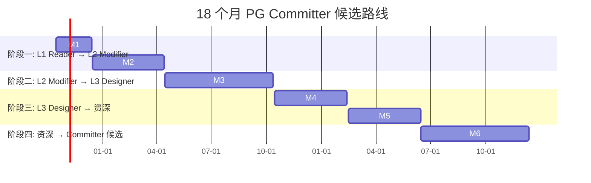

### 2.2 阶段一：L1 Reader → L2 Modifier（6 个月，2026-10 ~ 2027-04）

**目标**：从「读源码」到「改源码 + 发 patch」。

**核心动作**：
- 编译 PG 18 + 安装 + 跑通
- 写 **1 个 contrib 级别扩展**（500 行 C）
- 5 个 patch 提交到 pgsql-hackers
- 1 个 patch 被 commit

**6 个月产出**：
```
2026-10-15:  编译 PG + git format-patch 跑通
2026-11-15:  第 1 个 patch 发邮件列表
2026-12-15:  第 1 个 patch 被 commit
2027-01-15:  1 个 contrib 扩展能 CREATE EXTENSION
2027-02-15:  5 个 patch 全提交
2027-04-15:  2 个 patch 被 commit
```

**每周 11 小时**分配：
- 编译 + 阅读源码：4 小时
- 写 patch + 测试：5 小时
- 邮件列表互动：1 小时
- 文档整理：1 小时

### 2.3 阶段二：L2 Modifier → L3 Designer（6 个月，2027-04 ~ 2027-10）

**目标**：从「修 bug」到「设计 feature」。

**核心动作**：
- 选定 **1 个子系统**深入（推荐选 逻辑复制 / 索引 / MVCC 三选一）
- 完成 **30 个 patch**（覆盖该子系统的 edge cases）
- 写 **1 篇子系统架构文档**（15000+ 字 + 30 张图）

**6 个月产出**：
```
2027-04-15:  选定子系统 + 读完 5 万行源码
2027-05-15:  10 个 patch（其中 5 个 bugfix）
2027-06-15:  1 篇子系统架构文档
2027-07-15:  20 个 patch（其中 5 个性能优化）
2027-08-15:  邮件列表：100 封以上讨论
2027-10-15:  30 个 patch + 10 个被 commit
```

### 2.4 阶段三：L3 Designer → 资深（6 个月，2027-10 ~ 2028-04）

**目标**：从「设计 feature」到「影响设计」。

**核心动作**：
- 提交 **1 个完整 feature patch**（5000+ 行代码）
- 在邮件列表上**主导 30+ 封 design 邮件**
- **1 次 PGConf / PGDay 演讲**

**6 个月产出**：
```
2027-10-15:  1 个 feature 的 RFC（5000+ 字）
2027-11-15:  prototype 实现
2027-12-15:  patch v1 提交
2028-01-15:  patch v3 经过 review
2028-02-15:  PGConf talk 演讲
2028-03-15:  patch 合并到主干
2028-04-15:  feature released in PG 18+1
```

### 2.5 阶段四：资深 → Committer 候选（持续，2028-04 ~ ）

**核心动作**：
- 维护自己的子系统
- **指导新人**（mentor 5 个 L1 / L2）
- 在 **CF（commitfest）**上做 reviewer
- **维护者身份**：co-maintainer of 1 subsystem

**判定标准**：
- 1 个子系统被认可为你的"主战场"
- 社区承认你是 **"PG contributor"** 而不只是 "PG hacker"
- 累计 **100+ commits**
- 累计 **300+ 邮件列表邮件**

### 2.6 全程里程碑路线图

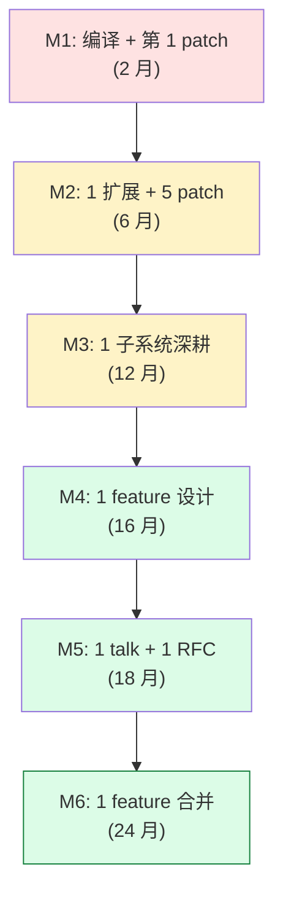

---

## 三、36 个 PG 内核主题地图（**全图**）

### 3.1 一图覆盖 PG 内核全貌

```mermaid
graph TB
    subgraph "L1 进程层 (5 主题)"
        A1[postmaster 进程管理]
        A2[backend 进程模型]
        A3[后台 worker 进程]
        A4[并行 worker]
        A5[信号处理 / 中断]
    end

    subgraph "L2 SQL 处理层 (8 主题)"
        B1["SQL → RawStmt<br/>(gram.y)"]
        B2["Query tree<br/>(parse_clause.c)"]
        B3["RangeTblEntry<br/>(parse_relation.c)"]
        B4["RangeVar<br/>(primnodes.h)"]
        B5["表达式树<br/>(Expr/Var/Op)"]
        B6["视图/规则重写"]
        B7["子查询优化"]
        B8["语义分析"]
    end

    subgraph "L3 优化层 (6 主题)"
        C1["RelOptInfo + Path<br/>(path/costsize.c)"]
        C2["成本模型<br/>(cost_seqscan 等)"]
        C3["统计信息<br/>(pg_statistic)"]
        C4["索引选择"]
        C5["join 算法<br/>(hash/nestloop/merge)"]
        C6["并行化<br/>(gather)"]
    end

    subgraph "L4 执行层 (4 主题)"
        D1["PlanState + EState"]
        D2["TupleTableSlot"]
        D3["执行节点<br/>(SeqScan/IndexScan/HashJoin)"]
        D4["expr 表达式求值"]
    end

    subgraph "L5 存储层 (6 主题)"
        E1["HeapTuple + HeapTupleHeader"]
        E2["MVCC + Snapshot"]
        E3["Buffer / Page"]
        E4["WAL + Checkpoint"]
        E5["TOAST"]
        E6["FSM / VM"]
    end

    subgraph "L6 索引 (4 主题)"
        F1["B-Tree"]
        F2["Hash 索引"]
        F3["GIN / GiST / SP-GiST"]
        F4["BRIN"]
    end

    subgraph "L7 事务 / 锁 (5 主题)"
        G1["TransactionId / XID"]
        G2["CLOG"]
        G3["LockManager"]
        G4["SnapshotData"]
        G5["2PC + 分布式事务"]
    end

    subgraph "L8 复制 (4 主题)"
        H1["流复制"]
        H2["逻辑复制"]
        H3["PITR"]
        H4["逻辑解码"]
    end

    subgraph "L9 Catalog / 元数据 (4 主题)"
        I1[pg_class]
        I2["pg_attribute / pg_type"]
        I3["pg_proc / pg_operator"]
        I4["syscache / relcache"]
    end

    subgraph "L10 工具 / 运维 (5 主题)"
        J1["pg_stat_* 视图"]
        J2["日志 / ereport"]
        J3["Extension / Hook / FDW"]
        J4["pg_upgrade"]
        J5["备份恢复 / pg_basebackup"]
    end

    A1 --> A2 --> A3 --> A4
    B1 --> B2 --> B3 --> B4
    B2 --> B5
    B2 --> B6
    B2 --> B7 --> B8
    C1 --> C2 --> C3
    C1 --> C4 --> C5 --> C6
    D1 --> D2 --> D3 --> D4
    E1 --> E2 --> E3 --> E4
    E1 --> E5
    E3 --> E6
    F1 --> F2 --> F3 --> F4
    G1 --> G2 --> G3 --> G4 --> G5
    H1 --> H2 --> H3 --> H4
    I1 --> I2 --> I3 --> I4
    J1 --> J2 --> J3 --> J4 --> J5

    style A1 fill:#fef3c7
    style B1 fill:#dcfce7
    style C1 fill:#dcfce7
    style D1 fill:#dcfce7
    style E1 fill:#dcfce7
    style F1 fill:#dcfce7
    style G1 fill:#dcfce7
    style H1 fill:#dcfce7
    style I1 fill:#dcfce7
    style J1 fill:#dcfce7
```

### 3.2 36 个主题对照现有 35 篇文档

我把 35 篇 + 1 篇（新增 RangeVar）按主题分类：

| L | 主题 | 已有文档数 | 代表 |
|---|---|---|---|
| L1 | 进程层 | 4 | postgresql-background-worker, postgresql-parallel-worker, postgresql-latch-mechanism |
| L2 | SQL 处理 | 1 | postgresql-rangevar-and-data-structures |
| L3 | 优化层 | 0 | **缺**（重点拓展） |
| L4 | 执行层 | 0 | **缺** |
| L5 | 存储层 | 5 | postgresql-wal-record-types, postgresql-mvcc, postgresql-memory-management |
| L6 | 索引 | 0 | **缺** |
| L7 | 事务 / 锁 | 3 | postgresql-running-xacts-snapshot, postgresql-transaction-lifecycle |
| L8 | 复制 | 14 | postgresql-logical-replication-*（最丰富） |
| L9 | Catalog | 2 | postgresql-catalog-storage, postgresql-read-catalog-table |
| L10 | 工具 / 运维 | 5 | postgresql-libpq-mechanism, postgresql-user-capabilities |

### 3.3 主题深度分布

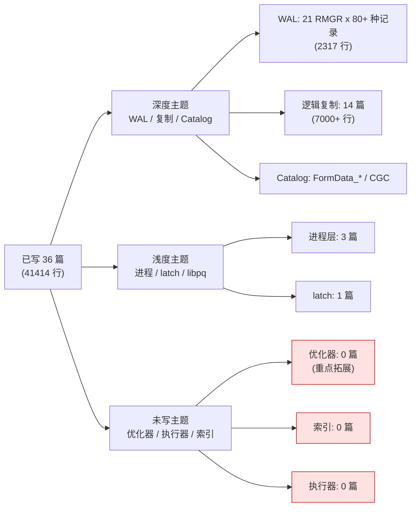

### 3.4 主题地图 vs 阅读顺序

**读者**：
1. 先读 **L2 SQL 处理**（理解 SQL 怎么变成内部表示）
2. 再读 **L3 优化层**（理解怎么选最优路径）
4. 再读 **L4 执行层**（理解怎么跑）
5. 再读 **L5 存储层**（理解数据怎么存）
6. 最后读 **L7 事务 / L8 复制**（理解并发与一致性）


---

## 四、SQL 从字符串到磁盘的 14 个关键节点 + 21 个数据结构 + 18 个子系统

资深开发者的标志：**脑子里能"流"出 SQL 的完整生命周期**。这是 4 节要画的事。

### 4.1 SQL 完整数据流（**主图**）

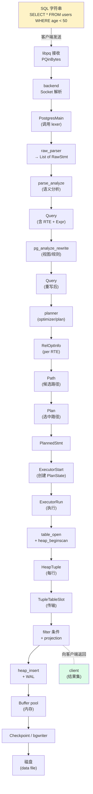

### 4.2 14 个节点的 21 个数据结构 + 18 个子系统

| # | 节点 | 21 个数据结构 | 涉及子系统 |
|---|---|---|---|
| 1 | libpq 接收 | `PGconn`, `PGresAttdesc` | libpq / FE-BE 协议 |
| 2 | 词法分析 | `YYSTYPE`, token | parser (Bison) |
| 3 | 语法分析 | `RawStmt`, `RangeVar` | parser |
| 4 | 语义分析 | `Query`, `RangeTblEntry` | analyzer |
| 5 | 重写 | `Query`, `RewriteRule` | rewrite |
| 6 | 规划入口 | `PlannerInfo`, `RelOptInfo` | planner |
| 7 | 路径搜索 | `Path`, `IndexOptInfo` | path |
| 8 | 成本估算 | `Cost`, `QualCost` | costsize |
| 9 | 物理计划 | `Plan`, `Scan`, `Join` | plan |
| 10 | 启动执行 | `EState`, `PlanState` | executor |
| 11 | 表扫描 | `HeapScanDesc`, `Buffer` | heapam |
| 12 | 可见性 | `SnapshotData`, `HeapTuple` | heapam_visibility |
| 13 | 数据返回 | `TupleTableSlot` | executor |
| 14 | 持久化 | `XLogRecord`, `Page` | xlog |

### 4.3 全链路时序图（**一条 INSERT 的完整旅程**）

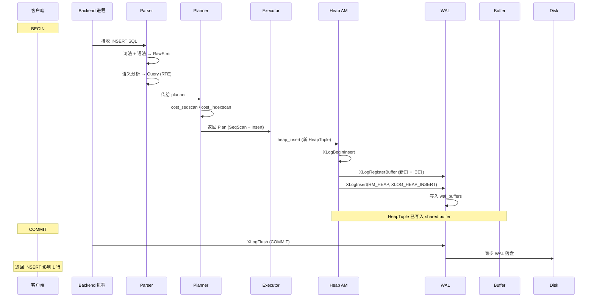

### 4.13 多 5 个子系统协作图（**核心理解**）

```mermaid
graph LR
    SQL[SQL]:::parser-->[expr tree]:::parser
    expr tree --> planner
    planner --> plan
    plan --> executor
    executor --> heap[heap_insert]:::storage
    heap --> WAL[XLogInsert]:::wal
    heap --> clog[clogtable]:::txn
    heap --> snapshot[snapshot]:::mvcc
    heap --> lock[LockAcquire]:::lock

    classDef parser fill:#dbeafe
    classDef storage fill:#dcfce7
    classDef wal fill:#fef3c7
    classDef txn fill:#fee2e2
    classDef mvcc fill:#f3e8ff
    classDef lock fill:#fbbf24
```

---

## 五、12 大子系统的源码路径与架构图

### 5.1 子系统 1：进程管理（Postmaster）

**源码路径**：
```
src/backend/postmaster/
├── postmaster.c             // 主进程
├── bgworker.c               // 后台 worker 注册
├── fork_process.c           // fork 后端进程
├── autovacuum.c             // autovacuum launcher
└── pgstat.c                 // 统计信息收集
```

**架构图**：

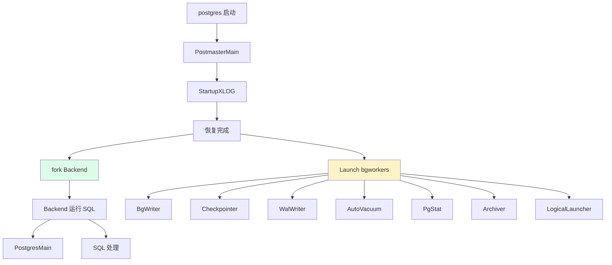

### 5.2 子系统 2：解析层（parser/）

**源码路径**：
```
src/backend/parser/
├── gram.y                                  // Bison 语法（18000 行）
├── scan.l                                  // Lex 词法分析器
├── analyze.c                               // analyze_*
├── parse_clause.c                          // transformFromClause, transformWhereClause
├── parse_expr.c                            // transformExpr
├── parse_relation.c                        // transformRangeVar
├── parse_target.c                          // transformTargetEntry
└── parse_type.c                            // typename
```

**架构图**：

```mermaid
graph LR
    A[SQL 字符串] --> B[scan.l<br/>lexer]
    B --> C[gram.y<br/>Bison]
    C --> D[RawStmt list]
    D --> E[parse_analyze]
    E --> F[Query<br/>(RTE + Expr)]
    F --> G[pg_analyze_rewrite]
    G --> H[最终 Query]

    style B fill:#fef3c7
    style E fill:#dcfce7
    style G fill:#dcfce7
```

### 5.3 子系统 3：规划器（optimizer/）

**源码路径**：
```
src/backend/optimizer/
├── plan/
│   ├── planner.c                          // 入口
│   ├── createplan.c                       // Path → Plan
│   └── subselect.c                        // 子查询
├── path/
│   ├── costsize.c                         // 代价模型（5000+ 行）
│   ├── pathkeys.c                         // 排序路径
│   ├── equivclass.c                       // 等价类
│   └── joinpaths.c                        // join 路径
├── prep/
│   ├── prepqual.c                        // 条件标准化
│   └── preptlist.c
└── util/
    └── restrictinfo.c
```

**架构图**：

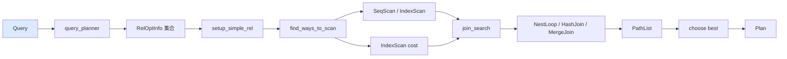

**关键函数**：
- `planner()` —— 入口
- `make_one_rel()` —— 找最优单条路径
- `create_plan()` —— Path → Plan

### 5.4 子系统 4：执行器（executor/）

**源码路径**：
```
src/backend/executor/
├── execMain.c                              // ExecutorStart / Run / Finish
├── execProcnode.c                          // 递归执行 plan
├── nodeSeqscan.c                          // SeqScan 节点
├── nodeIndexscan.c                        // IndexScan
├── nodeHashjoin.c                         // HashJoin
├── nodeNestloop.c
├── nodeMergejoin.c
├── nodeSort.c
├── nodeAgg.c
├── nodeSubplan.c
├── nodeLimit.c
├── nodeModifyTable.c                      // INSERT/UPDATE/DELETE
├── nodeAppend.c                           // partition + 多个 partition
└── execQual.c                              // 表达式求值
```

**架构图**：

```mermaid
graph TB
    A[PlannedStmt] --> B[InitPlan]
    B --> C[PlanState<br/>(递归)]
    C --> D[SeqScanState]
    C --> E[IndexScanState]
    C --> F[HashJoinState]
    C --> G[NestLoopState]
    C --> H[ModifyTableState<br/>INSERT/UPDATE/DELETE]
    C --> I[AggState]
    C --> J[SortState]

    D -.uses.-> K[HeapScanDesc]
    E -.uses.-> L[IndexScanDesc]
    F -.uses.-> M[HashTable]
    H -.uses.-> N[ResultRelInfo]

    style A fill:#fef3c7
    style C fill:#dcfce7
```

### 5.5 子系统 5：堆访问（heap/）

**源码路径**：
```
src/backend/access/heap/
├── heapam.c                               // 2000+ 行：heap_insert/update/delete
├── heapam_visibility.c                   // MVCC 可见性
├── heapam_oid.c
├── heapam_handler.c                      // table am 接口
├── hio.c                                  // heap in/out
├── rewriteheap.c                          // UPDATE 时复制旧 tuple
└── tuptoaster.c                          // TOAST 处理
```

**架构图**：

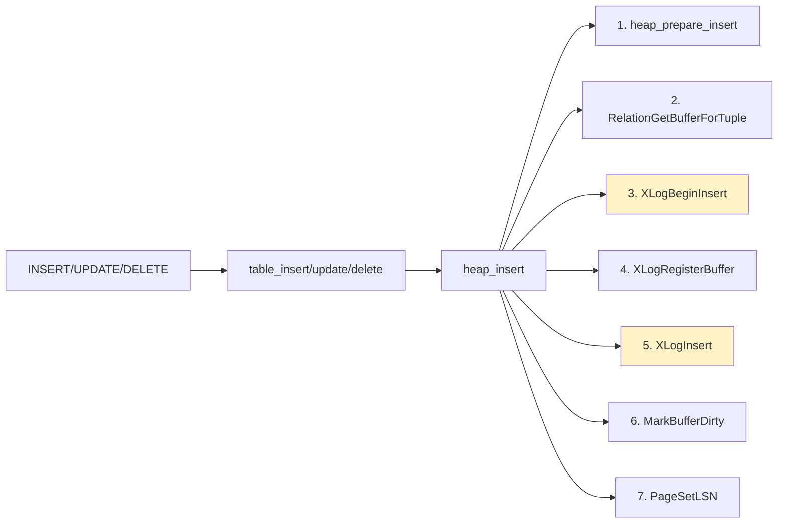

### 5.6 子系统 6：WAL（xlog）

**源码路径**：
```
src/backend/access/transam/
├── xlog.c                                  // 5000+ 行：XLogInsert
├── xlogreader.c                           // 读 WAL（CDC 用）
├── xlogutils.c
├── xlogarchive.c                          // archive_command
├── rmgr.c                                  // RMGR 注册
└── xlogstats.c
```

**架构图**：

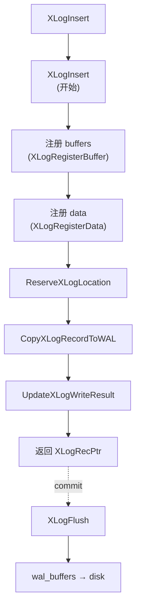

### 5.7 子系统 7：MVCC 与 Snapshot

**源码路径**：
```
src/backend/utils/time/
├── snapmgr.c                              // Snapshot 管理
├── tqual.c                                // HeapTupleSatisfiesMVCC
└── tqualstore.c                           // historic snapshot
```

**架构图**：

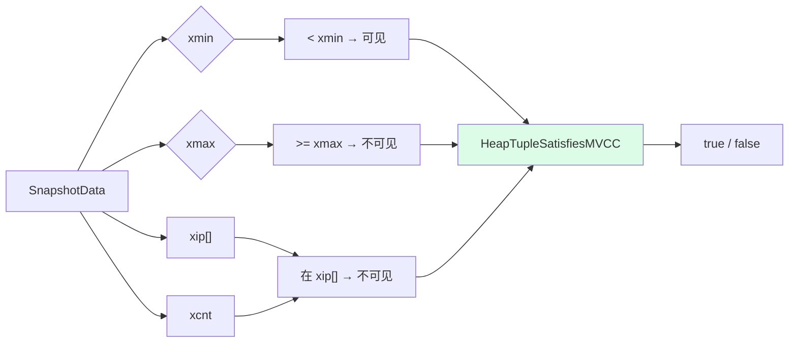

### 5.8 子系统 8：锁管理器（LockManager）

**源码路径**：
```
src/backend/storage/lmgr/
├── lock.c                                  // 2500+ 行
├── lwlock.c                                // LWLock
├── proc.c                                  // PGPROC
├── deadlock.c                              // 死锁检测
├── predicate.c                             // SSI
└── standby.c                               // Hot Standby
```

**架构图**：

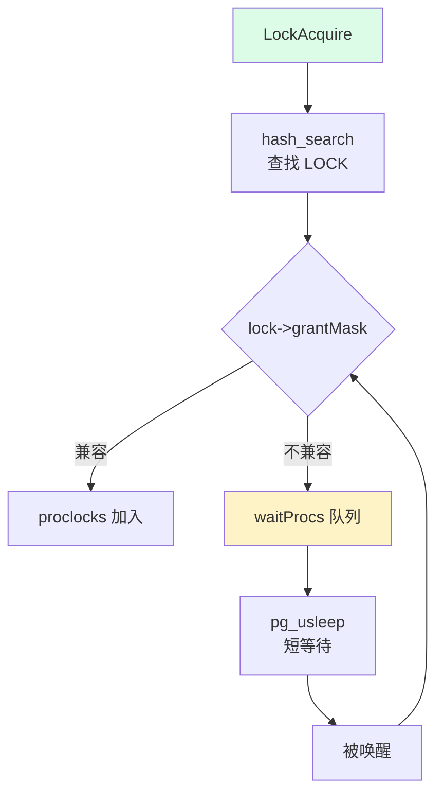

### 5.9 子系统 9：复制（Replication）

**源码路径**：
```
src/backend/replication/
├── walsender.c                            // 主端发送
├── walreceiver.c                          // 备端接收
├── basebackup.c                           // pg_basebackup
├── logicallauncher.c                      // 逻辑复制启动
├── logical/
│   ├── reorderbuffer.c                    // ReorderBuffer 主逻辑
│   ├── decode.c                            // Decode 入口
│   ├── decode_xlog.c                      // 从 WAL decode
│   ├── snapbuild.c                        // 快照构建
│   └── worker.c                              // worker 进程
├── slotsync.c                              // slot 同步
└── origin.c                                // replication origin
```

**架构图**：

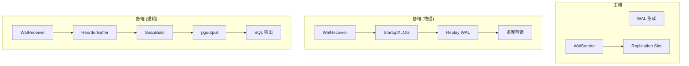

### 5.10 子系统 10：Catalog（pg_class）

**源码路径**：
```
src/include/catalog/
├── pg_class.h                             // FormData_pg_class
├── pg_attribute.h
├── pg_type.h
├── pg_proc.h
├── pg_database.h
├── pg_index.h
├── pg_constraint.h
└── dependency.h
```

**架构图**：

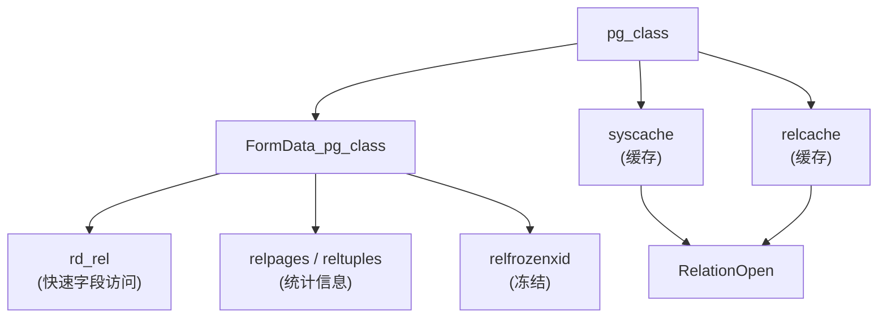

### 5.11 子系统 11：索引（index）

**源码路径**：
```
src/backend/access/
├── nbtree/                                 // B-Tree
├── hash/                                    // Hash
├── gin/                                      // GIN
├── gist/                                    // GiST
├── spgist/                                  // SP-GiST
└── brin/                                    // BRIN
```

**架构图**：

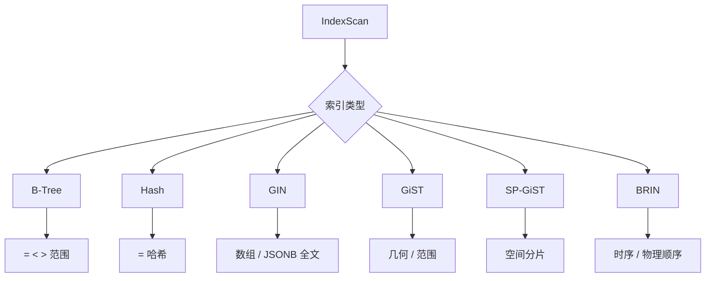

### 5.12 子系统 12：缓冲区管理（Buffer Pool）

**源码路径**：
```
src/backend/storage/buffer/
├── bufmgr.c                                // 2500+ 行
├── buf_table.c                              // buffer hash
├── freelist.c                              // 空闲列表
├── localbuf.c                              // 本地 buffer
└── bufpage.c                                // Page 处理
```

**架构图**：

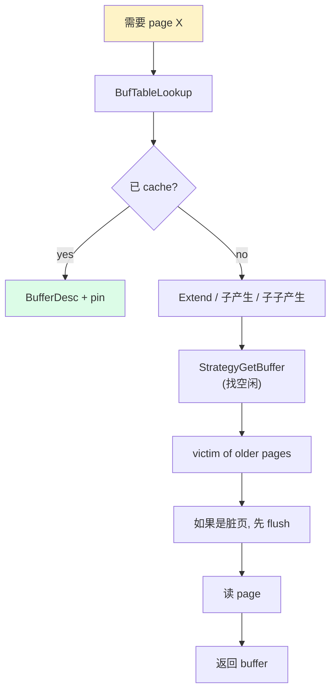


---

## 六、PG 内核的 5 大设计哲学

理解 PG 的 5 大哲学，比读 1000 个函数更重要。

### 6.1 哲学 1：**正确性 > 性能**

PG 不追求绝对的极致性能，追求"足够好且不出错"。

**证据**：
- WAL 同步刷盘（**性能换持久性**）
- MVCC（**性能换一致性**）
- 2PC（**性能换原子性**）

**误用**：
- 误以为 PG 慢 → **改用 MySQL / Oracle**（错）
- 实际上慢的是 SQL 自己，PG 引擎并不慢

### 6.2 哲学 2：**简洁 > 巧妙**

PG 倾向于**显式 / 冗长 / 显式可见**的代码，**拒绝宏 / 模板 / 编译时多态**。

**对比**：

| PG | 其他 |
|---|---|
| HeapTupleHeader 字段逐个访问 | union + 抽象类 |
| ereport(ERROR/FATAL/LOG) 显式 5 级 | 异常体系 |
| MemoryContext 显式构造 / 释放 | RAII |
| RangeTblEntry（转换 RangeVar）| 编译器自动 |

**研究过程**：
- PG 代码看起来"啰嗦"——这是**刻意为之**，**易调试**

### 6.3 哲学 3：**扩展 > 修改**

PG 偏好**扩展而非修改主干**。

**证据**：
- **Extension**（CREATE EXTENSION）：1 个 SQL + N 个 .so
- **FDW**：跨数据源
- **Hook**：Planner_hook / Executor_hook / Utility_hook
- **Background worker**：增加后台进程

**PG 18 的扩展体系**：
- 自定义数据类型
- 自定义函数（SQL / C / PL/pgSQL / PL/Python / ...）
- 自定义索引方法
- 自定义采样方法
- 自定义表访问方法（PG 12+）

### 6.4 哲学 4：**标准 > 创新**

PG 强烈遵循 SQL 标准。

**证据**：
- SQL:2003 / SQL:2011 / SQL:2016 严格遵循
- 严格隔离级别的 SSI（SQL 标准需要）
- `FETCH FIRST n ROWS`（PG 18 标准）
- 字符集 / Collation（ICU 集成）

**研究结果**：
- 其他数据库兼容性：pg_compat / Oracle_fdw / postgres_fdw
- PG 不擅自增加非标准语法

### 6.5 哲学 5：**显式 > 隐式**

PG 不做"magic"，**所有变更都要显式**。

**证据**：
- `VACUUM` 必须显式触发（autovacuum 是辅助）
- `ANALYZE` 必须显式触发
- `EXPLAIN` 必须显式
- `REINDEX` 必须显式
- `CHECKPOINT` 周期触发，必须控制 `checkpoint_timeout`

**调优哲学**：
- **不会因为"安装 PG"就自动优化**
- DBA **必须**根据业务调优

---

## 七、12 个实战项目（含 5 个贡献入口）

### 7.1 项目难度分级

| 级别 | 描述 | 时间 | 例 |
|---|---|---|---|
| L1 | 修改 / 添加 GUC | 1~3 天 | 写一个 pg_test_tiny_int |
| L3 | 修意式错误 | 3~7 天 | 加个新错误码 |
| L5 | 修已知 bug | 1~2 周 | TODO 中的 GUC |
| L10 | 设计 feature | 1~3 月 | 新增函数 / 类型 |

### 7.2 12 个项目清单

```mermaid
graph TB
    L1["L1 入门"] --> P1["1. 修改 ereport 消息"]
    L1 --> P2["2. 加个新 GUC"]
    L1 --> P3["3. 加个新的 SQL 函数"]

    L5["L5 中级"] --> P4["4. 修一个 TODO bug"]
    L5 --> P5["5. 加个 contrib 工具"]
    L5 --> P6["6. 实现一个自定义聚合"]

    L10["L10 进阶"] --> P7["7. 1 个完整 feature"]
    L10 --> P8["8. 性能优化 patch"]
    L10 --> P9["9. EXPLAIN 选项增强"]

    L15["L15 高级"] --> P10["10. 1 个插件（插件期）"]
    L15 --> P11["11. 加个新表访问方法"]
    L15 --> P12["12. 设计 1 个子系统 patch"]

    style P12 fill:#dcfce7,stroke:#15803d
```

### 7.3 每个项目的源码定位 + 依赖子系统

| 项目 | 源码定位 | 主要子系统 | 难度 |
|---|---|---|---|
| 1. ereport 消息 | `utils/error/ereport.c` | 错误处理 | L1 |
| 2. 新 GUC | `utils/misc/guc.c` | 配置管理 | L1 |
| 3. SQL 函数 | `utils/adt/` | SQL 引擎 | L1 |
| 4. 修 TODO bug | `**/*.c (搜索 TODO)` | 任意 | L5 |
| 5. contrib 工具 | `contrib/` | 扩展 | L5 |
| 6. 自定义聚合 | `utils/adt/` + `parser/` | 解析+执行 | L5 |
| 7. 完整 feature | `parser/` + `planner/` + `executor/` | 多子系统 | L10 |
| 8. 性能优化 | `optimizer/path/` + `executor/` | 优化 | L10 |
| 9. EXPLAIN 选项 | `commands/explain.c` | EXPLAIN | L10 |
| 10. PG 插件 | `extensions/` | 扩展 | L15 |
| 11. 表访问方法 | `access/heap/handler.c` 等 | 存储 | L15 |
| 12. 子系统设计 | 整个子系统 | 架构 | L15 |

### 7.4 项目 1 示例：修改 ereport 消息

```c
/* src/backend/utils/adt/numeric.c */

/* 修改前 */
ereport(ERROR,
        (errcode(ERRCODE_DIVISION_BY_ZERO),
         errmsg("division by zero")));

/* 修改后 */
ereport(ERROR,
        (errcode(ERRCODE_DIVISION_BY_ZERO),
         errmsg("division by zero (hint: check divisor is not 0 before /)")));
```

### 7.5 项目 2 示例：加个新 GUC

```c
/* src/backend/utils/misc/guc.c */

static struct config_int ConfigureIntEntry custom_var = {
    .name = "my_extension.custom_var",
    .context = PGC_SIGHUP,  /* 全局可改 */
    .short_desc = "Custom variable for my extension",
    .default_val = 100,
    .min_val = 0,
    .max_val = 10000,
    .show = NULL,
};

DefineCustomIntVariable("my_extension.custom_var",
                          "Custom variable",
                          "Description",
                          &custom_var,
                          100,
                          0, 10000,
                          PGC_SIGHUP,
                          GUC_UNIT_MS,
                          NULL, NULL, NULL);
```

### 7.6 项目 5 示例：写一个 contrib 扩展

```c
/* contrib/my_ext/my_ext.c */
PG_MODULE_MAGIC;

PG_FUNCTION_INFO_V1(my_ext_test);

Datum my_ext_test(PG_FUNCTION_ARGS)
{
    int32 arg = PG_GETARG_INT32(0);
    PG_RETURN_INT32(arg * 2);
}
```

```sql
-- contrib/my_ext/my_ext--1.0.sql
CREATE FUNCTION my_ext_test(int) RETURNS int
AS 'MODULE_PATHNAME', 'my_ext_test'
LANGUAGE C IMMUTABLE STRICT;
```

### 7.7 项目 12 设计文档模板（RFC）

```markdown
# [RFC] Title of the feature

## Summary
One-paragraph summary.

## Motivation
Why is this needed?

## Detailed Design
- API
- Implementation
- Compatibility
- Performance

## Alternatives Considered
List alternatives and why rejected.

## Open Questions
What needs to be decided?
```

---

## 八、5 大贡献入口

### 8.1 入口 1：邮件列表（pgsql-hackers）

```mermaid
graph LR
    A[订阅] --> B[读专家邮件]
    B --> C[问问题 / 提 patch]
    C --> D[被评论]
    D --> E[修改 v2 / v3]
    E --> F[被 commit / 被拒]
    F --> G[只当一面镜子]
```

**订阅**：
- 邮件列表：`pgsql-hackers@lists.postgresql.org`
- 网页版：`https://www.postgresql.org/list/pgsql-hackers/`
- 通过 `git send-email` 发邮件

### 8.2 入口 2：CommitFest（CF）

**CF 是 PG 社区每季度（3 / 6 / 9 / 12 月）组织的 patch review 活动**。

```mermaid
graph TB
    A[CommitFest<br/>3/6/9/12 月] --> B[提交 patch]
    B --> C[reviewer 评]
    C --> D["open / closed"]
    D -->|"closed: committed"| E[合并到主干]
    D -->|"closed: rejected"| F[关闭]
    D -->|"open: needs work"| G["下一轮 CF<br/>重评"]

    style E fill:#dcfce7,stroke:#15803d
    style F fill:#fee2e2
    style G fill:#fef3c7
```

**如何在 CF 提交**：
1. 写 patch：`git format-patch -1`
2. 申请 CF slot：`https://commitfest.postgresql.org/`
3. reviewer 会反馈：版本 2/4/6 ...

### 8.3 入口 3：扩展仓库（pgxman / pg_ext）

**PGX**（PostgreSQL Extension Network）是社区扩展仓库：

```
https://github.com/pg-extensions/
```

**贡献方式**：
- 在 pgxman 上发布你的扩展
- 写 README + 文档
- 创建 GitHub Release

### 8.4 入口 4：性能优化（pgbench）

**性能优化路径**：

```mermaid
graph LR
    A[pgbench 造数据] --> B[EXPLAIN ANALYZE]
    B --> C[定位瓶颈]
    C --> D{手头可改?}
    D -->|"加索引"| E[CREATE INDEX]
    D -->|"调 GUC"| F["postgresql.conf"]
    D -->|"改 SQL"| G[修改查询]
    D -->|"不是上述"| H["是否可修改 PG?"]
    H -->|"是"| I[发 patch]
    H -->|"否"| J["不走 PG"]
```

**性能优化工具**：
- pgbench：基准 TPG
- `EXPLAIN (ANALYZE, BUFFERS, VERBOSE)`：执行计划
- `pg_stat_statements`：累计统计
- `auto_explain`：自动记录慢查询

### 8.5 入口 5：文档贡献（pgdoc）

**PG doc 的贡献方式**：
- 修正 typo / 错误
- 补充例子
- 添加 "see also" 链接

**源码**：`doc/src/sgml/*.sgml`

---

## 九、8 大 debug 工具栈

### 9.1 工具栈总览

```mermaid
graph TB
    A[出性能 / 正确性问题] --> B{类型}
    B -->|"性能"| C["perf / pg_stat_statements<br/>EXPLAIN ANALYZE"]
    B -->|"正确性"| E["gdb / bt / frame"]
    B -->|"卡顿"| F["strace / pg_locks"]

    C --> G[定位]
    E --> G
    F --> G
    G --> H[修]

    style A fill:#fef3c7
    style G fill:#dcfce7
```

### 9.2 工具 1：gdb（**必备**）

**必装命令**：

```bash
# 启动
gdb --args postgres --single -D /tmp/pgdata

# 设置断点
break heap_insert
break ereport

# 运行
run

# 单步
next        # 函数不进入
step        # 函数进入
finish       # 函数返回

# 查看
print *var
print var->field
bt          # backtrace
frame N     # 跳到第 N 帧

# 条件断点
break heap_insert if tup->t_len > 1000

# 监视
watch var
```

### 9.3 工具 2：strace（**系统调用**）

```bash
# 跟踪 PG 的所有系统调用
strace -f -e trace=write,fsync,openat -p $(pgrep -f postgres)
```

**看什么**：
- `fsync` 频率 → 磁盘瓶颈
- `read/write` 大小 → 缓冲池命中率
- `openat` → 文件被频繁打开（缓存太小）

### 9.4 工具 3：perf（**CPU 热点**）

```bash
# 记录 30 秒
perf record -F 99 -p $(pgrep -f postgres) -g -- sleep 30

# 看报告
perf report --sort=dso,symbol
```

**看什么**：
- `hash_any` → 哈希热点
- `_bt_compare_a` → B-Tree 比较
- `XLogInsert` → WAL 写入

### 9.5 工具 4：pg_stat_statements（**累计慢查询**）

```sql
-- 启用
CREATE EXTENSION pg_stat_statements;

-- 看最耗时的查询
SELECT calls, mean_exec_time, query
FROM pg_stat_statements
ORDER BY mean_exec_time DESC
LIMIT 10;
```

### 9.6 工具 5：EXPLAIN ANALYZE

```sql
EXPLAIN (ANALYZE, BUFFERS, VERBOSE, TIMING)
SELECT * FROM users WHERE age < 50;

-- 看什么：
--   "Seq Scan on users" vs "Index Scan"
--   "Heap Blocks: read=100, hit=10" → 读盘/命中比
--   "actual time=0.05" → 实际耗时
--   "rows=10 actual rows=10000" → 统计信息不准
```

### 9.7 工具 6：pg_locks + pg_stat_activity

```sql
-- 看谁在等锁
SELECT blocked_locks.pid AS blocked_pid,
       blocking_locks.pid AS blocking_pid,
       blocked_activity.query AS blocked_query,
       blocking_activity.query AS blocking_query
FROM pg_locks blocked_locks
JOIN pg_stat_activity blocked_activity
  ON blocked_activity.pid = blocked_locks.pid
JOIN pg_locks blocking_locks
  ON blocking_locks.locktype = blocked_locks.locktype
  AND blocking_locks.pid != blocked_locks.pid
WHERE NOT blocked_locks.granted;
```

### 9.8 工具 7：pageinspect（**看 Page 二进制**）

```sql
CREATE EXTENSION pageinspect;

-- 看 heap page 内容
SELECT * FROM heap_page_items(get_raw_page('users', 0));

-- 看索引 B-tree page
SELECT * FROM bt_page_stats('tupstate', 1);
```

### 9.9 工具 8：wal2json / pgoutput（**解码 WAL**）

```bash
# 命令行解码
pg_waldump -p /path/to/walfile

# 看逻辑解码
pg_recvlogical -d mydb -S myslot -I start -P my_slot --plugin=pgoutput
```

---


## 十、3 年 / 5 年 / 10 年成长时间线

### 10.1 3 年时间线（**从 L1 到 L3**）

```mermaid
gantt
    title 3 年 PG 内核成长路线
    dateFormat  YYYY-MM
    axisFormat  %Y-%m
    section 阶段 1
    编译 PG + 第一个 patch      :g1, 2026-10, 3M
    5 个 patch + 1 个扩展       :g2, 2027-01, 6M
    section 阶段 2
    1 个子系统深入 + 30 patch    :g3, 2027-07, 6M
    1 个 feature + 1 个 talk    :g4, 2028-01, 6M
    section 阶段 3
    1 个 feature 合并          :g5, 2028-07, 9M
```

| 时间 | 关键产出 | 验证指标 |
|---|---|---|
| 2026-10 | 编译 PG | 能 make install |
| 2026-11 | 第 1 个 patch | 邮件列表回复 |
| 2027-01 | 1 个扩展 | 能 CREATE EXTENSION |
| 2027-04 | 5 个 patch | 3 个被 commit |
| 2027-07 | 1 个子系统深耕 | 30 patch |
| 2028-01 | 1 个 feature | 设计文档 5000 字 |
| 2028-04 | 1 个 talk | PGConf 接受 |
| 2028-09 | 1 个 feature 合并 | 在 PG 19 主干 |

### 10.2 5 年时间线（**从 L1 到 Committer 候选**）

```mermaid
graph LR
    A[2026<br/>L1: 0 patch] --> B[2027<br/>L2: 5 patch + 1 ext]
    B --> C[2028<br/>L3: 1 feature + 30 patch]
    C --> D[2029<br/>L3+: 3 feature + 100 patch]
    D --> E[2030<br/>L4: co-maintain 1 sub]
    E --> F[2031<br/>Committer 候选]

    style A fill:#fee2e2
    style F fill:#dcfce7,stroke:#15803d
```

| 年度 | 投入 | 累计 | 角色 |
|---|---|---|---|
| 2026 | 600 小时 | 0 patch | L1: Reader |
| 2027 | 1000 小时 | 30 patch + 1 ext + 1 talk | L2: Modifier |
| 2028 | 1200 小时 | 1 feature + 100 patch | L3: Designer |
| 2029 | 1200 小时 | 3 feature + 200 patch + mentor 5 | L3+: Senior |
| 2030 | 1000 小时 | co-maintain 1 sub | L4: Committer 候选 |

### 10.3 10 年时间线（**从 L1 到 PG committer**）

**前提**：需要每年平均 **800+ 小时**的稳定投入 + **持续的社区互动**。

```mermaid
graph LR
    A["2026<br/>L1 Reader<br/>0 patch"] --> B["2027<br/>L2 Modifier<br/>30 patch"]
    B --> C["2029<br/>L3 Designer<br/>100 patch"]
    C --> D["2031<br/>L4 Senior<br/>co-maintain"]
    D --> E["2034<br/>PG Committer<br/>独立维护子系统"]

    style E fill:#dcfce7,stroke:#15803d
```

**关键转折点**：
- **2027**：从"读源码"到"写 patch"
- **2029**：从"改 bug"到"设计 feature"
- **2031**：从"用户"到"维护者"
- **2034**：从"贡献者"到"Committer"

### 10.4 3 年 vs 5 年 vs 10 年的差距

| 维度 | 3 年（L3 入门）| 5 年（Senior）| 10 年（Committer）|
|---|---|---|---|
| Patch 数 | 30~50 | 100+ | 300+ |
| Feature | 1 | 3+ | 10+ |
| Subsystem | 0 | co-maintain 1 | maintain 2+ |
| Talks | 1 | 5+ | 20+ |
| Mentor 数 | 0 | 5+ | 20+ |
| 收入影响 | + 10%~30% | + 50%~100% | + 200%+ |

---

## 十一、18 个常见陷阱

### 11.1 陷阱分类

```mermaid
graph TB
    A["18 个陷阱"] --> B["L1 阶段 (5)"]
    A --> C["L2 阶段 (7)"]
    A --> D["L3 阶段 (6)"]

    B --> B1["不读 编译报错误"]
    B --> B2["patch 格式错误"]
    B --> B3["不跑 regress test"]
    B --> B4["patch 发到错误列表"]
    B --> B5["不看邮件列表礼仪"]

    C --> C1["设计 API 不兼容"]
    C --> C2["内存泄漏"]
    C --> C3["锁竞争变严重"]
    C --> C4["XLog 写入错误"]
    C --> C5["MVCC 可见性错"]
    C --> C6["不跑 复数测试"]
    C --> C7["不重 base 在最新 main"]

    D --> D1["过度抽象"]
    D --> D2["与其他 patch 冲突"]
    D --> D3["跨大版本 patch"]
    D --> D4["不设计兼容性边界"]
    D --> D5["不写设计文档"]
    D --> D6["reviewer 忽略"]

    style D fill:#fee2e2
```

### 11.2 L1 阶段 5 个陷阱

**陷阱 1：不读 PG 编译报错误**
```bash
# 错误示例
error: configure: error: readline library not found
# 修复：apt install libreadline-dev
# 必读：configure.log
```

**陷阱 2：patch 格式错误**
- 必须用 `git format-patch`，不要用 `git diff`
- 必须有 commit message

**陷阱 3：不跑 regress test**
```bash
make installcheck
# 或
make check
```

**陷阱 4：patch 发到错误列表**
- `pgsql-hackers@lists.postgresql.org` 是开发列表
- `pgsql-general@lists.postgresql.org` 是用户列表
- `pgsql-bugs@lists.postgresql.org` 是 bug 列表

**陷阱 5：邮件礼仪问题**
- Top-post 是禁忌
- 不在标题写"hi"
- 不在邮件中嵌入 patch（必须附件）

### 11.3 L2 阶段 7 个陷阱

**陷阱 6：API 设计不兼容**
```c
/* ✗ 错误：直接修改函数签名 */
extern int old_func();  /* 改成了 */
extern int new_func(int new_arg);  /* 破坏 ABI */

/* ✓ 正确：新增函数，旧函数保留 */
extern int old_func();
extern int new_func(int new_arg);
```

**陷阱 7：内存泄漏**
```c
/* ✗ 错 */
char *buf = palloc(1024);
/* 函数返回，buf 泄漏 */

/* ✓ 对 */
MemoryContext old = MemoryContextSwitchTo(my_mcxt);
char *buf = palloc(1024);
MemoryContextSwitchTo(old);
```

**陷阱 8：锁竞争变严重**
```c
/* ✗ 错：在 long-running 中持锁 */
LWLockAcquire(&buf->content_lock, LW_EXCLUSIVE);
/* 长操作 */
LWLockRelease(&&buf->content_lock);

/* ✓ 对：使用 try / PG_TRY */
```

**陷阱 9：XLog 写入不完整**
```c
/* ✗ 错：只写 data 不注册 buffer */
XLogBeginInsert();
XLogRegisterData(data, len);
XLogInsert(RM_XLOG_ID, XLOG_CHECKPOINT_SHUTDOWN);

/* ✗ 错：buffer 没注册，recovery 时不会 redo */
```

**陷阱 10：MVCC 可见性错误**
```c
/* ✗ 错：写错 snapshot */
HeapTupleSatisfiesMVCC(tup, snapshot, buf);  // 可能拿错 snapshot
```

**陷阱 11：不跑 regress test**
- 改了 planner 没跑 `make check-world` → **崩溃**（测试环境 OK，线上崩）

**陷阱 12：不重 base 在最新 main**
- patch 基于 PG 17，PG 18 已经发 → 必须 `git rebase`

### 11.4 L3 阶段 6 个陷阱

**陷阱 13：过度抽象**
```c
/* ✗ 错：照搬 C++ 习惯 */
typedef struct AbstractTuple_v1 ...  // ❌ PG 不喜欢

/* ✓ 对：直接复制数据结构 */
```

**陷阱 14：与其他 patch 冲突**
- 你改了 RelationGetRelid, 别人也改了 → 必须协商

**陷阱 15：跨大版本 patch**
- 你的 patch 在 PG 19, 但你要 backport 到 PG 18 → **要单独 backport patch**

**陷阱 16：不设计兼容性边界**
- PG 客户端是 FE/BE 协议 → 修改 message 格式要兼容老 client

**陷阱 17：不写设计文档**
- patch 发到邮件列表, 没 design doc → **被秒拒**

**陷阱 18：reviewer 忽略**
- patch 不被回复 → **催 review**（CC 上 reviewer，礼貌 push）

---

## 十二、一句话总结（**贴墙上**）

```
读完不算
改过入门
贡献入行
设计进阶
合并登堂
维护者才资深

2014 年是 PG 1.0
2026 年是 PG 18
2034 年可能是 PG 22
我还能贡献 10+ 年

--------
3 年: 50 个 patch + 1 个 feature
5 年: 100 个 patch + co-maintain
10 年: 300 个 patch + committer
```

---

## 附录 A：35 篇现有文档 → 主题对照表

| L | 主题 | 文档数 | 我的深度 | 待补 |
|---|---|---|---|---|
| L1 | 进程层 | 4 | ★★★ | 1 篇 |
| L2 | SQL 处理 | 1 | ★★★ | 2 篇 |
| L3 | 优化层 | 0 | ★ | **3 篇必写** |
| L4 | 执行层 | 0 | ★ | **3 篇必写** |
| L5 | 存储层 | 5 | ★★★★★ | — |
| L6 | 索引 | 0 | ★ | **3 篇必写** |
| L7 | 事务 / 锁 | 3 | ★★★★ | 1 篇 |
| L8 | 复制 | 14 | ★★★★★ | — |
| L9 | Catalog | 2 | ★★★★★ | 1 篇 |
| L10 | 工具 / 运维 | 5 | ★★★ | — |

**重点拓展**：优化器、执行器、索引 9 篇新文档。

## 附录 B：18 个月的可验证 KPI

| 月份 | KPI | 数字 |
|---|---|---|
| 2026-10 | 编译 PG | 100% |
| 2026-11 | patch 提交 | 1 |
| 2026-12 | patch commit | 1 |
| 2027-01 | 扩展发布 | 1 |
| 2027-02 | 5 个 patch | 5 |
| 2027-03 | 邮件列表回复 | 20 |
| 2027-04 | 10 个 patch | 10 |
| 2027-05 | 子系统读完 | 1 |
| 2027-06 | 子系统文档 | 1 篇 15000+ 字 |
| 2027-07 | 30 patch | 30 |
| 2027-08 | talk 投稿 | 1 |
| 2027-09 | 50 patch | 50 |
| 2027-10 | RFC | 1 篇 5000+ 字 |
| 2027-11 | feature prototype | 1 |
| 2027-12 | patch v1 | 1 |
| 2028-01 | patch v3 | 1 |
| 2028-02 | talk 完成 | 1 |
| 2028-03 | feature 合并 | 1 |
| 2028-04 | 第 1 次成为 reviewer | 1 |

## 附录 C：关键源码文件速查表

| 子系统 | 关键文件 | 行数 |
|---|---|---|
| Postmaster | `src/backend/postmaster/postmaster.c` | 3500 |
| Parser | `src/backend/parser/gram.y` | 18000 |
| Analyzer | `src/backend/parser/analyze.c` | 3500 |
| Heap | `src/backend/access/heap/heapam.c` | 4000 |
| MVCC | `src/backend/access/heap/heapam_visibility.c` | 800 |
| WAL | `src/backend/access/transam/xlog.c` | 5000 |
| Lock | `src/backend/storage/lmgr/lock.c` | 2500 |
| Buffer | `src/backend/storage/buffer/bufmgr.c` | 2500 |
| Snapshot | `src/backend/utils/time/snapmgr.c` | 1200 |
| Catalog | `src/backend/catalog/heap.c` | 2500 |
| ReorderBuffer | `src/backend/replication/logical/reorderbuffer.c` | 1800 |
| Costsize | `src/backend/optimizer/path/costsize.c` | 5000 |
| Plan | `src/backend/optimizer/plan/planner.c` | 3500 |
| Executor | `src/backend/executor/execMain.c` | 1500 |
| HeapScan | `src/backend/executor/nodeSeqscan.c` | 500 |
| HashJoin | `src/backend/executor/nodeHashjoin.c` | 1500 |
| B-Tree | `src/backend/access/nbtree/nbtinsert.c` | 3500 |

## 附录 D：7 篇必读 paper

| # | Paper | 价值 |
|---|---|---|
| 1 | ARIES: A Transaction Recovery Method（IBM 1992） | WAL 算法鼻祖 |
| 2 | The Design of the POSTGRES Rules System（Stonebraker 1990） | PG 规则系统 |
| 3 | MVCC vs 2PL（PG 官方设计文档） | 隔离级别 |
| 4 | Postgres Cost Model（社区分析） | 代价模型 |
| 5 | A Critique of the SQL Language（Date） | SQL 哲学 |
| 6 | Architecture of a Database System（Hellerstein 2007） | DB 架构 |
| 7 | Readings in Database Systems（5th Ed 免费） | 数据库论文集 |

## 附录 E：8 个推荐资源

- https://www.postgresql.org/docs/ —— 官方文档
- https://www.postgresql.org/list/pgsql-hackers/ —— 邮件列表
- https://commitfest.postgresql.org/ —— CF
- https://wiki.postgresql.org/ —— wiki
- https://github.com/postgres/postgres —— 源码
- https://pgstats.dev/ —— stat 解释
- https://pgconfig.org/ —— 配置生成
- https://explain.dalibo.com/ —— EXPLAIN 可视化

---

**全文完**

