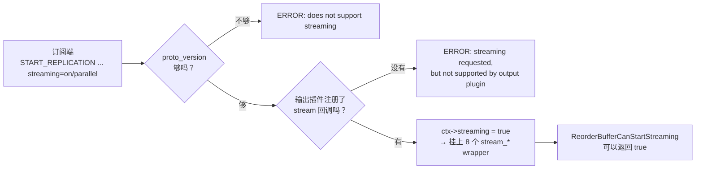
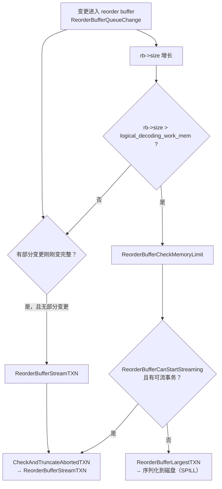
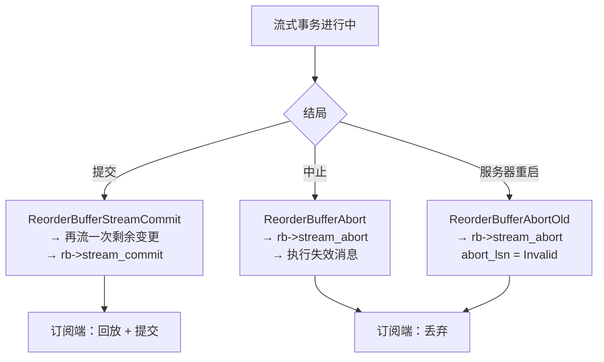
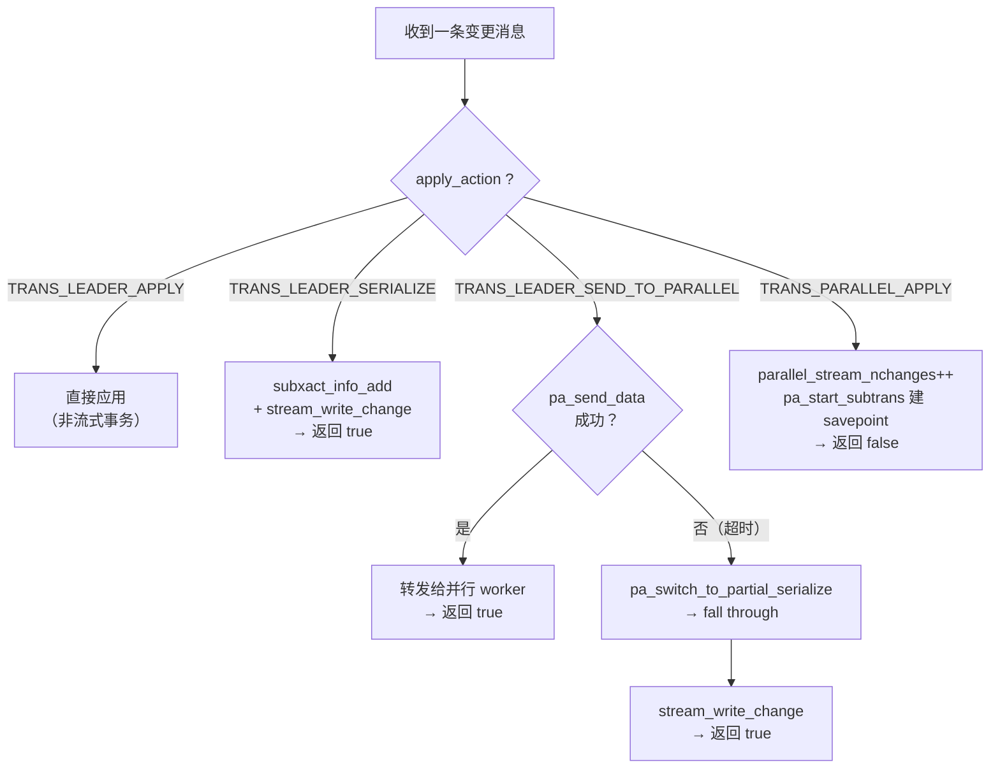
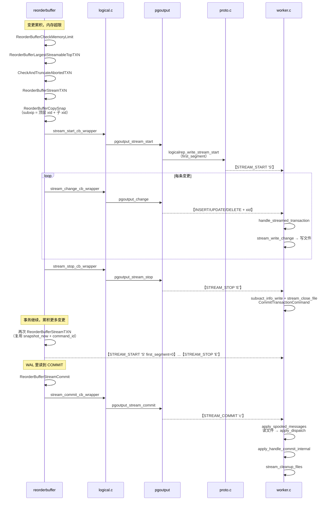
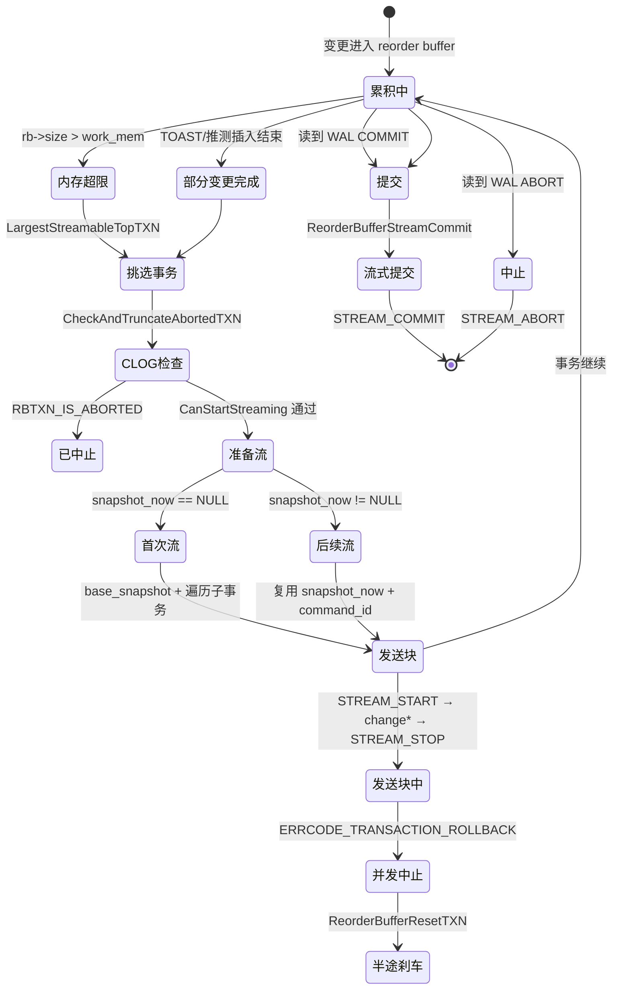
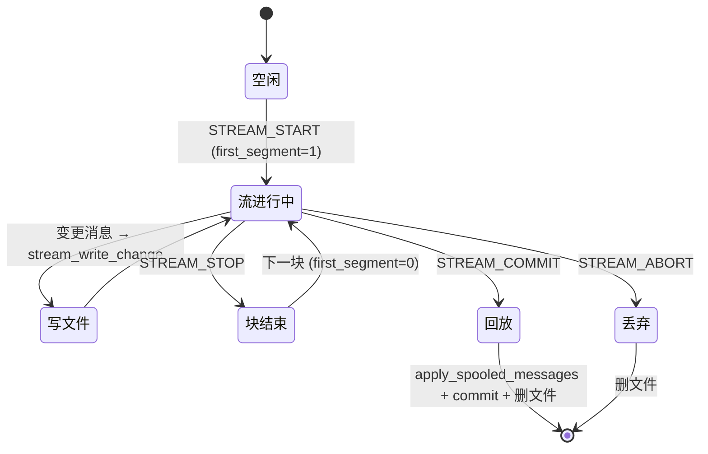

# PostgreSQL 逻辑复制 Stream 执行逻辑源码级拆解：从 reorderbuffer 触发到订阅端落盘回放

| 编写人 | 编写内容 | 编写时间 |
| --- | --- | --- |
| growdu | 初稿。**只讲 stream 的执行逻辑**，不碰配置调优与监控运维。结合 PostgreSQL 18 dev（`~/cwork/postgresql`）源码，把 **STREAM 协议**从触发到落地的每一条代码路径逐行走一遍：五种 STREAM 消息的字段边界 / 输出插件与订阅端的能力协商 / `ReorderBufferCanStartStreaming` 的四道闸门 / 三个触发源与"挑最大事务"的选择策略 / **`ReorderBufferStreamTXN` 的首次与后续两条分支** / **stream 快照机制（`subxip` 里装了什么、`command_id` 如何保存恢复）** / **并发中止检测（`CheckXidAlive` → `ERRCODE_TRANSACTION_ROLLBACK` → `ReorderBufferResetTXN`）** / commit / abort / prepare 三条收尾出路 / `pgoutput_stream_start` 的 `first_segment` 语义 / 订阅端 STREAM_START→STOP→COMMIT 的落盘与回放 / **并行 apply 下四种 `apply_action` 的分流与降级** / 完整状态机 / 资源账本与观测点 / 12 个坑点。配套源码版本：PostgreSQL 18 dev。 | 2026-10-27 |

> 本文是「PostgreSQL 逻辑复制源码系列」。**定位说明**：
>
> - [PostgreSQL 18 流式逻辑复制发布端深度解析](../../db/postgresql/postgresql-logical-replication-stream-publisher/index.html) — 讲**发布端**的配置、生命周期与 pgoutput 回调，本文**不重复**
> - [PostgreSQL 逻辑复制 streaming 与 spill](../../postgresql-logical-replication-streaming-spill/index.html) — 讲**内存墙与 spill 兜底**，本文**不重复**
> - [Apply Parallel Worker 的 lock_stream 与 unlock_stream](../../db/postgresql/postgresql-apply-parallel-lock-stream/index.html) — 讲并行 apply 的**锁协议**
>
> 本文补的是：**把 stream 当作一段程序来读**——谁调用谁、状态怎么流转、快照和 command id 怎么被保存又怎么被恢复、并发中止时怎么半途刹车、订阅端拿到一块流之后又是怎么落盘再回放的。

## 阅读指南

- **第一节 ~ 第五节**（**铺垫**）：协议锚点 / 能力协商 / 四道闸门 / 三个触发源
- **第六节 ~ 第十节**（**核心**）：`ReorderBufferStreamTXN` 主链路 / **快照机制** / **并发中止检测** / 收尾路径 / pgoutput 的 `first_segment`
- **第十一节 ~ 第十三节**（**订阅端**）：STREAM_START/STOP 与流文件 / 落盘与回放 / 并行 apply 的四种分流
- **第十四节 ~ 第十八节**（**收尾**）：状态机全景 / 资源账本 / 坑点速查 / 源码索引 / 总结

---

## 一、引子：把 stream 拆成"执行逻辑"来看

### 1.1 stream 到底改变了什么

普通（非流式）逻辑复制的复制单位是**事务**：

```text
BEGIN
  INSERT ...
  INSERT ...
  COMMIT          ← 只有到这里，订阅端才知道"这个事务结束了"
```

而 stream 改成了**块**：

```text
STREAM_START
  INSERT ...
STREAM_STOP
STREAM_START
  INSERT ...
  INSERT ...
STREAM_STOP
  ...
STREAM_COMMIT
```

关键差别在于：**第一块数据发出去的时候，原事务还没提交**。

这带来两个直接后果：

| 后果 | 说明 |
| --- | --- |
| 内存压力下降 | 发布端不必把整个大事务攒在 reorder buffer 里，攒够一块就可以吐出去 |
| 延迟下降 | 订阅端能提前拿到增量，不必等大事务跑完 |

但也带来**两个必须解决的问题**：

1. **中途反悔怎么办？** 事务可能在流了一半之后回滚 —— 订阅端必须能丢弃已收到的内容。
2. **快照怎么算？** 已发出的数据用的是"事务执行到一半"的快照，订阅端回放时怎么复现这个可见性视图？

这两个问题的答案，恰好是 stream 执行逻辑里**最难的两块**（第七节、第八节）。

### 1.2 一个容易混淆的命名

PG 里有**两个完全不同**的 "stream"：

| 名字 | 出处 | 含义 |
| --- | --- | --- |
| **STREAM 协议** | `LOGICAL_REP_MSG_STREAM_*` | 本文讲的：**大事务流式传输** |
| `lock_stream` / `unlock_stream` | `applyparallelworker.c` | 并行 apply 的**锁协议**，与本文无关 |
| `stream_fd` | `worker.c` | 订阅端存放流内容的**临时文件**，是 STREAM 协议的一部分 |

下文出现的 "stream" 一律指第一项。

### 1.3 代码地图

流式传输横跨 5 个文件，本文会反复回到它们：

```text
发布端                                    协议层                订阅端
─────────────────────────────────────    ──────────────      ─────────────────────────
reorderbuffer.c   ← 状态机与触发          proto.c            worker.c
logical.c         ← 回调分发              logicalproto.h    applyparallelworker.c
pgoutput.c        ← 消息生成                                message.c（文件操作）
```

---

## 二、协议层锚点：5 种 STREAM 消息

先钉死协议，后面所有执行逻辑都挂在这几个消息上。

### 2.1 消息类型枚举

```c
/* src/include/replication/logicalproto.h:73 */
	LOGICAL_REP_MSG_STREAM_START = 'S',
	LOGICAL_REP_MSG_STREAM_STOP = 'E',
	LOGICAL_REP_MSG_STREAM_COMMIT = 'c',
	LOGICAL_REP_MSG_STREAM_ABORT = 'A',
	LOGICAL_REP_MSG_STREAM_PREPARE = 'p',
```

### 2.2 五种消息的字段布局

| 消息 | 字节 | 携带字段 | 语义 |
| --- | --- | --- | --- |
| `STREAM_START` | `'S'` + int32 xid + int8 first_segment | 顶层事务 xid、是否第一块 | 开始传输一个事务块 |
| `STREAM_STOP` | `'E'` | — | 当前块结束 |
| `STREAM_COMMIT` | `'c'` + int32 xid + int8 flags + int64×3 | xid、commit_lsn、end_lsn、commit_time | 事务最终提交 |
| `STREAM_ABORT` | `'A'` + int32 xid + int32 subxid + (可选 int64×2) | 顶层 xid、子事务 xid、abort_lsn、abort_time | 事务回滚，丢弃已收内容 |
| `STREAM_PREPARE` | `'p'` + int32 xid + int64 + ... | xid、prepare_lsn | 两阶段提交的第一阶段 |

### 2.3 STREAM_START 的实现

```c
/* src/backend/replication/logical/proto.c:1061 */
logicalrep_write_stream_start(StringInfo out,
							  TransactionId xid, bool first_segment)
{
	pq_sendbyte(out, LOGICAL_REP_MSG_STREAM_START);

	Assert(TransactionIdIsValid(xid));

	/* transaction ID (we're starting to stream, so must be valid) */
	pq_sendint32(out, xid);

	/* 1 if this is the first streaming segment for this xid */
	pq_sendbyte(out, first_segment ? 1 : 0);
}
```

**`first_segment` 标志是整个协议的枢纽**：它告诉订阅端"这是这个事务的第一块"还是"继续前面的块"。

订阅端据此决定：

- `first_segment = true` → **新建**流文件、分配并行 apply worker
- `first_segment = false` → **追加**到已有流文件、读取已有的子事务信息

### 2.4 STREAM_STOP / STREAM_COMMIT

```c
/* src/backend/replication/logical/proto.c:1095 */
logicalrep_write_stream_stop(StringInfo out)
{
	pq_sendbyte(out, LOGICAL_REP_MSG_STREAM_STOP);
}
```

`STREAM_STOP` 不带任何负载 —— 它纯粹是个**边界标记**。

```c
/* src/backend/replication/logical/proto.c:1104 */
logicalrep_write_stream_commit(StringInfo out, ReorderBufferTXN *txn,
							   XLogRecPtr commit_lsn)
{
	uint8		flags = 0;

	pq_sendbyte(out, LOGICAL_REP_MSG_STREAM_COMMIT);

	Assert(TransactionIdIsValid(txn->xid));

	/* transaction ID */
	pq_sendint32(out, txn->xid);

	/* send the flags field (unused for now) */
	pq_sendbyte(out, flags);

	/* send fields */
	pq_sendint64(out, commit_lsn);
	pq_sendint64(out, txn->end_lsn);
	pq_sendint64(out, txn->xact_time.commit_time);
}
```

### 2.5 STREAM_ABORT：为什么要区分 xid 和 subxid

```c
/* src/backend/replication/logical/proto.c:1158 */
logicalrep_write_stream_abort(StringInfo out, TransactionId xid,
							  TransactionId subxid, XLogRecPtr abort_lsn,
							  TimestampTz abort_time, bool write_abort_info)
{
	pq_sendbyte(out, LOGICAL_REP_MSG_STREAM_ABORT);

	Assert(TransactionIdIsValid(xid) && TransactionIdIsValid(subxid));

	/* transaction ID */
	pq_sendint32(out, xid);
	pq_sendint32(out, subxid);

	if (write_abort_info)
	{
		pq_sendint64(out, abort_lsn);
		pq_sendint64(out, abort_time);
	}
}
```

注释说得很清楚：**顶层事务回滚时，xid 和 subxid 是同一个值**。

也就是说 `STREAM_ABORT` 既能表达"整个事务回滚"，也能表达"某个子事务回滚"—— 靠 xid/subxid 是否相等来区分。

### 2.6 一个协议层面的观察

STREAM 协议**没有 BEGIN，也没有 COMMIT**。

普通协议的 `BEGIN` 携带事务元数据（最终 LSN、时间戳、origin），`STREAM_START` 只带一个 xid 和一个标志位。事务的"身份信息"被推迟到 `STREAM_COMMIT` 才补齐。

这个设计的原因很直接：**流式传输的事务还没提交，它的最终 LSN 和提交时间在流的时候根本不存在**。

---

## 三、能力协商：stream 是怎么被"打开"的

### 3.1 输出插件的回调决定能力

```c
/* src/backend/replication/logical/logical.c:238 */
	ctx->streaming = (ctx->callbacks.stream_start_cb != NULL) ||
		(ctx->callbacks.stream_stop_cb != NULL) ||
		(ctx->callbacks.stream_abort_cb != NULL) ||
		(ctx->callbacks.stream_commit_cb != NULL) ||
		(ctx->callbacks.stream_change_cb != NULL) ||
		(ctx->callbacks.stream_message_cb != NULL) ||
		(ctx->callbacks.stream_truncate_cb != NULL);
```

**只要注册了任意一个 stream 回调，就认为插件支持流式传输。**

然后把这套回调挂到 reorder buffer 上：

```c
/* src/backend/replication/logical/logical.c:254 */
	ctx->reorder->stream_start = stream_start_cb_wrapper;
	ctx->reorder->stream_stop = stream_stop_cb_wrapper;
	ctx->reorder->stream_abort = stream_abort_cb_wrapper;
	ctx->reorder->stream_prepare = stream_prepare_cb_wrapper;
	ctx->reorder->stream_commit = stream_commit_cb_wrapper;
	ctx->reorder->stream_change = stream_change_cb_wrapper;
	ctx->reorder->stream_message = stream_message_cb_wrapper;
	ctx->reorder->stream_truncate = stream_truncate_cb_wrapper;
```

**注意这一层抽象的存在**：`reorderbuffer.c` 完全不知道输出插件的存在，它只认 `rb->stream_start` 这类函数指针。真正的插件逻辑藏在 `logical.c` 的 `*_cb_wrapper` 里。

### 3.2 包装层做了什么

```c
/* src/backend/replication/logical/logical.c:1269 */
stream_start_cb_wrapper(ReorderBuffer *cache, ReorderBufferTXN *txn,
						XLogRecPtr first_lsn)
{
	LogicalDecodingContext *ctx = cache->private_data;
	LogicalErrorCallbackState state;
	ErrorContextCallback errcallback;

	Assert(!ctx->fast_forward);

	/* We're only supposed to call this when streaming is supported. */
	Assert(ctx->streaming);

	/* Push callback + info on the error context stack */
	state.ctx = ctx;
	state.callback_name = "stream_start";
	state.report_location = first_lsn;
	errcallback.callback = output_plugin_error_callback;
	errcallback.arg = &state;
	errcallback.previous = error_context_stack;
	error_context_stack = &errcallback;

	/* set output state */
	ctx->accept_writes = true;
	ctx->write_xid = txn->xid;
	ctx->write_location = first_lsn;
	ctx->end_xact = false;
	...
```

包装层做三件事：

| 动作 | 作用 |
| --- | --- |
| 压 error context 栈 | 出错时能报出"是 stream_start 回调出的问题"以及对应 LSN |
| 设置 `ctx->write_xid` | 让后续写出的每条 change 都能带上正确的 xid |
| 设置 `ctx->write_location` | 推进"已写出位置"，供确认位点使用 |

### 3.3 pgoutput 的三档 streaming 选项

```c
/* src/backend/replication/pgoutput/pgoutput.c:278 */
	cb->stream_start_cb = pgoutput_stream_start;
	cb->stream_stop_cb = pgoutput_stream_stop;
	cb->stream_abort_cb = pgoutput_stream_abort;
	cb->stream_commit_cb = pgoutput_stream_commit;
	cb->stream_change_cb = pgoutput_change;
	cb->stream_message_cb = pgoutput_message;
	cb->stream_truncate_cb = pgoutput_truncate;
```

pgoutput 全部注册，并且额外支持两阶段提交：

```c
/* src/backend/replication/pgoutput/pgoutput.c:286 */
	cb->stream_prepare_cb = pgoutput_stream_prepare_txn;
```

订阅端在 `START_REPLICATION` 时通过 `streaming` 选项表达意愿：

| 选项 | 含义 | 协议版本要求 |
| --- | --- | --- |
| `off` | 关闭流式 | 无 |
| `on` | 开启流式，串行 apply | `LOGICALREP_PROTO_STREAM_VERSION_NUM` |
| `parallel` | 开启流式 + 并行 apply | `LOGICALREP_PROTO_STREAM_PARALLEL_VERSION_NUM` |

版本校验在：

```c
/* src/backend/replication/pgoutput/pgoutput.c:506 */
		/*
		 * Decide whether to enable streaming. It is disabled by default, in
		 * which case we just update the flag in decoding context. Otherwise
		 * we only allow it with sufficient version of the protocol, and when
		 * the output plugin supports it.
		 */
		if (data->streaming == LOGICALREP_STREAM_OFF)
			ctx->streaming = false;
		else if (data->streaming == LOGICALREP_STREAM_ON &&
				 data->protocol_version < LOGICALREP_PROTO_STREAM_VERSION_NUM)
			ereport(ERROR,
					(errcode(ERRCODE_INVALID_PARAMETER_VALUE),
					 errmsg("requested proto_version=%d does not support streaming, need %d or higher",
							data->protocol_version, LOGICALREP_PROTO_STREAM_VERSION_NUM)));
		else if (data->streaming == LOGICALREP_STREAM_PARALLEL &&
				 data->protocol_version < LOGICALREP_PROTO_STREAM_PARALLEL_VERSION_NUM)
			ereport(ERROR,
					(errcode(ERRCODE_INVALID_PARAMETER_VALUE),
					 errmsg("requested proto_version=%d does not support parallel streaming, need %d or higher",
							data->protocol_version, LOGICALREP_PROTO_STREAM_PARALLEL_VERSION_NUM)));
		else if (!ctx->streaming)
			ereport(ERROR,
					(errcode(ERRCODE_INVALID_PARAMETER_VALUE),
					 errmsg("streaming requested, but not supported by output plugin")));
```

### 3.4 槽初始化阶段禁用 stream

```c
		/*
		 * Disable the streaming and prepared transactions during the slot
		 * initialization mode.
		 */
		ctx->streaming = false;
		ctx->twophase = false;
```

槽初始化（导出快照）阶段不能用 stream —— 那时候还没建立一致的快照，无法保证可见性。

### 3.5 协商结果一览



---

## 四、四道闸门：CanStartStreaming 的检查

即使协议和插件都支持，也**不是**随时都能开始流。`ReorderBufferCanStartStreaming` 是唯一的那道闸门。

### 4.1 源码

```c
/* src/backend/replication/logical/reorderbuffer.c:4282 */
ReorderBufferCanStartStreaming(ReorderBuffer *rb)
{
	LogicalDecodingContext *ctx = rb->private_data;
	SnapBuild  *builder = ctx->snapshot_builder;

	/* We can't start streaming unless a consistent state is reached. */
	if (SnapBuildCurrentState(builder) < SNAPBUILD_CONSISTENT)
		return false;

	/*
	 * We can't start streaming immediately even if the streaming is enabled
	 * because we previously decoded this transaction and now just are
	 * restarting.
	 */
	if (ReorderBufferCanStream(rb) &&
		!SnapBuildXactNeedsSkip(builder, ctx->reader->ReadRecPtr))
		return true;

	return false;
}
```

### 4.2 三重检查

| # | 检查 | 不通过的后果 |
| --- | --- | --- |
| 1 | `SnapBuildCurrentState(builder) >= SNAPBUILD_CONSISTENT` | 快照构建还没到一致状态，**不能**流 |
| 2 | `ReorderBufferCanStream(rb)` | 输出插件不支持 stream |
| 3 | `!SnapBuildXactNeedsSkip(builder, ctx->reader->ReadRecPtr)` | 当前事务是**重启前就解码过**的，不能流 |

### 4.3 为什么"跳过的事务"不能流

第 3 条最容易被忽略。`SnapBuildXactNeedsSkip` 表示"这个事务在解码器重启前就解码过了"。

如果允许流，会出什么问题？

```text
解码器重启
  → 事务 T 的一部分变更已经被解码过（在重启前）
  → 重启后 T 还在跑，又产生了新变更
  → 如果现在才开始流 T
  → 订阅端会收到 T 的"后半截"，但缺少"前半截"
  → 数据不一致 ❌
```

所以：**已经在重启前露过面的事务，一律不走 stream**，而是等它提交后按普通事务整体重发（下游靠 xid 去重）。

### 4.4 `ReorderBufferCanStream` 只是薄薄一层

```c
/* src/backend/replication/logical/reorderbuffer.c:4273 */
ReorderBufferCanStream(ReorderBuffer *rb)
{
	LogicalDecodingContext *ctx = rb->private_data;

	return ctx->streaming;
}
```

它只是把 `ctx->streaming` 透出来而已 —— 真正的判断在 `logical.c` 里已经做完了。

### 4.5 与"部分变更"的交互

还有一个**额外的**限制，在 `ReorderBufferProcessPartialChange` 里：

```c
	/*
	 * Stream the transaction if it is serialized before and the changes are
	 * now complete in the top-level transaction.
	 *
	 * The reason for doing the streaming of such a transaction as soon as we
	 * get the complete change for it is that previously it would have reached
	 * the memory threshold and wouldn't get streamed because of incomplete
	 * changes.  Delaying such transactions would increase apply lag for them.
	 */
	if (ReorderBufferCanStartStreaming(rb) &&
		!(rbtxn_has_partial_change(toptxn)) &&
		rbtxn_is_serialized(txn) &&
		rbtxn_has_streamable_change(toptxn))
		ReorderBufferStreamTXN(rb, toptxn);
```

`rbtxn_has_partial_change(toptxn)` 为真时**不允许流**。什么叫"部分变更"？

| 情况 | 标志 |
| --- | --- |
| TOAST 数据还在拼接中（主表 insert 未到） | `RBTXN_HAS_PARTIAL_CHANGE` |
| 推测插入（speculative insert）还没确认或中止 | `RBTXN_HAS_PARTIAL_CHANGE` |

原因见源码注释：

```c
	/*
	 * If we allow streaming when there are pending toast chunks then such
	 * chunks won't be released till the insert (multi_insert) is complete and
	 * we expect the txn to have streamed all changes after streaming.  This
	 * restriction is mainly to ensure the correctness of streamed
	 * transactions and it doesn't seem worth uplifting such a restriction
	 * just to allow this case because anyway we will stream the transaction
	 * once such an insert is complete.
	 */
```

**道理**：TOAST 块是拼起来的，一行数据在主表 insert 到达之前根本不是一个完整的"变更"。流出去半行数据是错的。

推测插入同理 —— 在 `SPEC_CONFIRM` 到达之前，谁都不知道这行到底插进去了还是被回退了。

---

## 五、触发点：谁在何时发起 stream

有三个地方会调用 `ReorderBufferStreamTXN`。

### 5.1 触发源一览

| # | 位置 | 触发条件 | 目的 |
| --- | --- | --- | --- |
| 1 | `ReorderBufferCheckMemoryLimit` | reorder buffer 内存超过 `logical_decoding_work_mem` | **泄压**——把大事务吐出去换内存 |
| 2 | `ReorderBufferProcessPartialChange` | 部分变更刚刚变完整 | **降延迟**——本来因为"不完整"被内存检查跳过了，现在补发 |
| 3 | `ReorderBufferCheckMemoryLimit`（immediate 模式） | `debug_logical_replication_streaming = immediate` | **调试**——无视内存限制，来一个流一个 |

### 5.2 触发源 1：内存墙

```c
/* src/backend/replication/logical/reorderbuffer.c:3883 */
ReorderBufferCheckMemoryLimit(ReorderBuffer *rb)
{
	ReorderBufferTXN *txn;

	/*
	 * Bail out if debug_logical_replication_streaming is buffered and we
	 * haven't exceeded the memory limit.
	 */
	if (debug_logical_replication_streaming == DEBUG_LOGICAL_REP_STREAMING_BUFFERED &&
		rb->size < logical_decoding_work_mem * (Size) 1024)
		return;
```

注意条件里的 `rb->size` —— 这是**整个 reorder buffer 的总大小**，不是单个事务。

超过阈值后的处理：

```c
	while (rb->size >= logical_decoding_work_mem * (Size) 1024 ||
		   (debug_logical_replication_streaming == DEBUG_LOGICAL_REP_STREAMING_IMMEDIATE &&
			rb->size > 0))
	{
		/*
		 * Pick the largest non-aborted transaction and evict it from memory
		 * by streaming, if possible.  Otherwise, spill to disk.
		 */
		if (ReorderBufferCanStartStreaming(rb) &&
			(txn = ReorderBufferLargestStreamableTopTXN(rb)) != NULL)
		{
			/* we know there has to be one, because the size is not zero */
			Assert(txn && rbtxn_is_toptxn(txn));
			Assert(txn->total_size > 0);
			Assert(rb->size >= txn->total_size);

			/* skip the transaction if aborted */
			if (ReorderBufferCheckAndTruncateAbortedTXN(rb, txn))
				continue;

			ReorderBufferStreamTXN(rb, txn);
		}
		else
		{
			/*
			 * Pick the largest transaction (or subtransaction) and evict it
			 * from memory by serializing it to disk.
			 */
			txn = ReorderBufferLargestTXN(rb);
			...
```

**关键分支**：

```text
能流（CanStartStreaming && 有可流事务）
    → ReorderBufferStreamTXN        ← 走 STREAM 协议，订阅端能提前应用

不能流
    → ReorderBufferLargestTXN + 序列化到磁盘   ← 走 SPILL 协议，订阅端看不到
```

**这就是 stream 和 spill 的分岔口。** 两者都是"把内存腾出来"，但只有 stream 能让订阅端提前拿到数据。

### 5.3 挑哪个事务来流

```c
/* src/backend/replication/logical/reorderbuffer.c:3833 */
ReorderBufferLargestStreamableTopTXN(ReorderBuffer *rb)
{
	dlist_iter	iter;
	Size		largest_size = 0;
	ReorderBufferTXN *largest = NULL;

	/* Find the largest top-level transaction having a base snapshot. */
	dlist_foreach(iter, &rb->txns_by_base_snapshot_lsn)
	{
		ReorderBufferTXN *txn;

		txn = dlist_container(ReorderBufferTXN, base_snapshot_node, iter.cur);

		/* must not be a subtxn */
		Assert(!rbtxn_is_known_subxact(txn));
		/* base_snapshot must be set */
		Assert(txn->base_snapshot != NULL);

		/* Don't consider these kinds of transactions for eviction. */
		if (rbtxn_has_partial_change(txn) ||
			!rbtxn_has_streamable_change(txn) ||
			rbtxn_is_aborted(txn))
			continue;

		/* Find the largest of the eviction candidates. */
		if ((largest == NULL || txn->total_size > largest_size) &&
			(txn->total_size > 0))
		{
			largest = txn;
			largest_size = txn->total_size;
		}
	}

	return largest;
}
```

三个排除条件：

| 条件 | 含义 |
| --- | --- |
| `rbtxn_has_partial_change(txn)` | 有未完成的 TOAST/推测插入 |
| `!rbtxn_has_streamable_change(txn)` | 没有任何"可流式"的变更类型 |
| `rbtxn_is_aborted(txn)` | 已回滚 |

**`rbtxn_has_streamable_change` 是谁设置的？** 在 `ReorderBufferQueueChange` 里：

```c
	/*
	 * The changes that are sent downstream are considered streamable.  We
	 * remember such transactions so that only those will later be considered
	 * for streaming.
	 */
	if (change->action == REORDER_BUFFER_CHANGE_INSERT ||
		change->action == REORDER_BUFFER_CHANGE_UPDATE ||
		change->action == REORDER_BUFFER_CHANGE_DELETE ||
		change->action == REORDER_BUFFER_CHANGE_INTERNAL_SPEC_INSERT ||
		change->action == REORDER_BUFFER_CHANGE_TRUNCATE ||
		change->action == REORDER_BUFFER_CHANGE_MESSAGE)
	{
		ReorderBufferTXN *toptxn = rbtxn_get_toptxn(txn);

		toptxn->txn_flags |= RBTXN_HAS_STREAMABLE_CHANGE;
	}
```

**注意这个标志设在 `toptxn` 上** —— 因为流是**顶层事务**为单位的，子事务的变更也算进顶层事务。

### 5.4 触发源 2：部分变更补齐

见 4.5 节的 `ReorderBufferProcessPartialChange`。这个触发源的动机是**降低 apply 延迟**：

```c
	/*
	 * The reason for doing the streaming of such a transaction as soon as we
	 * get the complete change for it is that previously it would have reached
	 * the memory threshold and wouldn't get streamed because of incomplete
	 * changes.  Delaying such transactions would increase apply lag for them.
	 */
```

### 5.5 触发源 3：immediate 调试模式

```c
/* src/include/replication/reorderbuffer.h:33 */
	DEBUG_LOGICAL_REP_STREAMING_BUFFERED,
	DEBUG_LOGICAL_REP_STREAMING_IMMEDIATE,
```

默认值是 `buffered`：

```c
/* src/backend/replication/logical/reorderbuffer.c:229 */
int			debug_logical_replication_streaming = DEBUG_LOGICAL_REP_STREAMING_BUFFERED;
```

`immediate` 模式下，**每来一条变更就立刻流出去**，并且**跳过 CLOG 检查**：

```c
/* src/backend/replication/logical/reorderbuffer.c:1774 */
ReorderBufferCheckAndTruncateAbortedTXN(ReorderBuffer *rb, ReorderBufferTXN *txn)
{
	/* Quick return for regression tests */
	if (unlikely(debug_logical_replication_streaming == DEBUG_LOGICAL_REP_STREAMING_IMMEDIATE))
		return false;
```

这是回归测试用的开关，不是生产配置。

### 5.6 三个触发源的关系



---

## 六、发布端主链路：ReorderBufferStreamTXN

这是整个 stream 流程的中枢函数。

### 6.1 函数签名与前置断言

```c
/* src/backend/replication/logical/reorderbuffer.c:4308 */
ReorderBufferStreamTXN(ReorderBuffer *rb, ReorderBufferTXN *txn)
{
	Snapshot	snapshot_now;
	CommandId	command_id;
	Size		stream_bytes;
	bool		txn_is_streamed;

	/* We can never reach here for a subtransaction. */
	Assert(rbtxn_is_toptxn(txn));
```

**流永远是顶层事务为单位**。子事务的变更被合并进顶层事务一起流。

### 6.2 两条分支：首次流 vs 后续流

函数体开头是一个关键的分叉：

```c
	/*
	 * We can't make any assumptions about base snapshot here, similar to what
	 * ReorderBufferCommit() does. That relies on base_snapshot getting
	 * transferred from subxact in ReorderBufferCommitChild(), but that was
	 * not yet called as the transaction is in-progress.
	 *
	 * So just walk the subxacts and use the same logic here. But we only need
	 * to do that once, when the transaction is streamed for the first time.
	 * After that we need to reuse the snapshot from the previous run.
	 *
	 * Unlike DecodeCommit which adds xids of all the subtransactions in
	 * snapshot's xip array via SnapBuildCommitTxn, we can't do that here but
	 * we do add them to subxip array instead via ReorderBufferCopySnap. This
	 * allows the catalog changes made in subtransactions decoded till now to
	 * be visible.
	 */
	if (txn->snapshot_now == NULL)
	{
		dlist_iter	subxact_i;

		/* make sure this transaction is streamed for the first time */
		Assert(!rbtxn_is_streamed(txn));

		/* at the beginning we should have invalid command ID */
		Assert(txn->command_id == InvalidCommandId);

		dlist_foreach(subxact_i, &txn->subtxns)
		{
			ReorderBufferTXN *subtxn;

			subtxn = dlist_container(ReorderBufferTXN, node, subxact_i.cur);
			ReorderBufferTransferSnapToParent(txn, subtxn);
		}

		/*
		 * If this transaction has no snapshot, it didn't make any changes to
		 * the database till now, so there's nothing to decode.
		 */
		if (txn->base_snapshot == NULL)
		{
			Assert(txn->ninvalidations == 0);
			return;
		}

		command_id = FirstCommandId;
		snapshot_now = ReorderBufferCopySnap(rb, txn->base_snapshot,
											 txn, command_id);
	}
	else
	{
		/* the transaction must have been already streamed */
		Assert(rbtxn_is_streamed(txn));

		/*
		 * Nah, we already have snapshot from the previous streaming run. We
		 * assume new subxacts can't move the LSN backwards, and so can't beat
		 * the LSN condition in the previous branch (so no need to walk
		 * through subtxacts again). In fact, we must not do that as we may be
		 * using snapshot half-way through the subxact.
		 */
		command_id = txn->command_id;

		/*
		 * We can't use txn->snapshot_now directly because after the last
		 * streaming run, we might have got some new sub-transactions. So we
		 * need to add them to the snapshot.
		 */
		snapshot_now = ReorderBufferCopySnap(rb, txn->snapshot_now,
											 txn, command_id);

		/* Free the previously copied snapshot. */
		Assert(txn->snapshot_now->copied);
		ReorderBufferFreeSnap(rb, txn->snapshot_now);
		txn->snapshot_now = NULL;
	}
```

| 分支 | 条件 | 快照来源 | command_id |
| --- | --- | --- | --- |
| **首次流** | `txn->snapshot_now == NULL` | `txn->base_snapshot` | `FirstCommandId` |
| **后续流** | `txn->snapshot_now != NULL` | 上次保存的 `txn->snapshot_now` | `txn->command_id`（上次保存的） |

**为什么首次要从 base_snapshot 出发，还要遍历子事务？**

因为事务还在进行中，`ReorderBufferCommitChild()` 那个"把子事务快照上提到父事务"的逻辑**还没执行**（它是在提交时才做的）。所以这里手动做一遍：

```c
		dlist_foreach(subxact_i, &txn->subtxns)
		{
			ReorderBufferTXN *subtxn;

			subtxn = dlist_container(ReorderBufferTXN, node, subxact_i.cur);
			ReorderBufferTransferSnapToParent(txn, subtxn);
		}
```

**为什么后续流不能重新遍历子事务？**

源码注释解释得很清楚：

> We assume new subxacts can't move the LSN backwards, and so can't beat the LSN condition in the previous branch (so no need to walk through subtxacts again). **In fact, we must not do that as we may be using snapshot half-way through the subxact.**

翻译一下：后续流时，我们**正在使用**一个"停在某个子事务中间"的快照。如果此时再遍历一遍子事务去改快照，就把一个正在使用的快照改坏了。

### 6.3 统一的处理入口

```c
	/*
	 * Remember this information to be used later to update stats. We can't
	 * update the stats here as an error while processing the changes would
	 * lead to the accumulation of stats even though we haven't streamed all
	 * the changes.
	 */
	txn_is_streamed = rbtxn_is_streamed(txn);
	stream_bytes = txn->total_size;

	/* Process and send the changes to output plugin. */
	ReorderBufferProcessTXN(rb, txn, InvalidXLogRecPtr, snapshot_now,
							command_id, true);

	rb->streamCount += 1;
	rb->streamBytes += stream_bytes;

	/* Don't consider already streamed transaction. */
	rb->streamTxns += (txn_is_streamed) ? 0 : 1;

	/* update the decoding stats */
	UpdateDecodingStats((LogicalDecodingContext *) rb->private_data);

	Assert(dlist_is_empty(&txn->changes));
	Assert(txn->nentries == 0);
	Assert(txn->nentries_mem == 0);
}
```

注意 `ReorderBufferProcessTXN` 的**最后一个参数是 `true`** —— 这是 `streaming` 标志，整个函数靠它切换行为。

统计量的更新被刻意推迟到处理成功之后：

> We can't update the stats here as an error while processing the changes would lead to the accumulation of stats even though we haven't streamed all the changes.

### 6.4 ProcessTXN 里的 streaming 分支

```c
/* src/backend/replication/logical/reorderbuffer.c:2210 */
ReorderBufferProcessTXN(ReorderBuffer *rb, ReorderBufferTXN *txn,
						XLogRecPtr commit_lsn,
						volatile Snapshot snapshot_now,
						volatile CommandId command_id,
						bool streaming)
```

函数里 streaming 影响的点一共五处：

| # | 位置 | streaming = true 时的行为 |
| --- | --- | --- |
| 1 | 事务开始 | **不发** `begin` / `begin_prepare` |
| 2 | 第一条变更前 | 调 `rb->stream_start` |
| 3 | 每条变更 | 走 `rb->stream_change` 而不是 `rb->apply_change` |
| 4 | 全部处理完 | 调 `rb->stream_stop`，**不发** `commit` / `prepare` |
| 5 | 收尾 | `ReorderBufferSaveTXNSnapshot` 保存快照与 command_id |

第 1 处：

```c
		/*
		 * We only need to send begin/begin_prepare for non-streamed
		 * transactions.
		 */
		if (!streaming)
		{
			if (rbtxn_is_prepared(txn))
				rb->begin_prepare(rb, txn);
			else
				rb->begin(rb, txn);
		}
```

第 2 处：

```c
			/*
			 * We can't call start stream callback before processing first
			 * change.
			 */
			if (prev_lsn == InvalidXLogRecPtr)
			{
				if (streaming)
				{
					txn->origin_id = change->origin_id;
					rb->stream_start(rb, txn, change->lsn);
					stream_started = true;
				}
			}
```

**`STREAM_START` 是在第一条变更之前发的**，而且只在"第一条变更"时发一次。

第 3 处：

```c
/* src/backend/replication/logical/reorderbuffer.c:2071 */
ReorderBufferApplyChange(ReorderBuffer *rb, ReorderBufferTXN *txn,
						 Relation relation, ReorderBufferChange *change,
						 bool streaming)
{
	if (streaming)
		rb->stream_change(rb, txn, relation, change);
	else
		rb->apply_change(rb, txn, relation, change);
}
```

**分发点只有一行 if** —— 这是整个设计最优雅的地方：reorderbuffer 只负责"决定发不发"，"发什么"完全交给输出插件。

第 4 处：

```c
		/*
		 * Done with current changes, send the last message for this set of
		 * changes depending upon streaming mode.
		 */
		if (streaming)
		{
			if (stream_started)
			{
				rb->stream_stop(rb, txn, prev_lsn);
				stream_started = false;
			}
		}
		else
		{
			/*
			 * Call either PREPARE (for two-phase transactions) or COMMIT (for
			 * regular ones).
			 */
			if (rbtxn_is_prepared(txn))
			{
				Assert(!rbtxn_sent_prepare(txn));
				rb->prepare(rb, txn, commit_lsn);
				txn->txn_flags |= RBTXN_SENT_PREPARE;
			}
			else
				rb->commit(rb, txn, commit_lsn);
		}
```

第 5 处：

```c
		/*
		 * Remember the command ID and snapshot for the next set of changes in
		 * streaming mode.
		 */
		if (streaming)
			ReorderBufferSaveTXNSnapshot(rb, txn, snapshot_now, command_id);
		else if (snapshot_now->copied)
			ReorderBufferFreeSnap(rb, snapshot_now);
```

### 6.5 一轮流的完整消息序列

```text
┌─ ReorderBufferStreamTXN ────────────────────────────────────────┐
│                                                                  │
│  [准备快照]  首次 → base_snapshot + 遍历子事务上提快照            │
│              后续 → 复用上次的 snapshot_now + 补新的子 xid         │
│                                                                  │
│  ┌─ ReorderBufferProcessTXN(streaming=true) ──────────────────┐  │
│  │  SetupHistoricSnapshot(snapshot_now, tuplecid_hash)       │  │
│  │                                                            │  │
│  │  ① 第一条变更前 → rb->stream_start()  → 【STREAM_START】    │  │
│  │                                                            │  │
│  │  ② 每条变更     → rb->stream_change() → 【INSERT/UPDATE…】 │  │
│  │                                                            │  │
│  │  ③ 全部处理完   → rb->stream_stop()   → 【STREAM_STOP】     │  │
│  │                                                            │  │
│  │  ④ 保存快照与 command_id → ReorderBufferSaveTXNSnapshot()   │  │
│  └────────────────────────────────────────────────────────────┘  │
│                                                                  │
│  [记账]  rb->streamCount / streamBytes / streamTxns              │
└──────────────────────────────────────────────────────────────────┘
```

**注意：这一轮里没有 BEGIN，也没有 COMMIT。** 事务还在跑。

---

## 七、快照机制：stream 里最容易错的地方

第七节是本文的核心之一。stream 要解决的两个难题之一就是**可见性**。

### 7.1 为什么不能直接用 base_snapshot

普通（非流式）事务在提交时解码，用的是 `txn->base_snapshot` —— 那是**事务开始时**的快照，它已经包含了所有并发事务的状态判断。

但流式解码发生在**事务执行中途**。此时：

- 事务自己已经写了一堆数据（还没提交）
- 快照要能看见"事务执行到这一步"的中间状态
- 子事务可能已经提交了、也可能还没

所以需要一个**能演进**的快照。

### 7.2 ReorderBufferCopySnap：subxip 里装了什么

```c
/* src/backend/replication/logical/reorderbuffer.c:1908 */
ReorderBufferCopySnap(ReorderBuffer *rb, Snapshot orig_snap,
					  ReorderBufferTXN *txn, CommandId cid)
{
	Snapshot	snap;
	dlist_iter	iter;
	int			i = 0;
	Size		size;

	size = sizeof(SnapshotData) +
		sizeof(TransactionId) * orig_snap->xcnt +
		sizeof(TransactionId) * (txn->nsubtxns + 1);

	snap = MemoryContextAllocZero(rb->context, size);
	memcpy(snap, orig_snap, sizeof(SnapshotData));

	snap->copied = true;
	snap->active_count = 1;		/* mark as active so nobody frees it */
	snap->regd_count = 0;
	snap->xip = (TransactionId *) (snap + 1);

	memcpy(snap->xip, orig_snap->xip, sizeof(TransactionId) * snap->xcnt);

	/*
	 * snap->subxip contains all txids that belong to our transaction which we
	 * need to check via cmin/cmax. That's why we store the toplevel
	 * transaction in there as well.
	 */
	snap->subxip = snap->xip + snap->xcnt;
	snap->subxip[i++] = txn->xid;

	/*
	 * txn->nsubtxns isn't decreased when subtransactions abort, so count
	 * manually. Since it's an upper boundary it is safe to use it for the
	 * allocation above.
	 */
	snap->subxcnt = 1;

	dlist_foreach(iter, &txn->subtxns)
	{
		ReorderBufferTXN *sub_txn;

		sub_txn = dlist_container(ReorderBufferTXN, node, iter.cur);
		snap->subxip[i++] = sub_txn->xid;
		snap->subxcnt++;
	}

	/* sort so we can bsearch() later */
	qsort(snap->subxip, snap->subxcnt, sizeof(TransactionId), xidComparator);

	/* store the specified current CommandId */
	snap->curcid = cid;

	return snap;
}
```

**`subxip` 里装的是"本事务及其所有子事务的 xid"**。

这一点和普通 MVCC 快照完全不同：

| 字段 | 普通 MVCC 快照 | stream 用的快照 |
| --- | --- | --- |
| `xip` | **并发进行中**的事务 xid | 同左（继承自 base_snapshot） |
| `subxip` | 本事务的子事务 xid | **本事务顶层 xid + 所有子事务 xid** |
| `curcid` | 当前命令 ID | 当前命令 ID（流式下会变化） |

源码注释里的解释：

> snap->subxip contains all txids that belong to our transaction which we need to check via cmin/cmax. That's why we store the toplevel transaction in there as well.

翻译：`subxip` 是用来配合 `cmin`/`cmax` 做判断的。判断一个元组是不是"我自己写的"，需要知道**我自己所有的 xid**（顶层 + 子事务）。而这些 xid **不在 `xip` 里**（`xip` 装的是别人的并发事务），所以要放进 `subxip`。

> Unlike DecodeCommit which adds xids of all the subtransactions in snapshot's xip array via SnapBuildCommitTxn, we can't do that here but we do add them to subxip array instead via ReorderBufferCopySnap.

普通提交路径用的是 `SnapBuildCommitTxn` 把子事务 xid 加进 `xip`；流式做不到（事务还没提交），所以改用 `subxip`。

### 7.3 command_id 的保存与恢复

流式的另一个难点：**command id 会随着事务推进而变化**。

快照里的 `curcid` 决定"哪些元组对我可见"。流式解码时，事务内部可能执行了新的 SQL 命令，`curcid` 随之前进。

保存：

```c
/* src/backend/replication/logical/reorderbuffer.c:2119 */
ReorderBufferSaveTXNSnapshot(ReorderBuffer *rb, ReorderBufferTXN *txn,
							 Snapshot snapshot_now, CommandId command_id)
{
	txn->command_id = command_id;

	/* Avoid copying if it's already copied. */
	if (snapshot_now->copied)
		txn->snapshot_now = snapshot_now;
	else
		txn->snapshot_now = ReorderBufferCopySnap(rb, snapshot_now,
												  txn, command_id);
}
```

恢复：在 6.2 节的"后续流"分支里，`command_id = txn->command_id;`。

**为什么要单独保存？**

因为一轮流结束时，事务可能还开着新的子事务、新的 command id。下一轮流要**接着上次的状态**继续，而不是从头再来。

### 7.4 两种内部 change：换快照与换 command id

流式解码过程中，快照可能需要**中途替换**。reorderbuffer 用两种内部 change 来表达：

#### INTERNAL_SNAPSHOT：换一整个快照

```c
				case REORDER_BUFFER_CHANGE_INTERNAL_SNAPSHOT:
					/* get rid of the old */
					TeardownHistoricSnapshot(false);

					if (snapshot_now->copied)
					{
						ReorderBufferFreeSnap(rb, snapshot_now);
						snapshot_now =
							ReorderBufferCopySnap(rb, change->data.snapshot,
												  txn, command_id);
					}
					...
					/* and continue with the new one */
					SetupHistoricSnapshot(snapshot_now, txn->tuplecid_hash);
					break;
```

这个 change 在事务**从磁盘恢复**时出现 —— 之前被 spill 到磁盘的变更，重新加载时需要把当时的快照也带回来。

#### INTERNAL_COMMAND_ID：只推进 command id

```c
				case REORDER_BUFFER_CHANGE_INTERNAL_COMMAND_ID:
					Assert(change->data.command_id != InvalidCommandId);

					if (command_id < change->data.command_id)
					{
						command_id = change->data.command_id;

						if (!snapshot_now->copied)
						{
							/* we don't use the global one anymore */
							snapshot_now = ReorderBufferCopySnap(rb, snapshot_now,
																 txn, command_id);
						}

						snapshot_now->curcid = command_id;

						TeardownHistoricSnapshot(false);
						SetupHistoricSnapshot(snapshot_now, txn->tuplecid_hash);
					}

					break;
```

这个 change 在**事务内部执行了新的 SQL 命令**时出现 —— `cmin` 前进了，可见性判断要跟着变。

**两个 change 都做了同一件事：拆掉旧的 historic snapshot，装上新的。**

```text
旧：SetupHistoricSnapshot(snapA)  →  改 curcid  →  SetupHistoricSnapshot(snapA')
新：TeardownHistoricSnapshot()     →  换整个快照   →  SetupHistoricSnapshot(snapB)
```

### 7.5 与前文的呼应

这里出现了一个本文前面没展开、但你应该已经熟悉的概念：**historic snapshot**。

`SetupHistoricSnapshot` 设置的快照类型是 `SNAPSHOT_HISTORIC_MVCC`，它的 `xip` 语义是**反的**（存"当作已提交"的事务）。

> 详见 [PostgreSQL 目录快照源码级深度拆解](../postgresql-catalog-snapshot-deep-dive/index.html) 第十二节。

在 stream 场景下，historic snapshot 的作用是：**让解码器看到"事务执行到这一步时"的目录状态**，从而正确解码该事务自己改过的系统表。

---

## 八、并发中止：CheckXidAlive 与回滚分支

第八节是第二个核心。stream 的一切麻烦都源于"事务可能中途死掉"。

### 8.1 问题是什么

假设事务 501 修改了系统表 `pg_class` 的一行：

```text
初始：  (xmin=500, xmax=0)
501 改： (xmin=500, xmax=501) + (xmin=501, xmax=0)
501 中止，502 改：(xmin=500, xmax=502) + (xmin=502, xmax=0)
```

现在解码器带着一个"501 还在跑"的快照去读 `pg_class`：

```text
快照视角：501 是进行中的事务
看到的元组：(xmin=500, xmax=502)
判断：500 < snapshot->xmin（已提交），所以可见
      但 xmax=502 不在快照的 xip 里 → 502 被当作不可见
      → 结论：(500,502) 这行"可见" ❌
```

源码注释里的原话：

> And, when we will try to decode with that catalog tuple, it can lead to a wrong result or a crash.

### 8.2 解决方案：CheckXidAlive

```c
/* src/backend/replication/logical/reorderbuffer.c:2049 */
SetupCheckXidLive(TransactionId xid)
{
	/*
	 * If the input transaction id is already set as a CheckXidAlive then
	 * nothing to do.
	 */
	if (TransactionIdEquals(CheckXidAlive, xid))
		return;

	/*
	 * setup CheckXidAlive if it's not committed yet.  We don't check if the
	 * xid is aborted.  That will happen during catalog access.
	 */
	if (!TransactionIdDidCommit(xid))
		CheckXidAlive = xid;
	else
		CheckXidAlive = InvalidTransactionId;
}
```

它就是个**全局变量**，记录"当前正在流的那个事务的 xid"。

在 `ReorderBufferProcessTXN` 的变更循环里设置：

```c
			/*
			 * Set the current xid to detect concurrent aborts. This is
			 * required for the cases when we decode the changes before the
			 * COMMIT record is processed.
			 */
			if (streaming || rbtxn_is_prepared(change->txn))
			{
				curtxn = change->txn;
				SetupCheckXidLive(curtxn->xid);
			}
```

**注意条件：`streaming || rbtxn_is_prepared`**。只有这两种情况需要检测并发中止 —— 因为只有它们会在事务提交前解码数据。

### 8.3 检测点：系统表扫描

`CheckXidAlive` 在**系统表扫描**时被检查：

```c
/* src/backend/access/index/genam.c:491 */
static inline void
HandleConcurrentAbort()
{
	if (TransactionIdIsValid(CheckXidAlive) &&
		!TransactionIdIsInProgress(CheckXidAlive) &&
		!TransactionIdDidCommit(CheckXidAlive))
		ereport(ERROR,
				(errcode(ERRCODE_TRANSACTION_ROLLBACK),
				 errmsg("transaction aborted during system catalog scan")));
}
```

**判据**：xid 有效、不在进行中、也没提交 → 一定是中止了。

> We can't directly use TransactionIdDidAbort as after crash such transaction might not have been marked as aborted.

崩溃后 CLOG 可能还没标记，所以不能直接用 `TransactionIdDidAbort`。

在 `systable_beginscan` 里还会置一个 `bsysscan` 标志：

```c
	/*
	 * If CheckXidAlive is set then set a flag to indicate that system table
	 * scan is in-progress.  See detailed comments in xact.c where these
	 * variables are declared.
	 */
	if (TransactionIdIsValid(CheckXidAlive))
		bsysscan = true;
```

这个标志的作用是**防误用** —— 非系统表扫描时如果 `CheckXidAlive` 有效，说明逻辑出了问题：

```c
	/*
	 * We don't expect direct calls to heap_getnext with valid CheckXidAlive
	 * for catalog or regular tables.  See detailed comments in xact.c where
	 * these variables are declared.  Normally we have such a check at tableam
	 * level API but this is called from many places so we need to ensure it
	 * here.
	 */
	if (unlikely(TransactionIdIsValid(CheckXidAlive) && !bsysscan))
		elog(ERROR, "unexpected heap_getnext call during logical decoding");
```

### 8.4 刹车：PG_CATCH 里的特殊分支

`HandleConcurrentAbort` 抛出的是 `ERRCODE_TRANSACTION_ROLLBACK`。这个错误码在 `ReorderBufferProcessTXN` 的 `PG_CATCH` 里被**特殊对待**：

```c
		/*
		 * The error code ERRCODE_TRANSACTION_ROLLBACK indicates a concurrent
		 * abort of the (sub)transaction we are streaming or preparing. We
		 * need to do the cleanup and return gracefully only when we are
		 * sending the data in streaming mode and the streaming is not
		 * finished yet or when we are sending the data out on a PREPARE
		 * during a two-phase commit.
		 */
		if (errdata->sqlerrcode == ERRCODE_TRANSACTION_ROLLBACK &&
			(stream_started || rbtxn_is_prepared(txn)))
		{
			/* curtxn must be set for streaming or prepared transactions */
			Assert(curtxn);

			/* Cleanup the temporary error state. */
			FlushErrorState();
			FreeErrorData(errdata);
			errdata = NULL;

			/* Remember the transaction is aborted. */
			Assert(!rbtxn_is_committed(curtxn));
			curtxn->txn_flags |= RBTXN_IS_ABORTED;

			/* Mark the transaction is streamed if appropriate */
			if (stream_started)
				ReorderBufferMaybeMarkTXNStreamed(rb, txn);

			/* Reset the TXN so that it is allowed to stream remaining data. */
			ReorderBufferResetTXN(rb, txn, snapshot_now,
								  command_id, prev_lsn,
								  specinsert);
		}
		else
		{
			ReorderBufferCleanupTXN(rb, txn);
			MemoryContextSwitchTo(ecxt);
			PG_RE_THROW();
		}
```

**这个分支把致命错误降级成了"优雅刹车"**：

```text
检测到并发中止
   → 不再抛错（FlushErrorState）
   → 标记 curtxn 为 RBTXN_IS_ABORTED
   → 标记已流出的部分为 RBTXN_IS_STREAMED（这样才能发 STREAM_ABORT）
   → ReorderBufferResetTXN：收尾当前块
   → 正常返回，后续的变更会被跳过
```

### 8.5 ReorderBufferResetTXN：半途刹车做什么

```c
/* src/backend/replication/logical/reorderbuffer.c:2164 */
ReorderBufferResetTXN(ReorderBuffer *rb, ReorderBufferTXN *txn,
					  Snapshot snapshot_now,
					  CommandId command_id,
					  XLogRecPtr last_lsn,
					  ReorderBufferChange *specinsert)
{
	/* Discard the changes that we just streamed */
	ReorderBufferTruncateTXN(rb, txn, rbtxn_is_prepared(txn));

	/* Free all resources allocated for toast reconstruction */
	ReorderBufferToastReset(rb, txn);

	/* Return the spec insert change if it is not NULL */
	if (specinsert != NULL)
	{
		ReorderBufferFreeChange(rb, specinsert, true);
		specinsert = NULL;
	}

	/*
	 * For the streaming case, stop the stream and remember the command ID and
	 * snapshot for the streaming run.
	 */
	if (rbtxn_is_streamed(txn))
	{
		rb->stream_stop(rb, txn, last_lsn);
		ReorderBufferSaveTXNSnapshot(rb, txn, snapshot_now, command_id);
	}

	/* All changes must be deallocated */
	Assert(txn->size == 0);
}
```

**`rb->stream_stop(rb, txn, last_lsn)` 是必需的** —— 订阅端不能收到一个"开了头但没有收尾"的流块。

### 8.6 标记"已流出"

```c
/* src/backend/replication/logical/reorderbuffer.c:2137 */
ReorderBufferMaybeMarkTXNStreamed(ReorderBuffer *rb, ReorderBufferTXN *txn)
{
	/*
	 * The top-level transaction, is marked as streamed always, even if it
	 * does not contain any changes (that is, when all the changes are in
	 * subtransactions).
	 *
	 * For subtransactions, we only mark them as streamed when there are
	 * changes in them.
	 *
	 * We do it this way because of aborts - we don't want to send aborts for
	 * XIDs the downstream is not aware of. And of course, it always knows
	 * about the top-level xact (we send the XID in all messages), but we
	 * never stream XIDs of empty subxacts.
	 */
	if (rbtxn_is_toptxn(txn) || (txn->nentries_mem != 0))
		txn->txn_flags |= RBTXN_IS_STREAMED;
}
```

**为什么顶层事务总是标记，子事务要看有没有变更？**

> We do it this way because of aborts - we don't want to send aborts for XIDs the downstream is not aware of.

订阅端只在**收到过该 xid 的数据**时才知道这个事务存在。如果给一个从没流过数据的子事务发 `STREAM_ABORT`，订阅端会困惑。

而顶层事务的 xid **在每一条 change 消息里都带着**，所以订阅端一定知道它。

### 8.7 相关的标志位

```c
/* src/include/replication/reorderbuffer.h:167 */
#define RBTXN_HAS_CATALOG_CHANGES 	0x0001
#define RBTXN_IS_SUBXACT          	0x0002
#define RBTXN_IS_SERIALIZED       	0x0004
#define RBTXN_IS_SERIALIZED_CLEAR 	0x0008
#define RBTXN_IS_STREAMED         	0x0010
#define RBTXN_HAS_PARTIAL_CHANGE  	0x0020
#define RBTXN_IS_PREPARED 			0x0040
#define RBTXN_SKIPPED_PREPARE	  	0x0080
#define RBTXN_HAS_STREAMABLE_CHANGE	0x0100
#define RBTXN_SENT_PREPARE			0x0200
#define RBTXN_IS_COMMITTED			0x0400
#define RBTXN_IS_ABORTED			0x0800
#define RBTXN_DISTR_INVAL_OVERFLOWED	0x1000
```

stream 相关的四个：

| 标志 | 含义 |
| --- | --- |
| `RBTXN_HAS_STREAMABLE_CHANGE` | 这个事务有能被流出去的变更类型 |
| `RBTXN_IS_STREAMED` | 这个事务**已经**流出去了（至少一块） |
| `RBTXN_HAS_PARTIAL_CHANGE` | 有未完成的 TOAST / 推测插入 |
| `RBTXN_IS_ABORTED` | 已确认中止 |

---

## 九、收尾：commit / abort / prepare 三条出路

一个流式事务最终有三种归宿。

### 9.1 出路一：正常提交

```c
/* src/backend/replication/logical/reorderbuffer.c:1982 */
ReorderBufferStreamCommit(ReorderBuffer *rb, ReorderBufferTXN *txn)
{
	/* we should only call this for previously streamed transactions */
	Assert(rbtxn_is_streamed(txn));

	ReorderBufferStreamTXN(rb, txn);

	if (rbtxn_is_prepared(txn))
	{
		/*
		 * Note, we send stream prepare even if a concurrent abort is
		 * detected. See DecodePrepare for more information.
		 */
		Assert(!rbtxn_sent_prepare(txn));
		rb->stream_prepare(rb, txn, txn->final_lsn);
		txn->txn_flags |= RBTXN_SENT_PREPARE;

		/*
		 * This is a PREPARED transaction, part of a two-phase commit. The
		 * full cleanup will happen as part of the COMMIT PREPAREDs, so now
		 * just truncate txn by removing changes and tuplecids.
		 */
		ReorderBufferTruncateTXN(rb, txn, true);
		/* Reset the CheckXidAlive */
		CheckXidAlive = InvalidTransactionId;
	}
	else
	{
		rb->stream_commit(rb, txn, txn->final_lsn);
		ReorderBufferCleanupTXN(rb, txn);
	}
}
```

**关键的第一步是 `ReorderBufferStreamTXN(rb, txn)`** —— 提交前还要再流一次，把提交前最后一批变更吐出去。

之后分两支：

| 情况 | 动作 |
| --- | --- |
| 普通事务 | `rb->stream_commit` → `STREAM_COMMIT` |
| 两阶段事务 | `rb->stream_prepare` → `STREAM_PREPARE`，清理推迟到 `COMMIT PREPARED` |

### 9.2 谁调用 StreamCommit

```c
	if (rbtxn_is_streamed(txn))
	{
		ReorderBufferStreamCommit(rb, txn);
		return;
	}
```

这段在 `ReorderBufferReplay` 里 —— 也就是**读到 WAL 里的 COMMIT 记录时**。

**这是整个 stream 流程的终点**：从 WAL 里看到 COMMIT，说明事务结束了，此时才能发 `STREAM_COMMIT`。

### 9.3 出路二：中止

```c
/* src/backend/replication/logical/reorderbuffer.c:3089 */
ReorderBufferAbort(ReorderBuffer *rb, TransactionId xid, XLogRecPtr lsn,
				   TimestampTz abort_time)
{
	...
	/* For streamed transactions notify the remote node about the abort. */
	if (rbtxn_is_streamed(txn))
	{
		rb->stream_abort(rb, txn, lsn);

		/*
		 * We might have decoded changes for this transaction that could load
		 * the cache as per the current transaction's view (consider DDL's
		 * happened in this transaction). We don't want the decoding of future
		 * transactions to use those cache entries so execute only the inval
		 * messages in this transaction.
		 */
		if (txn->ninvalidations > 0)
			ReorderBufferImmediateInvalidation(rb, txn->ninvalidations,
											   txn->invalidations);
	}
	...
}
```

**只有 `rbtxn_is_streamed(txn)` 为真才发 `STREAM_ABORT`** —— 没流过的事务根本不用通知下游。

顺带做一件重要的事：**执行失效消息**。

> We don't want the decoding of future transactions to use those cache entries

这个事务的 DDL 可能污染了本地系统缓存，回滚后必须把受影响的缓存条目清掉，否则后续事务会看到"回滚掉的目录状态"。

### 9.4 出路三：服务器重启

```c
/*
 * Abort all transactions that aren't actually running anymore because the
 * server restarted.
 */
void
ReorderBufferAbortOld(ReorderBuffer *rb, TransactionId oldestRunningXid)
{
	...
	dlist_foreach_modify(it, &rb->toplevel_by_lsn)
	{
		ReorderBufferTXN *txn;

		txn = dlist_container(ReorderBufferTXN, node, it.cur);

		if (TransactionIdPrecedes(txn->xid, oldestRunningXid))
		{
			elog(DEBUG2, "aborting old transaction %u", txn->xid);

			/* Notify the remote node about the crash/immediate restart. */
			if (rbtxn_is_streamed(txn))
				rb->stream_abort(rb, txn, InvalidXLogRecPtr);

			/* remove potential on-disk data, and deallocate this tx */
			ReorderBufferCleanupTXN(rb, txn);
		}
		else
			return;
	}
}
```

**服务器重启后，之前流出去一半的事务全部作废**，订阅端收到 `STREAM_ABORT` 后丢弃已收内容。

这里传的 `abort_lsn` 是 `InvalidXLogRecPtr` —— 因为没有真正的 abort 记录。

### 9.5 三条出路对照

| 出路 | 触发点 | 发的消息 | 订阅端动作 |
| --- | --- | --- | --- |
| 提交 | WAL 里的 COMMIT 记录 | `STREAM_COMMIT` | 回放全部内容并提交 |
| 中止 | WAL 里的 ABORT 记录 | `STREAM_ABORT` | 丢弃全部内容 |
| 服务器重启 | `ReorderBufferAbortOld` | `STREAM_ABORT` | 丢弃全部内容 |



---

## 十、pgoutput 侧：first_segment 的语义

### 10.1 pgoutput_stream_start

```c
/* src/backend/replication/pgoutput/pgoutput.c:1838 */
pgoutput_stream_start(struct LogicalDecodingContext *ctx,
					  ReorderBufferTXN *txn)
{
	PGOutputData *data = (PGOutputData *) ctx->output_plugin_private;
	bool		send_replication_origin = txn->origin_id != InvalidRepOriginId;

	/* we can't nest streaming of transactions */
	Assert(!data->in_streaming);

	/*
	 * If we already sent the first stream for this transaction then don't
	 * send the origin id in the subsequent streams.
	 */
	if (rbtxn_is_streamed(txn))
		send_replication_origin = false;

	OutputPluginPrepareWrite(ctx, !send_replication_origin);
	logicalrep_write_stream_start(ctx->out, txn->xid, !rbtxn_is_streamed(txn));

	send_repl_origin(ctx, txn->origin_id, InvalidXLogRecPtr,
					 send_replication_origin);

	OutputPluginWrite(ctx, true);

	/* we're streaming a chunk of transaction now */
	data->in_streaming = true;
}
```

三个要点：

| 要点 | 说明 |
| --- | --- |
| `Assert(!data->in_streaming)` | **不允许嵌套流** —— 同一时刻只能有一个流块 |
| `!rbtxn_is_streamed(txn)` | 这就是 `first_segment` 的来源：**第一次流 = true** |
| `send_replication_origin` | 只有第一块才带 origin，后续块不带（避免重复） |

### 10.2 in_streaming 标志的影响

`data->in_streaming` 是 pgoutput 内部的状态位，它影响**每一条 change 消息**：

```c
	/*
	 * Remember the xid for the change in streaming mode. We need to send xid
	 * with each change in the streaming mode so that subscriber can make
	 * their association and on aborts, it can discard the corresponding
	 * changes.
	 */
	if (data->in_streaming)
		xid = change->txn->xid;
```

注意这里**没有直接写 socket**。pgoutput 只是把 xid 暂存到局部变量，再交给协议层的写入函数：

```c
/* src/backend/replication/logical/proto.c:403 */
logicalrep_write_insert(StringInfo out, TransactionId xid, Relation rel,
						TupleTableSlot *newslot, bool binary,
						Bitmapset *columns,
						PublishGencolsType include_gencols_type)
{
	pq_sendbyte(out, LOGICAL_REP_MSG_INSERT);

	/* transaction ID (if not valid, we're not streaming) */
	if (TransactionIdIsValid(xid))
		pq_sendint32(out, xid);
```

**这里的设计要点是"xid 有效才写"**：

- 非流式模式下 `xid` 保持 `InvalidTransactionId`，协议里**不写 xid 字段**，省掉每条 change 的 4 字节开销；
- 流式模式下 `xid` 被填成 `change->txn->xid`（**子事务的 xid**，不是顶层 xid），`logicalrep_write_update`（proto.c:450）和 `logicalrep_write_delete`（proto.c:528）走同一套判断。

所以"每条 change 都带 xid"不是靠 `if` 判断直接写 socket 实现的，而是靠 **协议层的 `TransactionIdIsValid(xid)` 闸门**实现的 —— `xid` 既是"是否流式"的标记，也是子事务的身份。

**为什么每条 change 都要带 xid？**

因为在流式模式下，一个顶层事务里可能有多个子事务并发地写数据。订阅端要按 xid 区分，必要时为子事务建 savepoint（并行 apply 模式）。这也是并行 apply 能把不同子事务分给不同 worker 的前提。

### 10.3 stream_stop / stream_commit / stream_abort

```c
/* src/backend/replication/pgoutput/pgoutput.c:1870 */
pgoutput_stream_stop(struct LogicalDecodingContext *ctx,
					 ReorderBufferTXN *txn)
{
	PGOutputData *data = (PGOutputData *) ctx->output_plugin_private;

	/* we should be streaming a transaction */
	Assert(data->in_streaming);

	OutputPluginPrepareWrite(ctx, true);
	logicalrep_write_stream_stop(ctx->out);
	OutputPluginWrite(ctx, true);

	/* we've stopped streaming a transaction */
	data->in_streaming = false;
}
```

```c
/* src/backend/replication/pgoutput/pgoutput.c:1924 */
pgoutput_stream_commit(struct LogicalDecodingContext *ctx,
					   ReorderBufferTXN *txn,
					   XLogRecPtr commit_lsn)
{
	PGOutputData *data PG_USED_FOR_ASSERTS_ONLY = (PGOutputData *) ctx->output_plugin_private;

	/*
	 * The commit should happen outside streaming block, even for streamed
	 * transactions. The transaction has to be marked as streamed, though.
	 */
	Assert(!data->in_streaming);
	Assert(rbtxn_is_streamed(txn));

	OutputPluginUpdateProgress(ctx, false);

	OutputPluginPrepareWrite(ctx, true);
	logicalrep_write_stream_commit(ctx->out, txn, commit_lsn);
	OutputPluginWrite(ctx, true);

	cleanup_rel_sync_cache(txn->xid, true);
}
```

```c
/* src/backend/replication/pgoutput/pgoutput.c:1891 */
pgoutput_stream_abort(struct LogicalDecodingContext *ctx,
					  ReorderBufferTXN *txn,
					  XLogRecPtr abort_lsn)
{
	ReorderBufferTXN *toptxn;
	PGOutputData *data = (PGOutputData *) ctx->output_plugin_private;
	bool		write_abort_info = (data->streaming == LOGICALREP_STREAM_PARALLEL);

	/*
	 * The abort should happen outside streaming block, even for streamed
	 * transactions. The transaction has to be marked as streamed, though.
	 */
	Assert(!data->in_streaming);

	/* determine the toplevel transaction */
	toptxn = rbtxn_get_toptxn(txn);

	Assert(rbtxn_is_streamed(toptxn));

	OutputPluginPrepareWrite(ctx, true);
	logicalrep_write_stream_abort(ctx->out, toptxn->xid, txn->xid, abort_lsn,
								  txn->xact_time.abort_time, write_abort_info);

	OutputPluginWrite(ctx, true);

	cleanup_rel_sync_cache(toptxn->xid, false);
}
```

**两个 `Assert(!data->in_streaming)` 是重要的一致性约束**：`STREAM_COMMIT` 和 `STREAM_ABORT` 必须发生在流块**之外**。

原因很直观：`STREAM_STOP` 已经宣告"这一块结束了"，如果紧接着在块内发 COMMIT，订阅端的解析器会困惑。

### 10.4 abort_info 的条件发送

```c
	bool		write_abort_info = (data->streaming == LOGICALREP_STREAM_PARALLEL);
```

**只有并行模式下才带 abort_lsn 和 abort_time**。

原因：串行模式下订阅端根本不需要这些信息（它只是丢弃文件）；并行模式下，订阅端可能已经把部分变更应用到了并行 worker，需要知道回滚位置。

### 10.5 pgoutput 的六个回调汇总

| 回调 | 发的消息 | 备注 |
| --- | --- | --- |
| `pgoutput_stream_start` | `STREAM_START` | 带 `first_segment` |
| `pgoutput_change` | `INSERT`/`UPDATE`/`DELETE` | 与 `apply_change` **共用**同一个函数 |
| `pgoutput_truncate` | `TRUNCATE` | 与 `apply_truncate` 共用 |
| `pgoutput_message` | `MESSAGE` | 与 `apply_message` 共用 |
| `pgoutput_stream_stop` | `STREAM_STOP` | 无负载 |
| `pgoutput_stream_commit` | `STREAM_COMMIT` | 必须在流块外 |
| `pgoutput_stream_abort` | `STREAM_ABORT` | 必须在流块外 |
| `pgoutput_stream_prepare_txn` | `STREAM_PREPARE` | 两阶段提交 |

**注意 change/truncate/message 三个回调是共用的** —— 流式与非流式走的是同一个函数，区别只在消息里是否多带一个 xid。

---

## 十一、订阅端（一）：STREAM_START / STOP 与流文件

现在切换到订阅端。订阅端的执行逻辑和发布端完全不同的思路：**它不立即应用，而是先落盘**。

### 11.1 为什么必须先落盘

流式事务在收到 `STREAM_COMMIT` 之前，**随时可能中止**。

如果订阅端边收边应用，那么中止时就必须**撤销**已经应用的变更 —— 这在数据库里非常难做（没有全局 undo）。

所以订阅端的策略是：

```text
收到 STREAM_START
   → 打开一个临时文件
收到每一条变更
   → 追加写入文件
收到 STREAM_STOP
   → 提交这个"临时事务"（只提交文件句柄，不提交数据）
   → 等待下一块
收到 STREAM_COMMIT
   → 读文件 → 真正应用 → 提交
收到 STREAM_ABORT
   → 删文件 → 丢弃
```

**"先落盘再回放"是 stream 协议能够安全实现的根本前提。**

### 11.2 apply_handle_stream_start

```c
/* src/backend/replication/logical/worker.c:1484 */
apply_handle_stream_start(StringInfo s)
{
	bool		first_segment;
	ParallelApplyWorkerInfo *winfo;
	TransApplyAction apply_action;

	/* Save the message before it is consumed. */
	StringInfoData original_msg = *s;

	if (in_streamed_transaction)
		ereport(ERROR,
				(errcode(ERRCODE_PROTOCOL_VIOLATION),
				 errmsg_internal("duplicate STREAM START message")));

	/* There must not be an active streaming transaction. */
	Assert(!TransactionIdIsValid(stream_xid));

	/* notify handle methods we're processing a remote transaction */
	in_streamed_transaction = true;

	/* extract XID of the top-level transaction */
	stream_xid = logicalrep_read_stream_start(s, &first_segment);

	if (!TransactionIdIsValid(stream_xid))
		ereport(ERROR,
				(errcode(ERRCODE_PROTOCOL_VIOLATION),
				 errmsg_internal("invalid transaction ID in streamed replication transaction")));

	set_apply_error_context_xact(stream_xid, InvalidXLogRecPtr);

	/* Try to allocate a worker for the streaming transaction. */
	if (first_segment)
		pa_allocate_worker(stream_xid);

	apply_action = get_transaction_apply_action(stream_xid, &winfo);
```

三个关键动作：

| 动作 | 条件 | 作用 |
| --- | --- | --- |
| `in_streamed_transaction = true` | 无条件 | 标记"处于流式事务中" |
| `pa_allocate_worker(stream_xid)` | **仅 first_segment** | 分配并行 apply worker |
| `apply_action` 分流 | — | 决定这一块怎么处理 |

**`pa_allocate_worker` 只在第一块调用** —— worker 是按事务分配的，不是按块。

### 11.3 stream_start_internal：打开流文件

```c
/* src/backend/replication/logical/worker.c:1446 */
stream_start_internal(TransactionId xid, bool first_segment)
{
	begin_replication_step();

	/*
	 * Initialize the worker's stream_fileset if we haven't yet. This will be
	 * used for the entire duration of the worker so create it in a permanent
	 * context. We create this on the very first streaming message from any
	 * transaction and then use it for this and other streaming transactions.
	 * Now, we could create a fileset at the start of the worker as well but
	 * then we won't be sure that it will ever be used.
	 */
	if (!MyLogicalRepWorker->stream_fileset)
	{
		MemoryContext oldctx;

		oldctx = MemoryContextSwitchTo(ApplyContext);

		MyLogicalRepWorker->stream_fileset = palloc(sizeof(FileSet));
		FileSetInit(MyLogicalRepWorker->stream_fileset);

		MemoryContextSwitchTo(oldctx);
	}

	/* Open the spool file for this transaction. */
	stream_open_file(MyLogicalRepWorker->subid, xid, first_segment);

	/* If this is not the first segment, open existing subxact file. */
	if (!first_segment)
		subxact_info_read(MyLogicalRepWorker->subid, xid);

	end_replication_step();
}
```

**`fileset` 是懒创建的** —— 只有真正收到流式消息才建。这避免了普通订阅（不用 stream）时白白占内存。

### 11.4 stream_open_file：第一块 vs 后续块

```c
/* src/backend/replication/logical/worker.c:4328 */
stream_open_file(Oid subid, TransactionId xid, bool first_segment)
{
	char		path[MAXPGPATH];
	MemoryContext oldcxt;

	Assert(OidIsValid(subid));
	Assert(TransactionIdIsValid(xid));
	Assert(stream_fd == NULL);

	changes_filename(path, subid, xid);
	elog(DEBUG1, "opening file \"%s\" for streamed changes", path);

	/*
	 * Create/open the buffiles under the logical streaming context so that we
	 * have those files until stream stop.
	 */
	oldcxt = MemoryContextSwitchTo(LogicalStreamingContext);

	/*
	 * If this is the first streamed segment, create the changes file.
	 * Otherwise, just open the file for writing, in append mode.
	 */
	if (first_segment)
		stream_fd = BufFileCreateFileSet(MyLogicalRepWorker->stream_fileset,
										 path);
	else
	{
		/*
		 * Open the file and seek to the end of the file because we always
		 * append the changes file.
		 */
		stream_fd = BufFileOpenFileSet(MyLogicalRepWorker->stream_fileset,
									   path, O_RDWR, false);
		BufFileSeek(stream_fd, 0, 0, SEEK_END);
	}

	MemoryContextSwitchTo(oldcxt);
}
```

| `first_segment` | 动作 |
| --- | --- |
| `true` | `BufFileCreateFileSet` —— **新建**文件 |
| `false` | `BufFileOpenFileSet` + `SEEK_END` —— **追加**到已有文件 |

文件名规则：

```c
static void
changes_filename(char *path, Oid subid, TransactionId xid)
{
	snprintf(path, MAXPGPATH, "%u-%u.changes", subid, xid);
}
```

即 `<subid>-<xid>.changes`，位于 `pg_replication_slot/<slot>/` 下。

> **注意**：这是**订阅端**的流文件，与发布端的 spill 文件（`<slot>/<xid>-<...>.txn`）是两回事。前者由订阅端写、由订阅端读；后者由发布端写。

### 11.5 apply_handle_stream_stop：块结束

```c
/* src/backend/replication/logical/worker.c:1643 */
apply_handle_stream_stop(StringInfo s)
{
	ParallelApplyWorkerInfo *winfo;
	TransApplyAction apply_action;

	if (!in_streamed_transaction)
		ereport(ERROR,
				(errcode(ERRCODE_PROTOCOL_VIOLATION),
				 errmsg_internal("STREAM STOP message without STREAM START")));
	...
```

核心动作在 `stream_stop_internal`：

```c
/* src/backend/replication/logical/worker.c:1620 */
stream_stop_internal(TransactionId xid)
{
	/*
	 * Serialize information about subxacts for the toplevel transaction, then
	 * close the stream messages spool file.
	 */
	subxact_info_write(MyLogicalRepWorker->subid, xid);
	stream_close_file();

	/* We must be in a valid transaction state */
	Assert(IsTransactionState());

	/* Commit the per-stream transaction */
	CommitTransactionCommand();

	/* Reset per-stream context */
	MemoryContextReset(LogicalStreamingContext);
}
```

三件事：

| # | 动作 | 目的 |
| --- | --- | --- |
| 1 | `subxact_info_write` | 把这一块遇到的子事务 xid 单独存一个文件 |
| 2 | `stream_close_file` | 关闭流文件 |
| 3 | `CommitTransactionCommand` + `MemoryContextReset` | **提交这个"临时事务"并清空内存上下文** |

**第 3 步是精髓**：这里提交的**不是数据变更**，而只是"文件句柄 + BufFile 管理状态"这个临时事务。真正的数据回放要等到 `STREAM_COMMIT`。

`MemoryContextReset(LogicalStreamingContext)` 保证每块之间不残留内存 —— 否则大事务会把 apply worker 的内存吃光。

### 11.6 子事务信息的单独文件

```c
/* src/backend/replication/logical/worker.c:4105 */
subxact_info_write(Oid subid, TransactionId xid)
{
	char		path[MAXPGPATH];
	Size		len;
	BufFile    *fd;

	Assert(TransactionIdIsValid(xid));

	/* construct the subxact filename */
	subxact_filename(path, subid, xid);

	/* Delete the subxacts file, if exists. */
	if (subxact_data.nsubxacts == 0)
	{
		cleanup_subxact_info();
		BufFileDeleteFileSet(MyLogicalRepWorker->stream_fileset, path, true);

		return;
	}
	...
	len = sizeof(SubXactInfo) * subxact_data.nsubxacts;

	/* Write the subxact count and subxact info */
	BufFileWrite(fd, &subxact_data.nsubxacts, sizeof(subxact_data.nsubxacts));
	BufFileWrite(fd, subxact_data.subxacts, len);

	BufFileClose(fd);

	/* free the memory allocated for subxact info */
	cleanup_subxact_info();
}
```

**为什么要单独存一个子事务文件？**

因为流文件是**追加**写的，而子事务信息需要**累积**（这一块看到的子事务 + 上一块看到的子事务）。

所以每块结束时把当前累积的子事务信息**整体重写**到 `<subid>-<xid>.subxact` 文件（不是追加，是覆盖）。

后续块开始时用 `subxact_info_read` 读回来。

### 11.7 订阅端的全局状态

```c
/* src/backend/replication/logical/worker.c:301 */
static bool in_streamed_transaction = false;
```

```c
/* src/backend/replication/logical/worker.c:333 */
static BufFile *stream_fd = NULL;
```

| 变量 | 作用 |
| --- | --- |
| `in_streamed_transaction` | 是否处于流式事务中（协议合法性检查用） |
| `stream_xid` | 当前流式事务的顶层 xid |
| `stream_fd` | 当前流文件的句柄 |

---

## 十二、订阅端（二）：流内容落盘与回放

### 12.1 handle_streamed_transaction：所有变更消息的统一入口

```c
/* src/backend/replication/logical/worker.c:552 */
handle_streamed_transaction(LogicalRepMsgType action, StringInfo s)
{
	TransactionId current_xid;
	ParallelApplyWorkerInfo *winfo;
	TransApplyAction apply_action;
	StringInfoData original_msg;

	apply_action = get_transaction_apply_action(stream_xid, &winfo);

	/* not in streaming mode */
	if (apply_action == TRANS_LEADER_APPLY)
		return false;

	Assert(TransactionIdIsValid(stream_xid));

	/*
	 * The parallel apply worker needs the xid in this message to decide
	 * whether to define a savepoint, so save the original message that has
	 * not moved the cursor after the xid. We will serialize this message to a
	 * file in PARTIAL_SERIALIZE mode.
	 */
	original_msg = *s;

	/*
	 * We should have received XID of the subxact as the first part of the
	 * message, so extract it.
	 */
	current_xid = pq_getmsgint(s, 4);

	if (!TransactionIdIsValid(current_xid))
		ereport(ERROR,
				(errcode(ERRCODE_PROTOCOL_VIOLATION),
				 errmsg_internal("invalid transaction ID in streamed replication transaction")));

	switch (apply_action)
	{
		case TRANS_LEADER_SERIALIZE:
			Assert(stream_fd);

			/* Add the new subxact to the array (unless already there). */
			subxact_info_add(current_xid);

			/* Write the change to the current file */
			stream_write_change(action, s);
			return true;

		case TRANS_LEADER_SEND_TO_PARALLEL:
			Assert(winfo);

			/*
			 * XXX The publisher side doesn't always send relation/type update
			 * messages after the streaming transaction, so also update the
			 * relation/type in leader apply worker. See function
			 * cleanup_rel_sync_cache.
			 */
			if (pa_send_data(winfo, s->len, s->data))
				return (action != LOGICAL_REP_MSG_RELATION &&
						action != LOGICAL_REP_MSG_TYPE);

			/*
			 * Switch to serialize mode when we are not able to send the
			 * change to parallel apply worker.
			 */
			pa_switch_to_partial_serialize(winfo, false);

			/* fall through */
		case TRANS_LEADER_PARTIAL_SERIALIZE:
			stream_write_change(action, &original_msg);

			/* Same reason as TRANS_LEADER_SEND_TO_PARALLEL case. */
			return (action != LOGICAL_REP_MSG_RELATION &&
					action != LOGICAL_REP_MSG_TYPE);

		case TRANS_PARALLEL_APPLY:
			parallel_stream_nchanges += 1;

			/* Define a savepoint for a subxact if needed. */
			pa_start_subtrans(current_xid, stream_xid);
			return false;

		default:
			elog(ERROR, "unexpected apply action: %d", (int) apply_action);
			return false;		/* silence compiler warning */
	}
}
```

**返回值的语义很关键**：

| 返回值 | 含义 |
| --- | --- |
| `true` | 消息已被**消费**（写文件或转给并行 worker），调用方不要再处理 |
| `false` | 消息**未被消费**，调用方按普通消息继续处理 |

### 12.2 流文件的记录格式

```c
/* src/backend/replication/logical/worker.c:4391 */
stream_write_change(char action, StringInfo s)
{
	int			len;

	Assert(stream_fd != NULL);

	/* total on-disk size, including the action type character */
	len = (s->len - s->cursor) + sizeof(char);

	/* first write the size */
	BufFileWrite(stream_fd, &len, sizeof(len));

	/* then the action */
	BufFileWrite(stream_fd, &action, sizeof(action));

	/* and finally the remaining part of the buffer (after the XID) */
	len = (s->len - s->cursor);

	BufFileWrite(stream_fd, &s->data[s->cursor], len);
}
```

磁盘布局：

```text
┌────────────┬──────────┬──────────────────────────┐
│ int32 len  │ char act │ 剩余的 payload（去掉 xid） │
└────────────┴──────────┴──────────────────────────┘
     ↑                ↑              ↑
  记录总长         消息类型      消息体（已消费掉 xid）
```

**注意 `s->cursor`**：`handle_streamed_transaction` 已经用 `pq_getmsgint(s, 4)` 把 xid 读掉了，所以写文件时**只写剩下的部分**。

但 `TRANS_LEADER_PARTIAL_SERIALIZE` 分支写的是 `&original_msg` —— 那是**未消费的原始消息**（含 xid），因为并行 worker 需要 xid 来决定 savepoint。

### 12.3 apply_handle_stream_commit：回放

```c
/* src/backend/replication/logical/worker.c:2148 */
apply_handle_stream_commit(StringInfo s)
{
	TransactionId xid;
	LogicalRepCommitData commit_data;
	ParallelApplyWorkerInfo *winfo;
	TransApplyAction apply_action;

	/* Save the message before it is consumed. */
	StringInfoData original_msg = *s;

	if (in_streamed_transaction)
		ereport(ERROR,
				(errcode(ERRCODE_PROTOCOL_VIOLATION),
				 errmsg_internal("STREAM COMMIT message without STREAM STOP")));

	xid = logicalrep_read_stream_commit(s, &commit_data);
	set_apply_error_context_xact(xid, commit_data.commit_lsn);

	apply_action = get_transaction_apply_action(xid, &winfo);

	switch (apply_action)
	{
		case TRANS_LEADER_APPLY:

			/*
			 * The transaction has been serialized to file, so replay all the
			 * spooled operations.
			 */
			apply_spooled_messages(MyLogicalRepWorker->stream_fileset, xid,
								   commit_data.commit_lsn);

			apply_handle_commit_internal(&commit_data);

			/* Unlink the files with serialized changes and subxact info. */
			stream_cleanup_files(MyLogicalRepWorker->subid, xid);

			elog(DEBUG1, "finished processing the STREAM COMMIT command");
			break;
		...
```

**串行路径的三步**：回放 → 提交 → 删文件。

### 12.4 apply_spooled_messages：读文件重放

```c
/* src/backend/replication/logical/worker.c:2018 */
apply_spooled_messages(FileSet *stream_fileset, TransactionId xid,
					   XLogRecPtr lsn)
{
	int			nchanges;
	char		path[MAXPGPATH];
	char	   *buffer = NULL;
	MemoryContext oldcxt;
	ResourceOwner oldowner;
	int			fileno;
	off_t		offset;

	if (!am_parallel_apply_worker())
		maybe_start_skipping_changes(lsn);

	/* Make sure we have an open transaction */
	begin_replication_step();

	/*
	 * Allocate file handle and memory required to process all the messages in
	 * TopTransactionContext to avoid them getting reset after each message is
	 * processed.
	 */
	oldcxt = MemoryContextSwitchTo(TopTransactionContext);

	/* Open the spool file for the committed/prepared transaction */
	changes_filename(path, MyLogicalRepWorker->subid, xid);
	elog(DEBUG1, "replaying changes from file \"%s\"", path);

	/*
	 * Make sure the file is owned by the toplevel transaction so that the
	 * file will not be accidentally closed when aborting a subtransaction.
	 */
	oldowner = CurrentResourceOwner;
	CurrentResourceOwner = TopTransactionResourceOwner;

	stream_fd = BufFileOpenFileSet(stream_fileset, path, O_RDONLY, false);

	CurrentResourceOwner = oldowner;

	buffer = palloc(BLCKSZ);

	MemoryContextSwitchTo(oldcxt);

	remote_final_lsn = lsn;

	/*
	 * Make sure the handle apply_dispatch methods are aware we're in a remote
	 * transaction.
	 */
	in_remote_transaction = true;
	pgstat_report_activity(STATE_RUNNING, NULL);

	end_replication_step();
	...
```

**关键细节**：

| 细节 | 原因 |
| --- | --- |
| `CurrentResourceOwner = TopTransactionResourceOwner` | 文件句柄归**顶层**事务所有，子事务回滚时不会误关 |
| `buffer = palloc(BLCKSZ)` 后 `repalloc` | 避免每条消息都 palloc |
| `in_remote_transaction = true` | 让 `apply_dispatch` 知道处于远程事务中 |

读取循环：

```c
	nchanges = 0;
	while (true)
	{
		StringInfoData s2;
		size_t		nbytes;
		int			len;

		CHECK_FOR_INTERRUPTS();

		/* read length of the on-disk record */
		nbytes = BufFileReadMaybeEOF(stream_fd, &len, sizeof(len), true);

		/* have we reached end of the file? */
		if (nbytes == 0)
			break;

		/* do we have a correct length? */
		if (len <= 0)
			elog(ERROR, "incorrect length %d in streaming transaction's changes file \"%s\"",
				 len, path);

		/* make sure we have sufficiently large buffer */
		buffer = repalloc(buffer, len);

		/* and finally read the data into the buffer */
		BufFileReadExact(stream_fd, buffer, len);

		BufFileTell(stream_fd, &fileno, &offset);

		/* init a stringinfo using the buffer and call apply_dispatch */
		initReadOnlyStringInfo(&s2, buffer, len);
		...
```

**回放路径和普通路径走的是同一个 `apply_dispatch`** —— 这是设计上的关键简化：文件里存的和网络上收的是同一种消息格式。

### 12.5 stream_cleanup_files

```c
/* src/backend/replication/logical/worker.c:4304 */
stream_cleanup_files(Oid subid, TransactionId xid)
{
	char		path[MAXPGPATH];

	/* Delete the changes file. */
	changes_filename(path, subid, xid);
	BufFileDeleteFileSet(MyLogicalRepWorker->stream_fileset, path, false);

	/* Delete the subxact file, if it exists. */
	subxact_filename(path, subid, xid);
	BufFileDeleteFileSet(MyLogicalRepWorker->stream_fileset, path, true);
}
```

两个文件：`<subid>-<xid>.changes` 和 `<subid>-<xid>.subxact`。

---

## 十三、并行 apply 与 stream 的四种 apply_action

第十三节把订阅端最复杂的部分讲清楚。

### 13.1 五个 action 的定义

```c
/* src/backend/replication/logical/worker.c:255 */
/*
 * TRANS_PARALLEL_APPLY:
 * This action means that we are in the parallel apply worker and changes of
 * the transaction are applied directly by the worker.
 */
typedef enum
{
	/* The action for non-streaming transactions. */
	TRANS_LEADER_APPLY,

	/* Actions for streaming transactions. */
	TRANS_LEADER_SERIALIZE,
	TRANS_LEADER_SEND_TO_PARALLEL,
	TRANS_LEADER_PARTIAL_SERIALIZE,
	TRANS_PARALLEL_APPLY,
} TransApplyAction;
```

| action | 谁执行 | 变更去向 |
| --- | --- | --- |
| `TRANS_LEADER_APPLY` | leader | **直接应用**（非流式事务的常规路径） |
| `TRANS_LEADER_SERIALIZE` | leader | **写文件**，等 COMMIT 时回放 |
| `TRANS_LEADER_SEND_TO_PARALLEL` | leader | **发给并行 worker** |
| `TRANS_LEADER_PARTIAL_SERIALIZE` | leader | 前半发给并行 worker，后半**写文件** |
| `TRANS_PARALLEL_APPLY` | 并行 worker | **直接应用**（并行 worker 内部） |

### 13.2 为什么会多出一个 PARTIAL_SERIALIZE

源码注释解释得很清楚：

> TRANS_LEADER_PARTIAL_SERIALIZE: This action means that we are in the leader apply worker and have sent some changes directly to the parallel apply worker and the remaining changes are serialized to a file, due to timeout while sending data. The parallel apply worker will apply these serialized changes when the final commit arrives.
>
> We can't use TRANS_LEADER_SERIALIZE for this case because, in addition to serializing changes, the leader worker also needs to serialize the STREAM_XXX message to a file, and wait for the parallel apply worker to finish the transaction when processing the transaction finish command. So this new action was introduced to keep the code and logic clear.

**触发原因**：给并行 worker 发数据时**超时了**（`pa_send_data` 返回 false）。

这时 leader 必须**降级**：把剩下的变更写到文件里。

### 13.3 降级路径

```c
		case TRANS_LEADER_SEND_TO_PARALLEL:
			Assert(winfo);

			/*
			 * XXX The publisher side doesn't always send relation/type update
			 * messages after the streaming transaction, so also update the
			 * relation/type in leader apply worker. See function
			 * cleanup_rel_sync_cache.
			 */
			if (pa_send_data(winfo, s->len, s->data))
				return (action != LOGICAL_REP_MSG_RELATION &&
						action != LOGICAL_REP_MSG_TYPE);

			/*
			 * Switch to serialize mode when we are not able to send the
			 * change to parallel apply worker.
			 */
			pa_switch_to_partial_serialize(winfo, false);

			/* fall through */
		case TRANS_LEADER_PARTIAL_SERIALIZE:
			stream_write_change(action, &original_msg);
			...
```

**`/* fall through */`** —— 这是 C 里最经典的降级写法：

```text
SEND_TO_PARALLEL
   ├─ pa_send_data 成功 → 转发给并行 worker，结束
   └─ pa_send_data 失败（超时）
        → pa_switch_to_partial_serialize(winfo, false)
        → fall through 到 PARTIAL_SERIALIZE
        → stream_write_change 写文件
```

### 13.4 并行 worker 侧

```c
		case TRANS_PARALLEL_APPLY:
			parallel_stream_nchanges += 1;

			/* Define a savepoint for a subxact if needed. */
			pa_start_subtrans(current_xid, stream_xid);
			return false;
```

并行 worker 收到变更后：

1. 计数（用于 DEBUG 日志）
2. `pa_start_subtrans(current_xid, stream_xid)` —— **必要时为子事务建 savepoint**
3. 返回 `false` —— 让调用方按正常路径应用

**为什么需要 savepoint？**

因为流式事务可能带着一个"已回滚的子事务"继续跑。订阅端如果已经应用了子事务的数据，后面收到 `STREAM_ABORT` 时要能撤销 —— savepoint 就是撤销点。

### 13.5 并行模式下的锁

`apply_handle_stream_stop` 里：

```c
		case TRANS_LEADER_SEND_TO_PARALLEL:
			Assert(winfo);

			/*
			 * Lock before sending the STREAM_STOP message so that the leader
			 * can hold the lock first and the parallel apply worker will wait
			 * for leader to release the lock. See Locking Considerations atop
			 * applyparallelworker.c.
			 */
			pa_lock_stream(winfo->shared->xid, AccessExclusiveLock);

			if (pa_send_data(winfo, s->len, s->data))
			{
				pa_set_stream_apply_worker(NULL);
				break;
			}
```

**STREAM_STOP 必须在持有锁的情况下转发** —— 保证 leader 先拿到锁，并行 worker 才继续。

> `lock_stream` / `unlock_stream` 的细节见 [Apply Parallel Worker 的 lock_stream 与 unlock_stream](../../db/postgresql/postgresql-apply-parallel-lock-stream/index.html)。

### 13.6 四种路径的完整对照



---

## 十四、执行逻辑全景状态机

把发布端和订阅端合起来看。

### 14.1 端到端时序



### 14.2 发布端状态机



### 14.3 订阅端状态机



---

## 十五、资源账本与观测点

### 15.1 发布端的三个计数器

```c
	rb->streamCount += 1;
	rb->streamBytes += stream_bytes;

	/* Don't consider already streamed transaction. */
	rb->streamTxns += (txn_is_streamed) ? 0 : 1;
```

| 计数器 | 含义 | 注意 |
| --- | --- | --- |
| `streamCount` | 发了多少个**流块** | 一个事务可以发多个块 |
| `streamBytes` | 发了多少**字节** | 累加的是 `txn->total_size` |
| `streamTxns` | 有多少个**事务**被流过 | 只在首次流时 +1 |

`streamTxns` 的 `+= (txn_is_streamed) ? 0 : 1` 很关键 —— 它统计的是**事务数**而不是**块数**。

### 15.2 订阅端的文件

| 文件 | 位置 | 生命周期 |
| --- | --- | --- |
| `<subid>-<xid>.changes` | `pg_replication_slot/<slot>/` | 从第一块到 COMMIT/ABORT |
| `<subid>-<xid>.subxact` | 同上 | 同上，每块结束时重写 |

**注意**：这些文件在 apply worker 的 `pg_replication_slot` 目录下，但**不是**发布端的槽目录。

### 15.3 观测点

| 观测项 | 手段 | 含义 |
| --- | --- | --- |
| 是否在流 | `pg_replication_slots` 的 `confirmed_flush_lsn` 与 `restart_lsn` 的推进节奏 | 流式时 confirmed 会更快跟上 |
| 流块频率 | `pg_stat_replication` 的 `latest_end_lsn` 推进 | 频繁推进 = 在流 |
| 订阅端落盘 | 订阅端 `pg_replication_slot/<slot>/` 下的 `.changes` 文件大小 | 大 = 大事务在流 |
| 内存 | `logical_decoding_work_mem` 与 `pg_stat_replication` 的内存占用 | 超过 work_mem 就会触发流 |

> 具体的调优与监控手段见 [PostgreSQL 18 流式逻辑复制发布端深度解析](../../db/postgresql/postgresql-logical-replication-stream-publisher/index.html) 第八、九节，本文不重复。

---

## 十六、坑点速查

### 坑点 1：`first_segment` 决定一切

`first_segment = true` → 新建文件、分配 worker；`false` → 追加文件、读回子事务信息。

**如果发布端的 `rbtxn_is_streamed(txn)` 判断错了，订阅端就会新建文件覆盖已有内容。**

### 坑点 2：stream 里没有 BEGIN / COMMIT

不要在订阅端找 BEGIN。流式事务的边界由 `STREAM_START` / `STREAM_STOP` / `STREAM_COMMIT` 界定。

### 坑点 3：`STREAM_COMMIT` 必须在流块外

pgoutput 里有 `Assert(!data->in_streaming)` 保护。`STREAM_STOP` 已经宣告块结束，块内发 COMMIT 会让订阅端解析器错乱。

### 坑点 4：每条 change 都带 xid

```c
	if (data->in_streaming)
		xid = change->txn->xid;
```

这个 xid 是**子事务**的 xid，不是顶层 xid。它随 `logicalrep_write_*` 一路传下去，由协议层的 `if (TransactionIdIsValid(xid))` 闸门决定是否真的落到 wire 上。订阅端用它建 savepoint。

### 坑点 5：`subxip` 里装的是"自己的 xid"

不是并发事务，是**本事务顶层 xid + 所有子事务 xid**。这是 stream 可见性判断的基础。

### 坑点 6：快照分两条分支

首次流从 `base_snapshot` 出发并**手动遍历子事务上提快照**（因为 `ReorderBufferCommitChild` 还没跑）；后续流**绝不能**再遍历（会破坏正在使用的快照）。

### 坑点 7：并发中止是"优雅刹车"不是崩溃

`ERRCODE_TRANSACTION_ROLLBACK` 在 `PG_CATCH` 里被吞掉，转成 `ReorderBufferResetTXN`。看到这条错误码不要以为是 bug。

### 坑点 8：并发中止检测只在系统表扫描时做

`HandleConcurrentAbort` 挂在 `systable_beginscan` 上。普通表扫描不检查 —— 所以 `heap_getnext` 有 `bsysscan` 的保护断言。

### 坑点 9：部分变更时不能流

TOAST 块未拼完、推测插入未确认时，`rbtxn_has_partial_change` 为真，**不允许流**。

### 坑点 10：重启前解码过的事务不能流

`SnapBuildXactNeedsSkip` 为真时 `CanStartStreaming` 返回 false。这类事务只能等提交后整体重发。

### 坑点 11：订阅端先落盘不是缺陷

看到 `pg_replication_slot/<slot>/*.changes` 有大文件，不要手动删 —— 它是"回放用"的暂存。COMMIT/ABORT 时会自动清理。

### 坑点 12：`pa_send_data` 超时会降级

并行模式下发数据超时，leader 会 `pa_switch_to_partial_serialize` 降级为写文件。**这不是错误**，但会导致该事务失去并行加速。

---

## 十七、源码引用索引

本文引用的全部 PostgreSQL 源码位置。源码版本：**PostgreSQL 18 dev**（`~/cwork/postgresql`）。

### 17.1 发布端 · reorderbuffer.c

| 位置 | 内容 |
| --- | --- |
| `src/backend/replication/logical/reorderbuffer.c:229` | `debug_logical_replication_streaming` 默认值 |
| `src/backend/replication/logical/reorderbuffer.c:740` | `ReorderBufferProcessPartialChange` —— 部分变更补齐触发 |
| `src/backend/replication/logical/reorderbuffer.c:1908` | `ReorderBufferCopySnap` —— `subxip` 的构造 |
| `src/backend/replication/logical/reorderbuffer.c:1982` | `ReorderBufferStreamCommit` |
| `src/backend/replication/logical/reorderbuffer.c:2049` | `SetupCheckXidLive` |
| `src/backend/replication/logical/reorderbuffer.c:2071` | `ReorderBufferApplyChange` —— streaming 分发 |
| `src/backend/replication/logical/reorderbuffer.c:2119` | `ReorderBufferSaveTXNSnapshot` |
| `src/backend/replication/logical/reorderbuffer.c:2137` | `ReorderBufferMaybeMarkTXNStreamed` |
| `src/backend/replication/logical/reorderbuffer.c:2164` | `ReorderBufferResetTXN` —— 半途刹车 |
| `src/backend/replication/logical/reorderbuffer.c:2210` | `ReorderBufferProcessTXN` —— 主处理循环 |
| `src/backend/replication/logical/reorderbuffer.c:3089` | `ReorderBufferAbort` —— 发 `STREAM_ABORT` |
| `src/backend/replication/logical/reorderbuffer.c:3833` | `ReorderBufferLargestStreamableTopTXN` |
| `src/backend/replication/logical/reorderbuffer.c:3883` | `ReorderBufferCheckMemoryLimit` —— 内存墙 |
| `src/backend/replication/logical/reorderbuffer.c:4273` | `ReorderBufferCanStream` |
| `src/backend/replication/logical/reorderbuffer.c:4282` | `ReorderBufferCanStartStreaming` —— 四道闸门 |
| `src/backend/replication/logical/reorderbuffer.c:4308` | `ReorderBufferStreamTXN` —— 中枢 |

### 17.2 发布端 · logical.c 与 pgoutput.c

| 位置 | 内容 |
| --- | --- |
| `src/backend/replication/logical/logical.c:238` | `ctx->streaming` 的判定 |
| `src/backend/replication/logical/logical.c:254` | 挂载 8 个 `stream_*` wrapper |
| `src/backend/replication/logical/logical.c:1269` | `stream_start_cb_wrapper` |
| `src/backend/replication/logical/logical.c:1318` | `stream_stop_cb_wrapper` |
| `src/backend/replication/logical/logical.c:1367` | `stream_abort_cb_wrapper` |
| `src/backend/replication/logical/logical.c:1408` | `stream_prepare_cb_wrapper` |
| `src/backend/replication/logical/logical.c:1453` | `stream_commit_cb_wrapper` |
| `src/backend/replication/pgoutput/pgoutput.c:278` | pgoutput 注册 stream 回调 |
| `src/backend/replication/pgoutput/pgoutput.c:506` | streaming 选项与协议版本校验 |
| `src/backend/replication/pgoutput/pgoutput.c:1482` | `pgoutput_change` —— 流式时多带 xid |
| `src/backend/replication/pgoutput/pgoutput.c:1838` | `pgoutput_stream_start` —— `first_segment` |
| `src/backend/replication/pgoutput/pgoutput.c:1870` | `pgoutput_stream_stop` |
| `src/backend/replication/pgoutput/pgoutput.c:1891` | `pgoutput_stream_abort` |
| `src/backend/replication/pgoutput/pgoutput.c:1924` | `pgoutput_stream_commit` |
| `src/backend/replication/pgoutput/pgoutput.c:1952` | `pgoutput_stream_prepare_txn` |

### 17.3 协议层

| 位置 | 内容 |
| --- | --- |
| `src/include/replication/logicalproto.h:73` | `LOGICAL_REP_MSG_STREAM_START` 等 5 个消息枚举 |
| `src/backend/replication/logical/proto.c:353` | `logicalrep_write_stream_prepare` |
| `src/backend/replication/logical/proto.c:1061` | `logicalrep_write_stream_start` |
| `src/backend/replication/logical/proto.c:1095` | `logicalrep_write_stream_stop` |
| `src/backend/replication/logical/proto.c:1104` | `logicalrep_write_stream_commit` |
| `src/backend/replication/logical/proto.c:1158` | `logicalrep_write_stream_abort` |

### 17.4 订阅端 · worker.c

| 位置 | 内容 |
| --- | --- |
| `src/backend/replication/logical/worker.c:255` | `TransApplyAction` 枚举与五种 action 的语义 |
| `src/backend/replication/logical/worker.c:301` | `in_streamed_transaction` |
| `src/backend/replication/logical/worker.c:333` | `stream_fd` |
| `src/backend/replication/logical/worker.c:552` | `handle_streamed_transaction` —— 变更消息统一入口 |
| `src/backend/replication/logical/worker.c:1280` | `apply_handle_stream_prepare` |
| `src/backend/replication/logical/worker.c:1446` | `stream_start_internal` |
| `src/backend/replication/logical/worker.c:1484` | `apply_handle_stream_start` |
| `src/backend/replication/logical/worker.c:1620` | `stream_stop_internal` |
| `src/backend/replication/logical/worker.c:1643` | `apply_handle_stream_stop` |
| `src/backend/replication/logical/worker.c:1829` | `apply_handle_stream_abort` |
| `src/backend/replication/logical/worker.c:2018` | `apply_spooled_messages` —— 读文件回放 |
| `src/backend/replication/logical/worker.c:2148` | `apply_handle_stream_commit` |
| `src/backend/replication/logical/worker.c:3428` | `LOGICAL_REP_MSG_STREAM_*` 的消息分发 |
| `src/backend/replication/logical/worker.c:4105` | `subxact_info_write` |
| `src/backend/replication/logical/worker.c:4154` | `subxact_info_read` |
| `src/backend/replication/logical/worker.c:4304` | `stream_cleanup_files` |
| `src/backend/replication/logical/worker.c:4328` | `stream_open_file` |
| `src/backend/replication/logical/worker.c:4391` | `stream_write_change` —— 落盘格式 |

### 17.5 并发中止检测

| 位置 | 内容 |
| --- | --- |
| `src/backend/access/index/genam.c:476` | `bsysscan` 标志的设置 |
| `src/backend/access/index/genam.c:491` | `HandleConcurrentAbort` —— 抛 `ERRCODE_TRANSACTION_ROLLBACK` |
| `src/backend/access/heap/heapam.c:1361` | `heap_getnext` 的 `bsysscan` 保护断言 |

### 17.6 标志位定义

| 位置 | 内容 |
| --- | --- |
| `src/include/replication/reorderbuffer.h:33` | `DEBUG_LOGICAL_REP_STREAMING_BUFFERED` / `_IMMEDIATE` |
| `src/include/replication/reorderbuffer.h:167` | `RBTXN_*` 标志位全集 |

---

## 十八、总结：把 stream 记成七句话

1. **stream 是"块级"复制**：把事务级复制改成 `STREAM_START → change* → STREAM_STOP` 的块序列，代价是必须处理"中途反悔"。

2. **能不能流，由四道闸门决定**：输出插件支持 + 快照构建已一致 + 事务不是"重启前解码过的" + 没有未完成的部分变更。

3. **流以顶层事务为单位**，子事务的变更合并进顶层一起发；`first_segment` 标志区分"第一块"和"后续块"。

4. **可见性靠两样东西撑着**：`subxip` 里装"自己的 xid"（顶层 + 子事务）+ `command_id` 随事务推进被保存和恢复。

5. **并发中止靠 `CheckXidAlive` 检出**，在系统表扫描时抛 `ERRCODE_TRANSACTION_ROLLBACK`，然后被 `PG_CATCH` 降级成"优雅刹车"—— 发 `STREAM_STOP` 收尾，标记已流出，等 `STREAM_ABORT` 收场。

6. **订阅端先落盘再回放**：`STREAM_COMMIT` 到来之前，所有变更都躺在 `<subid>-<xid>.changes` 里；COMMIT 时读出来重放，ABORT 时直接删掉。

7. **并行 apply 会带来降级路径**：`pa_send_data` 超时 → `TRANS_LEADER_PARTIAL_SERIALIZE` → 退回写文件，事务失去并行加速但保持正确。

### 一句话总结

> **stream 的本质是"用一个可撤销的中间态，换取延迟与内存"**。
>
> 发布端用 `snapshot_now` + `command_id` 描述这个中间态，用 `CheckXidAlive` 保证它不会错；订阅端用临时文件承载这个中间态，用 `STREAM_COMMIT` / `STREAM_ABORT` 决定它的生死。

---

## 同系列前文

- [PostgreSQL 18 流式逻辑复制发布端深度解析](../../db/postgresql/postgresql-logical-replication-stream-publisher/index.html) — 发布端的配置、生命周期与 pgoutput 回调
- [PostgreSQL 逻辑复制 streaming 与 spill](../postgresql-logical-replication-streaming-spill/index.html) — 内存墙与 spill 兜底
- [Apply Parallel Worker 的 lock_stream 与 unlock_stream](../../db/postgresql/postgresql-apply-parallel-lock-stream/index.html) — 并行 apply 的锁协议
- [PostgreSQL 目录快照源码级深度拆解](../postgresql-catalog-snapshot-deep-dive/index.html) — `HistoricSnapshot` 与 `SetupHistoricSnapshot`
- [PostgreSQL 读一行数据源码级深度拆解](../postgresql-read-a-row-deep-dive/index.html) — MVCC 在每个环节的落点
