# PostgreSQL TOAST 机制源码级深度拆解：从 8KB 页面限制到 chunked 分散存储

| 编写人 | 编写内容 | 编写时间 |
| --- | --- | --- |
| growdu | 初稿。从 PostgreSQL 18 dev（`~/cwork/postgresql`）源码出发，把 **TOAST**（**T**he **O**versized-**A**ttribute **S**torage **T**echnique）**彻底拆解**：为什么需要 TOAST / 4 种 varlena header（1B / 1B_E / 4B / 4B_C）/ 18 字节 varatt_external 指针 / 4 种 attstorage（PLAIN / EXTENDED / EXTERNAL / MAIN）/ 压缩引擎（PGLZ / LZ4）/ TOAST 表的创建 / `heap_toast_insert_or_update` 的 4 阶段算法 / `toast_save_datum` 的 chunk 拆分与 OID 选择 / `detoast` / `heap_fetch_toast_slice` 切片读取 / UPDATE 复用 TOAST OID 的优化 / VACUUM 清理。每个主题都给源码 + 关键字段 + mermaid 流程图。配套源码版本：PostgreSQL 18 dev。 | 2026-10-14 |

> 本文是「PostgreSQL 内核机制源码系列」。同系列前文：
>
> - [PostgreSQL 18 内核数据结构全景](../postgresql-rangevar-and-data-structures/index.html) — RangeVar / HeapTuple / SnapshotData 等
> - [PostgreSQL WAL 记录类型完全指南](../postgresql-wal-record-types/index.html) — 21 个 RMGR × 80+ 种记录
> - [PostgreSQL MVCC：从一行 UPDATE 到 5 个 HeapTuple 的演化](../postgresql-mvcc/index.html)
> - [PostgreSQL 内存管理](../postgresql-memory-management/index.html) — MemoryContext / dsa

## 阅读指南

- **第一节 ~ 第四节**（**必读**）：TOAST 是什么 / 4 种 varlena header / 18 字节指针 / 4 种 attstorage
- **第五节 ~ 第八节**（**精读**）：压缩 / TOAST 表创建 / 写入 4 阶段 / chunk 拆分
- **第九节 ~ 第十二节**（**精读**）：detoast 读取 / slice / UPDATE 优化 / VACUUM 清理
- **第十三节 ~ 第十六节**（**速查**）：性能 / 监控 / 陷阱 / 源码索引

## 目录

- 一、为什么需要 TOAST：8KB 页面限制
- 二、4 种 varlena header：1B / 1B_E / 4B / 4B_C
- 三、18 字节 varatt_external：TOAST 指针
- 四、4 种 attstorage：PLAIN / EXTENDED / EXTERNAL / MAIN
- 五、压缩引擎：PGLZ + LZ4
- 六、TOAST 表的创建：when + how
- 七、写入路径：`heap_toast_insert_or_update` 4 阶段算法
- 八、chunk 拆分：`toast_save_datum` 源码
- 九、读取路径：`detoast` 与 `detoast_external_attr`
- 十、切片读取：`heap_fetch_toast_slice`
- 十一、UPDATE 复用：TOAST OID 复用的优化
- 十二、清理：`VACUUM` 释放 TOAST 表
- 十三、性能特征
- 十四、监控与排查
- 十五、6 个常见陷阱
- 十六、源码路径索引

---

## 一、为什么需要 TOAST：8KB 页面限制

### 1.1 根本矛盾

PostgreSQL 的 **Heap Page 默认 8KB**（`BLCKSZ`）。一个 tuple 必须**完整 fit 在单个 page 内**。但**变长字段**（varlena：text / varchar / bytea / jsonb / array / numeric）**理论上无大小限制**。

**问题场景**：

| T | 字节 | 占页面 |
|---|---|---|
| 8KB page | 8192 B | 100% |
| 一行 200 列 | ~6KB | ~73% |
| 一行含 1MB JSONB | 1024 KB | 100000%（**不可能**） |

如果不处理 TOAST，**任何 > 8KB 的 varlena 都写不进数据库**。

### 1.2 TOAST 的 3 层策略

```mermaid
graph TB
    A[新 tuple 数据<br/>超大字段]:::input --> B1["1. 压缩<br/>(in-place)"]
    B1 -->|"压缩后仍过大"| B2["2. 切片<br/>(multi-row in TOAST)"]
    B2 -->|"切片后仍太大"| B3["3. 外置<br/>(pg_toast.pg_toast_NNNN)"]
    B3 --> C[Heap page<br/>(8KB 内)]

    style A fill:#dbeafe
    style B1 fill:#fef3c7
    style B2 fill:#fef3c7
    style B3 fill:#fef3c7
    style C fill:#dcfce7,stroke:#15803d
```

1. **压缩**：在原 tuple 内压缩（pglz / lz4），保留 inline
2. **切片**：单字段切到 ~2KB 一片，存到 TOAST 表
3. **外置**：把字段"拆出去"放到 TOAST 表，主 tuple 只留 18 字节指针

### 1.3 触发 TOAST 的关键阈值

**位置**：`src/include/access/heaptoast.h:55-79`

```c
#define TOAST_TUPLES_PER_PAGE	4
#define TOAST_TUPLE_THRESHOLD	MaximumBytesPerTuple(TOAST_TUPLES_PER_PAGE)
#define TOAST_TUPLE_TARGET		TOAST_TUPLE_THRESHOLD
#define TOAST_TUPLES_PER_PAGE_MAIN	1
#define TOAST_TUPLE_TARGET_MAIN MaximumBytesPerTuple(TOAST_TUPLES_PER_PAGE_MAIN)
#define TOAST_INDEX_TARGET		(MaxHeapTupleSize / 16)
```

**核心数字**（`BLCKSZ=8192` 下计算）：

| 阈值 | 字节 | 含义 |
|---|---|---|
| **TOAST_TUPLE_THRESHOLD** | ~2032 | 触发 TOAST 的 tuple 长度 |
| **TOAST_TUPLE_TARGET** | ~2032 | 压缩/外置后目标 |
| **TOAST_TUPLE_TARGET_MAIN** | ~8160 | MAIN 字段外置的目标 |
| **TOAST_INDEX_TARGET** | ~512 | 索引内可压缩阈值 |
| **TOAST_MAX_CHUNK_SIZE** | ~1998 | 单 chunk 大小 |

**`MaximumBytesPerTuple` 公式**：

```c
#define MaximumBytesPerTuple(tuplesPerPage) \
    MAXALIGN_DOWN((BLCKSZ - \
                   MAXALIGN(SizeOfPageHeaderData + (tuplesPerPage) * sizeof(ItemIdData))) \
                  / (tuplesPerPage))
```

**即**：`最大元组 = (页大小 - 页头 - 行指针数组) / 每页元组数`，对齐向下。

### 1.4 TOAST 表是什么

每张需要 TOAST 的用户表会自动创建**一个附属表**：

```
pg_toast.pg_toast_<oid_of_user_table>
```

**示例**：

```sql
CREATE TABLE users (name text, bio text);

-- 自动建 pg_toast.pg_toast_16384
```

**TOAST 表结构**（与用户表无关的固定结构）：

```c
/* pg_toast_<oid> 表的固定 schema */
typedef struct ToastTableData
{
    Oid         chunk_id;        /* = varatt_external.va_valueid */
    int32       chunk_seq;       /* = 0, 1, 2, ... */
    bytea       chunk_data;      /* = TOAST_MAX_CHUNK_SIZE 数据 */
} ToastTableData;
```

**3 列 + 1 个 BTREE 索引**（`chunk_id, chunk_seq` 联合索引），与一般表完全无关。

### 1.5 TOAST 的命名由来

**T**he **O**versized-**A**ttribute **S**torage **T**echnique —— "烤面包片"（烤过火的面包 = 变大 = 溢出）—— 80 年代末日 PG 内部起的外号，**沿用至今**。

---

## 二、4 种 varlena header：1B / 1B_E / 4B / 4B_C

**位置**：`src/include/varatt.h`

varlena 是 PG 所有变长类型的**底层表示**。所有 text / varchar / bytea / jsonb / numeric 都是 varlena。TOAST 的本质 = **改写 varlena 的 header + data 部分**。

### 2.1 4 种 header 类型的位图

```c
/* 第 1 字节的位模式（bytea / text / jsonb 都按这个解读） */

/* 1B (1 byte header, 短头) */
0xxxxxxx          /* 0 + 7-bit 长度 */
/* 长度 ≤ 127 字节 */

/* 4B (4 byte header, 完整头) */
00000000 xxxxxxxx xxxxxxxx xxxxxxxx  /* 00 + 30-bit 长度 */
/* 长度 ≤ 1GB */

/* 4B_C (4 byte header, 压缩) */
00000001 xxxxxxxx xxxxxxxx xxxxxxxx  /* 01 + 30-bit ext_size */
/* 压缩 inline，前 4B 是压缩后大小 + va_tcinfo */

/* 1B_E (1 byte external, 外置) */
1xxxxxxx          /* 1 + 7-bit 类型 */
/* VARTAG_ONDISK=18, VARTAG_INDIRECT=1, ... */
```

**位模式总结**：

| 第 1 字节范围 | 类型 | 数据指针 |
|---|---|---|
| `0xxxxxxx` | **1B**（短头）| 内联 ≤ 127B |
| `00000000` 开头 | **4B**（完整头）| 内联 |
| `00000001` 开头 | **4B_C**（压缩 inline）| 内联 |
| `1xxxxxxx` | **1B_E**（外置）| 18 字节指针 |

### 2.2 4 种 header 的 C 结构

**位置**：`src/include/varatt.h:115-160`

```c
typedef struct varattrib_1b  /* 1B: 短头 */
{
    uint8       va_header;       /* 0 + 7 bit 长度 */
    /* 紧跟数据，最多 127 字节 */
} varattrib_1b;

typedef struct varattrib_4b  /* 4B: 完整头 */
{
    uint32      va_header;       /* 00 + 30 bit 长度 */
    /* 紧跟数据 */
} varattrib_4b;

typedef struct varattrib_4b_c  /* 4B_C: 压缩 */
{
    uint32      va_header;       /* 01 + 30 bit ext_size */
    uint32      va_tcinfo;       /* 压缩方法 + 原始 ext_size */
    /* 紧跟压缩数据 */
} varattrib_4b_c;
```

### 2.3 4 种 vartag_external

```c
typedef enum vartag_external
{
    VARTAG_INDIRECT = 1,         /* 指向内存中的 varlena */
    VARTAG_EXPANDED_RO = 2,      /* read-only expanded object */
    VARTAG_EXPANDED_RW = 3,      /* read-write expanded object */
    VARTAG_ONDISK = 18           /* 外置到 TOAST 表 */
} vartag_external;
```

**判断宏**：

```c
#define VARATT_IS_COMPRESSED(PTR)			VARATT_IS_4B_C(PTR)
#define VARATT_IS_EXTERNAL(PTR)				VARATT_IS_1B_E(PTR)
#define VARATT_IS_EXTERNAL_ONDISK(PTR) \
    (VARATT_IS_EXTERNAL(PTR) && VARTAG_EXTERNAL(PTR) == VARTAG_ONDISK)
#define VARATT_IS_EXTERNAL_INDIRECT(PTR) \
    (VARATT_IS_EXTERNAL(PTR) && VARTAG_EXTERNAL(PTR) == VARTAG_INDIRECT)
```

### 2.4 varlena header 的内存布局

```mermaid
graph TB
    subgraph "1B 短头 (<=127B)"
        A1["1 byte<br/>(75 + 7-bit)"]
        A2["<= 127B 数据"]
        A1 --> A2
    end
    subgraph "4B 完整头"
        B1["1B 0"]
        B2["3B 长度 (30-bit)"]
        B3["<= 1GB 数据"]
        B1 --> B2 --> B3
    end
    subgraph "4B_C 压缩 inline"
        C1["1B 01"]
        C2["3B 压缩后长度"]
        C3["va_tcinfo (4B)"]
        C4["压缩后数据"]
        C1 --> C2 --> C3 --> C4
    end
    subgraph "1B_E 外置 (TOAST)"
        D1["1B 18 (VARTAG_ONDISK)"]
        D2["varatt_external (18B)"]
        D1 --> D2
    end

    style A1 fill:#dcfce7
    style B1 fill:#fef3c7
    style C1 fill:#fef3c7
    style D1 fill:#fee2e2
```

### 2.6 VARHDRSZ_*

```c
#define VARHDRSZ			sizeof(varattrib_4b)	/* 4B */
#define VARHDRSZ_SHORT		sizeof(varattrib_1b)	/* 1B */
#define VARHDRSZ_EXTERNAL	(sizeof(varatt_external) + 1)  /* 19B (1+18) */
```

`VARSIZE(PTR)` 读 4 字节长度；`VARSIZE_SHORT(PTR)` 读 1 字节长度；`VARSIZE_EXTERNAL(PTR)` = `VARHDRSZ_EXTERNAL` + 其他。

---

## 三、18 字节 varatt_external：TOAST 指针

**位置**：`src/include/varatt.h:25-32`

```c
typedef struct varatt_external
{
    int32       va_rawsize;       /* 原始未压缩数据大小（含 VARHDRSZ） */
    uint32      va_extinfo;       /* 外部存储大小 + 压缩方法（高 2 位） */
    Oid         va_valueid;       /* TOAST 表内的 OID（= chunk_id） */
    Oid         va_toastrelid;    /* TOAST 表的 OID */
} varatt_external;
```

### 3.1 字段逐一拆解

| # | 字段 | 大小 | 含义 |
|---|---|---|---|
| 1 | `va_rawsize` | 4B | 原始数据完整大小（含 VARHDRSZ） |
| 2 | `va_extinfo` | 4B | `size` (低 30 位) + `compression_method` (高 2 位) |
| 3 | `va_valueid` | 4B | TOAST 表的 OID 值，每条 datum 唯一 |
| 4 | `va_toastrelid` | 4B | 哪张 TOAST 表（OID 引用）|
| | **总计** | **18B** | |

### 3.2 va_extinfo 的位分解

```c
#define VARLENA_EXTSIZE_BITS	30
#define VARLENA_EXTSIZE_MASK	((1U << VARLENA_EXTSIZE_BITS) - 1)

#define VARATT_EXTERNAL_SET_SIZE_AND_COMPRESS_METHOD(toast_pointer, len, cm) \
    do { \
        Assert((cm) == TOAST_PGLZ_COMPRESSION_ID || \
               (cm) == TOAST_LZ4_COMPRESSION_ID); \
        ((toast_pointer).va_extinfo = \
            (len) | ((uint32) (cm) << VARLENA_EXTSIZE_BITS)); \
    } while (0)
```

**结构**：

```
va_extinfo: [2 bits compress_id | 30 bits extsize]
                  ↑                    ↑
              TOAST_PGLZ=0        size in toast
              TOAST_LZ4=1
```

### 3.3 判读是否压缩

```c
#define VARATT_EXTERNAL_IS_COMPRESSED(toast_pointer) \
    (VARATT_EXTERNAL_GET_EXTSIZE(toast_pointer) < \
     (toast_pointer).va_rawsize - VARHDRSZ)
```

**原理**：压缩后大小 < 原始大小才叫"压缩"。

### 3.4 TOAST 指针的内存布局

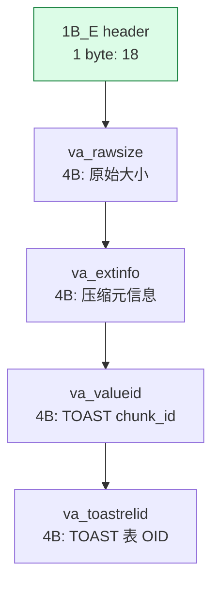

**总开销 = 19 字节**（1 字节 tag + 18 字节指针）。

### 3.5 TOAST 指针的"指针"特性

**TOAST 指针的 4 大作用**：

1. **识别**：通过 `va_valueid` 知道是哪条数据
3. **定位**：通过 `va_toastrelid` 知道在哪张表
4. **重建**：通过 `va_extinfo` + `va_rawsize` 知道怎么解压
5. **截断读**：切片时只读部分 chunk (见 §10)

---

## 四、4 种 attstorage：PLAIN / EXTENDED / EXTERNAL / MAIN

**位置**：`src/include/catalog/pg_attribute.h`（attstorage 字段）

```c
/*
 * attstorage tells for VARLENA attributes, what the heap access
 * methods can do to it if a given tuple doesn't fit into a page.
 * Possible values are as for pg_type.typstorage (see TYPSTORAGE macros).
 */
char    attstorage;
```

### 4.1 4 种策略

| 策略 | 压缩 | 外置 | 何时用 |
|---|---|---|---|
| **PLAIN** | ❌ | ❌ | 不压缩也不外置（如 char(N)）|
| **EXTENDED**（默认）| ✅ | ✅ | 普通 varlena，先压后置 |
| **EXTERNAL** | ❌ | ✅ | 不能压缩（如已加密）|
| **MAIN** | ✅ | ✅（兜底）| 优先压缩，最后才外置 |

### 4.3 4 种策略对 INSERT 行为的影响

```c
/* heap_toast_insert_or_update 的 4 阶段算法（源码） */
while (heap_compute_data_size(tupleDesc,
                              toast_values, toast_isnull) > maxDataLen)
{
    biggest_attno = toast_tuple_find_biggest_attribute(&ttc, true, false);
    /*                                ↑ for_compression  ↑ check_main */
    if (TupleDescAttr(tupleDesc, biggest_attno)->attstorage == TYPSTORAGE_EXTENDED)
        toast_tuple_try_compression(&ttc, biggest_attno);
    else
        toast_attr[biggest_attno].tai_colflags |= TOASTCOL_INCOMPRESSIBLE;

    if (toast_attr[biggest_attno].tai_size > maxDataLen &&
        rel->rd_rel->reltoastrelid != InvalidOid)
        toast_tuple_externalize(&ttc, biggest_attno, options);
}

/* Round 2: EXTENDED/EXTERNAL 全部外置 */
while (data_size > maxDataLen &&
       rel->rd_rel->reltoastrelid != InvalidOid)
    toast_tuple_externalize(...);

/* Round 3: MAIN 字段压缩 */
while (data_size > maxDataLen)
    toast_tuple_try_compression(&ttc, biggest_attno);

/* Round 4: MAIN 字段外置（兜底）*/
maxDataLen = TOAST_TUPLE_TARGET_MAIN - hoff;
while (data_size > maxDataLen &&
       rel->rd_rel->reltoastrelid != InvalidOid)
    toast_tuple_externalize(...);
```

### 4.4 4 种策略的写入决策树

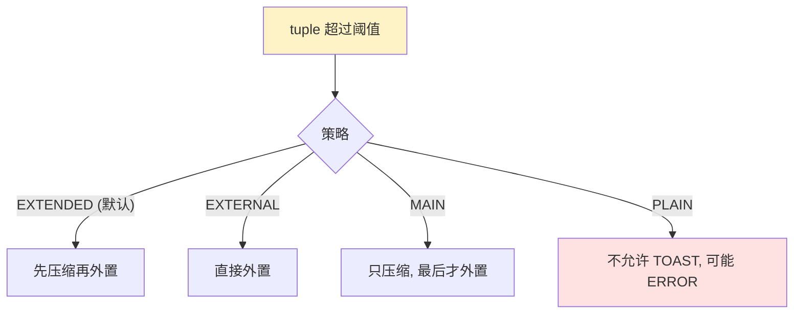

### 4.6 调整 attstorage

```sql
-- 修改字段策略
ALTER TABLE users ALTER COLUMN bio SET STORAGE EXTENDED;
ALTER TABLE users ALTER COLUMN bio SET STORAGE MAIN;
ALTER TABLE users ALTER COLUMN bio SET STORAGE EXTERNAL;
ALTER TABLE users ALTER COLUMN bio SET STORAGE PLAIN;
```

**修改后已经 TOAST 化的数据不会自动转换**——需要 `VACUUM FULL` 或 `ALTER COLUMN ... SET DATA TYPE`。

---

## 五、压缩引擎：PGLZ + LZ4

### 5.1 两种压缩方法

**位置**：`src/include/access/toast_compression.h`

```c
typedef enum ToastCompressionId
{
    TOAST_PGLZ_COMPRESSION_ID = 0,    /* PG 内置，从 80 年代沿用 */
    TOAST_LZ4_COMPRESSION_ID  = 1,    /* PG 14+，更快 */
    TOAST_INVALID_COMPRESSION_ID = 2,
} ToastCompressionId;

#define TOAST_PGLZ_COMPRESSION			'p'
#define TOAST_LZ4_COMPRESSION			'l'
#define InvalidCompressionMethod		'\0'
```

### 5.2 GUC：default_toast_compression

```c
int default_toast_compression = TOAST_PGLZ_COMPRESSION;  /* 默认值 */
```

**修改**：

```sql
SET default_toast_compression = 'lz4';  /* 单 session */
ALTER SYSTEM SET default_toast_compression = 'lz4';  /* 全局 */
```

**pg_attribute.attcompression** 字段控制**每列**的压缩方法：

```sql
CREATE TABLE t (
    data text COMPRESSION lz4,
    other text COMPRESSION pglz
);

ALTER TABLE t ALTER COLUMN data SET COMPRESSION pglz;
```

### 5.3 压缩 vs 不压缩的代价

| 维度 | PGLZ | LZ4 |
|---|---|---|
| 压缩率 | 高 | 中（80% of PGLZ）|
| 速度 | 慢（CPU bound）| 快（2~5x PGLZ）|
| 默认 | 是 | 否 |
| 适合 | 写少读多 | 写多读多 |

### 5.4 PGLZ 压缩的源码

**位置**：`src/backend/access/common/toast_compression.c:40-77`

```c
struct varlena *
pglz_compress_datum(const struct varlena *value)
{
    int32       valsize = VARSIZE_ANY_EXHDR(value);

    /* 太小或太大不压缩（节省 CPU） */
    if (valsize < PGLZ_strategy_default->min_input_size ||
        valsize > PGLZ_strategy_default->max_input_size)
        return NULL;

    /* 申请内存：PGLZ_MAX_OUTPUT(valsize) + VARHDRSZ_COMPRESSED */
    tmp = palloc(PGLZ_MAX_OUTPUT(valsize) + VARHDRSZ_COMPRESSED);

    len = pglz_compress(VARDATA_ANY(value), valsize,
                        (char *) tmp + VARHDRSZ_COMPRESSED, NULL);
    if (len < 0) {
        pfree(tmp);
        return NULL;  /* 压缩失败 */
    }
    SET_VARSIZE_COMPRESSED(tmp, len + VARHDRSZ_COMPRESSED);
    return tmp;
}
```

### 5.5 压缩失败的 4 个原因

```c
1. 值太小：< PGLZ_strategy_default->min_input_size
2. 值太大：> PGLZ_strategy_default->max_input_size
3. PGLZ 找不到重复模式（随机数据）
4. 压缩后变大（rare）
```

**5 个 PGLZ 参数**:

```c
PGLZ_strategy_default = {
    .min_input_size = 128,        /* < 128B 不压缩 */
    .max_input_size = 0x4000000,  /* > 64MB 不压缩 */
    .min_hist_size = 3,
    .max_hist_size = 0x1000,
    .match_size_good = 32,
    .match_size_drop = 2,
};
```

### 5.6 压缩的 4 种状态机

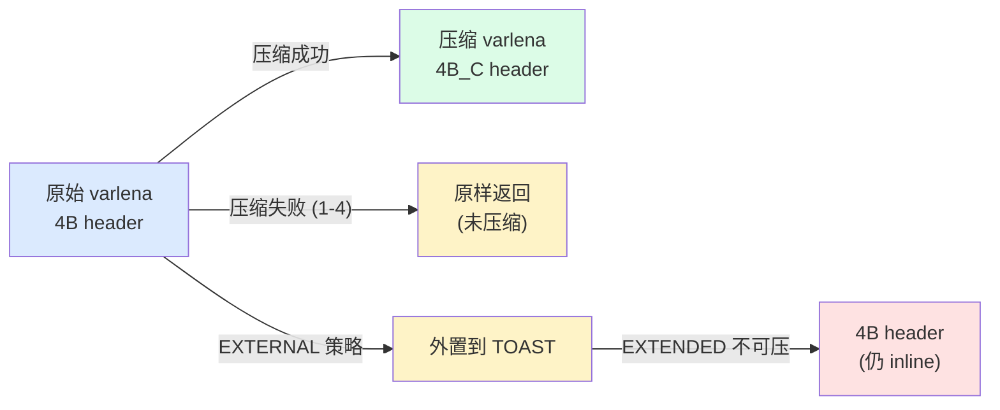

---

## 六、TOAST 表的创建：when + how

### 6.1 何时创建

**位置**：`src/backend/catalog/toasting.c:needs_toast_table`

```c
static bool
needs_toast_table(Relation rel)
{
    /* 1. 分区表不需要（partition 各自有 toast 表） */
    if (rel->rd_rel->relkind == RELKIND_PARTITIONED_TABLE)
        return false;

    /* 2. shared relation 不在 initdb 后建 */
    if (rel->rd_rel->relisshared && !IsBootstrapProcessingMode())
        return false;

    /* 3. catalog 表不能建（要 toast 必须在 initdb 时确定） */
    if (IsCatalogRelation(rel) && !IsBootstrapProcessingMode())
        return false;

    /* 4. 由 AM 决定 */
    return table_relation_needs_toast_table(rel);
}
```

**实际触发点**（heap 表）：

```c
/* heap_table_needs_toast_table 在 heapam_handler.c */
bool
heap_table_needs_toast_table(Relation rel)
{
    return rel->rd_rel->reltoastrelid == InvalidOid &&
           /* 至少有一个 varlena 列 */
           has_varlena_columns(rel);
}
```

### 6.2 触发场景

| 场景 | 何时创建 |
|---|---|
| `CREATE TABLE` 含 varlena | 立即建 |
| `CREATE TABLE` 只含定长列 | 不建 |
| `ALTER TABLE ADD COLUMN` | 立即建（如已存在也 OK）|
| `CREATE INDEX`（无表） | 不建 |
| `CLUSTER` / `VACUUM FULL` | 表重写，可能保留旧 TOAST |
| `ALTER TABLE ... SET TABLESPACE` | 创建新 TOAST |
| `initdb`（pg_class 等）| bootstrap 时建 |

### 6.3 创建入口

**位置**：`src/backend/catalog/toasting.c`

```c
void
AlterTableCreateToastTable(Oid relOid, Datum reloptions, LOCKMODE lockmode)
{
    CheckAndCreateToastTable(relOid, reloptions, lockmode, true, InvalidOid);
}

void
NewHeapCreateToastTable(Oid relOid, Datum reloptions, LOCKMODE lockmode,
                        Oid OIDOldToast)
{
    CheckAndCreateToastTable(relOid, reloptions, lockmode, false, OIDOldToast);
}
```

### 6.4 创建流程

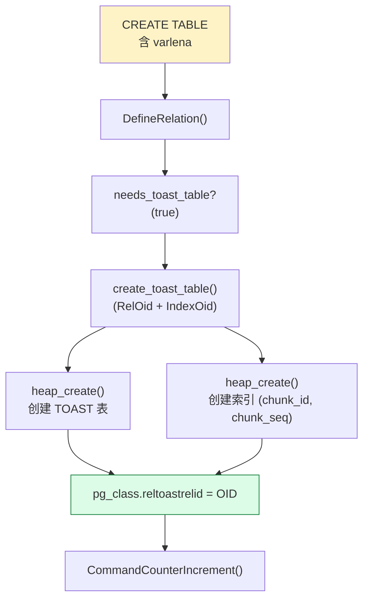

### 6.5 TOAST 表的 schema

```c
CREATE TABLE pg_toast.pg_toast_16384 (
    chunk_id   oid,            /* = varatt_external.va_valueid */
    chunk_seq  integer,        /* 0, 1, 2, ... */
    chunk_data bytea           /* 切片数据 */
);
ALTER TABLE pg_toast.pg_toast_16384
    OWNER TO postgres;

CREATE INDEX pg_toast_16384_index ON pg_toast.pg_toast_16384
    (chunk_id, chunk_seq);
```

**关键设计**：
- `chunk_id`：所有切片都用同一 OID（= 1 个 TOAST 指针）
- `chunk_seq`：第 N 块
- 联合索引：`(chunk_id, chunk_seq)` 范围扫描很快

### 6.6 reltoastrelid 字段

`pg_class.reltoastrelid` 是**用户表 → TOAST 表** 的反向引用：

```sql
SELECT relname, reltoastrelid
FROM pg_class
WHERE reltoastrelid != 0;

-- 输出
--  relname   | reltoastrelid
-- -----------+---------------
--  users     | 16384
--  pg_toast_16384 | 0 (TOAST 表本身没有 TOAST 表)
```

---

## 七、写入路径：`heap_toast_insert_or_update` 4 阶段算法

### 7.1 函数签名

**位置**：`src/backend/access/heap/heaptoast.c:96`

```c
HeapTuple
heap_toast_insert_or_update(Relation rel, HeapTuple newtup,
                            HeapTuple oldtup, int options);
```

**调用方**：

```c
/* heap_insert 和 heap_update 调用 */
result = heap_toast_insert_or_update(relation, mtup, NULL, options);
/* INSERT 场景：oldtup = NULL */
```

### 7.2 4 阶段算法（**核心**）

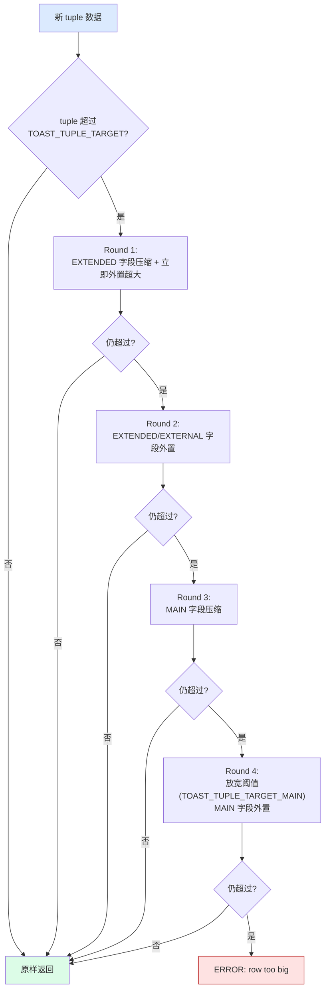

### 7.3 4 阶段源码（**关键片段**）

**位置**：`heaptoast.c:158-310`

```c
/* Round 1: 找最大字段, EXTENDED 压缩 */
while (heap_compute_data_size(tupleDesc,
                              toast_values, toast_isnull) > maxDataLen)
{
    int biggest_attno;

    biggest_attno = toast_tuple_find_biggest_attribute(&ttc, true, false);
    if (biggest_attno < 0)
        break;

    /* 仅 EXTENDED 才压缩 */
    if (TupleDescAttr(tupleDesc, biggest_attno)->attstorage == TYPSTORAGE_EXTENDED)
        toast_tuple_try_compression(&ttc, biggest_attno);
    else
        toast_attr[biggest_attno].tai_colflags |= TOASTCOL_INCOMPRESSIBLE;

    /* 大于 maxDataLen 单字段，直接外置 */
    if (toast_attr[biggest_attno].tai_size > maxDataLen &&
        rel->rd_rel->reltoastrelid != InvalidOid)
        toast_tuple_externalize(&ttc, biggest_attno, options);
}

/* Round 2: EXTENDED/EXTERNAL 全部外置 */
while (heap_compute_data_size(...) > maxDataLen &&
       rel->rd_rel->reltoastrelid != InvalidOid)
{
    biggest_attno = toast_tuple_find_biggest_attribute(&ttc, false, false);
    if (biggest_attno < 0) break;
    toast_tuple_externalize(&ttc, biggest_attno, options);
}

/* Round 3: MAIN 字段压缩 */
while (heap_compute_data_size(...) > maxDataLen)
{
    biggest_attno = toast_tuple_find_biggest_attribute(&ttc, true, true);
    if (biggest_attno < 0) break;
    toast_tuple_try_compression(&ttc, biggest_attno);
}

/* Round 4: MAIN 字段外置 (放宽阈值) */
maxDataLen = TOAST_TUPLE_TARGET_MAIN - hoff;

while (heap_compute_data_size(...) > maxDataLen &&
       rel->rd_rel->reltoastrelid != InvalidOid)
{
    biggest_attno = toast_tuple_find_biggest_attribute(&ttc, false, true);
    if (biggest_attno < 0) break;
    toast_tuple_externalize(&ttc, biggest_attno, options);
}

/* Round 4 后仍超：ERROR */
if (heap_compute_data_size(...) > maxDataLen)
    ereport(ERROR, (errcode(ERRCODE_PROGRAM_LIMIT_EXCEEDED),
                    errmsg("row is too big: ...")));
```

### 7.4 4 阶段策略对照表

| Round | 阈值 | 处理 EXTENDED | 处理 EXTERNAL | 处理 MAIN |
|---|---|---|---|---|
| 1 | 2KB | 压缩 + 立即外置超大 | 不处理 | 不处理 |
| 2 | 2KB | 外置 | 外置 | 不处理 |
| 3 | 2KB | — | — | 压缩 |
| 4 | 8KB | — | — | 外置 |

**Round 1 立即外置超大**：避免压缩浪费时间（一个超长 + 多个短时压缩无意义）。

**Round 4 放宽到 8KB**：MAIN 字段"宁可 inline 多花"，优先压缩。

---

## 八、chunk 拆分：`toast_save_datum` 源码

### 8.1 函数签名

**位置**：`src/backend/access/common/toast_internals.c:119`

```c
Datum
toast_save_datum(Relation rel, Datum value,
                 struct varlena *oldexternal, int options);
```

**调用方**：`toast_tuple_externalize`（`toast_helper.c:178`）

```c
void
toast_tuple_externalize(ToastTupleContext *ttc, int attribute, int options)
{
    Datum *value = &ttc->ttc_values[attribute];
    Datum old_value = *value;
    ToastAttrInfo *attr = &ttc->ttc_attr[attribute];

    attr->tai_colflags |= TOASTCOL_IGNORE;
    *value = toast_save_datum(ttc->ttc_rel, old_value, attr->tai_oldexternal, options);
    ...
}
```

### 8.2 toast_save_datum 的 4 个阶段

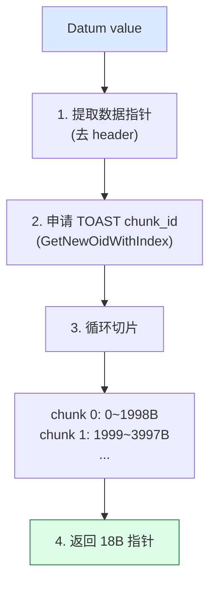

### 8.3 toast_save_datum 关键源码（**核心**）

**位置**：`toast_internals.c:119-360`

```c
Datum
toast_save_datum(Relation rel, Datum value,
                 struct varlena *oldexternal, int options)
{
    Relation toastrel;
    Relation *toastidxs;
    struct varatt_external toast_pointer;

    /* 1. 打开 TOAST 表 + 索引 */
    toastrel = table_open(rel->rd_rel->reltoastrelid, RowExclusiveLock);
    validIndex = toast_open_indexes(toastrel, RowExclusiveLock,
                                    &toastidxs, &num_indexes);

    /* 2. 提取数据 + 计算 rawsize/extinfo */
    if (VARATT_IS_SHORT(dval))
    {
        data_p = VARDATA_SHORT(dval);
        data_todo = VARSIZE_SHORT(dval) - VARHDRSZ_SHORT;
        toast_pointer.va_rawsize = data_todo + VARHDRSZ;
        toast_pointer.va_extinfo = data_todo;
    }
    else if (VARATT_IS_COMPRESSED(dval))
    {
        data_p = VARDATA(dval);
        data_todo = VARSIZE(dval) - VARHDRSZ;
        toast_pointer.va_rawsize =
            VARDATA_COMPRESSED_GET_EXTSIZE(dval) + VARHDRSZ;
        VARATT_EXTERNAL_SET_SIZE_AND_COMPRESS_METHOD(toast_pointer, data_todo,
                                                     VARDATA_COMPRESSED_GET_COMPRESS_METHOD(dval));
    }
    else
    {
        data_p = VARDATA(dval);
        data_todo = VARSIZE(dval) - VARHDRSZ;
        toast_pointer.va_rawsize = VARSIZE(dval);
        toast_pointer.va_extinfo = data_todo;
    }

    /* 3. 设置 TOAST 表 OID（重写场景特殊处理） */
    if (OidIsValid(rel->rd_toastoid))
        toast_pointer.va_toastrelid = rel->rd_toastoid;
    else
        toast_pointer.va_toastrelid = RelationGetRelid(toastrel);

    /* 4. 申请 chunk_id (OID) */
    if (!OidIsValid(rel->rd_toastoid))
    {
        /* 普通场景：申请新 OID */
        toast_pointer.va_valueid =
            GetNewOidWithIndex(toastrel,
                               RelationGetRelid(toastidxs[validIndex]),
                               (AttrNumber) 1);
    }
    else
    {
        /* 重写场景：复用旧 OID（如有）*/
        toast_pointer.va_valueid = InvalidOid;
        if (oldexternal != NULL)
        {
            struct varatt_external old_toast_pointer;
            VARATT_EXTERNAL_GET_POINTER(old_toast_pointer, oldexternal);
            if (old_toast_pointer.va_toastrelid == rel->rd_toastoid)
            {
                toast_pointer.va_valueid = old_toast_pointer.va_valueid;
                /* 重复 OID 检测 */
                if (toastrel_valueid_exists(toastrel, toast_pointer.va_valueid))
                    data_todo = 0;  /* 短路 */
            }
        }
        if (toast_pointer.va_valueid == InvalidOid)
            do
                toast_pointer.va_valueid =
                    GetNewOidWithIndex(toastrel, ...);
            while (toastid_valueid_exists(rel->rd_toastoid, ...));
    }

    /* 5. 循环切片，每片一行 TOAST 表 */
    while (data_todo > 0)
    {
        int i;
        CHECK_FOR_INTERRUPTS();
        chunk_size = Min(TOAST_MAX_CHUNK_SIZE, data_todo);

        /* 构造 TOAST 行 */
        t_values[0] = ObjectIdGetDatum(toast_pointer.va_valueid);
        t_values[1] = Int32GetDatum(chunk_seq++);
        SET_VARSIZE(&chunk_data, chunk_size + VARHDRSZ);
        memcpy(VARDATA(&chunk_data), data_p, chunk_size);
        toasttup = heap_form_tuple(toasttupDesc, t_values, t_isnull);

        heap_insert(toastrel, toasttup, mycid, options, NULL);

        /* 创建索引条目（仅 indisready） */
        for (i = 0; i < num_indexes; i++)
            if (toastidxs[i]->rd_index->indisready)
                index_insert(toastidxs[i], t_values, t_isnull,
                             &(toasttup->t_self), toastrel,
                             toastidxs[i]->rd_index->indisunique ?
                             UNIQUE_CHECK_YES : UNIQUE_CHECK_NO,
                             false, NULL);

        heap_freetuple(toasttup);
        data_todo -= chunk_size;
        data_p += chunk_size;
    }

    toast_close_indexes(toastidxs, num_indexes, NoLock);
    table_close(toastrel, NoLock);

    /* 6. 构造 18B TOAST 指针 */
    result = palloc(TOAST_POINTER_SIZE);  /* 19B */
    SET_VARTAG_EXTERNAL(result, VARTAG_ONDISK);
    memcpy(VARDATA_EXTERNAL(result), &toast_pointer, sizeof(toast_pointer));

    return PointerGetDatum(result);
}
```

### 8.4 chunk 大小计算

**位置**：`heaptoast.h:99-103`

```c
#define EXTERN_TUPLES_PER_PAGE	4	/* 每页 4 个 TOAST tuple */
#define EXTERN_TUPLE_MAX_SIZE	MaximumBytesPerTuple(EXTERN_TUPLES_PER_PAGE)
#define TOAST_MAX_CHUNK_SIZE	\
    (EXTERN_TUPLE_MAX_SIZE -							\
     MAXALIGN(SizeofHeapTupleHeader) -					\
     sizeof(Oid) -										\
     sizeof(int32) -									\
     VARHDRSZ)
```

**计算示例**（BLCKSZ=8192）：

```
EXTERN_TUPLE_MAX_SIZE    = (8192 - 24 - 4*4) / 4 = 2032
TOAST_MAX_CHUNK_SIZE     = 2032 - 24 - 4 - 4 - 4 = ~1996
```

**实际单 chunk 大小 = ~1996 字节**（可装 4 个 tuple/页）。

### 8.5 chunk 的存储格式

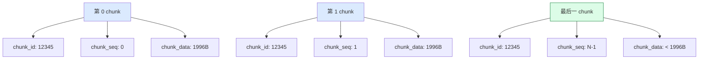

**关键**：`chunk_id` 相同 = 同一条 datum；按 chunk_seq 顺序重组。

### 8.6 TOAST 指针创建的 4 步

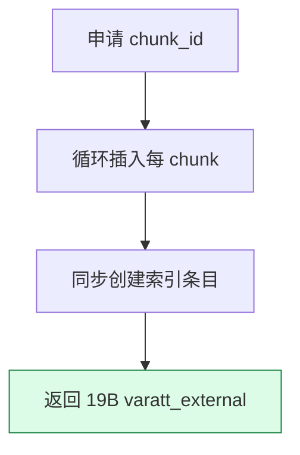


---

## 九、读取路径：`detoast` 与 `detoast_external_attr`

### 9.1 读取入口

**位置**：`src/backend/access/common/detoast.c`

```c
struct varlena *
detoast_external_attr(struct varlena *attr)
{
    struct varlena *result;

    if (VARATT_IS_EXTERNAL_ONDISK(attr))
    {
        /* 外置到 TOAST 表 */
        result = toast_fetch_datum(attr);
    }
    else if (VARATT_IS_EXTERNAL_INDIRECT(attr))
    {
        /* 间接指针（指向内存中的 varlena）*/
        struct varatt_indirect redirect;
        VARATT_EXTERNAL_GET_POINTER(redirect, attr);
        attr = (struct varlena *) redirect.pointer;
        if (VARATT_IS_EXTERNAL(attr))
            return detoast_external_attr(attr);
        result = palloc(VARSIZE_ANY(attr));
        memcpy(result, attr, VARSIZE_ANY(attr));
    }
    else if (VARATT_IS_EXTERNAL_EXPANDED(attr))
    {
        /* expanded object */
        ExpandedObjectHeader *eoh = DatumGetEOHP(PointerGetDatum(attr));
        Size resultsize = EOH_get_flat_size(eoh);
        result = palloc(resultsize);
        EOH_flatten_into(eoh, result, resultsize);
    }
    else
    {
        /* 普通 inline，无需操作 */
        result = attr;
    }
    return result;
}
```

### 9.2 读取的 4 种分支决策

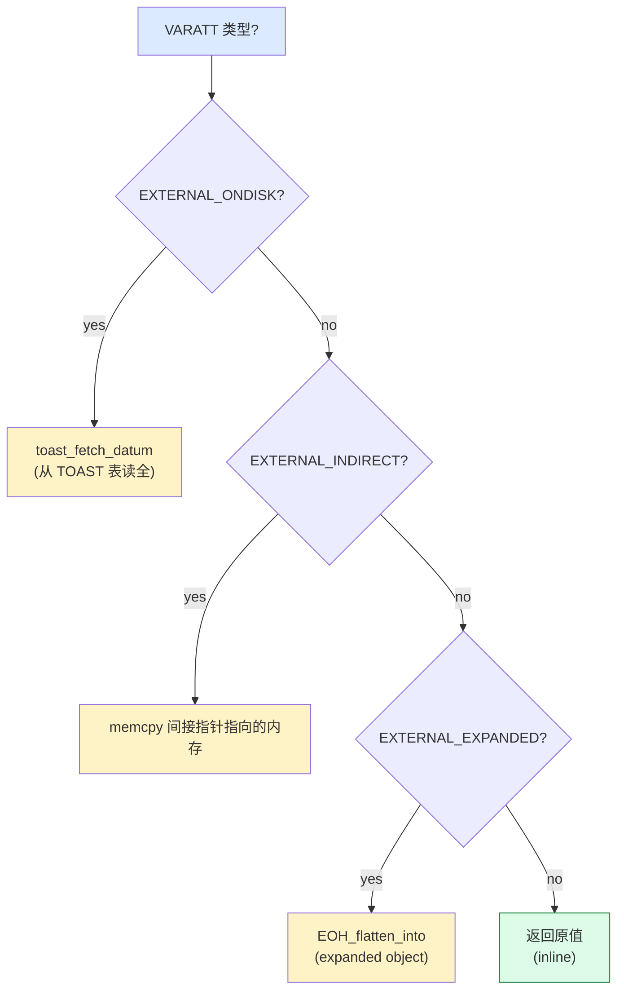

### 9.3 toast_fetch_datum 源码（**核心**）

**位置**：`detoast.c:343-394`

```c
static struct varlena *
toast_fetch_datum(struct varlena *attr)
{
    Relation toastrel;
    struct varlena *result;
    struct varatt_external toast_pointer;
    int32 attrsize;

    if (!VARATT_IS_EXTERNAL_ONDISK(attr))
        elog(ERROR, "toast_fetch_datum shouldn't be called for non-ondisk datums");

    VARATT_EXTERNAL_GET_POINTER(toast_pointer, attr);
    attrsize = VARATT_EXTERNAL_GET_EXTSIZE(toast_pointer);

    result = palloc(attrsize + VARHDRSZ);
    if (VARATT_EXTERNAL_IS_COMPRESSED(toast_pointer))
        SET_VARSIZE_COMPRESSED(result, attrsize + VARHDRSZ);
    else
        SET_VARSIZE(result, attrsize + VARHDRSZ);

    if (attrsize == 0)
        return result;

    /* 打开 TOAST 表 */
    toastrel = table_open(toast_pointer.va_toastrelid, AccessShareLock);

    /* 一次性读所有 chunks */
    table_relation_fetch_toast_slice(toastrel, toast_pointer.va_valueid,
                                     attrsize, 0, attrsize, result);

    table_close(toastrel, AccessShareLock);

    return result;  /* 仍是 4B_C 压缩格式 */
}
```

### 9.4 detoast 全家桶

| 函数 | 作用 | 何时用 |
|---|---|---|
| `detoast_external_attr` | ONDISK → 4B_C/4B | 通用读 |
| `detoast_attr` | 任意 → 4B（解压） | 普通读取 |
| `detoast_attr_slice` | 任意 → 切片 | `substr` 等 |
| `toast_raw_datum_size` | 取"逻辑大小" | log 输出 |
| `toast_datum_size` | 取"占用大小" | `pg_column_size` |

### 9.5 detoast_attr（**真正解压**）

```c
/* detoast.c */

struct varlena *detoast_attr(struct varlena *attr)
{
    if (VARATT_IS_EXTERNAL_ONDISK(attr))
        attr = toast_fetch_datum(attr);  /* 仍是 4B_C */
    if (VARATT_IS_COMPRESSED(attr))
        attr = toast_decompress_datum(attr);  /* 变成 4B */
    return attr;
}
```

---

## 十、切片读取：`heap_fetch_toast_slice`

### 10.1 何时用切片读取

- **`substr(big_text, 1000, 1000)`** —— 只需部分内容
- **`length(big_text)`** —— 已知大小，无需全读
- **B-tree 索引 over text** —— 比较前缀

### 10.2 heap_fetch_toast_slice 源码

**位置**：`src/backend/access/heap/heaptoast.c:626-770`

```c
void
heap_fetch_toast_slice(Relation toastrel, Oid valueid, int32 attrsize,
                       int32 sliceoffset, int32 slicelength,
                       struct varlena *result)
{
    /* 计算哪些 chunk 必读 */
    int32 totalchunks = ((attrsize - 1) / TOAST_MAX_CHUNK_SIZE) + 1;
    int startchunk = sliceoffset / TOAST_MAX_CHUNK_SIZE;
    int endchunk = (sliceoffset + slicelength - 1) / TOAST_MAX_CHUNK_SIZE;
    Assert(endchunk <= totalchunks);

    /* 设置索引扫描 key */
    ScanKeyInit(&toastkey[0], (AttrNumber) 1,
                BTEqualStrategyNumber, F_OIDEQ,
                ObjectIdGetDatum(valueid));

    if (startchunk == 0 && endchunk == totalchunks - 1)
        nscankeys = 1;  /* 全读 */
    else if (startchunk == endchunk)
    {
        /* 只读 1 个 chunk */
        ScanKeyInit(&toastkey[1], (AttrNumber) 2,
                    BTEqualStrategyNumber, F_INT4EQ,
                    Int32GetDatum(startchunk));
        nscankeys = 2;
    }
    else
    {
        /* 读 N 个 chunk (范围) */
        ScanKeyInit(&toastkey[1], (AttrNumber) 2,
                    BTGreaterEqualStrategyNumber, F_INT4GE,
                    Int32GetDatum(startchunk));
        ScanKeyInit(&toastkey[2], (AttrNumber) 2,
                    BTLessEqualStrategyNumber, F_INT4LE,
                    Int32GetDatum(endchunk));
        nscankeys = 3;
    }

    /* 通过有序索引扫描 */
    toastscan = systable_beginscan_ordered(toastrel, toastidxs[validIndex],
                                           get_toast_snapshot(),
                                           nscankeys, toastkey);

    /* 读每个 chunk, 校验完整性 */
    while ((ttup = systable_getnext_ordered(toastscan, ForwardScanDirection)) != NULL)
    {
        curchunk = DatumGetInt32(fastgetattr(ttup, 2, toasttupDesc, &isnull));
        chunk = DatumGetPointer(fastgetattr(ttup, 3, toasttupDesc, &isnull));

        if (!VARATT_IS_EXTENDED(chunk))
        {
            chunksize = VARSIZE(chunk) - VARHDRSZ;
            chunkdata = VARDATA(chunk);
        }
        else if (VARATT_IS_SHORT(chunk))
        {
            chunksize = VARSIZE_SHORT(chunk) - VARHDRSZ_SHORT;
            chunkdata = VARDATA_SHORT(chunk);
        }
        else
            elog(ERROR, "found toasted toast chunk ...");  /* 不会发生 */

        /* 完整性检查 */
        if (curchunk != expectedchunk)
            ereport(ERROR, ...);
        if (chunksize != expected_size)
            ereport(ERROR, ...);

        /* 拷贝到 result 中正确位置 */
        chcpystrt = 0;
        chcpyend = chunksize - 1;
        if (curchunk == startchunk)
            chcpystrt = sliceoffset % TOAST_MAX_CHUNK_SIZE;
        if (curchunk == endchunk)
            chcpyend = (sliceoffset + slicelength - 1) % TOAST_MAX_CHUNK_SIZE;

        memcpy(VARDATA(result) +
               curchunk * TOAST_MAX_CHUNK_SIZE - sliceoffset + chcpystrt,
               chunkdata + chcpystrt,
               (chcpyend - chcpystrt) + 1);

        expectedchunk++;
    }
    ...
}
```

### 10.3 切片扫描决策

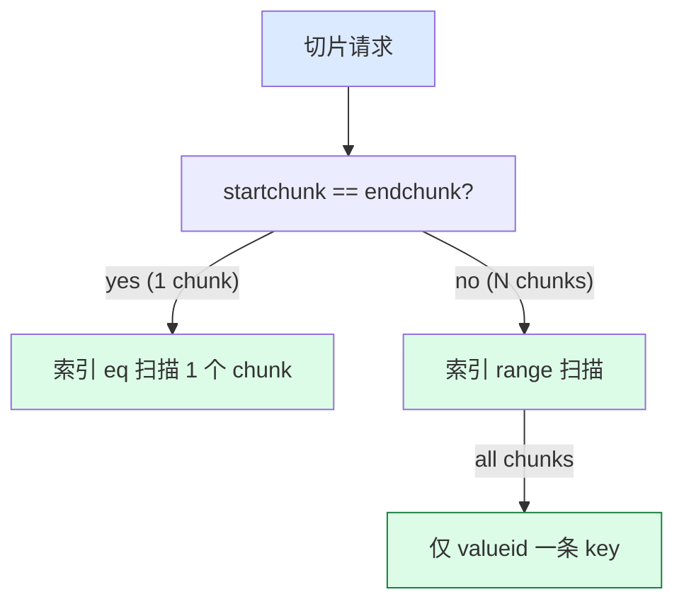

### 10.4 TOAST 索引 (chunk_id, chunk_seq) 的妙用

**为什么必须联合索引？**

- 单独 `chunk_id` 索引：要 1000+ chunks → 1000+ 次 IO
- 联合索引 (chunk_id, chunk_seq)：**一次 index scan** 拿到所有 chunks，**按 chunk_seq 顺序**

**有序扫描**：`systable_beginscan_ordered` + `systable_getnext_ordered` 保证顺序，**避免 sort 步骤**。

### 10.5 slice 的 3 层性能优化

```mermaid
graph LR
    A[SELECT substr(text, 1000, 100)]:::input --> B["detoast_attr_slice<br/>@ detoast.c"]
    B --> C["toast_fetch_datum_slice<br/>@ detoast.c"]
    C --> D["heap_fetch_toast_slice<br/>@ heaptoast.c"]
    D --> E["索引范围扫描<br/>只读 1 个 chunk"]
    E --> F["memcpy 到 result"]

    style A fill:#dbeafe
    style E fill:#dcfce7,stroke:#15803d
```

**性能对比**：

| 数据大小 | 切片 1000B | 全读 |
|---|---|---|
| 100KB text | 1 chunk (1996B IO) | 50 chunks |
| 10MB text | 1 chunk | 5000 chunks |
| 压缩率 50% | 0.5 chunk | 100KB |

---

## 十一、UPDATE 复用：TOAST OID 复用的优化

### 11.1 复用场景

**UPDATE 流程**：

```sql
UPDATE users SET bio = '新内容' WHERE id = 1;
```

**2 种可能**：
- bio 字段**没变** → 复用旧 OID，**不重新插入 TOAST**
- bio 字段**变了** → 申请新 OID，**重新插入**

### 11.2 复用的判断（源码）

**位置**：`toast_helper.c:toast_tuple_init`

```c
/* toast_tuple_init 阶段 */
if (ttc->ttc_oldvalues != NULL)
{
    old_value = (struct varlena *) DatumGetPointer(ttc->ttc_oldvalues[i]);
    new_value = (struct varlena *) DatumGetPointer(ttc->ttc_values[i]);

    if (att->attlen == -1 && !ttc->ttc_oldisnull[i] &&
        VARATT_IS_EXTERNAL_ONDISK(old_value))
    {
        if (ttc->ttc_isnull[i] ||
            !VARATT_IS_EXTERNAL_ONDISK(new_value) ||
            memcmp(old_value, new_value,
                   VARSIZE_EXTERNAL(old_value)) != 0)
        {
            /* bio 变了 → 要删除旧 TOAST 值 */
            ttc->ttc_attr[i].tai_colflags |= TOASTCOL_NEEDS_DELETE_OLD;
            ttc->ttc_flags |= TOAST_NEEDS_DELETE_OLD;
        }
        else
        {
            /* bio 没变 → 复用旧 TOAST 指针 */
            ttc->ttc_attr[i].tai_colflags |= TOASTCOL_IGNORE;
            continue;
        }
    }
}
```

### 11.3 memcmp 的对比

```c
memcmp(old_value, new_value, VARSIZE_EXTERNAL(old_value)) != 0
```

**对比 19 字节**（1B 头 + 18B 指针）：
- 如果完全相同 → 复用
- 如果任一字节不同 → 重新申请

### 11.4 复用的全流程

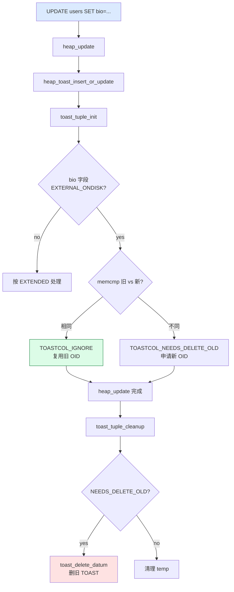

### 11.5 复用节省的开销

| 维度 | 复用 | 不复用 |
|---|---|---|
| TOAST 插入 | 0 | N |
| TOAST 删除 | 0 | N |
| WAL | 仅 heap update | heap update + N insert + N delete |
| Index 更新 | 0 | N |
| **总 IO** | **极低** | **高** |

### 11.6 实际意义

```sql
-- 这种 UPDATE 极快：bio 复用，仅主表 WAL
UPDATE users SET login_count = login_count + 1;

-- 这种慢：bio 重新 TOAST
UPDATE users SET bio = '新 bio';
```

---

## 十二、清理：`VACUUM` 释放 TOAST 表

### 12.1 VACUUM 作用

TOAST 表的清理由 **autovacuum / VACUUM** 自动完成：

```c
/* vacuumlazy.c 中检查 TOAST */
if (rel->rd_rel->reltoastrelid != InvalidOid)
    vacuum_rel(toastrelid, ...);
```

### 12.2 清理流程

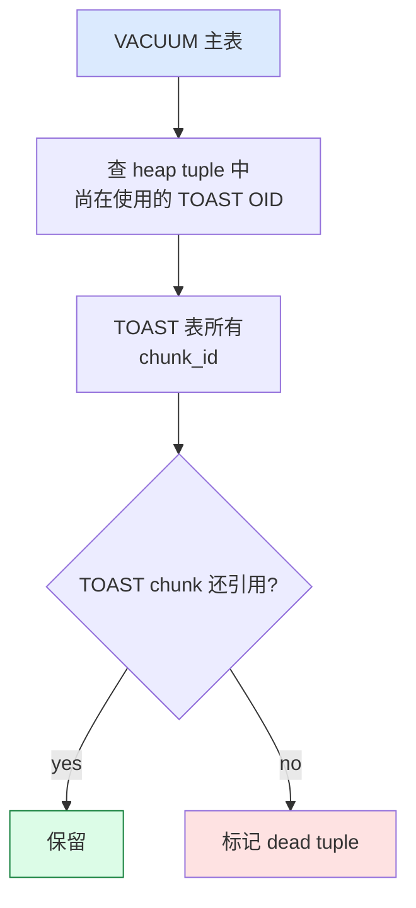

### 12.3 VACUUM 不能清理的 2 种死情况

1. **长事务**：`oldest xmin` 之前的所有 TOAST 不能清理
2. **未提交的 tuple**：仍可能被引用

### 12.4 手动清理 TOAST

```sql
VACUUM (VERBOSE, ANALYZE) users;
VACUUM FULL users;  -- 重建主表 + TOAST 表（更彻底但会锁）
```

### 12.5 TOAST 表的膨胀

```sql
-- 看 TOAST 表膨胀
SELECT
    c.relname,
    pg_size_pretty(pg_relation_size(c.oid)) AS size,
    pg_size_pretty(pg_indexes_size(c.oid)) AS index_size
FROM pg_class c
WHERE c.relname LIKE 'pg_toast_%'
  AND c.relname NOT LIKE '%_index';
```

---

## 十三、性能特征

### 13.1 TOAST 写入成本

| 操作 | 成本 |
|---|---|
| 1B inline（< 127B）| 0 |
| 4B inline | 0 |
| 4B_C 压缩 inline | 1x pglz/lz4 |
| 1B_E 外置 | 1x pglz/lz4 + N 行 INSERT + N 行 index_insert |
| 1B_E 外置 + 压缩 | 2x pglz/lz4 |

### 13.2 TOAST 读取成本

| 操作 | 成本 |
|---|---|
| Inline (1B/4B) | 0 |
| Inline 压缩 (4B_C) | 1x pglz/lz4 解压 |
| 外置 + 未压缩 | N 次 index scan + 顺序 IO |
| 外置 + 压缩 | 2x pglz/lz4 (解压 + 复制) |
| 切片读 | 1 次 index range scan |

### 13.3 TOAST 索引内存

`chunk_id, chunk_seq` 联合索引：

| 数据大小 | chunks | 索引条目 | 索引大小 |
|---|---|---|---|
| 100KB | 50 | 50 | ~8KB |
| 1MB | 500 | 500 | ~80KB |
| 100MB | 50000 | 50000 | ~8MB |

**索引大小约为数据大小的 10%**。

### 13.4 TOAST 的 6 个关键性能场景

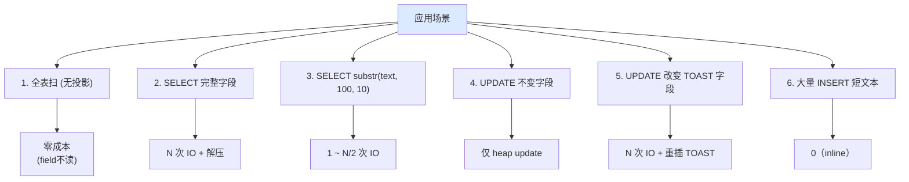

---

## 十四、监控与排查

### 14.1 看 TOAST 表大小

```sql
-- 单表 TOAST 大小
SELECT
    pg_size_pretty(pg_relation_size(c.oid)) AS toast_size,
    pg_size_pretty(pg_indexes_size(c.oid)) AS toast_index_size,
    pg_size_pretty(pg_relation_size(c.reltoastrelid)) AS main_size,
    pg_size_pretty(pg_total_relation_size(c.oid)) AS total_size
FROM pg_class c
WHERE c.reltoastrelid != 0
  AND c.relkind = 'r'
ORDER BY pg_total_relation_size(c.oid) DESC
LIMIT 20;
```

### 14.2 看 TOAST chunk 数量

```sql
-- 看最大 chunk_id（即数据条数）
SELECT
    max(chunk_id) AS max_chunks
FROM pg_toast.pg_toast_<oid>;
```

### 14.3 看字段级压缩

```sql
-- attcompression
SELECT attname, attstorage, attcompression
FROM pg_attribute
WHERE attrelid = 'users'::regclass
  AND attlen = -1;
```

### 14.4 启用 toast 详细日志

```sql
-- pg_stat_statements: 看 toast 操作
SELECT query, calls, total_exec_time / calls AS mean_time
FROM pg_stat_statements
WHERE query LIKE '%toast%'
LIMIT 20;
```

### 14.5 pg_stat_user_tables

```sql
-- n_tup_upd / n_tup_hot_upd 区分 toast 修改
SELECT relname, n_tup_upd, n_tup_hot_upd, n_tup_del
FROM pg_stat_user_tables
WHERE schemaname = 'public';
```

### 14.6 TOAST 表膨胀检查

```sql
-- 看哪些表的 TOAST 膨胀
WITH toast_info AS (
    SELECT
        c.oid AS main_oid,
        pg_relation_size(c.reltoastrelid) AS toast_bytes,
        pg_relation_size(c.oid) AS main_bytes
    FROM pg_class c
    WHERE c.reltoastrelid != 0
      AND c.relkind = 'r'
)
SELECT
    main_oid::regclass AS table_name,
    toast_bytes,
    main_bytes,
    CASE WHEN main_bytes = 0 THEN 0
        ELSE round((toast_bytes::numeric / main_bytes), 2) END AS ratio
FROM toast_info
ORDER BY ratio DESC
LIMIT 20;
```

### 14.7 EXPLAIN 看是否 TOAST

```sql
EXPLAIN (ANALYZE, VERBOSE) SELECT length(bio) FROM users;

-- 输出
-- Index Scan using ... (cost=...)
--   Output: length(bio)
--   -> 实际上 bio 是 1B_E, 不读 TOAST
```

**length / substring / position 等函数可优化**：不需要全读 TOAST 数据。

---

## 十五、6 个常见陷阱

### 15.1 陷阱 1：单字段 > 1GB

```sql
-- 这条 ERROR
INSERT INTO t (data) VALUES (repeat('x', 1024*1024*1024));
-- ERROR:  field size > 1GB
```

**原因**：varlena 长度字段是 30-bit，最大 1GB - 1。

### 15.2 陷阱 2：tuple 整体 > 8KB

```sql
-- 1000 列 char(10) 各 = 10KB, 单行超过 8KB
CREATE TABLE t (c1 char(10), c2 char(10), ..., c1000 char(10));
INSERT INTO t VALUES (...);  -- ERROR: row is too big
```

**原因**：TOAST 不解决多列总和过大的问题。

### 15.3 陷阱 3：EXTERNAL 不压缩导致大文件

```sql
ALTER TABLE t ALTER COLUMN bio SET STORAGE EXTERNAL;
-- 写入 1GB 文本 → TOAST 表变 1GB（未压缩）
```

### 15.4 陷阱 4：partial index + TOAST

```sql
CREATE INDEX idx ON t (substr(bio, 1, 100));  -- 索引内嵌部分 TOAST
-- 索引会有 partial copy of TOAST data
```

### 15.5 陷阱 5：VACUUM 不释放 TOAST 表

```sql
-- 长事务阻塞 VACUUM
BEGIN; SELECT * FROM t WHERE id = 1;  -- 不 commit
-- 后端 VACUUM 看不到老 VACUUM，TOAST 不能清
```

### 15.6 陷阱 6：复制中的 TOAST

```sql
-- 逻辑复制 OID 不变，但物理 WAL 是新内容
-- apply worker 正确处理（依靠 chunk_id）
```

---

## 十六、源码路径索引

### 16.1 主要头文件

| 内容 | 路径 |
|---|---|
| varlena header + 4 种类型 | `src/include/varatt.h` |
| TOAST 阈值常量 | `src/include/access/heaptoast.h` |
| heap_toast API | `src/include/access/heaptoast.h` |
| TOAST 压缩头 | `src/include/access/toast_compression.h` |
| TOAST 内部头 | `src/include/access/toast_internals.h` |
| detoast API | `src/include/access/detoast.h` |
| toast_helper API | `src/include/access/toast_helper.h` |
| catalog TOAST 创建 | `src/include/catalog/toasting.h` |
| pg_attribute | `src/include/catalog/pg_attribute.h` |

### 16.2 主要实现文件

| 内容 | 路径 | 行数 |
|---|---|---|
| TOAST 主流程 | `src/backend/access/heap/heaptoast.c` | 791 |
| TOAST 内部 | `src/backend/access/common/toast_internals.c` | 656 |
| 压缩 | `src/backend/access/common/toast_compression.c` | 316 |
| detoast | `src/backend/access/common/detoast.c` | 646 |
| toast helper | `src/backend/access/table/toast_helper.c` | — |
| TOAST 表创建 | `src/backend/catalog/toasting.c` | — |

### 16.3 关键函数速查

| 函数 | 路径 | 作用 |
|---|---|---|
| `heap_toast_insert_or_update` | `heaptoast.c:96` | INSERT/UPDATE 的 4 阶段算法 |
| `toast_save_datum` | `toast_internals.c:119` | 单 datum 的 TOAST 化 |
| `toast_delete_datum` | `toast_internals.c:~415` | 单 datum 的 TOAST 删除 |
| `toast_tuple_init` | `toast_helper.c:~80` | 准备 TOAST 元数据 |
| `toast_tuple_find_biggest_attribute` | `toast_helper.c` | 找最大字段 |
| `toast_tuple_try_compression` | `toast_helper.c` | 尝试压缩 |
| `toast_tuple_externalize` | `toast_helper.c:178` | 外置 |
| `detoast_external_attr` | `detoast.c:~40` | 读取入口 |
| `toast_fetch_datum` | `detoast.c:343` | 全读 TOAST |
| `toast_fetch_datum_slice` | `detoast.c:396` | 切片读 |
| `heap_fetch_toast_slice` | `heaptoast.c:626` | heap 实现切片 |
| `needs_toast_table` | `toasting.c` | 判断是否需要 TOAST |
| `pglz_compress_datum` | `toast_compression.c:40` | PGLZ 压缩 |
| `pglz_decompress_datum` | `toast_compression.c:82` | PGLZ 解压 |
| `lz4_compress_datum` | `toast_compression.c` | LZ4 压缩 |

---

## 附录 A：TOAST 关键阈值（PG 18, BLCKSZ=8192）

| 常量 | 字节 | 来源 |
|---|---|---|
| `TOAST_TUPLES_PER_PAGE` | 4 | `heaptoast.h:55` |
| `TOAST_TUPLE_THRESHOLD` | ~2032 | `MaximumBytesPerTuple(4)` |
| `TOAST_TUPLE_TARGET` | ~2032 | 同上 |
| `TOAST_TUPLES_PER_PAGE_MAIN` | 1 | `heaptoast.h:73` |
| `TOAST_TUPLE_TARGET_MAIN` | ~8160 | `MaximumBytesPerTuple(1)` |
| `TOAST_INDEX_TARGET` | ~512 | `MaxHeapTupleSize/16` |
| `TOAST_MAX_CHUNK_SIZE` | ~1996 | `heaptoast.h:103` |
| `TOAST_POINTER_SIZE` | 19 | `sizeof(varatt_external) + 1` |
| `VARHDRSZ` | 4 | `sizeof(varattrib_4b)` |
| `VARHDRSZ_SHORT` | 1 | `sizeof(varattrib_1b)` |
| `VARHDRSZ_EXTERNAL` | 19 | `sizeof(varatt_external)+1` |
| `VARHDRSZ_COMPRESSED` | 4 | `sizeof(varattrib_4b_c)+va_tcinfo` |

## 附录 B：TOAST 的 4 个典型使用场景

| 场景 | 数据 | attstorage |
|---|---|---|
| 用户画像 bio | 1KB~10KB text | EXTENDED（默认）|
| 日志 JSONB | 10KB~1MB jsonb | EXTENDED |
| 加密字段 | 100B~1KB bytea | EXTERNAL（已加密，不能压）|
| 关键列 | < 1KB text | MAIN（优先 inline）|
| 不可变短数据 | 不适用 | PLAIN（不可 TOAST）|

## 附录 C：TOAST 4 大调试命令

```bash
# 1. 查看 TOAST 表大小
SELECT pg_size_pretty(pg_total_relation_size(c.reltoastrelid))
FROM pg_class c WHERE c.relname = 'users';

# 2. 看 chunk 数
SELECT count(*), max(chunk_id)
FROM pg_toast.pg_toast_<oid>;

# 3. 看某个 TOAST 值的所有 chunk
SELECT * FROM pg_toast.pg_toast_<oid> WHERE chunk_id = 12345 ORDER BY chunk_seq;

# 4. pageinspect 看 TOAST 表 page
CREATE EXTENSION pageinspect;
SELECT * FROM heap_page_items(get_raw_page('pg_toast.pg_toast_<oid>', 0));
```

---

**全文完**

