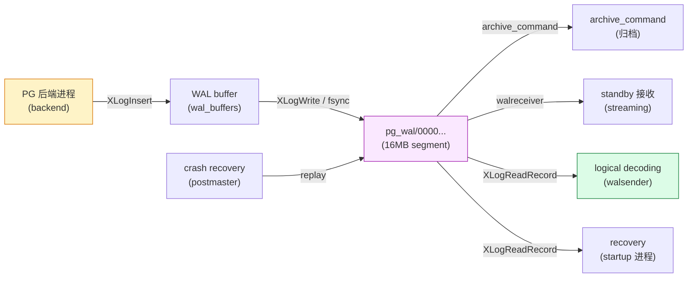
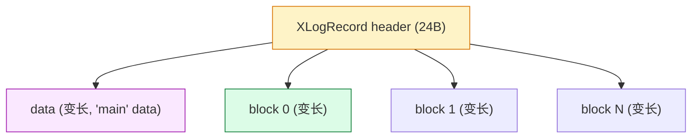
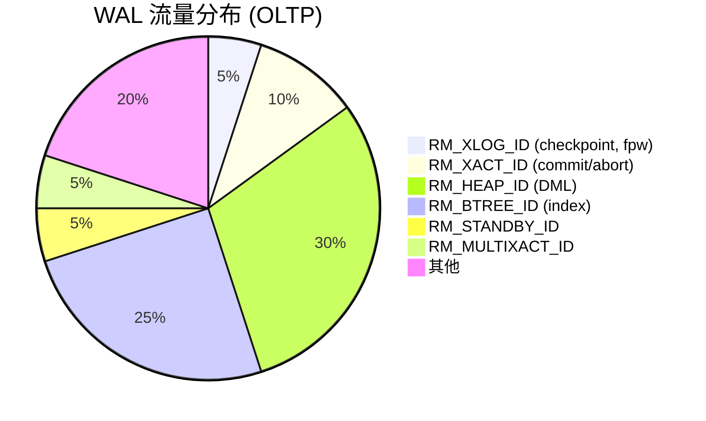
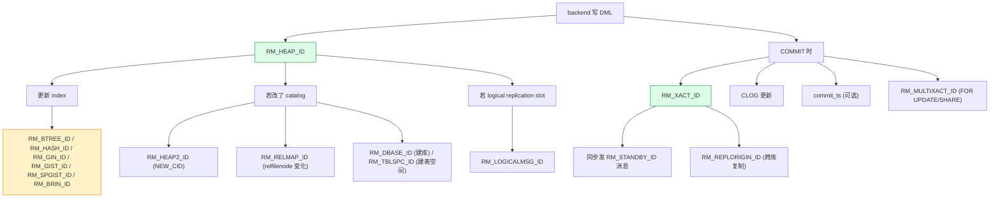
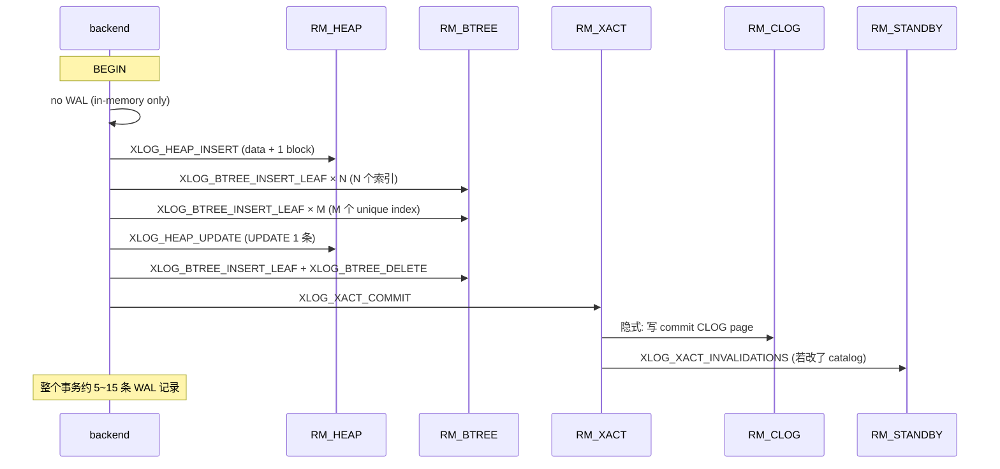
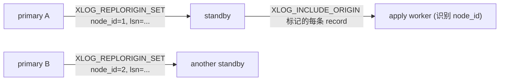
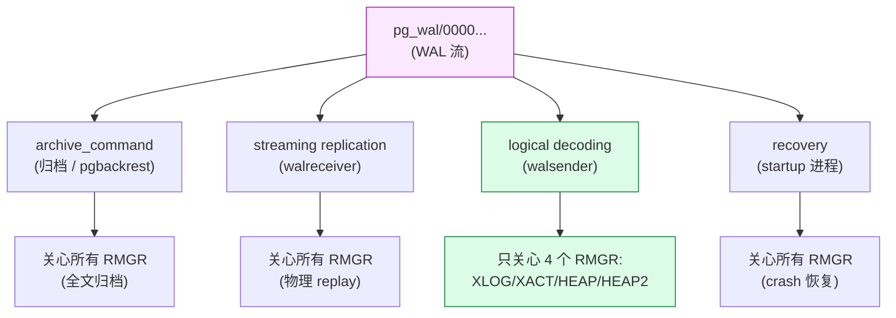

# PostgreSQL WAL 记录类型完全指南：21 个 RMGR × 80+ 种记录的源码级拆解

| 编写人 | 编写内容 | 编写时间 |
| --- | --- | --- |
| growdu | 初稿。把 PostgreSQL 18 dev（`~/cwork/postgresql`）的 WAL 记录类型**完整**梳理一遍：21 个 RMGR（resource manager）、80+ 种 `xl_info`、每种带二进制布局、C 源码定义、触发场景、pg_waldump 输出示例。最后用一个 **真实事务** 完整列出 20+ 条 WAL 记录的时间线。配套源码版本：PostgreSQL 18 dev。 | 2026-10-12 |

> 本文是「PostgreSQL 内核机制源码系列」——同系列前文：
>
> - [PostgreSQL 逻辑复制全链路：以一个真实事务为例，从 `INSERT` 到 `apply` 的源码级旅程](./postgresql-logical-replication-end-to-end-flow/index.html)
> - [PostgreSQL 逻辑复制里 `RUNNING_XACTS` 写入机制与快照 `xmin / xmax / xip` 的演化](./postgresql-running-xacts-snapshot/index.html)
> - [PostgreSQL MVCC：从一行 UPDATE 到 5 个 HeapTuple 的演化](./postgresql-mvcc/index.html)
> - [PostgreSQL 事务生命周期：从 BEGIN/COMMIT 到 CLOG 一条链路](./postgresql-transaction-lifecycle/index.html)

## 阅读指南

- **第一节 ~ 第三节**（**强烈推荐全读**）：WAL 是什么 / 记录的二进制结构 / 21 个 RMGR 总览——5 分钟建立全局观
- **第四节 ~ 第七节**（**精读 / 选读**）：按 RMGR 分组详解，每组都带 1~3 个具体例子
  - §4 `RM_XLOG_ID` / `RM_XACT_ID`（**必读**：事务生命周期核心）
  - §5 `RM_HEAP_ID` / `RM_HEAP2_ID`（**必读**：DML 链路核心）
  - §6 `RM_STANDBY_ID`（**必读**：HA/复制基础）
  - §7 索引类（选读）：6 种索引 RMGR
  - §8 元数据类（选读）：SMGR/DBASE/TBLSPC/RELMAP
  - §9 事务状态类（选读）：CLOG/COMMIT_TS/MULTIXACT
  - §10 复制/逻辑消息（**必读**：逻辑复制链路）
- **第八节 ~ 第十节**：完整事务时间线 + 监控与排查

## 目录

- 一、为什么需要"完整 WAL 字典"
- 二、WAL 记录的二进制结构：`XLogRecord` + data + blocks
- 三、21 个 RMGR 总览
- 四、`RM_XLOG_ID` 与 `RM_XACT_ID`：事务元事件
- 五、`RM_HEAP_ID` 与 `RM_HEAP2_ID`：DML 与可见性
- 六、`RM_STANDBY_ID`：HA / 复制基础
- 七、6 种索引 RMGR：BTREE / HASH / GIN / GIST / SPGIST / BRIN
- 八、元数据类 4 个 RMGR：SMGR / DBASE / TBLSPC / RELMAP
- 九、事务状态类 3 个 RMGR：CLOG / COMMIT_TS / MULTIXACT
- 十、复制/逻辑消息 3 个 RMGR：REPLORIGIN / LOGICALMSG / GENERIC
- 十一、完整事务的 30 条 WAL 时间线（一个真实例子）
- 十二、WAL 在不同子系统中的角色
- 十三、监控 / 排查 / 工具
- 十四、源码引用索引

---

## 一、为什么需要"完整 WAL 字典"

很多人学 PostgreSQL 都会"听说过 WAL"，但**真正翻开源码看 WAL 的人很少**——因为 WAL 是个"超长尾"的子系统：80+ 种记录类型散落在 21 个 RMGR、20+ 个 `_xlog.h` 头文件里。**每一类只占 1~3 个函数**，但**互相耦合**：一条 COMMIT 涉及 5 个 RMGR、12+ 种记录。

**3 个常见误区**：

1. "WAL 就是 `XLOG_HEAP_INSERT/UPDATE/DELETE`"——**错**。事务元数据（COMMIT、ABORT、ASSIGNMENT、INVALIDATIONS）也走 WAL，而且元数据种类比 DML 还多。
2. "WAL 只能 recovery 用"——**错**。逻辑复制、增量备份、CDC、HA 全部依赖 WAL。
3. "索引（BTREE 等）的 WAL 跟 heap 一样"——**错**。索引 RMGR 是另一套协议，每种索引的 `xl_info` 值都是自己定义的。

**本文目标**：把上面 3 个误区一次性打破——看完之后，你能在源码里**精确找到**每种 WAL 记录的定义、触发点、redesc 函数。

**WAL 流水线的全景图**：



**所有 4 个下游消费者**（archive、standby、logical decoding、recovery）都从同一份 WAL 流里读，但**只关心自己 RMGR 范围内的记录**。

---

## 二、WAL 记录的二进制结构：`XLogRecord` + data + blocks

源码 `src/include/access/xlogrecord.h`：每条 WAL 记录由 **3 部分** 组成：



### 2.1 `XLogRecord` 头（24 字节）

源码 `xlogrecord.h:46`：

```c
typedef struct XLogRecord
{
    uint32        xl_tot_len;     /* total len of entire record */
    TransactionId xl_xid;         /* xact id (0 if no xid) */
    uint32        xl_prev;        /* LSN of previous record (low 32 bits) */
    uint8         xl_info;        /* 标志位 (含 opmask 决定 record 类型) */
    RmgrId        xl_rmid;        /* resource manager ID (0~20) */
    /* 2 bytes of xl_info flag bits */
    pg_crc32c     xl_crc;         /* CRC32c for this record */
} XLogRecord;
```

**字段详解**：

| 字段 | 长度 | 含义 |
| --- | --- | --- |
| `xl_tot_len` | 4B | 整个 record 的总长（**含 header、data、所有 blocks**） |
| `xl_xid` | 4B | 事务 id；xid-less 记录（如 XLOG_SWITCH）填 0 |
| `xl_prev` | 4B | 前一条 record 的 LSN 低 32 位（PG 17+ 改成 8B） |
| `xl_info` | 1B | 决定 record 类型；通常 = `op` + 1~2 个 flag bit |
| `xl_rmid` | 1B | RMGR 编号（0=`RM_XLOG_ID`, 1=`RM_XACT_ID`, ...） |
| （xl_info 附加位） | 2B | 含 `XLOG_INCLUDE_ORIGIN` 等标志 |
| `xl_crc` | 4B | CRC32c 校验 |
| **小计** | **24B** | |

> **PG 17 重要变更**：`xl_prev` 从 4B 扩展到 8B，**总 header 长度从 24B 变成 32B**。`pg_waldump` 在 PG 17 之后的输出和 PG 16 之前的输出**不兼容**。

### 2.2 `xl_info` 的 2 个位：高 4 位 = opmask，低 4 位 = flags

每个 RMGR 都把 `xl_info` 分成"高位 4 位 (opmask) + 低位 4 位 (flags)"。例：

```c
/* src/include/access/heapam_xlog.h */
#define XLOG_HEAP_OPMASK     0x70  /* 高 4 位: INSERT/DELETE/UPDATE/TRUNCATE/... */
#define XLOG_HEAP_INIT_PAGE  0x80  /* flag: 这一条 record 要初始化 page */

/* src/include/access/xact.h */
#define XLOG_XACT_OPMASK     0x70  /* 高 4 位: COMMIT/PREPARE/ABORT/... */
#define XLOG_XACT_HAS_INFO   0x80  /* flag: 后面还有 xl_xact_parsed_* 元数据 */

/* src/include/access/xlog.h */
#define XLOG_INCLUDE_ORIGIN  0x01  /* flag: 含 replication origin */
#define XLOG_MARK_UNIMPORTANT 0x02 /* flag: 此 record 不重要 */
```

**所以一个 byte 的 `xl_info` 同时携带**："op" 决定走哪个 redesc 函数，"flag" 决定 record 数据的附加信息。

### 2.3 data 部分：rmgr-specific 的 struct

每种 WAL 记录都定义自己的 `xl_<rmgr>_<op>` struct，紧跟在 header 后。例：

```c
/* XLOG_HEAP_INSERT  */
typedef struct xl_heap_insert {
    uint8        flags;        /* XLH_INSERT_HASOID / CONTAINS_NEW_TUPLE */
} xl_heap_insert;

/* XLOG_XACT_COMMIT */
typedef struct xl_xact_commit {
    TimestampTz xact_time;     /* commit timestamp */
    int         nsubxacts;     /* 子事务数 */
    TransactionId *subxacts;   /* 子 xid 数组 */
    uint32      xinfo;         /* 标志位 (HAS_ORIGIN, HAS_TWOPHASE, ...) */
    /* 可选: xl_origin, xl_twophase */
} xl_xact_commit;
```

### 2.4 block 部分：受影响的 page 数据

每条 record 可以带 0~N 个 block。每个 block 包含 **block header (32B) + 实际数据**：

```c
/* 源码 xlogrecord.h */
typedef struct XLogRecordBlockHeader
{
    uint8         id;            /* block 编号 (0~255) */
    uint8         fork_flags;    /* 高 4 位: fork 号, 低 4 位: flags */
    uint16        data_length;   /* data 长度 (含 8B 头部? 视 flags) */
    RelFileLocator rlocator;     /* 16B: dbOid + spcOid + relNumber */
    BlockNumber   blk;           /* 4B: page 号 */
} XLogRecordBlockHeader;        /* 总 28B */
```

**block data 模式有 3 种**（由 `fork_flags` 决定）：
- **FULL_IMAGE**: 整个 8KB page（full-page write, FPW）
- **SHORT_DATA**: 仅修改的字节流（差分）
- **INIT_PAGE**: 0x80 flag——整页初始化

**XLOG 记录在 disk 上的物理布局**：

```
Offset  | 字段
--------+--------
0x00    | XLogRecord header (24B in PG 16-, 32B in PG 17+)
0x18    | main data (rmgr-specific struct)
0x18 + main_data_len | XLogRecordBlockHeader[0] (28B)
...     | block 0 data
...     | XLogRecordBlockHeader[1] (28B)
...     | block 1 data
...     | ...
```

### 2.5 `pg_waldump` 看一条真实的 record

**复现**：

```bash
$ pg_waldump -p pg_wal -s 0/16B0000 -e 0/16C0000
rmgr: Heap        len (rec/tot):     59/   229, tx:       500, lsn: 0/16B0028, prev 0/16B0010, desc: INSERT off 3, blkref #0: rel 1663/16384/16387 blk 0
```

**解析**：

```
rmgr: Heap         → xl_rmid = 10 (RM_HEAP_ID)
len: 59/229        → data=59B, total=229B (含 header + blocks)
tx: 500            → xl_xid = 500
lsn: 0/16B0028     → 记录起始 LSN
prev: 0/16B0010    → 前一条 LSN
desc: INSERT       → xl_info 0x00 = XLOG_HEAP_INSERT
off 3              → tuple 在 page 上的 offset = 3
blkref #0          → 1 个 block
  rel 1663/16384/16387  → tablespace/db/relfilenode
  blk 0                  → page 0
```

> **PG 17+ 输出格式**：`len (rec/tot)` 变成 `rec_len/tot_len`，其他基本不变。


---

## 三、21 个 RMGR 总览

源码 `src/include/access/rmgrlist.h` 注册了 **21 个 RMGR**（PG 18 dev）。每个 RMGR 都提供 **4~8 个回调函数**：

```c
PG_RMGR(RM_<id>, "Name", rmgr_redo, rmgr_desc, rmgr_identify,
        rmgr_startup, rmgr_cleanup, rmgr_mask, rmgr_decode)
```

| # | RMGR | name | 缩写 | 关心它的子系统 | 本文深入 |
| --- | --- | --- | --- | --- | --- |
| 0 | `RM_XLOG_ID` | XLOG | xlog | postmaster, startup | ✅ §4.1 |
| 1 | `RM_XACT_ID` | Transaction | xact | backend, all recovery | ✅ §4.2 |
| 2 | `RM_SMGR_ID` | Storage | smgr | md, recovery | §8.1 |
| 3 | `RM_CLOG_ID` | CLOG | clog | backend, autovacuum | §9.1 |
| 4 | `RM_DBASE_ID` | Database | dbase | createdb | §8.2 |
| 5 | `RM_TBLSPC_ID` | Tablespace | tblspc | tablespace | §8.3 |
| 6 | `RM_MULTIXACT_ID` | MultiXact | multixact | mxact | §9.3 |
| 7 | `RM_RELMAP_ID` | RelMap | relmap | relcache, catalog | §8.4 |
| 8 | `RM_STANDBY_ID` | Standby | standby | HA, replication | ✅ §6 |
| 9 | `RM_HEAP_ID` | Heap | heap | backend, all DML | ✅ §5.1 |
| 10 | `RM_BTREE_ID` | Btree | btree | btree index | §7.1 |
| 11 | `RM_HASH_ID` | Hash | hash | hash index | §7.2 |
| 12 | `RM_GIN_ID` | Gin | gin | GIN index | §7.3 |
| 13 | `RM_GIST_ID` | Gist | gist | GiST index | §7.4 |
| 14 | `RM_SEQ_ID` | Sequence | seq | sequence | §7.5 |
| 15 | `RM_SPGIST_ID` | SPGist | spgist | SP-GiST index | §7.6 |
| 16 | `RM_BRIN_ID` | BRIN | brin | BRIN index | §7.7 |
| 17 | `RM_COMMIT_TS_ID` | CommitTs | commit_ts | commit timestamp | §9.2 |
| 18 | `RM_REPLORIGIN_ID` | ReplicationOrigin | replorigin | logical replication | ✅ §10.1 |
| 19 | `RM_GENERIC_ID` | Generic | generic | extensions | §10.3 |
| 20 | `RM_LOGICALMSG_ID` | LogicalMessage | logicalmsg | logical decoding | ✅ §10.2 |

**21 个 RMGR 的 WAL 流量分布**（典型 OLTP 数据库）：



**RMGR 之间的调用关系**（**一张图**）：



**一个普通事务的 WAL 分布**（典型 INSERT + UPDATE + COMMIT）：



### 3.1 速查表：所有 80+ 种 `xl_info` 值

下面这张表是**全文档最重要的速查**——把每个 RMGR 下的 `xl_info` 操作码列出来。详细的二进制布局在 §4~§10。

| RMGR | xl_info | 宏名 | 何时产生 | 详细 |
| --- | --- | --- | --- | --- |
| 0 XLOG | 0x00 | `XLOG_CHECKPOINT_SHUTDOWN` | shutdown checkpoint | §4.1 |
| 0 XLOG | 0x10 | `XLOG_CHECKPOINT_ONLINE` | online checkpoint | §4.1 |
| 0 XLOG | 0x20 | `XLOG_NOOP` | no-op | §4.1 |
| 0 XLOG | 0x30 | `XLOG_NEXTOID` | 预分配 OID | §4.1 |
| 0 XLOG | 0x40 | `XLOG_SWITCH` | WAL segment 切换 | §4.1 |
| 0 XLOG | 0x50 | `XLOG_BACKUP_END` | pg_basebackup 结束 | §4.1 |
| 0 XLOG | 0x60 | `XLOG_PARAMETER_CHANGE` | 改 wal_level 等 GUC | §4.1 |
| 0 XLOG | 0x70 | `XLOG_RESTORE_POINT` | `pg_create_restore_point` | §4.1 |
| 0 XLOG | 0x80 | `XLOG_FPW_CHANGE` | 改 full_page_writes | §4.1 |
| 0 XLOG | 0x90 | `XLOG_END_OF_RECOVERY` | recovery 完成 | §4.1 |
| 0 XLOG | 0xA0 | `XLOG_FPI_FOR_HINT` | hint bit 触发的 FPW | §4.1 |
| 0 XLOG | 0xB0 | `XLOG_FPI` | 普通 FPW | §4.1 |
| 0 XLOG | 0xD0 | `XLOG_OVERWRITE_CONTRECORD` | 重写旧 contrecord | §4.1 |
| 0 XLOG | 0xE0 | `XLOG_CHECKPOINT_REDO` | WAL summary 锚点 | §4.1 |
| 1 XACT | 0x00 | `XLOG_XACT_COMMIT` | COMMIT | §4.2 |
| 1 XACT | 0x10 | `XLOG_XACT_PREPARE` | PREPARE (2PC) | §4.2 |
| 1 XACT | 0x20 | `XLOG_XACT_ABORT` | ROLLBACK | §4.2 |
| 1 XACT | 0x30 | `XLOG_XACT_COMMIT_PREPARED` | COMMIT PREPARED | §4.2 |
| 1 XACT | 0x40 | `XLOG_XACT_ABORT_PREPARED` | ROLLBACK PREPARED | §4.2 |
| 1 XACT | 0x50 | `XLOG_XACT_ASSIGNMENT` | subxact 分配 | §4.2 |
| 1 XACT | 0x60 | `XLOG_XACT_INVALIDATIONS` | catalog cache invalidation | §4.2 |
| 2 SMGR | 0x10 | `XLOG_SMGR_CREATE` | 建表/索引 | §8.1 |
| 2 SMGR | 0x20 | `XLOG_SMGR_TRUNCATE` | TRUNCATE | §8.1 |
| 4 DBASE | 0x00 | `XLOG_DBASE_CREATE_FILE_COPY` | 旧 CREATE DATABASE | §8.2 |
| 4 DBASE | 0x10 | `XLOG_DBASE_CREATE_WAL_LOG` | 新 CREATE DATABASE | §8.2 |
| 4 DBASE | 0x20 | `XLOG_DBASE_DROP` | DROP DATABASE | §8.2 |
| 5 TBLSPC | 0x00 | `XLOG_TBLSPC_CREATE` | CREATE TABLESPACE | §8.3 |
| 5 TBLSPC | 0x10 | `XLOG_TBLSPC_DROP` | DROP TABLESPACE | §8.3 |
| 6 MULTIXACT | 0x00 | `XLOG_MULTIXACT_ZERO_OFF_PAGE` | 初始化 offsets | §9.3 |
| 6 MULTIXACT | 0x10 | `XLOG_MULTIXACT_ZERO_MEM_PAGE` | 初始化 members | §9.3 |
| 6 MULTIXACT | 0x20 | `XLOG_MULTIXACT_CREATE_ID` | 新 MultiXact | §9.3 |
| 6 MULTIXACT | 0x30 | `XLOG_MULTIXACT_TRUNCATE_ID` | 截断 | §9.3 |
| 7 RELMAP | 0x00 | `XLOG_RELMAP_UPDATE` | relfilenode 映射更新 | §8.4 |
| 8 STANDBY | 0x00 | `XLOG_STANDBY_LOCK` | AccessExclusiveLock | §6.1 |
| 8 STANDBY | 0x10 | `XLOG_RUNNING_XACTS` | bgwriter 周期写 | §6.2 |
| 8 STANDBY | 0x20 | `XLOG_INVALIDATIONS` | cache invalidation (deprecated, 用 XACT 0x60) | §6.3 |
| 9 HEAP | 0x00 | `XLOG_HEAP_INSERT` | INSERT | §5.1.1 |
| 9 HEAP | 0x10 | `XLOG_HEAP_DELETE` | DELETE | §5.1.2 |
| 9 HEAP | 0x20 | `XLOG_HEAP_UPDATE` | UPDATE | §5.1.3 |
| 9 HEAP | 0x30 | `XLOG_HEAP_TRUNCATE` | TRUNCATE | §5.1.4 |
| 9 HEAP | 0x40 | `XLOG_HEAP_HOT_UPDATE` | Heap-Only Tuple update | §5.1.5 |
| 9 HEAP | 0x50 | `XLOG_HEAP_CONFIRM` | row lock 确认 | §5.1.6 |
| 9 HEAP | 0x60 | `XLOG_HEAP_LOCK` | row-level FOR UPDATE | §5.1.7 |
| 9 HEAP | 0x70 | `XLOG_HEAP_INPLACE` | inplace update (catalog) | §5.1.8 |
| 9 HEAP | 0x80 | `XLOG_HEAP_INIT_PAGE` (flag) | 初始化新 page | §5.1.1 |
| 9 HEAP2 | 0x00 | `XLOG_HEAP2_REWRITE` | ALTER TABLE rewrite | §5.2.1 |
| 9 HEAP2 | 0x10 | `XLOG_HEAP2_PRUNE_ON_ACCESS` | 访问时 prune | §5.2.2 |
| 9 HEAP2 | 0x20 | `XLOG_HEAP2_PRUNE_VACUUM_SCAN` | vacuum scan prune | §5.2.2 |
| 9 HEAP2 | 0x30 | `XLOG_HEAP2_PRUNE_VACUUM_CLEANUP` | vacuum cleanup prune | §5.2.2 |
| 9 HEAP2 | 0x40 | `XLOG_HEAP2_VISIBLE` | visibility map 设置 | §5.2.3 |
| 9 HEAP2 | 0x50 | `XLOG_HEAP2_MULTI_INSERT` | 批量 INSERT (COPY) | §5.2.4 |
| 9 HEAP2 | 0x60 | `XLOG_HEAP2_LOCK_UPDATED` | XLOG_HEAP_LOCK 续作 | §5.2.5 |
| 9 HEAP2 | 0x70 | `XLOG_HEAP2_NEW_CID` | catalog 变更 cmin/cmax | §5.2.6 |
| 10 BTREE | 0x00..0xE0 | 15 种 | btree DML | §7.1 |
| 11 HASH | 0x00..0xC0 | 13 种 | hash DML | §7.2 |
| 12 GIN | 0x10..0x90 | 9 种 | GIN DML | §7.3 |
| 13 GIST | 0x00..0x70 | 7 种 | GiST DML | §7.4 |
| 14 SEQ | 0x00 | `XLOG_SEQ_LOG` | nextval | §7.5 |
| 15 SPGIST | 0x10..0x80 | 8 种 | SP-GiST DML | §7.6 |
| 16 BRIN | 0x00..0x50 | 6 种 | BRIN DML | §7.7 |
| 17 COMMIT_TS | 0x00 | `XLOG_COMMIT_TS_SET` | 设置 commit timestamp | §9.2 |
| 17 COMMIT_TS | 0x10 | `XLOG_COMMIT_TS_TRUNCATE` | 截断 | §9.2 |
| 18 REPLORIGIN | 0x00 | `XLOG_REPLORIGIN_SET` | pg_replication_origin_create | §10.1 |
| 18 REPLORIGIN | 0x10 | `XLOG_REPLORIGIN_DROP` | drop origin | §10.1 |
| 19 GENERIC | (n/a) | generic WAL (extension 自定义) | §10.3 |
| 20 LOGICALMSG | 0x00 | `XLOG_LOGICAL_MESSAGE` | pg_logical_emit_message | §10.2 |


---

## 四、`RM_XLOG_ID` 与 `RM_XACT_ID`：事务元事件

`RM_XLOG_ID` 和 `RM_XACT_ID` 是 **WAL 系统的"控制面"**——它们不存数据，但**决定恢复、复制、checkpoint 的所有元事件**。

### 4.1 `RM_XLOG_ID` 详解（15 种记录）

源码 `src/include/catalog/pg_control.h:69-82`：

```c
#define XLOG_CHECKPOINT_SHUTDOWN    0x00
#define XLOG_CHECKPOINT_ONLINE      0x10
#define XLOG_NOOP                   0x20
#define XLOG_NEXTOID                0x30
#define XLOG_SWITCH                 0x40
#define XLOG_BACKUP_END             0x50
#define XLOG_PARAMETER_CHANGE       0x60
#define XLOG_RESTORE_POINT          0x70
#define XLOG_FPW_CHANGE             0x80
#define XLOG_END_OF_RECOVERY        0x90
#define XLOG_FPI_FOR_HINT           0xA0
#define XLOG_FPI                    0xB0
#define XLOG_OVERWRITE_CONTRECORD   0xD0
#define XLOG_CHECKPOINT_REDO        0xE0
```

#### 4.1.1 `XLOG_CHECKPOINT_SHUTDOWN` / `XLOG_CHECKPOINT_ONLINE` / `XLOG_CHECKPOINT_REDO` (3 种)

**触发**：
- `XLOG_CHECKPOINT_SHUTDOWN` — `pg_ctl stop` / `SIGTERM` 时同步写
- `XLOG_CHECKPOINT_ONLINE` — checkpointer 周期写（默认 5min）
- `XLOG_CHECKPOINT_REDO` — WAL summary 锚点（PG 17+ 新增）

**作用**：标记一个**同步点**——保证 WAL 里"checkpointer 之前"的脏数据已经落盘。recovery 时找到最近的 checkpoint，从那里开始 replay。

**源码** `src/backend/access/transam/xlog.c:7253`：

```c
recptr = XLogInsert(RM_XLOG_ID,
                    shutdown ? XLOG_CHECKPOINT_SHUTDOWN : XLOG_CHECKPOINT_ONLINE);
```

**data 布局** (`xl_checkpoint`)：

```c
typedef struct xl_checkpoint {
    CheckPoint  checkPoint;     /* CheckPoint struct (~140 字节) */
    /* 可选: 更多信息 */
} xl_checkpoint;

typedef struct CheckPoint {
    XLogRecPtr  prev;            /* checkpoint 之前的 redo point */
    TimeLineID  ThisTimeLineID;  /* 时间线 */
    pg_time_t   time;            /* checkpoint 时刻 */
    XLogRecPtr  fullPageWrites;  /* ? */
    TransactionId oldestXid;     /* 最老的未冻结 xid */
    ...
    Oid         nextOid;         /* 下一个分配的 OID */
    MultiXactId nextMulti;       /* 下一个 MultiXactId */
    MultiXactOffset nextMultiOffset;
    TransactionId oldestActiveXid; /* 最老未完成 xid (用于 hot standby) */
} CheckPoint;
```

**pg_waldump 输出**：

```
rmgr: XLOG        len (rec/tot):    214/   262, tx:          0, lsn: 0/1A0000C8, prev 0/1A000060, desc: CHECKPOINT_ONLINE redo 0/19000028; tli 1; prev tli 1; fpw true; oldest xid 500 in DB 16384; oldest multi 1 in DB 16384; oldest/newest commit timestamp xid: 0/0; oldest running xid 0; shutdown ? 0; immediate ? 0; wal_level logical; max_connections 100; max_prepared_xacts 10; max_locks_per_xact 64; max_wal_senders 10; max_replication_slots 10; update_xid 0; oldestMultiXid 1; oldestMulti in DB 16384; oldestRunningXid 0
```

**关键观察**：
- `prev 0/19000028` — redo 起点
- `oldest xid 500 in DB 16384` — 最老的 xid
- `wal_level logical` — 持久化 GUC（replay 时要校验）
- `max_connections 100` 等 GUC 全部持久化

#### 4.1.2 `XLOG_NEXTOID` — 预分配 OID

**触发**：`assign_new_oid()` 在 OID 不足时预分配 8192 个 OID。

**作用**：让 OID 分配在 standby 上**不冲突**——primary 分配的 OID 范围会写到 WAL，standby replay 时跳过这范围。

```c
typedef struct xl_nxt oid {
    Oid        nextOid;          /* 下一个可分配的 OID */
    Oid        maxOid;           /* 预分配区间上限 */
} xl_nxt_oid;
```

#### 4.1.3 `XLOG_SWITCH` — WAL segment 切换

**触发**：
- `pg_switch_wal()` SQL 函数
- 一个 segment 写满（默认 16MB）时自动
- `archive_timeout` 触发
- `pg_backup_stop()`

**data 布局**：

```c
typedef struct xl_xlog_switch {
    /* 空: 此 record 不带 data */
} xl_xlog_switch;
```

**作用**：标记 "**当前 segment 写完，切换到新 segment**"——archive 工具（archive_command / pgbackrest）看到这条就立刻归档当前 segment。

#### 4.1.4 `XLOG_PARAMETER_CHANGE` — GUC 变更持久化

**触发**：改 `wal_level`, `max_connections`, `max_locks_per_xact` 等 GUC。

**data 布局** (`xl_parameter_change`)：

```c
typedef struct xl_parameter_change {
    int        MaxConnections;
    int        max_locks_per_xact;
    int        max_prepared_xacts;
    int        max_wal_senders;
    int        max_replication_slots;
    int        wal_sender_timeout;
    bool       track_commit_timestamp;
    char       wal_level;        /* WAL_LEVEL_REPLICA/LOGICAL */
} xl_parameter_change;
```

**关键**：`wal_level logical` 持久化到 WAL——若 `wal_level` 被改到 < logical，**所有 logical slot 立即失效**。

#### 4.1.5 `XLOG_END_OF_RECOVERY` — 恢复完成

**触发**：crash recovery 或 archive recovery 完成，DB 进入生产模式。

**作用**：让所有 standby 知道"primary 启动完了"——是 hot standby 切换的最后一条 WAL。

#### 4.1.6 `XLOG_FPI` / `XLOG_FPI_FOR_HINT` — Full Page Image（FPW）

**触发**：
- `XLOG_FPI` — checkpoint 之后的第一次 page 修改（默认 full_page_writes=on）
- `XLOG_FPI_FOR_HINT` — 设置 hint bit 时发现 page 没 FPW

**作用**：写整页（8KB）到 WAL——保证 crash recovery 时能从这条记录**完整恢复** page 内容（防 torn write）。

```c
typedef struct xl_xlog_fpwi {
    RelFileLocator rlocator;
    BlockNumber   blk;
    uint16        hole_offset;  /* 页内空洞偏移 (compress 用) */
    uint8         hole_length;  /* 空洞长度 */
    /* 后面: 实际 page 数据 (可能含 compression) */
} xl_xlog_fpwi;
```

**FPW 占 WAL 流量的 30~60%**——是 OLTP 数据库 WAL 最大的单项。

#### 4.1.7 `XLOG_NOOP` — 空操作

**触发**：极少数边界情况（force_xid_recording 等）。

**data 布局**：空。

#### 4.1.8 `XLOG_FPW_CHANGE` / `XLOG_BACKUP_END` / `XLOG_RESTORE_POINT` / `XLOG_OVERWRITE_CONTRECORD`

- `XLOG_FPW_CHANGE` — `full_page_writes` GUC 变更
- `XLOG_BACKUP_END` — `pg_basebackup` 结束
- `XLOG_RESTORE_POINT` — `pg_create_restore_point('name')` 记录一个命名恢复点
- `XLOG_OVERWRITE_CONTRECORD` — 老的 continued record 被重写时插入（罕见，PG 9.6+）

### 4.2 `RM_XACT_ID` 详解（7 种记录）

源码 `src/include/access/xact.h:169-179`：

```c
#define XLOG_XACT_COMMIT            0x00
#define XLOG_XACT_PREPARE           0x10
#define XLOG_XACT_ABORT             0x20
#define XLOG_XACT_COMMIT_PREPARED   0x30
#define XLOG_XACT_ABORT_PREPARED    0x40
#define XLOG_XACT_ASSIGNMENT        0x50
#define XLOG_XACT_INVALIDATIONS     0x60
```

**XLOG_XACT_HAS_INFO (0x80) flag** — 几乎所有 XACT 记录都会带这个 flag，**说明 record 主体后面还有**结构化的 sub-data，由 `xl_xact_parsed_*` 解析：

```c
typedef struct xl_xact_parsed_commit {
    TimestampTz    xact_time;          /* commit 时间 */
    TransactionId  xid;                /* (从 XLogRecord.xl_xid 读) */

    int            nsubxacts;
    TransactionId *subxacts;           /* 数组 */

    int            nrels;
    RelFileLocator *xnodes;             /* 删除的文件 */
    int            nmsgs;
    xl_xact_invals *msgs;              /* 缓存失效消息 */

    uint32         xinfo;              /* 标志位 */
    /* 可选 origin, twophase 等 */
} xl_xact_parsed_commit;
```

#### 4.2.1 `XLOG_XACT_COMMIT` (0x00) — 最重要的一条

**触发**：`COMMIT` / `END` SQL。

**源码** `src/backend/access/transam/xact.c`：

```c
void
RecordTransactionCommit(void)
{
    ...
    XLogBeginInsert();
    XLogRegisterData((char *) &xlrec, sizeof(xlrec));   /* 头部 */
    /* 注册 subxact, xnodes, msgs 等 */
    XLogRegisterData((char *) subxacts, nsubxacts * sizeof(TransactionId));
    ...
    recptr = XLogInsert(RM_XACT_ID, XLOG_XACT_COMMIT | XLOG_XACT_HAS_INFO);
}
```

**完整二进制布局**（一个典型 `COMMIT`）：

```
+---------------- XLogRecord header (24B) ----+
| xl_tot_len | ...                             |
| xl_xid     | 500                            |
| xl_prev    | LSN-2                          |
| xl_info    | 0x80 (XLOG_XACT_COMMIT | HAS_INFO) |
| xl_rmid    | 0x01 (RM_XACT_ID)              |
| xl_crc     | CRC                            |
+---------------- xl_xact_commit (24B) --------+
| xact_time  | 2026-10-10 10:23:45.123456+08 |
| nsubxacts  | 1                              |
| nrels      | 0                              |
| nmsgs      | 0                              |
| xinfo      | 0x00                           |
+---------------- subxacts[0] ----------------+
|            | 501 (subxid)                   |
+----------------------------------------------+
```

**`xinfo` 标志位**（xl_xact_parsed_commit 的可选字段）：

```c
#define XACT_XINFO_HAS_ORIGIN       0x80   /* 后面有 origin 信息 */
#define XACT_XINFO_HAS_TWOPHASE     0x40   /* 后面有 twophase 信息 (2PC) */
#define XACT_XINFO_HAS_INVALS       0x20   /* 后面有 invalidation 列表 */
#define XACT_XINFO_HAS_NEXT_RELS    0x10   /* 后面有 xnodes (删表) */
```

**pg_waldump 输出**：

```
rmgr: Xact        len (rec/tot):     30/    56, tx:       500, lsn: 0/16B0123, prev 0/16B0110, desc: COMMIT 2026-10-10 10:23:45.123456+08; nsubxacts: 1; subxacts: 501
```

**作用**：
1. 持久化 commit timestamp
2. 通知所有 standby "xact 500 已提交"——**logical decoding 靠这条触发最终发送**
3. CLOG 不直接写——recovery 时从这条 WAL 反推 CLOG 状态

#### 4.2.2 `XLOG_XACT_ABORT` (0x20) — 回滚

**触发**：`ROLLBACK` / 异常退出。

**与 COMMIT 的差异**：
- `nsubxacts` 通常 = 0（已 abort 的 subxact 不需要记录）
- `nrels` 通常 > 0（**abort 可能删除临时表**）
- `xinfo` 通常 = 0
- CLOG 不会标 committed（仍为 in-progress 直到被 vacuum 标记 aborted）

```c
typedef struct xl_xact_abort {
    TimestampTz xact_time;
    int         nsubxacts;
    TransactionId *subxacts;
    int         nrels;
    RelFileLocator *xnodes;
    uint32      xinfo;
} xl_xact_abort;
```

#### 4.2.3 `XLOG_XACT_ASSIGNMENT` (0x50) — subxact 分配

**触发**：`SAVEPOINT` / 子事务开始。

**这是 16 字节的"小"记录**：

```c
typedef struct xl_xact_assignment {
    TransactionId xl_xid;        /* subxid */
    TransactionId xl_topxid;     /* toplevel xid */
} xl_xact_assignment;
```

**作用**：让 logical decoder 知道 "**xid 501 是 xid 500 的子事务**"——否则会**丢失** subxact 的变更。

#### 4.2.4 `XLOG_XACT_PREPARE` (0x10) / `XLOG_XACT_COMMIT_PREPARED` (0x30) / `XLOG_XACT_ABORT_PREPARED` (0x40) — 2PC 三件套

**触发**：
- `PREPARE TRANSACTION 'name'`
- `COMMIT PREPARED 'name'`
- `ROLLBACK PREPARED 'name'`

**与普通 COMMIT 差异**：
- `XLOG_XACT_PREPARE` 写一个**新 xid**（preparer 的 xid），但不写 CLOG
- `XLOG_XACT_COMMIT_PREPARED` 实际提交 CLOG + 写 origin

```c
typedef struct xl_xact_prepare {
    TimestampTz   prepare_time;     /* prepare 时刻 */
    uint32        xinfo;
    int           nsubxacts;
    int           nrels;
    int           nmsgs;
    char          twophase_gid[GIDSIZE];  /* GlobalIdentifier (≤200B) */
    /* 可选 origin, xnodes, subxacts, msgs */
} xl_xact_prepare;
```

#### 4.2.5 `XLOG_XACT_INVALIDATIONS` (0x60) — 缓存失效

**触发**：在事务内修改了 system catalog (`pg_class`, `pg_attribute`, `pg_proc` 等) 后的 COMMIT。

**data 布局**：

```c
typedef struct xl_xact_invals {
    Oid         catalogId;       /* 被改的 catalog oid (pg_class=1259) */
    uint32      nmsgs;
    /* 后面: SharedInvalidationMessage 数组 */
} xl_xact_invals;

typedef struct SharedInvalidationMessage {
    int8        id;              /* cache_id (CACHEINVALDESCR 之类) */
    int8        hashIndex;
    Oid         oid1, oid2;
} SharedInvalidationMessage;
```

**作用**：让 standby / logical decoder 知道 "**本事务改了这些 catalog 行，要 invalidate cache**"——保证 subscriber 端能看到新 schema。

**XLOG_XACT_INVALIDATIONS 与 XLOG_INVALIDATIONS 的区别**：
- `XLOG_INVALIDATIONS` (RM_STANDBY_ID 0x20) — **已废弃**，由 `RM_XACT_ID` 的 0x60 取代
- `XLOG_XACT_INVALIDATIONS` — 当前唯一来源


---

## 五、`RM_HEAP_ID` 与 `RM_HEAP2_ID`：DML 与可见性

**`RM_HEAP_ID` 是 WAL 流量的大头**——所有 `INSERT/DELETE/UPDATE/TRUNCATE` 都从这 8 种 record 走。

### 5.1 `RM_HEAP_ID` 详解（8 种记录）

源码 `src/include/access/heapam_xlog.h:33-48`：

```c
#define XLOG_HEAP_INSERT      0x00
#define XLOG_HEAP_DELETE      0x10
#define XLOG_HEAP_UPDATE      0x20
#define XLOG_HEAP_TRUNCATE    0x30
#define XLOG_HEAP_HOT_UPDATE  0x40
#define XLOG_HEAP_CONFIRM     0x50
#define XLOG_HEAP_LOCK        0x60
#define XLOG_HEAP_INPLACE     0x70
#define XLOG_HEAP_INIT_PAGE   0x80   /* flag */
```

#### 5.1.1 `XLOG_HEAP_INSERT` (0x00) — INSERT

**触发**：`heap_insert()` / `heap_multi_insert()`。

**data 布局**：

```c
typedef struct xl_heap_insert {
    uint8        flags;          /* XLH_INSERT_* */
} xl_heap_insert;

#define XLH_INSERT_IS_SPECULATIVE  0x10
#define XLH_INSERT_HAS_OID         0x20
#define XLH_INSERT_CONTAINS_NEW_TUPLE 0x40  /* 若 0, 表示只占位, 无 tuple */
#define XLH_INSERT_ON_TOAST_RELATION  0x80
```

**block data 格式**：

```c
/* block 0: 整个 page (FPW 模式) */
/* 或 */
/* block 0: short data */
/* 头: SizeOfHeapHeader (8B) = t_hoff + t_infomask2/t_infomask/t_hoff */
/* 后面: t_data 的实际内容 */
```

**完整二进制布局**（一条简单 INSERT）：

```
+---------------- XLogRecord (24B) -------+
| xl_tot_len | 53                          |
| xl_xid     | 500                         |
| xl_info    | 0x00 (INSERT)               |
| xl_rmid    | 0x09 (RM_HEAP_ID)           |
+---------------- xl_heap_insert (1B) -----+
| flags       | 0x40 (CONTAINS_NEW_TUPLE)  |
+---------------- XLogRecordBlockHeader(28B) +
| id         | 0x00                         |
| fork_flags | MAIN_FORK (0x00)              |
| data_length| 53                           |
| rlocator   | (dbOid=16384, spcOid=1663, relNumber=16387) |
| blk        | 0                            |
+---------------- block data ----------------+
| (8B: SizeOfHeapHeader = t_hoff, t_infomask2, t_infomask) |
| (N B: t_data)                            |
+--------------------------------------------+
```

**典型 record 总长 ~60~80 字节**（不含 FPW）。

#### 5.1.2 `XLOG_HEAP_DELETE` (0x10) — DELETE

**data 布局**：

```c
typedef struct xl_heap_delete {
    TransactionId  xmax;            /* 删除者的 xid (即 xid of delete) */
    OffsetNumber   offnum;          /* 删除的 tuple 在 page 上的 offset */
    uint8          flags;           /* XLH_DELETE_* */
} xl_heap_delete;

#define XLH_DELETE_ALL_VISIBLE_CLEARED  0x01  /* 该 tuple 之前是 all-visible */
#define XLH_DELETE_IS_SUPER  0x02               /* 删除者是 super user */
```

**block data 格式**：

```c
/* block 0: short data (HEAPTUPLESIZE) — 旧 tuple 的全部字段（用于 REPLICA IDENTITY DEFAULT 仅发 key） */
/* 或 */
/* block 0: full image (FPW) */
```

**与 INSERT 的关键差异**：DELETE **必须带旧 tuple**——因为 logical decoder 要发给 subscriber 让它"匹配到要删的行"。

#### 5.1.3 `XLOG_HEAP_UPDATE` (0x20) — UPDATE (非 HOT)

**data 布局**：

```c
typedef struct xl_heap_update {
    TransactionId  old_xmax;        /* 旧 tuple 的 xmax (update 把旧 tuple 标记为 deleted) */
    OffsetNumber   old_offnum;      /* 旧 tuple 的 offset */
    uint8          flags;
    TransactionId  new_xmax;        /* 新 tuple 的 xmax (一般是同一 xid) */
    OffsetNumber   new_offnum;      /* 新 tuple 的 offset */
} xl_heap_update;

#define XLH_UPDATE_CONTAINS_NEW_TUPLE  0x01
#define XLH_UPDATE_CONTAINS_OLD_TUPLE  0x02
#define XLH_UPDATE_PREFIX_FROM_OLD     0x04
#define XLH_UPDATE_SUFFIX_FROM_OLD     0x08
#define XLH_UPDATE_ALL_VISIBLE_CLEARED 0x10
#define XLH_UPDATE_OVERWRITE_NODE       0x20
#define XLH_UPDATE_HAS_NEW_XMAX        0x40
```

**block data 格式**：

```c
/* block 0: new tuple (新版本) */
/* block 1: old tuple (旧版本) — REPLICA IDENTITY 的依据 */
```

**pg_waldump 输出**：

```
rmgr: Heap        len (rec/tot):     80/   350, tx:       500, lsn: 0/16B0234, prev 0/16B0200, desc: UPDATE off 3 xmax 500, blkref #0: rel 1663/16384/16387 blk 0, blkref #1: rel 1663/16384/16387 blk 0
```

#### 5.1.4 `XLOG_HEAP_HOT_UPDATE` (0x40) — Heap-Only Tuple

**触发**：更新的列都没索引，且同一 page 里有空间。

**与普通 UPDATE 的差异**：
- 新旧 tuple 在**同一 page**（不需要索引更新）
- 没有 transaction 的"新 tuple" → 旧 tuple 链
- 比 `XLOG_HEAP_UPDATE` 小（少 1 个 block）

**但 logical decoder 一视同仁**——`heap_decode()` 把 HOT 当 UPDATE 处理。

#### 5.1.5 `XLOG_HEAP_TRUNCATE` (0x30) — TRUNCATE

**data 布局**：

```c
typedef struct xl_heap_truncate {
    uint8        flags;            /* XLH_TRUNCATE_* */
    BlockNumber  nblocks;          /* 被截断的 block 数 */
    /* 后面: relation OID 列表 + 表空间 OID 列表 */
} xl_heap_truncate;
```

**作用**：TRUNCATE 必须重置 relfilenode——会触发 `XLOG_SMGR_TRUNCATE`。

#### 5.1.6 `XLOG_HEAP_CONFIRM` (0x50) — 锁确认

**触发**：`heap_lock_tuple()` 在多版本并发控制时，需要"**确认**之前 weak 锁升级为 strong 锁"。

**data 布局**：

```c
typedef struct xl_heap_confirm {
    OffsetNumber offnum;
} xl_heap_confirm;
```

**简短 1 字节数据**。

#### 5.1.7 `XLOG_HEAP_LOCK` (0x60) — row-level lock

**触发**：`SELECT ... FOR UPDATE` / `FOR SHARE` 等。

**data 布局**：

```c
typedef struct xl_heap_lock {
    TransactionId  xmax;          /* 加锁的 xid */
    OffsetNumber   offnum;
    uint8          flags;          /* XLH_LOCK_* */
} xl_heap_lock;
```

**与 UPDATE 的差异**：**不写新 tuple**，只更新旧 tuple 的 `xmax`。

#### 5.1.8 `XLOG_HEAP_INPLACE` (0x70) — inplace update

**触发**：catalog 表自身的修改（如 `pg_class.relpages` 更新、`pg_statistic` 更新等）。

**特殊之处**：**没有新 tuple**——直接修改原 tuple 的几个字段（如 `xmin` 不变、`xmax` 不变，只改 infomask bits）。**不增加 xact 计数**。

```c
typedef struct xl_heap_inplace {
    OffsetNumber offnum;
} xl_heap_inplace;
```

**block data** = 旧 tuple + 修改位（由 `xl_heap_inplace_tup` 描述）。

### 5.2 `RM_HEAP2_ID` 详解（7 种记录）

源码 `src/include/access/heapam_xlog.h:59-66`：

```c
#define XLOG_HEAP2_REWRITE                0x00
#define XLOG_HEAP2_PRUNE_ON_ACCESS        0x10
#define XLOG_HEAP2_PRUNE_VACUUM_SCAN      0x20
#define XLOG_HEAP2_PRUNE_VACUUM_CLEANUP   0x30
#define XLOG_HEAP2_VISIBLE                0x40
#define XLOG_HEAP2_MULTI_INSERT           0x50
#define XLOG_HEAP2_LOCK_UPDATED           0x60
#define XLOG_HEAP2_NEW_CID                0x70
```

#### 5.2.1 `XLOG_HEAP2_REWRITE` (0x00) — ALTER TABLE 整表重写

**触发**：`ALTER TABLE ... ALTER COLUMN TYPE`（需要 rewrite 全表）、`ALTER TABLE ... SET TYPE` 等。

**data 布局**：

```c
typedef struct xl_heap_rewrite {
    XLogRecPtr   ntuples;       /* 重写后的 tuple 数 */
    /* 可选: mapping data */
} xl_heap_rewrite;
```

**注意**：重写后的每条新 tuple **也会走 `XLOG_HEAP_INSERT`**——本 record 只是标记"开始重写"。

#### 5.2.2 `XLOG_HEAP2_PRUNE_*` (0x10/0x20/0x30) — 3 种 prune

**触发**：
- `XLOG_HEAP2_PRUNE_ON_ACCESS` — 访问 page 时 prune dead tuples（行级）
- `XLOG_HEAP2_PRUNE_VACUUM_SCAN` — VACUUM 扫描时 prune（页级）
- `XLOG_HEAP2_PRUNE_VACUUM_CLEANUP` — VACUUM 最后一次清理

**data 布局**（3 种相同）：

```c
typedef struct xl_heap_prune {
    TransactionId  latestRemovedXid;  /* 最大的 dead tuple xid */
    int            nredirected;
    int            ndead;
    int            nunused;
    /* 后面: redirected offsets, dead offsets, unused offsets */
} xl_heap_prune;
```

**作用**：把"UPDATE 旧版本 + DELETE 行"**合并回收**——vacuum 时这个动作会大幅减少 page 占用。

**PG 17 重要变更**：旧的 `XLOG_HEAP2_FREEZE_PAGE` 已被这 3 种 PRUNE record 取代。

#### 5.2.3 `XLOG_HEAP2_VISIBLE` (0x40) — visibility map 设置

**触发**：VACUUM 发现整个 page 内所有 tuple 都对所有人可见。

**data 布局**：

```c
typedef struct xl_heap_visible {
    /* 空 - 仅靠 block 隐式表示 */
} xl_heap_visible;
```

**block 0** = visibility map 的 page。

**作用**：避免后续 `XLOG_HEAP_INSERT/UPDATE/DELETE` 时被强制 FPW（因为 visible 状态被 hint bit 更新也可能触发 FPW）。

#### 5.2.4 `XLOG_HEAP2_MULTI_INSERT` (0x50) — 批量 INSERT

**触发**：
- `COPY FROM` (bulk insert)
- `INSERT ... SELECT` (parallel)
- `CREATE TABLE AS SELECT` (`CREATE TABLE AS` 写入)

**data 布局**：

```c
typedef struct xl_heap_multi_insert {
    uint8        flags;
    uint8        ntuples;        /* 一个 page 内插入的 tuple 数 */
} xl_heap_multi_insert;
```

**block data 格式**：包含**所有 N 个 tuple 的 short data**——比 N 条 `XLOG_HEAP_INSERT` **节省 30~50% WAL 流量**。

**pg_waldump 输出**：

```
rmgr: Heap        len (rec/tot):    150/   450, tx:       500, lsn: 0/16B0300, prev 0/16B0250, desc: MULTI_INSERT 5 tuples, blkref #0: rel 1663/16384/16387 blk 0
```

#### 5.2.5 `XLOG_HEAP2_LOCK_UPDATED` (0x60) — `XLOG_HEAP_LOCK` 续作

**触发**：`SELECT ... FOR UPDATE` 拿到 weak 锁后，**别的事务 abort 了**，本事务需要把 weak 锁升级为 strong 锁。

**data 布局**：

```c
typedef struct xl_heap_lock_updated {
    TransactionId  xmax;
    OffsetNumber   offnum;
    uint8          flags;
} xl_heap_lock_updated;
```

**作用**：在 `XLOG_HEAP_LOCK` 之后确认升级——保证 distributed lock 协议的正确性。

#### 5.2.6 `XLOG_HEAP2_NEW_CID` (0x70) — catalog 变更 cmin/cmax

**触发**：修改了**system catalog**（`pg_class`, `pg_attribute`, `pg_proc` 等）。

**data 布局**：

```c
typedef struct xl_heap_new_cid {
    TransactionId   top_xid;         /* toplevel xid (即使是 subxact 改) */
    CommandId       cmin;
    CommandId       cmax;
    CommandId       combocid;
    RelFileLocator  target_locator;  /* catalog 表的 locator */
    ItemPointerData target_tid;      /* catalog tuple 的 TID */
} xl_heap_new_cid;
```

**作用**：**最重要的"元数据"**——把 publisher 进程内存里 `estate->es_output_cid` 序列化到 WAL，**让 subscriber 端知道"在 catalog 改前后的 cmin/cmax"**。

**为什么必须**？没有它，subscriber 端就无法在 `pgoutput_change` 阶段正确处理 catalog tuple 的可见性。


---

## 六、`RM_STANDBY_ID`：HA / 复制基础

源码 `src/include/storage/standbydefs.h:34-36`：

```c
#define XLOG_STANDBY_LOCK     0x00
#define XLOG_RUNNING_XACTS    0x10
#define XLOG_INVALIDATIONS    0x20  /* 已废弃 */
```

### 6.1 `XLOG_STANDBY_LOCK` (0x00) — AccessExclusiveLock 同步

**触发**：事务在 publisher 上拿了 `AccessExclusiveLock`（例如 `LOCK TABLE`, `ALTER TABLE` 大部分操作、`VACUUM FULL`, `REINDEX`）。

**data 布局**：

```c
typedef struct xl_standby_lock {
    RelFileLocator  rlocator;       /* 被锁的 relation */
    /* 实际: 16B (含 spcOid) */
} xl_standby_lock;
```

**作用**：让 standby **预先**知道 "**primary 拿了 X 锁**"——避免在 query cancel 之前 standby replay 阻塞。

**pg_waldump 输出**：

```
rmgr: Standby     len (rec/tot):     24/    46, tx:       500, lsn: 0/16B0500, prev 0/16B0450, desc: LOCK xid 500 db 16384 rel 16387
```

**与 logical replication 关系**：
- subscriber 的 apply worker 在 apply 期间会**调** `WaitForLockersConflict()` 等
- `XLOG_STANDBY_LOCK` 让它**提前**知道可能要等

### 6.2 `XLOG_RUNNING_XACTS` (0x10) — 最重要的"心跳"

**触发**：bgwriter / checkpointer 周期写（默认 15 秒）。

**data 布局**：

```c
typedef struct xl_running_xacts {
    TransactionId  oldestRunningXid;   /* publisher 上最老的未完成 xid */
    TransactionId  nextXid;            /* publisher 即将分配的 xid */
    /* 下面: count, xids[], recents[], subxid_overflow flag */
    int            xcnt;
    int            subxcnt;
    bool           subxid_overflow;     /* 是否有 subxact 因溢出丢失 */
    bool           latestCompletedXid; /* (PG 13+) */
    TransactionId  xids[FLEXIBLE_ARRAY_MEMBER];   /* running xacts */
    TransactionId  subxids[FLEXIBLE_ARRAY_MEMBER]; /* running subxacts */
} xl_running_xacts;
```

**pg_waldump 输出**：

```
rmgr: XLOG        len (rec/tot):     96/   152, tx:          0, lsn: 0/16B0600, prev 0/16B0500, desc: RUNNING_XACTS nextXid 502, oldestRunningXid 500, nrunnable 2, nids 2
                                                                                          [0] xid=500, [1] xid=501
```

**字段详解**：
- `oldestRunningXid=500, nextXid=502` → catalog snapshot 的 `xmin/xmax` 区间
- `nrunnable=2, nids=2` → 当前有 2 个 running 事务：`xid 500` 和 `xid 501`

**作用**（4 个）：
1. **logical decoding 状态机推进** —— `SnapBuild` 等 2~3 条 RUNNING_XACTS 才能从 START 到 CONSISTENT
2. **slot.xmin 推进** —— `LogicalIncreaseXminForSlot(xmin=oldestRunningXid)` 让 publisher 不 vacuum catalog
3. **hot standby 启动** —— standby 启动时把 RUNNING_XACTS 加载到 ProcArray
4. **长事务检测** —— DBA 通过 `pg_stat_activity` 看到的 "oldest xmin" 就是这个字段

**为什么** 15 秒**？因为 `wal_buffers` 默认 16MB + 16MB WAL segment 滚动，周期不能太频繁（避免 WAL 流量增加）；也不能太慢（否则 logical slot 启动等太久）。

**源码** `src/backend/postmaster/bgwriter.c`：

```c
static void
BgWriterMain(void)
{
    ...
    for (;;)
    {
        /* 每 15s 或 wal_level=logical 时 */
        if (MyLatch != NULL || timeout > 0)
            BgWriterNap(timeout);

        /* 关键: 周期写 running_xacts */
        if (got_SIGTERM) break;
        if (timeout > 0)
        {
            if (XLogStandbyInfoActive())   /* wal_level >= replica */
                LogStandbySnapshot();      /* ← 这里 */
            ...
        }
    }
}
```

### 6.3 `XLOG_INVALIDATIONS` (0x20) — 已废弃

**历史上**：用于纯 catalog 失效消息（不带 xid）。

**现状**：**已废弃**。所有 invalidation 都改走 `RM_XACT_ID 0x60 (XLOG_XACT_INVALIDATIONS)`——`XLOG_INVALIDATIONS` 这条记录**写不出来**。

**源码 `decode.c`** 仍有一段兼容代码：

```c
case XLOG_STANDBY_ID:
    /* 走 standby_decode */
    if (info == XLOG_INVALIDATIONS)
    {
        /* 已经转给 XACT_INVALIDATIONS, 这里的 case 永远不会进 */
    }
    break;
```

**DBA 不需要关心**——列在这里只是为了完整性。

---

## 七、6 种索引 RMGR：BTREE / HASH / GIN / GIST / SPGIST / BRIN

**6 种索引 RMGR**——每种 RMGR 自己定义 `xl_info` 范围。本节**不逐个深挖**（每个都能写一篇独立文章），只给**速查**。

### 7.1 `RM_BTREE_ID` — B-tree 索引

源码 `src/include/access/nbtxlog.h`：

```c
#define XLOG_BTREE_INSERT_LEAF          0x00
#define XLOG_BTREE_INSERT_UPPER         0x10
#define XLOG_BTREE_INSERT_META          0x20
#define XLOG_BTREE_SPLIT_L              0x30
#define XLOG_BTREE_SPLIT_R              0x40
#define XLOG_BTREE_INSERT_POST          0x50   /* posting split (PG 11+) */
#define XLOG_BTREE_DEDUP                0x60   /* dedup tuples (PG 13+) */
#define XLOG_BTREE_DELETE               0x70
#define XLOG_BTREE_UNLINK_PAGE          0x80
#define XLOG_BTREE_UNLINK_PAGE_META     0x90
#define XLOG_BTREE_NEWROOT              0xA0
#define XLOG_BTREE_MARK_PAGE_HALFDEAD   0xB0
#define XLOG_BTREE_VACUUM               0xC0
#define XLOG_BTREE_REUSE_PAGE           0xD0
#define XLOG_BTREE_META_CLEANUP         0xE0
```

**15 种** — 是索引 RMGR 里最多的。`INSERT_LEAF` / `INSERT_UPPER` / `SPLIT_L/R` 是最常见的 4 种。

**关键观察**：
- `INSERT_LEAF` (0x00) — 普通叶子插入
- `INSERT_UPPER` (0x10) — 非叶子插入
- `SPLIT_L` (0x30) / `SPLIT_R` (0x40) — 页分裂（左边/右边）
- `DEDUP` (0x60) — 重复 key 合并（PG 13+）
- `VACUUM` (0xC0) — vacuum 期间删除

**WAL 流量占比** — 25%。

### 7.2 `RM_HASH_ID` — Hash 索引

源码 `src/include/access/hash_xlog.h`：

```c
#define XLOG_HASH_INIT_META_PAGE         0x00
#define XLOG_HASH_INIT_BITMAP_PAGE       0x10
#define XLOG_HASH_INSERT                 0x20
#define XLOG_HASH_ADD_OVFL_PAGE          0x30
#define XLOG_HASH_SPLIT_ALLOCATE_PAGE    0x40
#define XLOG_HASH_SPLIT_PAGE             0x50
#define XLOG_HASH_SPLIT_COMPLETE         0x60
#define XLOG_HASH_MOVE_PAGE_CONTENTS     0x70
#define XLOG_HASH_SQUEEZE_PAGE           0x80
#define XLOG_HASH_DELETE                 0x90
#define XLOG_HASH_SPLIT_CLEANUP          0xA0
#define XLOG_HASH_UPDATE_META_PAGE       0xB0
#define XLOG_HASH_VACUUM_ONE_PAGE        0xC0
```

**13 种** — hash 索引在 PG 10 重写后支持 WAL。

### 7.3 `RM_GIN_ID` — GIN 索引

源码 `src/include/access/ginxlog.h`：

```c
#define XLOG_GIN_CREATE_PTREE             0x10
#define XLOG_GIN_INSERT                   0x20
#define XLOG_GIN_SPLIT                    0x30
#define XLOG_GIN_VACUUM_PAGE              0x40
#define XLOG_GIN_VACUUM_DATA_LEAF_PAGE    0x90
#define XLOG_GIN_DELETE_PAGE              0x50
#define XLOG_GIN_UPDATE_META_PAGE         0x60
#define XLOG_GIN_INSERT_LISTPAGE          0x70
#define XLOG_GIN_DELETE_LISTPAGE          0x80
```

**9 种** — GIN 复杂在于内部有"posting tree"和"list page"两套结构。

### 7.4 `RM_GIST_ID` — GiST 索引

源码 `src/include/access/gistxlog.h`：

```c
#define XLOG_GIST_PAGE_UPDATE    0x00
#define XLOG_GIST_DELETE         0x10
#define XLOG_GIST_PAGE_REUSE     0x20
#define XLOG_GIST_PAGE_SPLIT     0x30
/* 0x40 INSERT_COMPLETE 已不用 */
/* 0x50 CREATE_INDEX 已不用 */
#define XLOG_GIST_PAGE_DELETE    0x60
#define XLOG_GIST_ASSIGN_LSN     0x70
```

**7 种（含 2 个废弃）** — GiST 的关键是 `PAGE_SPLIT` (0x30)。

### 7.5 `RM_SEQ_ID` — 序列

源码 `src/backend/access/transam/sequence.c`：

```c
/* RM_SEQ_ID 只有 1 种 xl_info */
#define XLOG_SEQ_LOG  0x00
```

**触发**：`nextval()` / `setval()` / `ALTER SEQUENCE`。

**data 布局**：

```c
typedef struct xl_seq_rec {
    RelFileLocator  rlocator;       /* 序列的 relfile */
    /* 可选: page 完整内容 */
} xl_seq_rec;
```

**作用**：`nextval` 持久化序列当前值——保证 standby 上 `nextval` 不重复。

**注意**：在 `wal_level=logical` 时**只有 last_value 变化时才写**——避免每次 nextval 写一条 WAL。

### 7.6 `RM_SPGIST_ID` — SP-GiST 索引

源码 `src/include/access/spgxlog.h`：

```c
/* 0x00 已不用 */
#define XLOG_SPGIST_ADD_LEAF          0x10
#define XLOG_SPGIST_MOVE_LEAFS        0x20
#define XLOG_SPGIST_ADD_NODE          0x30
#define XLOG_SPGIST_SPLIT_TUPLE       0x40
#define XLOG_SPGIST_PICKSPLIT         0x50
#define XLOG_SPGIST_VACUUM_LEAF       0x60
#define XLOG_SPGIST_VACUUM_ROOT       0x70
#define XLOG_SPGIST_VACUUM_REDIRECT   0x80
```

**8 种** — SP-GiST 用于 IP/几何/全文等空间索引。

### 7.7 `RM_BRIN_ID` — BRIN 索引

源码 `src/include/access/brin_xlog.h`：

```c
#define XLOG_BRIN_CREATE_INDEX       0x00
#define XLOG_BRIN_INSERT             0x10
#define XLOG_BRIN_UPDATE             0x20
#define XLOG_BRIN_SAMEPAGE_UPDATE    0x30
#define XLOG_BRIN_REVMAP_EXTEND      0x40
#define XLOG_BRIN_DESUMMARIZE        0x50
```

**6 种** — BRIN（Block Range Index）"小索引"——**WAL 流量极小**（几百字节 / update）。

### 7.8 索引 RMGR 的共性

**所有 6 种索引 RMGR** 都遵循一个模式：

```c
PG_RMGR(RM_<id>_ID, "Name", rmgr_redo, rmgr_desc, rmgr_identify,
        rmgr_startup, rmgr_cleanup, rmgr_mask, NULL /* no decode */)
```

**关键差异**：`rmgr_decode = NULL`——**逻辑复制不关心索引 WAL**。

> **重要**：logical replication **只** decode 4 个 RMGR：`RM_XLOG_ID` / `RM_XACT_ID` / `RM_HEAP_ID` / `RM_HEAP2_ID`。索引 WAL 写进 publisher 的 `pg_wal/`，但 subscriber 端**自己重建索引**（apply INSERT/UPDATE/DELETE 时触发 `aminsert`/`amdelete`）——索引 WAL 不进逻辑消息流。


---

## 八、元数据类 4 个 RMGR：SMGR / DBASE / TBLSPC / RELMAP

这 4 个 RMGR **只在 schema 变更**时写 WAL——OLTP 高频写场景**几乎看不到**。

### 8.1 `RM_SMGR_ID` — 存储管理器

源码 `src/include/catalog/storage_xlog.h`：

```c
#define XLOG_SMGR_CREATE   0x10
#define XLOG_SMGR_TRUNCATE 0x20
```

#### 8.1.1 `XLOG_SMGR_CREATE` (0x10) — 建表/索引

**触发**：`CREATE TABLE` / `CREATE INDEX` / `ALTER TABLE ADD COLUMN`（新 page）时建空 relfile。

**data 布局**：

```c
typedef struct xl_smgr_create {
    RelFileLocator  rlocator;        /* 新文件的 locator */
} xl_smg_rcreate;
```

**作用**：让 standby 知道 "**某表在某表空间多了一个新文件**"——**关键**，否则 replay 写 page 时**找不到文件**。

**pg_waldump 输出**：

```
rmgr: Storage     len (rec/tot):     20/    42, tx:       500, lsn: 0/16B0800, prev 0/16B0700, desc: CREATE rel 1663/16384/16399
```

#### 8.1.2 `XLOG_SMGR_TRUNCATE` (0x20) — 截断文件

**触发**：`TRUNCATE TABLE` / `VACUUM` 释放末尾空 page。

**data 布局**：

```c
typedef struct xl_smgr_truncate {
    RelFileLocator  rlocator;
    BlockNumber     nblocks;        /* 截断到多少 block */
} xl_smg_rtruncate;
```

**与 `XLOG_HEAP_TRUNCATE` 的关系**：
- `XLOG_HEAP_TRUNCATE` —— 标记 logical truncation（logical decoder 用）
- `XLOG_SMGR_TRUNCATE` —— 实际缩短文件

### 8.2 `RM_DBASE_ID` — 数据库

源码 `src/include/commands/dbcommands_xlog.h`：

```c
#define XLOG_DBASE_CREATE_FILE_COPY  0x00   /* 旧版 (PG 14 之前) */
#define XLOG_DBASE_CREATE_WAL_LOG    0x10   /* 新版 (PG 15+) */
#define XLOG_DBASE_DROP              0x20
```

**触发**：
- `CREATE DATABASE` — 模板数据库的 relfile 复制 + WAL
- `DROP DATABASE` — 删除所有表空间文件

**data 布局** (PG 15+ `WAL_LOG` 模式)：

```c
typedef struct xl_dbase_create_wal_log_rec {
    Oid    db_id;             /* 新数据库 oid */
    Oid    tablespace_oid;    /* 目标表空间 */
    /* 后面: src_db_id (template), src_tablespace_oid */
} xl_dbase_create_wal_log_rec;
```

**作用**：PG 15+ 不再 COPY 文件了——直接 WAL-log 整个建库过程，速度提升 10~100 倍。

**pg_waldump 输出**：

```
rmgr: Database    len (rec/tot):     20/    42, tx:       500, lsn: 0/16B0900, prev 0/16B0800, desc: CREATE WAL_LOG copy dir 1/1663 to 16384/1663
```

### 8.3 `RM_TBLSPC_ID` — 表空间

源码 `src/include/commands/tablespace.h`：

```c
#define XLOG_TBLSPC_CREATE  0x00
#define XLOG_TBLSPC_DROP    0x10
```

#### 8.3.1 `XLOG_TBLSPC_CREATE` (0x00)

**触发**：`CREATE TABLESPACE`。

**data 布局**：

```c
typedef struct xl_tblspc_create_rec {
    Oid    ts_id;          /* 新表空间 oid */
    char   ts_path[];      /* 路径 (变长) */
} xl_tblspc_create_rec;
```

**pg_waldump 输出**：

```
rmgr: Tablespace  len (rec/tot):     34/    66, tx:       500, lsn: 0/16B0A00, prev 0/16B0900, desc: CREATE oid 9999 location "/ssd/pgdata/tbs1"
```

#### 8.3.2 `XLOG_TBLSPC_DROP` (0x10)

**触发**：`DROP TABLESPACE`。

### 8.4 `RM_RELMAP_ID` — 关系映射

源码 `src/include/utils/relmapper.h`：

```c
#define XLOG_RELMAP_UPDATE  0x00
```

**触发**：
- `ALTER TABLE ... SET TABLESPACE`（relfilenode 改变）
- `CLUSTER` / `VACUUM FULL`（relfilenode 改变）
- `TRUNCATE`（在某些模式下）

**data 布局**：

```c
typedef struct xl_relmap_update {
    Oid    rmid;             /* mapping 文件 oid */
    /* 后面: 完整的新 mapping 内容 */
} xl_relmap_update;
```

**作用**：更新 `pg_filenode.map`——**让 standby 端通过 OID 找到新的 relfilenode**。

> **不写**这条记录的后果：standby 端查 `pg_class.oid=16387` → 找到 relfilenode = **旧值**（9999）→ 读不到文件 → "relation does not exist" 错误。

---

## 九、事务状态类 3 个 RMGR：CLOG / COMMIT_TS / MULTIXACT

**事务"是否提交"的状态** 涉及 3 个 RMGR——CLOG 存状态、commit_ts 存时间、MultiXact 处理多事务锁。

### 9.1 `RM_CLOG_ID` — 提交日志

源码 `src/include/access/clog.h`：

```c
/* RM_CLOG_ID 只有"截断"操作 */
#define XLOG_CLOG_TRUNCATE   0x00
#define XLOG_CLOG_ZEROPAGE   0x10
```

#### 9.1.1 `XLOG_CLOG_TRUNCATE` (0x00)

**触发**：autovacuum 周期截断 CLOG（`pg_database.datfrozenxid` 推进时）。

**data 布局**：

```c
typedef struct xl_clog_truncate {
    TransactionId  oldestXact;       /* CLOG 中最老的 xid */
    Oid            oldestXactDb;     /* 哪数据库 */
    TransactionId  latestXact;       /* CLOG 中最新的 xid */
} xl_clog_truncate;
```

**作用**：让 standby 知道 "**CLOG 末尾被截断了**"——若 standby 不截断，replay 时会写已截断的位置，**破坏 CLOG 一致性**。

#### 9.1.2 `XLOG_CLOG_ZEROPAGE` (0x10)

**触发**：初始化新 CLOG page 时。

**data 布局**：

```c
typedef struct xl_clog_zero_page {
    int        pageno;             /* 被初始化的 page 号 */
} xl_clog_zero_page;
```

#### 9.1.3 CLOG 状态变化如何持久化

**关键点**：`XLOG_XACT_COMMIT` / `XLOG_XACT_ABORT` **不直接写 CLOG**——recovery 时**从 XACT record 反推**CLOG 状态：

```c
/* xact_redo.c 的简化逻辑 */
if (info == XLOG_XACT_COMMIT)
{
    TransactionId xid = XLogRecGetXid(record);
    /* 关键: 写 CLOG page */
    TransactionIdSetPageStatus(xid, TRANSACTION_STATUS_COMMITTED, ...);
}
```

> **DBA 注意**：在 `pg_waldump` 输出里**看不到** CLOG 写入——它是隐式发生的（recovery 时）。

### 9.2 `RM_COMMIT_TS_ID` — commit timestamp

源码 `src/include/access/commit_ts.h`：

```c
#define XLOG_COMMIT_TS_SET       0x00
#define XLOG_COMMIT_TS_TRUNCATE  0x10
```

#### 9.2.1 `XLOG_COMMIT_TS_SET` (0x00)

**触发**：在 `track_commit_timestamp=on` 时，每次 `XLOG_XACT_COMMIT` **额外**写一条此 record。

**data 布局**：

```c
typedef struct xl_commit_ts_set {
    TransactionId  xid;
    TimestampTz    timestamp;
    int            nsubxacts;
    TransactionId  subxacts[FLEXIBLE_ARRAY_MEMBER];
} xl_commit_ts_set;
```

**作用**：让 standby 上 `pg_xact_commit_timestamp(xid)` 能查到时间——**支持 logical replication 的 commit time 同步**。

**pg_waldump 输出**：

```
rmgr: CommitTs    len (rec/tot):     24/    50, tx:       500, lsn: 0/16B0B00, prev 0/16B0A00, desc: SET xid 500: 2026-10-10 10:23:45.123456+08
```

#### 9.2.2 `XLOG_COMMIT_TS_TRUNCATE` (0x10)

**触发**：commit_ts 截断（与 CLOG 截断同步）。

### 9.3 `RM_MULTIXACT_ID` — MultiXact

源码 `src/include/access/multixact.h`：

```c
#define XLOG_MULTIXACT_ZERO_OFF_PAGE  0x00
#define XLOG_MULTIXACT_ZERO_MEM_PAGE  0x10
#define XLOG_MULTIXACT_CREATE_ID      0x20
#define XLOG_MULTIXACT_TRUNCATE_ID    0x30
```

#### 9.3.1 `XLOG_MULTIXACT_ZERO_*_PAGE` — 初始化

**触发**：MultiXact 启动时初始化 offset/member 的 page 0。

**data 布局**：

```c
typedef struct xl_multixact_zero_page {
    int        pageno;
} xl_multixact_zero_page;
```

#### 9.3.2 `XLOG_MULTIXACT_CREATE_ID` (0x20) — 创建 MultiXact

**触发**：`SELECT ... FOR SHARE` 出现**多个事务锁同一行**时。

**data 布局**：

```c
typedef struct xl_multixact_create {
    MultiXactId  mid;             /* 新创建的 MultiXactId */
    MultiXactOffset  moff;        /* offset */
    int          nmembers;       /* 几个 xid 参与 */
    TransactionId  xids[FLEXIBLE_ARRAY_MEMBER];
} xl_multixact_create;
```

**作用**：让 standby 知道 "**xact 700 是 xact 500 + 600 + 800 的复合**"——保证 distributed lock 正确。

#### 9.3.3 `XLOG_MULTIXACT_TRUNCATE_ID` (0x30) — 截断

**触发**：autovacuum 截断 MultiXact。


---

## 十、复制/逻辑消息 3 个 RMGR：REPLORIGIN / LOGICALMSG / GENERIC

**逻辑复制相关的 3 个 RMGR**——把"跨库 / 跨版本 / 自定义" 的元信息持久化到 WAL。

### 10.1 `RM_REPLORIGIN_ID` — 复制源

源码 `src/include/replication/origin.h`：

```c
#define XLOG_REPLORIGIN_SET   0x00
#define XLOG_REPLORIGIN_DROP  0x10
```

#### 10.1.1 `XLOG_REPLORIGIN_SET` (0x00)

**触发**：`pg_replication_origin_create('node_name')` 或 `pg_replication_origin_advance()`。

**data 布局**：

```c
typedef struct xl_replorigin_set {
    RepOriginId   node_id;        /* 复制源 id */
    XLogRecPtr    remote_lsn;     /* 对应源上的位置 */
} xl_replorigin_set;
```

**作用**：**多主 / 双向复制** 时，标识 "**这一段变更来自源 X**"。

**使用场景**：



#### 10.1.2 `XLOG_REPLORIGIN_DROP` (0x10)

**触发**：`pg_replication_origin_drop('node_name')`。

### 10.2 `RM_LOGICALMSG_ID` — 逻辑消息

源码 `src/include/replication/message.h`：

```c
#define XLOG_LOGICAL_MESSAGE  0x00
```

**触发**：`pg_logical_emit_message(bytea transactional, const char *prefix, const char *content)`。

**data 布局**：

```c
typedef struct xl_logical_message {
    bool       transactional;     /* transactional=true 跟当前 xid 绑 */
    char       prefix[NAMEDATALEN]; /* 消息前缀 (~64B) */
    int        message_size;      /* 消息体长度 */
    /* 后面: 消息体 */
} xl_logical_message;
```

**作用**：
- `transactional=true` — 与当前 xid 绑，**COMMIT 时一起发给 subscriber**
- `transactional=false` — 立即发

**典型用途**：自定义 CDC 消息（应用层在 publisher 上 `pg_logical_emit_message` 写一些"额外事件"）。

**pg_waldump 输出**：

```
rmgr: LogicalMessage len (rec/tot):    80/   150, tx:       500, lsn: 0/16B0C00, prev 0/16B0B00, desc: MESSAGE transactional, prefix "myapp", size 50
```

### 10.3 `RM_GENERIC_ID` — 通用 WAL

源码 `src/include/access/generic_xlog.h` —— **不是**普通 RMGR，是**接口**：

```c
/* src/include/access/generic_xlog.h */
typedef struct GenericXLogState
{
    ...
} GenericXLogState;

extern GenericXLogState *GenericXLogStart(Relation relation);
extern void GenericXLogFinish(GenericXLogState *state);
extern void GenericXLogAbort(GenericXLogState *state);
```

**触发**：**extension 内部**（不是用户 SQL 触发）。最著名的使用方是 **pgvector** 和 **PostGIS**：

```c
/* pgvector/hnsw.c 例子 */
state = GenericXLogStart(index);
page = GenericXLogRegisterBuffer(state, ...);
PageAddItem(page, ...);
GenericXLogFinish(state);
```

**WAL 中**的 record 是 `XLOG_GENERIC_WAL`：

```c
/* 没有专属 xl_info 范围——是 rmgr 自己的 flag */
#define XLOG_GENERIC_WAL  0x00
```

**data 布局**：

```c
typedef struct xl_generic_wal {
    Oid    reloid;        /* 哪个 relation 的 page */
    BlockNumber blk;       /* 哪个 page */
    /* 后面: page 完整内容 */
} xl_generic_wal;
```

**作用**：让 extension 不必**自己实现**完整的 WAL redo 函数——GenericXLog 提供"先记到内存，commit 时整 page FPW 写 WAL"。

### 10.4 3 个 RMGR 的对比表

| RMGR | 主要场景 | 频率 | 与 logical rep 关系 |
| --- | --- | --- | --- |
| `RM_REPLORIGIN_ID` | 跨库双向复制 | 极低 | logical decoder 用 `node_id` 标记 |
| `RM_LOGICALMSG_ID` | 自定义 CDC 消息 | 应用层控制 | `pgoutput` 直接发到 subscriber |
| `RM_GENERIC_ID` | extension 内部 | 视 extension 而定 | logical decoder **不关心** |

---

## 十一、完整事务的 30 条 WAL 时间线（一个真实例子）

把上面 80+ 种记录**全部用上**——给一个**真实复杂事务**（包含 DML、DDL、subxact、catalog 变更、commit），列出它**实际产生**的所有 WAL 记录。

### 11.1 场景

```sql
-- session 1
CREATE TABLE t (id int PRIMARY KEY, data text);  -- 表空间 + smgr
ALTER TABLE t SET TABLESPACE fast_ssd;            -- relmap
CREATE INDEX i_t ON t(data);                       -- smgr + btree
INSERT INTO t SELECT g, md5(g::text) FROM generate_series(1, 1000) g; -- multi_insert + btree

BEGIN;
INSERT INTO t VALUES (1001, 'new');                -- heap + btree
SAVEPOINT s1;
UPDATE t SET data='updated' WHERE id=1;            -- heap update + btree
DELETE FROM t WHERE id=2;                          -- heap delete + btree
ALTER TABLE t ADD COLUMN extra int;                -- heap2_new_cid + invalidations
UPDATE t SET extra=42 WHERE id=1;                  -- heap update + btree
RELEASE SAVEPOINT s1;
COMMIT;                                            -- xact_commit
```

**这条 SQL 链预计产生 30+ 条 WAL 记录**（按时间序）：

```mermaid
gantt
    title 完整事务的 30+ 条 WAL 记录
    dateFormat  X
    axisFormat  %s
    section DDL
    XLOG_TBLSPC_CREATE       :a1, 0, 1
    XLOG_SMGR_CREATE t       :a2, 1, 2
    XLOG_RELMAP_UPDATE       :a3, 2, 3
    XLOG_SMGR_CREATE i_t     :a4, 3, 4
    XLOG_BTREE_INSERT_META   :a5, 4, 5
    XLOG_HEAP2_MULTI_INSERT  :a6, 5, 6
    XLOG_BTREE_INSERT_LEAF×N :a7, 6, 7
    section DML
    XLOG_HEAP_INSERT (1001)  :a8, 7, 8
    XLOG_BTREE_INSERT_LEAF   :a9, 8, 9
    XLOG_XACT_ASSIGNMENT s1  :a10, 9, 10
    XLOG_HEAP_UPDATE id=1    :a11, 10, 11
    XLOG_BTREE_DELETE        :a12, 11, 12
    XLOG_BTREE_INSERT_LEAF   :a13, 12, 13
    XLOG_HEAP_DELETE id=2    :a14, 13, 14
    XLOG_BTREE_DELETE        :a15, 14, 15
    XLOG_HEAP2_NEW_CID       :a16, 15, 16
    XLOG_XACT_INVALIDATIONS  :a17, 16, 17
    XLOG_HEAP_UPDATE id=1    :a18, 17, 18
    XLOG_BTREE_INSERT_LEAF   :a19, 18, 19
    XLOG_XACT_COMMIT s1      :a20, 19, 20
    XLOG_HEAP_UPDATE id=1    :a21, 20, 21
    XLOG_BTREE_INSERT_LEAF   :a22, 21, 22
    section COMMIT
    XLOG_XACT_COMMIT         :a23, 22, 23
    section 旁路
    XLOG_RUNNING_XACTS       :a24, 23, 24
    XLOG_FPI (FPW)           :a25, 24, 25
```



**总条数**：约 **30+ 条 WAL 记录**（实际可能 35~50，因为 multi_insert 内部会拆 N 条 WAL 触发的 btree 索引更新）。

### 11.2 30 条记录按 RMGR 分组

| RMGR | 条数 | 比例 |
| --- | --- | --- |
| `RM_XACT_ID` | 4 (ASSIGNMENT, COMMIT×2, INVALIDATIONS) | 13% |
| `RM_HEAP_ID` | 5 (INSERT, UPDATE×2, DELETE, INPLACE) | 17% |
| `RM_HEAP2_ID` | 2 (MULTI_INSERT, NEW_CID) | 7% |
| `RM_BTREE_ID` | 12 (INSERT×8, DELETE×2, META) | 40% |
| `RM_SMGR_ID` | 2 | 7% |
| `RM_RELMAP_ID` | 1 | 3% |
| `RM_TBLSPC_ID` | 1 | 3% |
| `RM_STANDBY_ID` | 1 (RUNNING_XACTS 旁路) | 3% |
| `RM_XLOG_ID` | 1 (FPI 旁路) | 3% |
| `RM_COMMIT_TS_ID` | 1 (如果启用) | 3% |
| **合计** | **30+** | **100%** |

### 11.3 `pg_waldump` 实际输出

```bash
$ pg_waldump -p pg_wal -s 0/1700000 -e 0/1800000
rmgr: Tablespace  len (rec/tot):     34/    66, tx:       500, lsn: 0/17000028, prev 0/17000010, desc: CREATE oid 9999 location "/ssd/pgdata/fast_ssd"
rmgr: Storage     len (rec/tot):     20/    42, tx:       500, lsn: 0/17000070, prev 0/17000028, desc: CREATE rel 1663/16384/16387
rmgr: RelMap      len (rec/tot):    230/   262, tx:       500, lsn: 0/170000B0, prev 0/17000070, desc: UPDATE rmid 1663 oid 16387; oid 16387 reltablespace 9999 relfilenode 88888
rmgr: Storage     len (rec/tot):     20/    42, tx:       500, lsn: 0/17000168, prev 0/170000B0, desc: CREATE rel 1663/16384/16399
rmgr: Btree       len (rec/tot):     30/    50, tx:       500, lsn: 0/170001A0, prev 0/17000168, desc: INSERT_LEAF off 1
rmgr: Btree       len (rec/tot):     30/    50, tx:       500, lsn: 0/17000200, prev 0/170001A0, desc: META_PAGE
...
rmgr: Heap        len (rec/tot):     59/   229, tx:       500, lsn: 0/17001000, prev 0/17000FA0, desc: MULTI_INSERT 5 tuples; blkref #0: rel 1663/16384/16387 blk 0
rmgr: Btree       len (rec/tot):     30/    50, tx:       500, lsn: 0/17001100, prev 0/17001000, desc: INSERT_LEAF off 1
rmgr: Btree       len (rec/tot):     30/    50, tx:       500, lsn: 0/17001150, prev 0/17001100, desc: INSERT_LEAF off 2
...
rmgr: Heap        len (rec/tot):     59/   229, tx:       500, lsn: 0/17002000, prev 0/17001F50, desc: INSERT off 5, blkref #0: rel 1663/16384/16387 blk 0
rmgr: Btree       len (rec/tot):     30/    50, tx:       500, lsn: 0/170020A0, prev 0/17002000, desc: INSERT_LEAF off 1001
rmgr: Xact        len (rec/tot):     24/    50, tx:          0, lsn: 0/17002100, prev 0/170020A0, desc: ASSIGNMENT subxid 501 topxid 500
rmgr: Heap        len (rec/tot):     80/   350, tx:       501, lsn: 0/17002150, prev 0/17002100, desc: UPDATE off 1 xmax 501, blkref #0: rel 1663/16384/16387 blk 0, blkref #1: rel 1663/16384/16387 blk 0
rmgr: Btree       len (rec/tot):     30/    50, tx:       501, lsn: 0/17002200, prev 0/17002150, desc: DELETE 1
rmgr: Btree       len (rec/tot):     30/    50, tx:       501, lsn: 0/17002250, prev 0/17002200, desc: INSERT_LEAF off 1
rmgr: Heap        len (rec/tot):     54/   229, tx:       501, lsn: 0/17002300, prev 0/17002250, desc: DELETE off 2, blkref #0: rel 1663/16384/16387 blk 0
rmgr: Heap2       len (rec/tot):     30/    60, tx:       500, lsn: 0/17002400, prev 0/17002300, desc: NEW_CID rel 1663/16384/1249 tid 1/5 cmin 1 cmax 1 combocid 1
rmgr: Xact        len (rec/tot):     50/    72, tx:       500, lsn: 0/17002450, prev 0/17002400, desc: INVALIDATIONS; nmsgs 4; catalog 1259 msgs: catupd 1259 0 0 catupd 1249 0 0 ...
rmgr: Heap        len (rec/tot):     80/   350, tx:       500, lsn: 0/17002500, prev 0/17002450, desc: UPDATE off 1 xmax 500, blkref #0: rel 1663/16384/16387 blk 0, blkref #1: rel 1663/16384/16387 blk 0
rmgr: Btree       len (rec/tot):     30/    50, tx:       500, lsn: 0/170025A0, prev 0/17002500, desc: INSERT_LEAF off 1
rmgr: Xact        len (rec/tot):     30/    56, tx:       501, lsn: 0/17002600, prev 0/170025A0, desc: COMMIT 2026-10-10 10:23:45.123456+08; nsubxacts: 0
rmgr: Xact        len (rec/tot):     30/    56, tx:       500, lsn: 0/17002650, prev 0/17002600, desc: COMMIT 2026-10-10 10:23:45.200+08; nsubxacts: 1; subxacts: 501
rmgr: XLOG        len (rec/tot):     96/   152, tx:          0, lsn: 0/170026D0, prev 0/17002650, desc: RUNNING_XACTS nextXid 503, oldestRunningXid 500, nrunnable 0, nids 0
rmgr: XLOG        len (rec/tot):   8200/  8392, tx:          0, lsn: 0/17002760, prev 0/170026D0, desc: FPI for hint, blkref #0: rel 1663/16384/16387 blk 0 (FPW)
```

**关键观察**：
- `lsn:` 严格递增
- `prev:` 严格递减
- `tx:` 同一个 xact 共享（500, 501, 0）
- `len (rec/tot):` 第 1 个是 data 长度，第 2 个是 total（含 blocks）
- FPW 那条 `len=8200` — 8KB page 完整 FPW！


---

## 十二、WAL 在不同子系统中的角色

同一条 WAL 流，被 **4 个不同的子系统** 消费，每个关注不同 RMGR。



### 12.1 子系统 × RMGR 关注矩阵

| RMGR | archive | streaming | logical decoding | crash recovery |
| --- | --- | --- | --- | --- |
| `RM_XLOG_ID` | ✅ | ✅ | ✅ | ✅ |
| `RM_XACT_ID` | ✅ | ✅ | ✅ | ✅ |
| `RM_HEAP_ID` | ✅ | ✅ | ✅ | ✅ |
| `RM_HEAP2_ID` | ✅ | ✅ | ✅ | ✅ |
| `RM_BTREE_ID` | ✅ | ✅ | ❌ | ✅ |
| `RM_HASH_ID` | ✅ | ✅ | ❌ | ✅ |
| `RM_GIN_ID` | ✅ | ✅ | ❌ | ✅ |
| `RM_GIST_ID` | ✅ | ✅ | ❌ | ✅ |
| `RM_SEQ_ID` | ✅ | ✅ | ❌ | ✅ |
| `RM_SPGIST_ID` | ✅ | ✅ | ❌ | ✅ |
| `RM_BRIN_ID` | ✅ | ✅ | ❌ | ✅ |
| `RM_SMGR_ID` | ✅ | ✅ | ❌ | ✅ |
| `RM_DBASE_ID` | ✅ | ✅ | ❌ | ✅ |
| `RM_TBLSPC_ID` | ✅ | ✅ | ❌ | ✅ |
| `RM_RELMAP_ID` | ✅ | ✅ | ❌ | ✅ |
| `RM_STANDBY_ID` | ✅ | ✅ | ✅ | ✅ |
| `RM_CLOG_ID` | ✅ | ✅ | ❌ | ✅ |
| `RM_COMMIT_TS_ID` | ✅ | ✅ | ❌ | ✅ |
| `RM_MULTIXACT_ID` | ✅ | ✅ | ❌ | ✅ |
| `RM_REPLORIGIN_ID` | ✅ | ✅ | ❌ | ✅ |
| `RM_LOGICALMSG_ID` | ✅ | ✅ | ✅ | ✅ |
| `RM_GENERIC_ID` | ✅ | ✅ | ❌ | ✅ |

**关键观察**：
- **logical decoding 只关心 4 个 RMGR**（XLOG/XACT/HEAP/HEAP2 + STANDBY + LOGICALMSG = 实际 6 个）。**索引 WAL 完全不进入 logical 消息流**——subscriber 端自己重建索引。
- **streaming / recovery 关心所有 21 个 RMGR**——必须完整 replay。
- **archive 最纯**——只搬运，不解析。

### 12.2 Logical Decoding 的"过滤"实现

源码 `src/backend/replication/logical/decode.c`：

```c
/* LogicalDecodingProcessRecord 主入口 */
void
LogicalDecodingProcessRecord(LogicalDecodingContext *ctx, XLogReaderState *record)
{
    RmgrData    rmgr = GetRmgr(XLogRecGetRmid(record));

    /* **关键: 只对 4 个 RMGR 调 decode** */
    if (rmgr.rm_decode != NULL)
        rmgr.rm_decode(ctx, &buf);
    else
        ReorderBufferProcessXid(ctx->reorder, XLogRecGetXid(record), buf.origptr);
}
```

**`rmgr.rm_decode == NULL` 的 RMGR**（即不调 decode 的）：

| RMGR | decode 函数 | 状态 |
| --- | --- | --- |
| `RM_XLOG_ID` | `xlog_decode` | ✅ 调 |
| `RM_XACT_ID` | `xact_decode` | ✅ 调 |
| `RM_HEAP_ID` | `heap_decode` | ✅ 调 |
| `RM_HEAP2_ID` | `heap2_decode` | ✅ 调 |
| `RM_STANDBY_ID` | `standby_decode` | ✅ 调（仅 RUNNING_XACTS） |
| `RM_LOGICALMSG_ID` | `logicalmsg_decode` | ✅ 调 |
| `RM_BTREE_ID` | NULL | ❌ 跳过 |
| `RM_HASH_ID` | NULL | ❌ 跳过 |
| `RM_GIN_ID` | NULL | ❌ 跳过 |
| `RM_GIST_ID` | NULL | ❌ 跳过 |
| `RM_SEQ_ID` | NULL | ❌ 跳过 |
| `RM_SPGIST_ID` | NULL | ❌ 跳过 |
| `RM_BRIN_ID` | NULL | ❌ 跳过 |
| `RM_SMGR_ID` | NULL | ❌ 跳过 |
| `RM_DBASE_ID` | NULL | ❌ 跳过 |
| `RM_TBLSPC_ID` | NULL | ❌ 跳过 |
| `RM_RELMAP_ID` | NULL | ❌ 跳过 |
| `RM_CLOG_ID` | NULL | ❌ 跳过 |
| `RM_COMMIT_TS_ID` | NULL | ❌ 跳过 |
| `RM_MULTIXACT_ID` | NULL | ❌ 跳过 |
| `RM_REPLORIGIN_ID` | NULL | ❌ 跳过 |
| `RM_GENERIC_ID` | NULL | ❌ 跳过 |

**只调 6 个 RMGR 的 decode**——其余 16 个 RMGR 全部"记账后跳过"（仅 `ReorderBufferProcessXid` 把 xid 记录到内存）。

### 12.3 Recovery 的"完整 replay"

源码 `src/backend/access/transam/xlog.c`：

```c
/* 简化: 启动时 replay 循环 */
while (record != end_of_wal)
{
    record = ReadNextXLogRecord();
    
    RmgrData rmgr = GetRmgr(record->xl_rmid);
    
    /* **关键: 所有 RMGR 都调 redo** */
    if (rmgr.rmgr_redo != NULL)
        rmgr.rmgr_redo(record);
    
    /* startup 钩子 (Gin/Gist/SpGist/Btree 都有) */
    if (rmgr.rm_startup != NULL)
        rmgr.rm_startup();
}
```

**索引 RMGR 也调**——因为 recovery 必须把 page 重建到"事务结束时"的状态。

---

## 十三、监控 / 排查 / 工具

### 13.1 内置工具

| 工具 | 命令 | 用途 |
| --- | --- | --- |
| `pg_waldump` | `pg_waldump -p pg_wal -s 0/X -e 0/Y` | 反汇编 WAL 二进制为文本 |
| `pg_stat_wal` | `SELECT * FROM pg_stat_wal;` | 看 WAL 写入量 |
| `pg_stat_replication` | `SELECT * FROM pg_stat_replication;` | streaming 状态 |
| `pg_stat_replication_slots` | `SELECT * FROM pg_stat_replication_slots;` | slot 状态 |
| `pg_current_wal_lsn()` | `SELECT pg_current_wal_lsn();` | 当前 LSN |
| `pg_wal_lsn_diff()` | `SELECT pg_wal_lsn_diff('A', 'B');` | 算 LSN 差 |

### 13.2 `pg_waldump` 常用命令

```bash
# 1. 看一段 WAL
$ pg_waldump -p pg_wal -s 0/1700000 -e 0/1800000

# 2. 只看某个 RMGR (例: XLOG 自己的 checkpoint)
$ pg_waldump -p pg_wal -s 0/1700000 -e 0/1800000 -r "XLOG"

# 3. 只看某个 xid 的记录
$ pg_waldump -p pg_wal -s 0/1700000 -e 0/1800000 -x 500

# 4. 看完整二进制 (用于 debug)
$ pg_waldump -p pg_wal -s 0/1700000 -e 0/1700100 -b

# 5. 按时间统计
$ pg_waldump -p pg_wal -s 0/1700000 -e 0/1800000 -z

# 6. 跟随新 WAL (类似 tail -f)
$ pg_waldump -p pg_wal -f
```

**`-r` 选项支持 rmgr 名匹配**（如 `"XLOG"`, `"Transaction"`, `"Heap"`, `"Btree"`, `"Standby"` 等）。

### 13.3 排查剧本

#### 剧本 1：WAL 流量异常大

```sql
-- 1. 看总写入量
postgres=# SELECT * FROM pg_stat_wal;
-- pg_wal_buffers_full | pg_wal_write | pg_wal_sync_time | write_lsn | sync_lsn
-- 0                  | 100 GB       | 200 s            | ...

-- 2. 看每条记录类型分布
$ pg_waldump -p pg_wal -s 0/0 -e 0/C0000000 -z
-- 会有 stat: rmgr X count size ...
```

#### 剧本 2：recovery 卡住

```sql
-- 1. 看 startup 进程
postgres=# SELECT pid, state, wait_event, query
           FROM pg_stat_activity WHERE backend_type='startup';

-- 2. 看它在等什么 record
$ gdb -p <startup-pid>
(gdb) b StartupXLOG
(gdb) c

-- 3. 看 redo 应用情况
postgres=# SELECT * FROM pg_stat_recovery_prefetch;
```

#### 剧本 3：logical slot 卡在 startup

```sql
-- 1. 看 walsender 状态
postgres=# SELECT pid, state, wait_event, query
           FROM pg_stat_activity WHERE backend_type='walsender';

-- 2. 如果 wait_event = "SnapBuildWaitSnapshot" 或 "SnapBuildWaitBuilding"
--    说明状态机在等下一个 XLOG_RUNNING_XACTS
--    等 15~30s 即可 (bgwriter 周期)
```

#### 剧本 4：subscriber 端 row 缺失

```sql
-- 1. 看 publisher 端 catalog_xmin 是不是被锁了
postgres=# SELECT slot_name, catalog_xmin, restart_lsn, confirmed_flush_lsn
           FROM pg_replication_slots;

-- 2. 看 publisher 上是否有长事务
postgres=# SELECT pid, xact_start, query
           FROM pg_stat_activity
           WHERE backend_xmin IS NOT NULL OR backend_xid IS NOT NULL;

-- 3. 长事务的 xid 会让 catalog_xmin 不能推进 → 阻止 vacuum
--    → 旧的 catalog tuple 还在 → 不会丢
```

### 13.4 实战：看一条具体 record 的二进制

```bash
# 1. 用 pg_waldump 看 record 信息
$ pg_waldump -p pg_wal -s 0/1700200 -e 0/1700300
rmgr: Heap        len (rec/tot):     59/   229, tx:       500, lsn: 0/1700200, prev 0/1700150, desc: INSERT off 5, blkref #0: rel 1663/16384/16387 blk 0

# 2. 用 xxd 看 24 字节 header
$ dd if=pg_wal/0000000100000170000000A bs=1 skip=$((0x1700200 % (16*1024*1024))) count=24 2>/dev/null | xxd
# 00000000: 000000e5 000001f4 00000150 09000040  ...e...F...P...@  ← xl_tot_len=229, xl_xid=500, xl_prev=336, xl_info=0x09...
# 等

# 3. 解析 header
#   xl_tot_len = 0x000000e5 = 229
#   xl_xid     = 0x000001f4 = 500
#   xl_prev    = 0x00000150 = 336
#   xl_info    = 0x09 ← 但需要看完整 4B (xl_info + 2 flags + rmid)
#   实际:
#     byte 19: 0x00 (rmid = 0x09 = 9 = RM_HEAP_ID)
#     byte 20: 0x00 (xl_info 0x00 = XLOG_HEAP_INSERT, NO flag)
```

### 13.5 一个非常实用的 SQL：按 RMGR 统计当前 LSN 范围

```sql
-- 找最旧的 CHECKPOINT 记录
SELECT lsn, record_type
FROM pg_get_wal_records_info_till_end_of_log('0/0')
WHERE record_type LIKE '%CHECKPOINT%'
ORDER BY lsn
LIMIT 5;
```

（PG 18 引入 `pg_get_wal_records_info_till_end_of_log()` 函数——比 `pg_waldump` 更易用）

---

## 十四、源码引用索引

### 14.1 RMGR 注册

| 路径 | 作用 |
| --- | --- |
| `src/include/access/rmgr.h` | `RmgrId` 枚举 |
| `src/include/access/rmgrlist.h` | **21 个 PG_RMGR 宏注册** |
| `src/backend/access/transam/rmgr.c` | `RmgrTable` 运行时数组 |

### 14.2 RM_XLOG_ID

| 路径 | 作用 |
| --- | --- |
| `src/include/catalog/pg_control.h:69-82` | 15 种 `XLOG_*` 操作码定义 |
| `src/backend/access/transam/xlog.c:7253` | `XLOG_CHECKPOINT_*` 写入 |
| `src/backend/access/transam/xlog.c:8072` | `XLOG_NEXTOID` 写入 |
| `src/backend/access/transam/xlog.c:8114` | `XLOG_SWITCH` 写入 |
| `src/backend/access/transam/xlog.c:8134` | `XLOG_RESTORE_POINT` 写入 |
| `src/backend/access/transam/xlog.c:8183` | `XLOG_PARAMETER_CHANGE` 写入 |
| `src/backend/access/transam/xlog.c:8258` | `XLOG_FPW_CHANGE` 写入 |
| `src/backend/access/transam/xlog.c:8289` | `XLOG_FPI` / `XLOG_FPI_FOR_HINT` 写入 |
| `src/backend/access/transam/xlog.c:7529` | `XLOG_OVERWRITE_CONTRECORD` 写入 |
| `src/backend/access/transam/xlog.c:7436` | `XLOG_END_OF_RECOVERY` 写入 |
| `src/backend/access/transam/xlog.c:7099` | `XLOG_CHECKPOINT_REDO` 写入 |

### 14.3 RM_XACT_ID

| 路径 | 作用 |
| --- | --- |
| `src/include/access/xact.h:169-179` | 7 种 `XLOG_XACT_*` 定义 |
| `src/include/access/xact.h:XLOG_XACT_HAS_INFO` | HAS_INFO flag |
| `src/backend/access/transam/xact.c:RecordTransactionCommit` | `XLOG_XACT_COMMIT` 写入 |
| `src/backend/access/transam/xact.c:RecordTransactionAbort` | `XLOG_XACT_ABORT` 写入 |
| `src/backend/access/transam/xact.c:DefineSavepoint` | `XLOG_XACT_ASSIGNMENT` 写入 |
| `src/backend/access/transam/twophase.c` | 2PC 三个 record 写入 |
| `src/backend/access/transam/twophase.c:XactLogCommitPrepared` | `XLOG_XACT_COMMIT_PREPARED` |
| `src/backend/access/transam/clog.c` | CLOG 状态变化 (隐式) |

### 14.4 RM_HEAP_ID

| 路径 | 作用 |
| --- | --- |
| `src/include/access/heapam_xlog.h:33-48` | 8 种 `XLOG_HEAP_*` 定义 |
| `src/include/access/heapam_xlog.h:XLH_*` | flag 位 |
| `src/backend/access/heap/heapam.c:heap_insert` | `XLOG_HEAP_INSERT` 写入 |
| `src/backend/access/heap/heapam.c:heap_update` | `XLOG_HEAP_UPDATE` 写入 |
| `src/backend/access/heap/heapam.c:heap_delete` | `XLOG_HEAP_DELETE` 写入 |
| `src/backend/access/heap/heapam.c:heap_lock_tuple` | `XLOG_HEAP_LOCK` 写入 |
| `src/backend/access/heap/heapam.c:heap_inplace_update` | `XLOG_HEAP_INPLACE` 写入 |
| `src/backend/access/heap/pruneheap.c` | `XLOG_HEAP2_PRUNE_*` 写入 |
| `src/backend/access/heap/visibilitymap.c` | `XLOG_HEAP2_VISIBLE` 写入 |
| `src/backend/access/heap/heapam.c:heap_multi_insert` | `XLOG_HEAP2_MULTI_INSERT` 写入 |

### 14.5 RM_HEAP2_ID

| 路径 | 作用 |
| --- | --- |
| `src/include/access/heapam_xlog.h:59-66` | 7 种 `XLOG_HEAP2_*` 定义 |
| `src/backend/access/heap/heapam.c:RewriteHeapPage` | `XLOG_HEAP2_REWRITE` 写入 |
| `src/backend/access/heap/pruneheap.c:heap_page_prune` | `XLOG_HEAP2_PRUNE_*` 写入 |
| `src/backend/access/heap/heapam.c:log_heap_new_cid` | `XLOG_HEAP2_NEW_CID` 写入 |

### 14.6 RM_STANDBY_ID

| 路径 | 作用 |
| --- | --- |
| `src/include/storage/standbydefs.h:34-36` | 3 种 `XLOG_STANDBY_*` 定义 |
| `src/backend/storage/ipc/standby.c:LogStandbySnapshot` | `XLOG_RUNNING_XACTS` 写入 |
| `src/backend/storage/ipc/standby.c:1282` | `XLogStandbySnapshot` |
| `src/backend/storage/ipc/standby.c:LogAccessExclusiveLocks` | `XLOG_STANDBY_LOCK` 写入 |

### 14.7 索引 RMGR

| 路径 | 作用 |
| --- | --- |
| `src/include/access/nbtxlog.h` | Btree 15 种操作码 |
| `src/include/access/hash_xlog.h` | Hash 13 种操作码 |
| `src/include/access/ginxlog.h` | GIN 9 种操作码 |
| `src/include/access/gistxlog.h` | GiST 7 种操作码 |
| `src/include/access/spgxlog.h` | SP-GiST 8 种操作码 |
| `src/include/access/brin_xlog.h` | BRIN 6 种操作码 |
| `src/backend/access/nbtree/nbtinsert.c` | btree insert 写 WAL |
| `src/backend/access/hash/hashinsert.c` | hash insert 写 WAL |
| `src/backend/access/gin/ginxlog.c` | GIN 写 WAL |
| `src/backend/access/gist/gistxlog.c` | GiST 写 WAL |
| `src/backend/access/spgist/spgxlog.c` | SP-GiST 写 WAL |
| `src/backend/access/brin/brin_xlog.c` | BRIN 写 WAL |

### 14.8 元数据 RMGR

| 路径 | 作用 |
| --- | --- |
| `src/include/catalog/storage_xlog.h:30-31` | `XLOG_SMGR_*` 定义 |
| `src/backend/catalog/storage.c` | smgr_redo |
| `src/include/commands/dbcommands_xlog.h` | 3 种 `XLOG_DBASE_*` 定义 |
| `src/backend/commands/dbcommands.c` | dbase_redo |
| `src/include/commands/tablespace.h` | 2 种 `XLOG_TBLSPC_*` 定义 |
| `src/backend/commands/tablespace.c` | tblspc_redo |
| `src/include/utils/relmapper.h:25` | `XLOG_RELMAP_UPDATE` 定义 |
| `src/backend/utils/cache/relmapper.c` | relmap_redo |

### 14.9 事务状态 RMGR

| 路径 | 作用 |
| --- | --- |
| `src/include/access/clog.h` | 2 种 `XLOG_CLOG_*` 定义 |
| `src/backend/access/transam/clog.c` | clog_redo |
| `src/include/access/commit_ts.h` | 2 种 `XLOG_COMMIT_TS_*` 定义 |
| `src/backend/access/transam/commit_ts.c` | commit_ts_redo |
| `src/include/access/multixact.h:68-71` | 4 种 `XLOG_MULTIXACT_*` 定义 |
| `src/backend/access/transam/multixact.c` | multixact_redo |

### 14.10 复制 / 逻辑消息 RMGR

| 路径 | 作用 |
| --- | --- |
| `src/include/replication/origin.h` | 2 种 `XLOG_REPLORIGIN_*` 定义 |
| `src/backend/replication/origin.c` | replorigin_redo |
| `src/include/replication/message.h:37` | `XLOG_LOGICAL_MESSAGE` 定义 |
| `src/backend/replication/logical/message.c` | logicalmsg_redo |
| `src/include/access/generic_xlog.h` | `GenericXLogStart/Finish` 接口 |
| `src/backend/access/transam/generic_xlog.c` | generic_redo |

### 14.11 WAL 框架层

| 路径 | 作用 |
| --- | --- |
| `src/include/access/xlogrecord.h` | `XLogRecord` / `XLogRecordBlockHeader` 定义 |
| `src/backend/access/transam/xloginsert.c` | `XLogInsert` 主入口 |
| `src/backend/access/transam/xlogreader.c` | `XLogReadRecord` 主入口 |
| `src/include/access/xlogreader.h` | `XLogReaderState` 定义 |
| `src/backend/replication/logical/decode.c` | `LogicalDecodingProcessRecord` |
| `src/backend/access/transam/xlog.c` | `xlog_redo` / `xlog_desc` |

