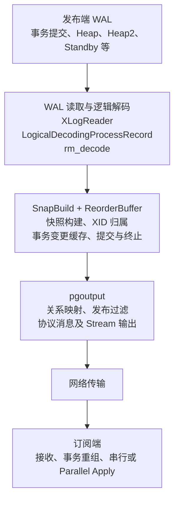
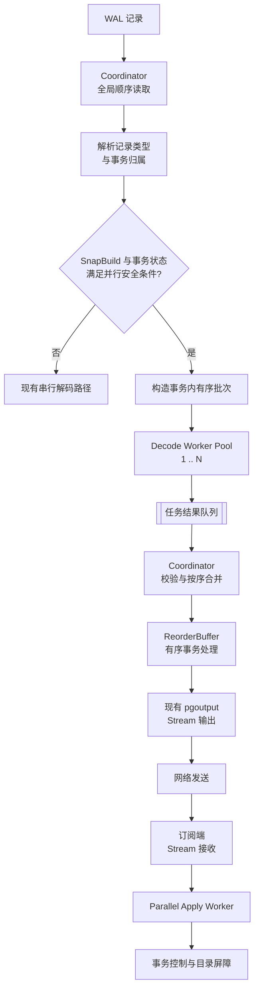
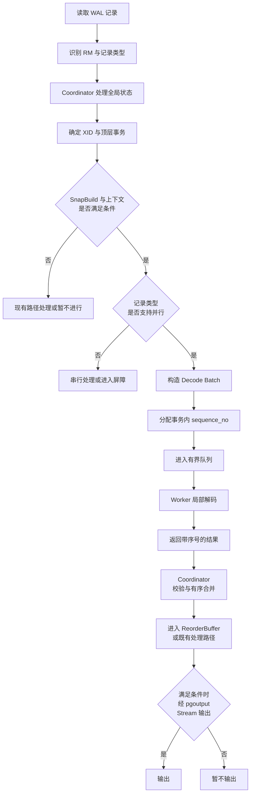
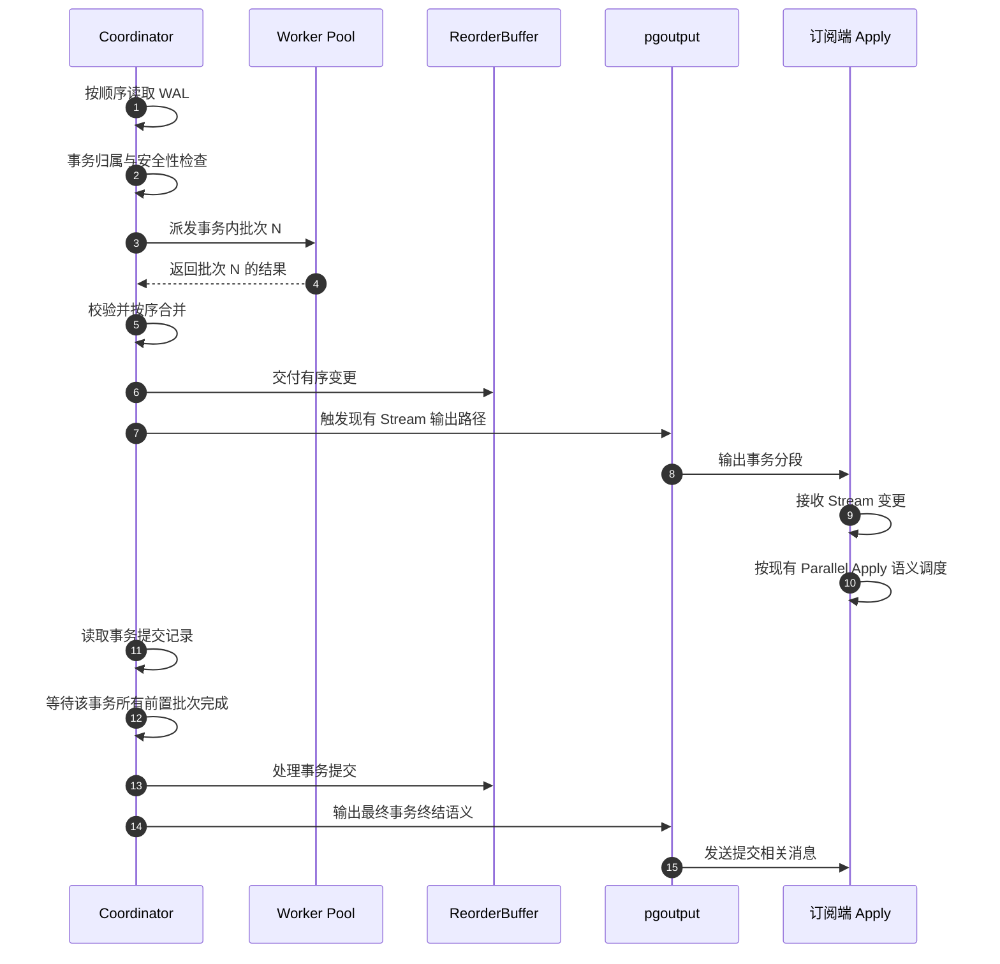
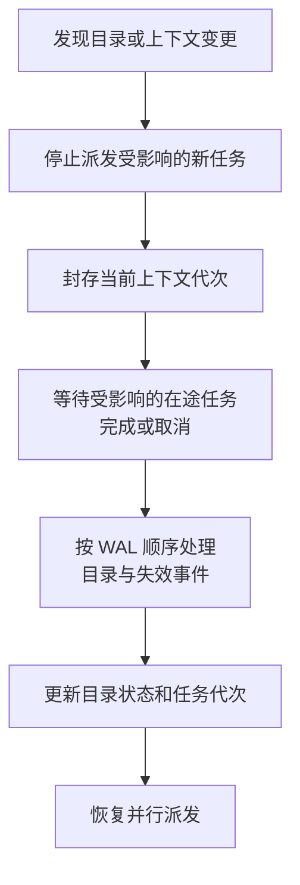
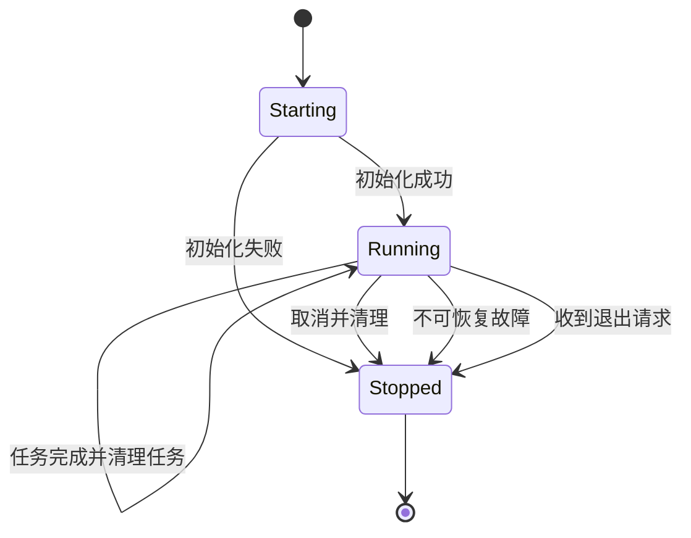
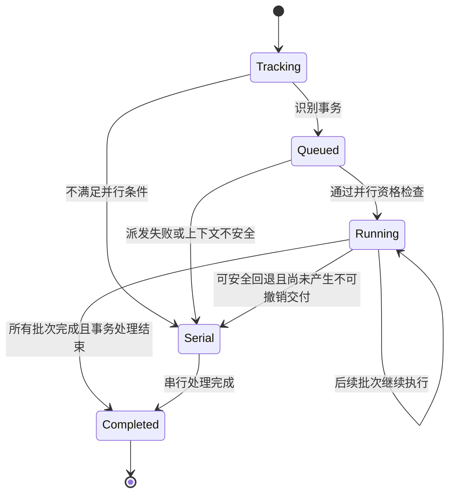
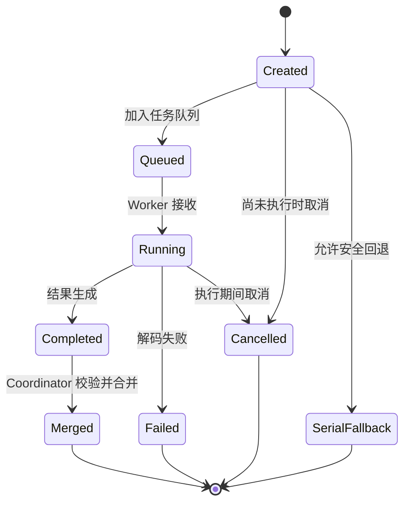

# PostgreSQL 18 逻辑复制并行解码概要设计说明书

> 本版以发布端并行解码与订阅端 Stream/Parallel Apply 协同为主线，保留原有逻辑解码、快照构建和事务重组的源码分析，并重点补齐 Stream 处理流程、Worker 并行粒度、Coordinator 职责、模块与接口、事务顺序、目录一致性屏障及异常恢复。
>
> 全文明确区分三类内容：
>
> - **PG18 现有机制**：现有源码中的函数、数据结构和逻辑复制协议。
> - **建议新增或改造的机制**：并行解码设计需要增加的模块、状态和内部接口。
> - **待详细设计验证的内容**：涉及跨进程状态、目录快照、Stream 消息交错等，需要结合实际 PG18 源码和原型验证，不能直接视为已经具备的内核能力。

## 1. 功能简述

### 1.1 逻辑复制现状

#### 1.1.1 功能背景

PostgreSQL 逻辑复制由发布端逻辑解码、逻辑复制协议、网络传输和订阅端逻辑复制应用组成。

现有发布端主要由 WAL 读取与解码、快照构建、事务重组和 `pgoutput` 输出等部分构成。WAL 按日志顺序读取，逻辑解码根据记录类型分派到相应的资源管理器解码函数，再将符合逻辑解码条件的变更组织为事务变更。

订阅端接收逻辑复制协议消息，根据事务边界和变更类型执行相应的 DML。启用并行应用后，符合条件的事务可以分派给多个 Apply Worker 执行。

当前需要解决的问题是：订阅端具备并行应用能力，并不意味着发布端的 WAL 解码也能够并行执行。 如果发布端解码仍然受限于单线程处理，解码阶段就可能成为整个复制链路的吞吐瓶颈。

因此，本设计在尽可能复用 PostgreSQL 18 现有逻辑解码和 `pgoutput` 协议的前提下，将部分满足并行安全条件的事务局部解码工作分配给有限的 Worker，并通过 Stream 协议将解码结果增量输出，使发布端解码、网络传输和订阅端并行应用能够形成流水线。

#### 1.1.2 现有逻辑复制整体架构

以上是逻辑结构示意。实际 PG18 源码中的 WAL 读取、事务重组、输出回调和发送过程相互关联，不应简单理解为各阶段之间只有单向函数调用。

#### 1.1.3 发布端核心数据结构

| 数据结构                     | 现有职责                                            | 并行解码设计中的处理原则                   |
| ------------------------ | ----------------------------------------------- | ------------------------------ |
| `LogicalDecodingContext` | 保存逻辑解码环境，包括 WAL 读取、快照构建、ReorderBuffer、输出插件等相关状态 | 全局协调状态不能直接由多个 Worker 无同步地修改    |
| `SnapBuild`              | 根据 WAL 中的事务状态和提交信息构建逻辑解码快照                      | 由 Coordinator 独占维护             |
| `ReorderBuffer`          | 按事务组织变更、管理事务状态和变更缓存，并支持提交、流式处理及重放               | 作为全局事务组织和有序交付的关键边界             |
| `ReorderBufferTXN`       | 表示一个事务或子事务及其关联状态                                | 不直接跨进程传递其私有指针                  |
| `ReorderBufferChange`    | 描述 INSERT、UPDATE、DELETE 等变更                     | Worker 结果需要通过明确的序列化结果格式进入协调流程  |
| `Relation`               | 表示打开的关系及相关元数据                                   | 不能将后端私有 `Relation *` 直接传给另一个进程 |
| `XLogReaderState`        | 保存 WAL 读取和记录解析上下文                               | 不作为 Worker IPC 参数传递            |
| `pgoutput` 插件状态          | 管理发布过滤、关系映射、协议版本及输出相关状态                         | 首阶段由 Coordinator 统一执行最终协议输出    |

这里的核心设计原则是：并行任务可以拥有局部状态，但全局快照、事务归属、提交顺序和复制协议输出必须有明确的单一所有者或受控同步机制。

#### 1.1.4 现有发布端核心处理流程

发布端逻辑解码可以按以下逻辑理解：

1. 读取 WAL 记录并解析记录头和记录内容。
2. 根据 WAL 资源管理器类型调用相应的解码函数。
3. 根据 XID 查找或创建事务上下文。
4. 对子事务建立与顶层事务之间的关联。
5. 根据 `SnapBuild` 状态判断当前记录是否满足正常逻辑解码条件。
6. 对 Heap 记录执行 INSERT、UPDATE、DELETE 等变更解码。
7. 将解码结果关联到相应的事务，并进入 `ReorderBuffer`。
8. 处理事务提交、终止以及相关事务状态变更。
9. 由输出插件将可输出的逻辑变更转换为逻辑复制协议消息。
10. 通过 WAL 发送及复制协议路径传输给订阅端。

在非流式模式下，通常需要等到事务达到可处理的阶段后，才按事务组织并输出完整变更。在流式模式下，符合条件的长事务可以在最终提交之前输出部分变更，最终仍然需要处理事务的 COMMIT 或 ABORT 结果。

#### 1.1.5 Stream 协议现状

Stream 是本设计必须重点适配的既有机制。它的作用不仅是将事务拆成多个网络消息，更重要的是允许订阅端在事务尚未最终提交时接收并处理该事务的部分变更。

在支持相应协议版本和流式配置的情况下，`pgoutput` 可以使用现有 Stream 语义输出事务分段。订阅端根据事务标识及 Stream 消息边界，将属于同一事务的变更交给对应的处理流程。

Stream 主要解决以下问题：

- 大事务无需始终等到完整事务结束后才开始向订阅端传输。
- 订阅端可以较早接收事务中的部分变更。
- 在订阅端启用 Parallel Apply 后，符合条件的事务可以被分配给不同的 Apply Worker。
- 发布端解码、网络传输和订阅端应用可以重叠执行，减少串行阶段之间的等待。

需要注意，Stream 协议本身不等于发布端并行解码。现有 Stream 能力允许事务增量输出，但并不会自动把 `heap_decode` 或 `DecodeInsert()` 等工作分配给多个发布端 Worker。

#### 1.1.6 Stream 模式下的事务处理流程

现有机制可以从三个层次理解。

第一层：WAL 记录进入逻辑解码和 ReorderBuffer。

WAL 仍按全局顺序读取。对符合条件的 Heap 变更记录，解码函数创建对应的变更描述，并通过 `ReorderBufferQueueChange()` 等路径关联到事务。

第二层：事务变更达到流式处理条件。

当 Stream 模式启用且满足现有流式处理条件时，ReorderBuffer 可以检查内存使用及相关事务状态，并通过流式处理路径输出事务中的部分变更。与此相关的机制包括：

- `ReorderBufferCheckMemoryLimit()`
- `ReorderBufferStreamTXN()`
- 流式输出回调及输出插件对应的 Stream 处理能力

具体是否在某个 `ReorderBufferQueueChange()` 调用后立即触发流式输出，取决于调用路径、当前事务状态、内存限制和配置等条件，不能将其简化为每次入队都必然输出一个 Stream segment。

第三层：事务最终提交或终止。

事务最终提交时，由事务解码及提交处理路径推进事务状态，典型关联路径包括 `xact_decode`、`DecodeCommit()`、`ReorderBufferCommit()` 和 `ReorderBufferProcessTXN()`。事务中间部分是否已经流式输出，不会取消最终事务提交语义。

事务终止时则需要遵循现有 ABORT 处理语义，避免已发送的事务片段被误认为已经提交。

以上路径描述的是现有机制的主要职责关系，不代表所有 Stream 操作都严格经由一条固定且唯一的函数链完成。详细实现时应以 PG18 对应分支的实际调用关系和回调接口为准。

#### 1.1.7 现有 Stream 与并行解码的差距

| 能力                 | 现有 Stream 机制             | 本设计拟补充的能力          |
| ------------------ | ------------------------ | ------------------ |
| 事务分段输出             | 已有                       | 复用                 |
| 事务中间结果传输           | 已有                       | 复用                 |
| 订阅端 Parallel Apply | 由订阅端配置和能力决定              | 与发布端并行解码协同         |
| WAL 全局顺序读取         | 现有逻辑解码路径负责               | 保持                 |
| 事务 XID 和子事务归属      | 现有 ReorderBuffer 及相关路径负责 | 由 Coordinator 统一维护 |
| 发布端变更解码并行化         | 不由 Stream 自动提供           | 新增受控任务调度           |
| Worker 任务结果合并      | 不属于 Stream 协议本身          | 新增                 |
| Worker 故障恢复和回退     | 不属于 Stream 协议本身          | 新增                 |
| 跨 Worker 的目录快照一致性  | 需要由并行方案保证                | 新增同步、屏障及回退机制       |

#### 1.1.8 设计目标

本设计目标如下：

1. 在发布端对满足并行安全条件的变更解码工作进行并行化。
2. 复用现有 `pgoutput` Stream 协议，不增加新的复制协议消息类型。
3. 支持事务变更增量处理，避免将所有工作推迟到事务提交之后。
4. 保证同一事务内部的变更顺序及 Stream 分段顺序。
5. 允许不同、且满足并行安全条件的顶层事务进行并行解码。
6. 保持 `SnapBuild`、全局事务状态和复制槽反馈路径的正确性。
7. 对目录变更、子事务、特殊 WAL 记录和无法安全并行的场景提供屏障或串行回退。
8. 采用有限 Worker 池和有界队列，控制内存占用及系统负载。
9. 通过端到端基准测试验证整体收益，而不只比较解码函数本身的执行时间。

### 1.2 发布端源码分析

#### 1.2.1 `LogicalDecodingProcessRecord()`

`LogicalDecodingProcessRecord()` 是逻辑解码处理 WAL 记录的重要协调入口。它结合当前逻辑解码上下文处理记录，并根据资源管理器及记录类型进入对应解码路径。

并行改造原则：

- 保持全局 WAL 记录顺序。
- 不允许 Worker 自行从同一个全局 WAL 读取位置任意推进。
- Coordinator 负责确定记录的事务归属和是否具备派发条件。
- 只有能够安全提取为独立任务的局部工作，才进入 Worker 调度。

因此，不能简单地把 `LogicalDecodingProcessRecord()` 整体复制到多个 Worker 中执行。它所依赖的全局状态和跨记录顺序关系必须继续受到协调。

#### 1.2.2 `ReorderBufferAssignChild()` 与 `ReorderBufferTXNByXid()`

子事务处理需要建立子事务和顶层事务之间的关联。

`ReorderBufferAssignChild()` 负责将子事务归属到相应的顶层事务上下文；`ReorderBufferTXNByXid()` 等查找路径用于根据 XID 定位事务对象。

对并行解码而言，事务归属是任务派发的前置条件。若一条变更所属的事务尚未被正确识别，就不能安全地分配到 Worker。

设计要求：

- Coordinator 维护唯一的 XID 到事务上下文映射。
- Worker 不独立创建相互冲突的全局事务归属。
- 子事务变更需要携带顶层 XID、子事务标识和事务内序列信息。
- 在无法确定事务归属时，当前记录走串行处理或等待必要的事务状态信息。

#### 1.2.3 `ReorderBufferProcessXid()`

该函数用于处理当前 XID 对应的事务状态，通常涉及事务对象的查找或创建及相关状态维护。

并行设计不能让多个 Worker 无保护地对同一事务执行事务对象创建、子事务归属或状态迁移。推荐由 Coordinator 先确定事务上下文，再将可并行的局部解码任务分配给 Worker。

Worker 结果应通过事务 ID、批次 ID、记录顺序信息和可序列化的变更结果返回，而不是通过共享 `ReorderBufferTXN *` 指针修改事务对象。

#### 1.2.4 `rm_decode` 资源管理器分派

逻辑解码会根据 WAL 记录所属的资源管理器及记录类型，进入对应的解码函数。相关路径包括：

- `heap_decode`
- `heap2_decode`
- `xlog_decode`
- `xact_decode`
- `standby_decode`

这些函数的职责不同，并非所有记录都可以直接并行化。

| 解码路径             | 主要职责                       | 建议处理方式                    |
| ---------------- | -------------------------- | ------------------------- |
| `heap_decode`    | 处理 Heap DML 等变更记录          | 主要候选并行入口，但需要拆分全局状态操作与局部解码 |
| `heap2_decode`   | 处理新命令 ID 等与元组可见性、目录变化相关的记录 | 首阶段优先由 Coordinator 串行处理   |
| `xact_decode`    | 处理事务提交、终止等事务控制信息           | 由 Coordinator 维护事务最终状态    |
| `standby_decode` | 处理运行中事务等快照构建相关记录           | 由 Coordinator 处理          |
| `xlog_decode`    | 处理逻辑解码相关的 XLOG 记录          | 根据具体记录类型决定，首阶段不作为通用并行入口   |

这里的候选函数是分析起点，不代表可以把这些函数原样移动到 Worker 中。

#### 1.2.5 `SnapBuildState`

现有快照构建状态可按以下状态理解：

| 状态                            | 含义             | 解码设计影响                              |
| ----------------------------- | -------------- | ----------------------------------- |
| `SNAPBUILD_START`             | 快照构建初始阶段       | 不具备一般变更解码所需的完整快照条件                  |
| `SNAPBUILD_BUILDING_SNAPSHOT` | 正在构建快照         | 需要持续处理事务状态及相关 WAL 信息                |
| `SNAPBUILD_FULL_SNAPSHOT`     | 已具备完整快照阶段所需的状态 | 不代表所有后续记录都已经满足并行安全条件                |
| `SNAPBUILD_CONSISTENT`        | 达到逻辑解码一致性条件    | 可在满足其他前提时进入正常逻辑解码，但不能直接据此认定所有事务均可并行 |

`SnapBuild` 依赖 WAL 中的事务状态变化和运行中事务信息。并行 Worker 不应各自维护一份相互独立且可能分叉的全局快照构建状态。

设计上由 Coordinator 独占 `SnapBuild`，并为 Worker 提供经过验证、具备明确生命周期的解码上下文。

#### 1.2.6 `standby_decode` 与 `SnapBuildProcessRunningXacts()`

`standby_decode` 中与 `XLOG_RUNNING_XACTS` 相关的处理，是快照构建的重要组成部分。

典型职责包括：

1. 读取运行中事务信息。
2. 调用 `SnapBuildProcessRunningXacts()` 更新快照构建状态。
3. 根据运行中事务状态处理已不再需要保留的旧事务信息，例如通过相关的 `ReorderBufferAbortOld()` 路径完成相应处理。

这些操作会影响全局事务状态和可见性判断，必须与 WAL 顺序保持一致。因此首阶段应保留在 Coordinator 中，不交给普通变更解码 Worker 并行执行。

#### 1.2.7 `heap_decode` 与 `SnapBuildProcessChange()`

`heap_decode` 负责处理 Heap 相关 WAL 记录。在执行正常逻辑变更解码之前，需要结合 `SnapBuild` 状态及当前 XID 判断该变更是否符合处理条件。

`SnapBuildProcessChange()` 参与判断当前事务变更的资格，并处理相应的事务快照状态，例如建立或设置事务的 `base_snapshot`。

满足条件后，`heap_decode` 才会进入相应的变更处理分支，例如：

- `DecodeInsert()`
- `DecodeUpdate()`
- `DecodeDelete()`
- `DecodeTruncate()`
- 与 Speculative Insert 确认相关的处理

并行化应当在 Coordinator 完成必要的资格检查、事务归属及上下文准备后进行。不能让 Worker 在缺少全局状态的情况下独立判断某条 WAL 记录是否应该成为逻辑变更。

#### 1.2.8 `DecodeInsert()`、`DecodeUpdate()` 与 `DecodeDelete()`

这些函数是潜在的局部解码工作入口，但它们并不是完全独立的纯计算函数。

它们可能涉及：

- WAL 数据读取与元组信息解析。
- 关系标识和关系元数据查找。
- 新旧元组数据处理。
- TOAST 相关数据处理。
- `ReorderBufferChange` 的构建。
- 事务和快照上下文关联。
- Tuple CID、目录变更及其他相关状态。
- 最终通过 `ReorderBufferQueueChange()` 将变更关联到事务。

因此，首阶段不宜将这三个函数不加修改地整体移到 Worker。建议拆分为：

1. Coordinator 预处理：解析 WAL 记录的必要信息、完成事务归属和并行资格检查。
2. Worker 局部解码：对已经序列化并具备充分上下文的输入执行可隔离的变更解码。
3. Coordinator 结果合并：校验任务代次、事务 ID 和序列号，将结果按顺序交给现有事务处理和输出路径。

具体哪些元组解析和变更构造步骤能够放到 Worker，需要通过 PG18 源码调用关系审计逐项确定。

#### 1.2.9 `ReorderBufferQueueChange()`

`ReorderBufferQueueChange()` 是变更与事务组织的重要边界。

在串行逻辑解码中，变更通常由当前解码路径构造，再关联到对应事务。并行设计必须避免多个 Worker 直接对同一个全局 ReorderBuffer 和同一事务的变更队列进行无序修改。

推荐方式是 Worker 返回独立的、可序列化的变更结果，由 Coordinator 校验并按照事务内序列号合并，再进入现有事务组织和输出路径。

需要特别注意：Worker 完成任务的先后顺序不能决定变更的逻辑顺序。

#### 1.2.10 `heap2_decode` 与 Tuple CID

`heap2_decode` 需要处理部分影响元组可见性和命令 ID 语义的记录，例如 `XLOG_HEAP2_NEW_CID`。

相关处理可能包括：

- `SnapBuildProcessNewCid()`
- `ReorderBufferXidSetCatalogChanges()`
- `ReorderBufferAddNewTupleCids()`
- `ReorderBufferAddNewCommandId()`

这些操作与事务可见性、目录访问及命令顺序有关。若 Worker 解码时依赖的 Tuple CID 或目录上下文与 Coordinator 的状态不一致，就可能造成逻辑变更解释错误。

首阶段将这些控制性记录作为串行处理点。当它们影响正在执行的并行任务时，必须通过版本检查、同步或屏障避免旧上下文继续被使用。

#### 1.2.11 `xact_decode`、`DecodeCommit()` 与 `DecodeAbort()`

事务控制记录需要由 Coordinator 按 WAL 顺序处理。

`DecodeCommit()` 除了处理提交相关状态，还可能涉及：

- `SnapBuild` 的提交状态推进。
- 已提交事务状态的维护，例如 `SnapBuildAddCommittedTxn()`。
- 对应事务在 ReorderBuffer 中的提交处理。
- 后续事务输出及清理。

`DecodeAbort()` 则需要保证被终止事务不会以已提交事务的语义交付。

在并行方案中，COMMIT 和 ABORT 是事务状态边界，而不是普通的 Worker 任务。对同一事务而言，终结处理必须等待所有此前的批次完成、通过校验并按顺序交付。

#### 1.2.12 `ReorderBufferCommit()` 与 `ReorderBufferProcessTXN()`

`ReorderBufferProcessTXN()` 是并行设计中必须重点审计的复杂处理框架。它不是简单的“执行解码函数”，而是围绕事务变更进行重组、可见性处理、输出和清理的关键路径。

需要重点考虑以下职责：

1. 事务变更遍历：通过事务迭代机制按既定顺序处理变更。
2. Tuple CID 处理：必要时构建 Tuple CID 相关查找结构。
3. 历史快照设置：通过 `SetupHistoricSnapshot()` 等相关路径准备事务所需的可见性环境。
4. 事务执行上下文：设置事务处理所需的环境和相关状态。
5. 子事务处理：按照现有语义处理顶层事务和子事务。
6. 变更应用及输出：通过 `ReorderBufferApplyChange()` 等路径处理变更。
7. TOAST 与目录失效处理：维护相关缓存和元数据一致性。
8. 提交、流式终结和清理：处理最终提交、Stream 结束或相关资源清理。

这些职责不应被整体复制到多个 Worker 中并发执行。首阶段应保留现有事务处理框架作为有序结果的最终处理边界，优先并行化前置的、可隔离的局部解码工作。

对于已启用 Stream 的事务，具体哪些变更通过完整事务路径处理、哪些部分通过流式处理路径输出，仍需以 PG18 的具体实现及其回调语义为准。

## 2. 主要术语

| 术语                     | 定义                                 |
| ---------------------- | ---------------------------------- |
| Coordinator            | 发布端 walsender 进程内的协调逻辑，不是独立的后台服务进程 |
| Parallel Decode Worker | 执行已分配局部解码任务的发布端 Worker             |
| Worker Pool            | 有限数量的并行解码 Worker 集合                |
| Decode Task            | Coordinator 派发给 Worker 的局部解码任务     |
| Decode Batch           | 事务内按 WAL 顺序划分的有序解码批次               |
| Top-level Transaction  | 顶层事务，是事务归属和 Stream 事务边界的主要单位       |
| Subtransaction         | 子事务，需要关联到对应的顶层事务                   |
| Sequence Number        | 用于标识同一事务内部批次或变更顺序的单调递增序号           |
| Stream Protocol        | 现有逻辑复制协议中用于事务分段输出的机制               |
| Parallel Apply         | 订阅端对符合条件的事务使用多个 Apply Worker 并行应用  |
| ReorderBuffer          | 负责事务组织、变更缓存和事务处理的重要逻辑解码组件          |
| SnapBuild              | 根据 WAL 中的事务状态构建逻辑解码快照的组件           |
| Catalog Barrier        | 目录状态屏障，保证目录变更前后的任务不会使用不兼容的元数据上下文   |
| Serial Fallback        | 无法证明并行安全时，退回原有串行逻辑解码路径             |
| Task Generation        | 任务上下文代次，用于阻止旧上下文任务在状态切换后被错误接收      |
| Send Progress          | 发布端协议输出及网络发送进度                     |
| Feedback Progress      | 订阅端反馈的接收、持久化或应用相关进度，具体语义取决于反馈路径    |

### 2.1 并行粒度定义

本设计采用两层粒度：

- 事务层：不同顶层事务可以并行执行满足安全条件的解码任务。
- 批次层：一个事务的变更可以分批解码和增量输出，但同一事务内的批次必须严格按序完成和交付。

一个 Worker 同一时刻只执行一个任务。对于同一个顶层事务，首阶段限制为最多一个正在执行的解码批次，不得并发解码该事务的多个批次。

同一事务可在一个批次完成后继续分配后续批次；在实现中可采用事务亲和性，尽量复用相同 Worker，但不能将 Worker 进程 ID 当作事务正确性的唯一依据。

需要区分：

- 内部 Decode Batch 不等于协议 Stream segment。
- 一个批次可以在合并后进入一次或多次协议输出操作。
- 一个协议 Stream segment 也不要求与某一个内部批次一一对应。
- Worker 完成不等于该事务已经提交。
- Worker 完成不等于发布端可以推进复制槽反馈位置。

## 3. 实现方案

### 3.1 原理

#### 3.1.1 总体设计思路

本方案以 PostgreSQL 18 现有逻辑解码流程为基础，新增发布端并行任务调度和结果合并能力。

核心原则如下：

1. Coordinator 保持 WAL 全局读取顺序。
2. Coordinator 负责事务归属、快照状态、控制记录及最终协议输出。
3. Worker 只处理已明确归属、可序列化、上下文完整且经过安全检查的局部解码任务。
4. 同一事务内批次顺序严格保序。
5. 不同事务可以在满足并行安全条件时并行处理。
6. 通过现有 Stream 协议增量输出已完成且有序的事务部分结果。
7. 目录状态、事务可见性或特殊 WAL 记录无法保证安全时，采用屏障或串行回退。
8. 复制槽位置和反馈进度继续走既有复制协议反馈路径。

#### 3.1.2 总体架构图

图中 `Coordinator` 表示 walsender 内的协调职责；Worker 的具体进程实现、任务传输机制及内存共享方式属于详细设计范围。

#### 3.1.3 Coordinator 职责

Coordinator 负责：

- 全局 WAL 读取与记录顺序。
- `rm_decode` 及各类 WAL 记录的协调分派。
- XID、顶层事务和子事务归属。
- `SnapBuild` 的状态推进。
- 判断事务和记录是否具备并行安全条件。
- 构造有序批次并分配 `sequence_no`。
- 管理 Worker Pool、任务队列及任务取消。
- 收集并校验 Worker 结果。
- 按事务和批次顺序合并变更。
- 管理目录变更、Tuple CID 变化及其他需要串行处理的控制事件。
- 处理事务提交、终止和其他事务控制边界。
- 调用现有事务重组、输出插件和 Stream 输出路径。
- 维护与复制协议输出相关的进度状态。

#### 3.1.4 Worker 职责

Worker 负责：

- 接收经过校验的解码任务。
- 根据任务携带的 WAL 输入和上下文执行局部解码。
- 在允许的范围内解析元组、构造局部变更结果。
- 产生带有事务 ID、批次 ID、序列号和任务代次的结果。
- 将结果返回给 Coordinator。
- 响应取消请求并清理任务局部资源。
- 报告可恢复错误和不可恢复错误。

Worker 不负责：

- 自行推进全局 WAL 读取位置。
- 修改全局 `SnapBuild`。
- 直接提交或终止全局事务。
- 直接写入逻辑复制网络协议。
- 直接调用需要独占全局输出状态的 `pgoutput` 回调。
- 直接推进复制槽的 `confirmed_flush_lsn` 或 `restart_lsn`。
- 将未经协调的结果直接插入全局 ReorderBuffer。

### 3.2 总体流程

#### 3.2.1 初始化流程

1. walsender 建立现有逻辑解码上下文。
2. 根据复制协议协商结果及订阅端请求，确定 Stream 相关能力是否启用。
3. 根据并行解码配置初始化有限 Worker Pool。
4. 初始化有界任务队列和结果队列。
5. Coordinator 继续使用现有 `SnapBuild`、`ReorderBuffer` 和输出插件上下文。
6. 在完成必要的状态检查后，允许符合条件的任务进入并行路径。
7. 如果 Worker Pool 初始化失败或当前场景不支持并行，则使用原有串行路径。

并行解码不应在尚未建立有效逻辑解码上下文时，擅自绕过现有一致性判断。

#### 3.2.2 WAL 记录处理流程

该流程是目标设计流程，不代表现有 PG18 已经具备图中所有新增模块。

#### 3.2.3 Stream 协同流程

注意：图中“批次 N”表示内部任务顺序，协议 Stream segment 的实际划分仍由现有 ReorderBuffer 和 `pgoutput` 输出路径决定。

#### 3.2.4 Worker 并行粒度与调度策略

建议采用以下调度规则：

1. Coordinator 先确定事务归属和当前变更的解码资格。
2. 对满足并行安全条件的事务，将连续且适合独立处理的记录组织成一个有序批次。
3. 每个批次具有唯一任务 ID、事务 ID、批次 ID、`sequence_no` 和上下文代次。
4. Worker 同一时刻只执行一个任务。
5. 同一顶层事务最多只有一个正在执行的批次。
6. 不同事务的批次可以在不同 Worker 上并行执行。
7. 批次完成后由 Coordinator 按序合并，再允许派发同一事务的下一个批次。
8. 事务提交或终止记录到达时，Coordinator 等待该事务所有前置批次完成。
9. 无空闲 Worker 时，使用有界队列和背压，不无限创建 Worker。
10. 任务超时、上下文失效或 Worker 失败时，进入取消、重试或串行回退流程。

不采用“同一事务的多个批次并行解码”作为首阶段目标。 这样可以降低同一事务内顺序依赖、TOAST 处理、Tuple CID 和目录状态同步的复杂度。

#### 3.2.5 事务内批次边界

批次划分需要兼顾并行调度成本和 Stream 的增量输出收益。建议综合考虑：

- WAL 记录数量或输入字节数。
- 已解析的逻辑变更数量。
- 事务内已缓存变更规模。
- Worker 派发和结果序列化成本。
- 目录状态或事务控制事件是否形成边界。
- Stream 输出路径和内存限制是否要求提前交付。

批次不应跨越未处理的事务控制边界、目录状态屏障或无法证明上下文一致的记录范围。

首阶段建议采用保守边界：遇到事务控制记录、目录相关控制事件、特殊 WAL 记录或不支持的变更类型时，结束当前批次并由 Coordinator 处理该边界。

#### 3.2.6 事务提交处理

事务提交时：

1. Coordinator 读取并处理提交相关 WAL 记录。
2. 根据 XID 查找事务及其顶层事务关系。
3. 阻止该事务继续派发新的普通变更批次。
4. 等待所有前置批次完成。
5. 检查所有批次是否按顺序合并并完成必要的校验。
6. 将事务提交交给现有提交处理及 ReorderBuffer 路径。
7. 由既有输出插件和 Stream 协议路径处理最终事务语义。
8. 清理事务相关任务、结果和局部资源。

Worker 任务完成时间不能代替事务提交顺序，也不能直接决定事务是否可以发送 COMMIT。

#### 3.2.7 事务终止处理

对于 ABORT：

1. Coordinator 识别终止记录并停止该事务的新任务派发。
2. 取消尚未执行的任务。
3. 对正在执行的任务发出取消请求，等待其退出或进入可安全清理的状态。
4. 丢弃未交付的事务批次结果。
5. 通过现有事务终止路径处理事务。
6. 清理任务队列、临时文件及事务相关状态。
7. 避免已取消任务的迟到结果重新进入输出路径。

如果事务部分内容已经通过 Stream 输出，订阅端仍必须依照既有协议处理事务终止语义，不能将中间分段等同于最终提交。

#### 3.2.8 目录一致性屏障

目录状态变化可能影响关系元数据、类型信息、Tuple CID、目录缓存、发布过滤和变更解释。若 Worker 在旧目录上下文下解码，而 Coordinator 已经处理了影响该上下文的目录变更，就可能造成错误。

因此采用以下原则：

- B 方案为主体：由 Coordinator 管理上下文代次，并将必要的目录状态和失效事件同步给 Worker。
- C 方案为保护措施：遇到无法通过增量同步证明安全的目录变更时，使用目录屏障。

屏障流程：

不能先应用目录变更，再等待使用旧上下文的 Worker 完成。

对于不能安全同步的目录变更，直接进入串行处理更为稳妥。

#### 3.2.9 变更和新增模块

| 模块                         | 类型      | 主要职责                       |
| -------------------------- | ------- | -------------------------- |
| 现有 WAL 读取与逻辑解码入口           | 改造      | 增加并行资格判断和任务派发入口            |
| `SnapBuild` 相关处理           | 保持单一所有者 | Coordinator 继续维护全局快照构建状态   |
| `ReorderBuffer` 相关处理       | 改造或扩展   | 增加与批次结果合并、顺序交付相关的协调逻辑      |
| Worker Pool Manager        | 新增      | Worker 生命周期、容量、空闲分配和退出管理   |
| Decode Task Scheduler      | 新增      | 构造批次、事务亲和性、队列背压及调度         |
| Decode Task Serializer     | 新增      | 将任务输入转换为跨进程可传输的格式          |
| Decode Worker              | 新增      | 执行局部解码工作并返回结果              |
| Decode Result Queue        | 新增      | 接收任务结果并传递给 Coordinator     |
| Result Merger              | 新增      | 校验任务代次、事务归属和序列号，按序合并       |
| Catalog Context Manager    | 新增      | 管理目录上下文代次和同步信息             |
| Catalog Barrier Manager    | 新增      | 暂停受影响任务、等待在途任务并安全切换上下文     |
| Error and Fallback Manager | 新增      | Worker 失败、取消、重试及串行回退       |
| 现有 `pgoutput` 输出路径         | 保持单一所有者 | 统一执行协议消息输出，不让 Worker 直接写网络 |

## 4. 功能说明

### 4.1 并行解码功能

支持对符合条件的逻辑变更执行局部并行解码。Coordinator 负责确定事务归属和并行资格，Worker 负责处理局部解码任务，结果由 Coordinator 校验和有序合并。

### 4.2 Stream 协同功能

复用现有逻辑复制 Stream 协议，在事务尚未提交时允许已完成且有序的变更进入既有流式输出路径。

内部批次与协议 Stream segment 分别管理，不新增协议消息类型，也不改变现有事务边界语义。

### 4.3 事务顺序保证

保证：

- WAL 记录的全局读取顺序不被 Worker 调度改变。
- 同一事务的批次按照 `sequence_no` 顺序交付。
- 同一事务的 COMMIT 或 ABORT 等待前置批次完成。
- 不同事务的 Worker 完成顺序不改变现有提交和输出语义。
- 对无法证明可安全并行的事务，走串行路径。

### 4.4 Worker 管理功能

Worker Pool 应支持：

- 初始化和有限容量控制。
- 空闲 Worker 选择。
- 任务派发和结果返回。
- 任务取消。
- Worker 退出与重新启动。
- 错误分类和故障隔离。
- 任务超时检测。
- 有界队列和背压。
- Worker 状态监控。

### 4.5 结果合并功能

每个结果至少包含：

- 任务 ID。
- 顶层事务 XID。
- 必要时的子事务标识。
- 批次 ID。
- `sequence_no`。
- 任务上下文代次。
- 输入 WAL 范围或相关 LSN 信息。
- 解码结果及错误状态。

Coordinator 只接受与当前任务和上下文匹配的结果，并且必须按照既定顺序交付。

### 4.6 串行回退功能

以下情况可触发串行回退：

- 事务类型或 WAL 记录类型不在首阶段支持范围内。
- 无法获得完整的解码上下文。
- 目录状态或 Tuple CID 发生不受支持的变化。
- 子事务关联无法被安全表达。
- Worker 失败或结果校验失败。
- 任务上下文代次已失效。
- 当前批次无法保证与前后批次的顺序关系。
- 特殊事务语义无法被并行实现完整覆盖。

回退必须是显式状态迁移，不得将同一批次既交给 Worker 又在串行路径重复处理。

### 4.7 首阶段功能范围

| 功能或记录类型                 | 首阶段策略                     |
| ----------------------- | ------------------------- |
| 普通 INSERT               | 候选并行类型，需通过元数据和上下文安全检查     |
| 普通 UPDATE               | 候选并行类型，需验证旧、新元组及 TOAST 处理 |
| 普通 DELETE               | 候选并行类型，需验证旧元组与关系上下文       |
| 多事务并行解码                 | 支持安全任务之间并行                |
| 同一事务多批次并发               | 不支持                       |
| 同一事务分批串行解码与增量交付         | 目标支持                      |
| Stream 协议输出             | 复用现有协议能力                  |
| TRUNCATE                | 首阶段建议串行                   |
| Speculative Insert 相关记录 | 首阶段建议串行，除非单独证明安全          |
| 目录变更及相关 DDL             | 首阶段串行或通过屏障保护              |
| Tuple CID 与目录失效控制记录     | Coordinator 串行处理          |
| 复杂子事务场景                 | 首阶段保守回退，逐步扩展              |
| 两阶段提交及 PREPARE 相关语义     | 首阶段不作为通用并行路径              |
| 逻辑消息及其他特殊记录             | 依据现有协议语义单独审计，默认串行         |
| 无法确认安全的 WAL 记录          | 串行处理                      |

表中的范围是建议的首阶段实现边界，不代表现有 PostgreSQL 对这些功能的支持限制。

## 5. 触发时机

### 5.1 并行解码启用条件

只有同时满足以下条件，才进入并行解码路径：

1. 当前逻辑复制连接和输出插件上下文正常。
2. 协议协商结果支持当前所需的 Stream 行为。
3. 并行解码配置已启用。
4. Worker Pool 可用。
5. `SnapBuild` 和事务上下文满足当前变更解码要求。
6. 当前记录已确定事务归属。
7. 当前事务和记录类型处于首阶段支持范围。
8. 当前不存在影响该任务的目录屏障或其他全局状态切换。
9. 任务输入和输出可以安全序列化。
10. 同一事务不存在另一个正在执行的解码批次。

任一条件不满足时，进入串行路径或等待必要状态恢复。

### 5.2 Stream 触发与并行解码触发的区别

Stream 协议能力和并行解码任务调度是两个独立判断：

- Stream 是否启用：由逻辑复制协议版本、输出插件能力及现有配置决定。
- 是否执行并行解码：由并行解码配置、Worker 资源、事务归属、记录类型和上下文安全条件决定。

因此，Stream 已启用并不意味着每条变更都必须并行解码；并行解码暂时不可用也不应破坏现有 Stream 语义。

### 5.3 触发串行屏障的时机

以下事件需要考虑触发屏障：

- 目录元数据发生可能影响后续解码的变化。
- Tuple CID 或其他事务可见性上下文变化无法安全增量同步。
- 需要切换解码上下文代次。
- 发现特殊 WAL 记录，且它与在途任务共享状态。
- 任务输入依赖的关系元数据已经失效。
- Coordinator 无法证明不同任务之间没有不安全的状态依赖。

屏障只影响相关任务范围；是否能够按关系、事务或整个 Worker Pool 限定屏障范围，需要通过详细设计确定。

## 6. 功能模块

### 6.1 模块职责

#### 6.1.1 Coordinator

负责全局状态及任务生命周期的统一协调。其核心职责包括 WAL 顺序读取、事务归属、任务构建、结果合并、控制事件处理、最终输出和错误回退。

#### 6.1.2 Worker Pool Manager

维护有限的 Worker 集合。管理 Worker 的启动、空闲状态、任务分配、取消和退出。

#### 6.1.3 Decode Task Scheduler

将适合并行的变更组织成有序批次，管理事务亲和性、任务队列、背压和调度公平性。

#### 6.1.4 Decode Worker

执行局部解码任务。不得直接操作无法跨进程共享的后端私有对象，也不得绕过 Coordinator 修改全局事务状态。

#### 6.1.5 Result Merger

对 Worker 返回的结果进行校验，并按照事务和批次顺序合并。对迟到、重复、过期或不完整结果进行拒绝或异常处理。

#### 6.1.6 Catalog Context Manager

维护目录上下文代次、必要的关系元数据和相关同步状态。具体采用共享内存、可序列化元数据副本或 Worker 内部重建，需要在详细设计中确定。

#### 6.1.7 Catalog Barrier Manager

在目录状态切换时停止相关新任务，等待在途任务结束，按顺序处理失效事件，并切换到新上下文。

#### 6.1.8 Error and Fallback Manager

统一管理 Worker 失败、任务取消、重试、结果校验失败和串行回退。

### 6.2 Worker 状态机

状态说明：

- `Starting`：Worker 正在初始化。
- `Idle`：Worker 可以接收任务。
- `Running`：正在执行一个任务。
- `Stopped`：Worker 已停止，不再接受任务。

Worker 故障后是否自动重建属于 Worker Pool Manager 的职责。重建 Worker 不意味着自动重放已经部分输出的任务。

### 6.3 顶层事务状态机

`Serial` 状态表示事务后续处理走串行路径。具体实现中必须定义已执行任务的取消、结果丢弃和事务状态恢复规则。

### 6.4 批次状态机

已合并结果不可再作为一个新任务重复交付。任务的重试和回退需要与结果合并状态绑定。

## 7. 接口说明

本章列出的 `ParallelDecode...` 等名称均为建议新增的内部接口名称，不是 PostgreSQL 18 已有 API。最终命名和参数应在源码设计阶段根据实际文件和现有编码风格确定。

### 7.1 用户接口

首阶段建议尽量减少新增用户接口，优先通过可控的服务端配置启用并行解码。

| 配置项                            | 建议含义        | 说明                   |
| ------------------------------ | ----------- | -------------------- |
| `parallel_decode`              | 是否启用发布端并行解码 | 默认关闭，便于兼容和回退         |
| `parallel_decode_workers`      | Worker 池规模  | 有限数量，具体默认值和上限待性能测试确定 |
| `parallel_decode_queue_size`   | 任务队列容量      | 必须有界                 |
| `parallel_decode_batch_size`   | 批次构建目标规模    | 具体按字节、记录数或变更数定义      |
| `parallel_decode_max_inflight` | 最大在途任务数     | 防止积压过多任务             |
| `parallel_decode_timeout`      | 单任务超时控制     | 超时后按错误类型取消或回退        |
| `parallel_decode_fallback`     | 是否允许串行回退    | 生产环境建议支持安全回退         |
| `parallel_decode_debug`        | 调试及诊断日志控制   | 默认关闭或采用低开销级别         |

上述参数名称仅为设计建议。最终需要确定 GUC 类型、作用域、是否允许会话级设置、配置变更生效时机及权限要求。

并行解码应与现有复制协议配置相互独立。不能仅凭一个新的并行参数推断订阅端已经启用 `streaming=parallel`。

### 7.2 内部接口

#### 7.2.1 任务调度接口

| 建议接口                           | 调用方                 | 职责                     | 阻塞语义               | 错误语义                |
| ------------------------------ | ------------------- | ---------------------- | ------------------ | ------------------- |
| `ParallelDecodeInit()`         | Coordinator 初始化路径   | 初始化调度器、队列和 Worker Pool | 可等待资源初始化           | 返回初始化失败             |
| `ParallelDecodeCanDispatch()`  | Coordinator         | 检查事务、记录类型及上下文是否满足并行条件  | 不应长时间阻塞            | 返回不满足条件或错误原因        |
| `ParallelDecodeBuildBatch()`   | Coordinator         | 构造事务内有序批次              | 可能等待必要输入           | 输入不完整时不派发           |
| `ParallelDecodeEnqueueTask()`  | Coordinator         | 将任务加入有界队列              | 队列满时按背压策略等待或回退     | 返回队列关闭、取消或资源错误      |
| `ParallelDecodeAssignWorker()` | Worker Pool Manager | 选择空闲 Worker            | 可等待空闲 Worker，但必须受控 | 超时或 Worker Pool 不可用 |
| `ParallelDecodeCancelTask()`   | Coordinator         | 取消尚未执行或正在执行的任务         | 可等待取消确认            | 区分取消成功和不可取消状态       |

#### 7.2.2 Worker 执行接口

| 建议接口                                | 调用方         | 职责           | 阻塞语义          | 错误语义              |
| ----------------------------------- | ----------- | ------------ | ------------- | ----------------- |
| `ParallelDecodeWorkerMain()`        | Worker 启动路径 | Worker 主循环   | 持续等待任务        | Worker 级不可恢复错误退出  |
| `ParallelDecodeExecuteTask()`       | Worker 主循环  | 执行一个局部解码任务   | 执行期间阻塞或消耗 CPU | 返回成功、可回退错误或不可恢复错误 |
| `ParallelDecodeSerializeInput()`    | Coordinator | 序列化任务输入      | 受输入大小限制       | 不支持的输入格式返回错误      |
| `ParallelDecodeDeserializeInput()`  | Worker      | 解析任务输入       | 受输入大小限制       | 格式校验失败时拒绝任务       |
| `ParallelDecodeSerializeResult()`   | Worker      | 序列化解码结果      | 受结果大小限制       | 序列化失败不得生成部分有效结果   |
| `ParallelDecodeDeserializeResult()` | Coordinator | 解析 Worker 结果 | 受结果大小限制       | 校验失败时拒绝结果         |

#### 7.2.3 结果合并接口

| 建议接口                               | 调用方         | 职责                    | 阻塞语义              | 错误语义              |
| ---------------------------------- | ----------- | --------------------- | ----------------- | ----------------- |
| `ParallelDecodeReceiveResult()`    | Coordinator | 获取 Worker 结果          | 可等待结果或使用 latch 机制 | Worker 退出时报告任务异常  |
| `ParallelDecodeValidateResult()`   | Coordinator | 校验任务 ID、XID、序列号和上下文代次 | 不应执行长时间解码         | 结果不匹配则拒绝          |
| `ParallelDecodeMergeResult()`      | Coordinator | 将结果按顺序合并到事务处理流程       | 后续批次可能等待前序批次      | 重复、过期或缺失结果触发错误处理  |
| `ParallelDecodeAdvanceBatch()`     | Coordinator | 更新批次状态并允许派发后续批次       | 不应绕过前序结果          | 顺序不满足时不推进         |
| `ParallelDecodeDrainTransaction()` | Coordinator | 等待事务前置任务结束            | 可能等待 Worker       | 失败时取消、回退或中止当前复制会话 |

#### 7.2.4 目录屏障接口

| 建议接口                                  | 调用方             | 职责                | 阻塞语义              | 错误语义           |
| ------------------------------------- | --------------- | ----------------- | ----------------- | -------------- |
| `ParallelDecodeBeginCatalogBarrier()` | Coordinator     | 停止受影响任务的新派发       | 可能等待任务停止派发        | 无法建立屏障时禁止继续并行  |
| `ParallelDecodeDrainCatalogBarrier()` | Barrier Manager | 等待相关在途任务完成或取消     | 可等待，但需处理故障 Worker | 超时后进入安全错误处理    |
| `ParallelDecodeApplyCatalogChange()`  | Coordinator     | 按 WAL 顺序处理目录及失效事件 | 由既有目录处理决定         | 处理失败则不恢复并行     |
| `ParallelDecodeEndCatalogBarrier()`   | Coordinator     | 切换上下文代次并恢复派发      | 不应在旧任务仍可能使用旧状态时完成 | 代次切换失败则保持屏障或回退 |

#### 7.2.5 进度与清理接口

| 建议接口                                  | 调用方            | 职责                        | 关键约束             |
| ------------------------------------- | -------------- | ------------------------- | ---------------- |
| `ParallelDecodeGetStats()`            | 监控路径           | 获取队列、Worker、批次和屏障统计       | 统计读取不能修改复制进度     |
| `ParallelDecodeCleanupTransaction()`  | Coordinator    | 清理事务任务及局部资源               | 只能在确认无有效在途任务后完成  |
| `ParallelDecodeShutdown()`            | walsender 清理路径 | 停止接收新任务、取消或排空任务并退出 Worker | 必须处理复制连接终止和进程退出  |
| `ParallelDecodeFallbackTransaction()` | Coordinator    | 将事务安全切换到串行路径              | 不得重复交付已合并或已输出的变更 |

### 7.3 IPC 数据契约

#### 7.3.1 任务输入

任务输入建议包含：

- 协议版本或内部任务格式版本。
- 唯一任务 ID。
- 顶层 XID 和必要的子事务信息。
- 批次 ID 与 `sequence_no`。
- 上下文代次。
- 必要的 WAL 记录数据或可重建的记录描述。
- 关系标识和必要的关系元数据版本。
- 任务需要的快照或目录上下文引用。
- 任务取消状态或有效性标识。

不得将 `XLogReaderState *`、`Relation *`、`ReorderBufferTXN *` 等后端私有指针直接作为 IPC 数据传递。

#### 7.3.2 任务输出

任务输出建议包含：

- 原始任务 ID。
- 顶层 XID 和批次序号。
- 上下文代次。
- 解码后的变更描述。
- 相关输入记录的顺序信息。
- 结果完整性标识。
- 错误分类、错误码及诊断信息。

对于元组数据，应明确采用复制、共享内存引用还是可管理的临时存储。若采用共享内存引用，必须定义对象所有权、引用计数、回收时机和 Worker 崩溃后的恢复规则。

### 7.4 进度接口与进度语义

并行解码需要区分多个进度，不能将它们合并成一个模糊的“解码完成 LSN”。

| 进度                      | 含义                      | 推进责任                     |
| ----------------------- | ----------------------- | ------------------------ |
| WAL Read LSN            | Coordinator 已读取的 WAL 位置 | WAL 读取路径                 |
| Decode Progress         | 已完成必要解码处理的位置            | Coordinator 与任务调度器共同判断   |
| Worker Task Completion  | 单个任务已经完成                | Worker 报告，Coordinator 校验 |
| Ordered Merge Progress  | 已按顺序合并并可交付的结果位置         | Result Merger            |
| Protocol Send LSN       | 逻辑复制协议已发送到的相关位置         | 既有发送路径                   |
| Subscriber Feedback LSN | 订阅端反馈的位置                | 既有反馈路径                   |
| `confirmed_flush_lsn`   | 复制槽确认位置                 | 既有复制槽反馈处理                |
| `restart_lsn`           | 复制槽要求保留 WAL 的起点         | 既有复制槽与 WAL 保留机制          |

Worker 完成某个任务并不意味着 Coordinator 可以直接推进复制槽位置。只有既有逻辑复制发送与反馈路径确认相应进度后，复制槽才能按照原有规则更新。

## 8. 内存管理

### 8.1 总体原则

并行解码会引入任务输入、任务输出、序列化缓冲区、共享状态和 Worker 私有内存。如果没有统一的资源上限，增加 Worker 数可能导致内存放大和 WAL 积压。

设计原则：

1. Worker 数量有限。
2. 任务队列和结果队列有界。
3. 单个任务输入和输出大小受控。
4. Worker 局部资源在任务完成、取消或失败后及时清理。
5. 结果在合并后按生命周期释放。
6. 支持必要的临时文件或 spill 机制。
7. 对大事务采用增量处理，不要求所有事务变更都长期驻留内存。
8. 不能通过无限缓存结果来掩盖前序批次阻塞。

### 8.2 内存组成

| 内存类别           | 所有者                     | 生命周期                       |
| -------------- | ----------------------- | -------------------------- |
| 现有逻辑解码上下文      | Coordinator             | 逻辑解码会话                     |
| `SnapBuild` 状态 | Coordinator             | 逻辑解码会话及既有快照生命周期            |
| 全局事务归属状态       | Coordinator             | 事务处理及必要的事务历史保留期            |
| 任务输入缓冲区        | Coordinator 或共享任务层      | 任务入队至 Worker 消费结束          |
| Worker 局部解析数据  | Worker                  | 单个任务执行期间                   |
| Worker 输出缓冲区   | Worker 或共享结果层           | 任务完成至 Coordinator 接收       |
| 待按序合并结果        | Coordinator             | 从结果接收到顺序交付                 |
| 目录上下文数据        | Catalog Context Manager | 对应上下文代次有效期间                |
| Stream 相关事务缓存  | 现有逻辑解码与输出路径             | 遵循现有 ReorderBuffer 和输出生命周期 |

### 8.3 有界队列与背压

当任务队列达到容量上限时：

- Coordinator 不得无限制派发新任务。
- 应优先等待已有任务完成，或按照调度策略处理可安全串行化的任务。
- 不能为了腾出队列空间而丢弃尚未交付的有效结果。
- 如果前序批次尚未完成，后续批次不得越过它交付。
- 必须考虑复制连接中断、Worker 故障和取消请求。

### 8.4 大事务与 spill

大事务可能产生大量变更，Stream 的增量输出可以减少必须长期保留在发布端内存中的事务数据，但不能假设所有变更都可以立即释放。

建议：

- 尽早合并已经完成且顺序满足要求的批次。
- 通过现有 ReorderBuffer 和 Stream 处理能力完成符合条件的增量输出。
- 对尚不能交付的结果使用有界内存或临时存储策略。
- 统计 spill 次数、字节数、I/O 时间和队列等待时间。
- 避免 Coordinator 因等待单个事务的前序批次而无限积压其他事务的结果。

### 8.5 资源清理

以下事件必须触发相应清理：

- 任务正常完成。
- 任务取消。
- Worker 崩溃。
- 事务提交。
- 事务终止。
- 目录屏障切换。
- 复制连接关闭。
- walsender 进程退出。

清理之前必须确认不会有仍在执行的 Worker 使用相关内存或上下文。共享内存或临时存储的回收机制需要防止重复释放和悬空引用。

## 9. 异常处理

### 9.1 错误分类

| 错误类型         | 处理原则                           |
| ------------ | ------------------------------ |
| Worker 初始化失败 | 降低可用 Worker 数；无法满足运行条件时走串行路径   |
| 任务队列已满       | 背压等待，必要时按策略回退                  |
| Worker 执行失败  | 标记任务失败，取消相关后续任务并检查能否安全回退       |
| IPC 通信失败     | 拒绝不完整结果，检查 Worker 和队列状态        |
| 结果序列号不匹配     | 拒绝结果，不允许越序交付                   |
| 结果重复到达       | 根据任务 ID 和状态拒绝重复合并              |
| 上下文代次过期      | 拒绝旧结果并执行安全清理                   |
| 目录屏障超时       | 不恢复受影响的并行派发，进入错误处理或串行回退        |
| 事务终止         | 取消未完成任务并遵循现有 ABORT 语义          |
| 复制连接断开       | 停止新任务派发，按清理流程终止 Worker 和任务     |
| 内存分配失败       | 遵循 PostgreSQL 错误处理规则，确保局部资源可清理 |
| 不支持的 WAL 记录  | 走串行路径，不将未知记录静默忽略               |

### 9.2 Worker 故障恢复

Worker 故障后不能简单地把当前任务重新派给另一个 Worker 并假设不会重复处理。

恢复流程应包括：

1. 标记 Worker 失效。
2. 识别该 Worker 正在执行或尚未完成的任务。
3. 停止接受该 Worker 的迟到结果。
4. 根据任务状态确认结果是否已合并、是否已交付输出路径。
5. 对未交付且可安全重试的任务重新派发。
6. 对无法证明可安全重试的任务采用串行回退或终止复制会话。
7. 清理旧 Worker 资源。
8. 视配置重建 Worker。

### 9.3 防止重复输出

必须将任务执行状态与结果合并状态分开记录。

建议使用以下状态标记：

- `Created`
- `Queued`
- `Running`
- `Completed`
- `Merged`
- `Cancelled`
- `Failed`
- `SerialFallback`

只有状态符合要求的结果才能进入合并流程。已经合并的结果不能被重试任务再次合并。

如果结果已经进入 `pgoutput` 输出路径，不能简单地通过重跑 Worker 来恢复，因为网络输出具有外部可观察性。此时应遵循现有复制连接和复制槽恢复语义，不能自行假设可以无重复地重发。

### 9.4 异常回退边界

串行回退必须发生在可以证明不会丢失或重复交付的边界上。

如果事务前序批次尚未合并且未交付，可以取消后转入串行处理。

如果事务已有部分变更进入 Stream 输出，则必须继续遵循该事务既有的流式处理和终止语义。不能将部分流式输出的事务简单地当作从未输出过，再重新发送全部变更。

### 9.5 日志与诊断

建议记录：

- 任务 ID、事务 ID、批次 ID 和序列号。
- Worker ID 和 Worker 状态。
- 任务开始、结束、取消及失败时间。
- 结果合并状态。
- 上下文代次。
- 串行回退原因。
- 队列等待和屏障等待时长。
- 相关 WAL 范围。
- 任务输入、输出规模。

诊断日志不应默认输出完整元组内容或其他不必要的数据。

## 10. 约束

### 10.1 正确性约束

1. Coordinator 是全局 WAL 顺序和事务归属的唯一协调者。
2. `SnapBuild` 状态不能被多个 Worker 无同步地独立推进。
3. Worker 不得直接修改全局 ReorderBuffer 事务队列。
4. 同一事务的批次必须严格按序交付。
5. 同一事务的提交或终止必须等待所有前置批次完成或被安全取消。
6. 目录状态切换前必须处理受影响的在途任务。
7. 不能把 `SNAPBUILD_CONSISTENT` 当作无条件并行安全的充分条件。
8. Worker 任务完成不能直接推进复制槽确认位置。
9. 不能将现有 Stream segment 和内部 Decode Batch 强行绑定为一一对应关系。

### 10.2 跨进程约束

以下对象不应作为普通 IPC 数据直接传递：

- `XLogReaderState *`
- `Relation *`
- `ReorderBufferTXN *`
- 依赖某个进程私有内存上下文的指针
- 未定义所有权的 Tuple 或缓存对象指针

应采用可序列化输入、共享内存中具有明确所有权的对象，或 Worker 侧可重建的上下文。

### 10.3 首阶段实现约束

- 优先支持普通 INSERT、UPDATE、DELETE。
- 事务内批次串行执行。
- 对复杂子事务、目录变更、特殊 WAL 记录等保守处理。
- 不修改逻辑复制协议的消息类型和事务语义。
- 不将整个 `ReorderBufferProcessTXN()` 直接并行化。
- 不允许 Worker 直接执行协议网络写入。
- 不允许通过无限增加 Worker 解决队列积压。

### 10.4 性能约束

并行解码不保证所有工作负载都加速。对单个大事务、强目录依赖事务、低并发事务或订阅端已经成为瓶颈的场景，并行解码的收益可能有限。

因此必须通过端到端测试确定：

- Worker 数量。
- 批次大小。
- 队列容量。
- 结果缓存策略。
- Stream 触发条件与现有内存策略之间的关系。
- 串行回退阈值和适用场景。

## 11. 安全

### 11.1 权限与隔离

并行 Worker 应继承或建立符合现有逻辑解码执行要求的权限上下文。不能因 Worker 独立执行而绕过现有发布过滤、复制权限或关系访问约束。

### 11.2 输入校验

对 IPC 任务和结果进行完整性检查：

- 格式版本是否受支持。
- 数据长度是否在允许范围内。
- 任务 ID 是否有效。
- XID 和批次序号是否匹配。
- 上下文代次是否有效。
- 变更类型是否属于当前允许范围。
- 结果中是否存在不完整或非法字段。

### 11.3 数据保护

任务输入和输出可能包含业务元组数据。共享内存、临时文件和诊断日志必须遵循 PostgreSQL 现有的资源访问和权限管理原则。

临时数据应在任务结束后及时清理。诊断信息不应无必要地持久化完整行数据。

### 11.4 故障隔离

Worker 错误应限制在对应任务和 Worker 生命周期范围内。未经验证的结果不得影响全局事务状态和协议输出。

## 12. 性能

### 12.1 性能目标

目标是提高逻辑复制链路的端到端吞吐，而不仅仅是缩短某个解码函数的执行时间。

总体性能取决于：

- 发布端 WAL 读取和解析。
- 局部变更解码。
- Worker 调度和 IPC。
- ReorderBuffer 组织与事务处理。
- `pgoutput` 编码。
- 网络发送。
- 订阅端接收和事务处理。
- Parallel Apply 的实际并行度。
- 复制反馈及 WAL 保留带来的间接影响。

### 12.2 主要性能风险

| 风险               | 表现                              | 优化方向                |
| ---------------- | ------------------------------- | ------------------- |
| Worker 调度开销过大    | 小批次任务耗时主要花在 IPC 和调度上            | 调整批次规模，避免过度切分       |
| Coordinator 成为瓶颈 | Worker 利用率低，但 Coordinator CPU 高 | 减少重复校验和序列化，优化协调路径   |
| 结果顺序阻塞           | 后续批次完成但不能交付                     | 减少单个任务长尾，控制批次大小     |
| 目录屏障频繁           | Worker 长时间空闲                    | 统计屏障原因，扩展安全同步能力     |
| 内存压力             | spill、队列阻塞和延迟上升                 | 限制在途任务和结果规模         |
| 事务粒度不适合并行        | 大量小事务导致调度开销高                    | 采用合适的批次门槛和回退策略      |
| 订阅端成为瓶颈          | 发布端吞吐提高但复制延迟无明显改善               | 优化端到端流水线及 Apply 端资源 |
| 网络成为瓶颈           | 发布端结果生成速度高于发送速度                 | 保持有界缓冲，避免无意义地继续堆积   |

### 12.3 测试方案

建议设置以下对照组：

| 组别 | 发布端解码       | Stream   | 订阅端应用          | 目的                 |
| -- | ----------- | -------- | -------------- | ------------------ |
| A  | 串行          | 关闭或非流式基线 | 串行 Apply       | 建立传统路径基线           |
| B  | 串行          | 启用       | Parallel Apply | 测量 Stream 与并行应用的收益 |
| C  | 并行解码        | 启用       | Parallel Apply | 测量发布端并行解码的额外收益     |
| D  | 并行解码，允许大量回退 | 启用       | Parallel Apply | 验证回退场景的开销和稳定性      |

应尽量保持数据量、事务分布、网络环境、订阅端资源和其他参数一致。A 组的具体协议配置应确保它确实代表目标基线，而不是因为不同协议行为引入不可比因素。

### 12.4 工作负载

至少覆盖：

- INSERT、UPDATE、DELETE 和混合事务。
- 小事务、中事务和大事务。
- 小行和大行。
- 单表和多表。
- 不同事务并发度。
- 不同 Worker 数。
- 不同批次大小。
- 不同队列容量。
- 不同目录变更频率。
- 不同 Stream 使用场景。
- 不同网络延迟和带宽。
- 订阅端不同 Apply Worker 数量。

### 12.5 监控指标

| 指标             | 目的                |
| -------------- | ----------------- |
| WAL 生成速率       | 了解输入负载            |
| WAL 读取及解析速率    | 判断读取和解析是否成为瓶颈     |
| 逻辑解码速率         | 测量发布端解码能力         |
| Worker 利用率     | 判断并行资源是否有效使用      |
| Worker 任务耗时分布  | 识别长尾任务            |
| 任务队列等待时间       | 判断 Worker 供给是否不足  |
| 结果合并等待时间       | 判断有序交付是否成为瓶颈      |
| 目录屏障等待时间       | 判断全局状态同步成本        |
| Stream 输出速率    | 测量流式协议输出能力        |
| 网络发送速率         | 判断网络阶段的能力         |
| 订阅端接收及应用速率     | 判断下游瓶颈            |
| 复制延迟及 LSN 差距   | 评估端到端效果           |
| 内存与 spill      | 评估资源代价            |
| Worker 崩溃及回退次数 | 评估稳定性             |
| WAL 保留量及复制槽状态  | 评估复制延迟对 WAL 保留的影响 |

### 12.6 验收标准

在正式实现前应明确量化目标。建议至少定义：

1. 在目标工作负载下的吞吐提升比例。
2. P95/P99 复制延迟是否改善。
3. Worker 调度和 IPC 开销占比。
4. 内存峰值与 spill 上限。
5. 目录屏障导致的停顿比例。
6. 故障后是否能够正确回退。
7. 长事务、事务终止和复制连接重建场景下的正确性。
8. 在 Worker 数增加时是否出现可解释的性能曲线。

不能仅以某个 `DecodeInsert()` 函数的耗时下降作为整体功能验收通过的依据。

## 13. 专利

本章节用于记录潜在创新点，不构成专利性判断或法律意见。

潜在技术点包括：

1. 基于全局事务状态协调的发布端并行逻辑解码机制。
2. 事务内有序批次与事务间并行调度的组合方式。
3. 将发布端局部解码并行化与现有 Stream 协议增量输出结合的机制。
4. 通过任务上下文代次和目录屏障保护并行解码正确性的机制。
5. 通过有序结果合并、事务终结等待和串行回退保证逻辑复制语义的机制。

这些内容是否具备新颖性、创造性及专利适格性，需要进一步开展现有技术检索和专业评估。

## 14. 升级管理

### 14.1 兼容性原则

- 默认关闭新增并行解码能力，具体默认值最终由实现评审确定。
- 关闭并行解码时，保留现有逻辑解码路径。
- 不改变现有逻辑复制协议的消息类型。
- 不要求所有订阅端都支持并行应用。
- 并行解码与 Stream 协议能力分别判断。
- 现有复制槽的生命周期、位置推进及 WAL 保留语义保持不变。

### 14.2 升级路径

建议按以下阶段实施：

1. 阶段一：基础框架 引入 Worker Pool、任务队列、IPC 格式和诊断指标，但默认不启用实际并行解码。
2. 阶段二：局部解码原型 对普通 INSERT 路径开展可序列化任务的原型验证，重点确认关系元数据、元组数据和结果合并边界。
3. 阶段三：扩展 DML 逐步支持 UPDATE、DELETE，并验证 TOAST、Tuple CID 和事务上下文。
4. 阶段四：Stream 协同 复用现有 Stream 输出路径，验证事务未提交时的增量交付、最终提交和终止语义。
5. 阶段五：故障恢复 完成 Worker 退出、取消、任务重试、目录屏障及串行回退测试。
6. 阶段六：性能验证 与串行解码、Stream 和 Parallel Apply 的基线进行端到端对比。
7. 阶段七：逐步开放 根据稳定性和性能数据确定默认值、配置边界及正式支持范围。

### 14.3 回滚策略

发生问题时，应允许通过配置关闭并行解码并回到现有串行路径。

回滚必须考虑：

- 当前 Worker 是否仍在执行任务。
- 是否存在未合并结果。
- 是否有部分事务结果已经通过 Stream 输出。
- 是否存在正在进行的目录屏障。
- 是否需要终止并重建当前复制连接。

不能仅将并行参数关闭，就假设所有在途任务和事务状态会自动安全转换。

## 15. 其他说明

### 15.1 当前设计尚未解决的关键实现问题

以下问题需要在详细设计和原型阶段解决：

1. Worker 执行环境：采用独立后台进程、现有 PostgreSQL Worker 机制还是其他进程管理方式，需明确进程类型、资源继承和退出管理。
2. WAL 输入传递：Worker 获取原始 WAL 数据、规范化记录描述还是局部解码所需的数据副本，需要通过性能与正确性评估决定。
3. 关系元数据获取：Worker 如何获得一致且生命周期安全的关系元数据。
4. 快照与目录上下文：不能只传递 `xmin`、`xmax` 等少量字段就默认构成完整可用的历史快照环境。
5. TOAST 处理：确定 Worker 产生的变更结果与现有 TOAST 缓存、事务重组和 Stream 处理之间的边界。
6. Tuple CID 与 `cmin/cmax`：明确相关信息的产生、传递、消费及失效处理。
7. ReorderBuffer 合并：确定如何在不破坏现有事务状态机的前提下接收 Worker 结果。
8. Stream 输出时机：明确内部批次完成后，何时满足现有 ReorderBuffer 流式输出条件。
9. 事务交错与协议兼容：验证不同事务交错输出时，订阅端的事务识别和 Parallel Apply 调度是否完全兼容。
10. 部分输出后的错误处理：明确发生错误时，如何使用既有复制协议和复制槽语义恢复。
11. 目录屏障范围：判断屏障能否按关系或事务局部化，还是必须影响整个并行任务池。
12. 任务存储和 spill：明确共享内存、临时文件及任务结果的所有权和回收机制。

### 15.2 为什么不直接并行化 `ReorderBufferProcessTXN()`

`ReorderBufferProcessTXN()` 包含事务变更遍历、历史快照、Tuple CID、事务上下文、TOAST、目录失效、子事务和最终输出等多个相互关联的职责。

如果将整个函数简单地分配给多个 Worker，可能造成：

- 同一事务的变更无序处理。
- 历史快照上下文不一致。
- 目录缓存失效顺序错误。
- 事务终结早于未完成变更。
- 多个 Worker 同时修改事务重组状态。
- `pgoutput` 共享状态被并发访问。
- 结果已输出后无法安全回滚。

因此，本设计优先把局部解码任务和最终事务重组/输出分离。`ReorderBufferProcessTXN()` 仍然是实现审计的关键位置，需要逐项识别其内部职责中哪些可以被提前计算、哪些必须保留串行执行。

### 15.3 关于并行解码与 Stream 的关系

本设计并不是用 Stream 替代并行解码，也不是将 Stream segment 直接作为 Worker 的任务边界。

二者的职责不同：

- 并行解码：缩短发布端可并行的局部解码工作耗时。
- Stream：使事务的部分变更能够在最终提交前进入现有逻辑复制协议输出路径。
- Parallel Apply：允许订阅端将符合条件的事务分配给多个 Apply Worker。

只有三者协同工作，才能形成端到端流水线。若发布端的瓶颈位于 `pgoutput`、网络或订阅端应用阶段，单独提高 Worker 数量可能不会提升整体吞吐。

## 16. 评审问题

正式进入详细设计前，建议围绕以下问题组织评审。

### 16.1 架构与并行粒度

1. Worker 采用何种进程类型和生命周期管理机制？
2. 首阶段是否明确限制为同一事务最多一个在途批次？
3. 事务内批次按什么条件切分：WAL 字节数、变更数量、内存规模还是组合阈值？
4. 是否需要事务亲和性，还是允许同一事务在不同 Worker 之间迁移？
5. 哪些 `heap_decode` 处理步骤可以从 Coordinator 安全地拆分出去？

### 16.2 全局状态与正确性

6. `SnapBuild` 的哪些状态需要作为任务资格判断条件？
7. Worker 是否需要完整的历史快照，还是可以只消费由 Coordinator 预先解析和序列化的变更输入？
8. 如何保证 `Tuple CID`、`cmin/cmax` 及目录失效信息的一致性？
9. `ReorderBufferQueueChange()` 是否继续只由 Coordinator 调用？
10. 如何在不破坏 `ReorderBufferProcessTXN()` 语义的情况下合并并行结果？

### 16.3 Stream 与协议兼容

11. 内部批次完成后，何时可以安全进入现有 Stream 输出路径？
12. 如何保证同一事务的 Stream 分段按序输出？
13. 如何验证事务交错输出与现有订阅端 Parallel Apply 完全兼容？
14. 部分事务内容已经发送后发生 Worker 故障，恢复边界是什么？
15. 是否需要明确限定第一阶段支持的输出插件和协议版本？

### 16.4 目录屏障与回退

16. 目录状态同步是否能够覆盖所有关系元数据和缓存失效情况？
17. 哪些记录需要触发全局屏障，哪些可以使用局部屏障？
18. 屏障等待期间如何处理新到达的 WAL 记录？
19. 什么条件下允许安全回退到串行路径？
20. 如何确保任务重试不会重复合并或重复输出？

### 16.5 性能与运维

21. Worker 池规模、任务队列容量和批次大小如何确定？
22. 如何区分 Coordinator 瓶颈、Worker 瓶颈和结果合并瓶颈？
23. 如何监控任务排队、Worker 利用率、屏障等待和回退比例？
24. spill 是否复用现有 ReorderBuffer 能力，还是需要新增任务结果存储机制？
25. 如何在性能提升、内存占用和 WAL 保留量之间取得平衡？

### 16.6 建议的评审结论

建议在进入正式编码前，至少确定以下六项：

- Worker 的进程模型及生命周期。
- 事务内有序批次的构建和调度规则。
- Worker 输入、输出及 IPC 数据格式。
- ReorderBuffer 与 `pgoutput` 的唯一所有者和调用边界。
- 目录屏障、任务取消和串行回退的状态机。
- 端到端性能测试及正确性验收标准。

## 总结

本方案的关键不是简单地把 `DecodeInsert()`、`DecodeUpdate()` 和 `DecodeDelete()` 改为多 Worker 调用，而是将原有逻辑解码流程划分为两个边界清晰的部分：

1. 全局协调与事务控制：由 Coordinator 负责 WAL 顺序、快照构建、事务归属、控制记录、目录状态及最终输出。
2. 受控并行的局部解码：由 Worker 处理安全、可序列化、上下文完整的事务内批次，完成后返回带序列号的结果，由 Coordinator 有序合并。

同时，发布端复用现有 Stream 协议，让已完成的事务变更可以增量进入网络传输和订阅端 Parallel Apply 路径。对于无法证明并行安全的记录，通过串行屏障或串行回退保留正确性。

实施重点应放在 `heap_decode` 的安全拆分、`ReorderBuffer` 的有序合并、`ReorderBufferProcessTXN()` 的职责边界、目录与快照上下文一致性，以及 Stream 事务终结语义。这些问题得到源码级验证后，再逐步扩展支持范围和调优并行度。建议将这份文档作为概要设计评审稿。进入编码前，优先完成 `DecodeInsert/Update/Delete` 的可并行边界审计、`ReorderBufferProcessTXN()` 的串行职责确认，以及 PG18 现有 Stream 协议与订阅端 Parallel Apply 的交错事务兼容性验证。