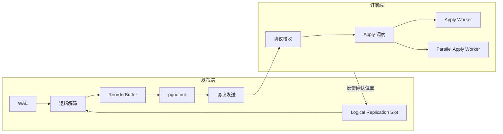
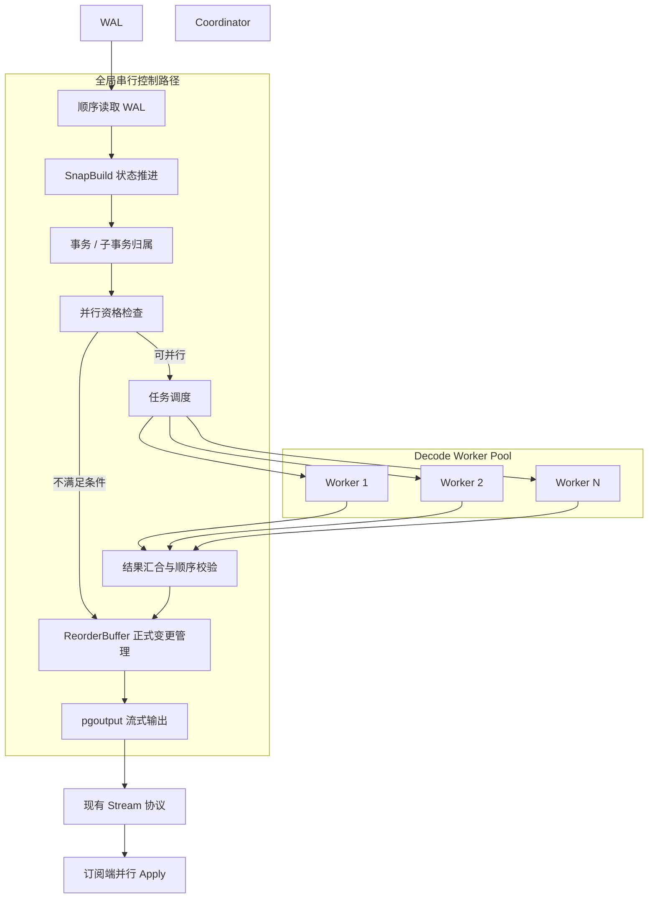
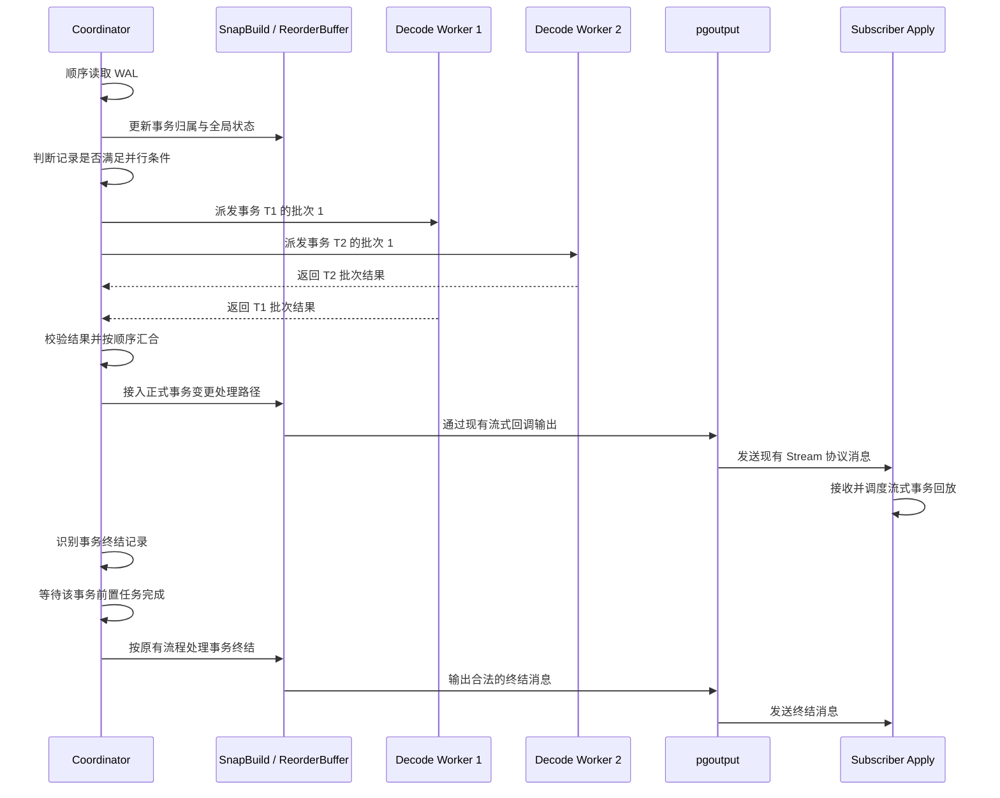

# 概要设计说明书（逻辑复制并行解码）

## 1. 功能简述

逻辑复制并行解码的核心目的是：通过将发布端的逻辑解码由单进程串行处理改造为多进程并行处理，提高逻辑复制整体同步速率。

逻辑复制的端到端性能取决于发布端 WAL 读取与解码、网络传输、订阅端数据回放等多个环节。如果只对发布端解码进行并行化，而订阅端仍然串行 Apply，整体性能可能受到订阅端限制；如果只开启订阅端并行 Apply，而发布端仍然串行解码，则发布端也可能成为性能瓶颈。

因此，本方案将发布端并行解码与订阅端并行 Apply 结合考虑。

PostgreSQL 16 及后续版本支持订阅端流式事务处理和并行 Apply 相关能力。对于需要使用流式事务并行 Apply 的场景，发布端需要使用与之匹配的 Stream 协议语义。本方案主要面向 Stream 场景：**发布端在事务执行期间增量产生解码任务，由多个 Decode Worker 并行处理可安全并行的工作，并通过现有流式逻辑复制输出路径向订阅端交付结果。**

非 Stream 场景不纳入第一阶段并行解码范围，继续使用 PostgreSQL 原有串行解码流程。

本方案不重新实现一套逻辑复制协议，而是在现有逻辑解码框架中增加并行任务调度、Worker 管理、结果汇合和顺序控制机制，并复用现有 `pgoutput` 流式输出路径。

### 1.1 逻辑复制现状

#### 1.1.1 逻辑复制整体架构

逻辑复制的主要处理过程如下：

1. 发布端根据复制槽确定需要读取的 WAL 范围。
2. 发布端的逻辑解码模块按 WAL 顺序读取记录。
3. SnapBuild 根据 WAL 中的事务状态信息维护一致性快照。
4. ReorderBuffer 根据事务 ID 组织事务、子事务及其变更记录。
5. 逻辑解码输出插件将事务变更转换为逻辑复制协议消息。
6. 发布端通过复制协议将数据发送给订阅端。
7. 订阅端接收消息，并由 Apply Worker 或 Parallel Apply Worker 执行数据回放。
8. 订阅端向发布端反馈复制进度，发布端根据反馈更新复制槽相关状态。

整体架构如下：



当前发布端的 WAL 解码和事务状态维护以顺序处理为基础。事务变更先进入 ReorderBuffer，再根据事务状态、内存限制和输出插件配置等条件处理或发送。

对于非流式事务，通常需要等到事务提交后，才具备完整处理事务并输出最终事务内容的条件。对于开启流式处理的事务，当满足流式处理条件时，可以在事务提交前分批发送变更，订阅端也可以据此提前接收和处理事务内容。

本方案利用这一机制，将发布端的解码工作和订阅端的回放工作连接成流水线。

#### 1.1.2 发布端现状

##### 1.1.2.1 核心数据结构

逻辑解码运行在 `LogicalDecodingContext` 上下文中，主要涉及以下核心组件。

| 数据结构 | 主要职责 | 与并行解码的关系 |
|---|---|---|
| `LogicalDecodingContext` | 保存逻辑解码运行上下文，关联 WAL Reader、ReorderBuffer、SnapBuild 和输出插件等组件 | 由 Coordinator 统一维护，不直接跨进程共享整个上下文 |
| `XLogReaderState` | 读取并解析 WAL 记录 | 由 Coordinator 顺序驱动；Worker 不直接共享活动 Reader 指针 |
| `ReorderBuffer` | 组织事务、子事务和变更记录，并管理事务级处理与资源生命周期 | 第一阶段由 Coordinator 统一维护正式事务状态 |
| `ReorderBufferTXN` | 保存事务或子事务相关信息，包括事务标识、快照、变更链表和处理状态等 | 作为任务归属和顺序管理的基础，但不作为跨进程共享的可变对象 |
| `ReorderBufferChange` | 表示逻辑解码过程中形成的变更或内部处理事件 | 可作为结果汇合的参考模型，但不能直接将含有后端指针的对象跨进程传递 |
| `SnapBuild` | 维护快照构建状态、事务状态信息和历史目录快照所需的数据 | 由 Coordinator 顺序推进 |
| `OutputPluginCallbacks` | 定义逻辑解码输出插件的回调接口 | 继续由 Coordinator 按现有生命周期调用 |
| `pgoutput` 插件状态 | 保存发布端逻辑复制输出过程所需的插件状态 | 不由多个 Worker 并发访问 |

需要注意，`ReorderBufferTXN` 和 `ReorderBufferChange` 是 PostgreSQL 后端内部的数据结构，通常包含链表节点、指针和内存上下文相关信息。它们不能简单地通过共享内存地址在不同进程间传递。

并行解码需要定义独立的任务描述和结果描述，由 Coordinator 将内部对象转换为适合 Worker 处理的输入，再将 Worker 结果转换为正式的 ReorderBuffer 变更。

##### 1.1.2.2 核心流程

逻辑解码的核心执行入口包括 `LogicalDecodingProcessRecord()`、资源管理器对应的解码函数和 ReorderBuffer 事务处理路径。

从职责上看，主要包含以下三个方面。

**1. 事务关系维护**

`ReorderBufferAssignChild()` 在需要关联子事务和顶层事务时，负责建立相应的归属关系。

`ReorderBufferProcessXid()` 负责根据 WAL 中的事务 ID 查找或建立事务对象，使后续记录能够关联到对应事务。

这两个函数解决的是事务组织和归属问题，不是记录内容的并行解码入口。

**2. WAL 记录解码**

`rm_decode` 根据 WAL 记录所属的资源管理器选择对应的解码函数，例如：

- `heap_decode()`：处理常规堆表变更相关 WAL。
- `heap2_decode()`：处理新 Command ID 等相关信息。
- `xact_decode()`：处理事务提交、回滚等相关 WAL。
- `standby_decode()`：处理 `XLOG_RUNNING_XACTS` 等与事务状态和快照构建相关的记录。
- `xlog_decode()`：处理相应 XLOG 记录，包括与快照恢复有关的记录。

实际是否执行变更解码，还取决于 SnapBuild 状态、事务资格和当前解码配置。

**3. 事务变更组织和输出**

常规数据变更通常经过 `DecodeInsert()`、`DecodeUpdate()`、`DecodeDelete()` 等函数形成 `ReorderBufferChange`，再通过 `ReorderBufferQueueChange()` 等路径组织到事务中。

事务后续由 ReorderBuffer 处理，涉及变更遍历、历史快照、Tuple CID、TOAST、事务回调以及输出插件调用等工作。

对于 Stream 场景，ReorderBuffer 还会在满足相应条件时执行流式事务处理，向输出插件交付事务的一部分变更。

当前流程按 WAL 顺序维护全局状态。SnapBuild 状态推进、事务对象管理、目录信息和 ReorderBuffer 变更组织之间存在紧密联系，这也是并行解码的主要复杂性来源。

### 1.2 逻辑复制发布端源码分析

#### 1.2.1 `ReorderBufferAssignChild`

该函数用于建立子事务与顶层事务之间的归属关系。

它会根据顶层事务 ID 和子事务 ID 查找或建立对应的 `ReorderBufferTXN` 对象。`ReorderBufferTXNByXid()` 通过事务 ID 对应的哈希表查找对象；当允许创建且对象不存在时，创建新的事务对象，并根据参数决定是否将其加入相应的事务组织结构。

典型查找或插入逻辑如下：

```c
ent = (ReorderBufferTXNByIdEnt *)
    hash_search(rb->by_txn,
                &xid,
                create ? HASH_ENTER : HASH_FIND,
                &found);
```

在完成事务对象关联后，还需要处理顶层事务和子事务之间的快照关系。如果子事务拥有独立的 `base_snapshot`，则需要按现有规则转移或释放快照引用，确保后续处理使用正确的事务快照。

并行解码设计中，事务归属关系必须先由 Coordinator 确认。不能让不同 Worker 分别建立自己的事务归属关系，否则可能导致同一个事务被重复派发，或者子事务变更被错误归入不同的处理上下文。

#### 1.2.2 `ReorderBufferProcessXid`

该函数根据 WAL 记录中的 XID 查找或建立对应的 `ReorderBufferTXN`，使 WAL 记录能够关联到正确的事务对象。

事务身份维护需要覆盖多种 WAL 类型，并不只发生在常规堆表变更解码时。

在并行解码方案中，`ReorderBufferProcessXid()` 仍由 Coordinator 按 WAL 顺序执行。它产生或确认的事务归属信息，是后续任务分配的基础。

Worker 不应绕过 Coordinator，独立修改全局事务哈希表或顶层事务链表。

#### 1.2.3 `rm_decode`

资源管理器解码路径负责将 WAL 记录分派给对应的解码函数。

| WAL 类别 | 主要处理函数 | 主要职责 | 第一阶段策略 |
|---|---|---|---|
| heap | `heap_decode()` | 处理常规 INSERT、UPDATE、DELETE 等记录 | 提取可并行处理的候选工作 |
| heap2 | `heap2_decode()` | 处理新 Command ID 等相关信息 | 保留全局有序处理 |
| xact | `xact_decode()` | 处理事务提交、回滚及相关事务状态信息 | 保留 Coordinator 控制 |
| standby | `standby_decode()` | 处理运行中事务信息，推进 SnapBuild | 保留 Coordinator 控制 |
| xlog | `xlog_decode()` | 处理相关 XLOG 记录 | 默认走受控串行路径，逐类评估 |

需要特别区分：Worker 并行处理的不是整个 `rm_decode` 调用链，而是其中经过明确拆分、具备独立输入和安全执行条件的事务局部工作。

WAL 的顺序读取和全局事务状态推进仍由 Coordinator 负责。并行化不能改变原有 WAL 记录的逻辑先后关系。

#### 1.2.4 `SnapBuildState`

SnapBuild 的状态定义如下：

```c
typedef enum
{
    SNAPBUILD_START = -1,
    SNAPBUILD_BUILDING_SNAPSHOT = 0,
    SNAPBUILD_FULL_SNAPSHOT = 1,
    SNAPBUILD_CONSISTENT = 2,
} SnapBuildState;
```

其主要含义如下。

| 状态 | 含义 |
|---|---|
| `SNAPBUILD_START` | 初始状态，尚不能执行完整的逻辑解码工作 |
| `SNAPBUILD_BUILDING_SNAPSHOT` | 收集事务状态和已提交事务信息，以建立目录快照 |
| `SNAPBUILD_FULL_SNAPSHOT` | 已获得解码后续事务所需的完整快照信息，可以开始收集符合条件的变更 |
| `SNAPBUILD_CONSISTENT` | 已跨过一致性边界，能够在满足相关条件时安全地产生事务提交回调 |

对常规 heap、heap2 和 xact 解码而言，SnapBuild 尚未达到 `SNAPBUILD_FULL_SNAPSHOT` 时，许多变更处理路径会提前返回。

例如，解码驱动路径可能通过以下条件控制变更处理：

```c
if (SnapBuildCurrentState(builder) < SNAPBUILD_FULL_SNAPSHOT)
    return;
```

但这并不意味着 `SNAPBUILD_FULL_SNAPSHOT` 或 `SNAPBUILD_CONSISTENT` 是启动所有并行工作的充分条件。

- `SNAPBUILD_FULL_SNAPSHOT` 表示具备进一步解码变更的快照基础。
- `SNAPBUILD_CONSISTENT` 表示已经达到相应的一致性边界。
- 具体事务是否可以并行处理，还需要考虑事务归属、历史目录状态、Tuple CID、上下文有效期和控制事件等条件。

因此，Worker 的派发资格必须由 Coordinator 根据全局状态判断，不能由 Worker 根据本地观察独立决定。

#### 1.2.5 `standby_decode`

`standby_decode()` 处理与事务状态和快照构建相关的 WAL，其中重要的一类是 `XLOG_RUNNING_XACTS`。

其核心处理逻辑包括：

```c
case XLOG_RUNNING_XACTS:
{
    xl_running_xacts *running =
        (xl_running_xacts *) XLogRecGetData(r);

    SnapBuildProcessRunningXacts(builder, buf->origptr, running);

    ReorderBufferAbortOld(ctx->reorder,
                          running->oldestRunningXid);
    break;
}
```

`xl_running_xacts` 提供某个 WAL 位置的运行中事务状态信息。SnapBuild 使用这些信息逐步构建快照并判断一致性边界；ReorderBuffer 则据此处理已不再需要保留的旧事务状态。

这一流程必须保持全局顺序。并行 Worker 不能独立推进 `SnapBuildProcessRunningXacts()`，也不能在缺少全局协调的情况下执行 `ReorderBufferAbortOld()`。

##### 1.2.5.1 `SnapBuildProcessRunningXacts`

在尚未达到一致性状态时，该函数主要用于推进快照构建状态；达到相关状态后，还会参与快照序列化、快照 xmin 管理以及已提交事务信息维护。

`SnapBuildFindSnapshot()` 根据运行中事务信息和已收集的事务状态，判断在哪个 WAL 位置可以建立合适的快照，并推进 SnapBuild 的状态。

在并行解码中，SnapBuild 必须保留单一、按序的状态推进者。否则多个 Worker 可能基于不同的全局状态判断同一事务是否可见，从而产生不一致的解码结果。

#### 1.2.6 `heap_decode`

`heap_decode()` 处理常规堆表相关 WAL。主要记录类型包括 INSERT、UPDATE、DELETE、TRUNCATE、SPEC_CONFIRM 等。

典型处理逻辑如下：

```c
case XLOG_HEAP_INSERT:
    if (SnapBuildProcessChange(builder, xid, buf->origptr) &&
        !ctx->fast_forward)
        DecodeInsert(ctx, buf);
    break;

case XLOG_HEAP_HOT_UPDATE:
case XLOG_HEAP_UPDATE:
    if (SnapBuildProcessChange(builder, xid, buf->origptr) &&
        !ctx->fast_forward)
        DecodeUpdate(ctx, buf);
    break;

case XLOG_HEAP_DELETE:
    if (SnapBuildProcessChange(builder, xid, buf->origptr) &&
        !ctx->fast_forward)
        DecodeDelete(ctx, buf);
    break;
```

上述代码说明，变更解码之前需要先执行 `SnapBuildProcessChange()`。该函数负责判断当前事务的变更是否满足解码条件，并确保事务拥有所需的基础快照。

因此，第一阶段不直接把整个 `heap_decode()` 调用放入 Worker，而是保留前置状态判断，再将符合条件的候选工作转换为并行任务。

##### 1.2.6.1 `SnapBuildProcessChange`

`SnapBuildProcessChange()` 主要判断当前事务的 WAL 变更是否具备解码资格，并确保对应事务已经关联适用的 `base_snapshot`。

当事务尚未拥有基础快照时，SnapBuild 可以构建快照并通过 `ReorderBufferSetBaseSnapshot()` 将其关联到事务。

示意代码如下：

```c
if (!ReorderBufferXidHasBaseSnapshot(builder->reorder, xid))
{
    if (builder->snapshot == NULL)
    {
        builder->snapshot = SnapBuildBuildSnapshot(builder);
        SnapBuildSnapIncRefcount(builder->snapshot);
    }

    SnapBuildSnapIncRefcount(builder->snapshot);

    ReorderBufferSetBaseSnapshot(builder->reorder, xid, lsn,
                                 builder->snapshot);
}
```

这说明快照不是简单的 Worker 本地参数，而是与全局 SnapBuild 状态、事务归属和 ReorderBuffer 生命周期相关联的对象。

并行方案应由 Coordinator 确认事务已经获得正确快照，并向 Worker 提供安全、明确的解码上下文。不能将正在被 SnapBuild 修改的内部快照指针直接交给 Worker 使用。

##### 1.2.6.2 `DecodeInsert`、`DecodeUpdate` 和 `DecodeDelete`

以 `DecodeInsert()` 为例，其主要工作是解析 WAL 中的记录信息，形成 `ReorderBufferChange`，并通过 ReorderBuffer 相关路径关联到事务。

这些函数是第一阶段最值得评估的并行化候选入口，但不意味着可以将现有函数整体迁移到 Worker。

需要先区分两类工作：

1. **适合候选并行化的工作**：在明确上下文下解析记录字段、提取元组数据、生成独立的变更结果。
2. **必须受控执行的工作**：修改全局 ReorderBuffer、访问不具备独立生命周期保证的 Relation 或目录对象、处理快照和事务状态、执行全局缓存失效，以及调用输出插件。

具体拆分边界需要结合 PostgreSQL 18 的实际函数实现和性能剖析确定。

在现有流式处理路径中，ReorderBuffer 可能根据事务缓存和相关配置触发流式发送。并行解码需要确保这一机制与新增的任务完成状态协调，不能让 Worker 在结果尚未汇合时直接触发事务输出。

#### 1.2.7 `heap2_decode`

`heap2_decode()` 中的 `XLOG_HEAP2_NEW_CID` 处理与 Tuple CID 和目录变更相关。

例如：

```c
ReorderBufferXidSetCatalogChanges(builder->reorder, xid, lsn);

ReorderBufferAddNewTupleCids(builder->reorder, xlrec->top_xid, lsn,
                             xlrec->target_locator, xlrec->target_tid,
                             xlrec->cmin, xlrec->cmax,
                             xlrec->combocid);
```

该路径涉及事务级目录变更标记、元组定位信息和命令 ID 的维护。相关信息可能影响后续事务变更的历史可见性判断。

第一阶段将这类记录保留在 Coordinator 的有序处理路径中。若后续希望并行化，需要先建立可靠的上下文版本、依赖关系和屏障机制。

#### 1.2.8 `xact_decode`

`xact_decode()` 处理事务提交、回滚等相关 WAL。事务提交处理涉及多个相互关联的阶段：

1. 解析提交信息。
2. 通过 SnapBuild 更新已提交事务状态。
3. 判断事务是否需要进一步解码或输出。
4. 处理 ReorderBuffer 中的事务和子事务。
5. 完成输出回调和相关状态更新。

`SnapBuildCommitTxn()` 会根据提交信息更新 SnapBuild 的事务状态。必要时，`SnapBuildAddCommittedTxn()` 会记录已提交事务信息。

对于修改目录的事务，还可能涉及快照分发、失效信息和内部变更等处理。

`ReorderBufferCommit()` 最终进入事务提交处理路径，其中 `ReorderBufferProcessTXN()` 是事务变更处理和输出的重要框架。

第一阶段不并行执行提交状态推进，也不允许 COMMIT 直接越过尚未完成的并行任务。

对于同一个事务，必须满足以下条件后才能输出最终的事务终结消息：

- 所有前置任务已完成或已被安全取消。
- 所有前置结果已经校验。
- 变更结果满足事务内顺序要求。
- 所需的历史快照、Tuple CID、TOAST 和其他事务局部处理已经完成。
- 对应的流式输出已按照协议要求完成。

#### 1.2.9 `ReorderBufferProcessTXN`

`ReorderBufferProcessTXN()` 不只是一个简单的 WAL 解码函数，而是事务变更重放与输出框架。它涉及变更迭代、历史快照、命令 ID、TOAST、特殊变更、输出插件回调和事务资源清理等工作。

其职责大体包括：

1. 构建或准备 Tuple CID 信息。
2. 建立历史快照。
3. 准备事务执行环境。
4. 根据事务状态执行相关开始回调。
5. 遍历变更并处理事务内的相关状态。
6. 处理 Relation、TOAST、命令 ID、快照和失效信息。
7. 执行流式输出或事务终结回调。
8. 清理或截断事务缓存和相关资源。

本方案将该函数列为**关键审计点，而不是默认的 Worker 执行入口**。

设计时必须明确：并行 Worker 的结果最终仍需要满足 ReorderBuffer 既有的事务生命周期和输出约束。不能简单地在多个进程中分别调用 `ReorderBufferProcessTXN()`，因为它可能访问各自不一致的事务对象、历史快照和插件状态。

---

## 2. 主要术语

| 术语 | 定义 |
|---|---|
| Coordinator | 发布端并行解码的协调角色，负责顺序读取 WAL、维护全局状态、分配任务、汇合结果和控制输出 |
| Decode Worker | 执行并行解码任务的后台工作进程 |
| Worker Pool | 由 Worker Manager 管理的有限数量 Decode Worker |
| Decode Task | 发布端内部调度单位，代表一段可独立处理的解码工作 |
| Decode Batch | 为便于任务分配、顺序控制和结果汇合而形成的变更批次 |
| Stream Segment | 通过现有流式复制协议交付的事务数据片段或协议阶段，不等同于内部 Decode Task |
| Transaction Context | 任务所属事务的身份、顺序、快照版本和必要上下文信息 |
| Task Sequence | 在同一事务内部用于标识任务先后顺序的编号 |
| Context Epoch | 用于标识目录或解码上下文版本的内部序号，便于在上下文切换时阻止旧任务污染新上下文 |
| Decode Safe LSN | Coordinator 已经能够确认相关解码工作安全完成的内部进度位置 |
| Protocol Send LSN | 发布端已按序完成协议交付的进度位置 |
| Flush LSN | 订阅端反馈的持久化或确认进度位置，具体语义遵循现有复制反馈机制 |
| `restart_lsn` | 复制槽为保证后续恢复所需 WAL 而维护的重启位置 |
| `confirmed_flush_lsn` | 逻辑复制槽记录的确认位置，由现有反馈处理路径推进 |
| Barrier | 暂停受影响范围的新任务派发，等待在途任务完成或取消，并按序处理控制事件的同步机制 |
| Serial Fallback | 对不满足并行安全条件的工作回退到原有串行路径 |

---

## 3. 实现方案

### 3.1 逻辑复制并行解码原理

本方案以 Stream 场景为目标，采用事务进行中的增量批次模型。

Coordinator 持续读取 WAL，按顺序维护 SnapBuild 和事务归属关系。对于符合并行条件的记录，Coordinator 创建 Decode Task 并分配给空闲 Worker。Worker 完成事务局部处理后返回结果，Coordinator 校验结果并将其接入正式的事务处理和输出流程。

与完整事务任务模型相比，增量批次模型有三个主要区别：

1. 任务不需要等待整个事务提交后才创建。
2. Worker 可以在事务仍然运行时处理已具备安全条件的变更。
3. 发布端可以在事务提交前逐步交付符合现有 Stream 协议语义的结果，使订阅端更早开始处理。

**内部任务单位与协议单位必须分离。** 一个 Decode Task 不要求对应一个 Stream Segment。Coordinator 可以将多个已经完成且顺序满足要求的任务结果合并为一个协议输出批次，也可以根据流式输出机制分批交付。

第一阶段主要采用不同事务之间的并行处理。对同一事务，任务可以在内部排队和汇合，但暂不默认支持任意并行执行同一事务内部的所有变更。

#### 3.1.1 并行化的范围

并行化重点放在常规 heap 变更的事务局部处理工作，候选函数包括：

- `DecodeInsert()`
- `DecodeUpdate()`
- `DecodeDelete()`

实际并行边界不是整个函数，而是从函数中拆分出的、具有明确输入和输出的事务局部工作。

以下工作第一阶段保留在 Coordinator 或受控串行路径：

- WAL 顺序读取和记录分发。
- `ReorderBufferAssignChild()` 等事务归属处理。
- `ReorderBufferProcessXid()` 等全局事务状态维护。
- SnapBuild 状态推进及快照构建。
- `heap2_decode()` 中的 Tuple CID 等控制信息处理。
- `xact_decode()` 中的提交和回滚状态处理。
- 全局 ReorderBuffer 事务对象的修改。
- 需要全局顺序的目录失效和上下文切换。
- `pgoutput` 插件回调及最终协议输出。
- 复制槽反馈和进度更新。

#### 3.1.2 并行安全条件

Coordinator 只有在以下条件满足时才派发任务：

1. SnapBuild 已达到允许处理相应变更的状态。
2. 当前事务和子事务的归属关系已经明确。
3. 事务具有可用且适用的基础快照或明确的快照处理策略。
4. 任务输入不依赖 Worker 无法安全访问的可变后端对象。
5. 当前上下文没有未处理完毕、可能影响该任务的目录变更或控制事件。
6. 任务能够被分配唯一的事务标识和顺序编号。
7. 任务的输入、结果和错误状态均可被 Coordinator 管理。
8. Worker 执行不会绕过现有 ReorderBuffer 和输出插件的事务生命周期约束。

任一条件无法满足时，任务进入串行回退路径，或者等待相应屏障解除后再派发。

#### 3.1.3 流式输出与并行解码的关系

Stream 协议允许发布端在事务结束前交付部分事务数据，但协议消息本身仍必须遵循既有事务边界和回调语义。

本方案不新增一套自定义 Stream 协议，也不允许 Worker 直接构造并发送复制协议消息。

正确流程是：

1. Worker 完成内部 Decode Task。
2. Coordinator 验证任务完成状态和结果顺序。
3. Coordinator 将可交付的变更接入正式事务处理路径。
4. 现有 ReorderBuffer 流式处理路径决定何时调用相应的输出插件回调。
5. `pgoutput` 生成现有协议消息。
6. 现有发送路径负责协议传输。

内部批次完成不意味着必须立即生成一个独立的 Stream Segment。是否发送、何时发送及发送哪些协议消息，仍由现有流式处理机制和相关配置决定。

### 3.2 总体流程

#### 3.2.1 逻辑复制并行解码架构图



#### 3.2.2 设计思路

整体采用 Coordinator + Worker Pool 架构。

**Coordinator 的核心职责是维持正确性。** 它按照 WAL 顺序维护全局状态，确保每条记录归属于正确的事务，控制任务派发、结果汇合、事务内顺序和输出时机。

**Worker 的核心职责是执行局部工作。** Worker 不负责决定全局事务是否提交，不推进 SnapBuild，不修改全局复制槽位置，也不直接操作输出插件。

Worker 池采用有限容量。Coordinator 优先从空闲 Worker 中分配任务；没有空闲 Worker 时，根据队列容量和任务依赖情况执行等待、背压或串行回退，不无限制地积累内存任务。

在事务进行期间，Coordinator 为任务分配事务标识、任务序号和上下文版本。任务完成顺序可以与 WAL 顺序不同，但交付顺序必须满足事务和协议约束。

#### 3.2.3 变更或新增模块

| 模块 | 类型 | 主要职责 | 对应内部接口 |
|---|---|---|---|
| Parallel Decode Coordinator | 新增逻辑模块 | 统筹任务调度、结果汇合、事务状态和输出门控 | `ParallelDecodeDispatch()`、`ParallelDecodeAcceptResult()` |
| Worker Manager | 新增 | Worker 启动、分配、回收、故障检测 | `ParallelDecodeWorkerAcquire()`、`ParallelDecodeWorkerRelease()` |
| Task Queue | 新增 | 保存待执行任务，限制排队数量 | `ParallelDecodeTaskEnqueue()`、`ParallelDecodeTaskDequeue()` |
| Result Queue | 新增 | 收集 Worker 结果和执行状态 | `ParallelDecodeResultEnqueue()`、`ParallelDecodeResultDequeue()` |
| Task Builder | 新增 | 将候选 WAL 变更转换为可序列化任务输入 | `ParallelDecodeBuildTask()` |
| Result Merger | 新增 | 验证任务结果，按事务和任务序号汇合 | `ParallelDecodeMergeResult()` |
| Stream Scheduler | 新增 | 控制批次可交付状态和事务终结消息 | `ParallelDecodeCanStream()`、`ParallelDecodeCanFinishTxn()` |
| Barrier Manager | 新增 | 管理目录变更、上下文版本切换和串行回退 | `ParallelDecodeBarrierBegin()`、`ParallelDecodeBarrierEnd()` |
| 现有 ReorderBuffer | 改造 | 在适当位置接收已校验的变更，并与任务状态协调 | 在原有队列和事务处理路径增加协调逻辑 |
| 现有 `pgoutput` | 复用 | 按现有回调语义生成流式协议消息 | 不新增并发调用入口 |

上述函数名称是**设计建议的内部接口名，不是 PostgreSQL 18 现有 API**。最终命名和参数定义应在源码设计阶段根据目标分支统一确定。

#### 3.2.4 逻辑复制运转流程



**流程说明：**

1. Coordinator 按 WAL 顺序读取记录，推进全局状态。
2. 对符合条件的常规变更，构造独立任务并分配给 Worker。
3. Worker 处理事务局部工作，并返回结果。
4. Coordinator 检查结果的事务归属、顺序、上下文版本和执行状态。
5. 已经满足交付条件的变更接入 ReorderBuffer 的正式处理路径。
6. 现有 `pgoutput` 流式回调负责协议消息生成。
7. 遇到事务终结记录时，Coordinator 先保证该事务的前置任务已经处理完成，再进入原有终结流程。
8. 非并行安全的工作继续通过串行路径处理。

---

## 4. 功能说明

### 4.1 Worker 池管理

系统启动或并行解码功能初始化时，根据配置建立有限的 Worker 池。

Worker 状态至少包括：

- `IDLE`：空闲，可接收任务。
- `BUSY`：正在执行任务。
- `DRAINING`：不再接受新任务，正在完成或取消已有任务。
- `STOPPED`：已退出，等待重新启动或清理。

Worker Manager 负责 Worker 生命周期和任务分配。单个 Worker 在同一时刻只执行一个 Decode Task，第一阶段不在同一个 Worker 内引入多任务并发执行。

当没有空闲 Worker 时，Coordinator 可以等待 Worker 返回结果。如果等待会造成队列持续增长，则必须实施背压，或者对适合串行执行的工作进行安全回退。

### 4.2 增量任务生成

Coordinator 在顺序读取 WAL 的过程中，识别满足并行条件的记录，创建事务局部任务。

每个任务至少包含：

- 任务 ID。
- 顶层事务 ID。
- 相关子事务 ID（如果适用）。
- 起始和结束 WAL 位置，或者对应记录的定位信息。
- 事务内任务序号。
- 上下文版本。
- 任务类型。
- 必要的记录数据和元数据。
- 任务执行所需的安全标志。

任务输入应尽可能采用自包含、可序列化的表示，避免将活动的 `XLogReaderState *`、`Relation *`、`ReorderBufferTXN *` 等指针跨进程传递。

### 4.3 Worker 并行处理

Worker 根据任务描述执行被授权的局部处理。

Worker 不负责：

- 修改 SnapBuild 的全局状态。
- 决定事务是否提交。
- 独立建立全局子事务关系。
- 直接修改正式 ReorderBuffer 事务对象。
- 调用 `pgoutput` 插件生成协议消息。
- 直接推进复制槽确认位置。

Worker 完成任务后，返回结果、任务状态和必要的错误信息。结果必须能够由 Coordinator 验证和关联到原任务。

### 4.4 结果汇合与顺序控制

Coordinator 为同一事务维护有序任务状态。

任务完成时间不代表其应当输出的时间。若事务内任务 2 先于任务 1 完成，Coordinator 可以先保存任务 2 的结果，但不得因此将任务 2 的结果越过任务 1 输出。

任务结果需要经过以下检查：

1. 任务 ID 是否有效且尚未被接受。
2. 事务和子事务归属是否一致。
3. 上下文版本是否仍然有效。
4. 任务序号是否符合事务内交付规则。
5. 结果是否完整，是否存在执行错误。
6. 结果是否依赖尚未完成的前置任务。
7. 是否遇到必须等待处理的控制事件或屏障。

只有通过检查的结果，才能进入正式变更处理和输出流程。

### 4.5 Stream 协议适配

并行解码的结果通过现有流式输出路径交付，不新增独立协议。

Stream Scheduler 主要负责判断内部任务结果何时具备交付条件。它不能替代 `pgoutput` 的协议实现，也不能自行重写流式事务的消息顺序。

事务仍然执行期间，已经完成且满足交付条件的变更可以进入现有流式处理路径；事务终结时，则必须确保该事务的前置任务已经完成并按序处理。

### 4.6 非 Stream 兼容

非 Stream 事务在第一阶段不使用新增的并行解码任务模型，继续执行原有串行解码流程。

这样可以降低对现有逻辑复制行为的影响，并允许通过配置或场景选择明确区分两种执行模式。

实际是否使用 Stream，应以发布端和订阅端现有协议能力、订阅配置及输出插件的行为为准，而不能仅凭发布端内部启用了并行解码就推断订阅端会进入并行 Apply。

---

## 5. 触发时机

### 5.1 并行解码启动条件

并行解码启动需要同时满足：

1. 当前逻辑复制会话已启用本方案。
2. 当前会话满足 Stream 相关条件。
3. Worker 池已成功初始化。
4. 全局解码状态允许处理相应记录。
5. 任务队列和结果队列处于可用状态。

对于不满足条件的会话，使用原有串行逻辑解码流程。

### 5.2 单条 WAL 记录的处理条件

Coordinator 读取 WAL 后，首先按原有流程处理必须有序执行的事务状态和快照相关工作。

对于常规数据变更，只有在事务归属明确、快照可用、输入上下文有效且不存在尚未解决的依赖时，才可以创建并行任务。

对于事务状态、快照构建、Tuple CID 和其他控制类记录，第一阶段继续走受控串行路径。

### 5.3 Worker 分配时机

任务完成构造和资格检查后，Coordinator 尝试从 Worker 池获取空闲 Worker：

- 存在空闲 Worker：派发任务。
- 没有空闲 Worker但仍可安全排队：进入有界任务队列。
- 队列达到上限：实施背压。
- 当前任务适合安全串行处理：回退至串行路径。
- 当前任务依赖尚未完成的上下文切换：等待屏障解除。

### 5.4 Stream 输出时机

Worker 返回结果后，不立即自行发送协议消息。

Coordinator 在结果完整、顺序正确、上下文有效且满足输出条件时，将结果接入现有 ReorderBuffer 处理路径。

具体的 Stream Segment 划分和协议回调时机沿用现有流式逻辑解码行为。

### 5.5 事务终结时机

识别到事务提交或回滚相关 WAL 后，Coordinator 必须确保该事务之前已派发的任务都进入可终结状态。

- COMMIT：等待前置任务完成、校验并按序处理，再走现有提交和输出路径。
- ABORT：保证尚未交付的结果不会作为已提交数据输出，并按照现有事务回滚及流式协议语义处理已交付部分。
- Worker 失败：根据任务是否可安全重试、是否已交付及事务状态决定恢复或串行回退。

---

## 6. 功能模块

### 6.1 Coordinator

负责整个并行解码过程的协调，具体包括：

- 维护 WAL 顺序。
- 维护全局 SnapBuild 和事务归属状态。
- 判断记录是否可并行处理。
- 创建和派发任务。
- 收集、验证并汇合任务结果。
- 控制事务终结和 Stream 输出。
- 管理屏障和串行回退。
- 维护任务级统计信息。

Coordinator 是全局状态的唯一控制者，不应被多个 Worker 替代。

### 6.2 Worker Manager

负责 Worker 的初始化、分配、监控和回收。

主要功能包括：

- 根据配置创建 Worker。
- 维护空闲 Worker 列表。
- 将任务分配给空闲 Worker。
- 检测 Worker 异常退出。
- 清理 Worker 未完成任务的资源。
- 根据恢复策略重新派发可安全重试的任务。
- 支持正常关闭和优雅退出。

Worker 数量受系统资源和复制会话负载约束，不应无上限增加。

### 6.3 Task Builder

将符合条件的 WAL 变更转换为可序列化的任务输入。

Task Builder 负责明确任务的数据边界和依赖关系，但不负责推进全局 SnapBuild，也不负责输出最终协议消息。

### 6.4 Task Queue 与 Result Queue

Task Queue 用于保存待处理任务；Result Queue 用于接收 Worker 返回的结果。

两者都必须有容量上限，并明确队列满时的行为。

任务和结果应具备可追踪的 ID、事务 ID、序号及上下文版本，以便处理重复结果、过期结果和 Worker 故障。

### 6.5 Result Merger

负责结果校验、去重和顺序汇合。

Result Merger 不应自行推进事务提交，也不应直接向订阅端发送数据。通过校验的结果交给现有事务变更处理路径。

### 6.6 Stream Scheduler

负责内部任务状态与现有 Stream 输出时机之间的协调。

主要职责包括：

- 判断事务批次是否已经具备交付条件。
- 维护事务内批次顺序。
- 阻止事务终结消息越过前置任务。
- 与 ReorderBuffer 现有流式处理逻辑衔接。
- 避免多个 Worker 并发调用输出插件。

### 6.7 Barrier Manager

用于处理目录变更、上下文切换和其他可能影响在途任务的控制事件。

屏障处理必须包含以下步骤：

1. 停止受影响范围的新任务派发。
2. 确认屏障生效时的上下文版本。
3. 等待受影响任务完成，或按安全规则取消任务。
4. 丢弃或隔离已经失效的结果。
5. 按 WAL 顺序处理控制事件。
6. 更新上下文版本和相关状态。
7. 恢复任务派发。

不得先更新全局目录或缓存上下文，再等待仍然依赖旧上下文的 Worker 完成。

### 6.8 ReorderBuffer 与 pgoutput 适配层

ReorderBuffer 仍然负责事务变更组织、流式处理和事务生命周期管理。`pgoutput` 继续使用现有回调接口生成协议消息。

适配层负责在任务结果汇合后将其纳入原有处理流程，避免并行 Worker 直接操作 ReorderBuffer 内部可变对象或输出插件状态。

---

## 7. 接口说明

### 7.1 用户接口

第一阶段原则上不增加新的 SQL 语法或逻辑复制协议参数。

是否启用并行解码，可通过新增的发布端配置控制。以下名称仅为设计建议，最终应根据 PostgreSQL 参数命名规范和启动时共享内存需求确定。

| 建议参数 | 类型 | 建议含义 |
|---|---|---|
| `logical_decoding_parallel` | Boolean | 是否启用并行解码功能 |
| `logical_decoding_parallel_workers` | Integer | 并行解码 Worker 数量 |
| `logical_decoding_parallel_queue_size` | Integer | 任务队列和结果队列的容量控制 |
| `logical_decoding_parallel_batch_size` | Integer 或其他适合的配置形式 | 任务批次的目标大小或相关调度阈值 |

参数名称、默认值、取值范围和是否需要重启，应在详细设计阶段确定。涉及共享内存、后台进程数量或启动期初始化的配置，不能默认认为通过 `pg_reload_conf()` 就能生效。

本方案不建议另行增加与现有 Stream 协议重复的用户接口。Stream 能力仍遵循 PostgreSQL 现有逻辑复制和订阅端配置语义。

### 7.2 程序内部接口

以下接口为建议新增的内部接口，用于明确模块之间的职责契约，不是 PostgreSQL 18 已有函数。

#### 7.2.1 Worker 管理接口

| 建议接口 | 职责 | 主要约束 |
|---|---|---|
| `ParallelDecodeWorkerAcquire()` | 获取空闲 Worker | 无空闲 Worker 时返回明确状态或进入等待 |
| `ParallelDecodeWorkerRelease()` | 归还 Worker | 仅在任务资源完成清理后释放 |
| `ParallelDecodeWorkerStart()` | 初始化 Worker | 负责执行环境和必要的错误处理 |
| `ParallelDecodeWorkerStop()` | 关闭 Worker | 支持优雅退出和未完成任务处置 |

#### 7.2.2 任务创建与调度接口

| 建议接口 | 职责 | 主要约束 |
|---|---|---|
| `ParallelDecodeCanDispatch()` | 判断当前记录是否可并行派发 | 不得绕过 SnapBuild 和事务归属检查 |
| `ParallelDecodeBuildTask()` | 构造可序列化任务输入 | 不传递活动后端对象指针 |
| `ParallelDecodeTaskEnqueue()` | 将任务放入有界队列 | 必须处理队列满和取消状态 |
| `ParallelDecodeDispatch()` | 分配并派发任务 | 维护事务 ID、任务序号和上下文版本 |

#### 7.2.3 Worker 处理接口

| 建议接口 | 职责 | 主要约束 |
|---|---|---|
| `ParallelDecodeExecuteTask()` | 执行事务局部解码工作 | 不修改 Coordinator 的全局状态 |
| `ParallelDecodeResultEnqueue()` | 返回处理结果 | 结果包含任务 ID、序号和状态 |
| `ParallelDecodeTaskCancel()` | 请求取消任务 | 仅在取消不会破坏已交付结果及事务语义时执行 |

#### 7.2.4 结果汇合与输出接口

| 建议接口 | 职责 | 主要约束 |
|---|---|---|
| `ParallelDecodeAcceptResult()` | 接收 Worker 结果 | 校验任务身份、上下文版本和执行状态 |
| `ParallelDecodeMergeResult()` | 按序汇合结果 | 不能由完成时间决定输出顺序 |
| `ParallelDecodeCanStream()` | 判断批次是否具备交付条件 | 遵循现有 Stream 和事务语义 |
| `ParallelDecodeCanFinishTxn()` | 判断事务是否可进入终结流程 | 必须确认该事务前置任务已完成 |
| `ParallelDecodeBarrierBegin()` | 开始上下文同步屏障 | 停止受影响的新任务派发 |
| `ParallelDecodeBarrierEnd()` | 完成上下文切换 | 确认旧上下文任务已妥善处理 |

#### 7.2.5 与现有内核函数的衔接

| 现有函数或路径 | 建议衔接位置 | 说明 |
|---|---|---|
| `LogicalDecodingProcessRecord()` | 记录处理和调度入口附近 | 保留顺序读取及全局状态处理，按条件创建任务 |
| `heap_decode()` | 常规变更解码分支 | 对 INSERT、UPDATE、DELETE 等候选记录拆分局部工作 |
| `DecodeInsert()`、`DecodeUpdate()`、`DecodeDelete()` | 函数内部或其下层的可独立处理部分 | 不能在未经拆分的情况下整体迁入 Worker |
| `ReorderBufferQueueChange()` | 正式变更入队路径 | 第一阶段仍由 Coordinator 控制正式事务队列 |
| `ReorderBufferProcessTXN()` | 事务处理和流式输出相关路径 | 增加对任务完成状态的协调，不整体改为 Worker 入口 |
| `pgoutput` 流式回调 | 现有输出插件调用路径 | 保持单一调用者和现有协议语义 |
| 复制槽反馈处理 | 现有反馈处理路径 | 继续依据订阅端反馈推进确认进度 |

内部接口应在实现前完成调用契约、参数所有权、内存生命周期、错误返回和并发约束设计，不能仅凭接口名称就假设已有相应内核能力。

---

## 8. 内存管理

### 8.1 内存管理原则

并行解码会同时存在正在执行的任务、尚未完成的任务结果、已完成但等待前置任务的结果，以及 ReorderBuffer 中等待后续处理的事务变更。

因此，必须为任务和结果队列设置容量限制，避免在大事务或 Worker 处理速度低于 WAL 读取速度时无限积累内存。

### 8.2 任务内存

每个任务拥有明确的输入数据和生命周期。

任务创建后，由 Coordinator 管理任务描述和输入缓冲区；Worker 根据既定的所有权约定读取输入。任务完成后，输入缓冲区应在确认不再被使用时释放。

不允许将依赖 Coordinator 临时内存上下文的指针直接传递给 Worker，并在原上下文释放后继续使用。

### 8.3 结果内存

Worker 返回的结果应使用可验证、可释放的独立存储形式。

Coordinator 接受结果后，需要明确：

- 结果是否已经被复制到正式变更存储。
- 结果是否仍被顺序汇合队列引用。
- 任务失败或取消时由谁释放缓冲区。
- 重复结果和过期结果如何清理。
- 屏障发生时，哪些结果必须保留，哪些结果必须丢弃。

### 8.4 ReorderBuffer 与磁盘溢写

现有 ReorderBuffer 具有事务变更缓存和相关内存管理机制。并行解码不能绕过这些机制，也不能把 Worker 结果无限期保留在新增队列中而不受现有内存控制。

新增任务队列和结果队列的内存占用应纳入整体资源评估，并与现有逻辑解码内存限制协调。

### 8.5 快照和元数据生命周期

SnapBuild 快照、Historic Snapshot、Relation 和目录元数据可能具有引用计数、事务边界和缓存失效要求。

第一阶段不在多个 Worker 之间直接共享可变的快照或 Relation 对象。需要使用快照的任务应采用经过明确设计的安全上下文传递或受控重建方式。

---

## 9. 异常处理

### 9.1 Worker 异常退出

当 Worker 异常退出时，Worker Manager 应：

1. 标记 Worker 不可用。
2. 确认其当前任务是否已经返回有效结果。
3. 清理该 Worker 拥有的任务资源。
4. 判断任务是否可以安全重试。
5. 对不可安全重试的任务停止并行派发，必要时进入串行回退。
6. 保证同一个任务不会因重试而重复交付变更。

任务重试必须有明确的幂等性和结果接纳规则。不能仅根据 Worker 没有返回结果，就认定任务一定没有产生任何可观察影响。

### 9.2 任务结果超时

任务超时后，Coordinator 不应立即无条件重新派发同一任务。

应先确认原 Worker 的状态，并通过任务 ID 和结果状态防止重复接受结果。如果无法证明原任务已经安全终止，应进入受控恢复流程。

### 9.3 事务回滚

事务 ABORT 后，属于该事务且尚未交付的结果必须被取消、丢弃或按既定回滚规则清理。

已经通过 Stream 协议交付的事务片段不能被简单视为从未发送。订阅端需要依据现有流式事务协议处理相应事务终结消息和回滚语义。

因此，事务回滚不仅是清理 ReorderBuffer 中的变更，还要求协调任务状态、结果缓存和协议交付状态。

### 9.4 上下文版本失效

当目录变更或其他控制事件导致旧上下文失效时，Barrier Manager 必须阻止旧任务结果在新上下文中被错误使用。

结果的上下文版本与当前有效版本不一致时，应根据任务性质进行安全重试、丢弃或串行回退，不能直接进入正式输出路径。

### 9.5 队列满和背压

当任务队列或结果队列达到容量上限时，Coordinator 必须限制新的任务生成或派发。

可以采用以下策略：

- 等待空闲 Worker。
- 等待结果队列被消费。
- 暂停受影响范围的新任务派发。
- 对安全的候选任务执行串行回退。

背压期间仍必须保持 WAL 处理、事务状态、复制槽和资源生命周期的一致性。

### 9.6 进程关闭和复制会话终止

正常关闭时，Coordinator 应停止接收新的并行任务，处理或取消在途任务，清理队列和 Worker 资源，并按现有逻辑解码流程完成会话终止。

异常终止后，恢复行为必须遵循复制槽、WAL 重放和现有协议语义，不得将内存中的任务完成状态当作持久化提交记录。

---

## 10. 约束

### 10.1 WAL 顺序约束

WAL 的读取仍由 Coordinator 按顺序完成。Worker 完成任务的顺序可以不同于 WAL 顺序，但不能改变变更的逻辑先后关系。

### 10.2 事务归属约束

事务及子事务归属由 Coordinator 维护。任务必须携带明确的顶层事务 ID 和必要的子事务信息，不能由 Worker 独立推断并修改全局归属关系。

### 10.3 快照约束

SnapBuild 的全局状态由 Coordinator 统一推进。达到 `SNAPBUILD_CONSISTENT` 并不意味着所有事务均可并行处理；仍需考虑历史快照、目录状态、Tuple CID 和控制事件。

### 10.4 ReorderBuffer 约束

正式 ReorderBuffer 事务对象的修改、事务生命周期管理和资源清理由受控路径完成。第一阶段不允许多个 Worker 直接并发修改同一事务的 `changes` 链表或其他内部状态。

### 10.5 Stream 协议约束

并行解码复用现有 Stream 协议。Worker 不直接生成、发送或终结协议消息。

### 10.6 事务内顺序约束

同一事务的任务使用明确的顺序编号。除非后续设计已经证明相关操作可交换且不影响所有事务语义，否则不得允许同一事务的后续结果越过前置结果交付。

### 10.7 进度约束

以下进度必须明确区分：

- Worker Completion LSN：某个 Worker 已完成工作的内部位置。
- Decode Safe LSN：Coordinator 已经确认安全处理的内部进度。
- Protocol Send LSN：发布端已按序完成协议交付的进度。
- 订阅端反馈的 Flush LSN：订阅端反馈的确认进度。
- 复制槽 `confirmed_flush_lsn`：现有逻辑复制槽确认位置。
- 复制槽 `restart_lsn`：保证后续恢复所需 WAL 的重启位置。

Worker 完成某条 WAL 对应的任务，不代表该记录已经被发送，更不代表订阅端已经确认。

`confirmed_flush_lsn` 和 `restart_lsn` 不能由 Worker 直接推进，必须继续遵循现有逻辑复制反馈和复制槽管理机制。

### 10.8 非 Stream 约束

非 Stream 事务第一阶段继续使用原有串行流程。不得在没有协议和事务生命周期设计的情况下，将 Stream 事务内部的任务管理方式直接套用于非 Stream 事务。

### 10.9 目录和控制事件约束

涉及目录变更、Tuple CID、缓存失效和全局上下文更新的工作，必须在明确的顺序和屏障规则下执行。

不能因为常规 heap 变更已经可以并行处理，就推断所有 heap、heap2、xact 和其他资源管理器的记录都能并行化。

---

## 11. 安全

本章中的安全主要指数据库内部执行安全、资源隔离和状态一致性。

### 11.1 进程间数据隔离

Worker 只能访问分配给自身的任务输入和必要的只读上下文，不得通过未受控指针访问 Coordinator 的活动内存对象。

### 11.2 任务身份校验

每个任务应具备唯一任务 ID、事务标识和序号。Coordinator 接收结果时必须校验这些字段，避免过期、重复或错误归属的结果进入正式输出路径。

### 11.3 错误隔离

Worker 任务失败时，不应直接破坏其他事务的 ReorderBuffer 状态或输出插件状态。任务异常应被封装为可由 Coordinator 处理的结果或错误状态。

### 11.4 资源限制

Worker 数量、任务队列容量、结果队列容量及单任务内存占用均应受到约束，避免异常负载造成内存无限增长或进程资源耗尽。

### 11.5 复制协议一致性

所有对外输出继续使用现有逻辑复制协议和插件回调，不允许 Worker 绕过协议实现直接向订阅端发送未经校验的数据。

---

## 12. 性能

### 12.1 性能目标

通过减少发布端串行解码的限制，使发布端解码、网络传输和订阅端并行 Apply 尽可能形成流水线，从而提升端到端复制吞吐。

性能目标应以实测结果确定，不预设固定的吞吐提升倍数。

### 12.2 可能的性能收益

1. 多个事务的可并行解码工作可以同时执行。
2. 事务不必等到提交后才开始处理所有可并行变更。
3. 已完成且满足交付条件的变更可以提前进入现有 Stream 输出路径。
4. 订阅端可以更早接收流式事务内容，降低发布端、网络和订阅端之间的等待。
5. 通过有界队列和背压，控制大事务场景下的内存增长。

### 12.3 主要性能风险

- Coordinator 仍然是全局状态推进和任务调度的串行部分。
- 任务拆分和结果汇合可能带来 IPC 和内存复制开销。
- Worker 数量增加可能导致 CPU、内存和上下文切换竞争。
- 目录访问、Historic Snapshot、Tuple CID 和 ReorderBuffer 处理可能仍是串行瓶颈。
- 大事务可能导致后续任务结果等待前置任务。
- 屏障过于频繁会降低并行度。
- 发布端即使提升了解码速度，也可能受到网络或订阅端 Apply 能力限制。

### 12.4 性能测试矩阵

至少比较以下四种场景：

| 场景 | 发布端解码 | Stream | 订阅端 Apply | 用途 |
|---|---|---|---|---|
| A | 串行 | 关闭或不使用流式事务 | 串行 | 基准场景 |
| B | 串行 | 开启 | 并行 Apply | 测量 Stream 与订阅端并行的收益 |
| C | 并行 | 开启 | 并行 Apply | 测量完整方案的端到端收益 |
| D | 并行功能开启，但大部分任务回退串行 | 开启 | 并行 Apply | 评估调度和 IPC 开销 |

测试应覆盖小事务、高并发事务、大事务、目录变更较多的负载，以及发布端或订阅端成为瓶颈的场景。

### 12.5 关键监控指标

- 发布端 WAL 读取速率。
- 发布端解码记录速率。
- Worker 利用率、空闲率和异常退出次数。
- 任务队列长度和结果队列长度。
- 平均任务耗时、P95/P99 任务耗时。
- 任务创建、派发、等待、汇合和串行回退次数。
- 结果等待前置任务的时间。
- Stream 输出速率和输出等待时间。
- ReorderBuffer 内存占用和磁盘溢写量。
- 订阅端 Apply 吞吐和等待情况。
- 发布端、订阅端及端到端复制延迟。
- 复制槽确认位置和 WAL 保留量。

通过火焰图和性能剖析，重点分析 `heap_decode()`、`DecodeInsert/Update/Delete()`、ReorderBuffer、Historic Snapshot、目录访问、插件输出和 IPC 的耗时占比。

---

## 13. 专利

本方案当前以 PostgreSQL 18 内核扩展设计为目标，本章仅用于记录潜在的技术创新点，不构成专利可授权性的判断。

潜在创新点包括：

1. 将发布端逻辑解码任务由完整事务模型调整为事务进行中的增量批次模型。
2. 将全局状态推进与事务局部并行处理分离。
3. 在保留现有 Stream 协议语义的前提下，协调内部任务完成顺序与事务协议输出顺序。
4. 使用上下文版本和屏障机制处理目录变更、快照及其他控制事件。
5. 通过任务级状态、背压和串行回退，在保证逻辑正确性的同时控制并行调度开销。

这些内容需要结合已有技术和公开实现进行进一步检索和分析，才能判断是否具备新颖性及创造性。

---

## 14. 升级管理

### 14.1 版本兼容

并行解码功能作为发布端内部实现能力，不应改变现有逻辑复制协议的基础语义。

未启用新功能时，应继续使用原有串行解码流程。

### 14.2 配置兼容

新增配置应提供明确的默认行为。默认是否启用、是否需要重启以及与现有逻辑解码内存限制之间的关系，需要在详细设计和参数定义阶段确定。

### 14.3 升级和回退

升级后如果出现并行解码异常，应能够通过关闭新功能或停止相关会话的并行派发，回到原有串行解码路径。

回退过程中必须妥善处理在途任务、结果队列和 Worker 资源，不能简单地停止 Worker 后直接复用可能处于不完整状态的任务结果。

### 14.4 复制槽兼容

复制槽的创建、持久化、恢复、反馈和 WAL 保留规则沿用现有机制。新功能不能引入依赖 Worker 内存状态才能恢复的复制槽进度。

### 14.5 跨版本验证

需要验证不同 PostgreSQL 版本间逻辑复制协议兼容性，以及发布端、订阅端对 Stream 相关能力的实际支持情况。不能只根据版本号推断所有配置和行为完全相同。

---

## 15. 其他说明

### 15.1 分阶段实施建议

**第一阶段：事务级并行框架与安全边界**

- 建立 Coordinator 和 Worker Manager。
- 明确任务输入、结果结构和队列协议。
- 保留 SnapBuild、事务归属和正式 ReorderBuffer 管理的串行性。
- 验证不同事务之间的并行任务调度。
- 先建立可靠的结果校验、错误处理和串行回退机制。

**第二阶段：增量任务与 Stream 输出协同**

- 将候选 heap 变更拆分为事务局部批次。
- 支持事务进行中的增量任务派发。
- 建立任务完成状态与现有 ReorderBuffer 流式输出路径之间的协调。
- 验证 COMMIT、ABORT 和流式事务终结语义。
- 测试队列背压、Worker 异常和上下文屏障。

**第三阶段：优化并行范围**

- 根据性能剖析结果，进一步拆分热点函数。
- 评估是否能够安全并行处理更多变更类型。
- 优化任务粒度、内存复制和 IPC。
- 只有在依赖分析充分后，才考虑同一事务内部的进一步并行化。

### 15.2 需要重点审计的源码

| 源码区域或函数 | 审计目的 |
|---|---|
| `LogicalDecodingProcessRecord()` | 明确 WAL 记录处理、事务归属和资源管理器分发的顺序 |
| `ReorderBufferAssignChild()` | 确认子事务和顶层事务的关联时机 |
| `ReorderBufferProcessXid()` | 确认事务对象创建和全局状态修改的边界 |
| `SnapBuildProcessRunningXacts()` | 确认快照状态推进和事务状态裁剪的依赖 |
| `SnapBuildProcessChange()` | 确认任务派发前快照资格和事务快照的建立条件 |
| `heap_decode()` | 确认候选变更入口和全局状态操作的拆分边界 |
| `DecodeInsert/Update/Delete()` | 分析可并行处理的记录解析和数据构造工作 |
| `heap2_decode()` | 明确 Tuple CID 和目录变更相关信息的顺序要求 |
| `xact_decode()` | 明确提交、回滚与任务终结之间的协调方式 |
| `ReorderBufferQueueChange()` | 明确正式变更队列的所有权及任务结果接入方式 |
| `ReorderBufferProcessTXN()` | 审计事务变更遍历、流式分段、输出回调和资源释放 |
| `ReorderBufferIterTXNInit/Next/Finish()` | 明确事务迭代、分段处理和清理之间的约束 |
| Historic Snapshot 和 Tuple CID 相关路径 | 明确历史可见性和命令 ID 的上下文要求 |
| `pgoutput` 流式回调 | 确认现有 Stream 消息生成及事务终结语义 |
| 复制反馈和复制槽更新路径 | 确保内部任务进度不会错误推进确认位置 |

---

## 16. 评审问题

本方案进入详细设计和编码前，需要重点评审以下问题。

### 16.1 并行边界

1. `DecodeInsert()`、`DecodeUpdate()` 和 `DecodeDelete()` 中，哪些代码可以抽取为不修改全局状态的事务局部处理？
2. 记录解析、元组构造、Relation 元数据访问和 ReorderBuffer 变更入队之间，应采用什么拆分边界？
3. 哪些资源管理器记录必须继续由 Coordinator 顺序处理？

### 16.2 事务与快照正确性

1. Worker 任务输入需要携带哪些快照、事务和元数据信息？
2. 如何确保 SnapBuild 推进不会与在途任务使用的上下文冲突？
3. `SNAPBUILD_CONSISTENT` 之后，哪些条件仍然可能阻止任务并行？
4. 子事务、Tuple CID、TOAST 和目录变更如何与任务顺序关联？

### 16.3 Stream 协议衔接

1. 现有 ReorderBuffer 流式处理在哪些条件下触发？
2. 如何避免任务结果尚未完成汇合时，事务变更已经被流式输出？
3. 内部批次与现有流式分段如何解耦？
4. 如何保证 COMMIT 和 ABORT 不越过对应事务的前置任务？
5. 发布端并行解码启用时，如何验证订阅端实际使用了预期的并行 Apply 模式？

### 16.4 Worker 与 IPC

1. 任务输入和结果采用何种序列化格式？
2. 如何管理任务 ID、事务内序号和上下文版本？
3. 如何避免任务重试产生重复结果或重复交付？
4. Worker 异常退出时，哪些任务可以安全重试，哪些任务必须回退串行？
5. 如何设置任务队列和结果队列的上限？

### 16.5 内存和性能

1. 新增任务队列与结果队列的内存是否需要纳入现有逻辑解码内存预算？
2. 任务粒度如何在调度开销与并行收益之间平衡？
3. 如何测量 Coordinator 的串行部分是否已经成为新的瓶颈？
4. 如果目录访问或 `ReorderBufferProcessTXN()` 占据主要耗时，仅并行常规变更解析是否仍有足够收益？
5. 如何量化 Stream、并行解码和并行 Apply 各自的独立贡献？

### 16.6 第一阶段验收标准

第一阶段至少应满足以下要求：

- 非 Stream 场景能够保持原有串行处理行为。
- Stream 场景可以安全派发符合条件的增量任务。
- Worker 之间不会因共享可变 ReorderBuffer 或 SnapBuild 状态而产生竞争。
- 任务完成顺序不同于 WAL 顺序时，仍然能够保证正确的事务内交付顺序。
- COMMIT、ABORT、目录变更和上下文切换不会越过必要的前置处理。
- Worker 异常、队列满和任务失败时能够安全恢复或回退串行。
- 复制槽确认位置仍然遵循订阅端反馈路径。
- 在相同负载和硬件环境下，相比“串行解码 + Stream + 并行 Apply”基线，完整方案能够通过可重复测试证明端到端性能收益。

---

## 总结

本方案的核心不是简单地将 `DecodeInsert()`、`DecodeUpdate()` 和 `DecodeDelete()` 放进多个进程执行，而是建立一套与 PostgreSQL 18 现有逻辑解码和 Stream 协议相协调的并行执行框架。

Coordinator 继续负责 WAL 顺序、SnapBuild、事务归属和最终输出控制；Decode Worker 处理经过明确拆分的事务局部任务；Result Merger 保证结果正确汇合；Stream Scheduler 确保内部任务完成状态与现有流式事务输出相匹配。

第一阶段以不同事务之间的并行处理为主，并通过有界队列、屏障、异常恢复和串行回退控制复杂性。在完成源码级依赖分析和性能验证后，再逐步扩大并行范围。

最终目标是让发布端解码、Stream 传输和订阅端并行 Apply 形成稳定的流水线，在保持事务语义和复制进度正确性的前提下，提高逻辑复制整体同步速率。