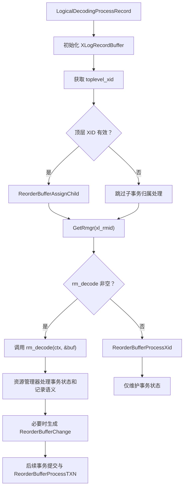
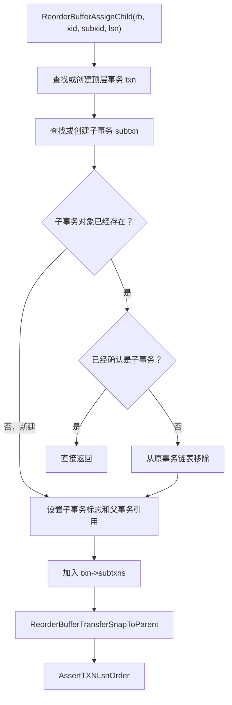
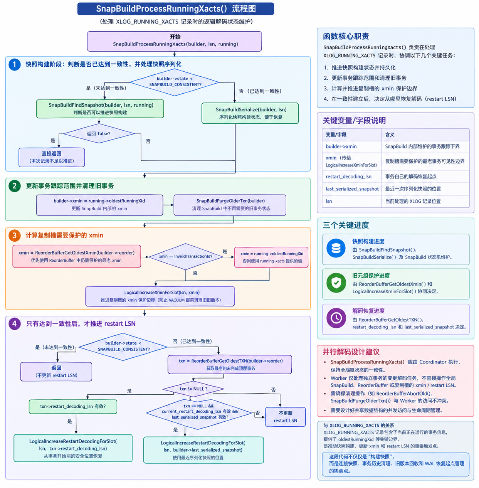
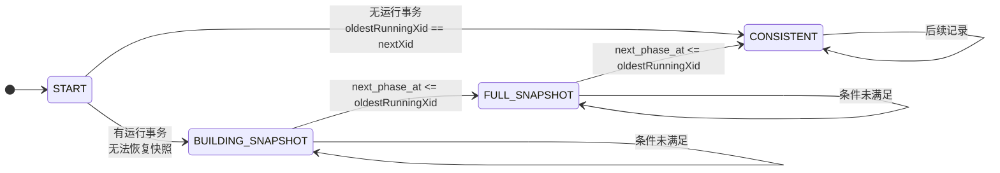
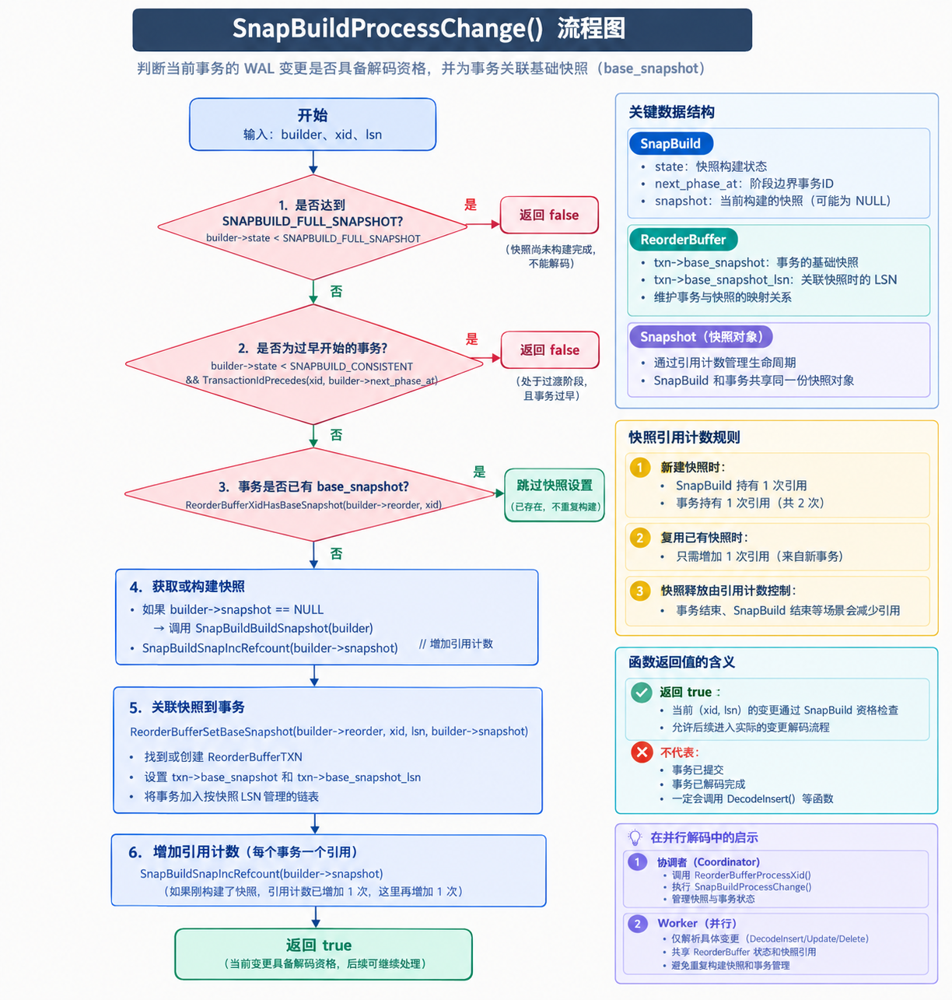
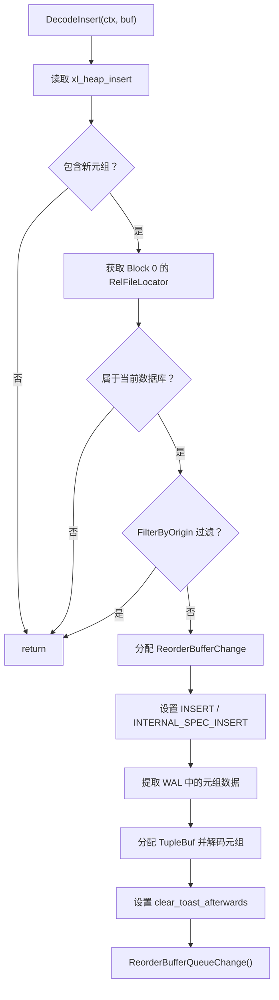
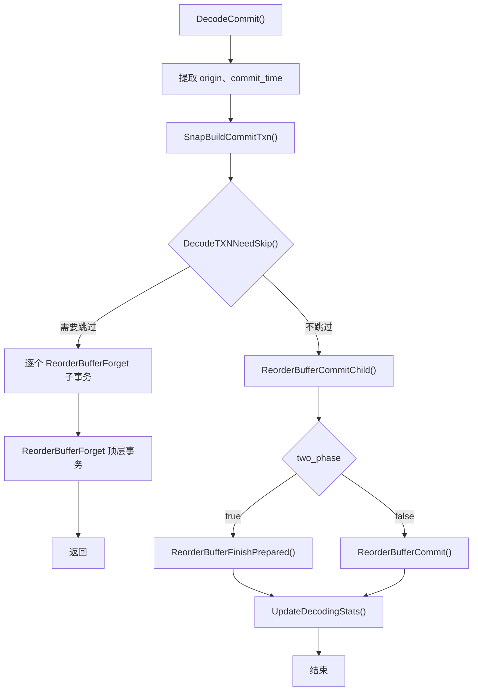
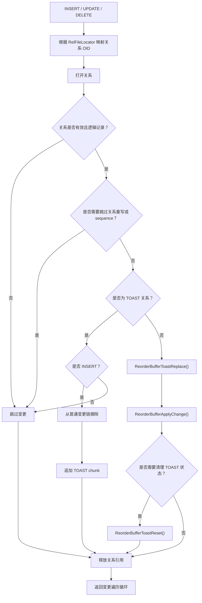
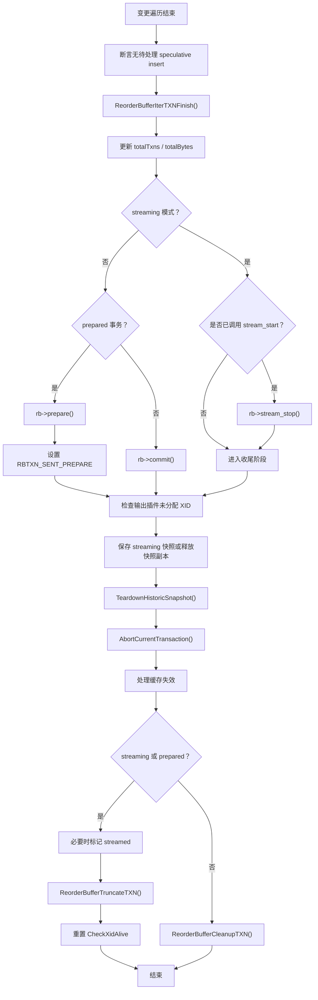

# 逻辑复制发布端现状

## 核心数据结构

逻辑复制发布端解码运行在一个叫LogicalDecodingContext的上下文里，该上下文主要包含如下几个核心部分：

- XLogReaderState ：读取日志的基础组件，需要从wal日志中反向解析处逻辑操作。
- ReorderBuffer：事务的组织信息，wal日志被解析后会以ReorderBufferTXN、ReorderBufferChange的形式保存在reorderbuffer中。
- SnapBuild：一致性快照的维护，wal中记录保存的是二进制数据信息，必须结合元数据信息才能解码，因此snapbuild负责获得对元数据读取的一致性快照。
- OutputPluginCallbacks：逻辑解码发送组件，定义了一套固定的api，按照接收端的要求生成逻辑日志。

## 核心流程

逻辑发布端解码从LogicalDecodingProcessRecord开始，其核心流程主要是三部分。

- ReorderBufferAssignChild：如果wal头部的topid是有效的，就需要执行这个函数建立子事务与顶层事务的归属。
- rm_decode：根据资源id对应的解码器，调用对应的解码函数进行解码。
- ReorderBufferProcessXid：如果解码器没有对应的解码函数，那就直接进行事务关系处理。



### ReorderBufferAssignChild

这个函数会分别使用xid和subxid调用ReorderBufferTXNByXid进行ReorderBufferTXN的查找和插入，如果在ReorderBufferTXN中已存在那直接返回存在的，若不存在就创建插入后返回新创建的。

ReorderBufferTXNByXid() 的核心职责是：根据事务 ID（XID），从 ReorderBuffer 中查找对应的 ReorderBufferTXN 对象；如果允许创建且对象不存在，就创建一个新的事务对象，并根据参数决定是否把它加入顶层事务链表。

查找插入的代码是,ReorderBufferTXN使用xid保存到hash表里。

```c
ent = (ReorderBufferTXNByIdEnt *)
		hash_search(rb->by_txn,
					&xid,
					create ? HASH_ENTER : HASH_FIND,
					&found);
```



在最后还需要统一子事务和顶层事务的base_snapshot，发现一个子事务拥有自己的基础快照（base_snapshot）时，将这个快照正确地转移或释放，使顶层事务统一使用适合整个事务的基础快照。

### ReorderBufferProcessXid

这个函数要做的事情比较简单，就是使用wal的xid构造ReorderBufferTXN并插入hash表和顶层事务链表。所有读取的wal日志都会执行这个步骤，包括rm_decode处理流程。

### rm_decode

当前解码函数主要针对一下几种wal：

- heap：这个就是常规的元组解析，比如插入、删除、更新，对应heap_decode.
- heap2：主要是系统表变更时会写入CID，对应heap2_decode.
- xlog: 对于逻辑复制来说，最主要的就是recovey相关，用于序列化快照的，场景较少。
- xact：事务提交相关的wal，对应xact_decode.
- standby:主要就是处理xl_running_xacts，对应standby_decode。

这些decode流程中，除了xact_decode外，都需要在开始前构造ReorderBufferTXN。

```c
ReorderBufferProcessXid(ctx->reorder, xid, buf->origptr);
```

解码的流程是按顺序读取wal日志（wal也是按顺序写入的），但是从什么位置开始读取与启动逻辑复制的时机和用户配置有关。因而先读取到什么类型的日志无法确定，可能是heap，也可能是xact。因而需要有一个状态来标识解码的开始，这个状态就是SnapBuild的状态。

#### SnapBuildState

```c
ypedef enum
{
	/*
	 * Initial state, we can't do much yet.
	 */
	SNAPBUILD_START = -1,

	/*
	 * Collecting committed transactions, to build the initial catalog
	 * snapshot.
	 */
	SNAPBUILD_BUILDING_SNAPSHOT = 0,

	/*
	 * We have collected enough information to decode tuples in transactions
	 * that started after this.
	 *
	 * Once we reached this we start to collect changes. We cannot apply them
	 * yet, because they might be based on transactions that were still
	 * running when FULL_SNAPSHOT was reached.
	 */
	SNAPBUILD_FULL_SNAPSHOT = 1,

	/*
	 * Found a point after SNAPBUILD_FULL_SNAPSHOT where all transactions that
	 * were running at that point finished. Till we reach that we hold off
	 * calling any commit callbacks.
	 */
	SNAPBUILD_CONSISTENT = 2,
} SnapBuildState;
```

这个状态是由standby类型的wal来维护更新的。
对于xact、heap、heap2类型的wal，在SnapBuildState没有达到SNAPBUILD_FULL_SNAPSHOT之前，是不会往下处理的。

```c
    /*
	 * If we don't have snapshot or we are just fast-forwarding, there is no
	 * point in decoding data changes. However, it's crucial to build the base
	 * snapshot during fast-forward mode (as is done in
	 * SnapBuildProcessChange()) because we require the snapshot's xmin when
	 * determining the candidate catalog_xmin for the replication slot. See
	 * SnapBuildProcessRunningXacts().
	 */
	if (SnapBuildCurrentState(builder) < SNAPBUILD_FULL_SNAPSHOT)
		return;
```

因而在逻辑复制前期不管解析到什么类型的wal日志（除standby类型外），在没有达到SNAPBUILD_FULL_SNAPSHOT之前都只会将wal转换为ReorderBufferTXN缓存事务消息，而不会进行解码。

需要等读取standby类型的wal进行处理并更新SnapBuildState。而standby消息解析就是standby_decode函数。

#### standby_decode

standby_decode核心处理就两个函数：

```c
case XLOG_RUNNING_XACTS:
{
    xl_running_xacts *running = (xl_running_xacts *) XLogRecGetData(r);

    SnapBuildProcessRunningXacts(builder, buf->origptr, running);

    /*
        * Abort all transactions that we keep track of, that are
        * older than the record's oldestRunningXid. This is the most
        * convenient spot for doing so since, in contrast to shutdown
        * or end-of-recovery checkpoints, we have information about
        * all running transactions which includes prepared ones,
        * while shutdown checkpoints just know that no non-prepared
        * transactions are in progress.
        */
    ReorderBufferAbortOld(ctx->reorder, running->oldestRunningXid);
}
break;
```

xl_running_xacts 提供了某个时间点的运行中事务集合。SnapBuild 根据连续出现的这些记录，判断之前的事务是否已经完成，并逐步建立能够正确读取历史系统目录的快照。

snapbuild中状态的维护和解码紧密耦合在一起，一方面根据snapbuild的状态决定是否对某个类型的wal解码，另一方面对某些wal类型的解码又会更新snapbuild中的状态。这也是导致并行解码设计复杂的点。

##### SnapBuildProcessRunningXacts


该函数的功能在没有达到consistent之前主要是更新snapbuild状态，达到后就是序列化快照，以及刷新快照的xmin，并对维护的“活跃事务表”（提交事务表）进行裁剪。



状态维护主要的函数是SnapBuildFindSnapshot，该函数利用 XLOG_RUNNING_XACTS 提供的事务状态信息，逐步判断从哪个 WAL 位置开始，解码器才能正确地解码事务，并最终达到 SNAPBUILD_CONSISTENT 状态。



当snapbuild进入SNAPBUILD_FULL_SNAPSHOT状态后才可以进行heap、heap2、xact的解码。

#### heap_decode

heap的wal日志类型主要分为：insert、update、delete、truncate、confirm。主要处理逻辑如下所示：

```c
    switch (info)
	{
		case XLOG_HEAP_INSERT:
			if (SnapBuildProcessChange(builder, xid, buf->origptr) &&
				!ctx->fast_forward)
				DecodeInsert(ctx, buf);
			break;

			/*
			 * Treat HOT update as normal updates. There is no useful
			 * information in the fact that we could make it a HOT update
			 * locally and the WAL layout is compatible.
			 */
		case XLOG_HEAP_HOT_UPDATE:
		case XLOG_HEAP_UPDATE:
			if (SnapBuildProcessChange(builder, xid, buf->origptr) &&
				!ctx->fast_forward)
				DecodeUpdate(ctx, buf);
			break;

		case XLOG_HEAP_DELETE:
			if (SnapBuildProcessChange(builder, xid, buf->origptr) &&
				!ctx->fast_forward)
				DecodeDelete(ctx, buf);
			break;

		case XLOG_HEAP_TRUNCATE:
			if (SnapBuildProcessChange(builder, xid, buf->origptr) &&
				!ctx->fast_forward)
				DecodeTruncate(ctx, buf);
			break;

		case XLOG_HEAP_INPLACE:

			/*
			 * Inplace updates are only ever performed on catalog tuples and
			 * can, per definition, not change tuple visibility.  Since we
			 * also don't decode catalog tuples, we're not interested in the
			 * record's contents.
			 */
			break;

		case XLOG_HEAP_CONFIRM:
			if (SnapBuildProcessChange(builder, xid, buf->origptr) &&
				!ctx->fast_forward)
				DecodeSpecConfirm(ctx, buf);
			break;
```

可以看到，对于每一种类型都需要先执行SnapBuildProcessChange进行处理。而ctx->fast_forward主要用来跳过解码的标志位，对于逻辑复制正常的传输场景来说都需要进行解码。

##### SnapBuildProcessChange

SnapBuildProcessChange用于判断当前事务的 WAL 变更是否具备解码资格；如果具备资格，确保对应事务已经关联一个 base_snapshot，供后续变更解码使用。

没有达到SNAPBUILD_FULL_SNAPSHOT和过早开始的事务的wal都不会进入解码。

而对于要解码的事务最主要的事情就是判断是否已经有快照了，如果没有的话就需要构建一个快照。其主要代码逻辑如下：

```c
/*
	 * If the reorderbuffer doesn't yet have a snapshot, add one now, it will
	 * be needed to decode the change we're currently processing.
	 */
	if (!ReorderBufferXidHasBaseSnapshot(builder->reorder, xid))
	{
		/* only build a new snapshot if we don't have a prebuilt one */
		if (builder->snapshot == NULL)
		{
			builder->snapshot = SnapBuildBuildSnapshot(builder);
			/* increase refcount for the snapshot builder */
			SnapBuildSnapIncRefcount(builder->snapshot);
		}

		/*
		 * Increase refcount for the transaction we're handing the snapshot
		 * out to.
		 */
		SnapBuildSnapIncRefcount(builder->snapshot);
		ReorderBufferSetBaseSnapshot(builder->reorder, xid, lsn,
									 builder->snapshot);
	}
```

SnapBuildBuildSnapshot就是根据snapbuild里的xmin，xmax，xip来构建快照。

ReorderBufferSetBaseSnapshot则是把构建的快照赋值给对应的ReorderBufferTXN。

```c
    txn = ReorderBufferTXNByXid(rb, xid, true, &is_new, lsn, true);
	if (rbtxn_is_known_subxact(txn))
		txn = ReorderBufferTXNByXid(rb, txn->toplevel_xid, false,
									NULL, InvalidXLogRecPtr, false);
	Assert(txn->base_snapshot == NULL);

	txn->base_snapshot = snap;
	txn->base_snapshot_lsn = lsn;
	dlist_push_tail(&rb->txns_by_base_snapshot_lsn, &txn->base_snapshot_node);
```



确认可以解码且wal的xid对应的txn已经有了快照之后才可以进行真正的解码。

###### DecodeInsert

DecodeInsert() 并不直接把 INSERT 输出给订阅端，而是把它转换为事务关联的变更记录，并通过 ReorderBufferQueueChange() 加入后续处理流程。即构建ReorderBufferChange并根据xid放入ReorderBufferTXN中。




生成的bufferchange最终添加到了txn的changes队列上，

```c
change->lsn = lsn;
change->txn = txn;

Assert(InvalidXLogRecPtr != lsn);
dlist_push_tail(&txn->changes, &change->node);

txn->nentries++;
txn->nentries_mem++;
```

其中在change入队的流程里，如果没有开启stream，则还需要考虑在内存不足的时候，将缓存的reorderbuffer序列化到磁盘。

同时如果开启了stream，则在构造完bufferchange后就会执行ReorderBufferCheckMemoryLimit对当前txn大小进行检查，满足条件后就会立即执行流式发送。

```c
/* skip the transaction if aborted */
if (ReorderBufferCheckAndTruncateAbortedTXN(rb, txn))
    continue;

ReorderBufferStreamTXN(rb, txn);
```

update、delete、truncate、confirm的流程与insert类似。

#### heap2_decode

```c
case XLOG_HEAP2_NEW_CID:
    if (!ctx->fast_forward)
    {
        xl_heap_new_cid *xlrec;

        xlrec = (xl_heap_new_cid *) XLogRecGetData(buf->record);
        SnapBuildProcessNewCid(builder, xid, buf->origptr, xlrec);

        break;
    }
```
首先要设置系统目录更改的RBTXN_HAS_CATALOG_CHANGES标记，如果是子事务的话就设置顶层事务。
然后将将 WAL 中携带的元组定位信息和命令 ID 信息交给 ReorderBuffer。
最后再将command id保存。

```c
ReorderBufferXidSetCatalogChanges(builder->reorder, xid, lsn);

ReorderBufferAddNewTupleCids(builder->reorder, xlrec->top_xid, lsn,
                                xlrec->target_locator, xlrec->target_tid,
                                xlrec->cmin, xlrec->cmax,
                                xlrec->combocid);

ReorderBufferAddNewCommandId(builder->reorder, xid, lsn, cid + 1);
```

#### xact_decode

对于xact日志，与其他日志略微不同，需要先解析commit信息到xl_xact_parsed_commit，然后才能调用DecodeCommit和DecodeAbort。

##### DecodeCommit

事务提交不仅要处理变更数据，还要先推进全局快照构建状态，再完成 ReorderBuffer 中的事务处理。



这里有四个主要阶段：
1. 提取提交时间和复制来源信息。
2. 通知 SnapBuild 事务已经提交。
3. 决定跳过事务，还是将子事务和顶层事务交给 ReorderBuffer 处理。
4. 更新逻辑解码统计信息。

##### SnapBuildCommitTxn

在SnapBuildProcessRunningXacts更新了快照的xmin，而xmax则是在SnapBuildCommitTxn中更新。

需要调用SnapBuildAddCommittedTxn将一个已经提交、且需要被历史快照构建机制跟踪的事务 ID，追加到 builder->committed 数组中。

同时如果本事务修改过元数据，还需要更新快照。

SnapBuildDistributeSnapshotAndInval 这个函数还会为所有的事务添加一个REORDER_BUFFER_CHANGE_INTERNAL_SNAPSHOT的bufferchange。

##### ReorderBufferCommitChild

##### ReorderBufferCommit

对于一个事务来说，之前的wal都缓存到了reorderbuffertxn里面，当解析到commit的时候，这个事务就可以整体解析并发送出去了。而处理事务txn的函数就是ReorderBufferProcessTXN。

- ReorderBufferReplay
- ReorderBufferProcessTXN
- ReorderBufferApplyChange

###### ReorderBufferProcessTXN

ReorderBufferProcessTXN() 不是单纯的 WAL 解码函数，而是一个事务变更重放与输出处理框架。 它负责按顺序遍历事务及其子事务的变更、维护历史快照与命令 ID、处理 TOAST 和特殊变更、调用输出插件回调，并完成事务级清理。

1. 初始化历史元组命令信息
`ReorderBufferBuildTupleCidHash()`

2. 建立历史快照
`SetupHistoricSnapshot()`

3. 建立内部事务环境
`BeginInternalSubTransaction()` 或 `StartTransactionCommand()`

4. 开始事务或准备事务输出
非 streaming 时调用 `begin` / `begin_prepare`

5. 遍历并处理变更
`ReorderBufferIterTXNInit()` → `ReorderBufferIterTXNNext()`

6. 维护变更顺序与执行上下文
LSN、XID、Relation、TOAST、命令 ID、快照和 invalidation

7. 结束输出并清理执行环境
stream stop 或 prepare / commit 回调，撤销内部事务

8. 释放或截断事务缓存
`ReorderBufferCleanupTXN()` / `ReorderBufferTruncateTXN()`







##### DecodeAbort