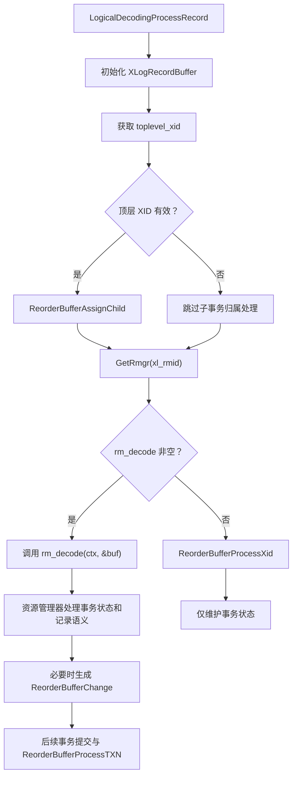
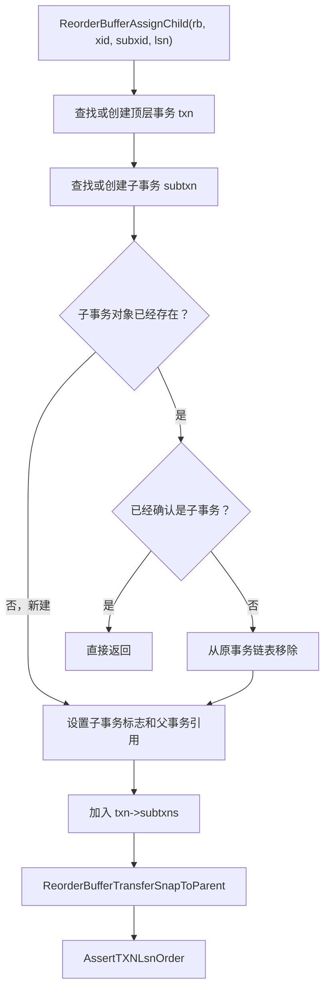
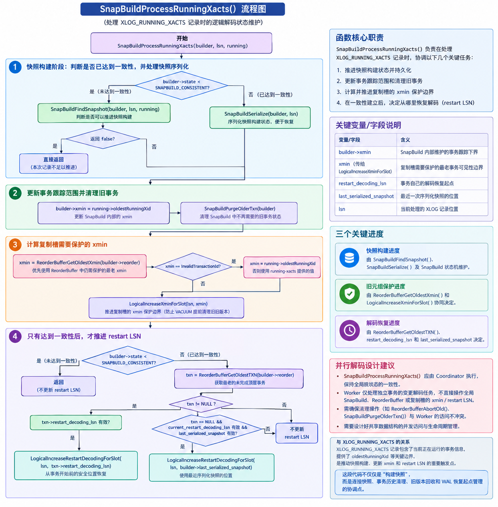
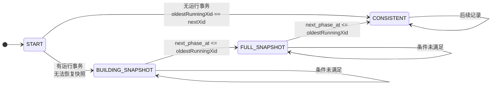

# 逻辑复制发布端现状

## 核心数据结构

逻辑复制发布端解码运行在一个叫LogicalDecodingContext的上下文里，该上下文主要包含如下几个核心部分：

- XLogReaderState ：读取日志的基础组件，需要从wal日志中反向解析处逻辑操作。
- ReorderBuffer：事务的组织信息，wal日志被解析后会以ReorderBufferTXN、ReorderBufferChange的形式保存在reorderbuffer中。
- SnapBuild：一致性快照的维护，wal中记录保存的是二进制数据信息，必须结合元数据信息才能解码，因此snapbuild负责获得对元数据读取的一致性快照。
- OutputPluginCallbacks：逻辑解码发送组件，定义了一套固定的api，按照接收端的要求生成逻辑日志。

## 核心流程

逻辑发布端解码从LogicalDecodingProcessRecord开始，其核心流程主要是三部分。

- ReorderBufferAssignChild：如果wal头部的topid是有效的，就需要执行这个函数建立子事务与顶层事务的归属。
- rm_decode：根据资源id对应的解码器，调用对应的解码函数进行解码。
- ReorderBufferProcessXid：如果解码器没有对应的解码函数，那就直接进行事务关系处理。



### ReorderBufferAssignChild

这个函数会分别使用xid和subxid调用ReorderBufferTXNByXid进行ReorderBufferTXN的查找和插入，如果在ReorderBufferTXN中已存在那直接返回存在的，若不存在就创建插入后返回新创建的。

ReorderBufferTXNByXid() 的核心职责是：根据事务 ID（XID），从 ReorderBuffer 中查找对应的 ReorderBufferTXN 对象；如果允许创建且对象不存在，就创建一个新的事务对象，并根据参数决定是否把它加入顶层事务链表。

查找插入的代码是,ReorderBufferTXN使用xid保存到hash表里。

```c
ent = (ReorderBufferTXNByIdEnt *)
		hash_search(rb->by_txn,
					&xid,
					create ? HASH_ENTER : HASH_FIND,
					&found);
```



在最后还需要统一子事务和顶层事务的base_snapshot，发现一个子事务拥有自己的基础快照（base_snapshot）时，将这个快照正确地转移或释放，使顶层事务统一使用适合整个事务的基础快照。

### ReorderBufferProcessXid

这个函数要做的事情比较简单，就是使用wal的xid构造ReorderBufferTXN并插入hash表和顶层事务链表。所有读取的wal日志都会执行这个步骤，包括rm_decode处理流程。

### rm_decode

当前解码函数主要针对一下几种wal：

- heap：这个就是常规的元组解析，比如插入、删除、更新，对应heap_decode.
- heap2：主要是系统表变更时会写入CID，对应heap2_decode.
- xlog: 对于逻辑复制来说，最主要的就是recovey相关，用于序列化快照的，场景较少。
- xact：事务提交相关的wal，对应xact_decode.
- standby:主要就是处理xl_running_xacts，对应standby_decode。

这些decode流程中，除了xact_decode外，都需要在开始前构造ReorderBufferTXN。

```c
ReorderBufferProcessXid(ctx->reorder, xid, buf->origptr);
```

解码的流程是按顺序读取wal日志（wal也是按顺序写入的），但是从什么位置开始读取与启动逻辑复制的时机和用户配置有关。因而先读取到什么类型的日志无法确定，可能是heap，也可能是xact。因而需要有一个状态来标识解码的开始，这个状态就是SnapBuild的状态。

#### SnapBuildState

```c
ypedef enum
{
	/*
	 * Initial state, we can't do much yet.
	 */
	SNAPBUILD_START = -1,

	/*
	 * Collecting committed transactions, to build the initial catalog
	 * snapshot.
	 */
	SNAPBUILD_BUILDING_SNAPSHOT = 0,

	/*
	 * We have collected enough information to decode tuples in transactions
	 * that started after this.
	 *
	 * Once we reached this we start to collect changes. We cannot apply them
	 * yet, because they might be based on transactions that were still
	 * running when FULL_SNAPSHOT was reached.
	 */
	SNAPBUILD_FULL_SNAPSHOT = 1,

	/*
	 * Found a point after SNAPBUILD_FULL_SNAPSHOT where all transactions that
	 * were running at that point finished. Till we reach that we hold off
	 * calling any commit callbacks.
	 */
	SNAPBUILD_CONSISTENT = 2,
} SnapBuildState;
```

这个状态是由standby类型的wal来维护更新的。
对于xact、heap、heap2类型的wal，在SnapBuildState没有达到SNAPBUILD_FULL_SNAPSHOT之前，是不会往下处理的。

```c
    /*
	 * If we don't have snapshot or we are just fast-forwarding, there is no
	 * point in decoding data changes. However, it's crucial to build the base
	 * snapshot during fast-forward mode (as is done in
	 * SnapBuildProcessChange()) because we require the snapshot's xmin when
	 * determining the candidate catalog_xmin for the replication slot. See
	 * SnapBuildProcessRunningXacts().
	 */
	if (SnapBuildCurrentState(builder) < SNAPBUILD_FULL_SNAPSHOT)
		return;
```

因而在逻辑复制前期不管解析到什么类型的wal日志（除standby类型外），在没有达到SNAPBUILD_FULL_SNAPSHOT之前都只会将wal转换为ReorderBufferTXN缓存事务消息，而不会进行解码。

需要等读取standby类型的wal进行处理并更新SnapBuildState。而standby消息解析就是standby_decode函数。

#### standby_decode

standby_decode核心处理就两个函数：

```c
case XLOG_RUNNING_XACTS:
{
    xl_running_xacts *running = (xl_running_xacts *) XLogRecGetData(r);

    SnapBuildProcessRunningXacts(builder, buf->origptr, running);

    /*
        * Abort all transactions that we keep track of, that are
        * older than the record's oldestRunningXid. This is the most
        * convenient spot for doing so since, in contrast to shutdown
        * or end-of-recovery checkpoints, we have information about
        * all running transactions which includes prepared ones,
        * while shutdown checkpoints just know that no non-prepared
        * transactions are in progress.
        */
    ReorderBufferAbortOld(ctx->reorder, running->oldestRunningXid);
}
break;
```

xl_running_xacts 提供了某个时间点的运行中事务集合。SnapBuild 根据连续出现的这些记录，判断之前的事务是否已经完成，并逐步建立能够正确读取历史系统目录的快照。

snapbuild中状态的维护和解码紧密耦合在一起，一方面根据snapbuild的状态决定是否对某个类型的wal解码，另一方面对某些wal类型的解码又会更新snapbuild中的状态。这也是导致并行解码设计复杂的点。

##### SnapBuildProcessRunningXacts


该函数的功能在没有达到consistent之前主要是更新snapbuild状态，达到后就是序列化快照，以及刷新快照的xmin，并对维护的“活跃事务表”（提交事务表）进行裁剪。



状态维护主要的函数是SnapBuildFindSnapshot，该函数利用 XLOG_RUNNING_XACTS 提供的事务状态信息，逐步判断从哪个 WAL 位置开始，解码器才能正确地解码事务，并最终达到 SNAPBUILD_CONSISTENT 状态。




#### heap_decode

#### heap2_decode

#### xact_decode

