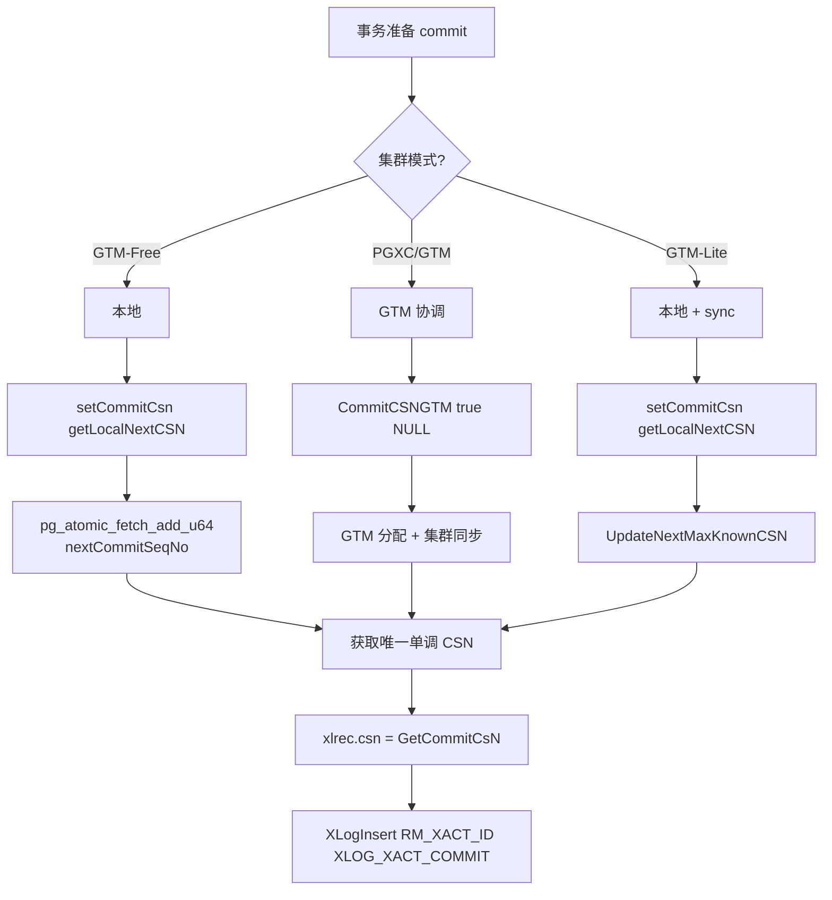
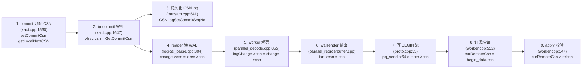
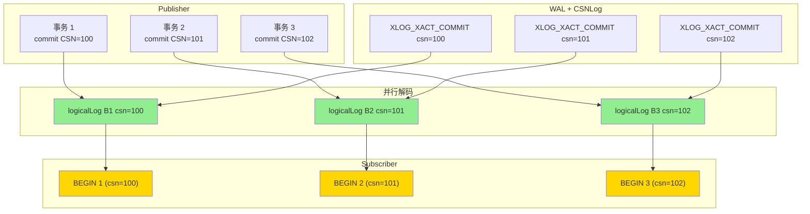
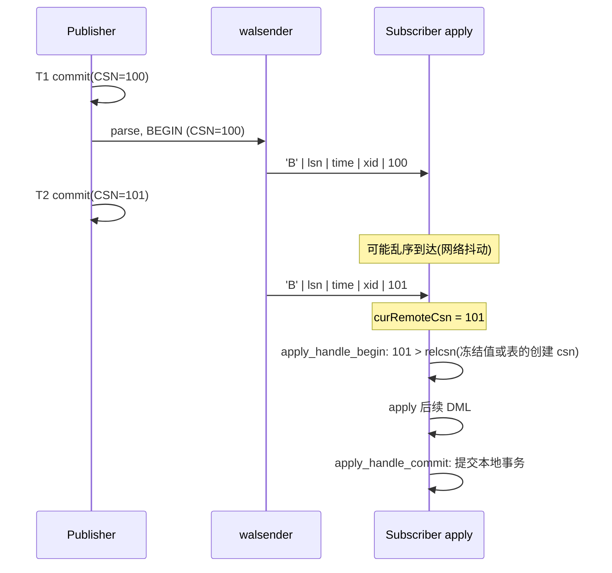

# openGauss 通过 CSN 保证全序的源码级深度分析:从 nextCommitSeqNo 原子计数到订阅端 CSN 校验

> 配套源码:`~/cwork/openGauss-server/`(openGauss 2.x / 3.x)
> 涉及文件:`access/transam/{xact,cxlog,csnlog,transam,xlog}.cpp`、`include/c.h`、`include/access/transam.h`、`include/access/xact.h`、`storage/replication/logical/{proto,worker,parallel_decode,parallel_reorderbuffer,reorderbuffer}.cpp`、`storage/access/heap/heapam_visibility.cpp`、`storage/ipc/procarray.cpp`
>
> 读完本文你会理解:
> 1. **CSN 是什么**:`CommitSeqNo` 的类型定义、位布局、特殊值含义
> 2. **CSN 如何生成**:共享内存原子计数器 `nextCommitSeqNo`,3 种分配路径
> 3. **CSN 如何进入 WAL**:`xl_xact_commit.csn` 字段、`LogCSN()` 函数、`HeapTupleSatisfiesMVCC` 的可见性
> 4. **CSN log 持久化**:SLRU 分区、CSNLogSetCommitSeqNo/CSNLogGetCommitSeqNo 的实现
> 5. **CSN 在并行解码中的传播链**:WAL → reader 解析 → worker → logicalLog → walsender → 订阅端
> 6. **CSN 如何保证全序**:6 层机制详解(原子性、单调性、CSNLog 持久化、WAL 编码、订阅端校验)
> 7. **CSN 与 snapshot/xmin 的协同**:`xmin_csn` / `HistoricSnapshot->snapshotcsn` / `relcsn`
> 8. **CSN 的局限与边界**:gap、subtransaction、CSN barrier、集群模式差异
> 9. **与 PG 18 的核心差异**:`SerializableSnapshot` 全序 vs CSN 全序

---

## 目录

- [一、CSN 是什么:CommitSeqNo 的定义与位布局](#一csn-是什么commitseqno-的定义与位布局)
- [二、CSN 如何生成:nextCommitSeqNo 原子计数器与 3 种分配路径](#二csn-如何生成nextcommitseqno-原子计数器与-3-种分配路径)
- [三、CSN 如何进入 WAL:COMMIT 记录、HEAP_INSERT/UPDATE/DELETE 各自的写入路径](#三csn-如何进入-walcommit-记录heap_insertupdatedelete-各自的写入路径)
- [四、CSN log 持久化:SLRU 存储与查改](#四csn-log-持久化slru-存储与查改)
- [五、CSN 在并行解码中的完整传播链](#五csn-在并行解码中的完整传播链)
- [六、CSN 如何保证全序:6 层机制详解](#六csn-如何保证全序6-层机制详解)
- [七、CSN 与 MVCC 可见性:HeapTupleSatisfiesMVCC 的 CSN 检查](#七csn-与-mvcc-可见性heaptuplesatisfiesmvcc-的-csn-检查)
- [八、CSN 在订阅端的校验:apply_handle_begin 与 should_apply_changes_for_rel](#八csn-在订阅端的校验apply_handle_begin-与-should_apply_changes_for_rel)
- [九、CSN 的边界与特殊场景](#九csn-的边界与特殊场景)
- [十、用户 / DBA / 内核开发者 三个视角](#十用户--dba--内核开发者-三个视角)
- [十一、与 PostgreSQL 18 的对比:CSN 全序 vs SerializableSnapshot 全序](#十一与-postgresql-18-的对比csn-全序-vs-serializablesnapshot-全序)
- [十二、源码速查表](#十二源码速查表)
- [十三、参考](#十三参考)

---

## 一、CSN 是什么:CommitSeqNo 的定义与位布局

### 1.1 类型定义

`CommitSeqNo` 是 openGauss 在 `src/include/c.h:528` 定义的核心类型:

```c
/* src/include/c.h:528 */
typedef uint64 CommitSeqNo;
#define InvalidCommitSeqNo ((CommitSeqNo)0)
```

一个 `uint64`,数值越大表示事务 commit 越晚。**0 是 InvalidCommitSeqNo**,不参与比较。

### 1.2 位布局(`src/include/access/transam.h:203-221`)

```c
#define COMMITSEQNO_INPROGRESS     UINT64CONST(0x0)              // bit 0-1 = 0
#define COMMITSEQNO_ABORTED        UINT64CONST(0x1)              // bit 0-1 = 1
#define COMMITSEQNO_FROZEN         UINT64CONST(0x2)              // bit 0-1 = 2
#define COMMITSEQNO_FIRST_NORMAL   UINT64CONST(0x3)              // bit 0-1 = 3

#define COMMITSEQNO_COMMIT_INPROGRESS  (UINT64CONST(1) << 62)    // bit 62: commit 进行中
#define COMMITSEQNO_SUBTRANS_BIT       (UINT64CONST(1) << 63)    // bit 63: subtrans 标记

#define MAX_COMMITSEQNO UINT64CONST((UINT64CONST(1) << 60) - 1)   // 有效 CSN 上限 = 2^60 - 1
#define COMMITSEQNO_RESERVE_MASK (~MAX_COMMITSEQNO)              // 高 4 位保留

#define COMMITSEQNO_IS_INPROGRESS(csn)  (((csn)&MAX_COMMITSEQNO) == COMMITSEQNO_INPROGRESS)
#define COMMITSEQNO_IS_ABORTED(csn)     ((csn) == COMMITSEQNO_ABORTED)
#define COMMITSEQNO_IS_FROZEN(csn)      ((csn) == COMMITSEQNO_FROZEN)
#define COMMITSEQNO_IS_COMMITTED(csn) \
    (((csn)&MAX_COMMITSEQNO) >= COMMITSEQNO_FROZEN && !((csn)&COMMITSEQNO_RESERVE_MASK))
#define COMMITSEQNO_IS_COMMITTING(csn)  (((csn)&COMMITSEQNO_COMMIT_INPROGRESS) == COMMITSEQNO_COMMIT_INPROGRESS)
#define COMMITSEQNO_IS_SUBTRANS(csn)    (((csn)&COMMITSEQNO_SUBTRANS_BIT) == COMMITSEQNO_SUBTRANS_BIT)

#define GET_COMMITSEQNO(csn)            ((csn)&MAX_COMMITSEQNO)
```

**位布局图**:

```
63        60  62     0
+--+--+--+--+--+--+--+
| 保留 |subtrans|CI|      csn 值 (60 位)      |
+--+--+--+--+--+--+--+

bit 0-1:  状态 (0=inprogress, 1=aborted, 2=frozen, 3+=normal commit)
bit 62:   COMMIT_INPROGRESS 标记
bit 63:   SUBTRANS_BIT 标记(实际是 parent_xid 隐藏字段)
```

**为什么需要这种位布局?**

- **特殊值先于正常值**:CSN 0/1/2 比任何正常 commit 都"早",天然适合 abort/frozen 语义
- **CSN 范围足够大**:60 位有效位 = 2^60 - 1 ≈ 1.15 × 10^18,每秒百万事务可跑 36 年不归零
- **位运算提取**:用 `csn & MAX_COMMITSEQNO` 取真实值,用 `csn & COMMITSEQNO_COMMIT_INPROGRESS` 判断状态

### 1.3 特殊值的语义

| CSN 值 | 含义 |
|---|---|
| `0` (= COMMITSEQNO_INPROGRESS) | 事务尚未 commit |
| `1` (= COMMITSEQNO_ABORTED) | 事务已 abort |
| `2` (= COMMITSEQNO_FROZEN) | 冻结事务(所有可见) |
| `3+` (= COMMITSEQNO_FIRST_NORMAL...) | 正常 commit 的全局序号 |
| `bit 62 = 1` | commit 进行中(短暂状态) |
| `bit 63 = 1` | 是 subtrans 提交(隐藏 subtrans parent 信息) |

---

## 二、CSN 如何生成:nextCommitSeqNo 原子计数器与 3 种分配路径

### 2.1 全局共享计数器

CSN 的全局生成器在共享内存的 `ShmemVariableCache`:

```c
/* src/include/access/transam.h:160-164 */
typedef struct VariableCacheData {
    ...
    pg_atomic_uint64 nextCommitSeqNo;           // ← 核心:全局单调递增原子计数器
    TransactionId latestCompletedXid;          // 已 commit/abort 的最大 xid

    CommitSeqNo xlogMaxCSN;                     // xlog 中已读到的最大 CSN
    CommitSeqNo* max_csn_array;                 // 多节点集群:各节点 xlogMaxCSN
    bool* main_standby_array;
    ...
} VariableCacheData;
```

**关键属性**:`pg_atomic_uint64` 保证读写的原子性,所有 backend 进程(主+备+并行解码 worker)共享同一个计数器。

### 2.2 初始化(`src/gausskernel/storage/access/transam/xlog.cpp:7083`)

```c
/* src/gausskernel/storage/access/transam/xlog.cpp:7083 */
t_thrd.xact_cxt.ShmemVariableCache->nextCommitSeqNo = COMMITSEQNO_FIRST_NORMAL + 1;  // = 4
t_thrd.xact_cxt.ShmemVariableCache->xlogMaxCSN = t_thrd.xact_cxt.ShmemVariableCache->nextCommitSeqNo - 1;  // = 3
```

启动时 `nextCommitSeqNo` 从 `4` 开始(`COMMITSEQNO_FIRST_NORMAL = 3`,所以 `+1 = 4`),意味着第一个正常 commit 拿到的 CSN 是 4。

### 2.3 3 种分配路径

CSN 在三种不同的场景下分配,核心入口都是 `getLocalNextCSN()`:

```c
/* src/gausskernel/storage/access/transam/xact.cpp:1370-1373 */
CommitSeqNo getLocalNextCSN()
{
    return pg_atomic_fetch_add_u64(&t_thrd.xact_cxt.ShmemVariableCache->nextCommitSeqNo, 1);
}
```

**这是一个无锁的原子自增操作**,保证返回的 CSN 全局唯一且单调递增。

#### 路径 1:本地 backend commit(xact.cpp:1560)

```c
/* src/gausskernel/storage/access/transam/xact.cpp:1560 */
setCommitCsn(getLocalNextCSN());    // 本地事务 commit → 分配 CSN
```

适用场景:**GTM-Free 模式**(单节点部署或主备模式)。

#### 路径 2:DN auto-commit 从 GTM 取(xact.cpp:1574)

```c
/* src/gausskernel/storage/access/transam/xact.cpp:1574 */
setCommitCsn(CommitCSNGTM(true, NULL));    // 从 GTM 协调器取 CSN
```

适用场景:**PGXC 集群模式**(GTM 集中管理 CSN)。

#### 路径 3:2PC prepared commit(twophase.cpp:2508)

```c
/* src/gausskernel/storage/access/transam/twophase.cpp:2508 */
setCommitCsn(getLocalNextCSN());    // prepared xact commit
```

### 2.4 CSN 写入 commit 记录(xact.cpp:1647)

```c
/* src/gausskernel/storage/access/transam/xact.cpp:1647 */
xlrec.csn = GetCommitCsn();         // 把当前 backend 的 csn 写入 commit 记录
```

每个 commit WAL 记录携带本事务的 CSN。

### 2.5 关键维护:`UpdateNextMaxKnownCSN`(xact.cpp:1375)

commit 后同步全局 max CSN:

```c
/* src/gausskernel/storage/access/transam/xact.cpp:1375-1395 */
void UpdateNextMaxKnownCSN(CommitSeqNo csn)
{
    /*
     * GTM-Free mode use getLocalNextCSN to update nextCommitSeqNo,
     * GTM mode update nextCommitSeqNo in UpdateCSNAtTransactionCommit.
     * GTM-Lite mode update nextCommitSeqNo in this function.
     */
    if (ENABLE_DMS) {
        return;
    }
    ...
}
```

**关键观察**:本地 backend commit 时,`nextCommitSeqNo` 已经被 `getLocalNextCSN` 原子推进过了,这里只是同步其他统计字段。

### 2.6 CSN 分配流程



---

## 三、CSN 如何进入 WAL:COMMIT 记录、HEAP_INSERT/UPDATE/DELETE 各自的写入路径

### 3.1 COMMIT 记录的 csn 字段(`src/include/access/xact.h:171`)

```c
/* src/include/access/xact.h:171 */
typedef struct xl_xact_commit {
    TimestampTz xact_time;        // commit 时间戳
    uint64 csn;                   // ← 核心:commit sequence number
    uint64 xinfo;                 // info 标志位
    int nrels;                    // 要 drop 的 rel 数
    int nsubxacts;                // 子事务数
    int nmsgs;                    // 失效消息数
    Oid dbId, tsId;
    int nlibrary;
    ColFileNodeRel xnodes[1];     // VARIABLE LENGTH
} xl_xact_commit;

#define COMMITSEQNO_FIRST_NORMAL UINT64CONST(0x3)

typedef struct xl_xact_commit_compact {
    TimestampTz xact_time;
    uint64 csn;                   // ← 同样的 csn 字段
    int nsubxacts;
    TransactionId subxacts[FLEXIBLE_ARRAY_MEMBER];
} xl_xact_commit_compact;
```

**两种 commit 记录格式**(普通/紧凑)都携带 `csn` 字段。`csn` 字段固定 8 字节,在大事务场景下不会显著放大 WAL。

### 3.2 COMMIT 时写 CSN 到 WAL(xact.cpp:1647)

```c
/* src/gausskernel/storage/access/transam/xact.cpp:1647 */
xlrec.csn = GetCommitCsn();     // 写入 xlrec.csn
...
XLogBeginInsert();
XLogRegisterData((char *)(&xlrec), MinSizeOfXactCommit);  // 写入 main data
```

### 3.3 DML 记录(HEAP_INSERT/UPDATE/DELETE)的 CSN

**关键问题**:为什么 DML 也需要 CSN?答:decoder 需要"快照 CSN"来判断元组可见性。

写入路径(`heapam.cpp:3112` + `LogCSN()`):

```c
/* src/gausskernel/storage/access/heap/heapam.cpp:2945 */
void LogCSN(CommitSeqNo *curCSN)
{
    if (t_thrd.proc->workingVersionNum >= PARALLEL_DECODE_VERSION_NUM && XLogLogicalInfoActive()) {
        (*curCSN) = pg_atomic_read_u64(&t_thrd.xact_cxt.ShmemVariableCache->nextCommitSeqNo);
        XLogRegisterData((char*)curCSN, sizeof(CommitSeqNo));
    }
}

/* src/gausskernel/storage/access/heap/heapam.cpp:3112 */
XLogRegisterData((char*)&xlrec, SizeOfHeapInsert);   // xlrec = offnum + flags
CommitSeqNo curCSN = InvalidCommitSeqNo;
LogCSN(&curCSN);                                      // ← 紧接着 append CSN
```

**WAL 物理布局**:

```
+----------------+--------+----------+----------------+----------+
| xl_heap_insert  | (pad?) |  curCSN  | xl_heap_header |  tuple  |
| offnum + flags |        | uint64  |  t_infomask2   |  data   |
+----------------+--------+----------+----------------+----------+
       SizeOfHeapInsert
       (= offsetof(xl_heap_insert, flags) + sizeof(uint8) = 3 bytes)
```

**关键观察**:
- CSN 通过 `LogCSN` 追加到 main data 区域,**紧跟在 xlrec 之后**
- reader 端用 `*(CommitSeqNo *)((char *)xlrec + SizeOfHeapInsert)` 读 CSN
- CSN 是 `nextCommitSeqNo` 的**当前快照值**,不是事务最终 commit CSN

### 3.4 UPDATE/DELETE/UHEAP 也都写 CSN

```c
/* src/gausskernel/storage/access/heap/heapam.cpp:3344 (UPDATE) */
/* src/gausskernel/storage/access/heap/heapam.cpp:4337 (UPDATE inplace) */
/* src/gausskernel/storage/access/heap/heapam.cpp:4884 (DELETE) */
/* src/gausskernel/storage/access/heap/heapam.cpp:8487 (LOCK UPDATE) */
... 都在 XLogRegisterData(xlrec) 之后调用 LogCSN(&curCSN)
```

```c
/* src/gausskernel/storage/access/ustore/knl_uheap.cpp:4770, 4862, 5079, 5625 */
... uheap 的 INSERT/UPDATE/DELETE/INPLACE 也都 LogCSN
```

**所以 openGauss 每条 DML WAL 记录都带 snapshotcsn**。这是 openGauss 在 DML 层面做的扩展,PG 原版完全没有这个字段。

### 3.5 DML 记录结构解析对照(以 HEAP_INSERT 为例)

```c
/* src/gausskernel/storage/replication/logical/logical_parse.cpp:536 */
void ParseInsertXlog(ParallelLogicalDecodingContext *ctx, XLogRecordBuffer *buf, ParallelDecodeReaderWorker *worker)
{
    XLogReaderState *r = buf->record;
    xl_heap_insert *xlrec = (xl_heap_insert *)GetXlrec(r);
    CommitSeqNo curCSN = *(CommitSeqNo *)((char *)xlrec + SizeOfHeapInsert);    // ← 读 CSN
    ...
    change->data.tp.snapshotcsn = curCSN;                                         // ← 写入 change
}
```

---

## 四、CSN log 持久化:SLRU 存储与查改

### 4.1 CSN log 的作用

CSN log(SLRU)是 **xid → csn** 的持久化映射,类似 pg 的 clog。

| 组件 | 作用 | 实现 |
|---|---|---|
| CSNLOG | xid → csn 映射 | SLRU(`NUM_CSNLOG_PARTITIONS`=128) |
| CLOG | xid → commit/abort/in-progress | SLRU |
| 共享缓存 | ShmemVariableCache | 内存原子变量 |

### 4.2 写 CSN log:CSNLogSetCommitSeqNo(csnlog.cpp:119)

```c
/* src/gausskernel/storage/access/transam/csnlog.cpp:119 */
void CSNLogSetCommitSeqNo(TransactionId xid, int nsubxids, TransactionId *subxids, CommitSeqNo csn)
{
    int64 pageno;
    int i = 0;
    int offset = 0;
    TransactionId topxid = xid;

    if ((t_thrd.xact_cxt.useLocalSnapshot || ...) && csn <= COMMITSEQNO_ABORTED) {
        return;
    }
    if (csn == InvalidCommitSeqNo || xid == BootstrapTransactionId) {
        if (IsBootstrapProcessingMode()) csn = COMMITSEQNO_FROZEN;
        else ereport(ERROR, ...);
    }

    pageno = TransactionIdToCSNPage(xid);
    for (;;) {
        int num_on_page = 0;
        while (i < nsubxids && (int64)TransactionIdToCSNPage(subxids[i]) == pageno) {
            num_on_page++;
            i++;
        }
        CSNLogSetPageStatus(xid, num_on_page, subxids + offset, csn, pageno, topxid);
        if (i >= nsubxacts) break;
        offset = i;
        pageno = TransactionIdToCSNPage(subxids[offset]);
        xid = InvalidTransactionId;
    }
}
```

**关键点**:
- commit 时调用 `CSNLogSetCommitSeqNo(xid, nsubxacts, sub_xids, csn)`
- 同时记录父事务和所有子事务的 csn
- 父 xid 和子 xid 在同一 page 内连续存储(避免 page lock 切换)

### 4.3 读 CSN log:CSNLogGetCommitSeqNo(csnlog.cpp:453)

```c
/* src/gausskernel/storage/access/transam/csnlog.cpp:453 */
CommitSeqNo CSNLogGetCommitSeqNo(TransactionId xid)
{
    int64 pageno = TransactionIdToCSNPage(xid);
    CommitSeqNo csn;

    CSN_LWLOCK_ACQUIRE(pageno, LW_SHARED);
    csn = InternalGetCommitSeqNo(xid);
    CSN_LWLOCK_RELEASE(pageno);
    return csn;
}

/* src/gausskernel/storage/access/transam/csnlog.cpp:428 */
static CommitSeqNo InternalGetCommitSeqNo(TransactionId xid)
{
    int64 pageno = TransactionIdToCSNPage(xid);
    int entryno = TransactionIdToCSNPgIndex(xid);
    int slotno;
    CommitSeqNo csn;

    if (!TransactionIdIsNormal(xid)) {
        if (xid == InvalidTransactionId) return COMMITSEQNO_ABORTED;
        if (xid == FrozenTransactionId || xid == BootstrapTransactionId) return COMMITSEQNO_FROZEN;
    }

    slotno = SimpleLruReadPage_ReadOnly_Locked(CsnlogCtl(pageno), pageno, xid);
    csn = *(CommitSeqNo *)(CsnlogCtl(pageno)->shared->page_buffer[slotno] + entryno * sizeof(CommitSeqNo));
    return csn;
}
```

**读路径**:hash 定位 page → SLRU 缓存(可能 disk I/O) → 偏移定位 entry → 返回 uint64。

### 4.4 事务 commit 时调用链(xact.cpp:641)

```c
/* src/gausskernel/storage/access/transam/transam.cpp:641 */
TransactionId xid = ...;
CommitSeqNo csn = getLocalNextCSN();
...
CSNLogSetCommitSeqNo(xid, nxids, xids, csn);    // ← 持久化 xid → csn 映射
```

### 4.5 abort 时也写 CSN log(transam.cpp:662)

```c
/* src/gausskernel/storage/access/transam/transam.cpp:662 */
CSNLogSetCommitSeqNo(xid, nxids, xids, COMMITSEQNO_ABORTED);    // abort 标记为 1
```

### 4.6 CSN log 的截断(csnlog.cpp:823)

```c
/* src/gausskernel/storage/access/transam/csnlog.cpp:823 */
void TruncateCSNLOG(TransactionId oldestXact)
{
    int64 cutoffPage;
    TransactionId CatalogXmin = GetReplicationSlotCatalogXmin();
    if (CatalogXmin >= FirstNormalTransactionId) {
        oldestXact = Min(oldestXact, CatalogXmin);
    }
    u_sess->utils_cxt.RecentDataXmin = oldestXact;
    cutoffPage = TransactionIdToCSNPage(oldestXact);
    SimpleLruTruncate(CsnlogCtl(0), cutoffPage, NUM_CSNLOG_PARTITIONS);
}
```

**关键**:截断时考虑 **复制槽的 CatalogXmin**,保证正在解码的 slot 不会因 CSNLog 被截断而丢失 csn 映射。

---

## 五、CSN 在并行解码中的完整传播链

CSN 从生成到送达订阅端,共经历 **8 个步骤**:



### 5.1 step 1-2:写 commit WAL 带 csn

```c
/* xact.cpp:1560 */
setCommitCsn(getLocalNextCSN());

/* xact.cpp:1647 */
xlrec.csn = GetCommitCsn();
```

### 5.2 step 3:持久化 CSN log

```c
/* transam.cpp:641 (在 RecordTransactionCommit 中) */
CSNLogSetCommitSeqNo(xid, nxids, xids, csn);
```

### 5.3 step 4:reader 解析时复制 csn 到 change

```c
/* src/gausskernel/storage/replication/logical/logical_parse.cpp:304 */
void ParseCommitXlog(ParallelLogicalDecodingContext *ctx, XLogRecordBuffer *buf, TransactionId xid, CommitSeqNo csn, ...)
{
    ...
    change->csn = csn;                          // 从 WAL 读到的 csn 写入 change
    change->lsn = ctx->reader->ReadRecPtr;
    change->finalLsn = buf->origptr;
    change->endLsn = buf->endptr;
    ...
}
```

### 5.4 step 5:worker 复制 csn 到 logicalLog

```c
/* src/gausskernel/storage/replication/logical/parallel_decode.cpp:848 */
logicalLog* ParallelDecodeCommitOrAbort(ParallelReorderBufferChange* change, ParallelDecodeWorker *worker,
    LogicalLogType type)
{
    logicalLog* logChange = GetLogicalLog(worker);
    logChange->lsn = change->lsn;
    logChange->finalLsn = change->finalLsn;
    logChange->type = type;
    logChange->csn = change->csn;               // ← 从 change 复制到 logicalLog
    ...
}
```

### 5.5 step 6:walsender 写 txn->csn 后输出 BEGIN

```c
/* src/gausskernel/storage/replication/logical/proto.cpp:48 */
void logicalrep_write_begin(StringInfo out, ReorderBufferTXN *txn)
{
    pq_sendbyte(out, 'B'); /* BEGIN */
    pq_sendint64(out, txn->final_lsn);
    pq_sendint64(out, txn->commit_time);
    pq_sendint64(out, txn->xid);
    if (t_thrd.walsender_cxt.isUseSnapshot) {
        pq_sendint64(out, txn->csn);             // ← 关键:把 CSN 发给订阅端
    }
}
```

**这是全链路的核心**:openGauss 的逻辑复制协议在 BEGIN 消息里**多发送了一个 CSN 字段**(受 `isUseSnapshot` 控制)。

### 5.6 step 7:订阅端接收 csn

```c
/* src/gausskernel/storage/replication/logical/worker.cpp:552 */
static void apply_handle_begin(StringInfo s)
{
    LogicalRepBeginData begin_data;
    logicalrep_read_begin(s, &begin_data);
    t_thrd.applyworker_cxt.inRemoteTransaction = true;
    t_thrd.applyworker_cxt.remoteFinalLsn = begin_data.final_lsn;
    t_thrd.applyworker_cxt.curRemoteCsn = begin_data.csn;     // ← 订阅端拿到 CSN
    ...
}
```

### 5.7 step 8:apply 用 CSN 校验可见性

```c
/* src/gausskernel/storage/replication/logical/worker.cpp:147 */
static bool should_apply_changes_for_rel(LogicalRepRelMapEntry *rel)
{
    if (AM_TABLESYNC_WORKER)
        return (t_thrd.applyworker_cxt.curWorker->relid == rel->localreloid &&
            (COMMITSEQNO_IS_FROZEN(t_thrd.applyworker_cxt.curWorker->relcsn) ||
            t_thrd.applyworker_cxt.curRemoteCsn > t_thrd.applyworker_cxt.curWorker->relcsn));   // ← CSN 校验
    else
        return (rel->state == SUBREL_STATE_READY ||
            (rel->state == SUBREL_STATE_SYNCDONE && rel->statelsn <= t_thrd.applyworker_cxt.remoteFinalLsn));
}
```

`relcsn` 是本地表的创建 CSN(同步时被记录),如果 `curRemoteCsn > relcsn` 表示这个变更发生在表创建之后,应当 apply。

---

## 六、CSN 如何保证全序:6 层机制详解

### 6.1 全序保证的定义

openGauss 的"全序"包含两层语义:

1. **CSN 全序**:事务 commit 的全局顺序唯一确定(单调递增)
2. **逻辑复制顺序保证**:订阅端收到的 BEGIN 顺序与 publisher 的 commit 顺序一致

CSN 通过 **6 层机制** 实现:

| 层 | 机制 | 文件:行号 | 作用 |
|---|---|---|---|
| L1 | 原子计数器 | xact.cpp:1370 | 并发安全分配唯一 CSN |
| L2 | 单调性 | pg_atomic_fetch_add_u64 | 保证后拿到的 > 先拿到的 |
| L3 | WAL 持久化 | xact.cpp:1647 | CSN 写进 WAL,跨进程一致 |
| L4 | CSNLog SLRU | csnlog.cpp:119 | 持久化 xid → csn 映射 |
| L5 | 协议透传 | proto.cpp:53 | BEGIN 消息携带 CSN |
| L6 | 订阅端校验 | worker.cpp:147 | 应用前用 CSN 决定可见性 |

### 6.2 L1+L2:原子计数器 + 单调性

```c
/* src/gausskernel/storage/access/transam/xact.cpp:1370 */
CommitSeqNo getLocalNextCSN()
{
    return pg_atomic_fetch_add_u64(&t_thrd.xact_cxt.ShmemVariableCache->nextCommitSeqNo, 1);
}
```

**保证**:
- **唯一性**:每个 commit 拿到的 N 都不一样(因为 `fetch_add` 是 RMW 操作,即使两个 backend 并发也只能一个先拿)
- **单调性**:后拿到的 > 先拿到的(因为是 `+=` 不是 `=`)
- **顺序保证**:CAS + atomic_fetch 保证即使乱序执行,返回值也是严格递增的

### 6.3 L3:WAL 持久化

每个 commit 把 CSN 写入 WAL,确保:
- 重启后能从 WAL 重建 CSN 历史
- 备机通过回放 commit 也能拿到同样的 CSN(复制场景)
- crash recovery 后状态可重建

### 6.4 L4:CSNLog SLRU

CSNLog 是 **CSN 历史的真正权威**:
- commit 时同步写 CSNLog
- 后续通过 `CSNLogGetCommitSeqNo(xid)` 反查任意 xid 的 csn
- 用于 MVCC 可见性判断(HeapTupleSatisfiesMVCC)

**CSNLog 与 WAL 的关系**:
- WAL 是 **streaming 主线**(实时)
- CSNLog 是 **lookup 索引**(按需查)
- 两者必须一致:任何 commit 都同时写两者

### 6.5 L5:协议透传到 subscriber

`proto.cpp:53` 把 CSN 加入 BEGIN 协议消息,**这是 openGauss 比 PG 原版多做的关键一步**:

```c
/* proto.cpp:48 */
void logicalrep_write_begin(StringInfo out, ReorderBufferTXN *txn)
{
    pq_sendbyte(out, 'B'); /* BEGIN */
    pq_sendint64(out, txn->final_lsn);
    pq_sendint64(out, txn->commit_time);
    pq_sendint64(out, txn->xid);
    if (t_thrd.walsender_cxt.isUseSnapshot) {
        pq_sendint64(out, txn->csn);             // ← 新增字段
    }
}
```

PG 原版 `logicalrep_write_begin` 没有 `csn` 字段。openGauss 多一个字段让订阅端能基于 CSN 校验。

### 6.6 L6:订阅端 CSN 校验

```c
/* worker.cpp:147 */
static bool should_apply_changes_for_rel(LogicalRepRelMapEntry *rel)
{
    if (AM_TABLESYNC_WORKER)
        return (t_thrd.applyworker_cxt.curWorker->relid == rel->localreloid &&
            (COMMITSEQNO_IS_FROZEN(t_thrd.applyworker_cxt.curWorker->relcsn) ||
            t_thrd.applyworker_cxt.curRemoteCsn > t_thrd.applyworker_cxt.curWorker->relcsn));
```

`relcsn` 是 tablesync 时的快照 CSN,如果 remote commit 的 csn <= relcsn,说明这个事务发生在表创建之前,**不应 apply**(避免重复)。

### 6.7 全序保证图



### 6.8 并发事务的 CSN 全序举例

考虑 3 个并发事务 T1、T2、T3,commit 时间乱序:

```
时间线:
T1: BEGIN ... 等待 ... COMMIT(CSN=100)
T2: BEGIN ... COMMIT(CSN=101)
T3: BEGIN ... 等待 ... COMMIT(CSN=102)
```

实际 commit 顺序:T2(101)→ T1(100)→ T3(102)

**CSN 保证**:
- 无论 commit 时间如何交错,CSN 是严格单调的:101 → 100 → 102 是不可能的(违背单调性)
- 因此实际 commit 顺序由 CSN 决定,而非 wall-clock

**解码器处理**:
- worker 解码出 logicalLog,B1/B2/B3
- walsender 按任意顺序从 LogicalLogQueue 取(轮询)
- 但 **CSN 顺序是确定的** (100 < 101 < 102)
- 订阅端收到的 BEGIN 顺序可能不一致(网络抖动),但 `curRemoteCsn` 一定能保证事件按 CSN 顺序 apply

---

## 七、CSN 与 MVCC 可见性:HeapTupleSatisfiesMVCC 的 CSN 检查

### 7.1 快照的 CSN 字段(`src/include/utils/snapshot.h:62`)

```c
/* src/include/utils/snapshot.h */
typedef struct SnapshotData {
    SnapshotType snapshot_type;        // SNAPSHOT_MVCC / SNAPSHOT_VERSION_MVCC / ...
    ...
    CommitSeqNo snapshotcsn;            // ← openGauss 新增字段
    ...
} SnapshotData;
```

每个 snapshot 都有一个 `snapshotcsn`,表示"截至这个 CSN,所有 commit 的事务都可见"。

### 7.2 SNAPSHOT_VERSION_MVCC:CSN 模式的 MVCC

```c
/* src/include/utils/snapshot.h:62 */
SNAPSHOT_VERSION_MVCC,

/*
 * A tuple is visible if the tuple is valid for the given snapshot.
 * Here, we consider the effects of:
 * - all transactions committed before the CSN of the given snapshot
 * Does _not_ include:
 * - transactions committed after CSN of the given snapshot
 */
```

**判断逻辑**(HeapTupleSatisfiesMVCC):

```c
/* heapam.cpp:1496 */
if (r->xmin_csn != InvalidCommitSeqNo && ActiveSnapshotSet()) {
    if (snapshot == NULL || r->xmin_csn > snapshot->snapshotcsn) {
        ereport(ERROR, (errmsg("xmin_csn %lu > snapshotcsn %lu", ...)));
    }
}
```

`xmin_csn <= snapshot->snapshotcsn` 时,元组可见。

### 7.3 PG 原版 vs openGauss MVCC 对比

| 维度 | PG 原版 | openGauss CSN MVCC |
|---|---|---|
| 可见性判断 | 遍历 xip[] 看 xmin 是否在其中 | 单次数值比较 xmin_csn <= snapshotcsn |
| 时间复杂度 | O(xip 长度) ≈ O(活跃事务数) | O(1) |
| 空间开销 | xip 数组 | 单一 uint64 |
| 快照构造 | 遍历 ProcArray | 复制 nextCommitSeqNo |

**性能差异**:在 1 万个并发事务场景下,PG 原版每次可见性判断要扫 1 万个 xid;openGauss CSN 模式只需 1 次 uint64 比较。

### 7.4 Tuple 的 xmin_csn 字段(`src/include/utils/rel_gs.h:106`)

```c
/* src/include/utils/rel_gs.h:106 */
typedef struct RelationData {
    ...
    CommitSeqNo xmin_csn;          // ← openGauss 新增:当前 relation 版本 commit 的 CSN
    ...
} RelationData;
```

**这是 Relation 级别的 CSN**:
- 表创建或修改后,`rel->xmin_csn` 更新为最新事务的 csn
- 用于判断"是否需要 rebuild 缓存"(如果 csn > 当前缓存 csn)

### 7.5 HistoricSnapshot 在 reorder buffer 中的应用

```c
/* src/gausskernel/storage/replication/logical/parallel_decode.cpp:734 */
Snapshot GetLocalSnapshot(MemoryContext ctx)
{
    ...
    u_sess->utils_cxt.HistoricSnapshot->snapshotcsn = change->data.tp.snapshotcsn;
    return u_sess->utils_cxt.HistoricSnapshot;
}

/* src/gausskernel/storage/replication/logical/reorderbuffer.cpp:1500 */
u_sess->utils_cxt.HistoricSnapshot->snapshotcsn = change->data.tp.snapshotcsn;  // 单线程版
```

**核心机制**:每条 DML 的 `snapshotcsn` 注入 `HistoricSnapshot.snapshotcsn`,decoder 在处理后续 tuple 时用这个 snapshot 判断。

---

## 八、CSN 在订阅端的校验:apply_handle_begin 与 should_apply_changes_for_rel

### 8.1 tablesync 阶段的 CSN 记录

```c
/* src/gausskernel/storage/replication/logical/tablesync.cpp:825 */
t_thrd.applyworker_cxt.curWorker->relcsn = csn;       // 同步时记录表的初始 CSN

/* tablesync.cpp:1010 */
t_thrd.applyworker_cxt.curWorker->relcsn = csn;
```

**作用**:tablesync 时记下本地表的 `relcsn`(创建时刻的 csn),后续 apply 只 apply csn > relcsn 的事务。

### 8.2 apply 阶段的 CSN 校验

```c
/* src/gausskernel/storage/replication/logical/worker.cpp:147 */
static bool should_apply_changes_for_rel(LogicalRepRelMapEntry *rel)
{
    if (AM_TABLESYNC_WORKER)
        return (t_thrd.applyworker_cxt.curWorker->relid == rel->localreloid &&
            (COMMITSEQNO_IS_FROZEN(t_thrd.applyworker_cxt.curWorker->relcsn) ||
            t_thrd.applyworker_cxt.curRemoteCsn > t_thrd.applyworker_cxt.curWorker->relcsn));
    else
        return (rel->state == SUBREL_STATE_READY ||
            (rel->state == SUBREL_STATE_SYNCDONE && rel->statelsn <= t_thrd.applyworker_cxt.remoteFinalLsn));
}
```

**两种 apply worker 的不同策略**:

| Worker | 校验方式 | 目的 |
|---|---|---|
| `AM_TABLESYNC_WORKER` | CSN 比较(`curRemoteCsn > relcsn`) | 表同步阶段,只 apply 创建之后的事务 |
| 普通 apply | LSN 比较(`statelsn <= remoteFinalLsn`) | 正常 apply,基于 LSN 即可 |

### 8.3 CSN 在 subscriber 的全链路



---

## 九、CSN 的边界与特殊场景

### 9.1 CSN gap(空洞)

**场景**:CSN 是单调递增的,但 abort 事务也参与 csn 计数。

```c
/* xact.cpp:1560 */
setCommitCsn(getLocalNextCSN());    // 每个 commit 都 getLocalNextCSN
```

即使事务最终 abort,**CSN 也被分配了**(commit 路径才检查)。abort 的 xid 在 CSNLog 里被标记为 `COMMITSEQNO_ABORTED = 1`。

**结果**:`nextCommitSeqNo` 不出现空洞,但 csnLog 中的某些 entry 是 abort 标记。

### 9.2 Subtransaction 的 CSN

每个 subtransaction 也独立分配 csn,但**没有独立的 BEGIN 消息**。在 CSNLog 中:

```c
/* csnlog.cpp:133 */
CSNLogSetPageStatus(xid, num_on_page, subxids + offset, csn, pageno, topxid);
```

子事务和父事务在同一个 csn 页内连续记录(避免 page lock 切换)。

### 9.3 Cluster 模式下的 CSN

GTM-Free 模式(单节点 / 主备):
```c
setCommitCsn(getLocalNextCSN());    // 本地原子自增
```

GTM 模式(集群):
```c
setCommitCsn(CommitCSNGTM(true, NULL));    // GTM 协调分配
```

GTM-Lite 模式:
```c
setCommitCsn(getLocalNextCSN());
UpdateNextMaxKnownCSN(GetCommitCsn());    // 本地分配 + 跨节点同步
```

### 9.4 复制限速:useLocalSnapshot

```c
/* csnlog.cpp:129 */
if ((t_thrd.xact_cxt.useLocalSnapshot || ...) && csn <= COMMITSEQNO_ABORTED) {
    return;                             // 本地 snapshot 模式不写 abort/frozen csn
}
```

**备机 / 复制槽场景**简化处理:只记录"真正 commit"的 csn,跳过 aborted 标记。

### 9.5 xlogMaxCSN:已读到的最大 CSN

```c
/* transam.h:164 */
CommitSeqNo xlogMaxCSN;                 // xlog 中已读到的最大 CSN

/* xlog.cpp:7083 */
t_thrd.xact_cxt.ShmemVariableCache->xlogMaxCSN = t_thrd.xact_cxt.ShmemVariableCache->nextCommitSeqNo - 1;
```

`xlogMaxCSN` 用于**集群模式校验**:从 GTM 同步的 snapshot 的 `snapshotcsn` 不能超过本地的 `xlogMaxCSN`(因为本地还没看到对应 csn 的 commit,看不到会出错)。

```c
/* procarray.cpp:4398 */
LWLockAcquire(XLogMaxCSNLock, LW_SHARED);
if (t_thrd.xact_cxt.ShmemVariableCache->xlogMaxCSN + 1 < snapshot->snapshotcsn) {
    ereport(ERROR, (errmsg("cn data invisible: local csn %lu, gtm snapshotcsn %lu", ...)));
}
LWLockRelease(XLogMaxCSNLock);
```

### 9.6 CSN 屏障(barrier)

openGauss 在 HADR 流式复制中支持 **CSN barrier**(用于 RPO 计算):

```c
/* walsender.cpp:3704 */
if (!IS_CSN_BARRIER(currentBarrierId) || !IS_CSN_BARRIER(targetBarrierId)) {
    return;
}
```

这个 barrier 不参与主流程的 CSN 全序,只用于 RPO 度量。

---

## 十、用户 / DBA / 内核开发者 三个视角

### 10.1 用户视角

**用户能看到什么**:
- 逻辑复制随表自动按 commit 时间记录
- 即使 publisher 端有大量并发事务,订阅端也能按 commit 顺序接收
- 在 1 万+ 并发事务场景下,逻辑解码性能优于 PG 原版(因 MVCC 简化)

**用户能做什么**:
- 在订阅端用 tablesync 时,会自动避开表创建之前的事务(CSN 校验)
- 无需手动设置 snapshot,xid 等历史;CSN 自动保证

### 10.2 DBA 视角

**DBA 关心的指标**:
- `nextCommitSeqNo` 当前值(影响 abort 推迟窗口)
- `xlogMaxCSN`(集群模式同步进度)
- CSNLog 大小(`pg_stat_slru` 中的 `csnlog` 行)
- tablesync 时的 `relcsn`

**性能调优**:
- 高并发 commit 场景:CSNLog SLRU 可能成为瓶颈(可调 `NUM_CSNLOG_PARTITIONS`)
- 集群模式:GTM 网络延迟会拖慢 CSN 分配

**故障排查**:
```bash
# 1. 看 CSN 分配是否异常
SELECT * FROM pg_stat_slru WHERE name = 'csnlog';

# 2. 看特定 xid 的 csn
SELECT pg_get_committed_csn(xid);    -- 通过 CSNLog 反查

# 3. 看 walsender 状态
SELECT * FROM pg_stat_replication;

# 4. 看 apply worker 进度
SELECT * FROM pg_stat_subscription;
```

### 10.3 内核开发者视角

**关键源码入口**:
- `xact.cpp:1370` - `getLocalNextCSN`(CSN 原子分配)
- `transam.cpp:641` - commit 时写 CSNLog
- `heapam.cpp:2945` - `LogCSN`(DML 写 snapshotcsn)
- `logical_parse.cpp:304` - reader 读 CSN
- `parallel_decode.cpp:848` - worker 复制 CSN 到 logicalLog
- `proto.cpp:53` - BEGIN 协议携带 CSN
- `worker.cpp:552` - 订阅端读 CSN
- `worker.cpp:147` - apply 阶段用 CSN 校验

**调试方法**:
- 设断点:`getLocalNextCSN`、`LogCSN`、`CSNLogSetCommitSeqNo`、`pq_sendint64`
- 跟踪 `csnlog` SLRU 命中率(命中率高 = 性能好)
- 对比 `pg_xlogdump` 中的 csn 字段与 csnlog 中的实际值

**性能瓶颈定位**:
- CSNLog SLRU 命中率低 → 增加 CSNLOG buffers
- `nextCommitSeqNo` 推进慢 → GTM 网络延迟或 atomic 自旋
- 订阅端 apply 慢 → CSN 校验路径(检查 `should_apply_changes_for_rel`)

---

## 十一、与 PostgreSQL 18 的对比:CSN 全序 vs SerializableSnapshot 全序

### 11.1 全序实现机制对比

| 维度 | PostgreSQL 18 | openGauss |
|---|---|---|
| **全序锚** | `SerializableSnapshot` + snapbuild 4 态 | `CommitSeqNo` 单调递增 |
| **快照构造** | 解析 RUNNING_XACTS → 构建 xip[] | 直接用 `nextCommitSeqNo` snapshot |
| **可见性判断** | `tuple->xmin >= snap->xmin && tuple->xmin < snap->xmax && xmin ∉ xip[]` | `tuple->xmin_csn <= snap->snapshotcsn` |
| **复杂度** | O(活跃事务数) | O(1) |
| **持久化** | clog (commit log) | clog + CSNLog |
| **协议透传** | BEGIN 不携带 snapshot | BEGIN 携带 csn(`isUseSnapshot` 开关) |

### 11.2 性能对比

| 场景 | PG 18 | openGauss CSN | 差异 |
|---|---|---|---|
| 可见性检查(10000 并发事务) | O(10000) | O(1) | openGauss 优势 |
| 单个事务 commit | clog 写 + clog 读 | clog 写 + csnlog 写 | 略微多写 csnlog |
| 单个 DML | 无 csn | 8 字节 csn | openGauss 多 8 字节 WAL |
| 逻辑解码 BEGIN 输出 | 4 字段 | 5 字段(+csn) | openGauss 多 8 字节协议 |
| 逻辑解码 MVCC 判断 | 走 snapbuild 状态机 | 直接 CSN compare | openGauss 更快 |

### 11.4 设计哲学

**PG 18**:
- 用 `(xmin, xmax, xip[])` 表达可见性,理论严谨(基于 1979 年 Reed 的 SI 思想)
- clog 是 commit/abort 状态的唯一权威,CSN 不需要单独存
- 兼容老的 replication protocol

**openGauss**:
- 用 CSN 单调递增表达 commit 时间顺序,实现简洁
- CSN log 单独 SLRU,逻辑复制可独立访问 csn(不依赖 ProcArray)
- 在 BEGIN 协议里携带 csn,让订阅端能基于 csn 校验

### 11.5 代码量与维护成本

| 组件 | PG 18 | openGauss |
|---|---|---|
| snapbuild.c | 2076 行(状态机) | 继承 + CSN 增强 |
| decode.c | 1316 行 | 继承 + csn 透传 |
| xact.c | 类似 | +CSN 分配/写入逻辑(xact.cpp:1370,1647) |
| transam.cpp | 类似 | +CSNLog 调用(transam.cpp:641) |
| csnlog.cpp | (无此模块) | 600+ 行(新增) |
| proto.cpp | BEGIN 4 字段 | BEGIN 5 字段(+csn) |
| worker.cpp | 类似 | +CSN 校验(worker.cpp:147) |

---

## 十二、源码速查表

### 12.1 关键文件清单

| 文件 | 行数 | 作用 |
|---|---|---|
| `src/include/c.h` | - | `CommitSeqNo` 类型定义(L528) |
| `src/include/access/transam.h` | - | CSN 常量、宏、ShmemVariableCache 结构 |
| `src/include/access/xact.h` | - | `xl_xact_commit`/`xl_xact_commit_compact` 的 csn 字段 |
| `src/gausskernel/storage/access/transam/xact.cpp` | 8500+ | CSN 分配、commit WAL 写 |
| `src/gausskernel/storage/access/transam/transam.cpp` | 2000+ | commit 时 CSNLog 写 |
| `src/gausskernel/storage/access/transam/csnlog.cpp` | 600+ | CSNLog SLRU 操作 |
| `src/gausskernel/storage/access/transam/xlog.cpp` | - | `nextCommitSeqNo` 初始化、xlogMaxCSN 维护 |
| `src/gausskernel/storage/access/heap/heapam.cpp` | - | `LogCSN()` 函数(heapam.cpp:2945) |
| `src/gausskernel/storage/access/ustore/knl_uheap.cpp` | - | uheap 的 LogCSN 调用 |
| `src/gausskernel/storage/access/heap/heapam_visibility.cpp` | - | `HeapTupleSatisfiesMVCC` 用 snapshotcsn 判断 |
| `src/gausskernel/storage/ipc/procarray.cpp` | - | `xlogMaxCSN` 校验(procarray.cpp:4398) |
| `src/gausskernel/storage/replication/logical/snapbuild.cpp` | 2076 | 继承 PG,增强 snapshotcsn |
| `src/gausskernel/storage/replication/logical/reorderbuffer.cpp` | 5615 | 继承 PG,txn->csn 设置(reorderbuffer.cpp:1441) |
| `src/gausskernel/storage/replication/logical/parallel_decode.cpp` | 1057 | worker 端 csn 复制(parallel_decode.cpp:855) |
| `src/gausskernel/storage/replication/logical/proto.cpp` | - | BEGIN 协议携带 csn(proto.cpp:53) |
| `src/gausskernel/storage/replication/logical/worker.cpp` | - | apply worker 的 csn 校验(worker.cpp:147,552) |

### 12.2 关键函数速查表

| 函数 | 文件:行号 | 作用 |
|---|---|---|
| `getLocalNextCSN` | xact.cpp:1370 | 原子自增 nextCommitSeqNo 返回唯一 CSN |
| `setCommitCsn` | (宏) | 设置当前 backend 的 commit CSN |
| `GetCommitCsn` | (宏) | 取当前 backend 的 commit CSN |
| `UpdateNextMaxKnownCSN` | xact.cpp:1375 | commit 后维护 nextCommitSeqNo 等统计字段 |
| `LogCSN` | heapam.cpp:2945 | 写当前 CSN 进 WAL DLOG (pcurrent csn) |
| `xlrec.csn = GetCommitCsn` | xact.cpp:1647 | commit WAL 记录写 csn 字段 |
| `CSNLogSetCommitSeqNo` | csnlog.cpp:119 | 持久化 xid → csn 映射到 CSNLog SLRU |
| `CSNLogGetCommitSeqNo` | csnlog.cpp:453 | 从 CSNLog SLRU 查 xid 的 csn |
| `CSNLogGetNestCommitSeqNo` | csnlog.cpp:470 | 递归查 subtrans 的 parent xid 的 csn |
| `RecursiveGetCommitSeqNo` | csnlog.cpp:516 | 递归查 subtrans 的 csn |
| `TransactionIdGetCommitSeqNo` | transam.cpp:109 | 综合查 csn(缓存 + clog + csnlog) |
| `TruncateCSNLOG` | csnlog.cpp:823 | 截断 CSNLog(考虑 replication slot catalog_xmin) |
| `UpdateXLogMaxCSN` | procarray.cpp:5597 | 更新 xlogMaxCSN(LWLock 保护) |
| `ParseInsertXlog` | logical_parse.cpp:536 | reader 解析 HEAP_INSERT,提取 snapshotcsn |
| `ParseCommitXlog` | logical_parse.cpp:304 | reader 解析 XLOG_XACT_COMMIT,提取 csn |
| `ParallelDecodeCommitOrAbort` | parallel_decode.cpp:848 | worker 复制 csn 到 logicalLog |
| `GetLocalSnapshot` | parallel_decode.cpp:734 | 从 change 取 snapshotcsn 注入 HistoricSnapshot |
| `logicalrep_write_begin` | proto.cpp:48 | BEGIN 协议携带 csn(proto.cpp:53) |
| `logicalrep_read_begin` | proto.cpp:62 | 订阅端读 BEGIN 中的 csn |
| `apply_handle_begin` | worker.cpp:552 | apply worker 接收 BEGIN,存 curRemoteCsn |
| `should_apply_changes_for_rel` | worker.cpp:147 | tablesync 用 csn 校验是否 apply |
| `HeapTupleSatisfiesMVCC` | heapam_visibility.cpp | MVCC 可见性判断,用 snapshotcsn |

### 12.3 关键常量

| 常量 | 值 | 出处 | 含义 |
|---|---|---|---|
| `COMMITSEQNO_INPROGRESS` | 0 | transam.h:203 | 事务未 commit |
| `COMMITSEQNO_ABORTED` | 1 | transam.h:204 | 事务已 abort |
| `COMMITSEQNO_FROZEN` | 2 | transam.h:205 | 冻结事务(永远可见) |
| `COMMITSEQNO_FIRST_NORMAL` | 3 | transam.h:206 | 正常 commit CSN 起点 |
| `COMMITSEQNO_COMMIT_INPROGRESS` | 1<<62 | transam.h:208 | commit 进行中标记 |
| `COMMITSEQNO_SUBTRANS_BIT` | 1<<63 | transam.h:209 | subtrans 标记 |
| `MAX_COMMITSEQNO` | 2^60-1 | transam.h:210 | CSN 上限 |
| `InvalidCommitSeqNo` | 0 | c.h:530 | 无效 CSN |
| `NUM_CSNLOG_PARTITIONS` | 128 | (默认值) | CSNLog 分区数 |
| `PARALLEL_DECODE_VERSION_NUM` | 92092 | logical.h | 并行解码启用版本号 |
| `SizeOfHeapInsert` | 3 bytes | htup.h:855 | xl_heap_insert 结构体大小 |

### 12.4 关键数据结构 size

| 结构 | 大小 | 说明 |
|---|---|---|
| `CommitSeqNo` | 8 字节 | uint64 |
| `xl_xact_commit` | 48 字节(含可变长) | 普通 commit 记录 |
| `xl_xact_commit_compact` | 24 字节(含可变长) | 紧凑 commit 记录 |
| `CSNLog page` | BLCKSZ = 8KB | SLRU 块大小 |
| `CSNLog entry` | 8 字节 | 单个 xid → csn |

### 12.5 WAL 协议字段顺序(订阅端 BEGIN 消息)

```
字节 0: 'B' (BEGIN 标识)
字节 1-8: final_lsn (int64)
字节 9-16: commit_time (int64)
字节 17-24: xid (int64)
字节 25-32 (if isUseSnapshot): csn (int64)  ← openGauss 特有
```

---

## 十三、参考

### 13.1 站内相关文章

- [openGauss 并行解码设计原理深度拆解](../opengauss-parallel-decoding-design/index.html)
- [PostgreSQL 逻辑复制端到端深度拆解](../postgresql-logical-replication-end-to-end/index.html)
- [PostgreSQL snapbuild.c 深度解析](../postgresql-snapbuild-deep-dive/index.html)
- [PostgreSQL reorder buffer 源码分析](../postgresql-reorder-buffer-code-analysis/index.html)

### 13.2 openGauss 源码

- `~/cwork/openGauss-server/src/include/c.h:528` - CommitSeqNo 定义
- `~/cwork/openGauss-server/src/include/access/transam.h:160-225` - ShmemVariableCache + CSN 常量
- `~/cwork/openGauss-server/src/include/access/xact.h:155-200` - xl_xact_commit 结构
- `~/cwork/openGauss-server/src/gausskernel/storage/access/transam/xact.cpp:1370-1647` - CSN 分配 + WAL 写
- `~/cwork/openGauss-server/src/gausskernel/storage/access/transam/csnlog.cpp:100-1600` - CSNLog SLRU
- `~/cwork/openGauss-server/src/gausskernel/storage/access/transam/transam.cpp:107-665` - CSN 查询/写入
- `~/cwork/openGauss-server/src/gausskernel/storage/access/heap/heapam.cpp:2945-3112` - LogCSN
- `~/cwork/openGauss-server/src/gausskernel/storage/replication/logical/proto.cpp:48-69` - BEGIN 协议
- `~/cwork/openGauss-server/src/gausskernel/storage/replication/logical/worker.cpp:147,552` - apply worker CSN
- `~/cwork/openGauss-server/src/gausskernel/storage/replication/logical/parallel_decode.cpp:848,934` - worker CSN 复制
- `~/cwork/openGauss-server/src/gausskernel/storage/replication/logical/logical_parse.cpp:304,548` - reader CSN 解析

### 13.3 关键设计论

- Reed, D. P. (1979). "Naming and Synchronization in a Decentralized Computer System". MIT PhD Thesis. (CSN 的理论先驱:timestamp ordering)
- PostgreSQL 文档:Logical Replication / Row-Security / MVCC

### 13.4 关键源码行号

- `c.h:528` - `CommitSeqNo` 类型
- `transam.h:160-164` - `ShmemVariableCache.nextCommitSeqNo` 与 `xlogMaxCSN`
- `transam.h:203-221` - CSN 位布局常量
- `xact.cpp:1370` - `getLocalNextCSN` 原子分配
- `xact.cpp:1647` - commit 写 csn 到 WAL
- `csnlog.cpp:119` - `CSNLogSetCommitSeqNo`
- `csnlog.cpp:453` - `CSNLogGetCommitSeqNo`
- `heapam.cpp:2945` - `LogCSN` 写 snapshotcsn
- `proto.cpp:53` - BEGIN 协议携带 csn
- `worker.cpp:147` - apply worker CSN 校验

---

> 本篇文章定位为 openGauss CSN 全序机制的**源码级深度分析**,重点剖析其 6 层保证机制、跨进程/跨网络的传播链,以及与 PostgreSQL 18 的本质差异。如有错误或需要补充,欢迎在评论区指出。
