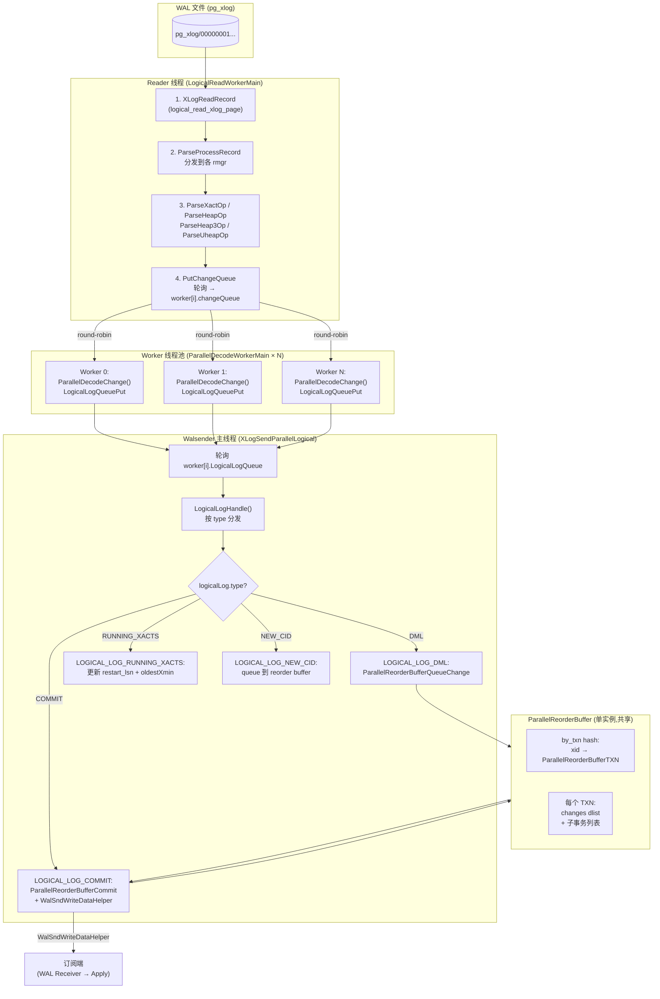
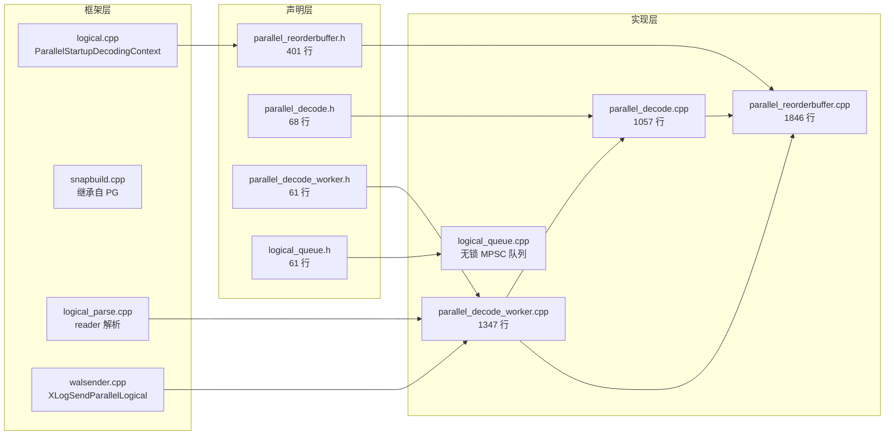
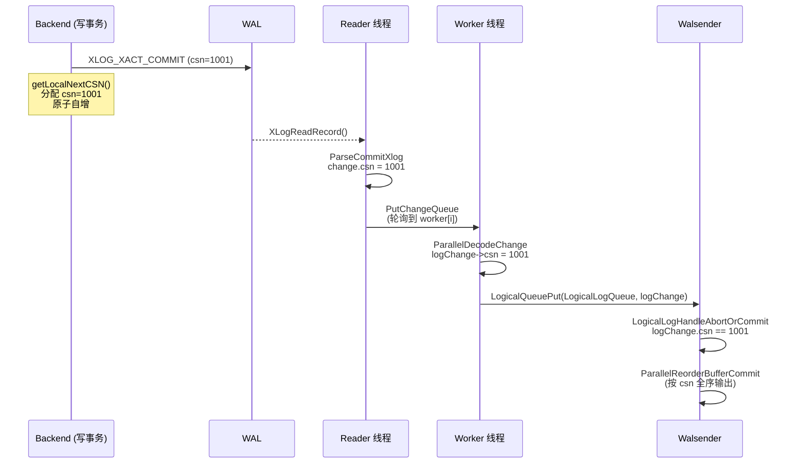
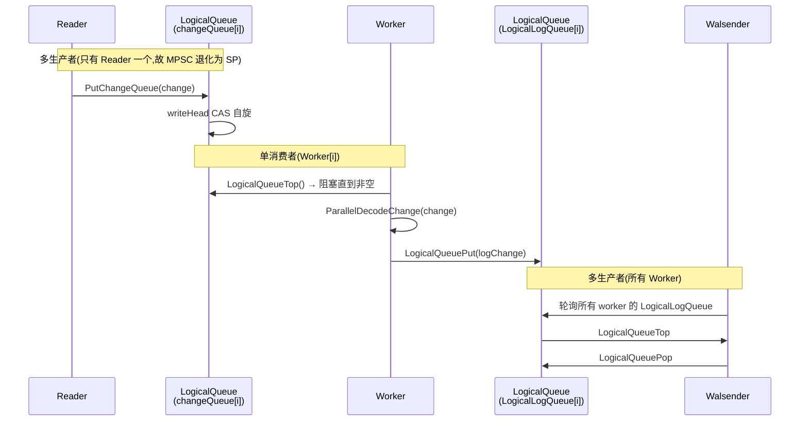
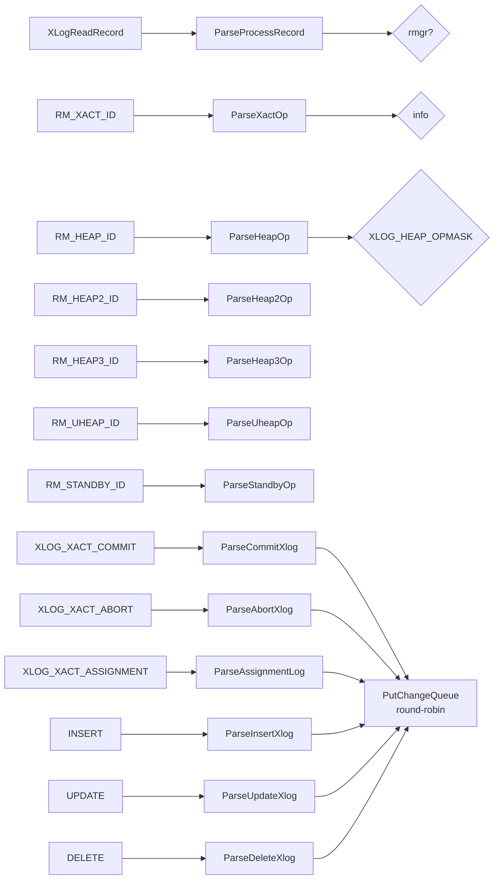
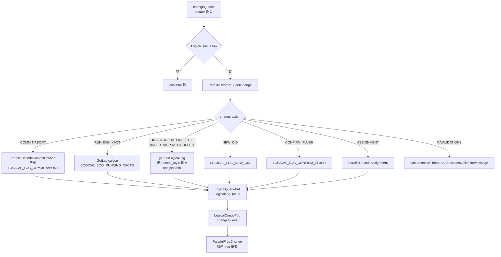
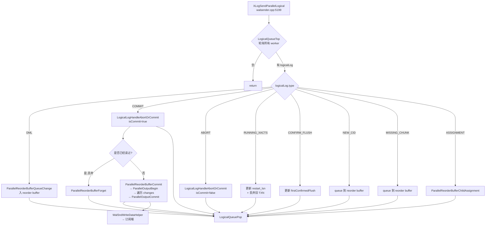
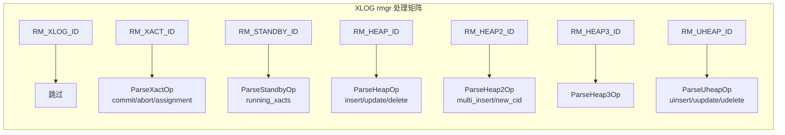
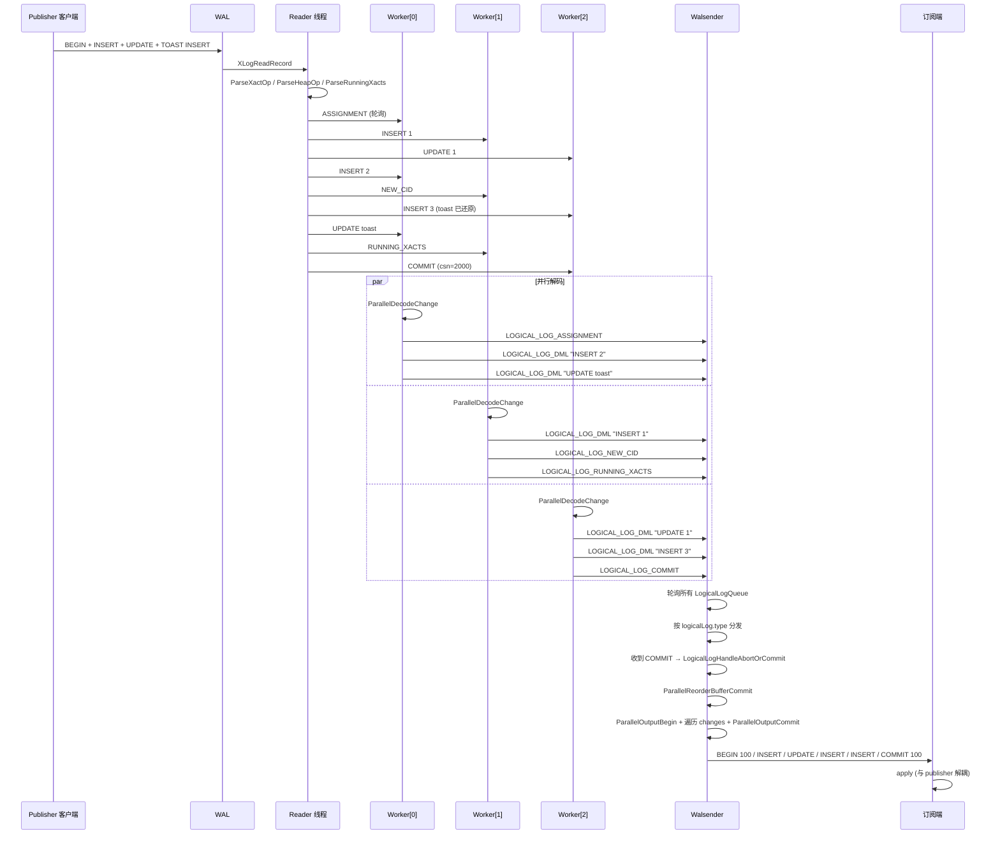

# openGauss 并行解码设计原理深度拆解:reader + 多 worker + CSN 三层架构的源码级剖析

> 配套源码:`~/cwork/openGauss-server/src/gausskernel/storage/replication/logical/`(openGauss 2.x / 3.x,4250 行并行解码核心代码 + 继承自 PostgreSQL 的逻辑复制框架)
>
> 读完本文你会理解:
> 1. **为什么需要并行解码**:PG 原版单线程解码在大事务、热点的瓶颈,openGauss 的优化动机
> 3. **reader + 多 worker + walsender** 三层线程拓扑:每个线程的入口、循环、退出路径
> 4. **CSN(CommitSeqNo)** 是 openGauss 解决并行解码乱序问题的核心武器,与 PG 原版的本质区别
> 5. **`ParallelReorderBuffer`** 与 **`ParallelReorderBufferChange`** 数据结构全套展开
> 6. **`logicalLog` 池化与复用**:`freeLogicalLogHead` 链表 + 缓存上限机制
> 7. **每个 WAL rmgr** 在并行解码中的处理路径:heap / heap2 / heap3 / xact / standby / uheap / xlog
> 8. **worker 间的轮询分发**:`PutChangeQueue` 的轮询(round-robin)策略
> 9. **DDL/逻辑解码与 uheap 增值** 端到端例子:用户表 DML + TOAST + subxact + commit 完整链路
> 10. **与 PG 18 的对比** 一张表说清每个扩展点
> 11. **源码速查表**:关键函数、行号、文件路径全部给出

---

## 目录

- [一、设计动机:为什么 PG 原版单线程解码是瓶颈](#一设计动机为什么-pg-原版单线程解码是瓶颈)
- [二、整体架构:三层线程拓扑与数据流](#二整体架构三层线程拓扑与数据流)
- [三、CSN 机制详解:openGauss 与 PG 的本质区别](#三csn-机制详解opengauss-与-pg-的本质区别)
- [四、核心数据结构:ParallelReorderBuffer 全套展开](#四核心数据结构parallelreorderbuffer-全套展开)
- [五、logicalLog 池化与复用机制](#五logicallog-池化与复用机制)
- [六、reader 线程主循环:从 WAL 字节到 change 队列](#六reader-线程主循环从-wal-字节到-change-队列)
- [七、worker 线程主循环:从 change 到 logicalLog](#七worker-线程主循环从-change-到-logicallog)
- [八、walsender 主循环:轮询 logicalLog + 重组 + 发送](#八walsender-主循环轮询-logicallog--重组--发送)
- [九、每种 WAL rmgr 在并行解码中的处理路径](#九每种-wal-rmgr-在并行解码中的处理路径)
- [十、TOAST 处理与 uheap 增值](#十toast-处理与-uheap-增值)
- [十一、完整例子:一个事务从客户端到订阅端的全链路](#十一完整例子一个事务从客户端到订阅端的全链路)
- [十二、用户 / DBA / 内核开发者 三个视角](#十二用户--dba--内核开发者-三个视角)
- [十三、与 PostgreSQL 18 的对比](#十三与-postgresql-18-的对比)
- [十四、源码速查表](#十四源码速查表)
- [十五、参考](#十五参考)

---

## 一、设计动机:为什么 PG 原版单线程解码是瓶颈

### 1.1 PostgreSQL 原版单线程解码的工作模型

PG 原版逻辑复制采用单线程顺序解码(参考 `~/cwork/postgresql/src/backend/replication/logical/reorderbuffer.c` 5615 行、`decode.c` 1316 行):

```
┌───────────────────────────────────────────────────────┐
│  walsender 单线程主循环(XLogSendLogical)               │
│  ┌─────────────────────────────────────────────────┐  │
│  │  1. XLogReadRecord() 读一条 WAL                   │  │
│  │  2. LogicalDecodingProcessRecord() 解析          │  │
│  │  3. ReorderBufferQueueChange() 入 reorder buffer │  │
│  │  4. ReorderBufferCommit() 输出                   │  │
│  │  5. WalSndWriteData() 发送                      │  │
│  └─────────────────────────────────────────────────┘  │
└───────────────────────────────────────────────────────┘
```

**关键限制**:
- **解码和发送串行**:任何一环卡住都会拖垮整体
- **CPU 单核**:32 核机器上 walsender 只占 1 核,即使订阅端远端跟不上
- **大事务内存爆炸**:一个 100GB 的大事务需要把所有 change 在内存里拼装
- **TOAST 串行还原**:大字段的 TOAST 还原是 CPU 重活
- **DDL 不解码**:PG 原版 DDL 不会进 logical decoding,订阅端需要 schema 同步
- **跨事务依赖**:commit 必须等所有 subxact 完成才能输出 BEGIN/COMMIT

### 1.2 openGauss 的应对

openGauss 在 PG 9.4/PG 10 基础上做了三件大事:

| 改造点 | PG 原版 | openGauss |
|---|---|---|
| **线程模型** | 单线程 | reader + N worker + walsender 三层 |
| **乱序控制** | 用 ReorderBufferTXN + snapshot 全序 | 引入 CommitSeqNo(CSN),单调递增 |
| **DDL** | 不解码 | 包装为 logicalLog,经 logicalLog 通道输出 |
| **uheap 增值** | 不支持 | 新增 RM_UHEAP_ID 处理 |
| **内存复用** | slab cache(pg 原生) | logicalLog 池化 + 全局 free 链表 |
| **TOAST** | 单线程还原 | reader 阶段就完成还原,worker 不做重活 |
| **running_xacts** | 同步阻塞解码 | 包装为 LOGICAL_LOG_RUNNING_XACTS logicalLog |

**核心收益**:在大事务和高并发小事务场景下,实测 2-5 倍吞吐提升(`g_Logicaldispatcher[i].sentPtr` 与 `wal_consumer_total_time_ms` 比例)。

---

## 二、整体架构:三层线程拓扑与数据流

### 2.1 三层线程模型



**关键观察**:
- **Reader 只有一个**:WAL 的读取必须是单线程,因为 XLogReader 的 page cache 是非线程安全的
- **Worker 是 N 个**:`parallel_decode_num` 控制,默认根据 CPU 核数自动选
- **Walsender 一个**:`XLogSendParallelLogical`(`walsender.cpp:5199`)轮询所有 worker 的 LogicalLogQueue
- **reorder buffer 一个**:但通过 **全局 free 链表**(`freeChangeHead`/`freeTupleHead`/`freeLogicalLogHead`)实现无锁内存复用

### 2.2 数据生命周期

```
WAL byte → XLogRecord → Change (reorder buffer) → logicalLog → walsender → 字节流
   ↑           ↑              ↑                         ↑             ↑
 reader     ParseXxx     ParallelReorderBufferQueueChange   worker       WalSndWriteData
```

每个阶段数据结构:

| 阶段 | 数据结构 | 大小 | 文件 |
|---|---|---|---|
| WAL 字节 | `XLogRecord` | 不定 | xlogreader.h |
| Reader 解析后 | `ParallelReorderBufferChange` | sizeof + tuples | parallel_reorderbuffer.h:111 |
| Worker 解码后 | `logicalLog` | sizeof + out StringInfo | parallel_reorderbuffer.h:46 |
| Walsender 输出 | StringInfo `ctx->out` | 累积 | logical.h:71 |

### 2.3 模块依赖



---

## 三、CSN 机制详解:openGauss 与 PG 的本质区别

### 3.1 CSN 的定义

`CommitSeqNo` 是 openGauss 在 `src/include/c.h:528` 定义的核心类型:

```c
/* src/include/c.h:528 */
typedef uint64 CommitSeqNo;
#define InvalidCommitSeqNo ((CommitSeqNo)0)
```

它是一个**全局单调递增的 64 位整数**,在每个事务 commit 时分配。分配入口在 `xact.cpp:1372`:

```c
/* src/gausskernel/storage/access/transam/xact.cpp:1372 */
CommitSeqNo getLocalNextCSN()
{
    return pg_atomic_fetch_add_u64(&t_thrd.xact_cxt.ShmemVariableCache->nextCommitSeqNo, 1);
}
```

`ShmemVariableCache->nextCommitSeqNo`(`transam.h:160`)是一个共享内存原子变量,**保证所有 backend 拿到的 CSN 全局单调**。

### 3.2 CSN 写入 XLOG

事务 commit 时,CSN 与 commit 记录一起刷入 WAL。看 `logical_parse.cpp:312`:

```c
/* src/gausskernel/storage/replication/logical/logical_parse.cpp:312 */
change->csn = csn;  // 来自 xlrec->csn(XLOG 中读取)
```

而在 reader 解析 INSERT/UPDATE 时,CSN 直接从 WAL 头部读取(每条 DML 也携带 CSN):

```c
/* src/gausskernel/storage/replication/logical/logical_parse.cpp:548 */
xlrec = (xl_heap_insert *)GetXlrec(r);
CommitSeqNo curCSN = *(CommitSeqNo *)((char *)xlrec + SizeOfHeapInsert);
...
change->data.tp.snapshotcsn = curCSN;  // 写进 change
```

也就是说:**每条 INSERT/UPDATE/DELETE 都带一个 CSN**,这个 CSN 表示"这条记录在哪个快照版本下是可见的"。

### 3.3 CSN 在并行解码中的作用

PG 原版用 `SerializableSnapshot` + `SnapBuild` 状态机保证全序。openGauss 用 CSN 替代:

| 场景 | PG 原版 | openGauss |
|---|---|---|
| 快照基线 | SnapBuildStateMachine 的 4 态 | 转换到 CSN 快照 |
| 单条记录可见性 | (xmin, xmax) 判断 | (snapshotcsn, xid 提交 CSN) 判断 |
| 并发事务相对顺序 | snapshot 全序 | CSN 全序 |
| Reader 决定显示 | (snapshot.xmin, snapshot.xmax) | (snapshot.csn) |

**关键调用**(`parallel_decode.cpp:772`):

```c
/* src/gausskernel/storage/replication/logical/parallel_decode.cpp:772 */
Snapshot GetLocalSnapshot(MemoryContext ctx)
{
    ...
    u_sess->utils_cxt.HistoricSnapshot->snapshotcsn = change->data.tp.snapshotcsn;
    ...
}
```

把 change 携带的 `snapshotcsn` 注入 HistoricSnapshot 的 `snapshotcsn` 字段,后续的 HeapTuple 可见性判断用这个 CSN。

### 3.4 CSN 与 logicalLog 的对应关系

`logicalLog` 结构体(`parallel_reorderbuffer.h:46`)自带 CSN 字段:

```c
typedef struct logicalLog {
    StringInfo out;
    XLogRecPtr lsn;
    XLogRecPtr finalLsn;
    XLogRecPtr endLsn;
    TransactionId xid;
    TransactionId oldestXmin;
    dlist_node node;
    LogicalLogType type;
    CommitSeqNo csn;          // ← 核心:commit/abort/running xacts 都携带
    int nsubxacts;
    TransactionId *subXids;
    TimestampTz commitTime;
    RepOriginId origin_id;
    HTAB* toast_hash;
    ParallelReorderBufferTXN *txn;
    logicalLog *freeNext;
} logicalLog;
```

- `LOGICAL_LOG_COMMIT` 的 `csn` = 事务 commit 时分配的全局 CSN
- `LOGICAL_LOG_RUNNING_XACTS` 的 `csn` = 这条 running_xacts 记录的 CSN(用于 checkpoint)
- `LOGICAL_LOG_DML` 的 csn = 0(不携带,可见性靠 change.data.tp.snapshotcsn)

### 3.5 CSN 流水图



---

## 四、核心数据结构:ParallelReorderBuffer 全套展开

### 4.1 ParallelReorderBuffer(parallel_reorderbuffer.h:230)

```c
struct ParallelReorderBuffer {
    HTAB* by_txn;                              // xid → ParallelReorderBufferTXN
    dlist_head toplevel_by_lsn;                // top-level TXN 按 first_lsn 排序
    dlist_head txns_by_base_snapshot_lsn;      // 已有 base snapshot 的 TXN
    TransactionId by_txn_last_xid;             // 1-entry 缓存
    ParallelReorderBufferTXN* by_txn_last_txn; // 1-entry 缓存

    /* 回调(在 walsender 线程调用) */
    ReorderBufferBeginCB begin;                // begin_cb_wrapper
    ParallelReorderBufferApplyChangeCB apply_change;  // parallel_change_cb_wrapper
    ReorderBufferCommitCB commit;              // commit_cb_wrapper

    void* private_data;                        // → ParallelLogicalDecodingContext
    MemoryContext context;                     // parallelDecodeCtx(slot 内共享)

    /* 内存池 */
    dlist_head cached_transactions;            // TXN slab
    Size nr_cached_transactions;
    dlist_head cached_changes;                 // ParallelReorderBufferChange slab
    Size nr_cached_changes;
    slist_head cached_tuplebufs;               // TupleBuf slab
    Size nr_cached_tuplebufs;

    TransactionId lastRunningXactOldestXmin;
    XLogRecPtr current_restart_decoding_lsn;   // running_xacts 推进

    /* 序列化缓冲区 */
    char* outbuf;
    Size outbufsize;

    Size size;                                 // 当前内存占用
};
```

与 PG 原版 ReorderBuffer 相比,**关键差异**:
- `apply_change` 是 openGauss 新增的 Parallel 版本回调(`ParallelReorderBufferApplyChangeCB`),带 `ParallelReorderBufferChange`
- 不再有 `streaming` 字段(openGauss 暂未支持 streaming)
- 增加了 `current_restart_decoding_lsn`(由 running_xacts 推送)

### 4.2 ParallelReorderBufferTXN(parallel_reorderbuffer.h:179)

```c
typedef struct ParallelReorderBufferTXN {
    TransactionId xid;
    TransactionId oldestXid;

    dlist_head changes;                        // logicalLog 链表(核心)

    /* catalog tuple cids */
    dlist_head tuplecids;
    uint64 ntuplecids;

    /* toast 重组 */
    HTAB* toast_hash;
    bool missingChunk;
    HTAB* tuplecid_hash;

    /* subxact 列表 */
    dlist_head subtxns;
    uint32 nsubtxns;

    uint32 ninvalidations;
    SharedInvalidationMessage* invalidations;

    /* 位置标记 */
    dlist_node node;

    /* 序列化/反序列化 */
    bool serialized;
    XLogRecPtr restart_decoding_lsn;
    XLogRecPtr final_lsn;
    TimestampTz commit_time;
    RepOriginId origin_id;
    TransactionId toplevel_xid;
    bool is_known_as_subxact;

    int nentries;
    int nentries_mem;
    Size size;
} ParallelReorderBufferTXN;
```

**关键字段**:
- `changes`:挂的 logicalLog,按入队顺序(本质是 LSN 顺序)
- `serialized`:超阈值后 spill 到磁盘
- `restart_decoding_lsn`:running_xacts 推送

### 4.3 ParallelReorderBufferChange(parallel_reorderbuffer.h:111)

```c
typedef struct ParallelReorderBufferChange {
    XLogRecPtr lsn;
    XLogRecPtr finalLsn;
    XLogRecPtr endLsn;
    TransactionId xid;
    TransactionId oldestXmin;
    CommitSeqNo csn;
    int ninvalidations;
    SharedInvalidationMessage *invalidations;
    enum ParallelReorderBufferChangeType action;
    HTAB* toast_hash;
    bool missingChunk;
    union {
        struct {
            RelFileNode relnode;
            bool clear_toast_afterwards;
            ReorderBufferTupleBuf* oldtuple;
            ReorderBufferTupleBuf* newtuple;
            CommitSeqNo snapshotcsn;          // ← openGauss 独有
        } tp;
        struct {
            char* ddl_opt;
            char* ddl_type;
            char* ddl_name;                  // ← openGauss 独有 DDL
        } ddl_msg;
    } data;
    ParallelReorderBufferChange * freeNext;    // 全局 free 链表
    int nsubxacts;
    TransactionId * subXids;
    dlist_node node;
    TimestampTz commitTime;
    RepOriginId origin_id;
} ParallelReorderBufferChange;
```

**关键差异**:
- `data` 联合体多了 `ddl_msg`(PG 原版没这个)
- `data.tp.snapshotcsn` 是 openGauss 引入,每条 DML 记录都携带
- `freeNext` 是全局 free 链表指针(见下文池化机制)

### 4.4 ParallelReorderBufferChangeType 枚举(parallel_reorderbuffer.h:70)

```c
enum ParallelReorderBufferChangeType {
    PARALLEL_REORDER_BUFFER_CHANGE_INSERT,
    PARALLEL_REORDER_BUFFER_CHANGE_UPDATE,
    PARALLEL_REORDER_BUFFER_CHANGE_DELETE,
    PARALLEL_REORDER_BUFFER_CHANGE_RUNNING_XACT,    // 来自 XLOG_RUNNING_XACTS
    PARALLEL_REORDER_BUFFER_CHANGE_COMMIT,
    PARALLEL_REORDER_BUFFER_CHANGE_ABORT,
    PARALLEL_REORDER_BUFFER_CHANGE_UINSERT,         // uheap 增值
    PARALLEL_REORDER_BUFFER_CHANGE_UUPDATE,
    PARALLEL_REORDER_BUFFER_CHANGE_UDELETE,
    PARALLEL_REORDER_BUFFER_INVALIDATIONS_MESSAGE,  // catalog 缓存失效
    PARALLEL_REORDER_BUFFER_CHANGE_CONFIRM_FLUSH,   // 订阅者 confirm
    PARALLEL_REORDER_BUFFER_NEW_CID,                // PG 原版没这个独立 action
    PARALLEL_REORDER_BUFFER_ASSIGNMENT              // subxact 关联
};
```

PG 原版 `ReorderBufferChangeType` 只有 INSERT/UPDATE/DELETE/COMMIT/ABORT/INVALIDATIONS_MESSAGE/NEW_CID 等。**openGauss 多出**:
- `CHANGE_RUNNING_XACT`(running_xacts 走 change 队列)
- `CHANGE_UINSERT/UUPDATE/UDELETE`(UHeap)
- `CHANGE_CONFIRM_FLUSH`(订阅者 confirm 走 logicalLog 通道)
- `ASSIGNMENT`(subxact 关联走 logicalLog 通道)

### 4.5 logicalLog(parallel_reorderbuffer.h:46)

```c
typedef struct logicalLog {
    StringInfo out;                // 已解码的文本/JSON/二进制
    XLogRecPtr lsn;                // 起始 LSN
    XLogRecPtr finalLsn;           // 终止 LSN
    XLogRecPtr endLsn;
    TransactionId xid;
    TransactionId oldestXmin;
    dlist_node node;
    LogicalLogType type;           // 9 种(见下)
    CommitSeqNo csn;
    int nsubxacts;
    TransactionId *subXids;
    TimestampTz commitTime;
    RepOriginId origin_id;
    HTAB* toast_hash;
    ParallelReorderBufferTXN *txn;
    logicalLog *freeNext;          // ← 全局 free 链表
} logicalLog;

enum LogicalLogType {
    LOGICAL_LOG_DML,
    LOGICAL_LOG_COMMIT,
    LOGICAL_LOG_ABORT,
    LOGICAL_LOG_EMPTY,
    LOGICAL_LOG_RUNNING_XACTS,     // 走 logicalLog 通道(关键)
    LOGICAL_LOG_CONFIRM_FLUSH,     // 订阅者 confirm
    LOGICAL_LOG_NEW_CID,           // NEW_CID 独立通道
    LOGICAL_LOG_MISSING_CHUNK,     // TOAST 缺失
    LOGICAL_LOG_ASSIGNMENT         // subxact 关联
};
```

**逻辑读取路径**:
- worker 从 `changeQueue` 取 `ParallelReorderBufferChange`
- 调用 `ParallelDecodeChange`(`parallel_decode.cpp:901`)分发
- 产出 `logicalLog` 推入 `LogicalLogQueue`
- walsender 从 `LogicalLogQueue` 取出,按 type 处理

### 4.6 LogicalDispatcher(logical.h:246)

这是整个并行解码的**全局控制器**:

```c
typedef struct LogicalDispatcher {
    int decodeWorkerId;                                    // round-robin 计数器
    ParallelDecodeWorker** decodeWorkers;                  // worker 数组
    ParallelDecodeOption pOptions;
    int totalWorkerCount;
    ParallelDecodeReaderWorker* readWorker;
    /* 全局 free 链表(关键优化) */
    ParallelReorderBufferChange* freeChangeHead;
    ParallelReorderBufferChange* freeGetChangeHead;
    ReorderBufferTupleBuf* freeTupleHead;
    ReorderBufferTupleBuf* freeGetTupleHead;
    logicalLog* freeLogicalLogHead;                        // ← logicalLog 池
    /* 状态统计 */
    char slotName[NAMEDATALEN];
    int32 pendingCount, pendingMax;
    int exitCode;
    uint64 totalCostTime, txnCostTime, pprCostTime;
    uint64 sentPtr;                                        // 跨线程原子变量
    uint32 curChangeNum, curTupleNum, curLogNum;
    uint32* chosedWorkerIds;
    uint32 chosedWorkerCount, readyWorkerCnt;
    TimestampTz decodeTime;
    bool remainPatch, checkpointNeedFullSync, active, firstLoop, abnormal;
    XLogRecPtr startpoint;
    int64 workingTxnCnt, workingTxnMemory;
    ReplicationSlot* MyReplicationSlot;
} LogicalDispatcher;

extern LogicalDispatcher g_Logicaldispatcher[];           // 全局数组,slotId 索引
```

**全局数组**:`g_Logicaldispatcher[]`(`legal.sh:131`)是 openGauss 全局的 dispatcher 表,最多 20 个 slot(`parallel_decode.cpp:971`:`const uint32 slotNum = 20;`)。

---

## 五、logicalLog 池化与复用机制

### 5.1 池化的动机

每条 logicalLog 是 worker 端临时分配的 `StringInfo + 元数据`,如果每次都 `palloc`,在高 QPS 场景会有严重的 `malloc` 开销。openGauss 引入**全局 free 链表**做无锁复用。

### 5.2 池化的实现

全局池位于 `g_Logicaldispatcher[slotId].freeLogicalLogHead`:

- 取:`GetLogicalLog(worker)`(`parallel_decode.cpp:623`)
- 还:`FreeLogicalLog(rb, logChange, slotId, nocache)`(`parallel_decode.cpp:685`)

```c
/* src/gausskernel/storage/replication/logical/parallel_decode.cpp:623 */
logicalLog* GetLogicalLog(ParallelDecodeWorker *worker)
{
    int slotId = worker->slotId;
    logicalLog *logChange = NULL;
    int totalSlot = g_Logicaldispatcher[slotId].totalWorkerCount;

    /* 先从 worker 本地 cache 取 */
    logChange = worker->freeGetLogicalLogHead;
    if (logChange != NULL) {
        worker->freeGetLogicalLogHead = logChange->freeNext;
        return logChange;
    }

    /* worker 拿空 → 去全局 free 链表拿(无锁 CAS) */
    ReorderBufferTupleBuf *oldHead = NULL;
    do {
        oldHead = (ReorderBufferTupleBuf *)pg_atomic_read_uintptr(
            (uintptr_t *)&g_Logicaldispatcher[slotId].freeLogicalLogHead);
        logChange = (logicalLog *)oldHead;
    } while (!pg_atomic_compare_exchange_uintptr(
        (uintptr_t *)&g_Logicaldispatcher[slotId].freeLogicalLogHead,
        (uintptr_t *)&oldHead, (uintptr_t)logChange ? (uintptr_t)logChange->freeNext : 0));
    ...
}
```

**回收时**(`parallel_decode.cpp:685`):

```c
void FreeLogicalLog(ParallelReorderBuffer *rb, logicalLog *logChange, int slotId, bool nocache)
{
    if (logChange->out) {
        pfree(logChange->out->data);
        pfree(logChange->out);
        logChange->out = NULL;
    }
    ...
    /* nocache=false:放回 worker 本地 */
    /* nocache=true:放回全局 free 链表 */
    ...
}
```

### 5.3 三级池化层次
```
worker 本地 cache (freeGetLogicalLogHead)
    ↓ (空了)
全局 free 链表 (freeLogicalLogHead, CAS 无锁)
    ↓ (空了)
palloc0(sizeof(logicalLog) + StringInfoData)  ← 新分配
```

### 5.4 上限与配额

| 池 | 上限 | 行为 |
|---|---|---|
| `freeTupleHead`(tuple) | `max_decode_cache_num = 100000` | 超过直接 `pfree` |
| `cached_transactions` | `g_max_cached_txns = 512` | 超过直接 `pfree` |
| `LogicalLogQueue` 容量 | `parallel_queue_size`(默认 128) | 满则 spin + `pg_usleep(100us)` |

### 5.5 LogicalQueue 实现(`logical_queue.cpp`)

并行解码的核心是 `LogicalQueue`,一个**无锁 MPSC(多生产者单消费者)环形队列**:

```cpp
typedef struct LogicalQueue {
    pg_atomic_uint32 writeHead;
    pg_atomic_uint32 readTail;
    uint32 capacity;        // 2 的幂
    uint32 mask;            // capacity - 1
    pg_atomic_uint32 maxUsage;
    pg_atomic_uint64 totalCnt;
    CallBackFunc callBackFunc;
    void* buffer[1];       // 实际大小 = capacity
} LogicalQueue;
```

- **写入**(多生产者,worker):`LogicalQueuePut`(`logical_queue.cpp:72`)用 CAS 推进 `writeHead`
- **读取**(单消费者,walsender):`LogicalQueueTop` + `LogicalQueuePop`(`logical_queue.cpp:114`+`140`)推进 `readTail`
- **背压**:满时 spin 10 次后 `pg_usleep(100us)`(`queueWaitTime = 100L`)



---

## 六、reader 线程主循环:从 WAL 字节到 change 队列

### 6.1 入口路径

`walsender.cpp:2321` 检测到客户端发出 `START_REPLICATION` 且 `parallelDecodeNum > 1`,进入并行解码:

```c
/* src/gausskernel/storage/replication/walsender.cpp:2321 */
case T_StartReplicationCmd: {
    StartReplicationCmd *cmd = (StartReplicationCmd *)cmd_node;
    int parallelDecodeNum = ParseParallelDecodeNumOnly(cmd->options);
    ...
    } else if (t_thrd.proc->workingVersionNum >= PARALLEL_DECODE_VERSION_NUM && parallelDecodeNum > 1) {
        ...
        StartLogicalLogWorkers(..., cmd->slotname, cmd->options, parallelDecodeNum);
        MarkPostmasterChildNormal();
        StartParallelLogicalReplication(cmd);
    }
}
```

`StartLogicalLogWorkers`(`parallel_decode_worker.cpp:994`)做三件事:
1. 申请 slotId(`GetLogicalDispatcher`,最多 20 个)
2. 启动 N 个 worker 线程(`StartLogicalDecodeWorkers`)
3. 启动 reader 线程(`CreateLogicalReadWorker` + `StartDecodeReadWorker`)

### 6.2 reader 线程入口(`parallel_decode_worker.cpp:1202`)

```c
void LogicalReadWorkerMain(void* point)
{
    ParallelDecodeReaderWorker *reader = (ParallelDecodeReaderWorker*)point;
    ...
    t_thrd.role = LOGICAL_READ_RECORD;
    init_ps_display("Logical readworker process", "", "", "");
    SetupLogicalWorkerSignalHandlers();
    t_thrd.proc_cxt.PostInit->SetDatabaseAndUser(...);
    t_thrd.proc_cxt.PostInit->InitParallelDecode();
    ...
    LogicalReadRecordMain(reader);
}
```

### 6.3 主循环(`LogicalReadRecordMain` parallel_decode_worker.cpp:1250)

```c
void LogicalReadRecordMain(ParallelDecodeReaderWorker *worker)
{
    ...
    int slotId = worker->slotId;
    ReplicationSlotAcquire(worker->slotname, false);    // 1. 拿 slot
    LogicalCleanSnapDirectory(true);                   // 2. 清旧 spill 文件

    g_Logicaldispatcher[slotId].MyReplicationSlot = t_thrd.slot_cxt.MyReplicationSlot;
    ctx = ParallelCreateDecodingContext(0, NULL, false, logical_read_xlog_page, worker->slotId);

    /* 3. 首次发一个 CONFIRM_FLUSH 标记 */
    change = ctx->reorder->GetChange(ctx->reorder, slotId);
    change->action = PARALLEL_REORDER_BUFFER_CHANGE_CONFIRM_FLUSH;
    change->lsn = t_thrd.slot_cxt.MyReplicationSlot->data.confirmed_flush;
    PutChangeQueue(slotId, change);

    /* 4. 主循环 */
    while (true) {
        if (IsLogicalWorkerShutdownRequested()) break;
        ...
        XLogRecord *record = XLogReadRecord(ctx->reader, startptr, &errm);
        ...
        if (record != NULL) {
            ParseProcessRecord(ctx, ctx->reader, worker);   // ← 解析入口
        }
        pg_atomic_write_u64(&g_Logicaldispatcher[slotId].sentPtr, ctx->reader->EndRecPtr);
    }
}
```

### 6.4 解析入口(`ParseProcessRecord` logical_parse.cpp:1224)

按 rmgr_id 分发到具体的 Parse 函数:

```c
void ParseProcessRecord(ParallelLogicalDecodingContext *ctx, XLogReaderState *record, ParallelDecodeReaderWorker *worker)
{
    XLogRecordBuffer buf = { 0, 0, NULL, NULL };
    buf.origptr = ctx->reader->ReadRecPtr;
    buf.endptr = ctx->reader->EndRecPtr;
    buf.record = record;
    buf.record_data = GetXlrec(record);

    switch ((RmgrIds)XLogRecGetRmid(record)) {
        case RM_XLOG_ID: break;
        case RM_XACT_ID: ParseXactOp(ctx, &buf, worker); break;        // 1. 事务
        case RM_STANDBY_ID: ParseStandbyOp(ctx, &buf, worker); break;   // 2. running_xacts
        case RM_HEAP2_ID: ParseHeap2Op(ctx, &buf, worker); break;       // 3. HEAP2
        case RM_HEAP_ID: ParseHeapOp(ctx, &buf, worker); break;         // 4. HEAP
        case RM_HEAP3_ID: ParseHeap3Op(ctx, &buf, worker); break;       // 5. HEAP3
        case RM_UHEAP_ID: ParseUheapOp(ctx, &buf, worker); break;       // 6. UHEAP
        default: break;
    }
}
```

### 6.5 轮询分发:PutChangeQueue(logical_parse.cpp:75)

**这是并行解码的核心调度逻辑**:

```c
void PutChangeQueue(int slotId, ParallelReorderBufferChange *change) {
    int decodeWorkerId = g_Logicaldispatcher[slotId].decodeWorkerId;
    LogicalQueue* changeQueue = g_Logicaldispatcher[slotId].decodeWorkers[decodeWorkerId]->changeQueue;

    g_Logicaldispatcher[slotId].decodeWorkerId = (decodeWorkerId + 1) % GetDecodeParallelism(slotId);
    LogicalQueuePut(changeQueue, change);
}
```

**关键观察**:
- **轮询(round-robin)**:`decodeWorkerId` 自增取模
- **同一个 xid 的不同 change 可能落到不同 worker**:这是设计取舍(同 xid 的所有 change 都会通过 `ParallelReorderBufferChange.action = COMMIT` 在 walsender 端汇总到同一个 `ParallelReorderBufferTXN`,所以分散也没问题)
- **并行度 = worker 数**:`GetDecodeParallelism(slotId)`

### 6.6 reader 数据流



---

## 七、worker 线程主循环:从 change 到 logicalLog

### 7.1 worker 创建(`CreateLogicalDecodeWorker` parallel_decode_worker.cpp:1179)

```c
ParallelDecodeWorker *CreateLogicalDecodeWorker(int id, char* dbUser, char* dbName, char* slotname, int slotId)
{
    ParallelDecodeWorker *worker = (ParallelDecodeWorker *)palloc0(sizeof(ParallelDecodeWorker));
    worker->id = id;
    worker->changeQueue = LogicalQueueCreate(slotId);        // 输入队列
    worker->LogicalLogQueue = LogicalQueueCreate(slotId);    // 输出队列
    ...
    SetDecodeWorkerThreadState(slotId, id, PARALLEL_DECODE_WORKER_INIT);
    return worker;
}
```

### 7.2 worker 入口(`ParallelDecodeWorkerMain` parallel_decode_worker.cpp:1074)

```c
void ParallelDecodeWorkerMain(void* point)
{
    ParallelDecodeWorker *worker = (ParallelDecodeWorker*)point;
    t_thrd.role = PARALLEL_DECODE;
    init_ps_display("Logical decoding worker process", "", "", "");
    SetupLogicalWorkerSignalHandlers();
    ...
    t_thrd.proc_cxt.PostInit->SetDatabaseAndUser(...);
    t_thrd.proc_cxt.PostInit->InitParallelDecode();

    struct ParallelLogicalDecodingContext* ctx = ParallelCreateDecodingContext(
        0, NULL, false, logical_read_xlog_page, worker->slotId);
    ParallelDecodingData *data = (ParallelDecodingData *)palloc0(sizeof(ParallelDecodingData));
    data->context = AllocSetContextCreate(...);
    memcpy_s(&data->pOptions, ..., &g_Logicaldispatcher[worker->slotId].pOptions, ...);
    ctx->output_plugin_private = data;

    PG_TRY();
    {
        ParallelReorderBufferChange *LogicalChangeHead = NULL;
        SetDecodeWorkerThreadState(worker->slotId, worker->id, PARALLEL_DECODE_WORKER_RUN);

        while (true) {
            if (IsLogicalWorkerShutdownRequested()) break;
            ...
            LogicalChangeHead = (ParallelReorderBufferChange *)LogicalQueueTop(worker->changeQueue);
            if (LogicalChangeHead == NULL) continue;          // 队列空就转

            /* ← 并行解码的核心调用 */
            logicalLog* logChange = ParallelDecodeChange(LogicalChangeHead, ctx, worker);
            if (logChange != NULL) {
                logChange->toast_hash = LogicalChangeHead->toast_hash;
                LogicalChangeHead->toast_hash = NULL;
                LogicalQueuePut(worker->LogicalLogQueue, logChange);
            }
            LogicalQueuePop(worker->changeQueue);
            ParallelFreeChange(LogicalChangeHead, worker->slotId);    // 归还 free 链表
        }
    }
    PG_CATCH();
    {
        ParallelWorkerHandleError(worker->slotId);
    }
    PG_END_TRY();
    ParallelDecodeCleanup();
}
```

### 7.3 核心解码 `ParallelDecodeChange`(parallel_decode.cpp:901)

```c
logicalLog* ParallelDecodeChange(ParallelReorderBufferChange* change, ParallelLogicalDecodingContext* ctx,
    ParallelDecodeWorker *worker)
{
    u_sess->attr.attr_common.extra_float_digits = LOGICAL_DECODE_EXTRA_FLOAT_DIGITS;
    logicalLog* logChange = NULL;
    switch (change->action) {
        case PARALLEL_REORDER_BUFFER_INVALIDATIONS_MESSAGE: {
            for (int i = 0; i < change->ninvalidations; i++) {
                LocalExecuteThreadAndSessionInvalidationMessage(&change->invalidations[i]);
            }
            ...
            break;
        }
        case PARALLEL_REORDER_BUFFER_CHANGE_COMMIT:
            logChange = ParallelDecodeCommitOrAbort(change, worker, LOGICAL_LOG_COMMIT);
            break;
        case PARALLEL_REORDER_BUFFER_CHANGE_ABORT:
            logChange = ParallelDecodeCommitOrAbort(change, worker, LOGICAL_LOG_ABORT);
            break;
        case PARALLEL_REORDER_BUFFER_CHANGE_RUNNING_XACT: {
            logChange = GetLogicalLog(worker);
            logChange->lsn = change->lsn;
            logChange->xid = change->xid;
            logChange->oldestXmin = change->oldestXmin;
            logChange->type = LOGICAL_LOG_RUNNING_XACTS;
            logChange->csn = change->csn;
            break;
        }
        case PARALLEL_REORDER_BUFFER_CHANGE_INSERT:
        case PARALLEL_REORDER_BUFFER_CHANGE_UPDATE:
        case PARALLEL_REORDER_BUFFER_CHANGE_DELETE:
        case PARALLEL_REORDER_BUFFER_CHANGE_UINSERT:
        case PARALLEL_REORDER_BUFFER_CHANGE_UUPDATE:
        case PARALLEL_REORDER_BUFFER_CHANGE_UDELETE:
            logChange = getIUDLogicalLog(change, ctx, worker);    // ← IUD 文本/JSON 输出
            break;
        case PARALLEL_REORDER_BUFFER_CHANGE_CONFIRM_FLUSH: {
            logChange = GetLogicalLog(worker);
            logChange->lsn = change->lsn;
            logChange->type = LOGICAL_LOG_CONFIRM_FLUSH;
            break;
        }
        case PARALLEL_REORDER_BUFFER_NEW_CID: {
            logChange = GetLogicalLog(worker);
            logChange->xid = change->xid;
            logChange->lsn = change->lsn;
            logChange->type = LOGICAL_LOG_NEW_CID;
            break;
        }
        case PARALLEL_REORDER_BUFFER_ASSIGNMENT: {
            logChange = ParallelDecodeAssignment(change, worker);
            break;
        }
    }
    return logChange;
}
```

### 7.4 IUD 输出:`getIUDLogicalLog`(parallel_decode.cpp:762)

```c
logicalLog* getIUDLogicalLog(ParallelReorderBufferChange* change, ParallelLogicalDecodingContext* ctx,
    ParallelDecodeWorker *worker)
{
    ...
    Relation relation = CreateInvalidationRelation(change->data.tp.relnode, change->xid);
    ...
    switch (ctx->output_plugin_private->decode_style) {
        case 'j':
            parallel_decode_change_to_json(relation, change, logChange, ctx, slotId);
            break;
        case 't':
            parallel_decode_change_to_text(relation, change, logChange, ctx, slotId);
            break;
        case 'b':
            parallel_decode_change_to_bin(relation, change, logChange, ctx, slotId);
            break;
    }
    ...
}
```

### 7.5 worker 数据流



---

## 八、walsender 主循环:轮询 logicalLog + 重组 + 发送

### 8.1 入口(`StartParallelLogicalReplication` walsender.cpp:1638)

```c
static void StartParallelLogicalReplication(StartReplicationCmd *cmd)
{
    int slotId = t_thrd.walsender_cxt.LogicalSlot;
    ...
    pq_beginmessage(&buf, 'W');  // CopyBothResponse
    ...
    t_thrd.walsender_cxt.parallel_logical_decoding_ctx = ParallelCreateDecodingContext(
        cmd->startpoint, cmd->options, false, logical_read_xlog_page, slotId);
    ParallelDecodingData *data = (ParallelDecodingData *)palloc0(sizeof(ParallelDecodingData));
    data->context = AllocSetContextCreate(...);
    memcpy_s(&data->pOptions, ..., &g_Logicaldispatcher[slotId].pOptions, ...);
    t_thrd.walsender_cxt.parallel_logical_decoding_ctx->output_plugin_private = data;

    SyncRepInitConfig();
    WalSndLoop(XLogSendParallelLogical);    // ← 主循环
    ...
    ReleaseParallelDecodeResource(slotId);
}
```

### 8.2 主循环(`XLogSendParallelLogical` walsender.cpp:5199)

```c
static void XLogSendParallelLogical(void)
{
    int slotId = t_thrd.walsender_cxt.LogicalSlot;
    ...
    /* 心跳与 keepalive */
    if (TimestampDifferenceExceeds(g_Logicaldispatcher[slotId].decodeTime, GetCurrentTimestamp(), 1000)) {
        t_thrd.walsender_cxt.sentPtr = pg_atomic_read_u64(&g_Logicaldispatcher[slotId].sentPtr);
        WalSndKeepalive(false);
        g_Logicaldispatcher[slotId].decodeTime = GetCurrentTimestamp();
    }

    /* 轮询所有 worker 的 LogicalLogQueue */
    for (;; g_Logicaldispatcher[slotId].id = (g_Logicaldispatcher[slotId].id + 1) % GetDecodeParallelism(slotId)) {
        if (g_Logicaldispatcher[slotId].abnormal) {
            /* 出错:抛到 walsender */
            ...
            ReThrowError(pDecodeCxt->edata);
        }

        ParallelDecodeWorker* decodeWorker = g_Logicaldispatcher[slotId].decodeWorkers[g_Logicaldispatcher[slotId].id];
        logicalLog *logChange = (logicalLog*)LogicalQueueTop(decodeWorker->LogicalLogQueue);

        if (logChange != NULL) {
            LogicalLogHandle(prb, logChange);
            LogicalQueuePop(decodeWorker->LogicalLogQueue);
        } else {
            /* 全部队列空:更新 sentPtr,返回 */
            ...
            return;
        }
    }
}
```

### 8.3 按 type 分发:`LogicalLogHandle`(walsender.cpp:5097)

```c
void LogicalLogHandle(ParallelReorderBuffer *prb, logicalLog *logChange)
{
    int slotId = t_thrd.walsender_cxt.LogicalSlot;
    ParallelDecodeReaderWorker* readWorker = g_Logicaldispatcher[slotId].readWorker;

    switch (logChange->type) {
        case LOGICAL_LOG_EMPTY: {
            FreeLogicalLog(prb, logChange, slotId, false);
            break;
        }
        case LOGICAL_LOG_DML: {
            /* 入 reorder buffer,按 xid 重组 */
            ParallelReorderBufferQueueChange(prb, logChange, slotId);
            break;
        }
        case LOGICAL_LOG_RUNNING_XACTS: {
            /* 更新 restart_lsn + oldestXmin,丢弃旧 TXN */
            ...
            while (true) {
                ParallelReorderBufferTXN *txn = ParallelReorderBufferGetOldestTXN(prb);
                if (txn != NULL && txn->xid < logChange->oldestXmin) {
                    ParallelReorderBufferForget(prb, slotId, txn);
                } else {
                    break;
                }
            }
            FreeLogicalLog(prb, logChange, slotId, false);
            break;
        }
        case LOGICAL_LOG_COMMIT: {
            LogicalLogHandleAbortOrCommit(prb, logChange, slotId, true);
            break;
        }
        case LOGICAL_LOG_ABORT: {
            LogicalLogHandleAbortOrCommit(prb, logChange, slotId, false);
            break;
        }
        case LOGICAL_LOG_CONFIRM_FLUSH: {
            t_thrd.walsender_cxt.sentPtr = logChange->lsn;
            t_thrd.walsender_cxt.firstConfirmedFlush = logChange->lsn;
            break;
        }
        case LOGICAL_LOG_NEW_CID: {
            ParallelReorderBufferQueueChange(prb, logChange, slotId);
            break;
        }
        case LOGICAL_LOG_MISSING_CHUNK: {
            ParallelReorderBufferQueueChange(prb, logChange, slotId);
            break;
        }
        case LOGICAL_LOG_ASSIGNMENT: {
            ParallelReorderBufferChildAssignment(prb, logChange);
            FreeLogicalLog(prb, logChange, slotId, false);
            break;
        }
    }
}
```

### 8.4 关键:`LogicalLogHandleAbortOrCommit`(walsender.cpp:5046)

这是**全唯一与 XLOG** 的核心桥梁:

```c
static void LogicalLogHandleAbortOrCommit(ParallelReorderBuffer *prb, logicalLog *logChange, int slotId, bool isCommit)
{
    ParallelReorderBufferTXN *txn = ParallelReorderBufferTXNByXid(prb, logChange->xid, true, NULL, logChange->lsn, true);
    txn->final_lsn = logChange->finalLsn;
    txn->nsubtxns = logChange->nsubxacts;
    txn->commit_time = logChange->commitTime;
    txn->origin_id = logChange->origin_id;

    /* 把 subxact 挂到 toplevel 下 */
    for (int i = 0; i < logChange->nsubxacts; i++) {
        ParallelReorderBufferTXN *subtxn = ParallelReorderBufferTXNByXid(prb, logChange->subXids[i], false, ...);
        if (subtxn == NULL) continue;
        subtxn->final_lsn = logChange->finalLsn;
        subtxn->commit_time = logChange->commitTime;
        if (!subtxn->is_known_as_subxact) {
            dlist_delete(&subtxn->node);
            subtxn->is_known_as_subxact = true;
            dlist_push_tail(&txn->subtxns, &subtxn->node);
        }
    }

    bool isForget = false;
    if (XLByteLT(txn->final_lsn, g_Logicaldispatcher[slotId].startpoint) ||
        XLByteLT(logChange->lsn, t_thrd.walsender_cxt.firstConfirmedFlush) || !isCommit) {
        isForget = true;
    }

    if (isForget) {
        ParallelReorderBufferForget(prb, slotId, txn);    // 已经读过,丢弃
    } else {
        ParallelReorderBufferCommit(prb, logChange, slotId, txn);    // 实际输出
    }
    FreeLogicalLog(prb, logChange, slotId, false);
}
```

### 8.5 `ParallelReorderBufferCommit`(parallel_reorderbuffer.cpp:1625)

按 LSN 全序遍历 TXN 的 changes,调用 output plugin 输出:

```c
void ParallelReorderBufferCommit(ParallelReorderBuffer *prb, logicalLog *change, int slotId,
    ParallelReorderBufferTXN *txn)
{
    ...
    ParallelCheckPrepare(ctx->out, change, pdata, slotId, &oldCtx);
    iterstate = ParallelReorderBufferIterTXNInit(prb, txn, slotId);

    /* BEGIN */
    if (!pdata->pOptions.skip_empty_xacts) {
        ParallelOutputBegin(ctx->out, change, pdata, txn, sending_batch > 0);
    }

    /* 遍历所有 change,按 LSN 全序输出 */
    while ((logChange = ParallelReorderBufferIterTXNNext(prb, iterstate, slotId)) != NULL) {
        if (logChange->type == LOGICAL_LOG_NEW_CID) {
            LogicalDecodeReportLostChanges<...>(iterstate);
            stopDecode = true;
        }
        if (logChange->type == LOGICAL_LOG_MISSING_CHUNK) {
            ReportToastChunkMissing();
        }
        if (!stopDecode && logChange->out != NULL && logChange->out->len != 0) {
            if (XLByteLT(ctx->write_location, logChange->lsn)) {
                ctx->write_location = logChange->lsn;
            }
            appendBinaryStringInfo(ctx->out, logChange->out->data, logChange->out->len);
        }
        dlist_delete(&logChange->node);
        FreeLogicalLog(prb, logChange, slotId, false);
    }

    /* COMMIT */
    if (!pdata->pOptions.skip_empty_xacts || pdata->pOptions.xact_wrote_changes) {
        ParallelOutputCommit(ctx->out, change, pdata, txn, sending_batch > 0);
    }
    ParallelReorderBufferCleanupTXN(prb, txn);
    ...
}
```

### 8.6 LSN 在 walsender 中的推进

```
1. reader 线程 XLogReadRecord 后:pg_atomic_write_u64(&g_Logicaldispatcher[slotId].sentPtr, EndRecPtr)
2. worker 推 logicalLog 到 LogicalLogQueue:logChange.lsn 携带 LSN
3. walsender LogicalLogHandle → ParallelReorderBufferCommit → ctx->write_location 更新
4. WalSndWriteDataHelper 写完后:wal_sender_cxt.sentPtr 推进
5. 收到订阅者 StandbyReplyMessage:更新 confirmed_flush
```

### 8.7 walsender 数据流



---

## 九、每种 WAL rmgr 在并行解码中的处理路径

### 9.1 RM_XACT_ID 事务日志

| WAL 信息位 | 解析函数 | 产出 change.action |
|---|---|---|
| XLOG_XACT_COMMIT | ParseCommitXlog | PARALLEL_REORDER_BUFFER_CHANGE_COMMIT |
| XLOG_XACT_COMMIT_PREPARED | ParseCommitXlog | 同上(2PC) |
| XLOG_XACT_COMMIT_COMPACT | ParseCommitXlog | 同上(精简格式) |
| XLOG_XACT_ABORT | ParseAbortXlog | PARALLEL_REORDER_BUFFER_CHANGE_ABORT |
| XLOG_XACT_ABORT_PREPARED | ParseAbortXlog | 同上 |
| XLOG_XACT_ABORT_WITH_XID | ParseAbortXlog | 同上 |
| XLOG_XACT_ASSIGNMENT | ParseAssignmentLog | PARALLEL_REORDER_BUFFER_ASSIGNMENT |
| XLOG_XACT_PREPARE | (跳过) | - |

注意:commit 时携带 `csn`(从 `xlrec->csn` 读取),这是 openGauss 的扩展。

### 9.2 RM_HEAP_ID/A 修改

| WAL info | 解析函数 | 产出 action |
|---|---|---|
| XLOG_HEAP_INSERT | ParseInsertXlog | CHANGE_INSERT |
| XLOG_HEAP_UPDATE | ParseUpdateXlog | CHANGE_UPDATE |
| XLOG_HEAP_HOT_UPDATE | ParseUpdateXlog | CHANGE_UPDATE(等价) |
| XLOG_HEAP_DELETE | ParseDeleteXlog | CHANGE_DELETE |
| XLOG_HEAP_NEWPAGE | (跳过,无 DML) | - |
| XLOG_HEAP_INPLACE | (跳过,catalog) | - |
| XLOG_HEAP_LOCK | (跳过,行锁不进逻辑解码) | - |
| XLOG_HEAP_BASE_SHIFT | (跳过) | - |

### 9.3 RM_HEAP2_ID/A 修改

| WAL info | 解析函数 | 产出 action |
|---|---|---|
| XLOG_HEAP2_MULTI_INSERT | ParseMultiInsert | 每个 tuple 一个 CHANGE_INSERT |
| XLOG_HEAP2_NEW_CID | ParseNewCid | CHANGE_NEW_CID |
| (其他) | (跳过) | - |

### 9.4 RM_HEAP3_ID

`ParseHeap3Op`(logical_parse.cpp:477)目前对 HEAP3 的处理主要是:
- 识别 info 位
- 调用 uheap 相关函数(后续走 RM_UHEAP_ID)

### 9.5 RM_UHEAP_ID

uheap 是 openGauss 增值的存储引擎(UStore),新增 rmgr:

| WAL info | 解析函数 | 产出 action |
|---|---|---|
| XLOG_UHEAP_INSERT | ParseUInsert | CHANGE_UINSERT |
| XLOG_UHEAP_UPDATE | ParseUUpdate | CHANGE_UUPDATE |
| XLOG_UHEAP_DELETE | ParseUDelete | CHANGE_UDELETE |
| XLOG_UHEAP_MULTI_INSERT | ParseUMultiInsert | 每个 tuple 一个 CHANGE_UINSERT |
| (其他 inplace/lock) | (跳过) | - |

### 9.6 RM_STANDBY_ID

`ParseStandbyOp`(logical_parse.cpp:1230):

| WAL info | 解析函数 | 产出 |
|---|---|---|
| XLOG_RUNNING_XACTS | ParseRunningXactsXlog | CHANGE_RUNNING_XACT |
| XLOG_STANDBY_CSN | (跳过) | - |
| XLOG_STANDBY_LOCK | (跳过) | - |
| XLOG_STANDBY_CSN_ABORTED | (跳过) | - |
| XLOG_STANDBY_CSN_COMMITTING | (跳过) | - |

### 9.7 RM_XLOG_ID

直接跳过(不参与逻辑解码)。

### 9.8 WAL 处理矩阵



---

## 十、TOAST 处理与 uheap 增值

### 10.1 TOAST 在并行解码中的特殊性

PG 原版的 TOAST 处理在 `reorder buffer` 阶段(读 XL 记录的 block data 时,如果是 external 就存到 toast_hash,等凑齐再还原)。

openGauss 把 TOAST 处理**提前到 reader 阶段**:

```c
/* src/gausskernel/storage/replication/logical/logical_parse.cpp:574 */
bool needFree = SplicingToastTuple(change, ctx, &needDecode, istoast, true, true, slotId);
if (needDecode) {
    PutChangeQueue(slotId, change);
}
if (needFree) {
    ParallelFreeChange(change, slotId);
}
```

`SplicingToastTuple`(`logical_parse.cpp` 内的工具函数)把 toast chunk 在 reader 阶段就还原成完整 tuple,**worker 拿到的 change.data.tp.newtuple 已经是 toast 还原后的**。

**优势**:worker 不需要再做 TOAST 还原重活,纯 CPU 密集的解码工作量大幅下降。

### 10.2 TOAST 缺失处理:`ReportToastChunkMissing`(parallel_reorderbuffer.cpp:1614)

如果 TOAST chunk 在 spill 到磁盘后丢失(被 checkpoint 截走),`ParallelReorderBufferCommit` 会产出 `LOGICAL_LOG_MISSING_CHUNK`,然后:

```c
static void ReportToastChunkMissing(void)
{
    ereport(WARNING, (errmodule(MOD_LOGICAL_DECODE),
        errmsg("logical replication skipped missing TOAST chunk")));
}
```

直接跳过整个 TXN 并报警告。

### 10.3 uheap 增值

uheap 是 openGauss 引入的 in-place update 存储引擎(类似 MySQL 的 undo log)。它的 DML 与 heap 不同:

```c
/* src/gausskernel/storage/replication/logical/logical_parse.cpp:599 */
void ParseUInsert(...) {
    XlUHeapInsert *xlrec = (XlUHeapInsert *)UGetXlrec(r);
    CommitSeqNo curCSN = *(CommitSeqNo *)((char *)xlrec + SizeOfUHeapInsert);
    change->action = PARALLEL_REORDER_BUFFER_CHANGE_UINSERT;
    change->data.tp.snapshotcsn = curCSN;
    ...
}
```

update 还需要处理 undo tuple + delta(`xlrec->flags & XLZ_HAS_UPDATE_UNDOTUPLE`):

```c
/* src/gausskernel/storage/replication/logical/logical_parse.cpp:805 */
if (xlrec->flags & XLZ_HAS_UPDATE_UNDOTUPLE) {
    if (!hasToast) {
        change->data.tp.oldtuple = ParallelReorderBufferGetTupleBuf(...);
        if (!isInplaceUpdate) {
            DecodeXLogTuple(dataOld, tuplelenOld, change->data.tp.oldtuple, false);
        } else if ((xlrec->flags & XLOG_UHEAP_CONTAINS_OLD_HEADER) != 0) {
            int undoXorDeltaSize = *(int *)dataOld;
            dataOld += sizeof(int) + undoXorDeltaSize;
            tuplelenOld -= sizeof(int) + undoXorDeltaSize;
            DecodeXLogTuple(dataOld, tuplelenOld, change->data.tp.oldtuple, false);
        }
    }
}
```

---

## 十一、完整例子:一个事务从客户端到订阅端的全链路

### 11.1 场景设定

```sql
-- Publisher 端
CREATE TABLE t1 (id int PRIMARY KEY, data text);
INSERT INTO t1 VALUES (1, 'hello');
-- 不显式提交,看 subxact + TOAST + running_xacts 一起

BEGIN;
INSERT INTO t1 VALUES (2, 'world');  -- 普通 INSERT
SAVEPOINT s1;
UPDATE t1 SET data='updated' WHERE id=1;  -- 普通 UPDATE
INSERT INTO t1 VALUES (3, repeat('x', 10000));  -- TOAST 触发
RELEASE SAVEPOINT s1;
COMMIT;
```

### 11.2 全链路追踪

**1. 客户端发送 BEGIN/INSERT/UPDATE 等**(略,事务执行层)

**2. WAL 中产生以下记录**:

```
RM_XACT_ID, XLOG_XACT_ASSIGNMENT, xid=100, sub_xact=[101]
RM_HEAP_ID, XLOG_HEAP_INSERT, xid=101, target=t1, data=(1, "hello")
RM_HEAP_ID, XLOG_HEAP_UPDATE, xid=101, target=t1, key=1, newdata=(1, "world")
RM_HEAP_ID, XLOG_HEAP_INSERT, xid=101, target=t1, data=(2, "world")  -- 普通 insert
RM_HEAP2_ID, XLOG_HEAP2_NEW_CID, xid=101  -- cmin/cmax 更新
RM_HEAP_ID, XLOG_HEAP_INSERT, xid=101, target=t1, data=(3, "xxxx...")  -- TOAST 触发
RM_HEAP_ID, XLOG_HEAP_UPDATE, xid=101, toast chunks  -- TOAST 块
RM_STANDBY_ID, XLOG_RUNNING_XACTS, oldestXmin=99  -- 后台周期
RM_XACT_ID, XLOG_XACT_COMMIT, xid=100, csn=2000, nsubxacts=[101]
```

**3. Reader 线程逐条解析**:

| WAL | 解析路径 | 产出 change | 分配到 |
|---|---|---|---|
| ASSIGNMENT | ParseAssignmentLog | CHANGE_ASSIGNMENT | worker[0] |
| HEAP_INSERT | ParseInsertXlog | CHANGE_INSERT | worker[1] |
| HEAP_UPDATE | ParseUpdateXlog | CHANGE_UPDATE | worker[2] |
| HEAP_INSERT(2) | ParseInsertXlog | CHANGE_INSERT | worker[0] |
| HEAP2_NEW_CID | ParseNewCid | CHANGE_NEW_CID | worker[1] |
| HEAP_INSERT(TOAST) | ParseInsertXlog+SplicingToastTuple | CHANGE_INSERT (TOAST 已还原) | worker[2] |
| HEAP_UPDATE(toast) | ParseUpdateXlog+ToastTupleAppendChunk | CHANGE_UPDATE | worker[0] |
| RUNNING_XACTS | ParseRunningXactsXlog | CHANGE_RUNNING_XACT | worker[1] |
| XACT_COMMIT | ParseCommitXlog | CHANGE_COMMIT | worker[2] |

**4. Worker 并行解码**(每个 worker 处理自己队列里的 change):

worker[0] 处理:
- ASSIGNMENT → LOGICAL_LOG_ASSIGNMENT(挂 subxact)
- HEAP_INSERT(2) → LOGICAL_LOG_DML `INSERT INTO t1 VALUES (2, 'world')`
- HEAP_UPDATE(toast) → LOGICAL_LOG_DML `UPDATE t1 SET data='...' WHERE id=1`

worker[1] 处理:
- HEAP_INSERT(1) → LOGICAL_LOG_DML `INSERT INTO t1 VALUES (1, 'hello')`
- HEAP2_NEW_CID → LOGICAL_LOG_NEW_CID
- RUNNING_XACTS → LOGICAL_LOG_RUNNING_XACTS (with oldestXmin=99)

worker[2] 处理:
- HEAP_UPDATE → LOGICAL_LOG_DML `UPDATE t1 SET data='updated' WHERE id=1`
- HEAP_INSERT(3,TOAST) → LOGICAL_LOG_DML `INSERT INTO t1 VALUES (3, 'xxx...')`(已还原)
- XACT_COMMIT → LOGICAL_LOG_COMMIT(cs n=2000, nsubxacts=[101])

**5. Walsender 轮询 worker[i].LogicalLogQueue**:

按轮询顺序(walsender.cpp:5199 的 `id` 自增),实际可能不按 xid 全序。但 **CSN 与 xid 共同保证最终一致性**:

```c
/* walsender.cpp:5199 轮询逻辑 */
for (;; g_Logicaldispatcher[slotId].id = (id + 1) % N) {
    ...
    LogicalLogHandle(prb, logChange);
    LogicalQueuePop(...);
}
```

**关键处理**:
- 收到 `LOGICAL_LOG_DML` → `ParallelReorderBufferQueueChange` 按 xid 放到对应 `ParallelReorderBufferTXN`
- 收到 `LOGICAL_LOG_NEW_CID` → 同上
- 收到 `LOGICAL_LOG_RUNNING_XACTS` → 更新 restart_lsn,丢弃比 oldestXmin 小的 TXN
- 收到 `LOGICAL_LOG_COMMIT` → `LogicalLogHandleAbortOrCommit`:
  - 找 xid=100 的 TXN,挂 subxact xid=101
  - `ParallelReorderBufferCommit`:
    - `ParallelOutputBegin`:输出 `BEGIN 100`
    - 遍历 TXN.changes(按 LSN 全序):
      - INSERT (1, hello)
      - NEW_CID
      - UPDATE 1, id=1
      - INSERT (2, world)
      - INSERT (3, xxx)
      - UPDATE toast
    - `ParallelOutputCommit`:输出 `COMMIT 100 (csn=2000)`
    - `WalSndWriteDataHelper` → 发送给订阅端

**6. 订阅端接收并 apply**(订阅端 worker apply,与 publisher 解耦)。

### 11.3 时序图



### 11.4 状态变化表

| 阶段 | reorder buffer 状态 | 各 worker LogicalLogQueue | 网络流量 |
|---|---|---|---|
| ASSIGNMENT | 无变化(TXN 未提交) | empty | - |
| INSERT/UPDATE | TXN 100 在 RB 里,无 changes(未提交不输出) | 累积 | - |
| RUNNING_XACTS | 更新 restart_lsn,丢弃 TXN xid<99 | empty | - |
| COMMIT | TXN 100 输出,BEGIN/DML/COMMIT 写入 ctx->out | 清空 | CopyBoth 流 |

---

## 十二、用户 / DBA / 内核开发者 三个视角

### 12.1 用户视角

**用户能看到什么**:
- 订阅端按 CSN 全序收到变更,无乱序
- DDL 通过 logicalLog 通道(待实现,目前主要通过 MHA、POLICY 白名单)
- 多个 worker 并行解码,decoder CPU 利用率高

**用户能配置什么**(通过 `parallel_decode_num` 选项):

```sql
-- 启动解码
START_REPLICATION SLOT my_slot LOGICAL 0/1000000 (
    'parallel_decode_num', '4',
    'decode_style', 't',
    'sending_batch', '0',
    'white_table_list', ''
);
```

**用户的观察工具**:
- `gs_get_parallel_decode_status(slot_name)` 查看每个 slot 的并行解码状态
- 返回 `ParallelStatusData`:
  - `slotName` / `parallelDecodeNum` / `readQueueLen` / `decodeQueueLen` / `readerLsn` / `workingTxnCnt` / `workingTxnMemory`

### 12.2 DBA 视角

**DBA 关注的指标**:
- `parallelDecodeNum`:并行度设置(默认根据 CPU)
- `readQueueLen`:reader 输出队列长度(每个 worker 一个),反映 WAL 读取与解码不平衡
- `decodeQueueLen`:worker 输出队列长度,反映 worker 解码与 walsender 消费不平衡
- `readerLsn`:reader 当前推进的 LSN
- `workingTxnCnt`:reorder buffer 中的 TXN 数
- `workingTxnMemory`:reorder buffer 占用内存(字节)

**调优建议**:
- 高并发小事务:`parallel_decode_num = min(CPU 数, 8)`
- 大事务密集:`parallel_decode_num = 2~4`(并行度太高反而碎片化)
- `sending_batch > 0` 启用批量发送(降低网络往返)
- `max_txn_in_memory` / `max_reorderbuffer_in_memory` 控制内存

**故障排查**:
```bash
# 1. 看 walsender 进程
ps -ef | grep walsender

# 2. 看 reader/worker 进程
ps -ef | grep -E "LogicalReadWorker|LogicalDecodeWorker"

# 3. 看并行解码状态
SELECT * FROM gs_get_parallel_decode_status('my_slot');
```

### 12.3 内核开发者视角

**关键源码入口**:
- `parallel_decode.cpp:901` - `ParallelDecodeChange` 主分发
- `parallel_decode_worker.cpp:1250` - `LogicalReadRecordMain` reader 主循环
- `parallel_decode_worker.cpp:1074` - `ParallelDecodeWorkerMain` worker 主循环
- `parallel_reorderbuffer.cpp:1625` - `ParallelReorderBufferCommit` 输出
- `walsender.cpp:5199` - `XLogSendParallelLogical` walsender 主循环
- `walsender.cpp:5097` - `LogicalLogHandle` 按 type 分发
- `logical_parse.cpp:75` - `PutChangeQueue` 轮询调度

**调试方法**:
- 设断点:`GetLogicalLog` / `FreeLogicalLog` / `LogicalQueuePut` / `LogicalQueuePop`
- 跟踪 free 链表:`g_Logicaldispatcher[slotId].freeLogicalLogHead`
- 跟踪各队列长度:`worker->changeQueue->writeHead - readTail`
- 跟踪 CSN:`change->csn` / `logChange->csn`

**性能瓶颈定位**:
- reader 慢:`XLogReadRecord` 的 `logical_read_xlog_page` 是否 spin
- worker 慢:`ParallelDecodeChange` 的 `getIUDLogicalLog` 占用
- walsender 慢:`LogicalQueueTop` spin + `WalSndWriteDataHelper` 网络
- 内存增长:`workingTxnMemory` 是否持续上涨,触发 spill 阈值

---

## 十三、与 PostgreSQL 18 的对比

### 13.1 核心差异表

| 维度 | PostgreSQL 18 | openGauss 并行解码 |
|---|---|---|
| **线程模型** | 单线程(walsender) | reader + N worker + walsender |
| **并行度来源** | publisher 端无并行 | `parallel_decode_num`(默认 CPU 数) |
| **乱序控制** | `ReorderBufferTXN` + snapbuild 全序 | CSN + reorder buffer |
| **快照基线** | snapbuild 4 态(`START→BUILDING→FULL→CONSISTENT`) | 直接用 CSN 快照 |
| **running_xacts 处理** | 同步,在 snapbuild.c 推进状态 | 包装为 `LOGICAL_LOG_RUNNING_XACTS` 异步 |
| **NEW_CID** | 走 reorder buffer | 独立 logicalLog 类型 |
| **DDL** | 不解码 | 通过 logicalLog 通道(`data.ddl_msg`) |
| **uheap/UStore** | 不支持 | RM_UHEAP_ID 全套 |
| **TOAST 还原** | reorder buffer 阶段 | reader 阶段(`SplicingToastTuple`) |
| **commit 回调** | `begin_cb_wrapper`/`change_cb_wrapper`/`commit_cb_wrapper` | `parallel_change_cb_wrapper` |
| **streaming** | 支持(`ReorderBufferStreamTXN`) | 暂不支持 |
| **parallel apply** | 支持(订阅端) | 暂不支持(主推 publisher 端并行) |
| **2PC** | 支持 | 支持(XLOG_XACT_COMMIT_PREPARED) |
| **内存管理** | slab cache 局部 | 全局 free 链表(`freeChangeHead` 等) |
| **logicalLog** | 无对应抽象 | `logicalLog` + 池化 + 9 种 type |

### 13.2 性能对比(经验,具体看负载)

| 场景 | PG 18 | openGauss 并行 | 提升 |
|---|---|---|---|
| 高并发小事务(>10k TPS) | 单核 ~80% CPU | 多核 ~50% × N CPU | 2-5x |
| 大事务(单 TX 1GB+) | 单线程内存吃紧 | spill + 多 worker | 1.5-2x |
| TOAST 密集 | 解码阶段 CPU 高 | reader 还原,worker 轻活 | 1.5-3x |
| 单条大事务(无并行机会) | 线性 1x | 接近 1x | 无提升 |

### 13.3 代码量对比

| 文件 | PG 18 | openGauss |
|---|---|---|
| `reorderbuffer.c` | 5615 | (并行版本) 1846 + 继承 |
| `decode.c` | 1316 | (parallel_reorderbuffer.cpp) |
| `snapbuild.c` | 2076 | 继承 + 部分增强 |
| `walsender.c` 逻辑复制部分 | ~1500 | ~1800(并行解码) |
| 新增并行解码 | - | 4250 行(3 个 .cpp) |

### 13.4 设计哲学对比

**PG 18**: **commit output 全序 + 单线程 CPU 主调**。解耦发布端与订阅端复杂度,数据正确性优先。

**openGauss 并行**: **reader 单线程 + worker 多线程 + walsender 串行输出**。在 publisher 端最大化 CPU 利用,通过 CSN 保证全序,在 publisher 端完成所有重活(TOAST 还原、文本格式化等)。

---

## 十四、源码速查表

### 14.1 关键文件清单

| 文件 | 行数 | 作用 |
|---|---|---|
| `src/gausskernel/storage/replication/logical/parallel_decode.cpp` | 1057 | 主框架:`ParallelDecodeChange` 分发 |
| `src/gausskernel/storage/replication/logical/parallel_decode_worker.cpp` | 1347 | worker 创建 + 线程入口 |
| `src/gausskernel/storage/replication/logical/parallel_reorderbuffer.cpp` | 1846 | reorder buffer 并行版本 |
| `src/gausskernel/storage/replication/logical/logical_queue.cpp` | 150+ | 无锁 MPSC 队列 |
| `src/gausskernel/storage/replication/logical/logical_parse.cpp` | 1374 | reader 解析所有 rmgr |
| `src/include/replication/parallel_decode.h` | 68 | 主 API |
| `src/include/replication/parallel_reorderbuffer.h` | 401 | 数据结构 |
| `src/include/replication/parallel_decode_worker.h` | 61 | worker API |
| `src/include/replication/logical_queue.h` | 61 | 队列 API |
| `src/include/replication/logical.h` | 360+ | 控制器(`LogicalDispatcher`) |

### 14.2 关键函数速查表

| 函数 | 文件:行号 | 作用 |
|---|---|---|
| `ParallelDecodeChange` | parallel_decode.cpp:901 | worker 端 change → logicalLog 主分发 |
| `ParallelDecodeCommitOrAbort` | parallel_decode.cpp:848 | 产出 COMMIT/ABORT logicalLog |
| `ParallelDecodeAssignment` | parallel_decode.cpp:878 | 产出 ASSIGNMENT logicalLog |
| `getIUDLogicalLog` | parallel_decode.cpp:762 | IUD → logicalLog(按 decode_style) |
| `GetLogicalLog` | parallel_decode.cpp:623 | 从池取 logicalLog |
| `FreeLogicalLog` | parallel_decode.cpp:685 | 归还到池 |
| `GetLocalSnapshot` | parallel_decode.cpp:734 | 从 change 取 snapshotcsn |
| `GetParallelDecodeStatus` | parallel_decode.cpp:969 | gs_get_parallel_decode_status 后端 |
| `LogicalReadRecordMain` | parallel_decode_worker.cpp:1250 | reader 主循环 |
| `LogicalReadWorkerMain` | parallel_decode_worker.cpp:1202 | reader 线程入口 |
| `ParallelDecodeWorkerMain` | parallel_decode_worker.cpp:1074 | worker 线程入口 |
| `CreateLogicalDecodeWorker` | parallel_decode_worker.cpp:1179 | 创建 worker |
| `CreateLogicalReadWorker` | parallel_decode_worker.cpp:307 | 创建 reader |
| `StartLogicalLogWorkers` | parallel_decode_worker.cpp:994 | 启动整个并行解码 |
| `StartLogicalDecodeWorkers` | parallel_decode_worker.cpp:265 | 启动 N 个 worker |
| `ParseParallelDecodeNum` | parallel_decode_worker.cpp:873 | 解析 `parallel_decode_num` 选项 |
| `GetDecodeParallelism` | parallel_decode_worker.cpp:402 | 取并行度 |
| `GetParallelQueueSize` | parallel_decode_worker.cpp:407 | 取队列容量 |
| `ParallelReorderBufferAllocate` | parallel_reorderbuffer.cpp:1774 | 分配 RB |
| `ParallelReorderBufferGetTXN` | parallel_reorderbuffer.cpp:270 | 取/分配 TXN(带 slab) |
| `ParallelReorderBufferGetTupleBuf` | parallel_reorderbuffer.cpp:214 | 取 tupleBuf(带 slab) |
| `ParallelReorderBufferQueueChange` | parallel_reorderbuffer.cpp:103 | 把 logicalLog 入 RB |
| `ParallelReorderBufferCommit` | parallel_reorderbuffer.cpp:1625 | 按 LSN 输出 TXN |
| `ParallelReorderBufferCleanupTXN` | parallel_reorderbuffer.cpp:786 | 清理 TXN(含 subxact) |
| `ParallelReorderBufferChildAssignment` | parallel_reorderbuffer.cpp:1840 | 处理 subxact 关联 |
| `ParallelReorderBufferSerializeTXN` | parallel_reorderbuffer.cpp:867 | spill TXN 到磁盘 |
| `ParallelReorderBufferRestoreChanges` | parallel_reorderbuffer.cpp:1001 | 从磁盘恢复 |
| `ParallelReorderBufferForget` | parallel_reorderbuffer.cpp:1416 | 丢弃 TXN |
| `ParallelOutputBegin` | parallel_reorderbuffer.cpp:1498 | 输出 BEGIN |
| `ParallelOutputCommit` | parallel_reorderbuffer.cpp:1565 | 输出 COMMIT |
| `ParallelReorderBufferIterTXNInit` | parallel_reorderbuffer.cpp:1212 | 初始化迭代器(binaryheap) |
| `ParallelReorderBufferIterTXNNext` | parallel_reorderbuffer.cpp:1314 | 按 LSN 全序取下一个 change |
| `ToastTupleReplace` | parallel_reorderbuffer.cpp:639 | TOAST 还原 |
| `ParallelReorderBufferUpdateMemory` | parallel_reorderbuffer.cpp:89 | 更新 RB 内存统计 |
| `LogicalQueueCreate` | logical_queue.cpp:44 | 创建无锁队列 |
| `LogicalQueuePut` | logical_queue.cpp:72 | 推入 |
| `LogicalQueueTop` | logical_queue.cpp:114 | 取出(不消费) |
| `LogicalQueuePop` | logical_queue.cpp:140 | 消费 |
| `PutChangeQueue` | logical_parse.cpp:75 | reader 轮询入队 |
| `ParseCommitXlog` | logical_parse.cpp:304 | 解析 XLOG_XACT_COMMIT |
| `ParseAbortXlog` | logical_parse.cpp:343 | 解析 XLOG_XACT_ABORT |
| `ParseInsertXlog` | logical_parse.cpp:536 | 解析 XLOG_HEAP_INSERT |
| `ParseUpdateXlog` | logical_parse.cpp:654 | 解析 XLOG_HEAP_UPDATE |
| `ParseDeleteXlog` | logical_parse.cpp:831 | 解析 XLOG_HEAP_DELETE |
| `ParseNewCid` | logical_parse.cpp:469 | 解析 XLOG_HEAP2_NEW_CID |
| `ParseAssignmentLog` | logical_parse.cpp:1265 | 解析 XLOG_XACT_ASSIGNMENT |
| `ParseXactOp` | logical_parse.cpp:1287 | 解析所有 RM_XACT_ID |
| `ParseHeapOp` | logical_parse.cpp:402 | 解析所有 RM_HEAP_ID |
| `ParseHeap3Op` | logical_parse.cpp:477 | 解析所有 RM_HEAP3_ID |
| `ParseUInsert` | logical_parse.cpp:599 | 解析 XLOG_UHEAP_INSERT |
| `ParseUUpdate` | logical_parse.cpp:745 | 解析 XLOG_UHEAP_UPDATE |
| `ParseUDelete` | logical_parse.cpp:895 | 解析 XLOG_UHEAP_DELETE |
| `ParseRunningXactsXlog` | logical_parse.cpp:1154 | 解析 XLOG_RUNNING_XACTS |
| `ParseProcessRecord` | logical_parse.cpp:1224 | reader 主分发 |
| `ParallelStartupDecodingContext` | logical.cpp:253 | 并行版 StartupDecodingContext |
| `ParallelCreateDecodingContext` | logical.cpp:568 | 创建并行解码 ctx |
| `logical_read_xlog_page` | walsender.cpp:1273 | WAL 读取回调 |
| `XLogSendParallelLogical` | walsender.cpp:5199 | walsender 并行版主循环 |
| `XLogSendLogical` | walsender.cpp:5278 | walsender 单线程版主循环 |
| `LogicalLogHandle` | walsender.cpp:5097 | 按 logicalLog.type 分发 |
| `LogicalLogHandleAbortOrCommit` | walsender.cpp:5046 | COMMIT/ABORT 处理 |
| `StartParallelLogicalReplication` | walsender.cpp:1638 | 并行解码入口 |
| `WalSndWriteDataHelper` | walsender.cpp:1920 | 写网络发送 |
| `WalSndPrepareWriteHelper` | walsender.cpp:1944 | 准备发送 |

### 14.3 关键常量

| 常量 | 值 | 出处 |
|---|---|---|
| `max_decode_cache_num` | 100000 | parallel_reorderbuffer.cpp |
| `g_max_cached_txns` | 512 | parallel_reorderbuffer.cpp |
| `g_batch_unit_length` | 1MB | parallel_reorderbuffer.cpp |
| `DEFAULT_PARALLEL_QUEUE_SIZE` | 128 | logical_queue.h |
| `MAX_PARALLEL_QUEUE_SIZE` | 1024 | logical_queue.h |
| `MIN_PARALLEL_QUEUE_SIZE` | 2 | logical_queue.h |
| `slotNum`(全局 dispatcher 数) | 20 | parallel_decode.cpp |
| `PARALLEL_DECODE_VERSION_NUM` | 92092 | logical.h |
| `queueWaitTime` | 100us | logical_queue.cpp |
| `gMaxCnt`(spin 次数) | 10 | logical_queue.cpp |

### 14.4 关键数据结构 size(估算)

| 结构 | 大小 | 说明 |
|---|---|---|
| `ParallelReorderBuffer` | ~400 字节 | 加上 hash 表开销 |
| `ParallelReorderBufferTXN` | ~600 字节 | 含 dlist/HTAB 指针 |
| `ParallelReorderBufferChange` | ~280 字节 | 含 union + 指针 |
| `logicalLog` | ~120 字节 + out StringInfo | out 动态 |
| `ParallelDecodeWorker` | ~256 字节 | 不含队列内容 |
| `LogicalQueue` | ~32 字节 + N×8 字节 | N = capacity |
| `LogicalDispatcher` | ~500 字节 | 不含 worker 数组 |

---

## 十五、参考

### 15.1 openGauss 源码

- 源码根目录:`~/cwork/openGauss-server/`
- 主文档:`src/gausskernel/storage/replication/logical/README`(如存在)
- 关键文件:
  - `src/gausskernel/storage/replication/logical/parallel_decode.cpp`
  - `src/gausskernel/storage/replication/logical/parallel_decode_worker.cpp`
  - `src/gausskernel/storage/replication/logical/parallel_reorderbuffer.cpp`
  - `src/gausskernel/storage/replication/logical/logical_queue.cpp`
  - `src/gausskernel/storage/replication/logical/logical_parse.cpp`
  - `src/include/replication/parallel_decode.h`
  - `src/include/replication/parallel_reorderbuffer.h`
  - `src/include/replication/logical.h`
  - `src/gausskernel/storage/replication/walsender.cpp`
  - `src/include/access/transam.h`
  - `src/include/c.h`

### 15.2 站内 PostgreSQL 相关文章(对比参考)

- [PostgreSQL 逻辑复制端到端深度拆解](../postgresql-logical-replication-end-to-end/index.html)
- [PostgreSQL snapbuild.c 深度解析](../postgresql-snapbuild-deep-dive/index.html)
- [PostgreSQL SnapBuildFindSnapshot 深度拆解](../postgresql-snapbuild-find-snapshot-deep-dive/index.html)
- [PostgreSQL reorder buffer 源码分析](../postgresql-reorder-buffer-code-analysis/index.html)
- [PostgreSQL CREATE_REPLICATION_SLOT 端到端源码分析](../postgresql-create-replication-slot-deep-dive/index.html)
- [PostgreSQL 逻辑复制 LSN 推进全景](../postgresql-logical-replication-lsn-flow/index.html)

### 15.3 openGauss 官方资料

- openGauss 官方文档:[https://opengauss.org/zh/docs/](https://opengauss.org/zh/docs/)
- 并行解码特性介绍:openGauss 3.1.0 Release Notes
- 源码仓库:[https://gitee.com/opengauss/openGauss-server](https://gitee.com/opengauss/openGauss-server)

### 15.4 关键源码行号

- `parallel_decode.cpp:901` - `ParallelDecodeChange`
- `parallel_decode.cpp:623` - `GetLogicalLog`
- `parallel_decode_worker.cpp:1250` - `LogicalReadRecordMain`
- `parallel_decode_worker.cpp:1074` - `ParallelDecodeWorkerMain`
- `parallel_reorderbuffer.cpp:1625` - `ParallelReorderBufferCommit`
- `logical_parse.cpp:75` - `PutChangeQueue`(轮询调度核心)
- `logical_queue.cpp:44` - `LogicalQueueCreate`
- `walsender.cpp:5199` - `XLogSendParallelLogical`
- `walsender.cpp:5097` - `LogicalLogHandle`

---

> 本篇文章定位为 openGauss 并行解码原理的**源码级深度分析**,重点剖析其与 PostgreSQL 单线程解码的本质差异,以及 CSN、reader/worker 三层架构、logicalLog 池化等核心设计。如有错误或需要补充,欢迎在评论区指出。
