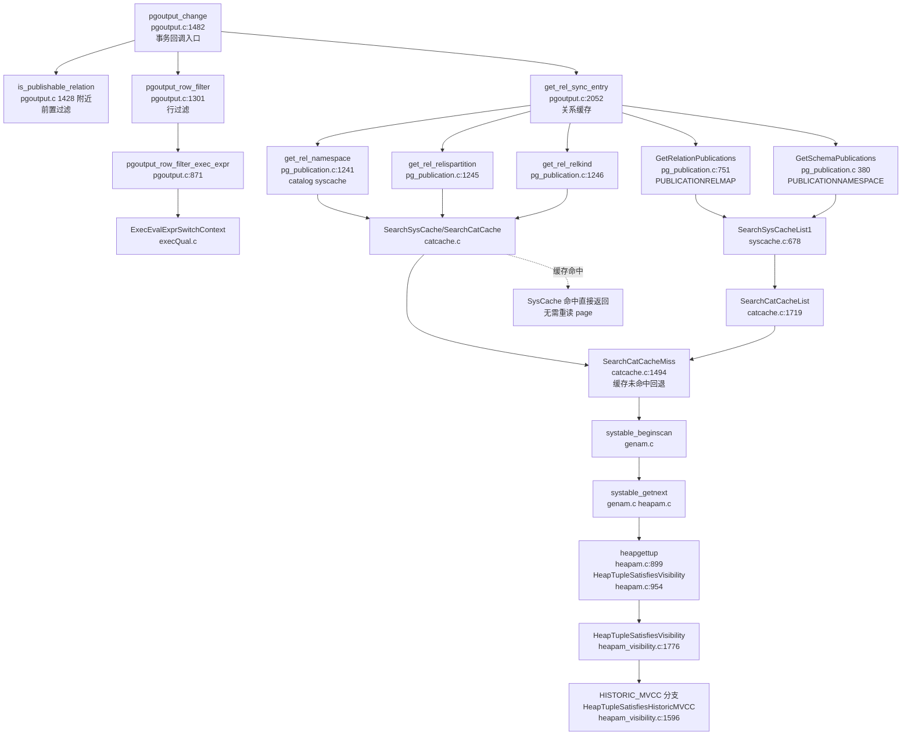
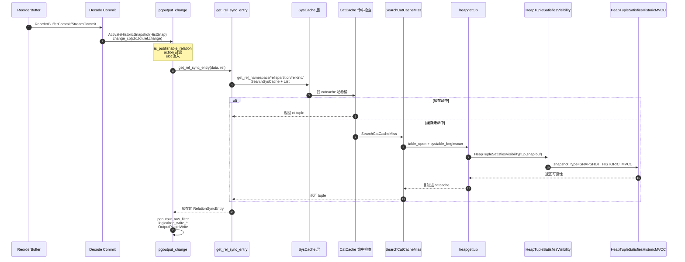
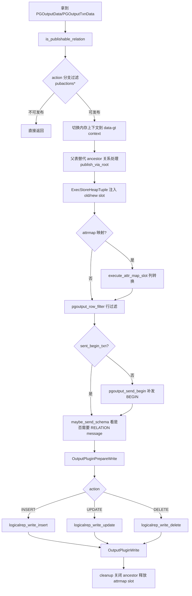
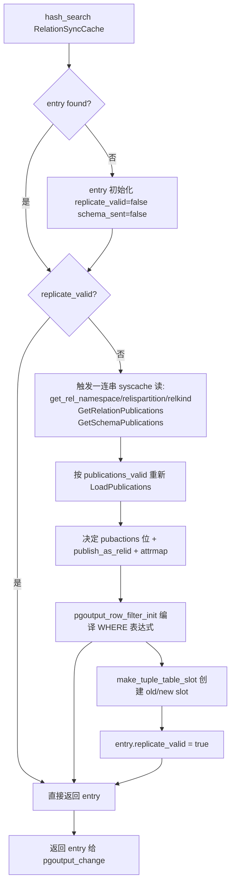
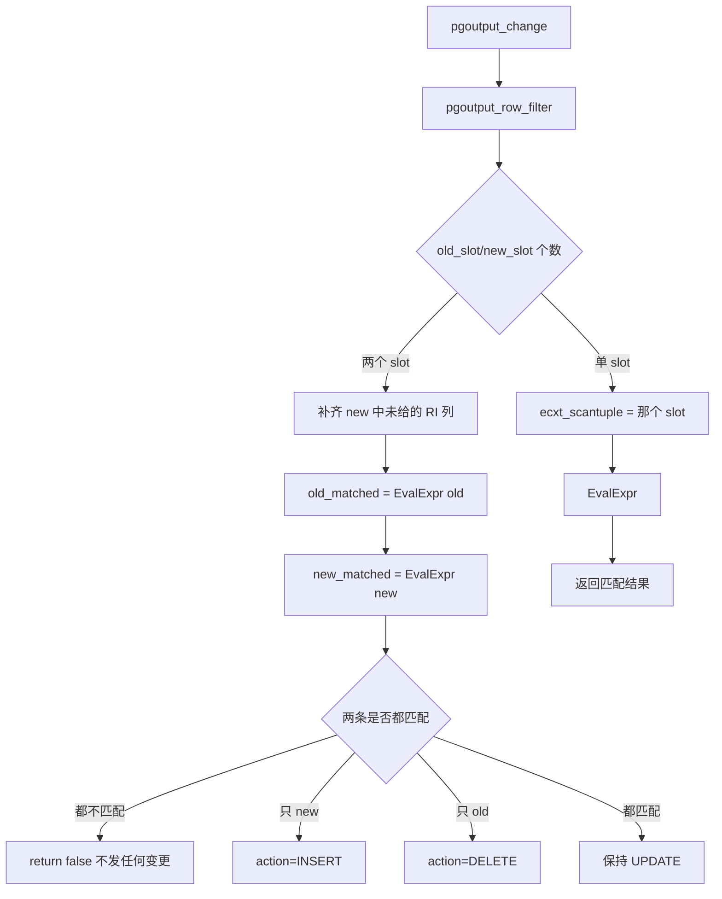
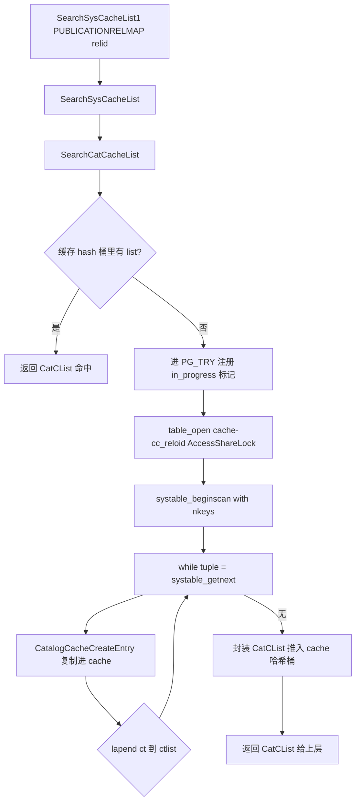
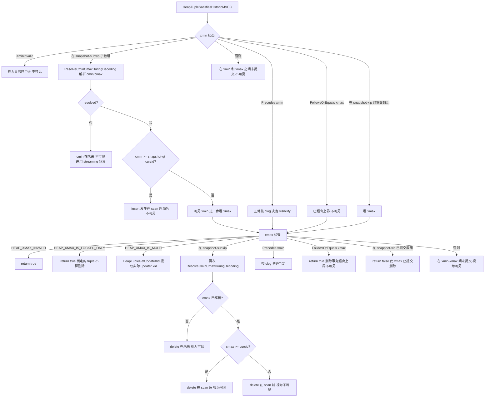
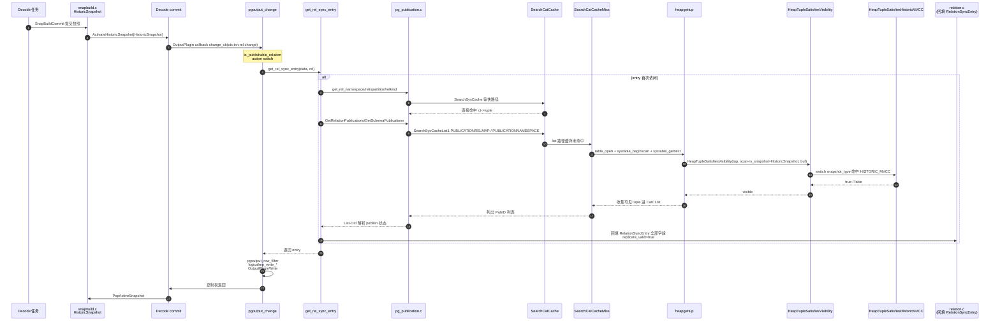

# pgoutput_change 到 HeapTupleSatisfiesVisibility 的函数调用栈分析

> 本文源码基线：PostgreSQL 18（`/Users/growduduan/cwork/postgresql`），所有行号可直接 `cd` 到对应源码目录校对。本文聚焦一条关键链路：**从输出插件回调 `pgoutput_change` 一路追到 `HeapTupleSatisfiesVisibility` 在何种场景下被触发，并在 `SNAPSHOT_HISTORIC_MVCC` 分支中如何完成可见性判定**。这条链路横跨 `pgoutput.c`、`pg_publication.c`、`genam.c`、`catcache.c`、`heapam.c`、`heapam_visibility.c`、`snapmgr.c` 七个文件，是理解"逻辑复制期间输出插件如何与历史快照配合"的关键。

## 阅读指南

- 关心调用栈总图：先看第二节"调用栈全景"
- 关心单函数内部分支：跳到第四节开始逐函数阅读
- 关心为什么"输出插件"会触发 `HeapTupleSatisfiesVisibility`：第七节"快照机制衔接"
- 关心最底层 `HeapTupleSatisfiesHistoricMVCC` 的判定逻辑：第九节
- 关心"实战中常见踩坑点"：第十一节

## 一、背景与问题

逻辑复制的工作流是一个三层流水线：

1. **WAL 重做日志 → 解码**：读取 WAL，把 `XLOG_HEAP_INSERT/UPDATE/DELETE` 解码成"事务内的变更"
2. **事务组装**：由 `reorderbuffer.c` 负责把乱序到达的变更按事务提交顺序排列、消除 DDL 影响、组装 toast、完成快照建立
3. **回调输出插件**：到 commit 时刻，统一调用注册的 `change_cb`，把组装好的变更交给输出插件（默认 `pgoutput`），由它把变更序列化成 wire protocol 字节流

容易混淆的一点是：**`pgoutput_change` 自身不会再做"读取老版本行"这种需要可见性判定的操作**——它拿到的 `ReorderBufferChange->data.tp.oldtuple/newtuple` 已经是组装好、解码完、解过 toast 的最终 tuple。但 `pgoutput_change` 内部会触发一连串**目录表（`pg_publication`、`pg_namespace`、`pg_class`）的 syscache 读取**——这些读在解码期间是发生在 `HistoricSnapshot` 已激活的事务上下文里的，而 syscache 在缓存命中或未命中两种情况下，都会把可见性判定落到 `HeapTupleSatisfiesVisibility` 上，并由 `SNAPSHOT_HISTORIC_MVCC` 分支返回真值。

**所以本文回答的核心问题是**：
"`pgoutput_change` → `get_rel_sync_entry` → `GetRelationPublications` / `get_rel_namespace` 等 syscache 调用 → `SearchSysCacheList1` → `SearchCatCacheList` → `SearchCatCacheMiss` → `systable_getnext` → `heap_getnextslot` → `heapgettup` → `HeapTupleSatisfiesVisibility` → `HeapTupleSatisfiesHistoricMVCC`" 这条穿越 7 个模块的链路，每个节点做了什么、为什么一定要走这一步、`SNAPSHOT_HISTORIC_MVCC` 视图下判定和普通 MVCC 有何不同。

## 二、调用栈全景





## 三、源码定位速查表

| 节点 | 文件:行号 | 关键职责 |
|---|---|---|
| `pgoutput_change` | `src/backend/replication/pgoutput/pgoutput.c:1482` | 输出插件统一变更回调，处理 INSERT/UPDATE/DELETE |
| `is_publishable_relation` | `src/backend/replication/pgoutput/pgoutput.c:1428 附近` | 提前过滤不可发布的表 |
| `get_rel_sync_entry` | `src/backend/replication/pgoutput/pgoutput.c:2052` | 按 relid 找/建 RelationSyncEntry，期间触发 syscache |
| `pgoutput_row_filter` | `src/backend/replication/pgoutput/pgoutput.c:1301` | 发布 WHERE 行过滤，可能把 UPDATE 改写为 INSERT/DELETE |
| `pgoutput_row_filter_exec_expr` | `src/backend/replication/pgoutput/pgoutput.c:871` | 实际执行过滤表达式 |
| `GetRelationPublications` | `src/backend/catalog/pg_publication.c:751` | 读 pg_publication_rel |
| `GetSchemaPublications` | `src/backend/catalog/pg_publication.c 380 附近` | 读 pg_publication_namespace |
| `get_rel_namespace` | `src/backend/catalog/pg_publication.c:1241` | 读 pg_class.relnamespace |
| `get_rel_relispartition` | `src/backend/catalog/pg_publication.c:1245` | 读 pg_class.relispartition |
| `get_rel_relkind` | `src/backend/catalog/pg_publication.c:1246` | 读 pg_class.relkind |
| `SearchSysCacheList1` | `src/backend/utils/cache/syscache.c:678` | 单键列举型 syscache 入口 |
| `SearchCatCacheList` | `src/backend/utils/cache/catcache.c:1719` | 列举型 catcache 入口，先查缓存 |
| `SearchCatCacheMiss` | `src/backend/utils/cache/catcache.c:1494` | 缓存未命中回退到磁盘扫描 |
| `CatalogCacheCreateEntry` | `src/backend/utils/cache/catcache.c:2133` | 把可见 tuple 复制进 cache |
| `systable_beginscan` | `src/backend/access/genam/genam.c` | 系统表的索引扫描开始 |
| `heapgettup` | `src/backend/access/heap/heapam.c:899`（可见性判定点在 `heapam.c:954`） | 逐行返回并执行可见性判定 |
| `HeapTupleSatisfiesVisibility` | `src/backend/access/heap/heapam_visibility.c:1776` | 可见性判定分发入口 |
| `HeapTupleSatisfiesHistoricMVCC` | `src/backend/access/heap/heapam_visibility.c:1596` | 历史快照下的专用判定 |
| `GetCatalogSnapshot` | `src/backend/utils/time/snapmgr.c:384` | 取目录表读取快照（解码时返回 HistoricSnapshot） |

## 四、`pgoutput_change` —— 输出插件的统一回调入口

**文件**：`src/backend/replication/pgoutput/pgoutput.c:1482`  
**签名**：`static void pgoutput_change(LogicalDecodingContext *ctx, ReorderBufferTXN *txn, Relation relation, ReorderBufferChange *change)`

### 4.1 关键参数解析

- `ctx`：逻辑解码主上下文，提供 `output_plugin_private` (即 `PGOutputData *)` 和 `out` 字节流缓冲
- `txn`：当前正在提交的事务对象，提供 `output_plugin_private` (即 `PGOutputTxnData *)` 记录 BEGIN 是否已发送、是否流式等
- `relation`：被变更的表，从内核层传入，已经经过 reorderbuffer 校验
- `change`：实际变更载荷，`change->action` 决定走 INSERT/UPDATE/DELETE 分支

### 4.2 关键流程



### 4.3 核心要点

1. **第一道关卡是 `is_publishable_relation(relation)`**——临时表、系统表、unlogged 视具体情况被排除。这步只是过滤，不会触发 syscache
2. **第二道关卡是 `relentry->pubactions`**——按表 + action 维度的发布权限位决策。这一步**会**触发 `get_rel_sync_entry`（详见第五节），进而触发 syscache 读
3. **关于 `in_streaming`**：流式场景下每条 change 都要带 xid 字段，便于订阅端在 abort 时把同一 xid 的多个 change 一起作废
4. **关于 `attrmap`**：分区表发布父表时，从子表 tuple 列到父表 tuple 列的映射；这一段**不会**触发 syscache，因为 `attrmap` 是 `RelationSyncEntry->attrmap` 已缓存的结果
5. **`pgoutput_row_filter` 是发起 syscache 读的第二大类入口**——它执行发布端的 `WHERE` 子句；如果发布的 `WHERE` 表达式里引用了用户表的列（这是允许的），相当于在 slot 上跑 `ExecEvalExpr`，表达式节点里可能嵌入函数调用，从而又可能触发 syscache

## 五、`get_rel_sync_entry` —— 关系缓存与 syscache 触发点

**文件**：`src/backend/replication/pgoutput/pgoutput.c:2052`

这是 **`pgoutput_change` 流里最热的 syscache 触发器**。当 `entry->replicate_valid == false` 时（即这个 `relid` 第一次被访问），会执行一连串目录读：

```c
Oid schemaId = get_rel_namespace(relid);                              // → catcache NAMESPACEOID
List *pubids  = GetRelationPublications(relid);                       // → catcache PUBLICATIONRELMAP (list 形式)
List *schemaPubids = GetSchemaPublications(schemaId);                 // → catcache PUBLICATIONNAMESPACE (list)
bool  am_partition = get_rel_relispartition(relid);                   // → catcache RELOID syscache
char  relkind = get_rel_relkind(relid);                               // → catcache RELOID syscache
```

### 5.1 关键流程



### 5.2 核心要点

1. **缓存按 `relation->rd_id`（即 `relid`）散列**，因此同一个表在一次解码会话里只走一次 syscache
2. **关键来源是 `LoadPublications` 只会按需加载**——见 `publications_valid` 标志，第一次访问才把所有发布定义抓进内存
3. **`attrmap` 仅对分区表发布父表场景构建**，由 `get_attmap` 系统函数生成
4. **如果发布的 `WHERE` 表达式里有用户表列触发器**，表达式编译在 `pgoutput_row_filter_init`，第一次访问同样会编译成 `ExprState` 并缓存
5. 这套机制是为了让热路径（`entry->replicate_valid == true` 时）几乎不触发新 syscache，所以**单条 change 的开销是 O(1) + 第一次访问的开销**

## 六、行过滤路径（不直接到 HeapTupleSatisfiesVisibility，但会触发 syscache）



**关键点**：

- `pgoutput_row_filter_exec_expr` 调 `ExecEvalExprSwitchContext` 来执行用户自定义表达式，表达式节点里可能调用 SQL/plpgsql 函数，从而触发 syscache
- **本质上 syscache 调用栈是从表达式节点开始的**，不是 `pgoutput_row_filter` 本身
- 如果 row filter 引用了用户表里通过 FDW/触发器间接依赖 catalog 的字段，`HeapTupleSatisfiesHistoricMVCC` 就会被再次触发

## 七、快照机制衔接 —— 为什么这条调用链会落到 `SNAPSHOT_HISTORIC_MVCC`

这一步是**理解整条链路**的钥匙，否则前面的所有函数都看不到它们为什么能跑在一起。

**文件**：`src/backend/utils/time/snapmgr.c:384`

```c
Snapshot
GetCatalogSnapshot(Oid relid)
{
    /* decoding 期间强制使用历史快照 */
    if (HistoricSnapshotActive())
        return HistoricSnapshot;

    return GetNonHistoricCatalogSnapshot(relid);
}
```

**关键点**：

- `HistoricSnapshotActive()` 在 `ActivateHistoricSnapshot(...)` 之后返回 true
- **逻辑复制 walsender 在调用输出插件前**，由 `SnapBuildCommit` 把 `historic` snapshot 推到 `ActiveSnapshot_stack`，并在调用结束前 `PopActiveSnapshot`
- 这个 `HistoricSnapshot` 是 `SNAPSHOT_HISTORIC_MVCC` 类型的（`src/backend/replication/logical/snapbuild.c:434` 注释里明确指出）
- syscache 内部所有 `SearchSysCache*` / `SearchCatCache*` → `SearchCatCacheMiss` 路径，最终都会通过 `systable_getnext`（无索引走 `table_scan_getnextslot` → `heap_getnextslot` → `heapgettup`，有索引走 `index_getnext_slot` → 内部同样落到 `HeapTupleSatisfiesVisibility`）→ 拿到 scan 启动时设置的 `rs_snapshot`，**这个 snapshot 就是 `GetCatalogSnapshot(relid)` 返回的那个 `HistoricSnapshot`**
- 也就是说：**任何在解码过程中触发的目录读，都会用 `SNAPSHOT_HISTORIC_MVCC` 视图去做 MVCC 判定**

### 7.1 `HeapTupleSatisfiesVisibility` 的分发逻辑

**文件**：`src/backend/access/heap/heapam_visibility.c:1776`

```c
bool
HeapTupleSatisfiesVisibility(HeapTuple htup, Snapshot snapshot, Buffer buffer)
{
    switch (snapshot->snapshot_type)
    {
        case SNAPSHOT_MVCC:             return HeapTupleSatisfiesMVCC(htup, snapshot, buffer);
        case SNAPSHOT_SELF:             return HeapTupleSatisfiesSelf(htup, snapshot, buffer);
        case SNAPSHOT_ANY:              return HeapTupleSatisfiesAny(htup, snapshot, buffer);
        case SNAPSHOT_TOAST:            return HeapTupleSatisfiesToast(htup, snapshot, buffer);
        case SNAPSHOT_DIRTY:            return HeapTupleSatisfiesDirty(htup, snapshot, buffer);
        case SNAPSHOT_HISTORIC_MVCC:    return HeapTupleSatisfiesHistoricMVCC(htup, snapshot, buffer);
        case SNAPSHOT_NON_VACUUMABLE:   return HeapTupleSatisfiesNonVacuumable(htup, snapshot, buffer);
    }
    return false;
}
```

`SNAPSHOT_HISTORIC_MVCC` 是专门给解码用的快照类型，其 MVCC 判定规则和普通 MVCC 不同（详见第九节）。其它分支在解码期间不会被走。

## 八、syscache 层（`SearchCatCacheList` / `SearchCatCacheMiss`）

### 8.1 列表型入口：`SearchCatCacheList`（`catcache.c:1719`）

调用时机：`GetRelationPublications`、`GetSchemaPublications` 等需要"按某列前缀批量找出若干行"的场景。



### 8.2 兜底：`SearchCatCacheMiss`（`catcache.c:1494`）

调用时机：`SearchCatCache` / `SearchCatCache1` 等"按完整 key 找唯一行"的快路径在 hash 桶里没找到时。

代码要点：

```c
relation = table_open(cache->cc_reloid, AccessShareLock);
memcpy(cur_skey, cache->cc_skey, sizeof(ScanKeyData) * nkeys);
cur_skey[0].sk_argument = v1; ...;

do {
    scandesc = systable_beginscan(relation, cache->cc_indexoid,
                                  IndexScanOK(cache), NULL, nkeys, cur_skey);
    while (HeapTupleIsValid(ntp = systable_getnext(scandesc))) {
        ct = CatalogCacheCreateEntry(cache, ntp, NULL, hashValue, hashIndex);
        ...
        break;  /* 假定唯一一行 */
    }
    systable_endscan(scandesc);
} while (stale);
```

**核心要点**：

- `table_open + AccessShareLock` 在解码期间是允许的，因为解码上下文的 lockproc 表里允许 catalog lock
- `IndexScanOK(cache)` 决定走索引扫还是顺序扫
- `systable_beginscan` → 内部 `heap_beginscan` → 设 `scan->rs_snapshot = GetCatalogSnapshot(relid) = HistoricSnapshot`
- `systable_getnext` → （无索引时）`table_scan_getnextslot` → `heap_getnextslot` → `heapgettup`（有索引时走 `index_getnext_slot`），最终在 `heapgettup` 内部 `heapam.c:954` 调用 `HeapTupleSatisfiesVisibility`

### 8.3 落入：`CatalogCacheCreateEntry`（`catcache.c:2133`）

- 仅做 tuple 复制、key 提取、detoast（如果需要），**不做可见性判定**——可见性在 `systable_getnext` 时已经过滤掉了
- 0.1% 概率（仅 debug build）模拟 toast 过程中被失效事件打死的场景，强制上层重试

## 九、`HeapTupleSatisfiesHistoricMVCC` —— 历史快照下的精确判定

**文件**：`src/backend/access/heap/heapam_visibility.c:1596`  
**调用栈深度**：8 层  

### 9.1 函数内部分支



### 9.2 与普通 `HeapTupleSatisfiesMVCC` 的差异

| 比较项 | `HeapTupleSatisfiesMVCC` | `HeapTupleSatisfiesHistoricMVCC` |
|---|---|---|
| 适用场景 | 普通 MVCC 可见性 | 逻辑复制期间对 catalog 的可见性判定 |
| 已 abort xmin 处理 | 依赖 t_infomask 提示位 | 需要二次确认 `TransactionIdDidCommit` |
| hint bit 写回 | 会写回 HEAP_XMIN_COMMITTED 等位 | **不写回 hint bits**（注释明确说明，太危险） |
| combo CID（HEAP_XACT_MASK）解析 | 不涉及 | 通过 `HistoricSnapshotGetTupleCids()` + `ResolveCminCmaxDuringDecoding` |
| xmin/xmax 在 [xmin, xmax) 之间且未提交 | 不可见 | **可见**（视为"未来事务尚未确定"） |
| self-xact 处理 | 通过 `TransactionIdIsCurrentTransactionId` | 通过 `TransactionIdInArray` 在 `snapshot->subxip` 找 |

**源码注释里的明确说明（`heapam_visibility.c:1584-1592`）**：

> Only usable on tuples from catalog tables!  
> We don't need to support HEAP_MOVED_(IN|OFF) for now because we only support reading catalog pages which couldn't have been created in an older version.  
> We don't set any hint bits in here as it seems unlikely to be beneficial as those should already be set by normal access and it seems to be too dangerous to do so as the semantics of doing so during timetravel are more complicated than when dealing "only" with the present.

也就是说 `HeapTupleSatisfiesHistoricMVCC` 是**专门为解码期间 catalog 读设计的简化版**，不会动 hint bits，运行开销比普通 MVCC 略低。

## 十、时序图（一张串起来）



## 十一、实战要点与踩坑

### 11.1 哪些 syscache 是解码期间会被这条链路触发的

- `pg_class` (`NamespaceSysCache*` / `RELOID`)
- `pg_namespace` (`NAMESPACEOID` / `NAMESPACENAME`)
- `pg_publication` (`PUBLICATIONOID` / `PUBLICATIONNAME`)
- `pg_publication_rel` (`PUBLICATIONRELMAP` list)
- `pg_publication_namespace` (`PUBLICATIONNAMESPACE` list)
- `pg_attribute` (`ATTNUM`)，如果 row filter 引用列
- 表达式编译阶段还会触碰 `pg_proc`、`pg_type`、`pg_operator`、`pg_collation`

**也就是说，输出插件每访问一张"被发布且第一次触碰"的表，就会把这张表所关联的 publication 元数据全部 syscache 化——这一连串读最终都会流到 `HeapTupleSatisfiesHistoricMVCC`**。

### 11.2 触发 `HeapTupleSatisfiesVisibility` 的概率

理论上每条 catalog miss 都会触发。但实际生产里：

- **绝大多数场景命中 catcache**——直接返回 `&ct->tuple`，从不进入 `SearchCatCacheMiss`，从不进入 `heapgettup`
- **冷启动期（replicat 刚启动或解码切到新表）会集中触发**——观测到的 `HeapTupleSatisfiesHistoricMVCC` 调用峰值往往出现在 `START_REPLICATION` 后最初几秒
- **DDL 事件会强制 `replicate_valid=false`**（pgoutput.c:2098 附近）——DBA 改 `ALTER PUBLICATION ADD TABLE t1` 后第一个变更会重新走整套 syscache

### 11.3 性能关注点

| 关注点 | 现象 | 解读 |
|---|---|---|
| `pubctx` 持续增长 | `data->pubctx` 每次 LoadPublications 都会 `MemoryContextReset` | 见 `pgoutput.c:2084 附近` |
| `exprstate` 反复编译 | row filter 在 `entry->replicate_valid==false` 时重新编译 | 见 `pgoutput.c:1301` 流程图 |
| catcache 极端膨胀 | `catcache_list` 引用被资源所有者跟踪 | 见 `catcache.c:1891 附近` `ResourceOwnerRememberCatCacheListRef` |
| TOAST 失败重试 | `CatalogCacheCreateEntry` 中 PG_TRY/PG_FINALLY 包装 toast 访问 | 见 `catcache.c:2150 附近` |

### 11.4 调试这一链路

```bash
# 启用 catcache 调试日志
SET client_min_messages = DEBUG2;

# 启用可见性跟踪（PG 17+ 提供 log_min_messages 配合 DEBUG3）
SET log_min_messages = DEBUG3;
```

抓到 `SearchCatCache: found in bucket N` 看到，说明**走的是快路径**；  
抓到 `made list of N members` 看到，说明走到了 list 未命中路径，进入了 `systable_getnext → HeapTupleSatisfiesHistoricMVCC`。

## 十二、与"WAL → reorderbuffer → 输出插件"主链路的关系

```mermaid
flowchart LR
    A[WAL Reader] --> B[logical.c Decode]
    B --> C[reorderbuffer.c 排队]
    C --> D{snapbuild.c}<br/>Commit 到达 xmin/xmax 边界?
    D -- 是 --> E[ActivateHistoricSnapshot]
    E --> F[OutputPlugin change_cb<br/>= pgoutput_change]
    F --> G[pgoutput_change → syscache → HeapTupleSatisfiesVisibility<br/>HISTORIC_MVCC]
    G --> H[PopActiveSnapshot]
    D -- 否 --> I[继续缓冲]
```

**重要区分**：

- WAL → reorderbuffer → commit → pgoutput_change 的**主链路**
- pgoutput_change → get_rel_sync_entry → syscache → HeapTupleSatisfiesVisibility 的**辅链路**（本文讨论对象）
- 这两条链路在同一次提交中会**先后触发**，辅链路出现的频次取决于 `(release count) × (被发布的表数量) × (是否分区发布父表) × (是否有 row filter)` 的乘积

## 十三、总结

`pgoutput_change` 本身不做可见性判定，但作为输出插件入口，会引发一连串的 syscache 读：

- `get_rel_sync_entry` 对每个被发布表只发起一次的目录读（`pg_publication`、`pg_publication_rel`、`pg_publication_namespace`、`pg_class`、`pg_namespace`）
- 这些目录读在 `HistoricSnapshot` 已激活的事务上下文里完成
- `GetCatalogSnapshot(relid)` 在解码期间返回 `HistoricSnapshot`，类型是 `SNAPSHOT_HISTORIC_MVCC`
- syscache miss 时 `SearchCatCacheMiss` 通过 `systable_getnext` → `heap_getnextslot` → `heapgettup` → `HeapTupleSatisfiesVisibility` → `SNAPSHOT_HISTORIC_MVCC` 分支 → `HeapTupleSatisfiesHistoricMVCC` 完成可见性判定
- `HeapTupleSatisfiesHistoricMVCC` 是 catalog 专用简化版，相比普通 MVCC 不写 hint bits、对组合 CID 用专门的 `ResolveCminCmaxDuringDecoding` 解析

**最终调用栈**（按层级）：

```
L1: pgoutput_change                                           pgoutput.c:1482
L2: get_rel_sync_entry                                        pgoutput.c:2052
L3: GetRelationPublications/GetSchemaPublications/get_rel_*  pg_publication.c
L4: SearchSysCache / SearchSysCacheList1                     syscache.c
L5: SearchCatCache / SearchCatCacheList                      catcache.c
L6 (miss): SearchCatCacheMiss                                catcache.c:1494
L7: systable_beginscan / systable_getnext                    genam.c
L8: heapgettup                                              heapam.c:899 (HeapTupleSatisfiesVisibility @ heapam.c:954)
L9: HeapTupleSatisfiesVisibility                             heapam_visibility.c:1776
L10: HeapTupleSatisfiesHistoricMVCC                          heapam_visibility.c:1596
```

理解这条链路，是优化逻辑复制 walsender 端 CPU 占用、定位"为什么 catcache 被塞爆"以及排查跨版本行为差异的必备基础。

## 参考

- PostgreSQL 18 源码：`src/backend/replication/pgoutput/pgoutput.c`、`src/backend/replication/logical/snapbuild.c`、`src/backend/access/heap/heapam_visibility.c`、`src/backend/utils/cache/catcache.c`、`src/backend/utils/time/snapmgr.c`
- 《PostgreSQL 14 Internals》"Logical Replication" 章
- pg源码相关博客文档（站内）：`docs/db/postgresql/PostgreSQL 逻辑复制 catalog 改动、可见性判定与 xmin/xmax 推进全景`、`docs/db/postgresql/reorderbuffer c 函数级源码全集`
