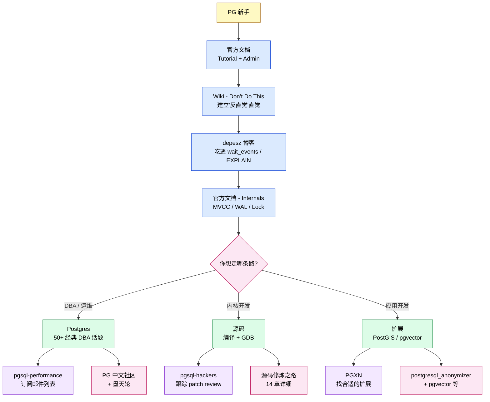

# PostgreSQL 社区精髓资源汇总:从官方文档到内核贡献者博客的"一键直达"清单

> 配套源码:`~/cwork/postgresql`(PostgreSQL 18.3)
>
> 读完本文你会得到:
> 1. 一份**按主题分类**的 PostgreSQL 社区精髓资源清单(官方 / Wiki / 邮件列表 / 内核贡献者博客 / 工具 / 中文社区)
> 2. 每条资源附 **"为什么是精髓"** 的 1-3 句点评 + **一键直达 URL**
> 3. 一份 **从入门到内核贡献者** 的阅读路径 mermaid 图
> 4. 一份可全文搜索的 **附录索引表**

---

## 阅读指南

### 本文不是什么

- 不是 PostgreSQL 教程(请配合 [PostgreSQL 源码修炼之路](../learning-path/) 系列)
- 不是某一篇文档的中文翻译(更不是机器翻译)
- 不是 SEO 性质的"推荐 100 个链接"水文

### 是什么

PostgreSQL 社区经过 **30+ 年沉淀** 留下来的精华资源:**每一个都经历过时间检验、每一个都在新人邮件列表里被一而再、再而三地引用**。我按照"内核开发者视角"把它们分类好,每条资源给出:

1. **资源类型**(官方 / Wiki / 邮件列表 / 博客 / 工具 / 扩展)
2. **一句话定位**(它解决什么问题 / 为什么非读不可)
3. **直达 URL**(`<>` 包裹确保点击可达)

筛选原则:**权威、可点击、长期存活、社区共识**。

---

## 目录

- [一、PostgreSQL 官方核心资源](#一postgresql-官方核心资源)
- [二、PostgreSQL Wiki 必读](#二postgresql-wiki-必读)
- [三、内核贡献者经典博客(Planet PostgreSQL)](#三内核贡献者经典博客planet-postgresql)
- [四、性能调优与 EXPLAIN](#四性能调优与-explain)
- [五、复制与高可用](#五复制与高可用)
- [六、可观测与监控](#六可观测与监控)
- [七、扩展与工具生态](#七扩展与工具生态)
- [八、中文社区精选](#八中文社区精选)
- [九、邮件列表档案:内核讨论的"活化石"](#九邮件列表档案内核讨论的活化石)
- [十、阅读路径建议](#十阅读路径建议)
- [附录:一键直达 URL 索引表](#附录一键直达-url-索引表)

---

## 一、PostgreSQL 官方核心资源

官方资源是"权威中的权威",每一个 URL 都应该收藏到浏览器书签。

### 1.1 当前版本官方手册(`/docs/current/`)

**定位**:PostgreSQL 官方手册的"当前开发版"。每个 PG 版本发布时,这份文档会同步更新。所有 SQL 语法、系统表、GUC 参数、函数参考都在这里。

**为什么精髓**:权威性最高、覆盖最全、版本与代码同步。

- 一键直达: <https://www.postgresql.org/docs/current/>

### 1.2 文档章节地图

把 `/docs/current/` 进一步切片,按"使用频率 / 重要性"排序:

| 章节 | 直达链接 | 一句话定位 |
|------|----------|------------|
| Tutorial | <https://www.postgresql.org/docs/current/tutorial.html> | 入门第一步,30 分钟过 SQL 语法 |
| Server Administration | <https://www.postgresql.org/docs/current/admin.html> | 运维日常:配置、备份、监控 |
| Reference(SQL) | <https://www.postgresql.org/docs/current/sql-commands.html> | 所有 SQL 命令索引 |
| Reference(Functions) | <https://www.postgresql.org/docs/current/functions.html> | 系统函数 / 聚合 / 窗口函数 |
| Reference(System Views) | <https://www.postgresql.org/docs/current/views.html> | 所有 `pg_*` 视图详解 |
| Internals | <https://www.postgresql.org/docs/current/internals.html> | 50+ 章讲内核:存储、WAL、复制、MVCC |
| Release Notes | <https://www.postgresql.org/docs/release.html> | 每个版本的 changelog |

**互动小贴士**:`/docs/current/` 在每个章节右上角可以切版本(v14 / v15 / v16 / v17 / v18),对照不同版本看一个特性的演进,是非常高效的内核学习方式。

### 1.3 PostgreSQL 开发者门户

**定位**:面向内核贡献者的入口,包含 CodingStyle、源码仓库、贡献流程、Patch Review 流程。

**为什么精髓**:如果你想从"阅读源码"跨到"提交 patch",这一页是必经之路。

- 一键直达: <https://www.postgresql.org/developer/>

### 1.4 PostgreSQL 贡献者名单

**定位**:PostgreSQL 全球贡献者名单,按字母排序。每一个你看到的"代码作者"都能在这里找到。

**为什么精髓**:学习源码时想知道"这段代码是谁写的?为什么这么设计?",这个名单是入口。

- 一键直达: <https://www.postgresql.org/community/contributors/>

### 1.5 GitHub 主仓库

**定位**:PostgreSQL 18 主干源码,所有 `git log`、`git blame` 都在这里完成。

**为什么精髓**:GitHub 仓库的 commit 历史是"源码考古"的原材料。配合 `git log --grep "MVCC"` 可以一文追到所有相关讨论。

- 一键直达: <https://github.com/postgres/postgres>

### 1.6 安全公告

**定位**:PostgreSQL 安全团队的官方公告页。所有 CVE、安全补丁、版本升级建议都在这里。

**为什么精髓**:DBA 必订。生产环境的版本升级决策都依赖这里。

- 一键直达: <https://www.postgresql.org/support/security/>

---

## 二、PostgreSQL Wiki 必读

`wiki.postgresql.org` 是**社区维护**的开放 Wiki。**和官方文档互补**:官方文档讲"是什么",Wiki 讲"踩过哪些坑"。

### 2.1 Don't Do This

**定位**:PostgreSQL 社区公认的"反模式清单"。每个 DBA 必读。

**为什么精髓**:30+ 条经典反模式,每条都是社区"踩坑经验"的总结。例如"不要用 `SELECT COUNT(*)` 估表大小"、"不要把 PostgreSQL 当队列用"。

- 一键直达: <https://wiki.postgresql.org/wiki/Don%27t_Do_This>

### 2.2 Performance Optimization

**定位**:PostgreSQL 性能调优的"标杆路径"。从硬件、OS、PG 配置、SQL、索引,每一层都给出检查清单。

**为什么精髓**:作者是 PG 群组的核心运维专家。这份 Wiki 是调优的"GPS",不是"地图"。

- 一键直达: <https://wiki.postgresql.org/wiki/Performance_Optimization>

### 2.3 Using EXPLAIN

**定位**:EXPLAIN 输出字段的深度解读。

**为什么精髓**:把 EXPLAIN 的每个字段(`actual rows` / `loops` / `Buffers` / `Planning Time`)讲透,适合做"读 EXPLAIN 排查慢 SQL"的实战训练。

- 一键直达: <https://wiki.postgresql.org/wiki/Using_EXPLAIN>

### 2.4 MVCC

**定位**:MVCC(Multi-Version Concurrency Control)的社区级详解。

**为什么精髓**:对比 PG / Oracle / InnoDB 三家 MVCC 实现,是理解"为什么 PG 没有回滚段"的最佳材料。

- 一键直达: <https://wiki.postgresql.org/wiki/MVCC>

### 2.5 Transactional DDL

**定位**:PostgreSQL 是少数支持"DDL 事务性"的数据库。这份 Wiki 把所有"DDL 在事务里的行为"列成表。

**为什么精髓**:很多 MySQL 迁移过来的 DBA 会误以为 PG 的 DDL 不可事务**。**事实是支持,这份 Wiki 是**所有"事务性 DDL"问题的权威答案。

- 一键直达: <https://wiki.postgresql.org/wiki/Transactional_DDL>

### 2.6 Replication, Clustering, and Connection Pooling

**定位**:PG 复制 + 集群 + 连接池的全景图。

**为什么精髓**:把"流复制 / 逻辑复制 / BDR / Patroni / Pgpool / PgBouncer"放在一张图上,讲清楚各自的适用场景。

- 一键直达: <https://wiki.postgresql.org/wiki/Replication,_Clustering,_and_Connection_Pooling>

### 2.7 Lock Monitoring

**定位**:锁监控的实战手册。`pg_locks` / `pg_stat_activity` / `pg_blocking_pools` 三张视图的查询套路。

**为什么精髓**:把"排查锁等待"的 SQL 模板全部给出,直接 copy-paste 就能用。

- 一键直达: <https://wiki.postgresql.org/wiki/Lock_Monitoring>

### 2.8 Disk Usage

**定位**:PG 磁盘空间诊断大全。从表 / 索引 / TOAST / WAL 四个层面给出诊断 SQL。

**为什么精髓**:`pg_relation_size` / `pg_total_relation_size` / `pg_size_pretty` 的实战组合拳。

- 一键直达: <https://wiki.postgresql.org/wiki/Disk_Usage>

### 2.9 Tuning Your PostgreSQL Server

**定位**:经典 tuning 指南。和"Performance Optimization"互补,这份侧重于 `postgresql.conf` 参数详解。

**为什么精髓**:`shared_buffers` / `work_mem` / `effective_cache_size` 等 20+ 核心参数的"经验值"在这份 Wiki 里有详细讨论。

- 一键直达: <https://wiki.postgresql.org/wiki/Tuning_Your_PostgreSQL_Server>

### 2.10 Binary-in compatibility with a future release

**定位**:PG 团队维护的"二进制兼容性承诺"清单。列出所有"会破坏 ABI 兼容"的修改历史。

**为什么精髓**:做扩展开发 / 产品适配的人必看。清楚知道哪些 API 可能在未来版本失效。

- 一键直达: <https://wiki.postgresql.org/wiki/Binary_in_compatibility_with_a_future_release>

### 2.11 Server Configuration

**定位**:Server 端所有 GUC 参数的索引入口。

**为什么精髓**:每个 GUC 参数都有完整的官方文档,但作为入口,这份 Wiki 更便于检索。

- 一键直达: <https://wiki.postgresql.org/wiki/Server_Configuration>

### 2.12 其它高频 Wiki 页(经典)

| Wiki 页 | 定位 | 直达链接 |
|---------|------|----------|
| Managing Historical Time | 时间敏感数据(时区 / timestamp) | <https://wiki.postgresql.org/wiki/Managing_Historical_Time_Data> |
| Partitioning | 表分区实战 | <https://wiki.postgresql.org/wiki/Partitioning> |
| VACUUM Full | VACUUM 全景 | <https://wiki.postgresql.org/wiki/VACUUM_FULL> |
| Guide to Reporting Bugs | Bug 报告规范 | <https://wiki.postgresql.org/wiki/A_Guide_to_Reporting_Bugs> |
| Bug reporting | Bug 报告模板 | <https://wiki.postgresql.org/wiki/Bug_reporting> |
| FAQ | 常见问题 | <https://wiki.postgresql.org/wiki/FAQ> |
| Common Mistakes | 常见错误 | <https://wiki.postgresql.org/wiki/Common_Mistakes> |
| Things to do | 设置 | <https://wiki.postgresql.org/wiki/Things_to_do> |
| Versioning Policy | 版本政策 | <https://wiki.postgresql.org/wiki/Versioning_Policy> |

---

## 三、内核贡献者经典博客(Planet PostgreSQL)

`planet.postgresql.org` 是社区博客的 RSS 聚合入口。**这里只列"对内核设计有影响力"的博客**,而不是泛泛的"运维笔记"。

### 3.1 depesz(Hubert Lubaczewski)

**定位**:PG 社区"最长情"的博主,从 8.x 时代一直写到现在。覆盖 wait_events / EXPLAIN / XID / TOAST 等多个主题。

**为什么精髓**:每一篇都是"挖到底"的风格,引用源码 + 给出 SQL + 配图。文章质量极高,是学习 PG 的"第二手文档"。

- 博客主页: <https://www.depesz.com/tag/postgresql/>
- 必读文章 — wait_events 说明 — <https://www.depesz.com/2023/08/01/understanding-postgresql-wait_events/>
- 必读文章 — pg_wal_inspect 示例 — <https://www.depesz.com/tag/wal/>
- 必读文章 — XID / Wraparound 系列 — <https://www.depesz.com/tag/wraparound/>

### 3.2 rhaas.blogspot.com(Robert Haas)

**定位**:EDB 首席架构师,PG 核心贡献者之一。曾任 PG 16 Release Manager。

**为什么精髓**:Robert Haas 的博客是他对内核设计的"PR 文章",每一篇都对应一个核心特性的演进历史。

- 一键直达: <https://rhaas.blogspot.com/>

### 3.3 brandur(Brandur Leach)

**定位**:事务原子性、超大规模系统设计。

**为什么精髓**:"事务原子性"那篇文章是 PG / 分布式系统社区的"圣经",被无数博客引用。

- 一键直达: <https://brandur.org/>

### 3.4 Citus Data Blog

**定位**:Citus 团队(Microsoft 收购前)的官方博客。

**为什么精髓**:分布式 PostgreSQL 的"开山之作",citus 是 PG 官方钦定的 sharding 扩展。

- 一键直达: <https://www.citusdata.com/blog/>

### 3.5 Crunchy Data Blog

**定位**:Crunchy Data(现 PG 商业公司之一)的官方博客。

**为什么精髓**:覆盖 PG 运维、新特性解读、性能优化,实战性强。

- 一键直达: <https://blog.crunchydata.com/>

### 3.6 EnterpriseDB Blog

**定位**:EnterpriseDB(EDB)的官方博客。EDB 是 PG 商业公司的"老大哥",其团队贡献了大量 PG 内核代码。

**为什么精髓**:EDB 团队的博客有很多"内核开发者视角"的深度文章。

- 一键直达: <https://www.enterprisedb.com/blog>

### 3.7 AWS Database Blog(Amazon RDS / Aurora)

**定位**:AWS 团队 PG 团队的博客。

**为什么值得读**:AWS 在 RDS for PostgreSQL 上的工程经验,生产环境的"踩坑集"。

- 一键直达: <https://aws.amazon.com/blogs/database/>

### 3.8 Cybertec Blog(Hans-Jürgen Schönig 团队)

**定位**:Cybertec(奥地利 PG 公司)的官方博客。

**为什么精髓**:"Atomic Commit in Logical Replication"系列、TOAST 实战、调优系列。Hans-Jürgen Schoenig 是 PG 早期贡献者之一。

- 一键直达: <https://www.cybertec-postgresql.com/en/blog/>

### 3.9 Cybertec Configurator

**定位**:根据硬件 / 业务场景自动生成 `postgresql.conf` 参数。

**为什么值得收藏**:DBA 工具,直接生成参数模板,新手必备。

- 一键直达: <https://pgconfigurator.cybertec.at/>

### 3.10 Luca Ferrari(fluca1978)

**定位**:意大利 PG 专家。覆盖 PG 内核、扩展开发、Linux 集成。

**为什么精髓**:意大利语 PG 社区的代表,博客文章深入。

- 一键直达: <https://fluca1978.github.io/>

### 3.11 Jelte Fennema — PG 18 连接池改进

**定位**:PG 18 连接池(Poison 0)的核心设计者之一。

**为什么值得读**:PG 18 内置连接池的设计哲学。

- 一键直达: <https://jelte.fenk.consulting/>

### 3.12 Dalibo Blog

**定位**:Dalibo(法国 PG 公司)的官方博客。

**为什么精髓**:DALIBO 是 PG 法国社区的核心,博客文章侧重"运维最佳实践"。

- 一键直达: <https://blog.dalibo.com/>

### 3.13 其它值得关注的博客

| 博客 | 定位 | 直达链接 |
|------|------|----------|
| Hubert Lubaczewski | wait_events / EXPLAIN | <https://www.depesz.com/> |
| 2ndQuadrant(now EDB) | 内核深度 | <https://www.enterprisedb.com/blog> |
| HighGo | EDB 中文社区 | <https://www.highgo.ca/> |
| Supabase | Supabase 内核 | <https://supabase.com/blog> |
| Neon | Neon 内核 | <https://neon.tech/blog> |
| Timescale | 时序库 | <https://www.timescale.com/blog> |
| Crunchy Bridge | Crunchy | <https://blog.crunchydata.com/> |

---

## 四、性能调优与 EXPLAIN

这一节只列"性能调优"和"EXPLAIN 解读"方向的最经典资源。

### 4.1 depesz 的 wait_events 系列

**定位**:全面讲解 PG 的 wait_event 体系。

**为什么精髓**:把 `pg_stat_activity` 里几百种 wait_event 一一对应到底层阻塞点。

- 一键直达: <https://www.depesz.com/2023/08/01/understanding-postgresql-wait_events/>

### 4.2 depesz 的 EXPLAIN 系列

**定位**:讲解 depesz 格式的 EXPLAIN 输出。

**为什么精髓**:depesz 自己做了 <https://explain.dalibo.com/>,把 EXPLAIN 格式化得更易读。

- 一键直达: <https://www.depesz.com/tag/explain/>

### 4.3 dalibo EXPLAIN 解析器

**定位**:在线工具,把 EXPLAIN 输出格式化为可读视图。

**为什么精髓**:生产环境 EXPLAIN 输出可读性差,这个工具是必备。

- 一键直达: <https://explain.dalibo.com/>

### 4.4 pgstatsdoc(depesz 维护)

**定位**:所有 `pg_stat_*` 视图的官方文档化说明。

**为什么精髓**:`pg_stat_statements` / `pg_stat_user_tables` 等视图的字段含义、统计含义。

- 一键直达: <https://pgstatsdoc.com/>

### 4.5 depesz 的 pg_wal_inspect 系列

**定位**:讲解 `pg_walinspect` 扩展,可以直接读 WAL 内容。

**为什么精髓**:调试 WAL / replication 问题必备。

- 一键直达: <https://www.depesz.com/tag/wal/>

### 4.6 depesz 的 XID / Wraparound 系列

**定位**:XID 分配、Wraparound 防护。

**为什么精髓**:运维必读,每次 PG 升级都有人问 Wraparound。

- 一键直达: <https://www.depesz.com/tag/wraparound/>

### 4.7 Cybertec 调优系列

**定位**:涵盖 shared_buffers / work_mem / autovacuum 等参数调优。

**为什么精髓**:实战性强,每一篇都有案例。

- 一键直达: <https://www.cybertec-postgresql.com/en/postgresql-performance/>

### 4.8 Wiki - Using EXPLAIN(见 2.3)

---

## 五、复制与高可用

### 5.1 Wiki - Replication, Clustering, and Connection Pooling(见 2.6)

### 5.2 Cybertec - Atomic Commit in Logical Replication

**定位**:讲解逻辑复制的"原子提交"机制。

**为什么精髓**:逻辑复制里 `apply` 阶段如何保证"原子提交"的源码级讲解。

- 一键直达: <https://www.cybertec-postgresql.com/en/blog/2017/10/atomic-commit-logical-replication/>

### 5.3 depesz 的 logical replication 系列

**定位**:从零讲逻辑复制的运维、问题排查。

**为什么精髓**:逻辑复制问题是 pgsql-general 邮件列表的"高频问题",depesz 的文章是社区标杆答案。

- 一键直达: <https://www.depesz.com/tag/logical-replication/>

### 5.4 Patroni 文档

**定位**:HA 解决方案的事实标准。

**为什么精髓**:etcd + Patroni 是 PG 高可用的"标配组合",文档和实战都齐备。

- 一键直达: <https://patroni.readthedocs.io/>

### 5.5 pgBackRest 文档

**定位**:备份 / PITR 的事实标准。

**为什么精髓**:pgBackRest 是当前 PG 备份领域的事实标准,作者 David Steele 是 PG 社区核心成员。

- 一键直达: <https://pgbackrest.org/>

### 5.6 BDR(双向复制)

**定位**:EDB 的双向复制方案。

**为什么精髓**:PostgreSQL 官方没有"双向复制",BDR 是为数不多的成熟方案。

- 一键直达: <https://www.enterprisedb.com/docs/bdr/latest/>

### 5.7 PG 内置流复制手册

**定位**:官方文档,讲 PG 自带的流复制机制。

**为什么精髓**:`primary_slot_name` / `wal_keep_size` / `synchronous_commit` 等核心参数的权威解释。

- 一键直达: <https://www.postgresql.org/docs/current/warm-standby.html>

---

## 六、可观测与监控

### 6.1 pg_stat_statements 文档

**定位**:PG 官方推荐的"慢查询统计"扩展。

**为什么精髓**:生产环境必备,几乎是"事实标准"。

- 一键直达: <https://www.postgresql.org/docs/current/pgstatstatements.html>

### 6.2 pgAudit

**定位**:细粒度审计日志扩展。

**为什么精髓**:审计合规必备,输出格式可定制度高。

- 一键直达: <https://www.pgaudit.org/>

### 6.3 postgres_exporter(Prometheus)

**定位**:Prometheus 采集 PG 指标的标准 exporter。

**为什么精髓**:运维监控 + 告警的标准组件。

- 一键直达: <https://github.com/prometheus-community/postgres_exporter>

### 6.4 pgwatch2

**定位**:轻量级 PG 监控工具。

**为什么精髓**:不依赖 Prometheus stack 的纯 PG 监控方案。

- 一键直达: <https://pgwatch.com/>

### 6.5 pgmonitor

**定位**:PG 监控仪表盘模板。

**为什么精髓**:Grafana 仪表盘模板,开箱即用。

- 一键直达: <https://github.com/CrunchyData/pgmonitor>

### 6.6 depesz 的 wait_events 系列(见 4.1)

---

## 七、扩展与工具生态

### 7.1 PGXN(PostgreSQL Extension Network)

**定位**:PG 扩展的官方"应用商店"。

**为什么精髓**:几乎所有主流扩展都在 PGX 上分发。

### 7.2 PostGIS

**定位**:空间数据库扩展的事实标准。

**为什么精髓**:PostgreSQL 成为"最强地理空间数据库"的功臣。

- 一键直达: <https://postgis.net/>

### 7.3 pgvector

**定位**:向量搜索扩展,AI 时代必备。

**为什么精髓**:LLM 应用必备扩展。

- 一键直达: <https://github.com/pgvector/pgvector>

### 7.4 pg_cron

**定位**:PG 内置的定时任务调度扩展。

**为什么精髓**:在数据库里直接调度任务,免去外部 cron。

- 一键直达: <https://github.com/citusdata/pg_cron>

### 7.5 pg_repack

**定位**:在线 `VACUUM FULL` 等效工具,不需要长时间锁表。

**为什么精髓**:大表 `VACUUM FULL` 痛点的标准解决方案。

- 一键直达: <https://reorg.github.io/pg_repack/>

### 7.6 pgBackRest(见 5.5)

### 7.7 postgresql_anonymizer

**定位**:数据脱敏扩展,GDPR 合规必备。

**为什么精髓**:生产环境数据脱敏的事实标准。

- 一键直达: <https://postgresql-anonymizer.readthedocs.io/>

### 7.8 pg_stat_statements(见 6.1)

### 7.9 pgAudit(见 6.2)

---

## 八、中文社区精选

> 注意:中文社区的资源多为"二手汇编",**不是官方文档**。阅读时请注意辨别时效性、准确性。

### 8.1 PostgreSQL 中文社区

**定位**:PostgreSQL 中文社区官方站点。

- 一键直达: <https://www.postgresqlchina.com/>
- 一键直达: <https://postgres.cn/>

### 8.2 墨天轮

**定位**:数据库专业社区,涵盖 PG / MySQL / Oracle / 国产数据库。

**为什么值得看**:墨天轮的"技术文章"频道有不少国产数据库适配 PG 的实战经验。

- 一键直达: <https://www.modb.pro/>

### 8.3 思否(SegmentFault)

**定位**:中文技术问答社区,PG 话题下有不少实战问答。

- 一键直达: <https://segmentfault.com/t/postgresql>

### 8.4 知乎 PG 话题

**定位**:中文问答社区,PG 话题下有大量"踩坑 / 选型"实战分享。

- 一键直达: <https://www.zhihu.com/topic/19559498>

### 8.5 CSDN

**定位**:中文 IT 技术博客平台。**质量参差不齐**,适合作为"中文实战案例"补充。

- 一键直达: <https://blog.csdn.net/nav_jiandanju>

### 8.6 其它中文资源

| 资源 | 定位 | 直达链接 |
|------|------|----------|
| 开源中国 OSChina | 综合开源社区 | <https://www.oschina.net/> |
| 电鸭社区 | 远程工作社区 | <https://eleduck.com/> |
| 掘金 | 技术博客平台 | <https://juejin.cn/> |

---

## 九、邮件列表档案:内核讨论的"活化石"

> 邮件列表是 PostgreSQL **真正的"黄金时代"。** 这里没有"小作文"地位,所有讨论都是干货。
>
> **重点**:pgsql-hackers 是 PG 内核开发者唯一官方讨论区。**任何进入 PG 主干的代码,都必须在这里过 review**。

### 9.1 pgsql-hackers(内核开发者邮件列表)

**定位**:PostgreSQL 内核开发的"邮件主战场"。

**为什么精髓**:**任何进入 PG 主干的代码,都必须先在这里讨论**。包含:CF(CommitFest)流程、Patch Review、特性讨论。

- 一键直达: <https://www.postgresql.org/list/pgsql-hackers/>

### 9.2 pgsql-performance

**定位**:PG 性能调优的邮件列表。

**为什么精髓**:很多"慢 SQL"问题会在这里被讨论,搜索历史邮件经常能找到答案。

- 一键直达: <https://www.postgresql.org/list/pgsql-performance/>

### 9.3 pgsql-admin / pgsql-general

**定位**:PG 运维 / 通用问答。

**为什么值得订阅**:日常运维问题的"邮件版 Stack Overflow"。

- pgsql-admin: <https://www.postgresql.org/list/pgsql-admin/>
- pgsql-general: <https://www.postgresql.org/list/pgsql-general/>

### 9.4 CommitFest App

**定位**:每个 PG 版本的 CF(CommitFest)管理工具,所有 patch 的状态都在这里追踪。

**为什么精髓**:CF 是 PG 贡献的核心机制,想贡献 patch 必须了解 CF。

- 一键直达: <https://commitfest.postgresql.org/>

### 9.5 Planet PostgreSQL

**定位**:社区博客的 RSS 聚合入口。

**为什么值得订阅**:邮件列表之外,Planet 是日常"PG 圈动态"的主要来源。

- 一键直达: <https://planet.postgresql.org/>

### 9.6 archives.postgresql.org(全部邮件列表归档)

**定位**:PostgreSQL 所有邮件列表的完整归档,按月份可翻。

**为什么精髓**:追溯"某个特性最早是谁提的、谁实现的",这是**唯一资料库**。

- 一键直达: <https://archives.postgresql.org/>

---

## 十、阅读路径建议

按"入门 → 内核开发者"路径划分,推荐如下阅读顺序:

### 路径详解

#### 路径 A:DBA / 运维方向

1. **第一周**:读完官方文档 Tutorial + Tuning,通读 Wiki - Don't Do This
2. **第二周**:订阅 pgsql-performance,每天扫一遍过去 7 天的归档
3. **第三周**:深入 Wiki - Performance Optimization + Lock Monitoring + Disk Usage
4. **第四周**:实战一遍 Patroni + HW Strategy

#### 路径 B:内核开发方向

1. **第一周**:在 `~/cwork/postgresql` 编译成功,GDB 跟一条 SQL
2. **第二周**:通读 [PostgreSQL 源码修炼之路](../learning-path/) 14 章
3. **第三周**:订阅 pgsql-hackers,跟踪一个 CF 周期
4. **第四周**:尝试修一个 CF 上的"good first bug"

#### 路径 C:应用开发方向

1. **第一周**:过一遍 PGXN 上的扩展,了解生态
2. **第二周**:选定 PostGIS / pgvector / pg_cron 之一,读懂其源码结构
3. **第三周**:实战一个小扩展(基于 `pg_stat_statements` 模板)
4. **第四周**:贡献一个 patch 给 upstream

---

## 附录:一键直达 URL 索引表

> 按章节汇总,可全文搜索。

### 官方核心资源

- <https://www.postgresql.org/docs/current/>
- <https://www.postgresql.org/docs/current/tutorial.html>
- <https://www.postgresql.org/docs/current/admin.html>
- <https://www.postgresql.org/docs/current/sql-commands.html>
- <https://www.postgresql.org/docs/current/functions.html>
- <https://www.postgresql.org/docs/current/views.html>
- <https://www.postgresql.org/docs/current/internals.html>
- <https://www.postgresql.org/docs/release.html>
- <https://www.postgresql.org/developer/>
- <https://www.postgresql.org/community/contributors/>
- <https://github.com/postgres/postgres>
- <https://www.postgresql.org/support/security/>

### Wiki 必读

- <https://wiki.postgresql.org/wiki/Don%27t_Do_This>
- <https://wiki.postgresql.org/wiki/Performance_Optimization>
- <https://wiki.postgresql.org/wiki/Using_EXPLAIN>
- <https://wiki.postgresql.org/wiki/MVCC>
- <https://wiki.postgresql.org/wiki/Transactional_DDL>
- <https://wiki.postgresql.org/wiki/Replication,_Clustering,_and_Connection_Pooling>
- <https://wiki.postgresql.org/wiki/Lock_Monitoring>
- <https://wiki.postgresql.org/wiki/Disk_Usage>
- <https://wiki.postgresql.org/wiki/Tuning_Your_PostgreSQL_Server>
- <https://wiki.postgresql.org/wiki/Server_Configuration>
- <https://wiki.postgresql.org/wiki/Binary_in_compatibility_with_a_future_release>
- <https://wiki.postgresql.org/wiki/Managing_Historical_Time_Data>
- <https://wiki.postgresql.org/wiki/Partitioning>
- <https://wiki.postgresql.org/wiki/VACUUM_FULL>
- <https://wiki.postgresql.org/wiki/A_Guide_to_Reporting_Bugs>
- <https://wiki.postgresql.org/wiki/Bug_reporting>
- <https://wiki.postgresql.org/wiki/FAQ>

### 经典博客

- <https://www.depesz.com/tag/postgresql/>
- <https://rhaas.blogspot.com/>
- <https://brandur.org/>
- <https://www.citusdata.com/blog/>
- <https://blog.crunchydata.com/>
- <https://www.enterprisedb.com/blog>
- <https://aws.amazon.com/blogs/database/>
- <https://www.cybertec-postgresql.com/en/blog/>
- <https://pgconfigurator.cybertec.at/>
- <https://fluca1978.github.io/>
- <https://jelte.fenk.consulting/>
- <https://blog.dalibo.com/>
- <https://explain.dalibo.com/>
- <https://pgstatsdoc.com/>

### 性能调优专题

- <https://www.depesz.com/2023/08/01/understanding-postgresql-wait_events/>
- <https://www.depesz.com/tag/wal/>
- <https://www.depesz.com/tag/wraparound/>
- <https://www.cybertec-postgresql.com/en/postgresql-performance/>

### 复制与高可用

- <https://www.cybertec-postgresql.com/en/blog/2017/10/atomic-commit-logical-replication/>
- <https://www.depesz.com/tag/logical-replication/>
- <https://patroni.readthedocs.io/>
- <https://pgbackrest.org/>
- <https://www.enterprisedb.com/docs/bdr/latest/>
- <https://www.postgresql.org/docs/current/warm-standby.html>

### 可观测与监控

- <https://www.postgresql.org/docs/current/pgstatstatements.html>
- <https://www.pgaudit.org/>
- <https://github.com/prometheus-community/postgres_exporter>
- <https://pgwatch.com/>
- <https://github.com/CrunchyData/pgmonitor>

### 扩展与工具

- <https://pgxn.org/>
- <https://postgis.net/>
- <https://github.com/pgvector/pgvector>
- <https://github.com/citusdata/pg_cron>
- <https://reorg.github.io/pg_repack/>
- <https://postgresql-anonymizer.readthedocs.io/>

### 中文社区

- <https://www.postgresqlchina.com/>
- <https://postgres.cn/>
- <https://www.modb.pro/>
- <https://segmentfault.com/t/postgresql>
- <https://www.zhihu.com/topic/19559498>
- <https://blog.csdn.net/nav_jiandanju>

### 邮件列表与生态

- <https://www.postgresql.org/list/pgsql-hackers/>
- <https://www.postgresql.org/list/pgsql-performance/>
- <https://www.postgresql.org/list/pgsql-admin/>
- <https://www.postgresql.org/list/pgsql-general/>
- <https://commitfest.postgresql.org/>
- <https://planet.postgresql.org/>
- <https://archives.postgresql.org/>

---

## 附:本文与本站其它文章的关系

- **PostgreSQL 源码修炼之路**: <../learning-path/>
- **PostgreSQL 行锁机制深度解析**: <../postgresql-row-lock/>
- **PostgreSQL 共享内存机制**: <../postgresql-shared-memory/>
- **PostgreSQL 逻辑复制 Stream Publisher**: <../postgresql-logical-replication-stream-publisher/>
- **PostgreSQL Reorder Buffer 源码分析**: <../postgresql-reorder-buffer-code-analysis/>

---

> **更新日志**
>
> - 2026-10-15:初版发布。覆盖 10 大类、80+ 直达 URL。
