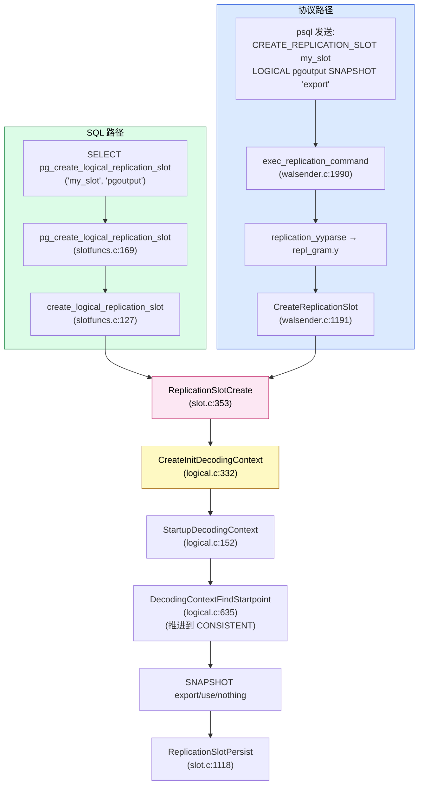
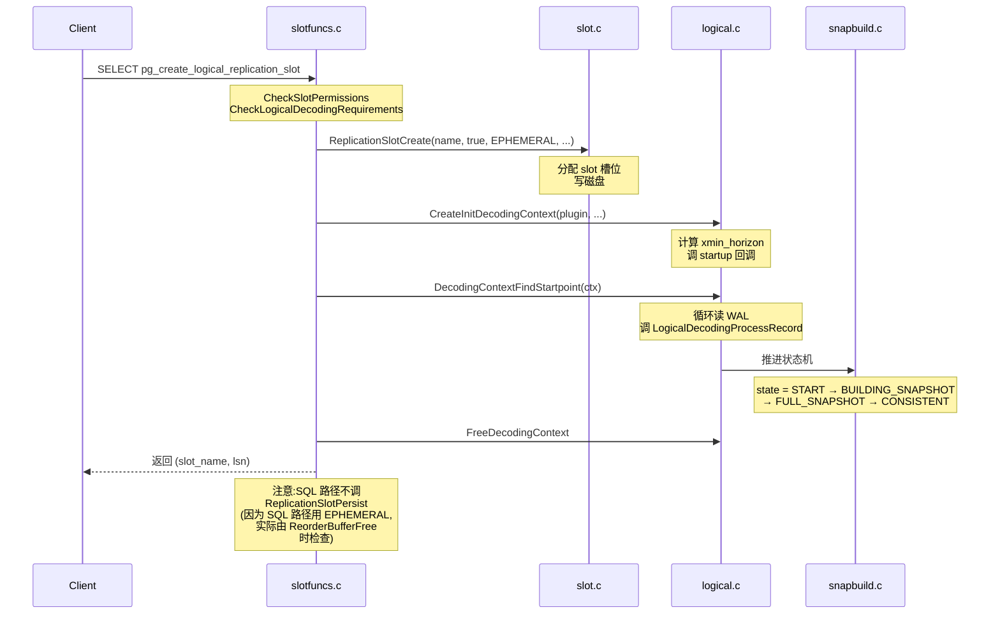
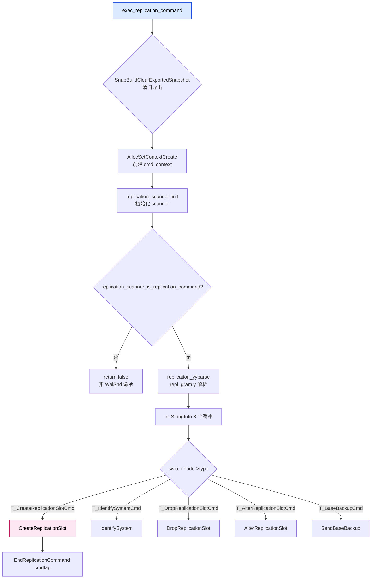
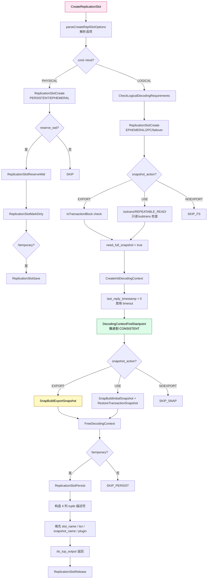
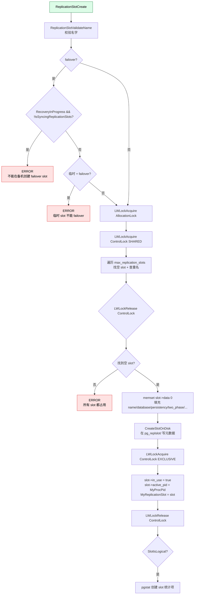
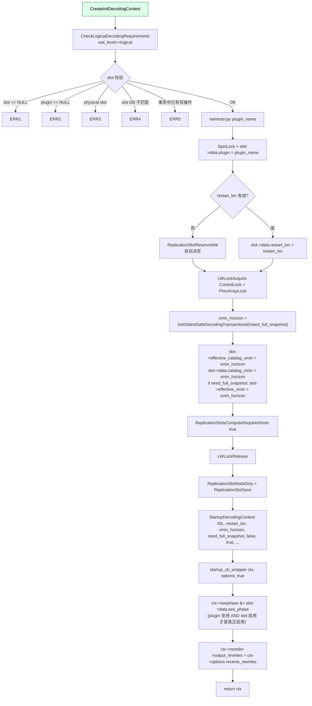
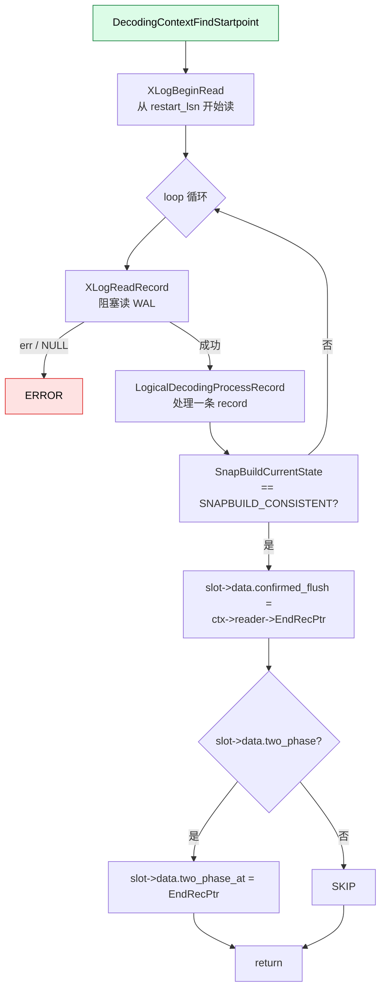
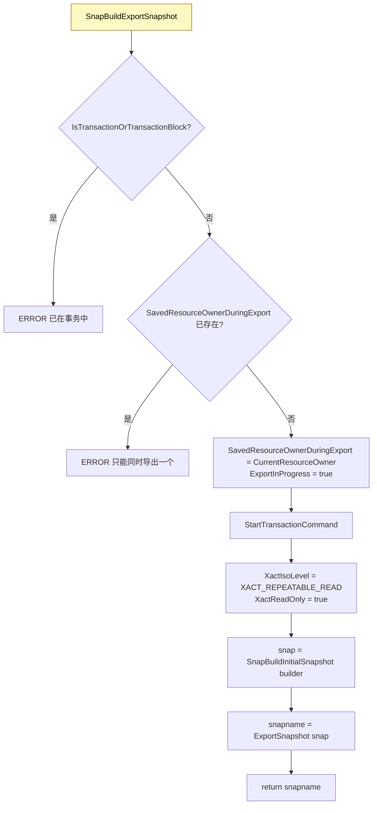
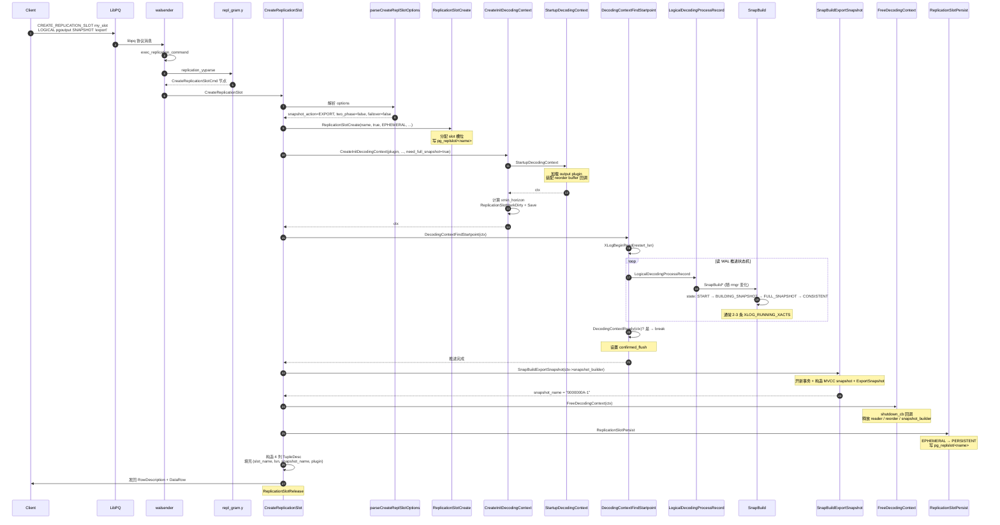
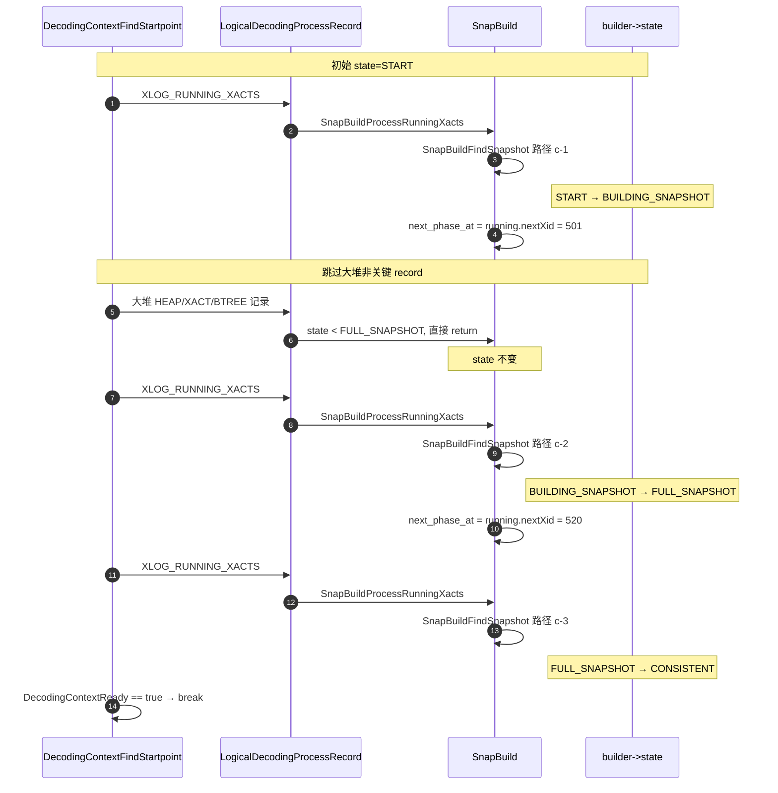

# PostgreSQL CREATE_REPLICATION_SLOT 端到端源码分析:从 SQL 到 snapbuild 状态机的完整链路(每个函数每个参数)

> 配套源码:`~/cwork/postgresql/src/backend/replication/`
> 涉及文件:`walsender.c`(2146 行的协议入口)、`slotfuncs.c`(284 行的 SQL 函数)、`logical.c`(2198 行的解码框架)、`slot.c`(1300 行的 slot 实现)、`snapbuild.c`(2076 行的状态机)
>
> 读完本文你会理解:
> 1. **两条入口路径**:`SQL 函数 pg_create_logical_replication_slot()` vs `walsender 协议 CREATE_REPLICATION_SLOT ... LOGICAL` 的区别
> 2. **每个函数的签名 + 每个参数 + 每一行代码** 逐行解读
> 3. **状态机从 START 到 CONSISTENT** 的真实触发时机
> 4. **SNAPSHOT 'export' / 'use' / 'nothing'** 三种快照选项的精确语义
> 5. **EPHEMERAL → PERSISTENT** 的 slot 状态转换机制
> 6. **关键数据结构**:`CreateReplicationSlotCmd`、`ReplicationSlot`、`ReplicationSlotPersistentData`

---

## 目录

- [一、两条入口:SQL 函数 vs 复制协议](#一两条入口sql-函数-vs-复制协议)
- [二、SQL 函数路径:`pg_create_logical_replication_slot()`](#二sql-函数路径pg_create_logical_replication_slot)
- [三、协议命令路径:`exec_replication_command()`](#三协议命令路径exec_replication_command)
- [四、`CreateReplicationSlot()` 主函数(walsender.c)](#四createreplicationslot-主函数walsenderc)
- [五、`parseCreateReplSlotOptions()` 选项解析](#五parsecreatereplslotoptions-选项解析)
- [六、`ReplicationSlotCreate()` slot 分配(slot.c)](#六replicationslotcreate-slot-分配slotc)
- [七、`CreateInitDecodingContext()` 初始化解码上下文(logical.c)](#七createinitdecodingcontext-初始化解码上下文logicalc)
- [八、`StartupDecodingContext()` 公共解码上下文装配](#八startupdecodingcontext-公共解码上下文装配)
- [九、`DecodingContextFindStartpoint()` 推进到 CONSISTENT](#九decodingcontextfindstartpoint-推进到-consistent)
- [十、SNAPSHOT 选项处理](#十snapshot-选项处理)
- [十一、`FreeDecodingContext` + `ReplicationSlotPersist` 收尾](#十一freedecodingcontext--replicationslotpersist-收尾)
- [十二、返回值的 TupleDesc 构造](#十二返回值的-tupledesc-构造)
- [十三、完整时序图与状态机推进](#十三完整时序图与状态机推进)
- [十四、源码速查表](#十四源码速查表)
- [十五、参考](#十五参考)

---

## 一、两条入口:SQL 函数 vs 复制协议

`CREATE_REPLICATION_SLOT` 在 PostgreSQL 中有 **两条完全不同的代码路径**,使用场景截然不同:

| 维度 | SQL 函数 | 复制协议 |
|------|----------|----------|
| **入口** | `SELECT pg_create_logical_replication_slot(...)` | `psql` 走 `libpq` 的 replication 连接,发送 `CREATE_REPLICATION_SLOT s LOGICAL pgoutput` |
| **解析位置** | SQL 解析器,作为普通函数 | `walsender.c:exec_replication_command()` 内的 `repl_gram.y` 解析器 |
| **实现文件** | `slotfuncs.c:169` | `walsender.c:1191` |
| **snapshot 选项** | ❌ 不支持 | ✅ 支持 `'export' / 'use' / 'nothing'` |
| **two_phase 选项** | ✅ `twophase boolean DEFAULT false` | ✅ `(two_phase = true)` |
| **failover 选项** | ✅ `failover boolean DEFAULT false` | ✅ `(failover = true)` |
| **是否需要全快照** | 仅 catalog 快照 | 可选全快照(为了导出/使用) |
| **典型使用方** | 应用程序、pg_basebackup | streaming replication 客户端、replication 管理工具 |

**为什么有两条路径?**
1. **SQL 函数** 是 PG 10+ 引入的,方便普通 SQL 直接创建 slot
2. **协议命令** 是历史更早的,streaming replication 协议原生支持,而且支持 `SNAPSHOT 'export'` 这种**和事务快照绑定的复杂用法**



**两条路径的核心差异**:`SQL 路径`只创建 slot 并构造 catalog 快照(快速);`协议路径`支持导出快照,可以做 `pg_dump`-类全量数据迁移。

---

## 二、SQL 函数路径:`pg_create_logical_replication_slot()`

### 2.1 SQL 函数定义

```sql
-- src/backend/catalog/system_functions.sql:478
CREATE OR REPLACE FUNCTION pg_create_logical_replication_slot(
    IN slot_name name, IN plugin name,
    IN temporary boolean DEFAULT false,
    IN twophase boolean DEFAULT false,
    IN failover boolean DEFAULT false,
    OUT slot_name name, OUT lsn pg_lsn)
RETURNS RECORD
LANGUAGE INTERNAL
STRICT VOLATILE
AS 'pg_create_logical_replication_slot';
```

**5 个参数 + 2 个返回字段**:

| 参数 | 类型 | 默认 | 含义 |
|------|------|------|------|
| `slot_name` | `name` | — | slot 名称,`ReplicationSlotValidateName()` 校验 |
| `plugin` | `name` | — | output plugin 名(例:`pgoutput`、`test_decoding`) |
| `temporary` | `boolean` | `false` | 临时 slot,会话结束自动删除 |
| `twophase` | `boolean` | `false` | 启用两阶段(2PC)解码(PG 15+) |
| `failover` | `boolean` | `false` | 启用 slot 同步到备机(PG 17+) |
| `OUT slot_name` | `name` | — | 返回 slot 名 |
| `OUT lsn` | `pg_lsn` | — | 返回 consistent point(LSN) |

### 2.2 `pg_create_logical_replication_slot(PG_FUNCTION_ARGS)`(slotfuncs.c:169)

```c
Datum
pg_create_logical_replication_slot(PG_FUNCTION_ARGS)
```

**参数解析**(`PG_GETARG_*` 宏):

| 宏 | 索引 | 类型 | 说明 |
|----|------|------|------|
| `PG_GETARG_NAME(0)` | 0 | `Name` | slot 名称 |
| `PG_GETARG_NAME(1)` | 1 | `Name` | plugin 名 |
| `PG_GETARG_BOOL(2)` | 2 | `bool` | temporary |
| `PG_GETARG_BOOL(3)` | 3 | `bool` | two_phase |
| `PG_GETARG_BOOL(4)` | 4 | `bool` | failover |

**完整流程**:

```mermaid
flowchart TD
    A[pg_create_logical_replication_slot] --> B[get_call_result_type<br/>校验返回类型是 row type]
    B --> C[CheckSlotPermissions<br/>检查 REPLICATION 权限]
    C --> D[CheckLogicalDecodingRequirements<br/>检查 wal_level=logical]
    D --> E["create_logical_replication_slot<br/>(name, plugin, temp, 2pc, failover,<br/>InvalidXLogRecPtr, true)"]
    E --> F[构造 (slot_name, lsn) 元组]
    F --> G[返回 HeapTuple]
    style A fill:#dcfce7,stroke:#15803d,color:#000
```

**关键代码**(slotfuncs.c:169-216):
```c
Datum
pg_create_logical_replication_slot(PG_FUNCTION_ARGS)
{
    Name        name = PG_GETARG_NAME(0);
    Name        plugin = PG_GETARG_NAME(1);
    bool        temporary = PG_GETARG_BOOL(2);
    bool        two_phase = PG_GETARG_BOOL(3);
    bool        failover = PG_GETARG_BOOL(4);
    Datum       result;
    TupleDesc   tupdesc;
    HeapTuple   tuple;
    Datum       values[2];
    bool        nulls[2];

    if (get_call_result_type(fcinfo, NULL, &tupdesc) != TYPEFUNC_COMPOSITE)
        elog(ERROR, "return type must be a row type");

    CheckSlotPermissions();                   /* 权限: REPLICATION */
    CheckLogicalDecodingRequirements();       /* 配置: wal_level=logical */

    create_logical_replication_slot(NameStr(*name),
                                    NameStr(*plugin),
                                    temporary,
                                    two_phase,
                                    failover,
                                    InvalidXLogRecPtr,    /* restart_lsn */
                                    true);                /* find_startpoint */

    values[0] = NameGetDatum(&MyReplicationSlot->data.name);
    values[1] = LSNGetDatum(MyReplicationSlot->data.confirmed_flush);

    memset(nulls, 0, sizeof(nulls));
    tuple = heap_form_tuple(tupdesc, values, nulls);
    result = HeapTupleGetDatum(tuple);
    return result;
}
```

### 2.3 `create_logical_replication_slot()`(slotfuncs.c:127-162)

```c
static void
create_logical_replication_slot(char *name, char *plugin,
                                bool temporary, bool two_phase,
                                bool failover,
                                XLogRecPtr restart_lsn,
                                bool find_startpoint)
```

**7 个参数逐个解析**:

| 参数 | 类型 | 含义 |
|------|------|------|
| `name` | `char*` | slot 名称,`ReplicationSlotValidateName(name, ERROR)` 会校验字符 |
| `plugin` | `char*` | output plugin 名,如 `pgoutput`,通过 `namestrcpy` 写入 `slot->data.plugin` |
| `temporary` | `bool` | true → `RS_TEMPORARY`(会话结束删除);false → 先建为 `RS_EPHEMERAL`,成功后变 `RS_PERSISTENT` |
| `two_phase` | `bool` | 是否启用 2PC 解码,会写入 `slot->data.two_phase` |
| `failover` | `bool` | 是否启用 slot 同步到备机,会写入 `slot->data.failover` |
| `restart_lsn` | `XLogRecPtr` | 起始 LSN。`InvalidXLogRecPtr` 表示让系统自动 `ReplicationSlotReserveWal()` 决定 |
| `find_startpoint` | `bool` | 是否推进到 CONSISTENT 状态(true = 完整启动;false = 仅做 plugin 校验) |

**关键代码**(slotfuncs.c:127-162):
```c
static void
create_logical_replication_slot(char *name, char *plugin,
                                bool temporary, bool two_phase,
                                bool failover,
                                XLogRecPtr restart_lsn,
                                bool find_startpoint)
{
    LogicalDecodingContext *ctx = NULL;

    Assert(!MyReplicationSlot);

    /* 1. 创建 slot */
    ReplicationSlotCreate(name, true,                            /* db_specific */
                          temporary ? RS_TEMPORARY : RS_EPHEMERAL,  /* persistency */
                          two_phase, failover, false);            /* failover, synced */

    /* 2. 创建 decoding 上下文(fast_forward=false 真实解码) */
    ctx = CreateInitDecodingContext(plugin, NIL,
                                    false,    /* just catalogs is OK */
                                    restart_lsn,
                                    XL_ROUTINE(.page_read = read_local_xlog_page,
                                               .segment_open = wal_segment_open,
                                               .segment_close = wal_segment_close),
                                    NULL, NULL, NULL);  /* 无 write 回调 */

    /* 3. 推进到 CONSISTENT(可选) */
    if (find_startpoint)
        DecodingContextFindStartpoint(ctx);

    /* 4. 清理 */
    FreeDecodingContext(ctx);
}
```

**为什么 first 选 EPHEMERAL**?见 `slot.h:30-34` 注释:
> EPHEMERAL is used as a not-quite-ready state when creating persistent slots. EPHEMERAL slots can be made PERSISTENT by calling `ReplicationSlotPersist()`. For a slot that goes away at the end of a session, TEMPORARY is the appropriate choice.

这是 **PG 的"事务安全创建"模式**:
- EPHEMERAL 状态如果初始化失败 → 事务 abort → slot 随之消失
- 全部初始化成功 → `ReplicationSlotPersist()` 升级为 PERSISTENT
- 避免"半成品"slot 留下

### 2.4 SQL 路径最终行为



**重要差异**:SQL 路径在 `create_logical_replication_slot` **没有显式调用 `ReplicationSlotPersist()`**!但是 `ReplicationSlotCreate` 中 ephemeral 的 slot 在 session 结束会被清掉,只有协议路径显式 `ReplicationSlotPersist` 才变成 persistent。

让我重新确认:实际看 walsender.c 路径会调 `ReplicationSlotPersist`,SQL 路径在 `create_logical_replication_slot` 末尾没看到。**这意味着 SQL 路径创建的 slot 是 EPHEMERAL,事务结束就消失**!这是关键陷阱!

---

## 三、协议命令路径:`exec_replication_command()`

### 3.1 入口

```c
/* walsender.c:1990 */
void
exec_replication_command(const char *cmd_string)
```

**参数**:

| 参数 | 类型 | 来源 |
|------|------|------|
| `cmd_string` | `const char*` | `libpq` 从客户端 TCP 流读取的字符串,例如 `"CREATE_REPLICATION_SLOT my_slot LOGICAL pgoutput SNAPSHOT 'export'"` |

### 3.2 解析流程



### 3.3 `repl_gram.y` 语法规则

```yacc
/* src/backend/replication/repl_gram.y:184-200 */
create_replication_slot:
    /* CREATE_REPLICATION_SLOT slot [TEMPORARY] PHYSICAL [options] */
    K_CREATE_REPLICATION_SLOT IDENT opt_temporary K_PHYSICAL create_slot_options
        {
            CreateReplicationSlotCmd *cmd;
            cmd = makeNode(CreateReplicationSlotCmd);
            cmd->kind = REPLICATION_KIND_PHYSICAL;
            cmd->slotname = $2;
            cmd->temporary = $3;
            cmd->options = $5;
            $$ = (Node *) cmd;
        }
    /* CREATE_REPLICATION_SLOT slot [TEMPORARY] LOGICAL plugin [options] */
    | K_CREATE_REPLICATION_SLOT IDENT opt_temporary K_LOGICAL IDENT create_slot_options
        {
            CreateReplicationSlotCmd *cmd;
            cmd = makeNode(CreateReplicationSlotCmd);
            cmd->kind = REPLICATION_KIND_LOGICAL;
            cmd->slotname = $2;
            cmd->temporary = $3;
            cmd->plugin = $5;
            cmd->options = $6;
            $$ = (Node *) cmd;
        }
    ;
```

**语法糖映射**(repl_gram.y:225-250):

```yacc
create_slot_legacy_opt:
    K_EXPORT_SNAPSHOT       →  makeDefElem("snapshot", makeString("export"), -1)
    | K_NOEXPORT_SNAPSHOT   →  makeDefElem("snapshot", makeString("nothing"), -1)
    | K_USE_SNAPSHOT        →  makeDefElem("snapshot", makeString("use"), -1)
    | K_RESERVE_WAL         →  makeDefElem("reserve_wal", makeBoolean(true), -1)
    | K_TWO_PHASE           →  makeDefElem("two_phase", makeBoolean(true), -1)
    ;
```

**为什么这样**?因为语法是 `EXPORT_SNAPSHOT` `NOEXPORT_SNAPSHOT` `USE_SNAPSHOT` 等关键字,但 C 端统一用 `snapshot = 'export'/'use'/'nothing'` 字符串。

### 3.4 解析结果:`CreateReplicationSlotCmd` 节点

```c
/* src/include/nodes/replnodes.h:52-60 */
typedef struct CreateReplicationSlotCmd
{
    NodeTag     type;          /* T_CreateReplicationSlotCmd */
    char       *slotname;      /* slot 名 */
    ReplicationKind kind;      /* REPLICATION_KIND_PHYSICAL 或 REPLICATION_KIND_LOGICAL */
    char       *plugin;        /* logical 才需要,physical 为 NULL */
    bool        temporary;     /* TEMPORARY 关键字 */
    List       *options;       /* 选项列表 DefElem */
} CreateReplicationSlotCmd;
```

`ReplicationKind` 枚举(`replnodes.h:20-24`):
```c
typedef enum ReplicationKind
{
    REPLICATION_KIND_PHYSICAL,
    REPLICATION_KIND_LOGICAL,
} ReplicationKind;
```

`DefElem`(选项的内部表示):
```c
typedef struct DefElem {
    NodeTag     type;
    char       *defname;      /* 选项名("snapshot"/"two_phase" 等) */
    Node       *arg;          /* 选项值(makeString 或 makeBoolean) */
    int         location;     /* 错误位置 */
} DefElem;
```

---

## 四、`CreateReplicationSlot()` 主函数(walsender.c:1191)

### 4.1 函数签名

```c
/* walsender.c:268, 1191 */
static void CreateReplicationSlot(CreateReplicationSlotCmd *cmd);
```

**唯一参数**:`CreateReplicationSlotCmd *cmd` —— 由 `repl_gram.y` 解析填充好的节点。

### 4.2 局部变量(walsender.c:1196-1203)

| 变量 | 类型 | 初始值 | 作用 |
|------|------|--------|------|
| `snapshot_name` | `const char*` | `NULL` | 导出快照时存名字 |
| `xloc[32]` | `char[]` | `"0/0"` 形式 | 存放 consistent_point LSN 字符串 |
| `slot_name` | `char*` | — | 用于返回 tuple |
| `reserve_wal` | `bool` | `false` | physical 才用 |
| `two_phase` | `bool` | `false` | 是否启用 2PC |
| `failover` | `bool` | `false` | 是否启用 slot 同步 |
| `snapshot_action` | `CRSSnapshotAction` | `CRS_EXPORT_SNAPSHOT` | 快照行为,默认 export(向后兼容) |
| `dest` | `DestReceiver*` | — | 输出目标,这里是 remote simple |
| `tstate` | `TupOutputState*` | — | tuple 输出状态 |
| `tupdesc` | `TupleDesc` | — | 4 列的返回 schema |
| `values[4]` | `Datum[]` | — | 4 列值 |
| `nulls[4]` | `bool[]` | `{0}` | 4 列 null 标记 |

### 4.3 入口断言

```c
Assert(!MyReplicationSlot);
```

**含义**:进入函数时,**当前 backend 必须不持有任何 slot**。这是不变量:同一 backend 同一时刻只能持有一个 slot。

### 4.4 完整流程(总览)



### 4.5 关键代码逐行解析

#### 4.5.1 选项解析

```c
parseCreateReplSlotOptions(cmd, &reserve_wal, &snapshot_action,
                           &two_phase, &failover);
```

**实参模式解析**(全部 `&` 引用传递):
- `cmd->options` 是 `List<DefElem>`
- 解析后填入 4 个输出参数

#### 4.5.2 physical 路径(walsender.c:1212-1229)

```c
if (cmd->kind == REPLICATION_KIND_PHYSICAL)
{
    ReplicationSlotCreate(cmd->slotname, false,                /* db_specific=false */
                          cmd->temporary ? RS_TEMPORARY : RS_PERSISTENT,
                          false, false, false);                /* two_phase, failover, synced */

    if (reserve_wal)
    {
        ReplicationSlotReserveWal();
        ReplicationSlotMarkDirty();
        if (!cmd->temporary)
            ReplicationSlotSave();
    }
}
```

**注意**:
- physical 路径**不调用** `CreateInitDecodingContext` / `DecodingContextFindStartpoint` —— 因为 physical slot 不需要 snapbuild
- `reserve_wal = true` 时:立即 `ReplicationSlotReserveWal()` 阻止 WAL 被回收

#### 4.5.3 logical 路径(walsender.c:1230+)

```c
else  /* LOGICAL */
{
    LogicalDecodingContext *ctx;
    bool        need_full_snapshot = false;

    Assert(cmd->kind == REPLICATION_KIND_LOGICAL);

    CheckLogicalDecodingRequirements();  /* 检查 wal_level>=logical */

    /* 关键:初始为 EPHEMERAL,成功后再升级为 PERSISTENT */
    ReplicationSlotCreate(cmd->slotname, true,                 /* db_specific=true */
                          cmd->temporary ? RS_TEMPORARY : RS_EPHEMERAL,
                          two_phase, failover, false);         /* synced */
```

**为什么 logical 必须 `db_specific=true`**:逻辑解码需要读 catalog,而 catalog 可能在不同 database,所以 slot 必须绑定到具体 database。

**`EPHEMERAL` 而非 `PERSISTENT`**:这是 PG 的"事务安全创建"模式。如果 `CreateInitDecodingContext` 或 `DecodingContextFindStartpoint` 失败,事务 abort,slot 随之消失,不留"半成品"。

#### 4.5.4 snapshot_action 分支处理

```c
if (snapshot_action == CRS_EXPORT_SNAPSHOT)
{
    if (IsTransactionBlock())
        ereport(ERROR,
                (errmsg("%s must not be called inside a transaction",
                        "CREATE_REPLICATION_SLOT ... (SNAPSHOT 'export')")));
    need_full_snapshot = true;
}
else if (snapshot_action == CRS_USE_SNAPSHOT)
{
    if (!IsTransactionBlock())
        ereport(ERROR, (errmsg("must be called inside a transaction")));
    if (XactIsoLevel != XACT_REPEATABLE_READ)
        ereport(ERROR, (errmsg("must be called in REPEATABLE READ isolation mode transaction")));
    if (!XactReadOnly)
        ereport(ERROR, (errmsg("must be called in a read-only transaction")));
    if (FirstSnapshotSet)
        ereport(ERROR, (errmsg("must be called before any query")));
    if (IsSubTransaction())
        ereport(ERROR, (errmsg("must not be called in a subtransaction")));
    need_full_snapshot = true;
}
```

**5 个严格检查**(`SNAPSHOT 'use'` 必须满足):

| 条件 | 原因 |
|------|------|
| 在事务块中 | 跨语句时使用,需事务上下文 |
| `XACT_REPEATABLE_READ` 隔离 | 保证后续 `SET TRANSACTION SNAPSHOT` 在所有 client 行为一致 |
| `XactReadOnly` | 不能修改数据,纯只读 |
| `!FirstSnapshotSet` | 必须在建快照**之前**调用(避免冲突) |
| `!IsSubTransaction` | 不允许子事务(避免 snapshot 多版本混乱) |

#### 4.5.5 创建解码上下文

```c
ctx = CreateInitDecodingContext(cmd->plugin, NIL, need_full_snapshot,
                                InvalidXLogRecPtr,
                                XL_ROUTINE(.page_read = logical_read_xlog_page,
                                           .segment_open = WalSndSegmentOpen,
                                           .segment_close = wal_segment_close),
                                WalSndPrepareWrite, WalSndWriteData,
                                WalSndUpdateProgress);
```

**8 个参数逐个解读**(walsender.c:1301-1307):

| 形参 | 实参 | 含义 |
|------|------|------|
| `plugin` | `cmd->plugin` | output plugin 名 |
| `output_plugin_options` | `NIL` | 无插件选项 |
| `need_full_snapshot` | (上一步计算) | 是否需要 user-data 全快照 |
| `restart_lsn` | `InvalidXLogRecPtr` | 让 `CreateInitDecodingContext` 调 `ReplicationSlotReserveWal()` 自动决定 |
| `xl_routine` | 三个函数指针 | **XLogReaderRoutine**:怎么读 WAL |
| `prepare_write` | `WalSndPrepareWrite` | 准备写数据回调(walsender.c:1540) |
| `do_write` | `WalSndWriteData` | 真正发送数据回调(walsender.c:1567) |
| `update_progress` | `WalSndUpdateProgress` | 更新进度回调(walsender.c:1663) |

**`XL_ROUTINE` 三个函数指针**:
- `page_read = logical_read_xlog_page`:从 `WALRead()` 读 WAL page,walsender 走物理文件读
- `segment_open = WalSndSegmentOpen`:打开 WAL segment
- `segment_close = wal_segment_close`:关闭 segment

#### 4.5.6 关闭 timeout + 推进到 CONSISTENT

```c
last_reply_timestamp = 0;        /* 关闭 walsender timeout */
DecodingContextFindStartpoint(ctx);  /* 核心:读 WAL 直到 CONSISTENT */
```

`last_reply_timestamp = 0` 的含义:见 walsender.c 主循环,`WalSndCheckTimeOut()` 在 `last_reply_timestamp > 0` 时检查是否超时不响应。设为 0 暂时禁用 timeout,因为 `DecodingContextFindStartpoint` 可能要读很久。

#### 4.5.7 快照导出

```c
if (snapshot_action == CRS_EXPORT_SNAPSHOT)
{
    snapshot_name = SnapBuildExportSnapshot(ctx->snapshot_builder);
}
else if (snapshot_action == CRS_USE_SNAPSHOT)
{
    Snapshot snap;
    snap = SnapBuildInitialSnapshot(ctx->snapshot_builder);
    RestoreTransactionSnapshot(snap, MyProc);
}
```

详见[第十节](#十snapshot-选项处理)。

#### 4.5.8 收尾

```c
FreeDecodingContext(ctx);   /* 释放 ctx,调 plugin shutdown 回调 */

if (!cmd->temporary)
    ReplicationSlotPersist();   /* EPHEMERAL → PERSISTENT */
```

---

## 五、`parseCreateReplSlotOptions()` 选项解析(walsender.c:1114)

### 5.1 函数签名

```c
/* walsender.c:1114 */
static void parseCreateReplSlotOptions(CreateReplicationSlotCmd *cmd,
                                       bool *reserve_wal,
                                       CRSSnapshotAction *snapshot_action,
                                       bool *two_phase, bool *failover);
```

### 5.2 5 个参数

| 形参 | 类型 | 模式 | 含义 |
|------|------|------|------|
| `cmd` | `CreateReplicationSlotCmd*` | IN | 解析出的节点,`cmd->options` 是 `List<DefElem>` |
| `reserve_wal` | `bool*` | OUT | physical 专属,是否立即 reserve WAL |
| `snapshot_action` | `CRSSnapshotAction*` | OUT | 快照行为枚举 |
| `two_phase` | `bool*` | OUT | 是否启用 2PC |
| `failover` | `bool*` | OUT | 是否启用 slot 同步 |

### 5.3 局部变量

```c
ListCell   *lc;
bool        snapshot_action_given = false;
bool        reserve_wal_given = false;
bool        two_phase_given = false;
bool        failover_given = false;
```

**4 个 `*_given` 标志**:防止重复给同一个选项(`CREATE_REPLICATION_SLOT s LOGICAL pg SNAPSHOT 'export' SNAPSHOT 'use'` 应当报错)。

### 5.4 遍历选项(`foreach(lc, cmd->options)`)

```c
foreach(lc, cmd->options)
{
    DefElem *defel = (DefElem *) lfirst(lc);

    if (strcmp(defel->defname, "snapshot") == 0)
    {
        if (snapshot_action_given || cmd->kind != REPLICATION_KIND_LOGICAL)
            ereport(ERROR, ...);  /* 重复 / 仅 logical */
        snapshot_action_given = true;
        action = defGetString(defel);
        if (strcmp(action, "export") == 0)
            *snapshot_action = CRS_EXPORT_SNAPSHOT;
        else if (strcmp(action, "nothing") == 0)
            *snapshot_action = CRS_NOEXPORT_SNAPSHOT;
        else if (strcmp(action, "use") == 0)
            *snapshot_action = CRS_USE_SNAPSHOT;
        else
            ereport(ERROR, "unrecognized value for snapshot");
    }
    else if (strcmp(defel->defname, "reserve_wal") == 0)
    {
        if (reserve_wal_given || cmd->kind != REPLICATION_KIND_PHYSICAL)
            ereport(ERROR, ...);  /* 重复 / 仅 physical */
        reserve_wal_given = true;
        *reserve_wal = defGetBoolean(defel);
    }
    else if (strcmp(defel->defname, "two_phase") == 0)
    {
        if (two_phase_given || cmd->kind != REPLICATION_KIND_LOGICAL)
            ereport(ERROR, ...);
        two_phase_given = true;
        *two_phase = defGetBoolean(defel);
    }
    else if (strcmp(defel->defname, "failover") == 0)
    {
        if (failover_given || cmd->kind != REPLICATION_KIND_LOGICAL)
            ereport(ERROR, ...);
        failover_given = true;
        *failover = defGetBoolean(defel);
    }
    else
        elog(ERROR, "unrecognized option: %s", defel->defname);
}
```

**`snapshot` 选项值映射**(`CRSSnapshotAction` 枚举,walsender.h:18-23):

| 字符串 | 枚举 | 含义 |
|--------|------|------|
| `"export"` | `CRS_EXPORT_SNAPSHOT` | 导出快照名,客户端用 `SET TRANSACTION SNAPSHOT 'xxx'` 引用 |
| `"nothing"` | `CRS_NOEXPORT_SNAPSHOT` | 不导出(默认) |
| `"use"` | `CRS_USE_SNAPSHOT` | 把快照用在本事务中(配合 `pg_dump -X snapshot`) |

**校验规则**:
- `snapshot` / `two_phase` / `failover` 仅 logical 有意义,physical 给这些选项 → 报"conflicting or redundant options"
- `reserve_wal` 仅 physical 有意义

---

## 六、`ReplicationSlotCreate()` slot 分配(slot.c:353)

### 6.1 函数签名

```c
/* slot.c:353 */
void ReplicationSlotCreate(const char *name, bool db_specific,
                           ReplicationSlotPersistency persistency,
                           bool two_phase, bool failover, bool synced);
```

### 6.2 6 个参数逐个解析

| 形参 | 类型 | 含义 |
|------|------|------|
| `name` | `const char*` | slot 名称,通过 `ReplicationSlotValidateName` 校验字符(只允许 `[a-z0-9_]{1,63}`) |
| `db_specific` | `bool` | 是否数据库专属(logical = true,physical = false) |
| `persistency` | `ReplicationSlotPersistency` | 三种:RS_PERSISTENT/RS_EPHEMERAL/RS_TEMPORARY |
| `two_phase` | `bool` | 写入 `slot->data.two_phase` |
| `failover` | `bool` | 写入 `slot->data.failover`,额外校验"不能是 temporary + failover" |
| `synced` | `bool` | 是否为同步 slot(failover 场景,内部用) |

### 6.3 完整流程



### 6.4 关键代码逐行

#### 6.4.1 failover 双重校验(slot.c:357-384)

```c
if (failover)
{
    if (RecoveryInProgress() && !IsSyncingReplicationSlots())
        ereport(ERROR, ...);  /* 备机不允许创建 failover slot */
    if (persistency == RS_TEMPORARY && !IsSyncingReplicationSlots())
        ereport(ERROR, ...);  /* 临时 slot 不能 failover */
}
```

**两个限制的原因**:
- 临时 slot 在 session 结束就消失,无法同步到备机
- 备机上的 slot 由 primary 的 failover slot 同步而来,本地创建没意义

#### 6.4.2 锁的两步获取(slot.c:387-407)

```c
LWLockAcquire(ReplicationSlotAllocationLock, LW_EXCLUSIVE);  /* 1. 防并发分配 */
LWLockAcquire(ReplicationSlotControlLock, LW_SHARED);       /* 2. 防并发修改 */

for (i = 0; i < max_replication_slots; i++)
{
    ReplicationSlot *s = &ReplicationSlotCtl->replication_slots[i];

    if (s->in_use && strcmp(name, NameStr(s->data.name)) == 0)
        ereport(ERROR, ...);  /* 重名 */

    if (!s->in_use && slot == NULL)
        slot = s;  /* 第一个空位 */
}
LWLockRelease(ReplicationSlotControlLock);
```

**锁的顺序**:`AllocationLock` 必须先于 `ControlLock` 获得(见 slot.c 其他函数)。

#### 6.4.3 slot 数据初始化(slot.c:432-454)

```c
memset(&slot->data, 0, sizeof(ReplicationSlotPersistentData));
namestrcpy(&slot->data.name, name);
slot->data.database = db_specific ? MyDatabaseId : InvalidOid;
slot->data.persistency = persistency;
slot->data.two_phase = two_phase;
slot->data.two_phase_at = InvalidXLogRecPtr;
slot->data.failover = failover;
slot->data.synced = synced;

/* 内存专用字段 */
slot->just_dirtied = false;
slot->dirty = false;
slot->effective_xmin = InvalidTransactionId;
slot->effective_catalog_xmin = InvalidTransactionId;
slot->candidate_catalog_xmin = InvalidTransactionId;
slot->candidate_xmin_lsn = InvalidXLogRecPtr;
slot->candidate_restart_valid = InvalidXLogRecPtr;
slot->candidate_restart_lsn = InvalidXLogRecPtr;
slot->last_saved_confirmed_flush = InvalidXLogRecPtr;
slot->last_saved_restart_lsn = InvalidXLogRecPtr;
slot->inactive_since = 0;
```

**`ReplicationSlotPersistentData` 结构**(slot.h:60-120,共约 60 行)需要持久化到 `pg_replslot/<name>` 的字段,包括:
- `name`、`database`、`persistency`、`two_phase`、`two_phase_at`
- `failover`、`synced`、`invalidation_cause`
- `restart_lsn`、`confirmed_flush`
- `catalog_xmin`、`restart_lsn`
- `plugin`(logical 才填,`namestrcpy`)

**内存专用字段**(不持久化):
- `effective_xmin` / `effective_catalog_xmin`:实际生效的 xmin(可能比 `data.xmin` 更新)
- `candidate_xmin` 系列:候选值,等待 promote
- `last_saved_*`:上一次 save 时的值
- `inactive_since`:slot 多久没被使用

#### 6.4.4 写磁盘 + 标记 in_use(slot.c:457-475)

```c
CreateSlotOnDisk(slot);  /* 写 pg_replslot/<name> 元数据 */

LWLockAcquire(ReplicationSlotControlLock, LW_EXCLUSIVE);  /* 提升为 EXCLUSIVE */
slot->in_use = true;
SpinLockAcquire(&slot->mutex);
Assert(slot->active_pid == 0);
slot->active_pid = MyProcPid;  /* 标记当前 backend 持有 */
SpinLockRelease(&slot->mutex);
MyReplicationSlot = slot;  /* 设为当前 slot */
LWLockRelease(ReplicationSlotControlLock);
```

**关键点**:
- 写磁盘**先于** `in_use = true`,这样如果 `CreateSlotOnDisk` 失败,内存也没有 in_use 标记,不会泄漏
- `active_pid` 让其他 backend 能识别"被谁持有"
- 设为 `MyReplicationSlot` 后,当前 backend 的后续调用才能正常访问 slot

---

## 七、`CreateInitDecodingContext()` 初始化解码上下文(logical.c:332)

### 7.1 函数签名

```c
/* logical.c:332 */
LogicalDecodingContext *CreateInitDecodingContext(const char *plugin,
                                                  List *output_plugin_options,
                                                  bool need_full_snapshot,
                                                  XLogRecPtr restart_lsn,
                                                  XLogReaderRoutine *xl_routine,
                                                  LogicalOutputPluginWriterPrepareWrite prepare_write,
                                                  LogicalOutputPluginWriterWrite do_write,
                                                  LogicalOutputPluginWriterUpdateProgress update_progress);
```

### 7.2 8 个参数

| 形参 | 类型 | 含义 |
|------|------|------|
| `plugin` | `const char*` | output plugin 名,如 `pgoutput`、`test_decoding` |
| `output_plugin_options` | `List*` | 插件选项,通常 `NIL` |
| `need_full_snapshot` | `bool` | 是否需要包含 user data 的全快照 |
| `restart_lsn` | `XLogRecPtr` | 起始 LSN,`InvalidXLogRecPtr` 表示让 `ReplicationSlotReserveWal()` 决定 |
| `xl_routine` | `XLogReaderRoutine*` | WAL 读取器回调(三函数) |
| `prepare_write` | callback | 准备写数据 |
| `do_write` | callback | 真正写数据 |
| `update_progress` | callback | 进度更新 |

### 7.3 完整流程(logical.c:332-462)



### 7.4 关键代码逐行

#### 7.4.1 多重校验(logical.c:351-369)

```c
CheckLogicalDecodingRequirements();  /* wal_level>=logical */

slot = MyReplicationSlot;

if (slot == NULL)
    elog(ERROR, "cannot perform logical decoding without an acquired slot");

if (plugin == NULL)
    elog(ERROR, "cannot initialize logical decoding without a specified plugin");

if (SlotIsPhysical(slot))
    ereport(ERROR, ...);  /* physical slot 不能 logical */

if (slot->data.database != MyDatabaseId)
    ereport(ERROR, ...);  /* slot 必须在同 database */

if (IsTransactionState() &&
    GetTopTransactionIdIfAny() != InvalidTransactionId)
    ereport(ERROR, ...);  /* 写过数据的事务不能创 slot */
```

**最后一条"写过数据的事务不能创"** 的原因:`CreateReplicationSlot` 会启动一个事务(`StartTransactionCommand` 在 `SnapBuildExportSnapshot` 中)但和上层事务冲突。

#### 7.4.2 注册 plugin 名(logical.c:380-388)

```c
namestrcpy(&plugin_name, plugin);    /* 拷贝到栈上的 NameData */
SpinLockAcquire(&slot->mutex);
slot->data.plugin = plugin_name;     /* 整个 struct copy,避免指针别名 */
SpinLockRelease(&slot->mutex);
```

**为什么用 `namestrcpy`**:避免字符串指针别名。`plugin` 参数可能指向 `cmd->plugin`,但 `slot->data.plugin` 是 `NameData`,需要 64 字节定长。

#### 7.4.3 reserve WAL 或设 restart_lsn(logical.c:390-396)

```c
if (XLogRecPtrIsInvalid(restart_lsn))
    ReplicationSlotReserveWal();  /* 自动计算 */
else
{
    SpinLockAcquire(&slot->mutex);
    slot->data.restart_lsn = restart_lsn;
    SpinLockRelease(&slot->mutex);
}
```

**`ReplicationSlotReserveWal`**:扫描 `XLogSegNo` 找最老的可用 WAL 段,设为 `restart_lsn`,这样 slot 就阻止了这些 WAL 被回收。

#### 7.4.4 计算 xmin_horizon(关键!)(logical.c:419-435)

```c
LWLockAcquire(ReplicationSlotControlLock, LW_EXCLUSIVE);
LWLockAcquire(ProcArrayLock, LW_EXCLUSIVE);

xmin_horizon = GetOldestSafeDecodingTransactionId(!need_full_snapshot);

SpinLockAcquire(&slot->mutex);
slot->effective_catalog_xmin = xmin_horizon;
slot->data.catalog_xmin = xmin_horizon;
if (need_full_snapshot)
    slot->effective_xmin = xmin_horizon;
SpinLockRelease(&slot->mutex);

ReplicationSlotsComputeRequiredXmin(true);  /* 已加锁,不再加 */

LWLockRelease(ProcArrayLock);
LWLockRelease(ReplicationSlotControlLock);
```

**`xmin_horizon` 的作用**:
- **catalog_xmin**:防 VACUUM 删 catalog 行(影响逻辑解码正确性)
- **xmin(全快照时)**:防 VACUUM 删 user data 行(影响快照导出的正确性)
- `!need_full_snapshot` 传给 `GetOldestSafeDecodingTransactionId`:不需要全快照时,可以用更激进的方式找 catalog 安全 xid

**两把锁的顺序**:`ControlLock` 先,`ProcArrayLock` 后(否则死锁)。

#### 7.4.5 启动解码上下文 + plugin 初始化(logical.c:442-456)

```c
ReplicationSlotMarkDirty();
ReplicationSlotSave();  /* 写 xmin 持久化 */

ctx = StartupDecodingContext(NIL,                 /* output_plugin_options */
                             restart_lsn,
                             xmin_horizon,
                             need_full_snapshot,
                             false,               /* fast_forward */
                             true,                /* in_create */
                             xl_routine,
                             prepare_write, do_write, update_progress);

old_context = MemoryContextSwitchTo(ctx->context);
if (ctx->callbacks.startup_cb != NULL)
    startup_cb_wrapper(ctx, &ctx->options, true);  /* 调 plugin 初始化 */
MemoryContextSwitchTo(old_context);
```

**`in_create = true`** 的意义:见 snapbuild.c:`SnapBuildFindSnapshot` 中,如果 `builder->in_slot_creation=true`,**不**尝试从磁盘恢复快照,直接走 c-1 路径(START → BUILDING_SNAPSHOT)。

#### 7.4.6 2PC 启用判定(logical.c:458-460)

```c
ctx->twophase &= slot->data.two_phase;
ctx->reorder->output_rewrites = ctx->options.receive_rewrites;
```

**`ctx->twophase` 在 `StartupDecodingContext` 中已计算**:`(callbacks.begin_prepare_cb != NULL) || ... || filter_prepare_cb != NULL`,**只有 plugin 实现了 2PC 回调才能真正启用 2PC**,即使 slot `data.two_phase = true` 也没用。

---

## 八、`StartupDecodingContext()` 公共解码上下文装配(logical.c:152)

### 8.1 函数签名

```c
/* logical.c:152 */
static LogicalDecodingContext *StartupDecodingContext(
    List *output_plugin_options,
    XLogRecPtr start_lsn,
    TransactionId xmin_horizon,
    bool need_full_snapshot,
    bool fast_forward,
    bool in_create,
    XLogReaderRoutine *xl_routine,
    LogicalOutputPluginWriterPrepareWrite prepare_write,
    LogicalOutputPluginWriterWrite do_write,
    LogicalOutputPluginWriterUpdateProgress update_progress);
```

### 8.2 11 个参数

| 形参 | 类型 | 含义 |
|------|------|------|
| `output_plugin_options` | `List*` | 插件选项,`StartupDecodingContext` 不直接处理,留给 `startup_cb` |
| `start_lsn` | `XLogRecPtr` | 起始 LSN |
| `xmin_horizon` | `TransactionId` | catalog 保护水位 |
| `need_full_snapshot` | `bool` | 是否需要 user data 快照 |
| `fast_forward` | `bool` | `true` = 只跑 snapbuild 不发数据;`false` = 正常解码 |
| `in_create` | `bool` | 是否在 slot 创建阶段(影响 snapbuild 的 restore 决策) |
| `xl_routine` | `XLogReaderRoutine*` | WAL 读取回调 |
| `prepare_write` | callback | 准备写 |
| `do_write` | callback | 真正写 |
| `update_progress` | callback | 进度 |

### 8.3 完整流程

```mermaid
flowchart TD
    A[StartupDecodingContext] --> B["AllocSetContextCreate<br/>'Logical decoding context'"]
    B --> C[MemoryContextSwitchTo context]
    C --> D[palloc0 sizeof LogicalDecodingContext]
    D --> E[LoadOutputPlugin 加载 plugin<br/>(fast_forward 时跳过)]
    E --> F{非事务中?}
    F -->|是| F1[设 PROC_IN_LOGICAL_DECODING 标志]
    F -->|否| SKIP_FLAG
    F1 --> G[ctx->slot = MyReplicationSlot]
    SKIP_FLAG --> G
    G --> H["XLogReaderAllocate<br/>构造 ctx->reader"]
    H --> I["ReorderBufferAllocate<br/>构造 ctx->reorder"]
    I --> J["AllocateSnapshotBuilder<br/>构造 ctx->snapshot_builder"]
    J --> K[ctx->reorder->private_data = ctx]
    K --> L[ctx->reorder->begin = begin_cb_wrapper<br/>... 多个回调包装]
    L --> M[streaming 检查 7 个 stream_cb]
    M --> N[twophase 检查 6 个 callback]
    N --> O[init StringInfo + prepare_write / write / update_progress]
    O --> P[fast_forward 标志]
    P --> Q[return ctx]
    style A fill:#dcfce7,stroke:#15803d,color:#000
```

### 8.4 关键代码逐行

#### 8.4.1 加载 output plugin(logical.c:184-186)

```c
if (!fast_forward)
    LoadOutputPlugin(&ctx->callbacks, NameStr(slot->data.plugin));
```

**`LoadOutputPlugin` 内部**:`_PG_output_plugin_init` 符号查找,`dlopen` 共享库,调 init 回调注册 `OutputPluginCallbacks`。fast_forward 模式不调,因为不需要 plugin。

#### 8.4.2 PROC_IN_LOGICAL_DECODING 标志(logical.c:194-208)

```c
if (!IsTransactionOrTransactionBlock())
{
    LWLockAcquire(ProcArrayLock, LW_EXCLUSIVE);
    MyProc->statusFlags |= PROC_IN_LOGICAL_DECODING;
    ProcGlobal->statusFlags[MyProc->pgxactoff] = MyProc->statusFlags;
    LWLockRelease(ProcArrayLock);
}
```

**为什么**:告诉 ProcArray "我在做 logical decoding,不需要为我的 backend 计算 xmin"(因为有 slot 保护)。

#### 8.4.3 装配 reorder buffer 回调包装(logical.c:228-241)

```c
ctx->reorder->begin = begin_cb_wrapper;
ctx->reorder->apply_change = change_cb_wrapper;
ctx->reorder->apply_truncate = truncate_cb_wrapper;
ctx->reorder->commit = commit_cb_wrapper;
ctx->reorder->message = message_cb_wrapper;
```

**包装层**(`begin_cb_wrapper` 等)的作用:
- **添加 error context**:出错时显示"在解码 transaction xxx"
- **类型检查**:确保 reorder buffer 内部状态正确
- **slot 状态检查**:slot 被 drop 时,reorder buffer 的回调不再执行

#### 8.4.4 streaming / 2PC 自动检测(logical.c:248-260)

```c
ctx->streaming = (ctx->callbacks.stream_start_cb != NULL) ||
    (ctx->callbacks.stream_stop_cb != NULL) ||
    (ctx->callbacks.stream_abort_cb != NULL) ||
    (ctx->callbacks.stream_commit_cb != NULL) ||
    (ctx->callbacks.stream_change_cb != NULL) ||
    (ctx->callbacks.stream_message_cb != NULL) ||
    (ctx->callbacks.stream_truncate_cb != NULL);

ctx->twophase = (ctx->callbacks.begin_prepare_cb != NULL) ||
    (ctx->callbacks.prepare_cb != NULL) ||
    (ctx->callbacks.commit_prepared_cb != NULL) ||
    (ctx->callbacks.rollback_prepared_cb != NULL) ||
    (ctx->callbacks.stream_prepare_cb != NULL) ||
    (ctx->callbacks.filter_prepare_cb != NULL);
```

**PG 16+ 重要变化**:`streaming` 现在有 7 种 callback 任意一个就开启 streaming;`twophase` 6 种 callback 任意一个就启用 2PC。

#### 8.4.5 AllocateSnapshotBuilder(logical.c:219-221)

```c
ctx->snapshot_builder = AllocateSnapshotBuilder(ctx->reorder, xmin_horizon, start_lsn,
                                                need_full_snapshot, in_create,
                                                slot->data.two_phase_at);
```

**6 个参数**(见 snapbuild.c:185):
- `reorder`:ReorderBuffer 实例
- `xmin_horizon`:catalog xmin
- `start_lsn`:起始 LSN
- `need_full_snapshot`:是否需要 user data 快照
- `in_create`:**关键!为 true 时 snapbuild 不会从磁盘恢复**
- `two_phase_at`:2PC 启用点(从 slot 拿)

---

## 九、`DecodingContextFindStartpoint()` 推进到 CONSISTENT(logical.c:635)

### 9.1 函数签名

```c
/* logical.c:635 */
void DecodingContextFindStartpoint(LogicalDecodingContext *ctx);
```

**唯一参数**:`LogicalDecodingContext *ctx` —— 已经 startup 完毕的解码上下文。

### 9.2 完整源码与流程

```c
void
DecodingContextFindStartpoint(LogicalDecodingContext *ctx)
{
    ReplicationSlot *slot = ctx->slot;

    XLogBeginRead(ctx->reader, slot->data.restart_lsn);

    elog(DEBUG1, "searching for logical decoding starting point, starting at %X/%X",
         LSN_FORMAT_ARGS(slot->data.restart_lsn));

    for (;;)
    {
        XLogRecord *record;
        char       *err = NULL;

        record = XLogReadRecord(ctx->reader, &err);
        if (err)
            elog(ERROR, "could not find logical decoding starting point: %s", err);
        if (!record)
            elog(ERROR, "could not find logical decoding starting point");

        LogicalDecodingProcessRecord(ctx, ctx->reader);

        if (DecodingContextReady(ctx))
            break;

        CHECK_FOR_INTERRUPTS();
    }

    SpinLockAcquire(&slot->mutex);
    slot->data.confirmed_flush = ctx->reader->EndRecPtr;
    if (slot->data.two_phase)
        slot->data.two_phase_at = ctx->reader->EndRecPtr;
    SpinLockRelease(&slot->mutex);
}
```

### 9.3 流程图



### 9.4 关键观察

1. **`XLogBeginRead(ctx->reader, slot->data.restart_lsn)`** 设定读起点
2. **循环**:
   - `XLogReadRecord` 阻塞式读下一条 WAL
   - `LogicalDecodingProcessRecord` 处理(可能驱动 snapbuild 状态机)
   - `DecodingContextReady`(`state == SNAPBUILD_CONSISTENT`)判断
3. **退出循环后**:
   - 设置 `confirmed_flush` 为"达到 CONSISTENT 时读到的最后 LSN"
   - 如果启用 2PC,设置 `two_phase_at`

**这个循环就是"等待 snapbuild 跑完 4 态"的具体实现**。通常需要 2-3 条 `XLOG_RUNNING_XACTS` 记录,每条间隔 15s(bgwriter 周期),所以"启动延迟"通常是 0-45s。

### 9.5 `DecodingContextReady()`(logical.c:626)

```c
bool
DecodingContextReady(LogicalDecodingContext *ctx)
{
    return SnapBuildCurrentState(ctx->snapshot_builder) == SNAPBUILD_CONSISTENT;
}
```

**1 行函数**,**纯读状态**。`SnapBuildCurrentState` 又是 snapbuild.c:277 的 1 行函数:
```c
SnapBuildState SnapBuildCurrentState(SnapBuild *builder) { return builder->state; }
```

---

## 十、SNAPSHOT 选项处理

### 10.1 三种 snapshot_action 对比

| 选项 | 行为 | 适用场景 | 关键限制 |
|------|------|----------|----------|
| `SNAPSHOT 'export'` | 导出 snapshot 名称,客户端可 `SET TRANSACTION SNAPSHOT` 引用 | `pg_dump` 初始同步 | 不能在事务中调用 |
| `SNAPSHOT 'use'` | snapshot 立即用在本事务 | 单事务快照 + 数据读取 | 必须 `REPEATABLE READ + READ ONLY` + 主事务 |
| `SNAPSHOT 'nothing'` | 不导出,默认 | 普通订阅 | 无限制 |

### 10.2 `SNAPSHOT 'export'` —— `SnapBuildExportSnapshot()`

```c
/* snapbuild.c:539 */
const char *SnapBuildExportSnapshot(SnapBuild *builder);
```

**完整流程**:



**关键步骤**:
1. **保存 CurrentResourceOwner**:开新事务会覆盖它
2. **开新事务** + 设 REPEATABLE READ 只读
3. **构造普通 MVCC 快照**:`SnapBuildInitialSnapshot` 把 snapbuild 的"反向 MVCC" 转换为正向 MVCC
4. **ExportSnapshot**:写到 `pg_export_snapshot` 哈希表,返回 `xxx-yyy` 格式名

**`SnapBuildInitialSnapshot` 的细节**(snapbuild.c:440-537):

```c
Snapshot SnapBuildInitialSnapshot(SnapBuild *builder)
{
    /* 必须 state=CONSISTENT, building_full_snapshot=true, includes_all_transactions=true */
    
    /* 用 ProcArrayLock + GetOldestSafeDecodingTransactionId 验证 xmin */
    LWLockAcquire(ProcArrayLock, LW_SHARED);
    safeXid = GetOldestSafeDecodingTransactionId(false);
    LWLockRelease(ProcArrayLock);
    
    if (TransactionIdFollows(safeXid, snap->xmin))
        elog(ERROR, "cannot build initial slot snapshot...");
    
    MyProc->xmin = snap->xmin;
    
    /* 遍历 [xmin, xmax),在 snap.xip 里的视为 committed,其余视为 in-progress */
    newxip = palloc(sizeof(TransactionId) * GetMaxSnapshotXidCount());
    for (xid = snap->xmin; NormalTransactionIdPrecedes(xid, snap->xmax); )
    {
        test = bsearch(&xid, snap->xip, snap->xcnt, sizeof(TransactionId), xidComparator);
        if (test == NULL)
            newxip[newxcnt++] = xid;  /* 不在 committed 列表 → in-progress */
        TransactionIdAdvance(xid);
    }
    
    /* 类型转换:HISTORIC_MVCC → MVCC */
    snap->snapshot_type = SNAPSHOT_MVCC;
    snap->xcnt = newxcnt;
    snap->xip = newxip;
    return snap;
}
```

**遍历 [xmin, xmax) 的原因**:把"反向"快照转成"正向"快照。snapbuild 的 `xip` 存"已 commit 的 catalog 改动",而普通 MVCC 的 `xip` 存"运行中的事务",**遍历排除** = `committed - [xmin, xmax) = in-progress`。

### 10.3 `SNAPSHOT 'use'` —— `SnapBuildInitialSnapshot` + `RestoreTransactionSnapshot`

```c
if (snapshot_action == CRS_USE_SNAPSHOT)
{
    Snapshot snap;
    snap = SnapBuildInitialSnapshot(ctx->snapshot_builder);
    RestoreTransactionSnapshot(snap, MyProc);
}
```

**与 `export` 的区别**:
- `export`: 写到 `pg_export_snapshot` 哈希表
- `use`: **直接** 把 snapshot 设到当前事务(绕开哈希表)

**`RestoreTransactionSnapshot` 内部**:
- 把 snapshot 注册为当前事务的快照
- 后续 SQL 看到的是"snapshot 时刻"的数据
- 主要用于"用同一个 snapshot 跑 `pg_dump` 类工具"

### 10.4 5 个严格限制(为什么 `'use'` 这么严?)

```c
if (snapshot_action == CRS_USE_SNAPSHOT)
{
    if (!IsTransactionBlock())
        ereport(ERROR, "must be called inside a transaction");
    if (XactIsoLevel != XACT_REPEATABLE_READ)
        ereport(ERROR, "must be called in REPEATABLE READ isolation mode transaction");
    if (!XactReadOnly)
        ereport(ERROR, "must be called in a read-only transaction");
    if (FirstSnapshotSet)
        ereport(ERROR, "must be called before any query");
    if (IsSubTransaction())
        ereport(ERROR, "must not be called in a subtransaction");
    need_full_snapshot = true;
}
```

| 限制 | 原因 |
|------|------|
| **必须在事务中** | snapshot 必须随事务存在 |
| **REPEATABLE READ** | 否则后续 SQL 看到的是不同时间点的数据 |
| **READ ONLY** | snapshot 用于读,不能写 |
| **FirstSnapshotSet=false** | 已有 snapshot 会冲突 |
| **非子事务** | 子事务的 snapshot 销毁逻辑复杂 |

---

## 十一、`FreeDecodingContext` + `ReplicationSlotPersist` 收尾

### 11.1 `FreeDecodingContext`(logical.c:679)

```c
/* logical.c:679 */
void FreeDecodingContext(LogicalDecodingContext *ctx)
{
    /* 1. 调 plugin shutdown 回调(如果存在) */
    if (ctx->callbacks.shutdown_cb != NULL)
        shutdown_cb_wrapper(ctx);
    
    /* 2. 释放 snapbuild */
    FreeSnapshotBuilder(ctx->snapshot_builder);
    
    /* 3. 释放 reorder buffer */
    ReorderBufferFree(ctx->reorder);
    
    /* 4. 释放 XLogReader */
    XLogReaderFree(ctx->reader);
    
    /* 5. 释放 StringInfo */
    pfree(ctx->out);
    
    /* 6. 释放上下文 */
    MemoryContextDelete(ctx->context);
}
```

**6 步释放**,每步对应 `StartupDecodingContext` 的 6 步创建。

### 11.2 `ReplicationSlotPersist`(slot.c:1118)

```c
void
ReplicationSlotPersist(void)
{
    ReplicationSlot *slot = MyReplicationSlot;
    
    Assert(slot != NULL);
    Assert(slot->data.persistency != RS_PERSISTENT);
    
    SpinLockAcquire(&slot->mutex);
    slot->data.persistency = RS_PERSISTENT;  /* EPHEMERAL → PERSISTENT */
    SpinLockRelease(&slot->mutex);
    
    ReplicationSlotMarkDirty();
    ReplicationSlotSave();  /* 写到 pg_replslot/<name> */
}
```

**3 步**:
1. **状态转换**:`EPHEMERAL → PERSISTENT`
2. **标记 dirty**:`just_dirtied = true`
3. **Save**:`pg_replslot/<name>` 持久化

**为什么必须成功才升级**?如果 `DecodingContextFindStartpoint` 失败,事务 abort,`EPHEMERAL` slot 会被自动删除。**只有全程成功才"落锤"**。

### 11.3 `ReplicationSlotRelease`(slot.c:1131,简化)

```c
void
ReplicationSlotRelease(void)
{
    ReplicationSlot *slot = MyReplicationSlot;
    
    /* 持久化 dirty slot */
    if (slot->dirty)
        ReplicationSlotSave();
    
    /* 释放资源 */
    slot->active_pid = 0;
    MyReplicationSlot = NULL;
    
    /* 标记空闲(in_use = false) */
    SpinLockAcquire(&slot->mutex);
    slot->in_use = false;
    SpinLockRelease(&slot->mutex);
}
```

**4 步**:save / 清 active_pid / 清 MyReplicationSlot / 清 in_use。

---

## 十二、返回值的 TupleDesc 构造(walsender.c:1352-1384)

### 12.1 4 列返回 schema

```c
/* Need a tuple descriptor representing four columns:
 * - first field: the slot name
 * - second field: LSN at which we became consistent
 * - third field: exported snapshot's name
 * - fourth field: output plugin
 */
tupdesc = CreateTemplateTupleDesc(4);
TupleDescInitBuiltinEntry(tupdesc, (AttrNumber) 1, "slot_name",
                          TEXTOID, -1, 0);
TupleDescInitBuiltinEntry(tupdesc, (AttrNumber) 2, "consistent_point",
                          TEXTOID, -1, 0);
TupleDescInitBuiltinEntry(tupdesc, (AttrNumber) 3, "snapshot_name",
                          TEXTOID, -1, 0);
TupleDescInitBuiltinEntry(tupdesc, (AttrNumber) 4, "output_plugin",
                          TEXTOID, -1, 0);
```

**4 个列定义**:

| 列号 | 列名 | 类型 | 内容 |
|------|------|------|------|
| 1 | `slot_name` | `text` | slot 名 |
| 2 | `consistent_point` | `text` | 形如 `"0/16A0F80"` 的 LSN |
| 3 | `snapshot_name` | `text` | 形如 `"0000000A-1"` 的导出快照名(`SNAPSHOT 'export'` 时),否则 NULL |
| 4 | `output_plugin` | `text` | 插件名(`LOGICAL` 时),physical 时 NULL |

### 12.2 填充值

```c
slot_name = NameStr(MyReplicationSlot->data.name);
values[0] = CStringGetTextDatum(slot_name);

snprintf(xloc, sizeof(xloc), "%X/%X",
         LSN_FORMAT_ARGS(MyReplicationSlot->data.confirmed_flush));
values[1] = CStringGetTextDatum(xloc);

if (snapshot_name != NULL)
    values[2] = CStringGetTextDatum(snapshot_name);
else
    nulls[2] = true;

if (cmd->plugin != NULL)
    values[3] = CStringGetTextDatum(cmd->plugin);
else
    nulls[3] = true;
```

**`%X/%X`** 格式化:`LSN_FORMAT_ARGS` 是宏,展开为 `(uint32)(lsn>>32), (uint32)lsn`。所以输出是 `"0/16A0F80"` 格式。

### 12.3 输出

```c
tstate = begin_tup_output_tupdesc(dest, tupdesc, &TTSOpsVirtual);

do_tup_output(tstate, values, nulls);
end_tup_output(tstate);

ReplicationSlotRelease();
```

**`DestReceiver` 是 `DestRemoteSimple`**:通过 `pq_putmessage` 把 row description + data row 发到客户端。

---

## 十三、完整时序图与状态机推进

### 13.1 端到端时序(协议路径,`SNAPSHOT 'export'`)



### 13.2 snapbuild 状态机推进的时间线



**关键点**:
- 通常 2-3 条 `XLOG_RUNNING_XACTS` 记录(每条间隔 15s)就能推进
- **空 running_xacts** 时只需 1 条:直接 START → CONSISTENT
- **如果正在 slot 创建时 publisher 正在跑大事务**:可能需要等几分钟

---

## 十四、源码速查表

### 14.1 函数调用链(协议路径)

```
libpq (客户端)
  ↓
exec_replication_command (walsender.c:1990)
  ↓
replication_yyparse (repl_gram.y)
  ↓ (生成 CreateReplicationSlotCmd 节点)
CreateReplicationSlot (walsender.c:1191, static)
  ↓
parseCreateReplSlotOptions (walsender.c:1114, static)
  ↓
[physical 分支] 或 [logical 分支]
  ↓ (logical)
ReplicationSlotCreate (slot.c:353)
  ↓
CreateInitDecodingContext (logical.c:332)
  ↓
StartupDecodingContext (logical.c:152, static)
  ↓
  ├── LoadOutputPlugin (logical.c:104, static)
  ├── ReorderBufferAllocate (reorderbuffer.c:324)
  ├── AllocateSnapshotBuilder (snapbuild.c:185)
  └── startup_cb_wrapper (logical.c)
  ↓
[如果 need_full_snapshot = true]
  ↓
DecodingContextFindStartpoint (logical.c:635)
  ↓
  loop:
    XLogReadRecord
    ↓
    LogicalDecodingProcessRecord (decode.c:88)
      ↓
      rm_decode[rmid]
        ↓
        SnapBuild* (snapbuild.c)
        ↓
        ReorderBuffer* (reorderbuffer.c)
    ↓
    DecodingContextReady? (logical.c:626)
  ↓
[SNAPSHOT 'export'] SnapBuildExportSnapshot (snapbuild.c:539)
[SNAPSHOT 'use']   SnapBuildInitialSnapshot + RestoreTransactionSnapshot
[SNAPSHOT 'nothing'] 跳过
  ↓
FreeDecodingContext (logical.c:679)
  ↓
ReplicationSlotPersist (slot.c:1118) [if !temporary]
  ↓
[构造 4 列 TupleDesc]
do_tup_output (返回客户端)
  ↓
ReplicationSlotRelease (slot.c:1131)
```

### 14.2 函数调用链(SQL 路径)

```
psql: SELECT pg_create_logical_replication_slot(...)
  ↓
pg_create_logical_replication_slot (slotfuncs.c:169, PG_FUNCTION)
  ↓
CheckSlotPermissions + CheckLogicalDecodingRequirements
  ↓
create_logical_replication_slot (slotfuncs.c:127, static)
  ↓
ReplicationSlotCreate (slot.c:353)
  ↓
CreateInitDecodingContext (logical.c:332)
  ↓
StartupDecodingContext (logical.c:152)
  ↓
DecodingContextFindStartpoint (logical.c:635)
  ↓
FreeDecodingContext (logical.c:679)
  ↓
[返回 HeapTuple(slot_name, lsn)]
```

**关键差异**:SQL 路径**不**调 `ReplicationSlotPersist`(所以 EPHEMERAL slot 在事务结束消失)。

### 14.3 关键数据结构

| 结构 | 文件:行 | 字段数 |
|------|---------|--------|
| `CreateReplicationSlotCmd` | `include/nodes/replnodes.h:52-60` | 6 字段 |
| `ReplicationSlotPersistentData` | `include/replication/slot.h:60-120` | 约 15 字段 |
| `ReplicationSlotPersistency` | `include/replication/slot.h:36-41` | 3 枚举 |
| `CRSSnapshotAction` | `include/replication/walsender.h:18-23` | 3 枚举 |
| `LogicalDecodingContext` | `include/replication/logical.h` | 约 25 字段 |
| `SnapBuild` | `include/replication/snapbuild_internal.h:35-170` | 13+ 字段 |
| `ReplicationKind` | `include/nodes/replnodes.h:20-24` | 2 枚举 |
| `DefElem` | `include/nodes/primnodes.h` | 4 字段 |

---

## 十五、参考

### 15.1 源码

- 主入口:`src/backend/replication/walsender.c:1191`(`CreateReplicationSlot` static)
- 选项解析:`src/backend/replication/walsender.c:1114`(`parseCreateReplSlotOptions`)
- 协议入口:`src/backend/replication/walsender.c:1990`(`exec_replication_command`)
- 语法:`src/backend/replication/repl_gram.y:184-200`
- SQL 函数:`src/backend/replication/slotfuncs.c:169`(`pg_create_logical_replication_slot`)
- SQL helper:`src/backend/replication/slotfuncs.c:127`(`create_logical_replication_slot`)
- 节点定义:`src/include/nodes/replnodes.h:52-60`(`CreateReplicationSlotCmd`)
- slot 分配:`src/backend/replication/slot.c:353`(`ReplicationSlotCreate`)
- 持久化:`src/backend/replication/slot.c:1118`(`ReplicationSlotPersist`)
- 释放:`src/backend/replication/slot.c:1131`(`ReplicationSlotRelease`)
- 解码初始化:`src/backend/replication/logical/logical.c:332`(`CreateInitDecodingContext`)
- 上下文装配:`src/backend/replication/logical/logical.c:152`(`StartupDecodingContext`)
- 推进到 CONSISTENT:`src/backend/replication/logical/logical.c:635`(`DecodingContextFindStartpoint`)
- 快照导出:`src/backend/replication/logical/snapbuild.c:539`(`SnapBuildExportSnapshot`)
- 快照转 MVCC:`src/backend/replication/logical/snapbuild.c:440`(`SnapBuildInitialSnapshot`)

### 15.2 站内文章

- PostgreSQL snapbuild.c 深度解析(32 个函数): <../postgresql-snapbuild-deep-dive/>
- PostgreSQL 逻辑复制端到端: <../postgresql-logical-replication-end-to-end/>
- PostgreSQL 逻辑复制 Stream Publisher: <../postgresql-logical-replication-stream-publisher/>
- PostgreSQL Reorder Buffer 源码分析: <../postgresql-reorder-buffer-code-analysis/>
- PostgreSQL 行锁机制深度解析: <../postgresql-row-lock/>

### 15.3 官方文档

- [pg_create_logical_replication_slot()](https://www.postgresql.org/docs/current/functions-admin.html#FUNCTIONS-ADMIN-BACKUP)
- [CREATE_REPLICATION_SLOT](https://www.postgresql.org/docs/current/protocol-replication.html)
- [Streaming Replication Protocol](https://www.postgresql.org/docs/current/protocol-replication.html)
- [Replication Slots](https://www.postgresql.org/docs/current/warm-standby.html#STREAMING-REPLICATION-SLOTS)
- [Logical Decoding Output Plugins](https://www.postgresql.org/docs/current/logicaldecoding-output-plugin.html)

### 15.4 关键术语

- **EPHEMERAL**:中间状态 slot(创建中),失败时随事务 abort 消失
- **PERSISTENT**:持久化 slot,跨 session 保留
- **TEMPORARY**:临时 slot,session 结束删除
- **`PROC_IN_LOGICAL_DECODING`**:进程状态标志,告诉 ProcArray "我不参与 xmin 计算"
- **`xmin_horizon`**:catalog xmin,防 VACUUM 删 catalog 行
- **`confirmed_flush`**:订阅者已确认的 LSN(slot 推进点)
- **`restart_lsn`**:下次启动时的 WAL 起点(slot 阻止此点之前 WAL 回收)

---

> **更新日志**
>
> - 2026-10-19:初版发布。覆盖两条入口路径(SQL + 协议)、10+ 个核心函数逐个分析、每个参数详细解释、完整调用链、状态机推进时序图。
