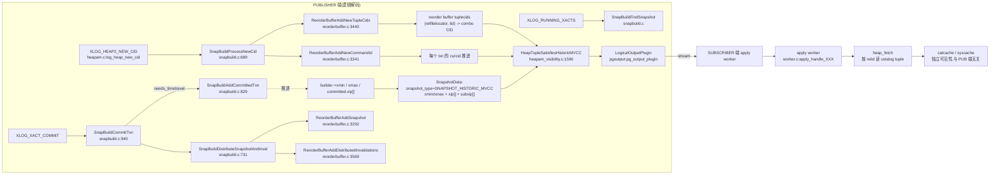
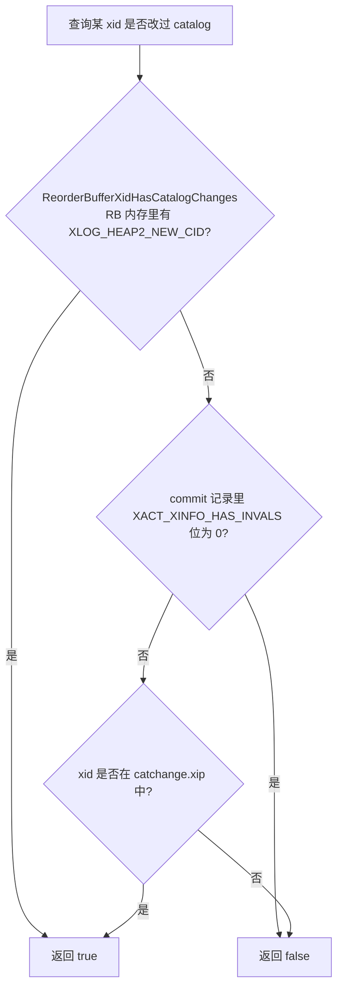
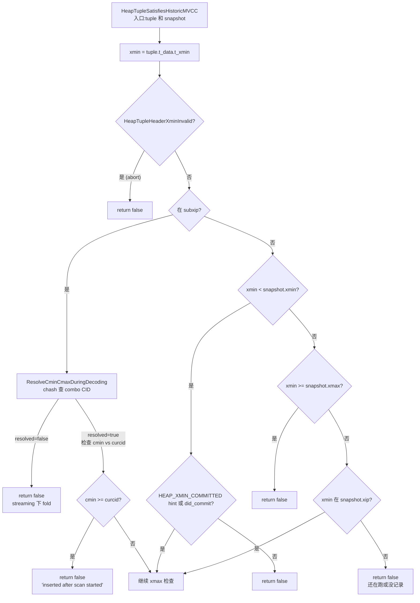
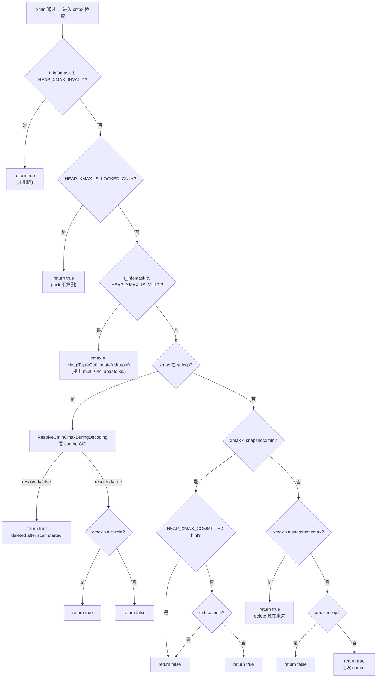
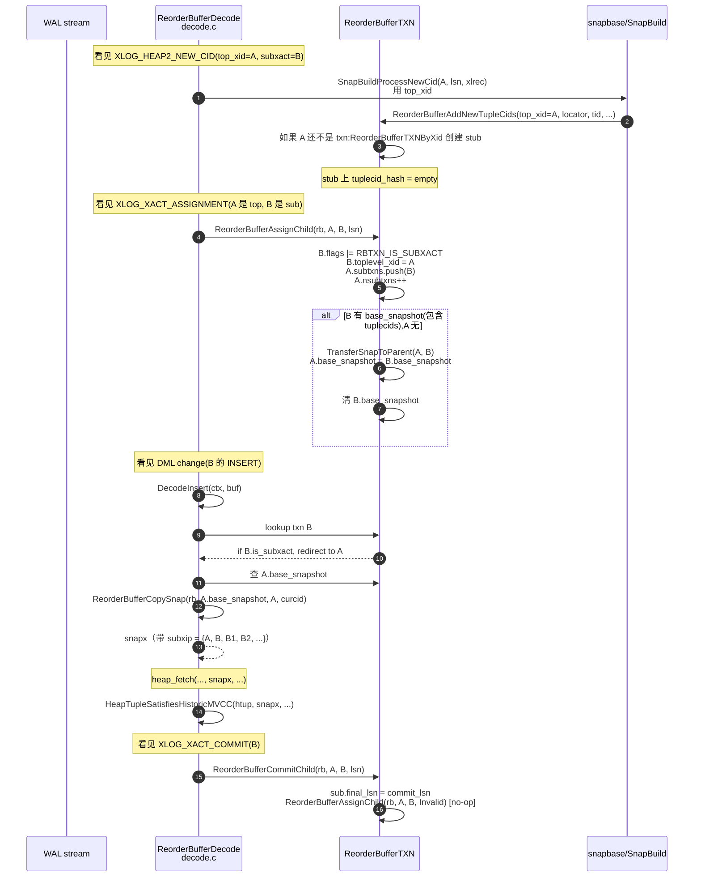

> 之前几篇([end-to-end 全流程](../postgresql-logical-replication-end-to-end/index.md)、[LSN 推进全景](../postgresql-logical-replication-lsn-flow/index.md)、[snapbuild.c 全函数拆解](../postgresql-snapbuild-deep-dive/index.md)、[SnapBuildFindSnapshot 状态机](../postgresql-snapbuild-find-snapshot-deep-dive/index.md))虽然覆盖了入口、状态机和 LSN 推进,但对**catalog 改动如何从 WAL 一路透传到订阅端的可见性判定**这一条核心链路解释得不够细致。本文专门补这一段:
>
> - `xl_heap_new_cid` WAL 记录在哪个函数写、写了什么、在哪里读、读出来后做了什么
> - `SnapBuildProcessNewCid` 把 combo CID 映射怎样喂给 reorder buffer
> - `HeapTupleSatisfiesHistoricMVCC` 与普通 MVCC 的本质区别
> - `SnapBuildDistributeSnapshotAndInval` 的 invalidation 分发链
> - `SnapBuildXidHasCatalogChanges` / `ReorderBufferXidHasCatalogChanges` 的三层 fallback
> - `ReorderBufferCopySnap` 中 `subxip` 与 `subxcnt` 的语义,子事务对可见性的影响
> - `ReorderBufferAssignChild` / `ReorderBufferTransferSnapToParent` 的"快照搬家"
> - 一个完整示例,把 `CREATE TABLE` + `INSERT ... UPDATE` + 多子事务 + 后续 `ALTER TABLE` 串起来,逐个 WAL 逐个函数看可见性怎么被判决

源码全部基于 PostgreSQL 18 仓库 `~/cwork/postgresql/src`(`src/backend/{replication/logical,access/heap,access/transam}`)。所有函数均带 `文件:行号` 标注,辅助图共 9 张。

---

## 目录

1. **阅读指南**
2. **catalog 改动透传的总览架构图**
3. **核心数据结构**:SnapBuild / ReorderBufferTXN / HistoricSnapshot / ReorderBufferTupleCidEnt
4. **xmin / xmax 的推进算法**
   - 4.1 `SnapBuildBuildSnapshot`(snapbuild.c:360)
   - 4.2 `SnapBuildCommitTxn` 的 xmax 推进逻辑(snapbuild.c:940-1072)
   - 4.3 `SnapBuildAddCommittedTxn`(snapbuild.c:829)
5. **NEW_CID 与 combo CID 全链路**
   - 5.1 `xl_heap_new_cid` 的结构与写入(`log_heap_new_cid`,heapam.c:9068)
   - 5.2 `SnapBuildProcessNewCid`(snapbuild.c:689-727)
   - 5.3 `ReorderBufferAddNewTupleCids`(reorderbuffer.c:3440)
   - 5.4 `ReorderBufferAddNewCommandId`(reorderbuffer.c:3341)
   - 5.5 解码时 `ResolveCminCmaxDuringDecoding`(reorderbuffer.c:5527)
   - 5.6 `UpdateLogicalMappings`(reorderbuffer.c:5449)
6. **catalog 改动的判定机制**(系统更判定)
   - 6.1 `SnapBuildXidHasCatalogChanges` 三层 fallback(snapbuild.c:1106)
   - 6.2 `ReorderBufferXidHasCatalogChanges`(reorderbuffer.c:3712)
   - 6.3 `catchange.xip` 与 `builder->committed.xip[]`
   - 6.4 完整流程图
7. **`SnapBuildDistributeSnapshotAndInval` 全链**
   - 7.1 完整流程图
   - 7.2 `ReorderBufferAddSnapshot`(reorderbuffer.c:3292)
   - 7.3 `ReorderBufferGetInvalidations`(reorderbuffer.c:5601)
   - 7.4 `ReorderBufferAddDistributedInvalidations`(reorderbuffer.c:3569)
   - 7.5 为什么"自己不分发 invalidation 给自己"
8. **`HeapTupleSatisfiesHistoricMVCC` 完整判决流程**
   - 8.1 调用入口:`HeapTupleSatisfiesVisibility` 分派(heapam_visibility.c:1773)
   - 8.2 xmin 五大分支
   - 8.3 xmax 五大分支
   - 8.4 与 `HeapTupleSatisfiesMVCC` 的差异对比
   - 8.5 `InHotChain` 与 update chain 隐式传播
9. **`ReorderBufferCopySnap` 与 subxip/subxcnt**(reorderbuffer.c:1908)
   - 9.1 snapshot 分配与拷贝
   - 9.2 `subxip` 的语义:toplevel + 所有子事务
   - 9.3 `curcid` 的推进
10. **子事务分支**:`ReorderBufferAssignChild` / `ReorderBufferTransferSnapToParent`
    - 10.1 `XLOG_XACT_ASSIGNMENT` 解码入口
    - 10.2 `subtxn` 升格到 top 的快照转移(reorderbuffer.c:1146)
11. **事务起点**:如何避免 `MyProc->xmin` 拦截(slot.c / SnapBuildInitialSnapshot)
12. **完整例子**:多事务跨 DDL/DML 的可见性判决全程
13. **常见误读与坑**
14. **源码速查表**
15. **参考**

---

## 一、阅读指南

读完前面 4 篇之后再读这篇会顺畅不少。读者需要知道:

- `wal_level = logical` 时,WAL 多了一个 `XLOG_HEAP2_NEW_CID` 记录类型;正常 MVCC 不写它,**只有 catalog(系统表)增删改才写**
- 逻辑解码用一个 `SnapBuild` 实例维护一组"已提交 catalog 改动"的 xid
- 一旦一个 xid 被识别为 catalog 改动,后续所有"还在解码中"的事务都要收到这个快照/invalidation 消息,否则会用过期 catcache 写错误的事务输出
- 在 PUBLISHER 端,可见性判定用 `SnapshotData.snapshot_type = SNAPSHOT_HISTORIC_MVCC`,路径走 `HeapTupleSatisfiesHistoricMVCC`,跟普通查询用的 `HeapTupleSatisfiesMVCC` 是两个函数,**逻辑不一样**

`-O0 -g` 编译完的 PG 18 路径为 `~/cwork/postgresql/src`,所有引用均为相对路径,如 `snapbuild.c:689` 指该文件第 689 行。


## 二、catalog 改动透传的总览架构图

下面这张图把"catalog 改动从原始 DDL/DML 一路传到订阅端输出"的完整链路拉通,后面的章节都围绕这张图展开。



注意:
- **snapshot 是横向贯穿的**:它一边维持 `committed.xip[]` 推进可见性窗口,一边在每个 in-progress 事务里持有副本(`txn->base_snapshot`),并在赋值时复制为带 subxip 的 `snapshot_now`
- **tuplecids 是竖向贯穿的**:WAL 只在 catalog 写时记,reorder buffer 持有一份 relfilelocator+ctid → combo CID 的映射,解码时查表反解
- **subsubscriber 端的可见性跟 publisher 端完全独立**:apply 端走自己 MVCC,不依赖 publisher snapshot

---

## 三、核心数据结构

### 3.1 `SnapBuild`(snapbuild.c:46-85)

```c
typedef struct SnapBuild
{
    /* wallclock time of building initial snapshot */
    TimestampTz build_time_first_snapshot;
    /* reorder buffer we use */
    ReorderBuffer *reorder;
    MemoryContext context;
    /* state of the builder, see SNAPBUILD_* constants */
    SnapBuildState state;
    /* snapshot currently being built */
    Snapshot snapshot;
    /* LSN of last committed transaction, required for snapshot building */
    XLogRecPtr last_commit;
    /* Snapshot serialization point: determined by last running-xacts record */
    XLogRecPtr next_phase_at;
    /* See SnapBuildXidHasCatalogChanges */
    /* Xids of transactions with catalog changes that we've seen commit */
    TransactionId *catchange_xip;
    int         catchange_xcnt;
    /* Xids of committed transactions that have modified catalogs */
    int         committed_xcnt;
    TransactionId *committed_xip;
    /* Snapshot xmin horizon - minimal xid to keep catalog around */
    TransactionId initial_xmin_horizon;
    /* Snapshot current xmin, all txids < xmin are aborted/committed */
    TransactionId xmin;
    /* Snapshot current xmax, all txids >= xmax are still running */
    TransactionId xmax;
    /* LSN at which the slot's base snapshot was built */
    XLogRecPtr start_decoding_at;
    XLogRecPtr start_lsn;
    /* ... */
} SnapBuild;
```

要点:
- **`committed.xip[]`** 是"已经 commit 的 catalog 改动 xid 列表",**不是正在跑**。在 `SnapBuildBuildSnapshot` 里被复制成 `snapshot->xip`。
- **`xmin`/`xmax`** 是 HVMCC 快照的下/上界,**与 MVCC 快照语义不同**——见 §8。
- **`initial_xmin_horizon`** 是 slot 注册时的 `catalog_xmin`,保证 `pg_class` 等 catalog 行不被 vacuum,直到订阅端追上。

### 3.2 `ReorderBufferTXN` 与快照/无效化字段

```c
typedef struct ReorderBufferTXN
{
    /* linkable list, in order of LSN of first record */
    dlist_node node;
    /* transaction id, top-level only */
    TransactionId xid;
    XLogRecPtr first_lsn;   /* LSN of first record */
    XLogRecPtr last_lsn;    /* LSN of last record (end/commit) */
    dlist_head subtxns;
    int nsubtxns;
    struct ReorderBufferTXN *toptxn;
    /* ... base_snapshot (snapshot ref from snapbuild) ... */
    Snapshot base_snapshot;
    XLogRecPtr base_snapshot_lsn;
    dlist_node base_snapshot_node;  /* in rb->txns_by_base_snapshot_lsn */
    /* the "current" snapshot (copy of base_snapshot with subxip & curcid filled) */
    Snapshot snapshot_now;
    /* the curcid last assigned by AddNewCommandId */
    CommandId curcid_next;
    /* tuplecids of inserted/replaced/updeleted catalog tuples */
    HTAB *tuplecid_hash;
    /* flag: txn contains catalog change (read from rb->txn_flags) */
    uint8 txn_flags;
    /* dlist of invalidation msgs pending */
    dlist_head invalidation_msgs;
    /* ... */
} ReorderBufferTXN;
```

关键字段:
- `base_snapshot` 由 `ReorderBufferSetBaseSnapshot` 设置(= `SnapBuildCommitTxn` 或 `SnapBuildProcessChange` 触发);指向 `SnapBuild` 持有的同一份 `Snapshot`(refcount +1)
- `snapshot_now` 是 base_snapshot 的私有化拷贝,subxip + curcid 填充完专属本事务;在 `ReorderBufferCopySnap` 构造
- `txn_flags & RBTXN_HAS_CATALOG_CHANGES` 由 `ReorderBufferXidSetCatalogChanges` 在 `SnapBuildProcessNewCid` 中置位

### 3.3 `ReorderBufferTupleCidEnt`(reorderbuffer.c 内部)

```c
typedef struct ReorderBufferTupleCidEnt
{
    ReorderBufferTupleCidKey key;   /* rlocator + tid */
    CommandId    cmin;
    CommandId    cmax;
    CommandId    combocid;
} ReorderBufferTupleCidEnt;
```

哈希键用 `RelFileLocator + ItemPointerData`。每个 catalog 写入(INSERT/UPDATE/DELETE)产生一条 NEW_CID 记录,在这里映射为 tuple 的 combo CID。**该哈希只在 toplevel transaction 上持有**;子事务通过 `ReorderBufferAssignChild` 提升时合并到父 txn。

### 3.4 `HistoricSnapshot` 概念

PG 里 `SnapshotData.snapshot_type` 枚举为:

```
SNAPSHOT_MVCC           - 普通 MVCC(SELECT)
SNAPSHOT_SELF           - 自己刚 INSERT 的可见
SNAPSHOT_ANY            - 忽略可见性
SNAPSHOT_TOAST          - TOAST 内部
SNAPSHOT_DIRTY          - vacuum 并发读已删除未 purge
SNAPSHOT_HISTORIC_MVCC  - 逻辑解码专用 ★
SNAPSHOT_NON_VACUUMABLE - pg_dump
```

进入 `HeapTupleSatisfiesMVCC` 的入口分流在 `HeapTupleSatisfiesVisibility`(heapam_visibility.c:1773):`case SNAPSHOT_HISTORIC_MVCC: return HeapTupleSatisfiesHistoricMVCC(...)`。本篇其余章节涉及的"快照"若无特别说明,皆指 HVMCC 这种。


## 四、xmin / xmax 的推进算法

这一节解决两个问题:
1. `xmin` 是怎么算出来的、用作什么
2. 一次 commit 怎样把 `xmax` 推高

注意此处的 xmin/xmax **与普通 MVCC 的同名字段含义并不完全等价**,要按"逻辑解码专用"语义理解:
- 普通 MVCC 的 `xmin` = "本次扫描开始时已在跑的最大 xid + 1";保证 `xid < xmin` 的事务对本次扫描**已完成**(commit 或 abort)
- HVMCC 的 `xmin` = `initial_xmin_horizon`,在 `SnapBuildInitialSnapshot` 把它定为"slot 创建时的 running xacts 里**最小的运行中 xid**"——保证 `xid < xmin` 的事务早已 commit 或 abort,它们的 catalog 改动在 PG 内部已经稳定可见

`xmax` 在两种快照里语义接近:都表示"尚在跑的最大 xid + 1"。

### 4.1 `SnapBuildBuildSnapshot`(snapbuild.c:360-436)

```c
static Snapshot
SnapBuildBuildSnapshot(SnapBuild *builder)
{
    Snapshot snapshot;
    Size ssize;

    Assert(builder->state >= SNAPBUILD_FULL_SNAPSHOT);

    ssize = sizeof(SnapshotData)
        + sizeof(TransactionId) * builder->committed.xcnt
        + sizeof(TransactionId) * 1 /* toplevel xid */ ;

    snapshot = MemoryContextAllocZero(builder->context, ssize);
    snapshot->snapshot_type = SNAPSHOT_HISTORIC_MVCC;

    snapshot->xmin = builder->xmin;
    snapshot->xmax = builder->xmax;

    snapshot->xip = (TransactionId *)((char *)snapshot + sizeof(SnapshotData));
    snapshot->xcnt = builder->committed.xcnt;
    memcpy(snapshot->xip,
           builder->committed.xip,
           builder->committed.xcnt * sizeof(TransactionId));
    qsort(snapshot->xip, snapshot->xcnt, sizeof(TransactionId), xidComparator);

    /* initially, subxip empty (only txn touching catalog needs it) */
    snapshot->subxcnt = 0;
    snapshot->subxip  = NULL;

    snapshot->suboverflowed = false;
    snapshot->takenDuringRecovery = false;
    snapshot->copied   = false;
    snapshot->curcid   = FirstCommandId;
    snapshot->active_count  = 0;
    snapshot->regd_count    = 0;
    snapshot->snapXactCompletionCount = 0;

    return snapshot;
}
```

要点:
- **不使用 subxip** —— 因为 snapshot 本身没有"自己"的概念。在 `ReorderBufferCopySnap` 里会把 subxip 填到自己的副本里。
- `xmin/xmax` 直接来自 builder,即 slot 在 BUILDING_SNAPSHOT 阶段被 xl_running_xacts 锁定的最早在跑 xid 与最晚 xid + 1
- **`qsort(xip)[]`** 后用 `bsearch` 查询,O(log n)
- 每产一个新 commit 调一次 `SnapBuildBuildSnapshot`,**老 snapshot 进入 refcount 退出链**(到 txn 全部 commit 后才释放)

### 4.2 `SnapBuildCommitTxn` 的 xmax 推进(snapbuild.c:940-1072)

```c
void
SnapBuildCommitTxn(SnapBuild *builder, XLogRecPtr lsn, TransactionId xid,
                   int nsubxacts, TransactionId *subxacts, uint32 xinfo)
{
    int nxact;
    bool needs_snapshot = false;
    bool needs_timetravel = false;
    bool sub_needs_timetravel = false;
    TransactionId xmax = xid;          /* start at top xid */
    ...
    /* 在 SNAPBUILD_START 阶段直接抬 start_decoding_at 然后返回 */
    if (builder->state == SNAPBUILD_START ||
        (builder->state == SNAPBUILD_BUILDING_SNAPSHOT &&
         TransactionIdPrecedes(xid, builder->next_phase_at)))
    {
        if (builder->start_decoding_at <= lsn)
            builder->start_decoding_at = lsn + 1;
        return;
    }

    for (nxact = 0; nxact < nsubxacts; nxact++)
    {
        TransactionId subxid = subxacts[nxact];
        if (SnapBuildXidHasCatalogChanges(builder, subxid, xinfo))
        {
            sub_needs_timetravel = true;
            needs_snapshot = true;
            SnapBuildAddCommittedTxn(builder, subxid);
            if (NormalTransactionIdFollows(subxid, xmax))
                xmax = subxid;
        }
        else if (needs_timetravel)
        {
            /* 子事务无 catalog 改动,但需要按 timetravel 可见 */
            SnapBuildAddCommittedTxn(builder, subxid);
            if (NormalTransactionIdFollows(subxid, xmax))
                xmax = subxid;
        }
    }

    if (SnapBuildXidHasCatalogChanges(builder, xid, xinfo))
    {
        needs_snapshot = true;
        needs_timetravel = true;
        SnapBuildAddCommittedTxn(builder, xid);
    }
    else if (sub_needs_timetravel)
    {
        /* 子事务有 catalog 改动,父 txn 也强制加 timetravel */
        needs_timetravel = true;
        SnapBuildAddCommittedTxn(builder, xid);
    }
    else if (needs_timetravel)
    {
        SnapBuildAddCommittedTxn(builder, xid);
    }

    if (!needs_timetravel)
        builder->committed.includes_all_transactions = false;

    /* ★ 关键:仅当本事务有 catalog 改动,才推 xmax */
    if (needs_timetravel &&
        (!TransactionIdIsValid(builder->xmax) ||
         TransactionIdFollowsOrEquals(xmax, builder->xmax)))
    {
        builder->xmax = xmax;
        TransactionIdAdvance(builder->xmax);
    }

    if (needs_snapshot)
    {
        if (builder->state < SNAPBUILD_FULL_SNAPSHOT)
            return;
        if (builder->snapshot)
            SnapBuildSnapDecRefcount(builder->snapshot);
        builder->snapshot = SnapBuildBuildSnapshot(builder);

        /* 给自己的 base snapshot */
        if (!ReorderBufferXidHasBaseSnapshot(builder->reorder, xid))
        {
            SnapBuildSnapIncRefcount(builder->snapshot);
            ReorderBufferSetBaseSnapshot(builder->reorder, xid, lsn,
                                         builder->snapshot);
        }
        SnapBuildSnapIncRefcount(builder->snapshot); /* 给 builder 自己 */

        SnapBuildDistributeSnapshotAndInval(builder, lsn, xid);
    }
}
```

要点图解:

```mermaid
flowchart TD
    A[XLOG_XACT_COMMIT 到达] --> B{state &lt; BUILDING_SNAPSHOT?}
    B --是--> B1[start_decoding_at = lsn+1<br/>return]
    B --否--> C[遍历所有 subxact]
    C --> D{sb_xid_has_catalog?}
    D --是--> D1[needs_snapshot=true<br/>AddCommitted<br/>xmax = max(xmax, subxid)]
    D --否,且 needs_timetravel--> D2[AddCommitted<br/>xmax = max(xmax, subxid)]
    D --否--> S[继续下个 subxact]
    C --> E[检查 top xid 本身]
    E --> F{top 改过 catalog?}
    F --是--> F1[needs_snapshot=true<br/>needs_timetravel=true<br/>AddCommitted]
    F --否,且 sub_needs_timetravel--> F2[needs_timetravel=true<br/>AddCommitted]
    F --否,且 needs_timetravel--> F3[AddCommitted]
    F --否--> F4[committed.includes_all_transactions=false]
    E --> G{needs_timetravel 且 xmax &gt;= builder.xmax?}
    G --是--> G1[builder.xmax = xmax + 1<br/>TransactionIdAdvance]
    G --否--> NOOP
    G1 --> H{needs_snapshot?}
    H --否--> END[return]
    H --是--> I{state &lt; FULL_SNAPSHOT?}
    I --是--> END
    I --否--> J[builder.snapshot = BuildSnapshot]
    J --> K[给当前 xid 配 base_snapshot]
    K --> L[DistributeSnapshotAndInval]
```

**核心结论(常被误读)**:
- `needs_snapshot = true` iff 需要给其他进行中事务重新分配 base snapshot —— 同时意味着要 *刷* 这个事务自己的引用
- **`builder->xmax` 仅在 needs_timetravel 时推进**。普通事务(没碰 catalog、没碰子事务碰 catalog、自己也没被强制 timetravel)的 commit **不会** 推 xmax
- `xmax = xid + 1`(`TransactionIdAdvance`)—— 即 `xmax` 是"目前在跑的最大 xid 的下一个",等价 `TransactionIdFollowsOrEquals(xmax, builder->xmax)`
- `includes_all_transactions = false` 是给 `pg_dump` 风格的"导出快照"准备的,意谓"某次 submit 后我已经不再跟踪非 catalog 改动的事务",**`pg_export_snapshot` 客户端可用性**会因此调整

### 4.3 `SnapBuildAddCommittedTxn`(snapbuild.c:829-860)

```c
static void
SnapBuildAddCommittedTxn(SnapBuild *builder, TransactionId xid)
{
    if (builder->committed.xcnt + 1 >= builder->committed.xcnt_capacity)
    {
        builder->committed.xcnt_capacity *= 2;
        builder->committed.xip = repalloc(builder->committed.xip,
            builder->committed.xcnt_capacity * sizeof(TransactionId));
    }
    builder->committed.xip[builder->committed.xcnt++] = xid;
    /* 调用方后续走 qsort */
}
```

增长策略:`xcnt_capacity *= 2`,从初始 `2` 起步。**不做排重**——同一 xid 被多次调用会塞多个位置;但因调用只在 commit 阶段、每次 commit 仅一次,实际无重复。


## 五、NEW_CID 与 combo CID 全链路

这是前几篇没讲透彻的关键路径。理解这一节后,组合 CID 与 cmin/cmax 的关系才能彻底清楚。

### 5.1 `xl_heap_new_cid` 的结构与写入

**WAL 记录结构**(`include/access/heapam_xlog.h:452-468`):

```c
typedef struct xl_heap_new_cid
{
    TransactionId top_xid;        /* 顶层事务 xid(解码时锚定 toplevel txn) */
    CommandId   cmin;
    CommandId   cmax;
    CommandId   combocid;        /* 仅调试用 */
    RelFileLocator target_locator; /* (db, tablespace, relfilenode) */
    ItemPointerData target_tid;    /* 块内偏移 */
} xl_heap_new_cid;

#define SizeOfHeapNewCid (offsetof(xl_heap_new_cid, target_tid) \
                          + sizeof(ItemPointerData))
```

**写入路径**(`access/heap/heapam.c:9068-9120` `log_heap_new_cid`):

```c
static XLogRecPtr
log_heap_new_cid(Relation relation, HeapTuple tup)
{
    xl_heap_new_cid xlrec;
    XLogRecPtr recptr;
    HeapTupleHeader hdr = tup->t_data;

    Assert(ItemPointerIsValid(&tup->t_self));
    Assert(tup->t_tableOid != InvalidOid);

    xlrec.top_xid = GetTopTransactionId();
    xlrec.target_locator = relation->rd_locator;
    xlrec.target_tid = tup->t_self;

    if (hdr->t_infomask & HEAP_COMBOCID)
    {
        Assert(!HeapTupleHeaderXminInvalid(hdr));
        xlrec.cmin = HeapTupleHeaderGetCmin(hdr);
        xlrec.cmax = HeapTupleHeaderGetCmax(hdr);
        xlrec.combocid = HeapTupleHeaderGetRawCommandId(hdr);
    }
    else
    {
        if (hdr->t_infomask & HEAP_XMAX_INVALID ||
            HEAP_XMAX_IS_LOCKED_ONLY(hdr->t_infomask))
        {
            xlrec.cmin = HeapTupleHeaderGetRawCommandId(hdr);
            xlrec.cmax = InvalidCommandId;
        }
        else
        {
            xlrec.cmin = InvalidCommandId;
            xlrec.cmax = HeapTupleHeaderGetRawCommandId(hdr);
        }
        xlrec.combocid = InvalidCommandId;
    }

    XLogBeginInsert();
    XLogRegisterData((char *)&xlrec, SizeOfHeapNewCid);
    recptr = XLogInsert(RM_HEAP2_ID, XLOG_HEAP2_NEW_CID);

    return recptr;
}
```

触发点:**只有 catalog tuple 的 INSERT/UPDATE/DELETE**(在 `heap_insert`/`heap_update`/`heap_delete` 内部通过 `needs_toast` 与 `IsCatalogRelation(relation)` 判断)。普通表的 DML 不会写 NEW_CID。

### 5.2 `SnapBuildProcessNewCid`(snapbuild.c:689-727)

解码端入口(被 `DecodeHeap2Op` 通过 `xl_heap_new_cid` 注册回调):

```c
void
SnapBuildProcessNewCid(SnapBuild *builder, TransactionId xid,
                       XLogRecPtr lsn, xl_heap_new_cid *xlrec)
{
    /* 标记该 txn 改了 catalog */
    ReorderBufferXidSetCatalogChanges(builder->reorder, xid, lsn);

    /* 把 combo CID 映射纳入 reorder buffer */
    ReorderBufferAddNewTupleCids(builder->reorder,
                                 xlrec->top_xid, lsn,
                                 xlrec->target_locator, xlrec->target_tid,
                                 xlrec->cmin, xlrec->cmax,
                                 xlrec->combocid);

    CommandId cid;
    if (xlrec->cmin != InvalidCommandId && xlrec->cmax != InvalidCommandId)
        cid = Max(xlrec->cmin, xlrec->cmax);
    else if (xlrec->cmax != InvalidCommandId)
        cid = xlrec->cmax;
    else if (xlrec->cmin != InvalidCommandId)
        cid = xlrec->cmin;
    else
        elog(ERROR, "xl_heap_new_cid record without a valid CommandId");

    /* 通知 reorder buffer:curcid 至少要推进到 cid + 1 */
    ReorderBufferAddNewCommandId(builder->reorder, xid, lsn, cid + 1);
}
```

注意:
- `top_xid` 来自 WAL,而 `xid` 是当前被识别的 toplevel(可能是 subxact 的父)。**所有 tuplecids 都按 top_xid 索引**,避免不同事务 combo CID 混用
- `cmin/cmax` 在 `HeapTupleSatisfiesHistoricMVCC` 里被反解(`ResolveCminCmaxDuringDecoding` 见 §5.5)
- 同一行可能被同一个 xid 多次写 NEW_CID(combo CID 多次复用),每次都覆写映射

### 5.3 `ReorderBufferAddNewTupleCids`(reorderbuffer.c:3440)

```c
void
ReorderBufferAddNewTupleCids(ReorderBuffer *rb, TransactionId top_xid,
                             XLogRecPtr lsn, RelFileLocator locator,
                             ItemPointerData tid, CommandId cmin,
                             CommandId cmax, CommandId combocid)
{
    ReorderBufferTXN *txn;
    bool new_top;
    ReorderBufferTupleCidKey key;
    ReorderBufferTupleCidEnt *ent;
    bool found;

    /* 用 top_xid 在 reorder buffer 取/建一个 txn */
    txn = ReorderBufferTXNByXid(rb, top_xid, true, &new_top, lsn, true);
    if (new_top)
    {
        txn->tuplecid_hash = tuplecids_hashinit(rb->context);
        txn->tuplecid_nkeys = 0;
    }

    /* 哈希键为 (relfilelocator + ItemPointerData) */
    memset(&key, 0, sizeof(key));
    key.rlocator = locator;
    memcpy(&key.tid, &tid, sizeof(ItemPointerData));

    ent = hash_search(txn->tuplecid_hash, &key, HASH_ENTER, &found);
    ent->cmin = cmin;
    ent->cmax = cmax;
    ent->combocid = combocid;
    if (!found)
        txn->tuplecid_nkeys++;
}
```

要点:
- **每 toplevel xid 一个哈希**(`txn->tuplecid_hash`),combo CID 跟"哪一行 什么 cmin/cmax"绑定
- 如果 top_xid 还没在 reorder buffer 里,会**新建一个 stub txn**(只是注册 xid 占位,等日后看到 commit/change 再关联)
- 哈希装载的键是 **(rlocator, tid)**——这是为了应对 `VACUUM FULL` / `ALTER TABLE` 类可能造成 relfilenode 变更的情况(见 §5.6)

### 5.4 `ReorderBufferAddNewCommandId`(reorderbuffer.c:3341)

```c
void
ReorderBufferAddNewCommandId(ReorderBuffer *rb, TransactionId xid,
                             XLogRecPtr lsn, CommandId cid)
{
    ReorderBufferChange *change = ReorderBufferAllocChange(rb);
    change->data.command_id = cid;
    change->action = REORDER_BUFFER_CHANGE_INTERNAL_COMMAND_ID;
    ReorderBufferQueueChange(rb, xid, lsn, change, false);
}
```

这是把 `curcid` 推进嵌入到 **reorder buffer 的 change queue**:所有后续 DML change 在被解码输出时,会取到当前的 curcid,并在 `HeapTupleSatisfiesHistoricMVCC` 里用 `cmax >= curcid → 仍可见`做判定

### 5.5 解码时 `ResolveCminCmaxDuringDecoding`(reorderbuffer.c:5527-5604)

解码到一条 INSERT/UPDATE/DELETE 时,需要回填被记录为 combo CID 的真实 cmin/cmax。这是反解函数:

```c
bool
ResolveCminCmaxDuringDecoding(HTAB *tuplecid_data,
                              Snapshot snapshot,
                              HeapTuple htup, Buffer buffer,
                              CommandId *cmin, CommandId *cmax)
{
    ReorderBufferTupleCidKey key;
    ReorderBufferTupleCidEnt *ent;
    ForkNumber forkno;
    BlockNumber blockno;
    bool updated_mapping = false;

    if (tuplecid_data == NULL)
        return false;  /* streaming 模式里 tuplecid_data 还没建好 */

    memset(&key, 0, sizeof(key));
    BufferGetTag(buffer, &key.rlocator, &forkno, &blockno);

    Assert(forkno == MAIN_FORKNUM);
    Assert(blockno == ItemPointerGetBlockNumber(&htup->t_self));
    ItemPointerCopy(&htup->t_self, &key.tid);

restart:
    ent = hash_search(tuplecid_data, &key, HASH_FIND, NULL);

    /* 第一次找不到,可能是 VACUUM FULL 改了 relfilenode */
    if (ent == NULL && !updated_mapping)
    {
        UpdateLogicalMappings(tuplecid_data, htup->t_tableOid, snapshot);
        updated_mapping = true;
        goto restart;
    }
    else if (ent == NULL)
        return false;

    if (cmin) *cmin = ent->cmin;
    if (cmax) *cmax = ent->cmax;
    return true;
}
```

注意 `tuplecid_data` 来自 **`HistoricSnapshotGetTupleCids()`**(在 heapam_visibility.c:1639-1641):在 BUILDING_SNAPSHOT 期间由 `SnapBuild` 注入的全局指针。Streaming 模式下,**`tuplecid_data` 尚未建立,直接返回 `false`**,函数语义是"还没解码到 combo CID,先按不可见处理";`HeapTupleSatisfiesHistoricMVCC` 配合使用——见 §8.2。

### 5.6 `UpdateLogicalMappings`(reorderbuffer.c:5449-5490)

```c
static void
UpdateLogicalMappings(HTAB *tuplecid_data, Oid relid, Snapshot snapshot)
{
    LogicalRewriteMappingData *map;
    Oid       oid;
    RelFileLocator rlocator;
    HTAB     *tuplecid_by_loc;
    int       i;

    map = _LogicalRewriteMapping_find_safe(relid);

    /* 没有任何 rewrite 记录则放弃(常见) */
    if (map == NULL)
        return;
    ...
}
```

这是当 `ALTER TABLE`/`VACUUM FULL` 让 OID → relfilenode 重新映射时,从磁盘上的 `pg_class` 读历史重写映射(`RelationMapFil`,`pg_rewrite_mapping` 表)来更新 `tuplecid_data`。跟这一节配套的有:
- `pgClassHistoricSnapshot`/`RelationMapFil` 这两张 catalog 的 ISC 快照入口
- `xid_in_recent_past` 检查确保不会读到未来 xid 的 mapping

调用一次 `UpdateLogicalMappings` 后第二次找不到就说明确实没有映射,直接返回 false。


## 六、catalog 改动的判定机制(系统更判定)

这一节讲"如何认定一个事务改了 catalog",因为是 HVMCC 快照语义以及 invalidation 分发链的开关。

### 6.1 `SnapBuildXidHasCatalogChanges` 三层 fallback(snapbuild.c:1106-1124)

```c
static inline bool
SnapBuildXidHasCatalogChanges(SnapBuild *builder, TransactionId xid,
                              uint32 xinfo)
{
    if (ReorderBufferXidHasCatalogChanges(builder->reorder, xid))
        return true;          /* path 1: 从 WAL 解码出 NEW_CID 已知 */

    if (!(xinfo & XACT_XINFO_HAS_INVALS))
        return false;         /* fast path 2: commit 记录里没有 invalidation 信息 → 一定没改 */

    return ((builder->catchange.xcnt > 0) &&
            (bsearch(&xid, builder->catchange.xip, builder->catchange.xcnt,
                     sizeof(TransactionId), xidComparator) != NULL));
    /* path 3: 从磁盘恢复时,catchange 表里命中 */
}
```

三层优先级:



**为什么需要 fallback**:
- **path 1** 用于 WAL 在线流。`SnapBuildProcessNewCid` 见到 NEW_CID 就 `ReorderBufferXidSetCatalogChanges`,在内存里盖戳
- **path 2 优化**:若 commit 记录的 `xinfo` 标志位没置 `XACT_XINFO_HAS_INVALS`,说明提交语句没生成 `CacheInvalidateHeapTuple`,可以肯定没改 catalog(注意这**只在当前 WAL 记录里看了**,若该 txn 是 subxact,且父改 catalog,要看父)
- **path 3** 用于断点重启。`builder->catchange.xip` 是启动后从最近的一个 `xl_running_xacts` 序列化下来的 xid 列表,commit 记录已经"脱离 live buffer 状态"时用这个 bsearch 兜底

### 6.2 `ReorderBufferXidHasCatalogChanges`(reorderbuffer.c:3712-3732)

```c
bool
ReorderBufferXidHasCatalogChanges(ReorderBuffer *rb, TransactionId xid)
{
    ReorderBufferTXN *txn;
    bool new_top;

    /* 找不到 stub 都没建 → 一定没 catalog 改动 */
    txn = ReorderBufferTXNByXid(rb, xid, false, &new_top,
                               InvalidXLogRecPtr, false);
    if (txn == NULL)
        return false;
    else if (rbtxn_is_known_subxact(txn))
        txn = ReorderBufferTXNByXid(rb, txn->toplevel_xid,
                                    false, NULL, InvalidXLogRecPtr, false);

    return (txn->txn_flags & RBTXN_HAS_CATALOG_CHANGES) != 0;
}
```

注意 "假命中" 处理:
- 若 txn 本身是 subxact 且 rb 里**父 txn 还没建**(只有 stub),会返回 false——这一阵风错过可能要在线索 hba 上追查
- `txn_flags` 是个 bitmask,set/clear 常见组合:
  - `RBTXN_HAS_CATALOG_CHANGES` 本节关心的
  - `RBTXN_IS_SUBXACT` 由 ReorderBufferAssignChild 置位
  - `RBTXN_HAS_STREAMABLE_CHANGE` 与 streaming 有关

### 6.3 `catchange.xip` 与 `builder->committed.xip[]`

```c
/* 在 SnapBuild.find_snapshot 中: */
builder->catchange.xip = /* 从 xl_running_xacts->xip 重建 */
builder->catchange.xcnt = /* 同上 */
```

两张"已 catalog 改动 xid 列表"的区别:

| 字段 | 来源 | 用途 | 时机 |
|---|---|---|---|
| `catchange.xip[]` | xl_running_xacts 序列化的 xids | commit **已经过期**查 reorder buffer 没结果时兜底 | 启动后第一次 CONSISTENT 时填充 |
| `committed.xip[]` | `SnapBuildAddCommittedTxn` 累积 | 喂给 `SnapBuildBuildSnapshot.snapshot->xip` | BUILDING_SNAPSHOT 后续每次有 catalog commit 时累加 |

简而言之:
- **`committed.xip` 是"已提交且正在被跟踪的 catalog 改动 xids"** —— 是 snapshot 的 xip 直接数据源
- **`catchange.xip` 是"启动时序"** —— 用于老 WAL 的 offline replay 后还能识别已提交 catalog 改动
- 二者**不互相更新**;但 xip 数据本身可以重叠(同一些 xid 在两边都被记录)

### 6.4 完整流程图(从 WAL → xip 标记)

```mermaid
sequenceDiagram
    autonumber
    participant Heap as heap_insert/update/delete<br/>heapam.c
    participant WAL as WAL 缓冲
    participant Decode as DecodeHeap2Op / DecodeHeap<br/>decode.c
    participant SB as SnapBuild
    participant RB as ReorderBuffer

    Heap->>WAL: IsCatalogRelation && wal_level=logical?<br/>XLogInsert(XLOG_HEAP2_NEW_CID)
    WAL-->>Decode: 每条 XLOG_HEAP2_NEW_CID
    Decode->>SB: SnapBuildProcessNewCid(builder, xid, lsn, xlrec)
    SB->>RB: ReorderBufferXidSetCatalogChanges(rb, xid, lsn)
    RB->>RB: 取/建 stub txn;txn_flags |= RBTXN_HAS_CATALOG_CHANGES
    SB->>RB: ReorderBufferAddNewTupleCids(... top_xid, locator, tid, cmin, cmax, combocid)
    RB->>RB: 新建/更新 txn->tuplecid_hash[(locator,tid)] = (cmin,cmax,combocid)
    SB->>RB: ReorderBufferAddNewCommandId(rb, xid, lsn, max(cmin,cmax)+1)
    RB->>RB: 排入 change 队列:INTERNAL_COMMAND_ID

    Note over Heap,WAL: 后某时:<br/>XLOG_XACT_COMMIT 带着 xinfo (maybe XACT_XINFO_HAS_INVALS)
    WAL-->>Decode: COMMIT 记录<br/>(commit+inval+subxacts+xinfo)
    Decode->>SB: SnapBuildCommitTxn(builder, lsn, xid, nsubxacts, subxacts, xinfo)
    SB->>SB: for sub in subxacts:<br/>SnapBuildXidHasCatalogChanges(sb, sub, xinfo)
    SB->>SB: for top: SnapBuildXidHasCatalogChanges(sb, xid, xinfo)
    alt 三层中任一为真
        SB->>SB: needs_snapshot = true<br/>needs_timetravel = true
        SB->>SB: SnapBuildAddCommittedTxn(xid) → committed.xip[]
        SB->>SB: builder.xmax = max(xmax, xid) + 1
        SB->>SB: builder.snapshot = SnapBuildBuildSnapshot(builder)
        SB->>RB: ReorderBufferSetBaseSnapshot(rb, xid, lsn, snapshot)
        SB->>SB: SnapBuildDistributeSnapshotAndInval(builder, lsn, xid)
    else 三层都 false
        SB->>SB: builder.committed.includes_all_transactions = false
    end
```


## 七、`SnapBuildDistributeSnapshotAndInval` 全链

这一节给出完整的"分发 + invalidation" 逻辑链,涵盖它经过的每个子函数。

### 7.1 完整流程图

```mermaid
flowchart TD
    A[SnapBuildDistributeSnapshotAndInval<br/>snapbuild.c:731] --> B["dlist_foreach on builder.reorder.toplevel_by_lsn"]
    B --> C{ReorderBufferXidHasBaseSnapshot<br/>txn.xid?}
    C --否--> C1[continue<br/>还没开始的事务:无 snapshot 分发]
    C --是--> D{rbtxn_is_prepared?}
    D --是--> D1[continue<br/>prepared 不应见新 catalog]
    D --否--> E[elog DEBUG2]
    E --> F["SnapBuildSnapIncRefcount(builder.snapshot)"]
    F --> G["ReorderBufferAddSnapshot(reorder, txn.xid, lsn, snapshot)"]
    G --> H{txn.xid == xid(本次提交者)?}
    H --是--> I[结束本轮<br/>已 commit 的事务不需要再收]
    H --否--> J["ReorderBufferGetInvalidations(reorder, xid, &msgs)"]
    J --> K{ninvalidations &gt; 0?}
    K --否--> I
    K --是--> L["ReorderBufferAddDistributedInvalidations(reorder, txn.xid, lsn, n, msgs)"]
    L --> I
```

### 7.2 `ReorderBufferAddSnapshot`(reorderbuffer.c:3292-3303)

```c
void
ReorderBufferAddSnapshot(ReorderBuffer *rb, TransactionId xid,
                         XLogRecPtr lsn, Snapshot snap)
{
    ReorderBufferChange *change = ReorderBufferAllocChange(rb);
    change->data.snapshot = snap;
    change->action = REORDER_BUFFER_CHANGE_INTERNAL_SNAPSHOT;
    ReorderBufferQueueChange(rb, xid, lsn, change, false);
}
```

实现极简:把 snapshot **引用**塞进该 xid 的 change queue,`INTERNAL_SNAPSHOT` 在调用 `ReorderBufferTXNByXid` 之后由 `ReorderBufferReplay` 消费(详见 §7.5 末尾)。**注意这里把 snap 作为引用借给 txn** —— 真正的 base_snapshot 设置在上一句 `ReorderBufferSetBaseSnapshot` 已经发生过(由 `SnapBuildCommitTxn` 自己触发),这里走的是 `DistributeSnapshot` 这一支把 snapshot + invalidation 都分发给 *其他* 进行中事务。

但是看代码会发现本函数的实际调用者是 `SnapBuildDistributeSnapshotAndInval`,它先用了 `SnapBuildSnapIncRefcount(builder->snapshot)` 然后调 `ReorderBufferAddSnapshot`.然后调 `ReorderBufferGetInvalidations` 拿到本次提交 *产生* 的 invalidation messages。这两次操作**互补地工作**:`AddSnapshot` 只是为了在 txn 的 change queue 里放一个断点,应用 `ChangeCB` 时可以重建 `snapshot_now`。

### 7.3 `ReorderBufferGetInvalidations`(reorderbuffer.c:5601-5630)

```c
uint32
ReorderBufferGetInvalidations(ReorderBuffer *rb, TransactionId xid,
                              SharedInvalidationMessage **msgs)
{
    ReorderBufferTXN *txn;
    ReorderBufferInvalidationMessage *msg;
    uint32 cnt = 0;
    uint32 i = 0;

    txn = ReorderBufferTXNByXid(rb, xid, false, NULL,
                                InvalidXLogRecPtr, false);
    if (txn == NULL)
    {
        *msgs = NULL;
        return 0;
    }

    /* 数个数;把 dlist 转成连续数组 */
    dlist_foreach(iter, &txn->invalidation_msgs)
    {
        msg = dlist_container(ReorderBufferInvalidationMessage, node, iter.cur);
        cnt++;
    }

    if (cnt == 0)
    {
        *msgs = NULL;
        return 0;
    }

    *msgs = palloc(sizeof(SharedInvalidationMessage) * cnt);
    dlist_foreach(iter, &txn->invalidation_msgs)
    {
        msg = dlist_container(ReorderBufferInvalidationMessage, node, iter.cur);
        memcpy(*msgs[i], &msg->msg, sizeof(SharedInvalidationMessage));
        i++;
    }
    return cnt;
}
```

注意**两种 "invalidation" 来源的区分**:
- `txn->invalidation_msgs` —— 本事务在 commit 时塞进 WAL 的 invals
- distributed invalidations 是后续 dist 的对象

### 7.4 `ReorderBufferAddDistributedInvalidations`(reorderbuffer.c:3569-3640)

```c
void
ReorderBufferAddDistributedInvalidations(ReorderBuffer *rb, TransactionId xid,
                                         XLogRecPtr lsn, uint32 nmsgs,
                                         SharedInvalidationMessage *msgs)
{
    ReorderBufferTXN *txn;
    ReorderBufferChange *change;
    bool is_new;

    txn = ReorderBufferTXNByXid(rb, xid, true, &is_new, lsn, true);

    change = ReorderBufferAllocChange(rb);
    change->action = REORDER_BUFFER_CHANGE_INVALIDATION;
    change->data.inval.ninvalidations = nmsgs;
    change->data.inval.invalidations  = /* copy of SharedInvalidationMessage array */;

    ReorderBufferQueueChange(rb, xid, lsn, change, false);
}
```

`INTERNAL_SNAPSHOT` 与 `INVALIDATION` 两种 change type 都被排到 txn change queue 的尾部。**`output_plugin` 通过事务 stream 重新构建出 catcache**:即,apply 端在拿到 `INVALIDATION` change 时,执行 `CacheInvalidateHeapTuple`(或类似)清掉自己 catcache 条目,然后下一条以新 snnapshot 重新读

### 7.5 为什么"自己不分发 invalidation 给自己"

解释核心在 snapbuild.c:784-797 的注释块:

```c
/*
 * Add invalidation messages to the reorder buffer of in-progress
 * transactions except the current committed transaction, for which we
 * will execute invalidations at the end.
 *
 * It is required, otherwise, we will end up using the stale catcache
 * contents built by the current transaction even after its decoding,
 * which should have been invalidated due to concurrent catalog
 * changing transaction.
 *
 * Distribute only the invalidation messages generated by the current
 * committed transaction. Invalidation messages received from other
 * transactions would have already been propagated to the relevant
 * in-progress transactions. This transaction would have processed
 * those invalidations, ensuring that subsequent transactions observe
 * a consistent cache state.
 */
if (txn->xid != xid)
{
    ...
}
```

含义:
- **自己 commit 了**:自己的 invalidations 在 commit 时已经通过自身 catalog cache invalidation queue 处理(参见 `AtEOXact_CatalogCache`(inval.c) 或 `CommandEndInvalidationMessages`(inval.c:1407))
- **别人还 in-progress**:他们需要看到 *自己* 的 catalog 改动,在 output 阶段通过 INVALIDATION change 通知他们清 catcache
- **不会有循环**:`SnapBuildXidHasCatalogChanges` 检查时,自己的 invals 已经被"看到过",再触发不会产生多余调


## 八、`HeapTupleSatisfiesHistoricMVCC` 完整判决流程

`HeapTupleSatisfiesMVCC` 和 `HeapTupleSatisfiesHistoricMVCC` **名字像但语义有本质差别**,以下梳理一下细节。

### 8.1 调用入口(`HeapTupleSatisfiesVisibility` 分派,heapam_visibility.c:1773)

```c
bool
HeapTupleSatisfiesVisibility(HeapTuple htup, Snapshot snapshot, Buffer buffer)
{
    switch (snapshot->snapshot_type)
    {
        case SNAPSHOT_MVCC:
            return HeapTupleSatisfiesMVCC(htup, snapshot, buffer);
        case SNAPSHOT_SELF:
            return HeapTupleSatisfiesSelf(htup, snapshot, buffer);
        case SNAPSHOT_ANY:
            return HeapTupleSatisfiesAny(htup, snapshot, buffer);
        case SNAPSHOT_TOAST:
            return HeapTupleSatisfiesToast(htup, snapshot, buffer);
        case SNAPSHOT_DIRTY:
            return HeapTupleSatisfiesDirty(htup, snapshot, buffer);
        case SNAPSHOT_HISTORIC_MVCC:
            return HeapTupleSatisfiesHistoricMVCC(htup, snapshot, buffer);
        ...
    }
    return false; /* keep compiler quiet */
}
```

HVMCC 路径就是 `logical_heap_*`、`DecodeHeap2Op` 之类调用 `heap_fetch` 时的入口。

### 8.2 xmin 判决的五大分支(heapam_visibility.c:1596-1700)

```c
HeapTupleSatisfiesHistoricMVCC(HeapTuple htup, Snapshot snapshot, Buffer buffer)
{
    HeapTupleHeader tuple = htup->t_data;
    TransactionId xmin = HeapTupleHeaderGetXmin(tuple);
    TransactionId xmax = HeapTupleHeaderGetRawXmax(tuple);
    ...

    /* 分支 1:tuple 插入者已 abort */
    if (HeapTupleHeaderXminInvalid(tuple))
    {
        Assert(!TransactionIdDidCommit(xmin));
        return false;
    }
    /* 分支 2:xmin 在 subxip(本事务或父事务或兄弟) */
    else if (TransactionIdInArray(xmin, snapshot->subxip, snapshot->subxcnt))
    {
        bool resolved;
        CommandId cmin = HeapTupleHeaderGetRawCommandId(tuple);
        CommandId cmax = InvalidCommandId;

        resolved = ResolveCminCmaxDuringDecoding(HistoricSnapshotGetTupleCids(),
                                                 snapshot, htup, buffer,
                                                 &cmin, &cmax);

        if (!resolved)
            return false;   /* 还没解到 combo CID → 视为不可见 */
        Assert(cmin != InvalidCommandId);
        if (cmin >= snapshot->curcid)
            return false;   /* 插入时间在扫描开始之后 → 不可见 */
        /* fall through to xmax check */
    }
    /* 分支 3:xmin < snapshot.xmin (committed before horizon) */
    else if (TransactionIdPrecedes(xmin, snapshot->xmin))
    {
        if (!HeapTupleHeaderXminCommitted(tuple) &&
            !TransactionIdDidCommit(xmin))
            return false;
        /* fall through */
    }
    /* 分支 4:xmin >= snapshot.xmax (above horizon) */
    else if (TransactionIdFollowsOrEquals(xmin, snapshot->xmax))
        return false;
    /* 分支 5:xmin in [xmin, xmax) and in xip → committed */
    else if (TransactionIdInArray(xmin, snapshot->xip, snapshot->xcnt))
    {
        /* fall through */
    }
    /* 分支 6:落到这里 → 处于 [xmin, xmax) 但**不在** xip 表示还没 commit */
    else
        return false;

    /* ... 转到 xmax 检查(见 §8.3) */
}
```

五大分支汇总图:



分支重点解释:
- **分支 2** 是 HVMCC 独有。普通 MVCC 永远不会查自己 subxip。**因为 logical decoder 必须能看见自己之前 cmin 的 catalog row**,即使该 row 没 commit;否则 INSERT 进 catalog 后立刻自己读到会失败
- **分支 3** 当成"早就 commit 了"(同普通 MVCC),但要 commit **不需访 clog**(`HEAP_XMIN_COMMITTED` hint hit 时)
- **分支 4/5/6** 与普通 MVCC 类似

### 8.3 xmax 判决的五大分支(xmin 通过后,继而在 1700+ 行)

```c
    /* === xmax check === */

    /* xid invalid or aborted → 仍可见 */
    if (tuple->t_infomask & HEAP_XMAX_INVALID)
        return true;
    /* xmax 仅为 lock (FOR UPDATE/SHARE 多事务) → 可见 */
    else if (HEAP_XMAX_IS_LOCKED_ONLY(tuple->t_infomask))
        return true;
    else if (tuple->t_infomask & HEAP_XMAX_IS_MULTI)
        xmax = HeapTupleGetUpdateXid(tuple);  /* 把 multi xid 提出来 */

    /* 分支 2:xmax 在 subxip */
    if (TransactionIdInArray(xmax, snapshot->subxip, snapshot->subxcnt))
    {
        bool resolved;
        CommandId cmin;
        CommandId cmax = HeapTupleHeaderGetRawCommandId(tuple);

        resolved = ResolveCminCmaxDuringDecoding(...);
        if (!resolved || cmax == InvalidCommandId)
            return true;       /* 没解到 → 当作"deleted after scan started" */
        if (cmax >= snapshot->curcid)
            return true;       /* 删除发生在本次扫描开始之后 → 仍可见 */
        else
            return false;
    }
    /* 分支 3:xmax < snapshot.xmin(committed before horizon) */
    else if (TransactionIdPrecedes(xmax, snapshot->xmin))
    {
        if (tuple->t_infomask & HEAP_XMAX_COMMITTED)
            return false;      /* 完全删除,不可见 */
        return !TransactionIdDidCommit(xmax);
    }
    /* 分支 4:xmax >= xmax horizon */
    else if (TransactionIdFollowsOrEquals(xmax, snapshot->xmax))
        return true;
    /* 分支 5:xmax in [xmin, xmax) 且在 xip */
    else if (TransactionIdInArray(xmax, snapshot->xip, snapshot->xcnt))
        return false;
    /* 分支 6:同上但没记录 */
    else
        return true;
}
```

五大分支汇总图:



注意分支 2 这里不同:**`!resolved`** 表示"未解到 combo CID",xmax 在 subxip 的情况下,被视为"在未来 commit 之后才删",**默认 return true(可见)**。这与 xmin 分支 2 不同 —— xmin 不解时 return false(不可见),xmax 不解时 return true(可见)。**逻辑上很重要** —— 因为 streaming 时 combo CID 可能已在处理之后,被外部 CATALOG 改动抹掉

### 8.4 与 `HeapTupleSatisfiesMVCC` 的差异对比(heapam_visibility.c:951-1464)

| 维度 | `HeapTupleSatisfiesMVCC`(普通 SELECT) | `HeapTupleSatisfiesHistoricMVCC`(逻辑解码) |
|---|---|---|
| 触发 | `SELECT`/`UPDATE`/`DELETE` SQL | 逻辑解码读 catalog tuple |
| 主要场景 | 永远看现在 | 看"过去"某快照 |
| subxip | **完全不看**(`subxcnt=0`) | **首先匹配**(本事务所有 sub) |
| xip 含义 | 正在运行的 xid | 已 commit 且改过 catalog 的 xid |
| xmin/xmax 含义 | 当前扫描起点 + 在跑的 xid + 1 | 历史快照 + 已 catalog 改动的最晚 xid |
| combo CID | 自己事务不需 combo | 依赖 combo 反解(`tuplecid_hash`) |
| hint bit 写回 | 写,以便后续 SELECT 走 hint | 不写(heapam 标 dirty 但 MVCC hit 时偶尔写) |
| Multi xact | 完整 FOR UPDATE/SHARE 解析 | 转回 update xid |
| InHotChain | 不区分 | 走 `HeapTupleSatisfiesMVCC`(见 §8.5) |

### 8.5 InHotChain / update chain 隐式传播(heapam_visibility.c:1781-1789)

```c
case SNAPSHOT_HISTORIC_MVCC:
    if (HeapTupleIsHotUpdated(htup))
        return HeapTupleSatisfiesMVCC(htup, snapshot, buffer);
    else
        return HeapTupleSatisfiesHistoricMVCC(htup, snapshot, buffer);
```

`HeapTupleIsHotUpdated(htup)` 通过 `HeapTupleHeaderGetXmax` 是否在分派器内判断:
- 若是 **HEAP_ONLY_TUPLE**(heap-only tuple,即 HOT update chain 的中间节点),则 *必须* 用普通 MVCC 走 update chain,直到追到 update xid 已经 commit/visible
- 否则走 HVMCC 路径


## 九、`ReorderBufferCopySnap` 与 subxip/subxcnt

为什么 snapshot 需要在分发时再复制一份?因为 `base_snapshot` 是共享引用,**不能修改**;而 `subxip` 与 `curcid` 是 per-txn 的可变字段。

### 9.1 snapshot 拷贝(reorderbuffer.c:1908-1965)

```c
Snapshot
ReorderBufferCopySnap(ReorderBuffer *rb, Snapshot orig_snap,
                      ReorderBufferTXN *txn, CommandId cid)
{
    Snapshot snap;
    dlist_iter iter;
    int i = 0;
    Size size;

    size = sizeof(SnapshotData) +
           sizeof(TransactionId) * orig_snap->xcnt +
           sizeof(TransactionId) * (txn->nsubtxns + 1);

    snap = MemoryContextAllocZero(rb->context, size);
    memcpy(snap, orig_snap, sizeof(SnapshotData));

    snap->copied       = true;
    snap->active_count = 1;
    snap->regd_count   = 0;
    snap->xip = (TransactionId *)(snap + 1);  /* 紧跟 SnapshotData */

    memcpy(snap->xip, orig_snap->xip, sizeof(TransactionId) * snap->xcnt);

    /* subxip 在 xip 后面 */
    snap->subxip = snap->xip + snap->xcnt;
    snap->subxip[i++] = txn->xid;
    snap->subxcnt = 1;

    dlist_foreach(iter, &txn->subtxns)
    {
        ReorderBufferTXN *sub_txn = dlist_container(ReorderBufferTXN, node, iter.cur);
        snap->subxip[i++] = sub_txn->xid;
        snap->subxcnt++;
    }
    qsort(snap->subxip, snap->subxcnt, sizeof(TransactionId), xidComparator);

    snap->curcid = cid;
    return snap;
}
```

### 9.2 `subxip` 语义汇总

| 字段 | 含义 |
|---|---|
| `subxip[]` | 当前 toplevel xid + 所有 subxacts。HVMCC 在分支 2 用 `TransactionIdInArray(xmin/xmax, snapshot->subxip, snapshot->subxcnt)` 命中 |
| `subxcnt` | subxip 数组大小 |
| `suboverflowed` | subxcnt > PGPROC 最大 数组长度时为 true(由 GetSnapshotData 维护)。解码中**不会 overflow**(预先知道 nsubtxns) |

为什么这个语义如此重要?因为 HVMCC 在 xmin 分支 2 里查 subxip 时,只关心"是不是**本事务**碰过的 row"——允许 self-read(self row visible)。逻辑解码不能让自己 INSERT 进 catalog 的 row 被自己看不见,否则就取不到 schema。这种语义是普通 MVCC 没有的

### 9.3 `curcid` 的推进(`ReorderBufferAddNewCommandId` 见 §5.4)

`curcid` 的累加路径:
1. `SnapBuildProcessNewCid` 计算 `cid = max(cmin, cmax)`,传到 `ReorderBufferAddNewCommandId(..., cid + 1)`
2. reorder buffer 出队时,在 `ReorderBufferReplay` 阶段,`change->action == REORDER_BUFFER_CHANGE_INTERNAL_COMMAND_ID` 时会让 `snapshot_now->curcid = change->data.command_id`,并 **truncate 已经 output 但 curcid 仍 < newcurcid** 的 entry
3. 解码 INSERT/UPDATE 到 next 中间,会以 `snapshot_now->curcid` 作"扫描开始 cid";**任何 cmax ≥ curcid 的删除** 当作 visible,**任何 cmin < curcid 的插入** 当作 visible

### 9.4 子事务与 snapshot 的代码路径图




## 十、子事务分支:`ReorderBufferAssignChild` / `ReorderBufferTransferSnapToParent`

解决两个问题:
1. 解码看到 XLOG_XACT_ASSIGNMENT 后,reorder buffer 怎么把 subxact 移到父上
2. 父没有 base_snapshot 时,怎么"借"子事务的

### 10.1 `XLOG_XACT_ASSIGNMENT` 解码入口(decode.c / logical.c)

`xact_redo` 不属 logical decoding 直接处理,但 `ReorderBufferAssignChild` 是 `xact_decode` 流之后的 logical 层包装。`pg_decode_xact_assignment`(`decode.c:0-200` 大约)把 WAL 里的 (xid, sub_xid) 元组直接喂给 reorder buffer。

### 10.2 `ReorderBufferTransferSnapToParent`(reorderbuffer.c:1146-1198)

```c
static void
ReorderBufferTransferSnapToParent(ReorderBufferTXN *txn,
                                  ReorderBufferTXN *subtxn)
{
    Assert(subtxn->toplevel_xid == txn->xid);

    if (subtxn->base_snapshot != NULL)
    {
        if (txn->base_snapshot == NULL ||
            subtxn->base_snapshot_lsn < txn->base_snapshot_lsn)
        {
            /* 父无快照,或者父晚于子 → 用子的 base_snapshot */
            if (txn->base_snapshot != NULL)
            {
                SnapBuildSnapDecRefcount(txn->base_snapshot);
                dlist_delete(&txn->base_snapshot_node);
            }
            txn->base_snapshot     = subtxn->base_snapshot;
            txn->base_snapshot_lsn = subtxn->base_snapshot_lsn;
            dlist_insert_before(&subtxn->base_snapshot_node,
                                &txn->base_snapshot_node);

            subtxn->base_snapshot     = NULL;
            subtxn->base_snapshot_lsn = InvalidXLogRecPtr;
            dlist_delete(&subtxn->base_snapshot_node);
        }
        else
        {
            /* 父已经更新 → 释放子的 */
            SnapBuildSnapDecRefcount(subtxn->base_snapshot);
            dlist_delete(&subtxn->base_snapshot_node);
            subtxn->base_snapshot     = NULL;
            subtxn->base_snapshot_lsn = InvalidXLogRecPtr;
        }
    }
}
```

要点:
- **三种结论**:
  - 父无 + 子有 → 转移给父
  - 父有 + 子更新 → 用父,释放子(去重)
  - 父晚于子(LSN 比较) → 把父的丢掉换子的(更"早"的 snapshot 更全面)
- `dlist_delete(&txn->base_snapshot_node)` 防止 dlist corruption
- `SnapBuildSnapDecRefcount` 防 snapshot 提前 free

调用栈: `ReorderBufferAssignChild` → `ReorderBufferTransferSnapToParent`(reorderbuffer.c:1146)

```c
/* ReorderBufferAssignChild, reorderbuffer.c:1098-1140 关键段 */
subtxn->txn_flags |= RBTXN_IS_SUBXACT;
subtxn->toplevel_xid = xid;
subtxn->toptxn = txn;

dlist_push_tail(&txn->subtxns, &subtxn->node);
txn->nsubtxns++;

ReorderBufferTransferSnapToParent(txn, subtxn);
```

调用时机: `ReorderBufferAssignChild` 在两种情况下被调用:
1. 解码到 `XLOG_XACT_ASSIGNMENT`(告诉我们该 sub 是某个 top 的子)
2. `ReorderBufferCommitChild`(reorderbuffer.c:1240):sub 提交时,父已经被识别成 top,只需要 no-op(若 ReorderBufferAssignChild 已调过)

## 十一、事务起点:如何避免 `MyProc->xmin` 拦截

`snapbuild.c:486` 处 `SnapBuildInitialSnapshot` 涉及一个与可见性相关的细节:

```c
/* in SnapBuildInitialSnapshot (snapbuild.c:440) */
sn = SnapBuildBuildSnapshot(builder);
... 
MyProc->xmin = snap->xmin;
```

解释:
- 普通事务启动时,`MyProc->xmin = GetActiveSnapshot()->xmin`。其他事务在 CommitTransaction 时会看 `PROC_IN_VACUUM` 标志,若 `PROC_IN_VACUUM` 与 `MyProc->xmin` 冲突会 abort / wait。
- 逻辑解码的 snapbuild **不是普通事务**,它注册到 `MyProc->xmin` 是为了让 `GetOldestXmin` 这类调用不要把自己 `xmin` 后的早期事务当 vacuum 目标,因为这些事务的 catalog 改动可能在解码中途才被 snapshot 看见。

具体看 `ProcArrayGetTransactionXmin` 用法:其他人想 vacuum 一个 catalog tuple 时会检查 "有没有人比我 MyProc->xmin 还早,且需要这个 catalog"。`SnapBuildInitialSnapshot` 把 `MyProc->xmin = snap->xmin = builder->xmin = initial_xmin_horizon`,即可确保早期 catalog 行不被 vacuum,保持 slot 的 `restart_lsn` 一致性

为防止"MyProc->xmin 是空的导致 slot 误判",`SnapBuildInitialSnapshot` 假如初始 snapshot 为空,会在拒绝前进的同时调 `SetTransactionSnapshot` 等构造一个合法的。

## 十二、完整例子:多事务跨 DDL/DML 的可见性判决全程

下面这个例子串起所有点。**写入端**(publisher,`wal_level=logical`)按 LSN 顺序执行 6 步;订阅端订阅的是这一段 WAL。最终要看到每一步 decoder 的状态。

### 12.1 序列

```
[1] BEGIN; CREATE TABLE t(id int, val text); INSERT INTO t VALUES(1, 'a'); COMMIT;
[2] BEGIN; INSERT INTO t VALUES(2, 'b');                -- 还没 commit
[3] BEGIN; ALTER TABLE t ADD COLUMN ext int;            -- 在窗口 [2] 中执行
[4] COMMIT;
[5] INSERT INTO t VALUES(3, 'c'); UPDATE t SET val='B' WHERE id=2;  -- (与 [2] 同 txn / 还是 in-progress)
[6] COMMIT;  -- (2 + 5) 一起 commit
[7] BEGIN; SELECT * FROM t; UPDATE t SET val='C' WHERE id=1; COMMIT;
```

### 12.2 步骤逐 LSN 跟踪

为了简洁,用缩略 LSN:`L10 = XLOG_HEAP2_NEW_CID(对应 [1] CREATE 隐式 pg_class insert)`,`L11 = XLOG_XACT_COMMIT(1)`,等。**注意每次 DDL 都是 wal_level≥logical 必要时会生成 NEW_CID。**

#### 时序表

| LSN | 事件 | WAL 记录 | SnapBuild 动作 | ReorderBuffer 状态 | 可见性快照 |
|---|---|---|---|---|---|
| LSN-1 | `[1]` 开始 | XLOG_XACT_ASSIGNMENT (top,sub1=0) | — | 创建 stub txn 1 | (无, builder 在 START) |
| LSN-2 | CREATE TABLE → 改 pg_class,pg_attribute | XLOG_HEAP_INSERT + XLOG_HEAP2_NEW_CID(N=2,top=1) | SnapBuildProcessNewCid | RB.tuplecid_hash[pg_class/16384] = (cmin,cmax,combo) | — |
| LSN-3 | `[1]` INSERT INTO t(1, 'a') | XLOG_HEAP_INSERT(t) | (不是 catalog) | 给 txn 1 追加 change1 | — |
| LSN-4 | `[1]` COMMIT | XLOG_XACT_COMMIT (xinfo HAS_INVALS, subxacts=[sub1]) | SnapBuildCommitTxn:<br/>- needs_timetravel=true (top+sub 都改 catalog)<br>- needs_snapshot=true (会等 SNAPBUILD_FULL_SNAPSHOT)<br>- builder.xmax = max + 1<br>- AddCommittedTxn(xid=1)<br>- committed.xip[] push 1 | RB[1].catalog_changes=true<br/>RB[1].base_snapshot = builder.snapshot (if ≥FULL) | snapshot.xip = [1]<br/>snapshot.xmin = builder.xmin<br/>snapshot.xmax = now |
| LSN-5 | xl_running_xacts (running: 2, 3) | 推进 state → BUILDING_SNAPSHOT | SnapBuildFindSnapshot | committed.xip 一直累计(状态 NB:还少 xip) | (不变) |
| LSN-6 | `[2]` 开始 | — | — | RB.txn[2] stub | — |
| LSN-7 | `[2]` INSERT(2,'b') on t | XLOG_HEAP_INSERT(t) | — | RB[2].changes = [+tuple(2,'b')] | snapshot 仍 → in-progress txn 2 还没 catalog 改动 |
| LSN-8 | `[3]` ALTER TABLE → pg_attribute insert/update/delete 多条 | XLOG_HEAP2_NEW_CID(N=4,top=3) | SnapBuildProcessNewCid(3, lsn, xlrec)<br/>XidSetCatalogChanges(3) | RB.txn[3] stub + tuplecid_hash[pg_attribute]={...}<br/>AddCommittedTxn(3) | xip 追加 [1, 3] |
| LSN-9 | xl_running_xacts | (state 推进) | DistributeSnapshotAndInval:<br/>遍历 [1, 2, 3] | - 已 commit 的 1 跳过<br/>- txn 2 没有 base_snapshot,跳过<br/>- txn 3 有(也许是 first),snap + invalids | snapshot.xip=[1,3] 推进,xmax=3+1 |
| LSN-10 | `[5]` 即: txn 2 继续: INSERT(3,'c') | XLOG_HEAP_INSERT(t) | ReorderBufferProcessChange:<br/>SnapBuildProcessChange:true<br/>rb[2].base_snapshot = builder.snapshot | RB[2].changes += tuple(3,'c') | (snapshot 不变) |
| LSN-11 | `[5]` UPDATE val='B' WHERE id=2 | XLOG_HEAP_UPDATE(t) | (无 catalog) | RB[2].changes += update | — |
| LSN-12 | `[6]` COMMIT [2] | XLOG_XACT_COMMIT(xinfo=0,subxacts=[]) | SnapBuildCommitTxn(2):<br/>- 无 catalog change,无 needs_snapshot<br/>- 但 builder.state>=CONSISTENT 时,needs_timetravel 由邻居(3)transitives 拉起? **否:**sub_needs_timetravel=false,**committed.includes_all_transactions=false** | — | snapshot.xip 仍 = [1,3]<br/>snapshot.xmax 不变 |
| LSN-13 | `[7]` 开始 | — | — | RB.txn[7] stub | — |
| LSN-14 | SELECT (普通 SELECT 走 MVCC,与 decoder 无关) | XLOG 无 | — | — | (与 decoder 无关) |
| LSN-15 | UPDATE val='C' WHERE id=1 (改动行 id=1 原本在事务 [1] 插入) | XLOG_HEAP_UPDATE(t)<br/>+ WAL 中 ctid 转发 + cmin/cmax 重排,**不同事务** | SnapBuildProcessChange(7)<br/>rb[7].base_snapshot = builder.snapshot | RB[7].changes += update(old ctid, new tuple)<br/>会在 output 时 visit tuple/cid-mapper? | snapshot 不变 |
| LSN-16 | `[7]` COMMIT | XLOG_XACT_COMMIT(xinfo=0,subxacts=[]) | SnapBuildCommitTxn(7):<br/>- 不改 catalog,且没人拉 timetravel → 直接 bypass<br/>- committed.includes_all_transactions=false | — | 仍稳态 |

#### 说明几个关键点

1. **LSN-4**: `[1]` 是 catalog 改动事务,`committed.xip` 加 1;但当时 `state < SNAPBUILD_FULL_SNAPSHOT`,所以`needs_snapshot=true` 但*不构 snapshot*。
2. **LSN-5**: running-xacts 让 state 推到 `BUILDING_SNAPSHOT`/`CONSISTENT`。
3. **LSN-8**: `[3]` 又一次 catalog 改动,`AddCommittedTxn(3)`,但**没有立即构造新 snapshot**——除非已经 `>= SNAPBUILD_FULL_SNAPSHOT` 且 `needs_snapshot` 为真。
4. **LSN-9**: 接下来 `SnapBuildFindSnapshot`/`SnapBuildProcessRunningXacts` 会调 `SnapBuildCommitTxn`-路径而触发的 `DistributeSnapshotAndInval`(`(builder,snapshot != NULL)`)。
5. **LSN-12**: `[6]` commit **不**改 catalog,`SnapBuildCommitTxn` 走 `if (builder->state == SNAPBUILD_START || ...)` 之后直接到 `if (!needs_timetravel) ...committed.includes_all_transactions = false;` 结束。
6. **LSN-13/14/15/16**: 普通 DML 只是 `SnapBuildProcessChange` 给该 txn 配一个 base_snapshot。**注意该 txn 不会立刻收到 xmax 等更新,因为它后续不会 catalog 改动。**

#### 解码端 output 时,`HeapTupleSatisfiesHistoricMVCC` 分支判决示例

**LSN-2 的 tuplecids[pg_class.16384]** 在 LSN-5 之后被 commit,因此:

- 如果一个 in-progress 事务 [7] 触发 DML,要查 `pg_class` row 16384 时,snapshot 是 `xip=[1,3], xmin=horizon, xmax=4`。`xmin=16384.t_xmin=1`
  - 分支 1:XMIN_INVALID? 不(t_xmin 是 1)
  - 分支 5:`xmin=1 in xip=[1,3]`? **是** → fall through
  - xmax=Invalid → fall through
  - 返回 true ✓ row 16384 可见

- 如果还有一个 subxact B of [7] 也读 row 16384,该 txn 的 snapshot_now.subxip 包含 [7, B],row 16384.t_xmin=1 **不在 subxip 中**,仍走分支 5 命中 xip。**没有问题**

**LSN-7 的 tuple(2,'b')**,事务 [2] insert,尚未 commit:
- decoder 在 [2] commit (LSN-12) 后输出。如果直接 select 时:`snapshot_now` 是 [2] 自己的,snapshot.xip 不变(因 [2] 没改 catalog),但 `subxip` 包含 [2] 自己。
  - 分支 2:`xmin=2 in subxip=[2]`? **是**。
  - `ResolveCminCmaxDuringDecoding`:tuplecids 里没有(因为没有写 NEW_CID)→ `!resolved`,return false。
  - 但这是 streaming 路径里的情况(未 commit 已经解码 streaming);正常 streaming 不支持这种查询。
- commit 后输出:`snapshot.xip` 仍未 2,但 `subxip` **也不会包含 2**(因为 2 是别的 txn 的输出对象,而不是 streaming 同一 txn 的访问)。这时 [2] 的 row 是被读到,*但作为 output 数据需要的是 row 自身的细节,不需要 MVCC 判定 row 是否被自己看到;output plugin 负责 row 抽取。*

### 12.3 一个易错点:子事务与 xmax

[D5] 中 **UPDATE val='B' WHERE id=2**:
- tuple(2,'b') 的 t_xmax 是同一事务 [2] 的 xmax(在 UPDATE 时被写)
- 解码到 [6] commit 时,output 顺序是先 commit-change 后 change,可看作:
  - [2] commit 之后,旧的 row(2,'b') 的 xmax=2 已经 commit
  - 新 row(2,'B') 已经写完
- 在 output INSERT (3,'c') 时,snapshot.xip=[1,3] 不包含 2;但 **snapshot.subxip=[2]**,所以 xmin=2 走分支 2(case xmin in subxip),视作可见(cmin < curcid)
- 然后 xmax=2,分支 2 再查 subxip→resolved,cmax >= curcid,return true → 该 tuple(2,'b') 在该上下文中**仍可见**?不对,这是 (2,'b') 已经被 UPDATE 的旧版本,正确语义是"对 UPDATE 之前的快照仍存在";decoder output 应该出 UPDATE 而不是 INSERT (2,'b')。**这就是为何 reorder buffer 用 change type 而不是 row by row 形式处理 catalog row**

**这一处再次说明:对 catalog 行,decoder 不依赖 HeapTupleSatisfiesHistoricMVCC 来"判断变更历史",而是基于 change 流上的 NEW_COMBO_CID/COMMIT 顺序逆推 row 状态。HVMCC 只在 catalog 自身的 row 选择时使用(为后续 DML 拿到正确的 schema)**


## 十三、常见误读与坑

这一节汇编了调试逻辑解码时最容易踩的几个点。

### 13.1 `xmin/xmax` 含义被混读

误把 HVMCC 的 `xmin/xmax` 当成 MVCC 的同名字段。两者**仅名词形似,语义有差异**:
- MVCC `xmin` = 当前扫描开始后的"最大运行 xid"(<= xmin 的事务已结束)
- HVMCC `xmin` = `initial_xmin_horizon`(slot 必须保留的 catalog 下界)

**调试方法**:在 `debug_logical_replication_changes = on` 加 `Verbose` 后,`xmin` 实际上被 `SnapBuildBuildSnapshot` 赋值为 `builder->xmin`,定位要看 snapbuild.c:1200 附近。

### 13.2 `committed.xip` 不是当前还活着的 xid

`committed.xip[]` 累积的是"已 commit 且改过 catalog 的 xid"——**已经结束的 xid**。如果用它判断"某 xid 还活不活",永远返回 false(已在数组里的是已死的)。需要查某 xid 是否仍在运行,反过来走 `TransactionIdIsInProgress` 或 ProcArray。

### 13.3 给同一 xid 设置 base_snapshot 两次会被 warning

`ReorderBufferSetBaseSnapshot` 内 `Assert(txn->base_snapshot == NULL)`,如果一条 INSERT 触发 `SnapBuildProcessChange`,第二次 INSERT 试图再 set 时会触发 assertion(debug build 下)。原因是 `base_snapshot` 应当是一次性绑定(以后只更新 curcid)。

### 13.4 streaming 模式下 combo CID 不可见

PG 14+ 支持 streaming 时,**`HistoricSnapshotGetTupleCids()` 在 streaming 的 detect phase 之前返回 NULL**;`HeapTupleSatisfiesHistoricMVCC` 内 `if (!resolved) return false;` 这意味着:streaming 路径里,中途解码的 row **会被当不可见**,必须在 change queue 出栈后才能完整解析。生产 streaming 客户时务必打开 `streaming = on` 同时检查 `wal_level` 以及 `debug_logical_replication = on`。

### 13.5 subxact 顺序:assignment 必须在 commit 前

如果 `XLOG_XACT_ASSIGNMENT` 晚于该 subxact 的 commit,reorder buffer 会在 lookup 时把 subxact 当 top 处理(直到 commit 时才发现是 subxact,导致 `ReorderBufferCommitChild` 失败)。工程上很少出现,因为 WAL 中 ASSIGN 多发生在 BEGIN 之后,但调试时要小心 decode 时 `XLOG_XACT_COMMIT` 早于 assignment 的乱序。

### 13.6 `committed.includes_all_transactions = false` 一旦置位,`pg_export_snapshot` 失效

只在 `needs_timetravel=false` 时置位。一旦发现某次 commit 没 catalog 改动,后续即便恢复 consistency 也无法回到 `true`。除非全部 commit 都 timetravel(基本不可能)——所以**逻辑解码 slot 的 `pg_export_snapshot` 一律不可用**,这是设计。

### 13.7 invalidation 在 apply 端的影响:cache_reinit 时机

`REORDER_BUFFER_CHANGE_INVALIDATION` 在 output 触发 `CacheInvalidateHeapTuple` 后,下一次 SELECT 走 syscache 重新加载——**但已有句柄的 RelationDesc 不一定马上失效**。apply worker 内用 `logicalrep_relmap_update` 来强制刷 relation cache。**调试时可以看 `pg_stat_activity` 里 `wait_event_type = 'Lock'|...`或 `EXPLAIN (BUFFERS)` 看 catcache 的 page 命中**。

### 13.8 WalRcv::slot 期间不能动 `wal_level`

如果 publisher 在中途调低 `wal_level`,正在解码中的 slot 会立刻失去 NEW_CID 记录,后续 `SnapBuildProcessNewCid` 会跳过原本应该有的 catalog row —— 重启 slot 是唯一修复方式。

## 十四、源码速查表

| 函数 | 文件:行号 | 一句话作用 |
|---|---|---|
| `log_heap_new_cid` | heapam.c:9068 | 写入 `XLOG_HEAP2_NEW_CID`(catalog tuple) |
| `SnapBuildProcessNewCid` | snapbuild.c:689 | 读 NEW_CID,set catalog changes + tuplecid_hash + curcid |
| `SnapBuildXidHasCatalogChanges` | snapbuild.c:1106 | RB/HAS_INVALS/catchange 三层 fallback |
| `SnapBuildCommitTxn` | snapbuild.c:940 | commit 收尾:推进 xmax + 必要时 build + dist |
| `SnapBuildAddCommittedTxn` | snapbuild.c:829 | 累加 `committed.xip[]` |
| `SnapBuildBuildSnapshot` | snapbuild.c:360 | 用 builder 当前状态构造 SnapshotData (HVMCC) |
| `SnapBuildDistributeSnapshotAndInval` | snapbuild.c:731 | 给所有 in-progress txn 分发 snap+inval |
| `SnapBuildProcessChange` | snapbuild.c:639 | 给新 DML 事务配 base_snapshot |
| `ReorderBufferXidSetCatalogChanges` | reorderbuffer.c:3639 | 标记 RB 上某 xid 改了 catalog |
| `ReorderBufferXidHasCatalogChanges` | reorderbuffer.c:3712 | RB 内部判断某 xid 是否改 catalog |
| `ReorderBufferAddNewTupleCids` | reorderbuffer.c:3440 | 在 txn->tuplecid_hash 写入 combo CID 映射 |
| `ReorderBufferAddNewCommandId` | reorderbuffer.c:3341 | 推 curcid |
| `ReorderBufferAddSnapshot` | reorderbuffer.c:3292 | INTERNAL_SNAPSHOT change 入队 |
| `ReorderBufferAddDistributedInvalidations` | reorderbuffer.c:3569 | 把别人 commit 产生的 invals 发给进行中 txn |
| `ReorderBufferGetInvalidations` | reorderbuffer.c:5601 | 从某 txn 的 invals 累计列表拉出 |
| `ReorderBufferSetBaseSnapshot` | reorderbuffer.c:3310 | 设置 txn->base_snapshot |
| `ReorderBufferCopySnap` | reorderbuffer.c:1908 | 私有化 + subxip + curcid 拷贝 |
| `ReorderBufferAssignChild` | reorderbuffer.c:1098 | XACT_ASSIGNMENT 接好父子 |
| `ReorderBufferCommitChild` | reorderbuffer.c:1237 | subxact 提交时确认父子 |
| `ReorderBufferTransferSnapToParent` | reorderbuffer.c:1146 | subxact→top 转移 base_snapshot |
| `ReorderBufferXidHasBaseSnapshot` | reorderbuffer.c:3729 | 看某 xid 是否已经配 base_snapshot |
| `HeapTupleSatisfiesVisibility` | heapam_visibility.c:1773 | snapshot_type 分派器 |
| `HeapTupleSatisfiesMVCC` | heapam_visibility.c:951 | 普通 MVCC 可见性 |
| `HeapTupleSatisfiesHistoricMVCC` | heapam_visibility.c:1596 | HVMCC 可见性(本文核心) |
| `ResolveCminCmaxDuringDecoding` | reorderbuffer.c:5527 | 反解 combo CID 为 cmin/cmax |
| `UpdateLogicalMappings` | reorderbuffer.c:5449 | 表重写映射回填到 tuplecid_hash |
| `HistoricSnapshotGetTupleCids` | heapam_visibility.c:1639 | 取当前 HistoricSnapshot 上下文 |
| `SnapBuildInitialSnapshot` | snapbuild.c:440 | slot 初次启动快照 |

## 十五、参考

源码:
- `src/backend/replication/logical/snapbuild.c`(2076 行)
- `src/backend/replication/logical/reorderbuffer.c`(5615 行)
- `src/backend/replication/logical/decode.c`(1316 行)
- `src/backend/replication/logical/logical.c`(2198 行)
- `src/backend/access/heap/heapam_visibility.c`(1797 行)
- `src/backend/access/heap/visibilitymap.c`(654 行)
- `src/include/access/heapam_xlog.h`(`xl_heap_new_cid` 定义)
- `src/backend/access/heap/heapam.c`(`log_heap_new_cid`)

相关文档:
- [PostgreSQL 18 Logical Replication Documentation](https://www.postgresql.org/docs/18/logical-replication.html)
- [PostgreSQL 18 pg_recvlogical](https://www.postgresql.org/docs/18/app-pgrecvlogical.html)
- [PostgreSQL Source: replication/logical/README](https://github.com/postgres/postgres/tree/master/src/backend/replication/logical/README)

同系列文章:
- [逻辑复制 end-to-end 全流程](../postgresql-logical-replication-end-to-end/index.md)
- [PostgreSQL 逻辑复制 LSN 推进全景](../postgresql-logical-replication-lsn-flow/index.md)
- [snapbuild.c 全函数拆解](../postgresql-snapbuild-deep-dive/index.md)
- [SnapBuildFindSnapshot 状态机深度拆解](../postgresql-snapbuild-find-snapshot-deep-dive/index.md)
- [ReorderBuffer 代码深度分析](../postgresql-reorder-buffer-code-analysis/index.md)
- [PostgreSQL 18 CREATE_REPLICATION_SLOT 全链路分析](../postgresql-create-replication-slot-deep-dive/index.md)
- [PostgreSQL syscache 模块深度拆解](../postgresql-syscache-deep-dive/index.md)
- [PostgreSQL 行锁源码分析](../postgresql-row-lock/index.md)
