# PostgreSQL 逻辑复制端到端深度拆解:从 WAL 字节到订阅者 apply 的全链路源码分析

> 配套源码:`~/cwork/postgresql/src/backend/replication/`(PG 18 主干,30+ 文件、30K+ 行)
>
> 读完本文你会理解:
> 1. **逻辑复制的整体数据流**:`WAL 字节 → walsender → reorder buffer → output plugin → 订阅者`
> 2. **`snapbuild` 4 态状态机** 的具体 WAL 推进过程(以具体日志为例)
> 3. **每种 WAL rmgr** 在逻辑解码中的处理路径(`heap` / `heap2` / `xact` / `standby` / `xlog` / `logicalmsg`)
> 4. **reorder buffer** 的核心抽象:`ReorderBufferTXN` / `ReorderBufferChange` / `base snapshot` 注入
> 5. **完整例子**:`INSERT 1 行 → 提交` 经历的 7 个函数调用链
> 6. **用户/DBA/内核开发者** 三个视角下的观察点
> 7. **PG 18 重要特性**:streaming、parallel apply、two-phase decoding 源码入口

---

## 目录

- [一、整体架构:6 层流水线](#一整体架构6-层流水线)
- [二、状态机原理:snapbuild 的 4 态推进](#二状态机原理snapbuild-的-4-态推进)
- [三、WAL 记录处理矩阵:每种 rmgr 的解码路径](#三wal-记录处理矩阵每种-rmgr-的解码路径)
- [四、reorder buffer 核心抽象](#四reorder-buffer-核心抽象)
- [五、完整启动到稳态流程(具体日志举例)](#五完整启动到稳态流程具体日志举例)
- [六、完整事务生命周期(具体例子)](#六完整事务生命周期具体例子)
- [七、用户 / DBA / 内核开发者 三个视角](#七用户--dba--内核开发者-三个视角)
- [八、PG 18 重要特性源码入口](#八pg-18-重要特性源码入口)
- [九、源码速查表](#九源码速查表)
- [十、参考](#十参考)

---

## 一、整体架构:6 层流水线

逻辑复制的本质是:**把 publisher 的 WAL 字节流,通过一系列"翻译",变成订阅者能直接 apply 的 SQL 操作流**。翻译过程涉及 6 层协作。

### 1.1 端到端架构图

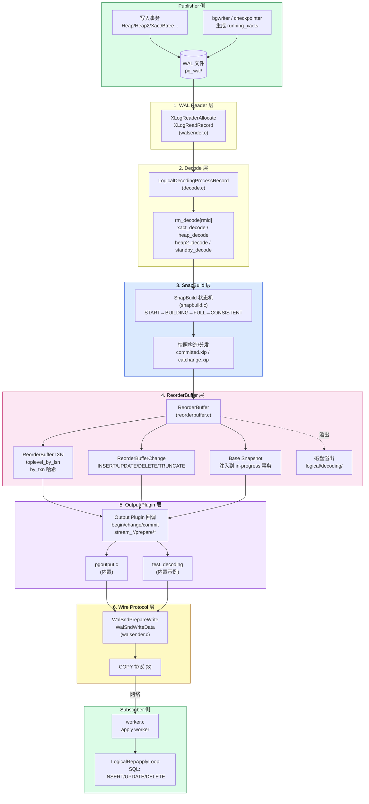

### 1.2 模块清单与代码量

| 模块 | 文件 | 行数 | 职责 |
|------|------|------|------|
| **WAL 读取** | `replication/walsender.c` | 4000+ | `XLogSendLogical`、`WalSndLoop` 主循环 |
| **解码框架** | `replication/logical/logical.c` | 2198 | `StartupDecodingContext`、`CreateDecodingContext` |
| **WAL 解码** | `replication/logical/decode.c` | 1316 | `LogicalDecodingProcessRecord`、各 rmgr 的 `*_decode` |
| **状态机** | `replication/logical/snapbuild.c` | 2076 | 4 态状态机、committed/catchange 数组 |
| **重组缓冲** | `replication/logical/reorderbuffer.c` | 5615 | `ReorderBufferTXN` / `ReorderBufferChange` 抽象、磁盘溢出 |
| **Output 框架** | `replication/logical/logical.c` | — | 回调包装(error context) |
| **pgoutput 插件** | `replication/pgoutput/pgoutput.c` | 2484 | 内置逻辑复制输出插件,真实订阅者协议 |
| **协议** | `replication/logical/proto.c` | 1301 | 二进制流协议编码 |
| **apply worker** | `replication/logical/worker.c` | 5239 | 订阅者端 apply 主循环 |
| **冲突处理** | `replication/logical/conflict.c` | 505 | PG 16+ 冲突检测 |
| **并行 apply** | `replication/logical/applyparallelworker.c` | 1646 | PG 17+ 并行 apply 框架 |
| **slot 同步** | `replication/logical/slotsync.c` | 1862 | failover 时 slot 同步 |

**总代码量**:`src/backend/replication/logical/` + `pgoutput/` + `walsender.c` 共 ~30K 行。

### 1.3 核心数据流(单条 WAL 记录)

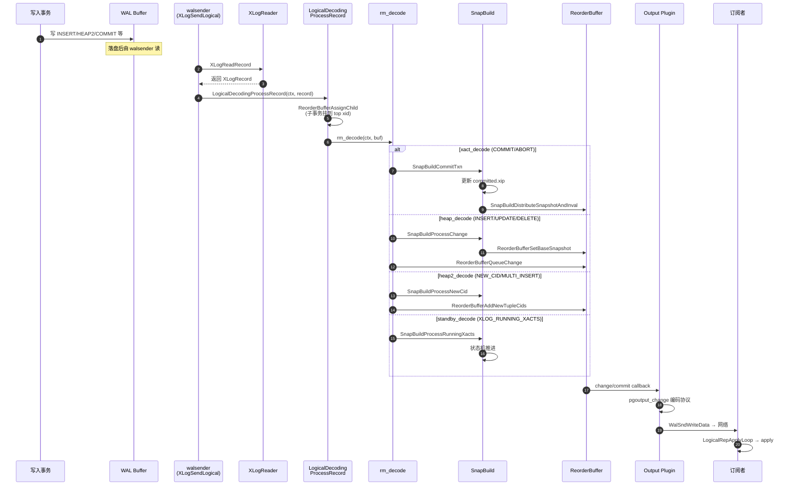

**关键观察**:**snapbuild 与 reorder buffer 紧密耦合**。snapbuild 决定哪些 WAL 记录"可以解码",reorder buffer 负责把"可解码"的内容暂存、排序、最终交给 output plugin。

---

## 二、状态机原理:snapbuild 的 4 态推进

> snapbuild.c 已经在 <../postgresql-snapbuild-deep-dive/> 详细拆解 32 个函数。本文重点讲状态机的"WAL 推进视角"——**看到哪条 WAL 记录,状态会怎么变**。

### 2.1 状态机回顾

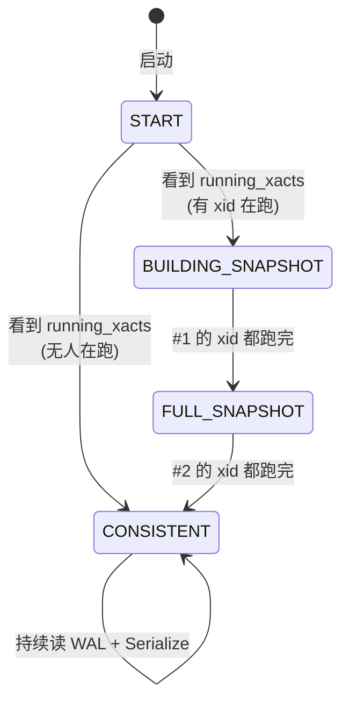

**状态值**(`snapbuild.h:23-49`):
- `SNAPBUILD_START = -1`
- `SNAPBUILD_BUILDING_SNAPSHOT = 0`
- `SNAPBUILD_FULL_SNAPSHOT = 1`
- `SNAPBUILD_CONSISTENT = 2`

### 2.2 推进矩阵:每种 WAL 记录如何影响状态

| WAL 记录类型 | rm_decode | 推进的状态机调用 | 状态变化 |
|--------------|-----------|------------------|----------|
| `XLOG_RUNNING_XACTS` | `standby_decode` | `SnapBuildProcessRunningXacts` | START→BUILDING / BUILDING→FULL / FULL→CONSISTENT |
| `XLOG_HEAP_INSERT/UPDATE/DELETE/TRUNCATE` | `heap_decode` | `SnapBuildProcessChange` | 仅在 ≥ FULL_SNAPSHOT 时返回 true |
| `XLOG_HEAP2_NEW_CID` | `heap2_decode` | `SnapBuildProcessNewCid` | 标记事务改了 catalog,加 cmin/cmax |
| `XLOG_HEAP2_MULTI_INSERT` | `heap2_decode` | `SnapBuildProcessChange` | 同 INSERT |
| `XLOG_XACT_COMMIT/ABORT` | `xact_decode` | `SnapBuildCommitTxn` | 决定是否需要重建 snapshot |
| `XLOG_XACT_ASSIGNMENT` | `xact_decode` | (跳过) | 子事务分配到 top xid |
| `XLOG_XACT_INVALIDATIONS` | `xact_decode` | (加 invalidation 队列) | 缓存 invalidation |
| `XLOG_CHECKPOINT_SHUTDOWN` | `xlog_decode` | `SnapBuildSerialize` | serialize 快照到磁盘 |
| `XLOG_CHECKPOINT_ONLINE` | `xlog_decode` | `SnapBuildSerialize` | 同上 |

**核心规律**:**只有 `XLOG_RUNNING_XACTS` 能改变 state 字段**。其他记录只修改 builder 内部的 `xmin`/`xmax`/`committed.xip`/`snapshot`。

### 2.3 4 态的"业务含义"

| 状态 | 业务含义 | 可解码性 | 可分发 snapshot | 可 export |
|------|----------|----------|-----------------|-----------|
| **START** | 刚启动,什么都没收集 | ❌ | ❌ | ❌ |
| **BUILDING_SNAPSHOT** | 在等 #1 老 xid 结束 | ❌ | ❌ | ❌ |
| **FULL_SNAPSHOT** | 已有 catalog 快照,新 xid 可解码 | ✅(新 xid) | ✅(限 catalog) | ❌ |
| **CONSISTENT** | 一切就绪,持久化快照已存在磁盘 | ✅(所有 xid) | ✅(user data) | ✅ |

**关键不变量**:
- `state >= SNAPBUILD_FULL_SNAPSHOT` 是 `SnapBuildBuildSnapshot` 的 `Assert`(见 snapbuild.c:365)
- `state == SNAPBUILD_CONSISTENT` 是 `SnapBuildInitialSnapshot` 的 `Assert`(见 snapbuild.c:461)
- 这意味着 **不在稳态,不可能导出 snapshot 给 user data 读**

---

## 三、WAL 记录处理矩阵:每种 rmgr 的解码路径

每条 WAL 记录进入 `LogicalDecodingProcessRecord`(`decode.c:88`)后,根据 `rmid` 走不同分支:

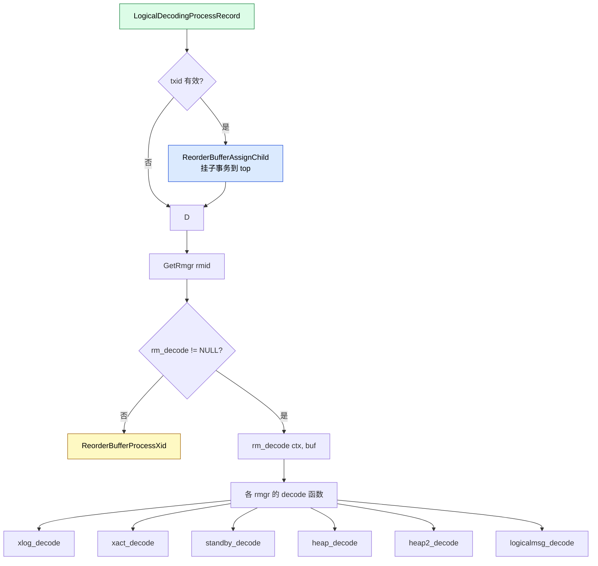

### 3.1 `xlog_decode`(`decode.c:129-198`)

**职责**:处理 `RM_XLOG_ID`(CHECKPOINT 记录)。

**关键分支**:
- `XLOG_CHECKPOINT_SHUTDOWN` / `XLOG_CHECKPOINT_ONLINE`:触发 `SnapBuildSerialize` 写快照
- `XLOG_END_OF_RECOVERY`:同 shutdown
- 其他(`FPI` / `SWITCH` / `BACKUP_END`):不处理(只调 `ReorderBufferProcessXid`)

**为什么 checkpoint 触发 serialize**? 因为 slot 需要"重启点",而 shutdown checkpoint 是"无 in-progress 事务"的最佳时机。online checkpoint 则作为常规推进点。

### 3.2 `xact_decode`(`decode.c:201-356`)

**职责**:处理 `RM_XACT_ID`(事务提交/回滚/prepare/assignment/invalidation)。

**4 个子分支**:

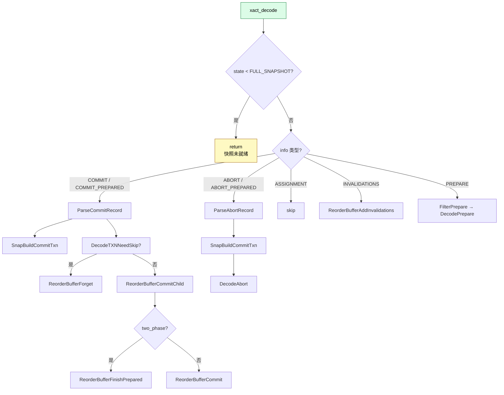

**关键调用链**:`xact_decode → SnapBuildCommitTxn → SnapBuildDistributeSnapshotAndInval → ReorderBufferAddSnapshot`

### 3.3 `standby_decode`(`decode.c:359-403`)

**职责**:处理 `RM_STANDBY_ID`(`XLOG_RUNNING_XACTS`、`XLOG_STANDBY_LOCK`、`XLOG_INVALIDATIONS`)。

**核心调用**(`decode.c:362-388`):
```c
case XLOG_RUNNING_XACTS:
    running = (xl_running_xacts *) XLogRecGetData(r);
    SnapBuildProcessRunningXacts(builder, buf->origptr, running);
    ReorderBufferAbortOld(ctx->reorder, running->oldestRunningXid);
```

**两个关键调用**:
1. `SnapBuildProcessRunningXacts`:**状态机的总驱动**。每条 `XLOG_RUNNING_XACTS` 都会推进。
2. `ReorderBufferAbortOld`:**裁剪 reorder buffer**。把 < `oldestRunningXid` 的事务强制 abort(因为它们理论上不可能"还活着"了)。

**`XLOG_STANDBY_LOCK` 和 `XLOG_INVALIDATIONS`**:不做事(由 `xact_decode` 的 `XLOG_XACT_INVALIDATIONS` 处理)。

### 3.4 `heap_decode`(`decode.c:469-550`)

**职责**:处理 `RM_HEAP_ID`(`INSERT` / `UPDATE` / `DELETE` / `TRUNCATE` / `INPLACE` / `CONFIRM` / `LOCK`)。

**核心模式**(以 `XLOG_HEAP_INSERT` 为例,`decode.c:494-498`):
```c
case XLOG_HEAP_INSERT:
    if (SnapBuildProcessChange(builder, xid, buf->origptr) &&
        !ctx->fast_forward)
        DecodeInsert(ctx, buf);
    break;
```

**两层过滤**:
1. `SnapBuildProcessChange`:**关键过滤器**。返回 false 时,直接跳过(连 `ReorderBufferProcessXid` 都不调,decode.c:475 已经在前面调过)。

> **重要**:`ReorderBufferProcessXid` 是在 rm_decode 入口处无条件调的(`decode.c:475`),它**先于** snapbuild 的状态检查。这意味着即便 snapbuild 拒绝,reorder buffer 仍然**会知道这个 xid 存在**(只是不装 base snapshot)。

2. `!ctx->fast_forward`:**快进模式**。`STARTUP` 时只跑 snapbuild 不发数据,`streaming` 时才发。

**每个分支的 `DecodeXxx`**:
- `DecodeInsert` / `DecodeUpdate` / `DecodeDelete` / `DecodeTruncate` / `DecodeSpecConfirm`:解析 WAL 数据,转 `ReorderBufferQueueChange`
- `XLOG_HEAP_INPLACE`:跳过(catalog 表的 inplace update,不影响 user)
- `XLOG_HEAP_LOCK`:跳过(行锁与逻辑复制无关)

### 3.5 `heap2_decode`(`decode.c:405-467`)

**职责**:处理 `RM_HEAP2_ID`(`NEW_CID` / `MULTI_INSERT` / `REWRITE` / 各种 `PRUNE_*` / `VISIBLE` / `LOCK_UPDATED`)。

**最关键分支**(`decode.c:425-432`):
```c
case XLOG_HEAP2_NEW_CID:
    if (!ctx->fast_forward)
    {
        xlrec = (xl_heap_new_cid *) XLogRecGetData(buf->record);
        SnapBuildProcessNewCid(builder, xid, buf->origptr, xlrec);
        break;
    }
    // 注意:这里没有 break!如果没有 fast_forward,fall through 到 default
```

**注意**:`if (!ctx->fast_forward)` **没有 break**,会 fall through 到 default。fast_forward 模式直接跳过 NEW_CID 处理。

**`XLOG_HEAP2_MULTI_INSERT`**:一次插入多行(CTAS 场景),走 `DecodeMultiInsert`(`decode.c:421-424`)。

**`XLOG_HEAP2_REWRITE`**:只在 crash recovery 时生效,逻辑解码中不做事。

### 3.6 `logicalmsg_decode`(`decode.c:586-666`)

**职责**:处理 `RM_LOGICALMSG_ID`(逻辑消息,用于插件间通信)。

**两种消息**:
- **transactional message**(`xlrec->transactional == true`):进 reorder buffer,事务提交时才发
- **non-transactional message**:立即发,不入 buffer

---

## 四、reorder buffer 核心抽象

`reorderbuffer.c` 是逻辑复制的**真正核心**(5615 行,占 logical 子目录 1/4)。它负责解决一个核心问题:**WAL 里的事务是按 LSN 顺序写入的,但发布给订阅者时需要按"事务提交顺序"**。

### 4.1 核心数据结构

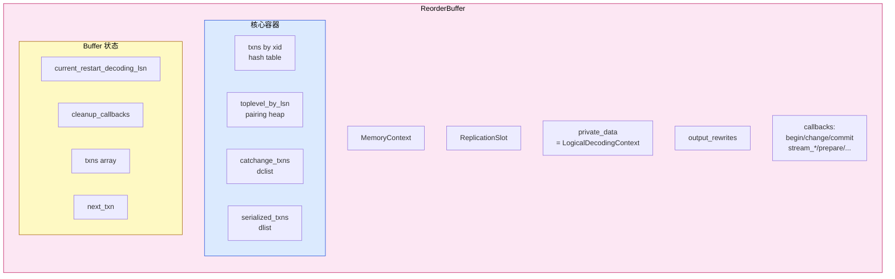

### 4.2 `ReorderBufferTXN` —— 事务抽象

```c
/* reorderbuffer.c / reorderbuffer.h 关键字段 */
struct ReorderBufferTXN {
    TransactionId xid;            /* 事务 id */
    XLogRecPtr first_lsn;         /* 第一个 LSN */
    XLogRecPtr restart_decoding_lsn; /* 何时可以重启 */
    dlist_node node;              /* toplevel_by_lsn 的节点 */
    Snapshot base_snapshot;       /* 从 snapbuild 注入的快照 */
    bool is_catalog_change;       /* 是否改了 catalog */
    ReorderBufferTupleCids *tuple_cids; /* cmin/cmax 映射 */
    dlist_head changes;           /* ReorderBufferChange 列表 */
    Size total_size;              /* 内存占用(触发 spill) */
    ReorderBufferTXN *toplevel_xid; /* 父事务(子事务) */
    /* ... */
};
```

**`base_snapshot` 是关键**:这是从 snapbuild 注入的"目录快照",决定了这个事务解码时能"看到"哪些 catalog 行。

### 4.3 `ReorderBufferChange` —— 变更抽象

```c
typedef enum {
    REORDER_BUFFER_CHANGE_INSERT,
    REORDER_BUFFER_CHANGE_UPDATE,
    REORDER_BUFFER_CHANGE_DELETE,
    REORDER_BUFFER_CHANGE_TRUNCATE,
    REORDER_BUFFER_CHANGE_MESSAGE,
    REORDER_BUFFER_CHANGE_INTERNAL_SPECINSERT,  /* speculative insert for ON CONFLICT */
    REORDER_BUFFER_CHANGE_INTERNAL_SPECCONFIRM, /* confirm speculative */
    REORDER_BUFFER_CHANGE_STREAMING,            /* 标记 streaming 起点 */
} ReorderBufferChangeType;
```

### 4.4 关键函数:事务生命周期

| 函数 | 行号 | 职责 |
|------|------|------|
| `ReorderBufferAllocate` | 324 | 创建 reorder buffer |
| `ReorderBufferProcessXid` | 759 | 看到 xid 时调,创建 `ReorderBufferTXN` |
| `ReorderBufferAssignChild` | 731 | 把子 xid 挂到 top xid |
| `ReorderBufferCommitChild` | 733 | 子事务 commit 记录,合并到 top |
| `ReorderBufferQueueChange` | 715 | 入队一条 change(INSERT/UPDATE/DELETE) |
| `ReorderBufferCommit` | 722 | top xid commit,触发 output 回调 |
| `ReorderBufferAbort` | 736 | top xid abort,丢弃 |
| `ReorderBufferAbortOld` | 738 | 强制 abort < oldestRunningXid 的 xid |
| `ReorderBufferForget` | 739 | 跳过这个事务(不发送) |
| `ReorderBufferSetBaseSnapshot` | 742 | snapbuild 注入 snapshot 给事务 |
| `ReorderBufferAddSnapshot` | 744 | 后续 snapshot 更新(commit 后触发) |

### 4.5 base snapshot 注入机制

**这是 snapbuild 与 reorder buffer 的"接口"**。

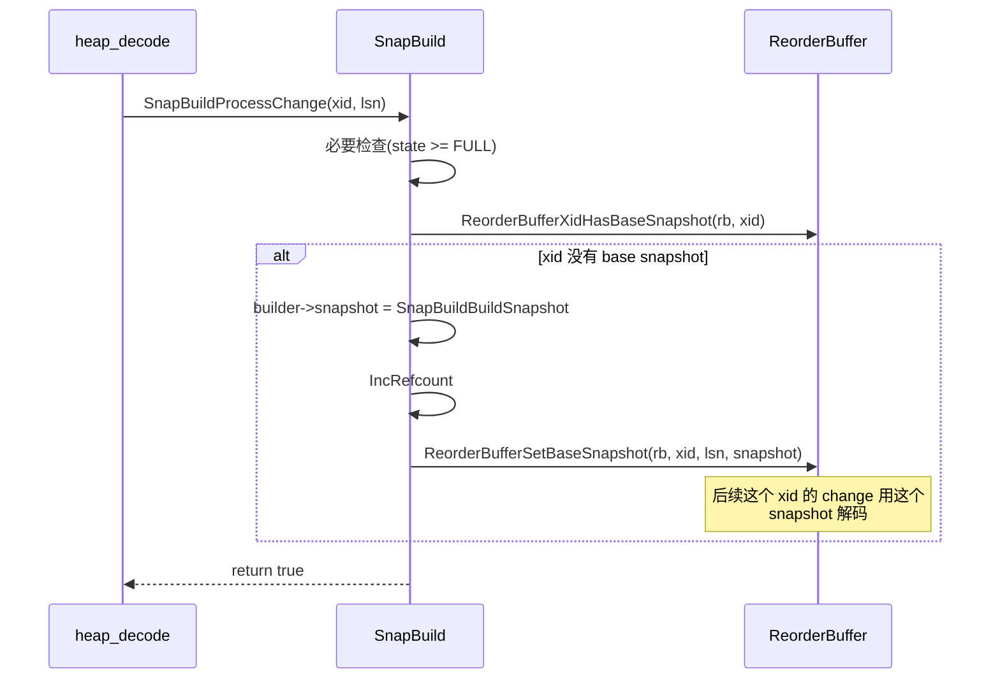

**第二次注入**(`commit` 之后):
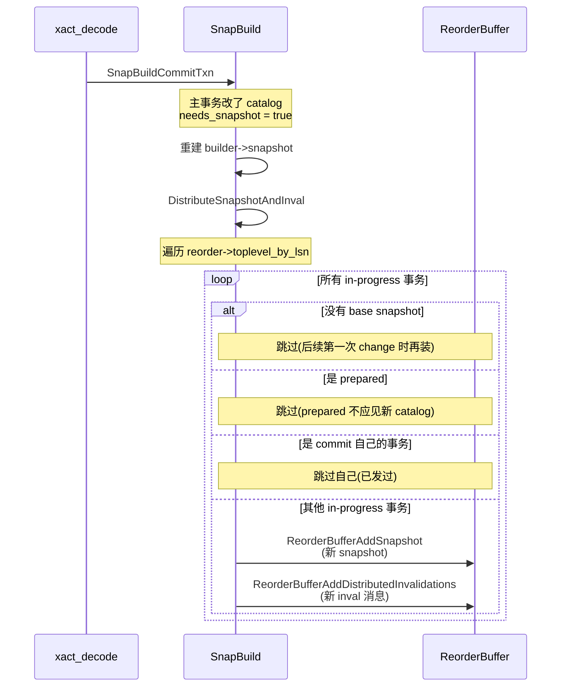

**关键约束**:`base_snapshot` 在事务**第一条 change** 时注入,在事务**commit 时**如果 catalog 改过则更新并分发给**其他 in-progress 事务**。

### 4.6 磁盘溢出(spill)

`ReorderBufferCheckMemoryLimit`(`reorderbuffer.c:265`)周期性检查 `rb->txns[REORDER_BUFFER_CHANGE_SIZE]` 是否超过 `logical_decoding_work_mem`。超过则:
1. 找**最老的非 streamed** 事务
2. `ReorderBufferSerializeTXN` → 写到 `pg_replslot/<slot>/decoding/<xid>_<lsn>.td` 文件
3. 释放内存

**重启时**:`ReorderBufferRestoreContents` 读回。

---

## 五、完整启动到稳态流程(具体日志举例)

> 这是 snapbuild.c 状态机的"WAL 视角"展示。**所有 LSN 都是虚构示例**,实际位置由初始 `restart_lsn` 决定。

### 5.1 假设场景

- publisher 跑了 N 天,有 100 个 long-running 事务
- slot 初始 `restart_lsn = 0/1500000`
- bgwriter 周期 15s(checkpoint)

### 5.2 WAL 序列与状态推进

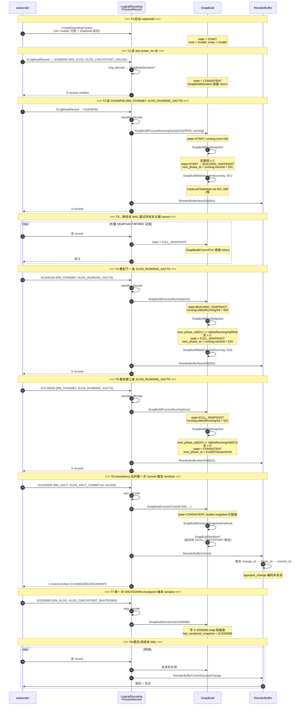

### 5.3 关键观察

1. **从 T0 到 T4(state=FULL_SNAPSHOT),不发送任何数据**。这一段时间,所有 `DecodeCommit` 都直接 return,只有 `SnapBuild` 在静默收集。
2. **从 T4 起,可以发"新 xid"**。但 T4 之前启动的事务(< next_phase_at=520)仍然**不发送**,因为它们的提交信息不全。
3. **从 T5(state=CONSISTENT)起,所有 xid 都可发**。此时也才允许 `pg_dump` 用这个 slot。
4. **T7 之后**:重启 slot 时可以直接从 `0/1D00000.snap` 恢复,**跳过 T0-T6 全部过程**。

### 5.4 "如果看到的是空 running_xacts"

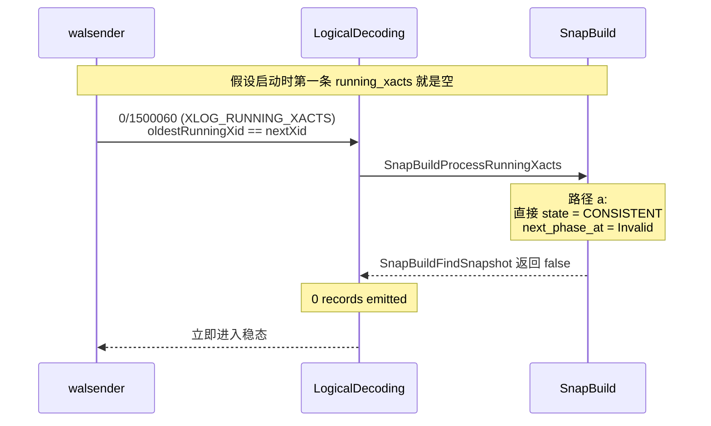

**这是最快路径** —— startup 几乎瞬间完成。

---

## 六、完整事务生命周期(具体例子)

> 用一个具体的 **UPDATE** 事务,从客户端 `UPDATE` 到订阅者 apply,**逐函数**跟踪。

### 6.1 假设场景

- publisher 客户端执行:`UPDATE t SET val = 100 WHERE id = 1;`
- t 表 schema:`(id int, val int)`,id 为主键
- xid = 600
- LSN 序列(虚构)

### 6.2 publisher 端:walsender 读到这条事务的 WAL

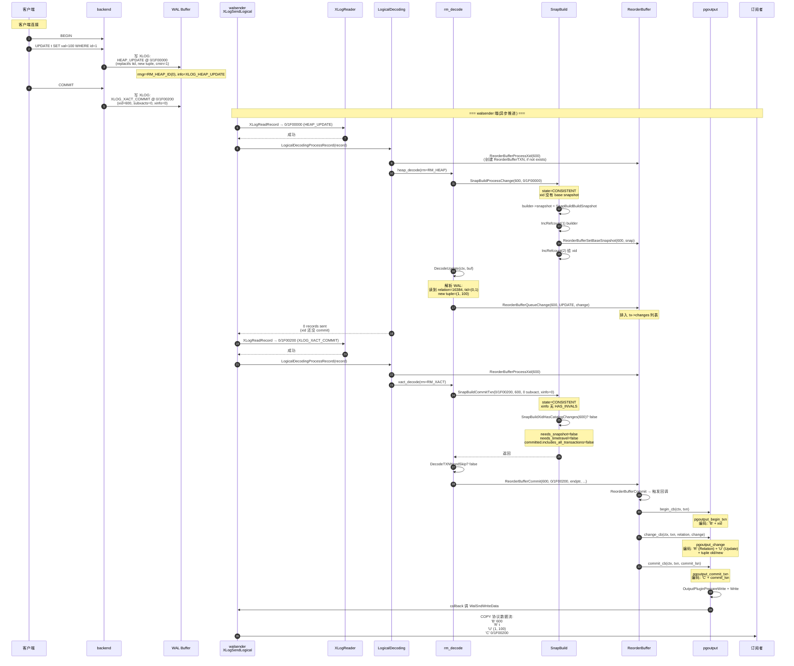

### 6.3 订阅者端:apply 流程

```mermaid
sequenceDiagram
    autonumber
    participant NET as TCP/COPY 协议
    participant W as worker.c
    participant AP as LogicalRepApplyLoop
    participant R as apply 状态机
    participant TXN as apply 事务
    participant DB as subscriber DB

    NET->>W: 收到 'B' message
    W->>AP: apply_dispatch
    AP->>R: handle_begin
    R->>TXN: StartTransaction
    TXN->>DB: SET LOCAL statement_timeout = 0

    NET->>W: 收到 'R' message (rel 16384)
    W->>AP: apply_dispatch
    AP->>R: handle_relation
    Note over R: 缓存 relation 信息<br/>(relname, attrs, types)

    NET->>W: 收到 'U' message (UPDATE)
    W->>AP: apply_dispatch
    AP->>R: handle_update
    R->>TXN: 当前 apply 事务中
    R->>DB: UPDATE t SET val=100 WHERE id=1<br/>(或:<br/> DELETE WHERE id=1;<br/> INSERT (1, 100);<br/>如果表无主键)

    NET->>W: 收到 'C' message
    W->>AP: apply_dispatch
    AP->>R: handle_commit
    R->>DB: COMMIT
    R->>TXN: 提交

    Note over W: 流式继续下一批
```

### 6.4 函数调用栈总结(一次 UPDATE)

| 步骤 | 文件:函数 | 关键操作 |
|------|-----------|----------|
| 1 | `walsender.c:XLogSendLogical` | `XLogReadRecord` |
| 2 | `decode.c:LogicalDecodingProcessRecord` | `ReorderBufferAssignChild` + `rm_decode` |
| 3 | `decode.c:heap_decode` | `SnapBuildProcessChange` |
| 4 | `snapbuild.c:SnapBuildProcessChange` | `SnapBuildBuildSnapshot` + `ReorderBufferSetBaseSnapshot` |
| 5 | `decode.c:DecodeUpdate` | 解析 WAL → `ReorderBufferQueueChange` |
| 6 | `decode.c:xact_decode` | 收到 COMMIT 调 `SnapBuildCommitTxn` |
| 7 | `snapbuild.c:SnapBuildCommitTxn` | 判断 needs_snapshot / 重建 snapshot |
| 8 | `decode.c:DecodeCommit` | `ReorderBufferCommit` |
| 9 | `reorderbuffer.c:ReorderBufferCommit` | 触发 output 回调 |
| 10 | `logical.c:begin_cb_wrapper` → `pgoutput.c:pgoutput_begin_txn` | 编码 'B' |
| 11 | `logical.c:change_cb_wrapper` → `pgoutput.c:pgoutput_change` | 编码 'R' + 'U' |
| 12 | `logical.c:commit_cb_wrapper` → `pgoutput.c:pgoutput_commit_txn` | 编码 'C' |
| 13 | `walsender.c:WalSndWriteData` | 写网络 |
| 14 | `proto.c` (订阅者) | 解析消息 |
| 15 | `worker.c:LogicalRepApplyLoop` | apply |
| 16 | `worker.c:handle_update` | `UPDATE` SQL |

**16 个函数调用,贯穿 publisher / subscriber**。

---

## 七、用户 / DBA / 内核开发者 三个视角

### 7.1 用户视角:看得见的现象

```sql
-- 创建 slot
SELECT pg_create_logical_replication_slot('my_slot', 'pgoutput');

-- 启动订阅
CREATE SUBSCRIPTION my_sub CONNECTION '...' PUBLICATION my_pub
  WITH (slot_name = 'my_slot', create_slot = false);

-- 现象 1:启动后前几秒,订阅者不接收数据
--   → 内部:状态机在 BUILDING_SNAPSHOT
-- 现象 2:订阅者累积 lag,数分钟后才追上
--   → 内部:REORDER_BUFFER_TXN 在 reorder buffer 等待提交
-- 现象 3:slot 占用大量磁盘
--   → 内部:ReorderBufferCheckMemoryLimit 触发 spill 到 pg_replslot
```

### 7.2 DBA 视角:监控点

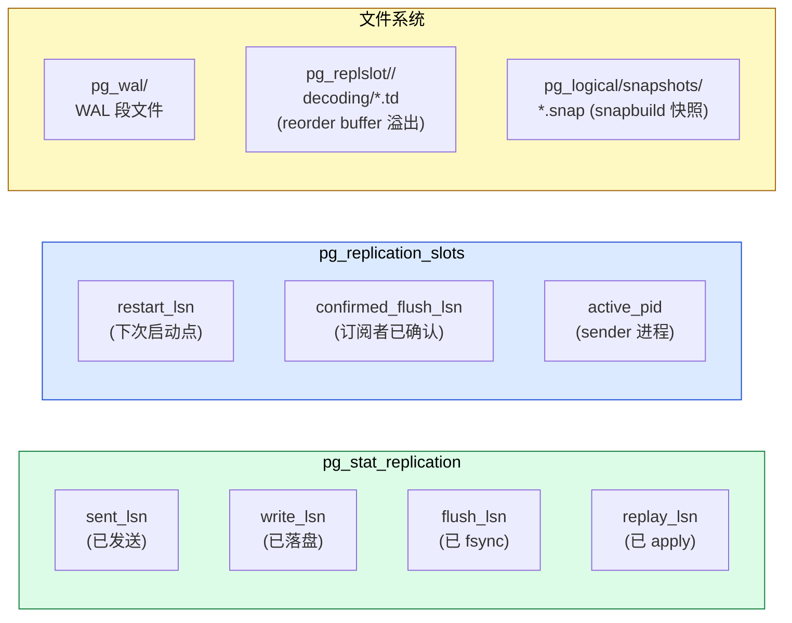

**DBA 关注的核心指标**:
- `pg_replication_slots.restart_lsn` 决定 slot 占多少 WAL
- `pg_replication_slots.confirmed_flush_lsn` vs `sent_lsn` 差值 = 发送缓冲
- `pg_replslot/<slot>/decoding/` 大小 = reorder buffer 内存压力
- `pg_logical/snapshots/` 大小 = snapbuild 快照文件

**关键 SQL**:
```sql
-- 监控所有 slot 状态
SELECT slot_name, plugin, slot_type, database, active,
       restart_lsn, confirmed_flush_lsn, wal_status
FROM pg_replication_slots;

-- 监控 reorder buffer 占用
SELECT slot_name, spill_txns, spill_count, spill_bytes
FROM pg_stat_replication_slots;

-- 看 snapbuild 状态(扩展:pg_logicalinspect)
SELECT (pg_get_snapbuild_state(slot_name)).state
FROM pg_replication_slots
WHERE plugin = 'pgoutput';
```

### 7.3 内核开发者视角:扩展点

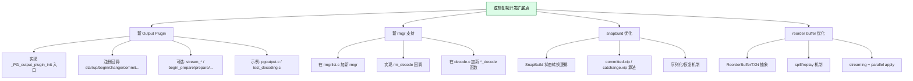

**几个具体扩展点**:

1. **新输出插件**:`src/backend/replication/pgoutput/pgoutput.c` 是范本,所有回调如何实现一目了然。
2. **新的事务类型支持**(比如 GTID):修改 `decode.c` 的 `xact_decode`,加新 case。
3. **snapbuild 优化**:`snapbuild.c` 的 `committed.xip` 排序 / purge 算法可改。
4. **parallel apply**:`applyparallelworker.c` 完整展示了 PG 17+ 的并行 apply 框架。

---

## 八、PG 18 重要特性源码入口

PG 18 在 logical replication 方向有重大升级,以下是源码入口:

| 特性 | 文件 | 关键函数/位置 |
|------|------|--------------|
| **Streaming 模式** | `reorderbuffer.c` | `ReorderBufferStreamTXN`、`ReorderBufferCanStream` |
| **Parallel apply** | `applyparallelworker.c` | `ApplyParallelWorkerMain` 等 |
| **两阶段解码(2PC)** | `decode.c` | `DecodePrepare`、`DecodeCommit` 的 two_phase 分支 |
| **冲突检测** | `conflict.c` | 完整 505 行文件 |
| **Slot failover** | `slotsync.c` | `update_local_synced_slot` |
| **logical message** | `decode.c:logicalmsg_decode` | RM_LOGICALMSG_ID 处理 |
| **origin filter** | `decode.c:FilterByOrigin` | 双源复制场景 |
| **wal2json 风格协议** | `pgoutput.c` | proto.c 编码协议 |

### 8.1 Streaming 模式 (PG 16+)

**核心思想**:事务**还没 commit** 就开始发给订阅者(配合 logical_decoding_work_mem 决定 streaming vs spilling)。

**关键参数**:
- `logical_replication_mode = 'streaming'|'spill'|'immediate'`

**源码入口**(`reorderbuffer.c`):
```c
static inline bool ReorderBufferCanStream(ReorderBuffer *rb);   // line 292
static inline bool ReorderBufferCanStartStreaming(ReorderBuffer *rb);  // line 293
static void ReorderBufferStreamTXN(ReorderBuffer *rb, ReorderBufferTXN *txn);  // line 294
static void ReorderBufferStreamCommit(ReorderBuffer *rb, ReorderBufferTXN *txn);  // line 295
```

### 8.2 Parallel apply (PG 17+)

**核心思想**:大事务可以由多个 apply worker 并行 apply(只对 streaming 模式有效)。

**源码入口**(`applyparallelworker.c`):
- `ApplyParallelWorkerMain`:并行 worker 主入口
- `applyparallelworker.c` 全 1646 行

### 8.3 两阶段解码(2PC) (PG 15+)

**核心思想**:`PREPARE` 记录立即发给订阅者,`COMMIT PREPARED` 触发最终提交。

**源码入口**(`decode.c:763-836`):
- `DecodePrepare` 处理 XLOG_XACT_PREPARE
- `DecodeCommit` 处理 XLOG_XACT_COMMIT_PREPARED
- 调 `ReorderBufferRememberPrepareInfo` 缓存 prepare 信息

### 8.4 冲突检测 (PG 16+)

**核心思想**:订阅者 apply 时检测主键冲突、update 行不存在、delete 行不存在。

**源码入口**:`src/backend/replication/logical/conflict.c`

---

## 九、源码速查表

### 9.1 主入口调用链

```
START_REPLICATION 命令
  → StartLogicalReplication (walsender.c:1228)
    → CreateDecodingContext (logical.c:500)
      → StartupDecodingContext (logical.c:152)
        → LoadOutputPlugin (logical.c:104)
        → AllocateSnapshotBuilder (snapbuild.c:185)
        → ReorderBufferAllocate (reorderbuffer.c:324)
    → DecodingContextFindStartpoint (logical.c:635)
      → 循环读 WAL 直到 SnapBuildCurrentState == CONSISTENT
    → WalSndLoop (walsender.c:1516)
      → XLogSendLogical (walsender.c:3428)
        → XLogReadRecord
        → LogicalDecodingProcessRecord (decode.c:88)
          → ReorderBufferAssignChild
          → rm_decode[rmid] (heap_decode / heap2_decode / xact_decode / standby_decode)
            → SnapBuild* (snapbuild.c)
            → ReorderBuffer* (reorderbuffer.c)
              → output plugin callback (pgoutput.c)
                → WalSndWriteData (walsender.c:1567)
                  → pq_putmessage (libpq)
```

### 9.2 snapbuild.c 关键函数

| 函数 | 行号 | 何时调用 |
|------|------|----------|
| `AllocateSnapshotBuilder` | 185 | 启动时 |
| `SnapBuildProcessChange` | 639 | 每条 HEAP 变更 |
| `SnapBuildProcessNewCid` | 689 | 每条 HEAP2_NEW_CID |
| `SnapBuildCommitTxn` | 940 | 每条 XACT commit/abort |
| `SnapBuildProcessRunningXacts` | 1136 | 每条 RUNNING_XACTS |
| `SnapBuildFindSnapshot` | 1238 | 状态机总驱动 |
| `SnapBuildSerialize` | 1497 | CHECKPOINT 或稳态后 |
| `SnapBuildRestore` | 1841 | 启动时尝试恢复 |
| `CheckPointSnapBuild` | 1970 | checkpoint 时清理 |

### 9.3 decode.c 关键函数

| 函数 | 行号 | 何时调用 |
|------|------|----------|
| `LogicalDecodingProcessRecord` | 88 | 每条 WAL 记录 |
| `xlog_decode` | 129 | RM_XLOG |
| `xact_decode` | 201 | RM_XACT |
| `standby_decode` | 359 | RM_STANDBY |
| `heap_decode` | 469 | RM_HEAP |
| `heap2_decode` | 405 | RM_HEAP2 |
| `logicalmsg_decode` | 586 | RM_LOGICALMSG |
| `DecodeCommit` | 667 | 解析 xact COMMIT |
| `DecodePrepare` | 763 | 解析 xact PREPARE |
| `DecodeAbort` | 838 | 解析 xact ABORT |
| `DecodeInsert` | 894 | 解析 HEAP INSERT |
| `DecodeUpdate` | 953 | 解析 HEAP UPDATE |
| `DecodeDelete` | 1020 | 解析 HEAP DELETE |
| `DecodeTruncate` | 1074 | 解析 HEAP TRUNCATE |
| `DecodeMultiInsert` | 1112 | 解析 HEAP2 MULTI_INSERT |
| `DecodeSpecConfirm` | 1216 | 解析 HEAP CONFIRM |

### 9.4 reorderbuffer.c 关键函数

| 函数 | 行号 | 何时调用 |
|------|------|----------|
| `ReorderBufferAllocate` | 324 | 启动时 |
| `ReorderBufferProcessXid` | 759 | 看到新 xid |
| `ReorderBufferQueueChange` | 715 | 收到 DML change |
| `ReorderBufferCommit` | 722 | top xid commit |
| `ReorderBufferFinishPrepared` | 725 | 2PC commit |
| `ReorderBufferAssignChild` | 731 | 子 xid 挂 top |
| `ReorderBufferCommitChild` | 733 | 子 xid commit |
| `ReorderBufferAbort` | 736 | top xid abort |
| `ReorderBufferAbortOld` | 738 | 强制 abort 老 xid |
| `ReorderBufferSetBaseSnapshot` | 742 | snapbuild 注入 snapshot |
| `ReorderBufferAddSnapshot` | 744 | 后续 snapshot 更新 |

### 9.5 关键宏 / 常量

| 名称 | 值/位置 | 作用 |
|------|---------|------|
| `SNAPBUILD_START` | -1 | 状态机初始 |
| `SNAPBUILD_BUILDING_SNAPSHOT` | 0 | 等 #1 老 xid |
| `SNAPBUILD_FULL_SNAPSHOT` | 1 | 已有 catalog 快照 |
| `SNAPBUILD_CONSISTENT` | 2 | 完全一致 |
| `SNAPBUILD_MAGIC` | 0x51A1E001 | snap 文件魔数 |
| `SNAPBUILD_VERSION` | 6 | snap 文件版本 |
| `PG_LOGICAL_SNAPSHOTS_DIR` | `pg_logical/snapshots` | snap 文件目录 |
| `LOGICAL_REP_MSG_*` | proto.c | 协议消息类型 ('B' / 'R' / 'U' / 'C' / 'D' / 'T' / 'M' / 'O' / 'Y' / 'K' / 'G') |

---

## 十、参考

### 10.1 源码

- 主入口:`src/backend/replication/walsender.c`(~4000 行)
- 解码框架:`src/backend/replication/logical/logical.c`(2198 行)
- 解码器:`src/backend/replication/logical/decode.c`(1316 行)
- 状态机:`src/backend/replication/logical/snapbuild.c`(2076 行)
- 重组缓冲:`src/backend/replication/logical/reorderbuffer.c`(5615 行)
- 输出插件:`src/backend/replication/pgoutput/pgoutput.c`(2484 行)
- 协议:`src/backend/replication/logical/proto.c`(1301 行)
- 订阅端 apply:`src/backend/replication/logical/worker.c`(5239 行)
- 并行 apply:`src/backend/replication/logical/applyparallelworker.c`(1646 行)
- 冲突处理:`src/backend/replication/logical/conflict.c`(505 行)

### 10.2 站内文章

- snapbuild.c 深度解析(32 个函数逐个源码分析): <../postgresql-snapbuild-deep-dive/>
- PostgreSQL 逻辑复制 Stream Publisher: <../postgresql-logical-replication-stream-publisher/>
- PostgreSQL Reorder Buffer 源码分析: <../postgresql-reorder-buffer-code-analysis/>
- PostgreSQL 行锁机制深度解析: <../postgresql-row-lock/>
- PostgreSQL 共享内存机制: <../postgresql-shared-memory/>

### 10.3 官方文档

- [Logical Decoding Overview](https://www.postgresql.org/docs/current/logicaldecoding-explanation.html)
- [Streaming Replication Protocol](https://www.postgresql.org/docs/current/protocol-replication.html)
- [pgoutput 文档](https://www.postgresql.org/docs/current/logicaldecoding-output-plugin.html)
- [WAL Internals](https://www.postgresql.org/docs/current/wal-internals.html)
- [pg_replication_slots 视图](https://www.postgresql.org/docs/current/view-pg-replication-slots.html)

### 10.4 关键术语

- **`xl_running_xacts`**:WAL 中记录当前运行 xid 的结构(`access/xact.h`)
- **`xl_heap_new_cid`**:catalog 改动时记录的 cmin/cmax 组合
- **`xl_xact_parsed_commit`**:commit 记录解析后的结构
- **`XLogReaderState`**:WAL 读取器状态
- **`LogicalDecodingContext`**:逻辑解码上下文,贯穿整个生命周期
- **`ReorderBufferTXN`**:`pg_replication_slots` 视图级别的 in-memory 事务
- **`ReorderBufferChange`**:单条 change(INSERT/UPDATE/DELETE/TRUNCATE/MESSAGE)
- **`base_snapshot`**:snapbuild 注入给事务的 catalog 快照
- **`SNAPSHOT_HISTORIC_MVCC`**:snapbuild 专用快照类型

---

> **更新日志**
>
> - 2026-10-19:初版发布。整合 snapbuild + reorderbuffer + decode + output plugin 完整链路,12 张架构/时序/流程图,完整状态机 WAL 推进举例,一个 UPDATE 事务的 16 步全函数调用链。
