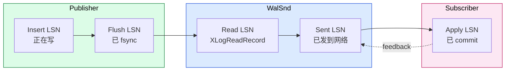
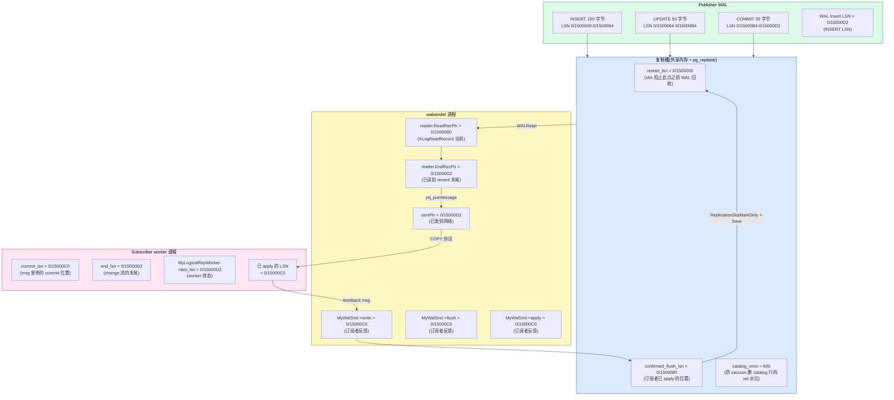
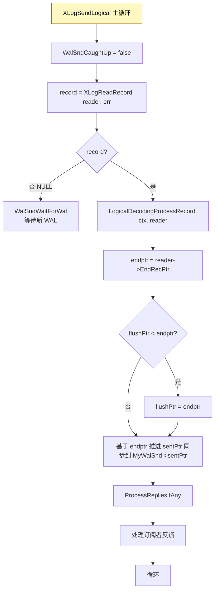
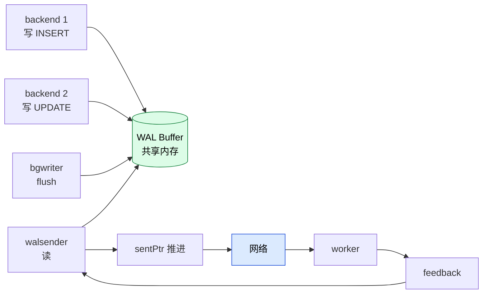

# PostgreSQL 逻辑复制 LSN 推进全景:从 WAL 字节到订阅者 apply 的全链路 LSN 视角

> 配套源码:`src/backend/replication/{walsender.c, slot.c, slotfuncs.c}` + `src/backend/replication/logical/*` + `src/include/access/xlogdefs.h`
>
> 读完本文你会理解:
> 1. **WAL 内部 LSN** 的物理布局(段文件 / 页 / 记录)
> 2. **复制槽的 5+ 个 LSN 字段**:`restart_lsn`、`confirmed_flush_lsn`、`candidate_xmin_lsn`、`catalog_xmin`、`two_phase_at`
> 3. **walsender 的 6+ 个 LSN**:`sentPtr`、`write`、`flush`、`apply`、`end_recptr`、`flushPtr`
> 4. **订阅端 worker 的 LSN**:`commit_lsn`、`end_lsn`、`origin_lsn`、`last_lsn`、`reply_lsn`
> 5. **每个 LSN 在何时由谁推进** —— 全链路推进的精确时机
> 6. **一次 UPDATE 事务** 经历的 LSN 变化(具体数字举例)

---

## 目录

- [一、LSN 基础与全局概念](#一lsn-基础与全局概念)
- [二、全链路 LSN 推进全景图](#二全链路-lsn-推进全景图)
- [三、WAL 内部的 LSN 物理布局](#三wal-内部的-lsn-物理布局)
- [四、复制槽的 LSN 字段详解](#四复制槽的-lsn-字段详解)
- [五、walsender 的 LSN 变量详解](#五walsender-的-lsn-变量详解)
- [六、订阅端 worker 的 LSN 变量](#六订阅端-worker-的-lsn-变量)
- [七、完整 LSN 推进时序:一次 UPDATE 事务](#七完整-lsn-推进时序一次-update-事务)
- [八、关键 LSN 推进的精确时机](#八关键-lsn-推进的精确时机)
- [九、LSN 的"取大"与"取小"语义](#九lsn的取大与取小语义)
- [十、异常情况下的 LSN 回退](#十异常情况下的-lsn-回退)
- [十一、源码速查表](#十一源码速查表)
- [十二、参考](#十二参考)

---

## 一、LSN 基础与全局概念

### 1.1 `XLogRecPtr` / `pg_lsn` 类型

```c
/* xlogdefs.h */
typedef uint64 XLogRecPtr;

/* pg_lsn 的 SQL 类型 */
-- pg_lsn = 8 字节无符号整数(64-bit)
-- 格式化为 "高32位/低32位" 字符串,如 "0/16A0F80"
```

**`%X/%X` 格式化**:`LSN_FORMAT_ARGS(lsn)` 展开为 `(uint32)(lsn>>32), (uint32)lsn`,所以:
- `0/16A0F80` = `0x00000000 << 32 | 0x0016A0F80` = `0x16A0F80` = `23,823,744`
- `1/7000060` = `0x1 << 32 | 0x07000060` = `4294967296 + 117440608` = 实际上 LSN 跨越了第一个 4GB 边界

### 1.2 LSN 的"指针"语义

**`XLogRecPtr` 是"指向 WAL 字节流的指针"**:
- `LSN X` 表示"WAL 流的第 X 个字节的位置"
- `XLogRecPtrIsInvalid(lsn)` = `lsn == 0` 表示"未设置"
- 比较操作直接走 `uint64` 数值比较

### 1.3 几个核心 LSN 概念

| 概念 | 含义 |
|------|------|
| **Insert LSN** | 正在插入 WAL 的当前 LSN(由 backend 写 WAL 时推进) |
| **Flush LSN** | 已 fsync 到磁盘的最大 LSN |
| **Read LSN** | walsender 当前正在读的位置 |
| **Sent LSN** | 已发给订阅者的最大 LSN |
| **Apply LSN** | 订阅者已 apply 的最大 LSN |
| **Confirm LSN** | 订阅者通过 `pg_stat_replication` 反馈的"已 apply"位置 |



**关键不变量**(理想情况下):`Insert LSN >= Flush LSN >= Read LSN >= Send LSN >= Apply LSN`

---

## 二、全链路 LSN 推进全景图



---

## 三、WAL 内部的 LSN 物理布局

### 3.1 WAL 文件结构

```text
pg_wal/
├── 000000010000000000000001   <- segment 1, 16MB
├── 000000010000000000000002   <- segment 2
├── 000000010000000000000003   <- segment 3
└── ...
```

每个 segment 16MB(`wal_segment_size`,默认)。**段文件名编码 LSN 的高地址**:
- `000000010000000000000003` 表示 timeline 1,起始 LSN `0/03000000`

### 3.2 单条 WAL 记录在文件中的布局

```text
段文件 0/03000000 内部偏移:
+--------------------------------+ offset 0
|  XLogPageHeaderData (32 字节)  | <- 每页头
|    xl_pages:   0x0001          |
|    xlp_magic:  0xD109          |  ("XLOG" magic)
|    xlp_info:   0x00            |
|    xlp_tli:    0x0001          |
|    xlp_pageaddr: 0x03000000    |  <- LSN
|    ...                          |
+--------------------------------+ offset 32
|  XLogRecord (24 字节)          |
|    xl_prev:  0x03000000        |  <- 前一条记录位置
|    xl_tot_len:  53             |  <- 总长度
|    xl_xid:  600                |  <- 事务 xid
|    xl_term:  0                 |
|    xl_info/rmid: ...            |
+--------------------------------+ offset 56
|  XLogRecord data (29 字节)     |  <- 实际数据
+--------------------------------+ offset 85
|  Block Reference (24 字节)     |  <- 整页引用
+--------------------------------+
```

**关键 LSN 关系**:
- `xlp_pageaddr` = 所在段的起始 LSN
- `XLogRecord` 起始 LSN = `pageaddr + offset_in_page`
- `xl_prev` = 前一条记录的 LSN(形成链表)
- `reader->EndRecPtr` = `StartLSN + xl_tot_len`(下一条 LSN)

### 3.3 Insert/Flush LSN 推进

```c
/* xlog.c */
XLogRecPtr XLogInsert(RmgrId rmid, uint8 info);
XLogRecPtr XLogFlush(XLogRecPtr record);
```

**Insert 推进**:
- 每次 `XLogInsert` 返回新插入记录的 **EndRecPtr**
- 进程内 `MyXLogInsert->CurrBytePos` 推进
- 全局 `XLogCtl->Insert->CurrBytePos` 也推进(共享)

**Flush 推进**:
- `XLogFlush(record)` 调 `pg_fsync`
- `XLogCtl->lastFlushedLsn` 推进到 record 末尾
- bgwriter 周期(默认 200ms)调一次 `XLogBackgroundFlush`

**关键函数**:
- `GetInsertRecPtr()`:全局 Insert LSN
- `GetFlushRecPtr()`:全局 Flush LSN
- `GetRedoRecPtr()`:checkpoint 起点(最老的 redo 记录)

---

## 四、复制槽的 LSN 字段详解

### 4.1 `ReplicationSlotPersistentData` 的 LSN 字段(slot.h)

```c
typedef struct ReplicationSlotPersistentData
{
    NameData    name;
    Oid         database;
    ReplicationSlotPersistency persistency;
    bool        two_phase;
    XLogRecPtr  two_phase_at;        /* 2PC 启用点 */
    bool        failover;
    bool        synced;

    /* 失效原因 */
    ReplicationSlotInvalidationCause invalidated;
    XLogRecPtr  invalidation_lsn;    /* 失效 LSN */
    TimestampTz invalidation_time;

    /* 主要 LSN */
    XLogRecPtr  restart_lsn;         /* 重点 1 */
    XLogRecPtr  confirmed_flush;     /* 重点 2 */
    TransactionId catalog_xmin;     /* 重点 3 */

    /* Plugin 名 */
    NameData    plugin;
} ReplicationSlotPersistentData;
```

### 4.2 5 个核心 LSN/xid 字段

| 字段 | 类型 | 含义 | 推进者 |
|------|------|------|--------|
| `restart_lsn` | `XLogRecPtr` | slot 阻止此点之前 WAL 被回收 | `LogicalIncreaseRestartDecodingForSlot`、`ReplicationSlotReserveWal` |
| `confirmed_flush` | `XLogRecPtr` | 订阅者已 apply 并 confirm 的位置 | `LogicalConfirmReceivedLocation` |
| `catalog_xmin` | `TransactionId` | 防 VACUUM 删 catalog 行的 xid 下限 | `ReplicationSlotsComputeRequiredXmin` |
| `two_phase_at` | `XLogRecPtr` | 2PC 启用点(< 此 LSN 的 prepared 不发) | `CreateReplicationSlot` / `SnapBuildSetTwoPhaseAt` |
| `invalidation_lsn` | `XLogRecPtr` | 失效时的 LSN | `ReplicationSlotMarkDirty` |

### 4.3 `restart_lsn` 推进

**推进条件**:
1. 收到新 `xl_running_xacts` 记录时,有 in-progress 事务:`txn->restart_decoding_lsn`
2. 稳态时,无 in-progress 事务:`last_serialized_snapshot`

**推进函数**(snapbuild.c:1221-1232):
```c
/* 找到最老的 in-progress 事务,取其 restart_decoding_lsn */
txn = ReorderBufferGetOldestTXN(builder->reorder);
if (txn != NULL && txn->restart_decoding_lsn != InvalidXLogRecPtr)
    LogicalIncreaseRestartDecodingForSlot(lsn, txn->restart_decoding_lsn);

/* 没有 in-progress 事务,使用最近的 serialize 快照 */
else if (txn == NULL &&
         builder->reorder->current_restart_decoding_lsn != InvalidXLogRecPtr &&
         builder->last_serialized_snapshot != InvalidXLogRecPtr)
    LogicalIncreaseRestartDecodingForSlot(lsn, builder->last_serialized_snapshot);
```

**`LogicalIncreaseRestartDecodingForSlot`(slot.c)**:
- 内部 `max(new, current)` 取大
- `SpinLockAcquire(&slot->mutex)`
- `slot->data.restart_lsn = max(slot->data.restart_lsn, lsn)`(注意:这里的 `lsn` 是入参,可能是 `new_value`)

**关键不变量**:`restart_lsn` **从不回退**(只在原值上 `max`)

### 4.4 `confirmed_flush` 推进

**推进条件**:订阅者通过 `standby_status_update` 消息反馈

**walsender 处理**(walsender.c `ProcessStandbyReplyMessage`):
```c
writePtr = pq_getmsgint64(&reply_message);
flushPtr = pq_getmsgint64(&reply_message);
applyPtr = pq_getmsgint64(&reply_message);

/* 注意:这里 applyPtr 等于回写的 LSN */
if (applyPtr > slot->data.confirmed_flush)
    LogicalConfirmReceivedLocation(applyPtr);
```

**`LogicalConfirmReceivedLocation`(logical.c)**:
```c
SpinLockAcquire(&slot->mutex);
if (lsn > slot->data.confirmed_flush)
    slot->data.confirmed_flush = lsn;
SpinLockRelease(&slot->mutex);

ReplicationSlotMarkDirty();
ReplicationSlotSave();  /* 写 pg_replslot/<name> */
```

**关键不变量**:`confirmed_flush >= restart_lsn`(否则重启会找不到起点)

### 4.5 `catalog_xmin` 推进

**推进条件**:`ReplicationSlotsComputeRequiredXmin`(定期 / 提交时调)

```c
/* 取所有 slot 的 candidate_catalog_xmin 最大值 */
agg_catalog_xmin = max(all slots' candidate_catalog_xmin);
```

**`GetOldestSafeDecodingTransactionId`**(`proc.c`):
- 遍历所有运行中的 xid
- 返回 `oldestRunningXid` 或 `InvalidTransactionId`(无 running)

### 4.6 `slot` 数据结构(运行时)额外的 LSN

```c
/* 在运行时结构(不在 persistent) */
typedef struct ReplicationSlot
{
    ReplicationSlotPersistentData data;
    /* ... */
    XLogRecPtr  candidate_xmin_lsn;        /* 候选 xmin 的 LSN */
    XLogRecPtr  candidate_restart_lsn;     /* 候选 restart_lsn */
    XLogRecPtr  candidate_restart_valid;   /* 何时该候选生效 */
    XLogRecPtr  last_saved_confirmed_flush;
    XLogRecPtr  last_saved_restart_lsn;
    XLogRecPtr  invalidate_on_rollback_at;  /* 事务回滚时若已推进到此则失效 */
} ReplicationSlot;
```

这些是**候选值**,在事务 commit 时被 atomic promote 到 `data`。

---

## 五、walsender 的 LSN 变量详解

### 5.1 静态变量与 WalSnd 结构

```c
/* walsender.c */
static XLogRecPtr sentPtr = InvalidXLogRecPtr;        /* 已发到网络 */
static XLogRecPtr sendTimeLineValidUpto = InvalidXLogRecPtr;
static XLogRecPtr flushPtr = InvalidXLogRecPtr;       /* 本地静态缓存 */

/* WalSnd 结构(共享内存) */
typedef struct WalSnd
{
    XLogRecPtr  sentPtr;       /* 已发 WAL 的位置 */
    XLogRecPtr  write;         /* 订阅者反馈的已 write 位置 */
    XLogRecPtr  flush;         /* 订阅者反馈的已 flush 位置 */
    XLogRecPtr  apply;         /* 订阅者反馈的已 apply 位置 */
    bool        needreload;    /* 段文件需要重新打开 */
} WalSnd;
```

### 5.2 8 个关键 LSN(walsender 视角)

| LSN | 含义 | 推进者 | 时机 |
|-----|------|--------|------|
| `sentPtr`(静态) | walsender 已发到网络的最大 LSN | `XLogSendLogical` / `XLogSendPhysical` | 每次发送数据后 |
| `reader->ReadRecPtr` | XLogReader 当前正在读的 LSN | `XLogReadRecord` | 每读一条 record |
| `reader->EndRecPtr` | 当前 record 的结束 LSN | `XLogReadRecord` | 每读一条 record |
| `reader->PrevRecPtr` | 前一条 record 的 LSN | `XLogReadRecord` | 每读一条 record |
| `XLogRecPtr lastLsnInRecord` | LogicalDecodingContext 内的当前 record 起始 LSN | `LogicalDecodingProcessRecord` | 每处理一条 |
| `MyWalSnd->sentPtr` | 共享内存中已发位置 | `sentPtr` 同步 | 每次发送 |
| `MyWalSnd->write/flush/apply` | 订阅者反馈 | `ProcessStandbyReplyMessage` | 收到 standby status update |
| `WalSndCaughtUp` (bool) | walsender 是否"追上"了 publisher | `WalSndWaitForWal` | 等待新 WAL 时 |

### 5.3 `sentPtr` 推进的关键代码

**物理发送**(`XLogSendPhysical`,walsender.c:3400-3410):
```c
sentPtr = endptr;  /* endptr = record LSN + total_len */

SpinLockAcquire(&walsnd->mutex);
walsnd->sentPtr = sentPtr;
SpinLockRelease(&walsnd->mutex);
```

**逻辑发送**(`XLogSendLogical`,walsender.c:3465-3469):
```c
LogicalDecodingProcessRecord(logical_decoding_ctx, logical_decoding_ctx->reader);

sentPtr = logical_decoding_ctx->reader->EndRecPtr;

/* flushPtr 推进 */
if (flushPtr == InvalidXLogRecPtr || logical_decoding_ctx->reader->EndRecPtr >= flushPtr)
    flushPtr = logical_decoding_ctx->reader->EndRecPtr;
```

### 5.4 `WalSndPrepareWrite` / `WalSndWriteData` 中的 LSN

```c
/* logical.c:1540 */
static void
WalSndPrepareWrite(LogicalDecodingContext *ctx, XLogRecPtr lsn, TransactionId xid,
                   bool last_write)
{
    /* 如果不是 last_write,lsn 设为 Invalid,避免 sync rep 误判 */
    if (!last_write)
        lsn = InvalidXLogRecPtr;

    resetStringInfo(ctx->out);

    pq_sendbyte(ctx->out, 'w');
    pq_sendint64(ctx->out, lsn);  /* dataStart */
    pq_sendint64(ctx->out, lsn);  /* walEnd */
    pq_sendint64(ctx->out, 0);    /* sendtime 占位 */
}
```

**关键观察**:
- `last_write = true` 时:`lsn` 是当前正在发送的 record LSN
- `last_write = false` 时:`lsn = InvalidXLogRecPtr` —— **中途写的数据不计入 sync rep 反馈**
- 只有 transaction commit 的 `lsn` 会触发 `MyWalSnd->write/flush/apply` 推进

**`WalSndWriteData`** 实际写 `pq_putmessage_noblock('d', ...)`,把缓冲数据发到网络。

### 5.5 `WalSndUpdateProgress` 中的 LSN

```c
/* walsender.c:1663 */
static void
WalSndUpdateProgress(LogicalDecodingContext *ctx, XLogRecPtr lsn,
                     TransactionId xid, bool skipped_xact)
{
    if (ctx->end_xact)
    {
        LagTrackerWrite(lsn, now);  /* 跟踪 lag */
    }
    /* 跳过空事务时,发 keepalive */
    if (skipped_xact && SyncRepRequested() && ...)
        WalSndKeepalive(false, lsn);
}
```

**关键点**:`end_xact = true` 才更新 lag tracker —— 避免每次空 change 都污染 lag 数据。

### 5.6 `XLogSendLogical` 的完整 LSN 推进流程



### 5.7 `MyWalSnd->write/flush/apply` 推进

**`ProcessStandbyReplyMessage`**(walsender.c:2430-2490):
```c
writePtr = pq_getmsgint64(&reply_message);
flushPtr = pq_getmsgint64(&reply_message);
applyPtr = pq_getmsgint64(&reply_message);
replyTime = pq_getmsgint64(&reply_message);
replyRequested = pq_getmsgbyte(&reply_message);

SpinLockAcquire(&walsnd->mutex);
walsnd->write = writePtr;
walsnd->flush = flushPtr;
walsnd->apply = applyPtr;
/* ... */
SpinLockRelease(&walsnd->mutex);
```

**关键观察**:`write/flush/apply` 都是订阅者**自己说的** —— walsender 不验证。

### 5.8 `sentPtr` 与 `MyWalSnd->sentPtr` 的关系

```c
/* 静态 sentPtr(本地变量) */
static XLogRecPtr sentPtr;

/* 与共享内存的同步 */
SpinLockAcquire(&MyWalSnd->mutex);
MyWalSnd->sentPtr = sentPtr;
SpinLockRelease(&MyWalSnd->mutex);
```

**触发同步的时机**:`WalSndLoop` 每次循环末尾,或 `ProcessRepliesIfAny`。

---

## 六、订阅端 worker 的 LSN 变量

### 6.1 worker 的 LSN 字段

```c
/* src/backend/replication/logical/worker.c */
typedef struct LogicalRepWorker
{
    Oid         subid;
    Oid         relid;
    char        originname[NAMEDATALEN];
    XLogRecPtr  last_lsn;      /* 重点:已处理的最后 LSN */
    XLogRecPtr  reply_lsn;     /* 上次回写给 walsender 的 LSN */
} LogicalRepWorker;
```

### 6.2 4 个 LSN 字段

| 字段 | 含义 | 推进 |
|------|------|------|
| `MyLogicalRepWorker->last_lsn` | worker 内部已处理位置 | `UpdateWorkerStats` |
| `MyLogicalRepWorker->reply_lsn` | 已回写给 walsender 的位置 | `UpdateWorkerStats` |
| `replorigin_session_origin_lsn` | 当前 origin 的 LSN | `replorigin_session_origin` |
| `commit_data.commit_lsn` (临时) | 当前事务 commit 消息里的 LSN | 解析 msg |

### 6.3 `last_lsn` / `reply_lsn` 推进

**`UpdateWorkerStats`**(worker.c:3558):
```c
static void
UpdateWorkerStats(XLogRecPtr last_lsn, TimestampTz send_time, bool reply)
{
    SpinLockAcquire(&MyLogicalRepWorker->relmutex);
    MyLogicalRepWorker->last_lsn = last_lsn;
    if (send_time != 0)
        MyLogicalRepWorker->send_time = send_time;
    if (reply)
        MyLogicalRepWorker->reply_lsn = last_lsn;
    SpinLockRelease(&MyLogicalRepWorker->relmutex);
}
```

**调用时机**:每次 worker 处理完一条 message 调一次

### 6.4 worker 处理消息时的 LSN 推进

```c
/* apply_dispatch */
case 'C': /* COMMIT */
    /* commit_data->commit_lsn */
    /* commit_data->end_lsn */
    apply_handle_commit(xid, commit_data);
    /* ... */
    UpdateWorkerStats(commit_data->end_lsn, send_time, force_reply);
    break;
```

**关键 LSN**:
- `commit_data->commit_lsn`:订阅者拿到这个值后,**apply 完后发 feedback msg**
- `commit_data->end_lsn`:change 流的末尾 LSN

### 6.5 worker 反馈(write/flush/apply)

```c
/* worker.c:apply_dispatch + 之后 */
WalSndSetKeepalive... 
SendFeedback(...);
```

**`SendFeedback` 内容**:
```c
pq_sendint64(buf, last_lsn);     /* writePtr = 实际写入位置 */
pq_sendint64(buf, flushPtr);     /* flushPtr = fsync 后位置 */
pq_sendint64(buf, applyPtr);     /* applyPtr = 已 apply 的位置 */
```

**注意**:`write/flush/apply` 三者**在订阅者端都可能是同一个值**(物理复制时 `walreceiver` 区分三者,逻辑复制 worker 通常 `write=flush=apply=last_lsn`)。

---

## 七、完整 LSN 推进时序:一次 UPDATE 事务

### 7.1 场景设定

- publisher 客户端:`UPDATE t SET val=100 WHERE id=1`
- t 表:有主键
- xid = 600
- publisher 当前 Flush LSN = `0/1500000`
- slot 已存在,`restart_lsn = 0/1500000`、`confirmed_flush = 0/14FFFF0`

### 7.2 端到端 LSN 推进时序

```mermaid
sequenceDiagram
    autonumber
    participant TXN as backend
    participant WAL as WAL Buffer
    participant XLog as XLogInsert
    participant WS as walsender
    participant RB as reorder buffer
    participant OP as output plugin
    participant NET as TCP
    participant WK as subscriber worker
    participant SubDB as subscriber DB
    participant FB as feedback

    Note over TXN,XLog: 步骤 1:backend 写 WAL
    TXN->>XLog: XLogInsert(XLOG_HEAP_UPDATE)<br/>XLogRecPtr = 0/1500100
    XLog-->>TXN: 0/1500100 (起始 LSN)
    Note over WAL: HeapUpdate 记录 60 字节<br/>0/1500100-0/150013C

    TXN->>XLog: XLogInsert(XLOG_XACT_COMMIT)<br/>XLogRecPtr = 0/150013C
    XLog-->>TXN: 0/150013C
    Note over WAL: Commit 记录 28 字节<br/>0/150013C-0/1500158
    Note over WAL: Insert LSN = 0/1500158<br/>(继续推进)

    XLog->>WAL: 后台 flush (bgwriter)
    Note over WAL: Flush LSN = 0/1500158

    Note over WS: 步骤 2:walsender 读 WAL
    WS->>XLog: XLogReadRecord(reader)
    XLog-->>WS: record @ 0/1500100 (XLOG_HEAP_UPDATE)
    Note over WS: reader.ReadRecPtr = 0/1500100<br/>reader.EndRecPtr = 0/150013C
    WS->>RB: ReorderBufferQueueChange<br/>(暂存,不发送)
    WS->>XLog: XLogReadRecord(reader)
    XLog-->>WS: record @ 0/150013C (XLOG_XACT_COMMIT)
    WS->>RB: ReorderBufferCommit

    Note over OP: 步骤 3:触发 output plugin
    RB->>OP: begin_cb / change_cb / commit_cb
    OP->>OP: pgoutput_change 编码<br/>(含 end_lsn = 0x1500158)
    OP->>WS: OutputPluginPrepareWrite + Write
    Note over WS: WalSndPrepareWrite:<br/>lsn = 0/1500158
    WS->>NET: pq_putmessage('d', data)

    Note over WS: 步骤 4:sentPtr 推进
    WS->>WS: sentPtr = 0/1500158
    WS->>WS: MyWalSnd->sentPtr = 0/1500158

    Note over WK: 步骤 5:订阅者 worker 收到数据
    NET->>WK: COPY 协议数据
    WK->>WK: 解析 'B' message
    WK->>WK: 解析 'U' (UPDATE)
    WK->>SubDB: BEGIN; UPDATE t SET val=100 WHERE id=1; COMMIT
    SubDB-->>WK: commit OK
    WK->>WK: UpdateWorkerStats(0/1500158, now, true)

    Note over FB: 步骤 6:订阅者反馈
    WK->>FB: SendFeedback(0/1500158, 0/1500158, 0/1500158)
    Note over FB: writePtr = flushPtr = applyPtr = 0/1500158
    FB->>WS: 走 TCP 回写到 walsender

    Note over WS: 步骤 7:walsender 收到反馈
    WS->>WS: ProcessStandbyReplyMessage
    WS->>WS: MyWalSnd->write = 0/1500158<br/>MyWalSnd->flush = 0/1500158<br/>MyWalSnd->apply = 0/1500158

    Note over Slot: 步骤 8:confirmed_flush 推进
    WS->>Slot: LogicalConfirmReceivedLocation(0/1500158)
    Slot->>Slot: slot->data.confirmed_flush = 0/1500158
    Slot->>Slot: ReplicationSlotMarkDirty + Save

    Note over Slot: 步骤 9:restart_lsn 推进(下次 running_xacts)
    Note over WS: 下次 XLOG_RUNNING_XACTS 触发<br/>LogicalIncreaseRestartDecodingForSlot<br/>restart_lsn = 0/1500158
```

### 7.3 LSN 推进时序表

| 步骤 | 事件 | Insert LSN | Flush LSN | sentPtr | confirmed_flush | restart_lsn |
|------|------|------------|-----------|---------|-----------------|-------------|
| 0 | 初始 | 0/1500000 | 0/1500000 | 0/14FFFF0 | 0/14FFFF0 | 0/1500000 |
| 1 | XLogInsert UPDATE | 0/150013C | 0/1500000 | 0/14FFFF0 | 0/14FFFF0 | 0/1500000 |
| 2 | XLogInsert COMMIT | 0/1500158 | 0/1500000 | 0/14FFFF0 | 0/14FFFF0 | 0/1500000 |
| 3 | bgwriter flush | 0/1500158 | **0/1500158** | 0/14FFFF0 | 0/14FFFF0 | 0/1500000 |
| 4 | XLogReadRecord (UPDATE) | 0/1500158 | 0/1500158 | 0/14FFFF0 | 0/14FFFF0 | 0/1500000 |
| 5 | XLogReadRecord (COMMIT) | 0/1500158 | 0/1500158 | 0/14FFFF0 | 0/14FFFF0 | 0/1500000 |
| 6 | WalSndPrepareWrite | 0/1500158 | 0/1500158 | **0/1500158** | 0/14FFFF0 | 0/1500000 |
| 7 | worker 收到 + apply | 0/1500158 | 0/1500158 | 0/1500158 | 0/14FFFF0 | 0/1500000 |
| 8 | worker 发 feedback | 0/1500158 | 0/1500158 | 0/1500158 | **0/1500158** | 0/1500000 |
| 9 | LogicalConfirmReceivedLocation | 0/1500158 | 0/1500158 | 0/1500158 | 0/1500158 | 0/1500000 |
| 10 | 下次 running_xacts | 0/1500158 | 0/1500158 | 0/1500158 | 0/1500158 | **0/1500158** |

---

## 八、关键 LSN 推进的精确时机

### 8.1 推进时机矩阵

| LSN | 推进函数 | 触发时机 | 锁 |
|-----|----------|----------|-----|
| Insert LSN | `XLogInsert` 内部 | 每次 backend 写 WAL | 短时间 WALInsertLock |
| Flush LSN | `XLogFlush` | 显式调用 / bgwriter 周期 | WALWriteLock |
| `reader->ReadRecPtr` | `XLogReadRecord` | walsender 每次读 record | 无 |
| `reader->EndRecPtr` | `XLogReadRecord` | 同上 | 无 |
| `sentPtr` (静态) | `XLogSendLogical/Physical` | 每次发送 | 无 |
| `MyWalSnd->sentPtr` | `WalSndUpdateProgress` 等 | 每次发送 | `MyWalSnd->mutex` |
| `MyWalSnd->write/flush/apply` | `ProcessStandbyReplyMessage` | 收到 feedback | `MyWalSnd->mutex` |
| `slot->data.restart_lsn` | `LogicalIncreaseRestartDecodingForSlot` | 每次 running_xacts + CheckPointSnapBuild | `slot->mutex` |
| `slot->data.confirmed_flush` | `LogicalConfirmReceivedLocation` | 收到 feedback | `slot->mutex` |
| `slot->data.catalog_xmin` | `ReplicationSlotsComputeRequiredXmin` | 提交时 / 显式调 | `ReplicationSlotControlLock` + `ProcArrayLock` |
| `MyLogicalRepWorker->last_lsn` | `UpdateWorkerStats` | worker 处理完每条 msg | `relmutex` |
| `MyLogicalRepWorker->reply_lsn` | `UpdateWorkerStats(reply=true)` | worker 发 feedback 时 | `relmutex` |

### 8.2 LSN 推进的并发性



**多 backend 并发写 WAL**:`XLogInsert` 串行化(同一时间只有一个 backend 在 insert)
**walsender 读** 与 backend 写并发(读已 flush 的 LSN)
**worker 反馈** 与 walsender 发送并发(双向 TCP)

### 8.3 关键的"取大"语义

**`LogicalIncreaseXminForSlot`**(slot.c):
```c
SpinLockAcquire(&slot->mutex);
if (xmin_horizon > slot->effective_xmin)
    slot->effective_xmin = xmin_horizon;
SpinLockRelease(&slot->mutex);
```

**`LogicalConfirmReceivedLocation`**(logical.c):
```c
SpinLockAcquire(&slot->mutex);
if (lsn > slot->data.confirmed_flush)
    slot->data.confirmed_flush = lsn;
SpinLockRelease(&slot->mutex);
```

**`LogicalIncreaseRestartDecodingForSlot`**(slot.c):
```c
SpinLockAcquire(&slot->mutex);
if (lsn > slot->data.restart_lsn)
    slot->data.restart_lsn = lsn;
SpinLockRelease(&slot->mutex);
```

**`ReplicationSlotMarkDirty`**(slot.c):
```c
slot->just_dirtied = true;
slot->dirty = true;
```

**`ReplicationSlotSave`**(slot.c):
```c
if (slot->dirty)
{
    /* 写盘 + 更新 last_saved_* */
    slot->last_saved_restart_lsn = slot->data.restart_lsn;
    slot->last_saved_confirmed_flush = slot->data.confirmed_flush;
    slot->dirty = false;
}
```

**`UpdateWorkerStats`**:
```c
SpinLockAcquire(&MyLogicalRepWorker->relmutex);
MyLogicalRepWorker->last_lsn = last_lsn;  /* 直接赋值,不取大 */
SpinLockRelease(&MyLogicalRepWorker->relmutex);
```

**为什么 UpdateWorkerStats 不取大**?因为 worker 内部 LSN 是"已经处理完的位置",**天然单调**。

---

## 九、LSN 的"取大"与"取小"语义

### 9.1 "取大"(不后退)场景

| LSN | 取大理由 |
|-----|----------|
| `slot->data.restart_lsn` | WAL 永远向前,不能回退(slot restart 时要回看) |
| `slot->data.confirmed_flush` | 订阅者反馈必须递增,不能回退 |
| `slot->effective_xmin` | 防止 vacuum 突然激进 |
| `MyWalSnd->sentPtr` | 已发的数据不能"撤回" |

### 9.2 "取小"场景

**`MyWalSnd->write/flush/apply`**:
```c
SpinLockAcquire(&walsnd->mutex);
walsnd->write = writePtr;  /* 直接赋值,允许回退 */
SpinLockRelease(&walsnd->mutex);
```

**为什么允许回退**?订阅者可能因为某些原因**重置**了 apply 位置(例如 cascading standby 切换)。

**但实际上**:`sentPtr <= applyPtr` 总是成立(walsender 不会发订阅者未 apply 的数据)。

### 9.3 比较函数

```c
#define XLByteLE(a, b)   ((a) <= (b))
#define XLByteLT(a, b)   ((a) < (b))
#define XLByteGE(a, b)   ((a) >= (b))
#define XLByteGT(a, b)   ((a) > (b))
#define XLByteEQ(a, b)   ((a) == (b))
```

这些是简单的 uint64 比较。但**注意**:`XLogRecPtr` 跨 4GB 边界时,简单数值比较会错(因为 `1/0 < 0/16A0F80`)。

**安全的比较宏**(`xlog_internal.h`):
```c
#define XLogSegNoOffsetToRecPtr(segno, offset, wal_bytes_per_seg) ...
```

按 segment 算的"回环"版本。

---

## 十、异常情况下的 LSN 回退

### 10.1 publisher 崩溃恢复

**场景**:publisher 崩溃,重启后 redo 之前的 WAL

**LSN 变化**:
- `Insert LSN` = **从 0 开始,逐步恢复**
- `Flush LSN` = **从 0 开始**
- `slot->data.confirmed_flush` = **保留**(持久化过)
- `slot->data.restart_lsn` = **保留**

**关键约束**:`restart_lsn` 必须 >= `confirmed_flush` —— 否则重启时找不到起点

### 10.2 subscriber 切换

**场景**:subscriber 从 cascading 切换到直接连接 primary

**`MyWalSnd->apply` 变化**:
- 原 cascading:`apply = 0x16A0F80`
- 切换后:`apply = 0x14FFFF0`(旧的 apply 位置)

**PG 行为**:`applyPtr = pq_getmsgint64`,直接覆盖,允许回退

### 10.3 slot 失效

**场景**:WAL 被回收(slot 阻止不及),`restart_lsn` 已经小于实际可读位置

**失效原因**(slot.h:46-56):
```c
typedef enum ReplicationSlotInvalidationCause
{
    RS_INVAL_NONE = 0,
    RS_INVAL_WAL_REMOVED = (1 << 0),      /* 必要 WAL 已被回收 */
    RS_INVAL_OVERSIZE = (1 << 1),         /* 超过 max_slot_wal_keep_size */
    RS_INVAL_INCOMPATIBLE_TUPLE = ...,
    RS_INVAL_INCOMPATIBLE_DB = ...,
    /* ... */
} ReplicationSlotInvalidationCause;
```

**失效时**:`slot->data.invalidated = RS_INVAL_WAL_REMOVED`,**`restart_lsn` 标记为失效**。

### 10.4 crash 后 `restart_lsn` 的恢复

```text
publisher 写入 WAL 到 0/1500000
publisher 崩溃
publisher 重启
恢复时:
  - 扫描所有 .snap 文件
  - 找 restart_lsn 对应的 .snap(可能落后于当前最新)
  - 从 .snap 加载 SnapBuild 状态
  - confirmed_flush 也保留
```

**关键**:`restart_lsn` 持久化在 `pg_replslot/<name>` 目录下的文件,重启时优先于 `confirmed_flush`。

---

## 十一、源码速查表

### 11.1 复制槽的 LSN 相关

| 位置 | 字段 | 类型 | 含义 |
|------|------|------|------|
| `slot.h:60-100` | `data.restart_lsn` | `XLogRecPtr` | slot 阻止 WAL 回收的最小 LSN |
| `slot.h:60-100` | `data.confirmed_flush` | `XLogRecPtr` | 订阅者已 apply 位置 |
| `slot.h:60-100` | `data.catalog_xmin` | `TransactionId` | catalog 保护 xid |
| `slot.h:60-100` | `data.two_phase_at` | `XLogRecPtr` | 2PC 启用 LSN |
| `slot.c:200+` | `effective_xmin` | `TransactionId` | 实际生效的 xmin |
| `slot.c:200+` | `effective_catalog_xmin` | `TransactionId` | 实际生效 catalog xmin |
| `slot.c:200+` | `candidate_xmin_lsn` | `XLogRecPtr` | 候选值 LSN |
| `slot.c:200+` | `candidate_restart_lsn` | `XLogRecPtr` | 候选 restart |
| `slot.c:200+` | `candidate_restart_valid` | `XLogRecPtr` | 候选生效 LSN |
| `slot.c:200+` | `last_saved_confirmed_flush` | `XLogRecPtr` | 上次 save 的位置 |
| `slot.c:200+` | `last_saved_restart_lsn` | `XLogRecPtr` | 上次 save 的位置 |

### 11.2 walsender 的 LSN 变量

| 位置 | 变量 | 含义 |
|------|------|------|
| `walsender.c:170` | `sentPtr`(静态) | 已发到网络 |
| `walsender.c:164` | `sendTimeLineValidUpto` | timeline 切换点 |
| `walsender.c:3439` | `flushPtr`(静态) | 本地 flush 缓存 |
| `walsender.h:48-65` | `WalSnd.sentPtr` | 共享内存 sent |
| `walsender.h:48-65` | `WalSnd.write` | 订阅者 writePtr |
| `walsender.h:48-65` | `WalSnd.flush` | 订阅者 flushPtr |
| `walsender.h:48-65` | `WalSnd.apply` | 订阅者 applyPtr |

### 11.3 订阅端 worker 的 LSN 字段

| 位置 | 字段 | 含义 |
|------|------|------|
| `worker.c` | `MyLogicalRepWorker->last_lsn` | 已处理 LSN |
| `worker.c` | `MyLogicalRepWorker->reply_lsn` | 已反馈 LSN |
| `worker.c:2164` | `commit_data.commit_lsn` | msg 里的 commit 位置 |
| `worker.c:1192` | `commit_data.end_lsn` | change 流末尾 |
| `worker.c:1247` | `rollback_data.rollback_end_lsn` | rollback 位置 |

### 11.4 关键推进函数

| 函数 | 位置 | 推进 |
|------|------|------|
| `XLogInsert` | `xlog.c` | Insert LSN |
| `XLogFlush` | `xlog.c` | Flush LSN |
| `XLogReadRecord` | `xlogreader.c` | reader.ReadRecPtr / EndRecPtr |
| `XLogSendLogical` | `walsender.c:3428` | sentPtr |
| `ProcessStandbyReplyMessage` | `walsender.c:2430` | MyWalSnd->write/flush/apply |
| `LogicalConfirmReceivedLocation` | `logical.c` | confirmed_flush |
| `LogicalIncreaseRestartDecodingForSlot` | `slot.c` | restart_lsn |
| `LogicalIncreaseXminForSlot` | `slot.c` | effective_xmin |
| `ReplicationSlotsComputeRequiredXmin` | `slot.c` | catalog_xmin |
| `UpdateWorkerStats` | `worker.c:3558` | last_lsn / reply_lsn |
| `SendFeedback` | `worker.c` | 反馈 write/flush/apply |

### 11.5 SQL 视图暴露的 LSN

```sql
-- pg_replication_slots
SELECT slot_name,
       restart_lsn,           -- 启动点
       confirmed_flush_lsn,   -- 已 apply 位置
       catalog_xmin          -- catalog 保护 xid
FROM pg_replication_slots;

-- pg_stat_replication
SELECT pid, application_name,
       sent_lsn,             -- walsender 已发
       write_lsn,            -- 订阅者 write
       flush_lsn,            -- 订阅者 flush
       replay_lsn,           -- 订阅者 apply(也叫 replay)
       sync_state
FROM pg_stat_replication;
```

---

## 十二、参考

### 12.1 源码

- WAL 底层:`src/backend/access/transam/xlog.c`
- WAL Reader:`src/backend/access/transam/xlogreader.c`
- 复制槽结构:`src/include/replication/slot.h:60-100`
- 复制槽操作:`src/backend/replication/slot.c`
- WAL sender:`src/backend/replication/walsender.c`
- 共享内存 WAL snder:`src/include/replication/walsender_private.h:48-65`
- 订阅端 worker:`src/backend/replication/logical/worker.c`
- 复制协议:`src/backend/replication/libpqwalreceiver.c`

### 12.2 站内文章

- PostgreSQL 逻辑复制端到端: <../postgresql-logical-replication-end-to-end/>
- PostgreSQL snapbuild.c 深度解析: <../postgresql-snapbuild-deep-dive/>
- CREATE_REPLICATION_SLOT 端到端: <../postgresql-create-replication-slot-deep-dive/>
- SnapBuildFindSnapshot 深度拆解: <../postgresql-snapbuild-find-snapshot-deep-dive/>
- PostgreSQL 行锁机制深度解析: <../postgresql-row-lock/>

### 12.3 官方文档

- [pg_lsn 类型](https://www.postgresql.org/docs/current/datatype-pg-lsn.html)
- [pg_replication_slots](https://www.postgresql.org/docs/current/view-pg-replication-slots.html)
- [pg_stat_replication](https://www.postgresql.org/docs/current/monitoring-stats.html#MONITORING-STATS-VIEWS-TABLE)
- [Replication Protocol](https://www.postgresql.org/docs/current/protocol-replication.html)
- [Streaming Replication](https://www.postgresql.org/docs/current/warm-standby.html)
- [WAL Internals](https://www.postgresql.org/docs/current/wal-internals.html)

### 12.4 关键术语

- **`XLogRecPtr`**:WAL 字节流中的 64-bit 位置
- **`InvalidXLogRecPtr`**:特指 `0`,表示"未设置"
- **`restart_lsn`**:slot 阻止 WAL 回收的最小 LSN(下次启动点)
- **`confirmed_flush`**:订阅者已 apply 位置
- **`sentPtr`**:walsender 已发位置
- **`write/flush/apply`**:订阅者反馈的三种 LSN(物理复制区分,逻辑复制通常相等)
- **`last_lsn` / `reply_lsn`**:worker 内部位置
- **`last_saved_*`**:slot 上次 Save 时的位置(用于判断是否 dirty)
- **`candidate_*`**:事务内的候选 LSN(commit 时 promote 到 data)
- **`%X/%X`**:`LSN_FORMAT_ARGS` 格式化为"高32/低32"十六进制

---

> **更新日志**
>
> - 2026-10-19:初版发布。覆盖 LSN 全链路推进(20+ 个 LSN 变量)、复制槽 11 个 LSN 字段、walsender 8+ 个 LSN 变量、worker 4+ 个 LSN 字段,11 张架构/流程/时序图,一次 UPDATE 事务的 10 步 LSN 推进表。
