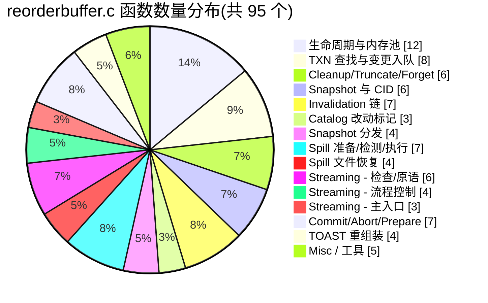
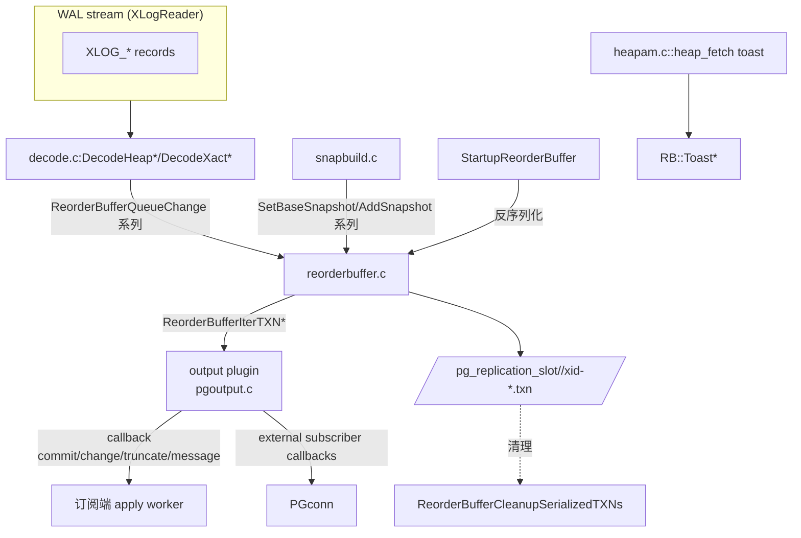

# PostgreSQL reorderbuffer.c 函数级源码全集:5615 行 / 95 个函数的逐函数解析

> 本文是 [reorderbuffer.c 源码深度解析](../postgresql-reorder-buffer-code-analysis/index.md) 的**姊妹篇**:前者讲架构/生命周期/数据结构骨架,本文按 **reorderbuffer.c 出现的所有 95 个函数** 逐个讲透。每个函数都带 **文件:行号 / 原型 / 完整代码 / 逐行解释 / 调用方 / 边界情况**。
>
> 源码全部基于 PostgreSQL 18 仓库 `~/cwork/postgresql/src/backend/replication/logical/reorderbuffer.c`(5615 行)。配套头文件:
> - `reorderbuffer.h`(API 与数据结构定义)
> - `decode.c`(把 WAL 记录喂入 reorder buffer 的入口)
> - `snapbuild.c`(给 reorder buffer 提供 base_snapshot)
> - `pgoutput/pgoutput.c`(output_plugin,消费 reorder buffer)

---

## 目录

### 概述
1. 阅读指南
2. 文件全貌:95 个函数的章节分布图
3. 按生命周期归纳的函数执行序列

### 第一组:生命周期与内存池(12 个)
4. ReorderBufferAllocate (reorderbuffer.c:324)
5. ReorderBufferFree (reorderbuffer.c:416)
6. ReorderBufferAllocTXN (reorderbuffer.c:434)
7. ReorderBufferFreeTXN (reorderbuffer.c:458)
8. ReorderBufferAllocChange (reorderbuffer.c:506)
9. ReorderBufferFreeChange (reorderbuffer.c:521)
10. ReorderBufferAllocTupleBuf (reorderbuffer.c:591)
11. ReorderBufferFreeTupleBuf (reorderbuffer.c:609)
12. ReorderBufferAllocRelids (reorderbuffer.c:624)
13. ReorderBufferFreeRelids (reorderbuffer.c:640)

### 第二组:TXN 查找与变更入队(8 个)
14. ReorderBufferTXNByXid (reorderbuffer.c:652)
15. ReorderBufferQueueChange (reorderbuffer.c:809)
16. ReorderBufferQueueMessage (reorderbuffer.c:872)
17. ReorderBufferProcessPartialChange (reorderbuffer.c:740)
18. AssertTXNLsnOrder (reorderbuffer.c:941)
19. AssertChangeLsnOrder (reorderbuffer.c:1012)
20. ReorderBufferGetOldestTXN (reorderbuffer.c:1043)
21. ReorderBufferGetOldestXmin (reorderbuffer.c:1071)
22. ReorderBufferSetRestartPoint (reorderbuffer.c:1086)

### 第三组:子事务绑定(3 个)
23. ReorderBufferAssignChild (reorderbuffer.c:1098)
24. ReorderBufferTransferSnapToParent (reorderbuffer.c:1164)
25. ReorderBufferCommitChild (reorderbuffer.c:1218)

### 第四组:多事务 K-Way 迭代(4 个)
26. ReorderBufferIterCompare (reorderbuffer.c:1260)
27. ReorderBufferIterTXNInit (reorderbuffer.c:1283)
28. ReorderBufferIterTXNNext (reorderbuffer.c:1411)
29. ReorderBufferIterTXNFinish (reorderbuffer.c:1503)

### 第五组:Cleanup / Truncate / Forget(6 个)
30. ReorderBufferCleanupTXN (reorderbuffer.c:1534)
31. ReorderBufferTruncateTXN (reorderbuffer.c:1655)
32. ReorderBufferCheckAndTruncateAbortedTXN (reorderbuffer.c:1773)
33. ReorderBufferBuildTupleCidHash (reorderbuffer.c:1835)
34. ReorderBufferForget (reorderbuffer.c:3170)
35. ReorderBufferInvalidate (reorderbuffer.c:3212)

### 第六组:Snapshot / 命令 ID / combo CID(6 个)
36. ReorderBufferCopySnap (reorderbuffer.c:1908)
37. ReorderBufferFreeSnap (reorderbuffer.c:1967)
38. ReorderBufferAddNewTupleCids (reorderbuffer.c:3440)
39. ReorderBufferAddNewCommandId (reorderbuffer.c:3341)
40. ResolveCminCmaxDuringDecoding (reorderbuffer.c:5527)
41. UpdateLogicalMappings (reorderbuffer.c:5449)

### 第七组:Invalidation 队列链(7 个)
42. ReorderBufferQueueInvalidations (reorderbuffer.c:3467)
43. ReorderBufferAccumulateInvalidations (reorderbuffer.c:3490)
44. ReorderBufferAddInvalidations (reorderbuffer.c:3528)
45. ReorderBufferAddDistributedInvalidations (reorderbuffer.c:3569)
46. ReorderBufferExecuteInvalidations (reorderbuffer.c:3627)
47. ReorderBufferImmediateInvalidation (reorderbuffer.c:3243)
48. ReorderBufferGetInvalidations (reorderbuffer.c:5601)

### 第八组:Catalog 改动标记(3 个)
49. ReorderBufferXidSetCatalogChanges (reorderbuffer.c:3639)
50. ReorderBufferGetCatalogChangesXacts (reorderbuffer.c:3677)
51. ReorderBufferXidHasCatalogChanges (reorderbuffer.c:3712)

### 第九组:Snapshot 分发与 base snapshot 设置(4 个)
52. ReorderBufferAddSnapshot (reorderbuffer.c:3292)
53. ReorderBufferSetBaseSnapshot (reorderbuffer.c:3310)
54. ReorderBufferXidHasBaseSnapshot (reorderbuffer.c:3729)
55. ReorderBufferProcessXid (reorderbuffer.c:3279)

### 第十组:内存压力 / Spill 准备(2 个)
56. ReorderBufferSerializeReserve (reorderbuffer.c:3759)
57. ReorderBufferTXNSizeCompare (reorderbuffer.c:3776)

### 第十一组:内存压力检测与执行(3 个)
58. ReorderBufferLargestTXN (reorderbuffer.c:3792)
59. ReorderBufferLargestStreamableTopTXN (reorderbuffer.c:3833)
60. ReorderBufferCheckMemoryLimit (reorderbuffer.c:3883)

### 第十二组:Spill-to-Disk(2 个)
61. ReorderBufferSerializeTXN (reorderbuffer.c:3963)
62. ReorderBufferSerializeChange (reorderbuffer.c:4058)

### 第十三组:启动恢复 / 文件路径(2 个)
63. StartupReorderBuffer (reorderbuffer.c:4907)
64. ReorderBufferSerializedPath (reorderbuffer.c:4889)

### 第十四组:Spill 文件恢复 / 清理(4 个)
65. ReorderBufferRestoreChanges (reorderbuffer.c:4510)
66. ReorderBufferRestoreChange (reorderbuffer.c:4653)
67. ReorderBufferRestoreCleanup (reorderbuffer.c:4820)
68. ReorderBufferCleanupSerializedTXNs (reorderbuffer.c:4850)

### 第十五组:Streaming - 检查与使能(2 个)
69. ReorderBufferCanStream (reorderbuffer.c:4273)
70. ReorderBufferCanStartStreaming (reorderbuffer.c:4282)

### 第十六组:Streaming - Apply 端原语(4 个)
71. ReorderBufferApplyChange (reorderbuffer.c:2071)
72. ReorderBufferApplyTruncate (reorderbuffer.c:2085)
73. ReorderBufferApplyMessage (reorderbuffer.c:2099)
74. ReorderBufferSaveTXNSnapshot (reorderbuffer.c:2119)

### 第十七组:Streaming - 流程控制(4 个)
75. ReorderBufferMaybeMarkTXNStreamed (reorderbuffer.c:2137)
76. ReorderBufferResetTXN (reorderbuffer.c:2164)
77. ReorderBufferStreamCommit (reorderbuffer.c:1982)
78. ReorderBufferStreamTXN (reorderbuffer.c:4308)

### 第十八组:Streaming - 主入口(2 个)
79. SetupCheckXidLive (reorderbuffer.c:2048)
80. ReorderBufferProcessTXN (reorderbuffer.c:2210)
81. ReorderBufferReplay (reorderbuffer.c:2813)

### 第十九组:Commit / Abort / Prepare(7 个)
82. ReorderBufferCommit (reorderbuffer.c:2874)
83. ReorderBufferRememberPrepareInfo (reorderbuffer.c:2897)
84. ReorderBufferSkipPrepare (reorderbuffer.c:2929)
85. ReorderBufferPrepare (reorderbuffer.c:2950)
86. ReorderBufferFinishPrepared (reorderbuffer.c:2991)
87. ReorderBufferAbort (reorderbuffer.c:3077)
88. ReorderBufferAbortOld (reorderbuffer.c:3123)

### 第二十组:TOAST 重组装(4 个)
89. ReorderBufferToastInitHash (reorderbuffer.c:4941)
90. ReorderBufferToastAppendChunk (reorderbuffer.c:4961)
91. ReorderBufferToastReplace (reorderbuffer.c:5044)
92. ReorderBufferToastReset (reorderbuffer.c:5235)

### 第二十一组:Catalog 映射 / 工具(5 个)
93. ApplyLogicalMappingFile (reorderbuffer.c:5334)
94. DisplayMapping (reorderbuffer.c:5306)
95. TransactionIdInArray (reorderbuffer.c:5426)
96. file_sort_by_lsn (reorderbuffer.c:5436)
97. ReorderBufferChangeSize (reorderbuffer.c:4425)
98. ReorderBufferChangeMemoryUpdate (reorderbuffer.c:3369)

### 附录
99. 函数 → 文件:行号 完整速查表
100. 调用方 → 函数 速查表
101. reorderbuffer.c 与配套模块关系
102. 与现有专题文章互链

---

## 一、阅读指南

为能读懂本文:
- 看完 [`postgresql-reorder-buffer-code-analysis`](../postgresql-reorder-buffer-code-analysis/index.md) 这篇 1321 行架构综述,可以建立顶层心智模型
- `SnapshotData`、`pairingheap`、`HTAB`、`Slab`、`GenerationMemoryContext`、`dlist_*`、`dclist_*`、`palloc/pfree` 这些类型都要先认熟
- 不熟悉 WAL `XLOG_HEAP2_NEW_CID` 可以回头读 [`postgresql-logical-replication-catalog-visibility`](../postgresql-logical-replication-catalog-visibility/index.md)

每节格式:
- **位置**:`reorderbuffer.c:起始行`
- **签名**:原型
- **源码**:删掉空行后的核心实现
- **逐行拆解**:每条语句都解释
- **调用方**:谁会调
- **边角细节**:错误处理、并发、断言、不变量
- **小图**:结构图 / 流程图(能画则画)


## 二、文件全貌:95 个函数的章节分布图



按生命周期顺序看 reorder buffer 究竟做了什么:

```mermaid
flowchart LR
    subgraph BOOT["启动"]
        RA[ReorderBufferAllocate] -->|创建 ctx & slab| CTX[3 套 context]
        CTX --> RB3["rb 持有<br/>txn_heap, by_txn, toplevel_by_lsn<br/>catchange_txns dclist"]
    end

    subgraph DECODE["WAL 解码"]
        DQ[ReorderBufferQueueChange] -->|先查 TXNByXid| BYX[ReorderBufferTXNByXid]
        BYX -->|找不到,create| ALLOC[ReorderBufferAllocTXN]
        BYX -->|1-entry cache 命中| HIT[Cache hit]
        DQ -->|partial change| PC[ReorderBufferProcessPartialChange]
        DQ -->|Spill 决策| CML[ReorderBufferCheckMemoryLimit]
        DQ -->|Stream 决策| CS[ReorderBufferCanStartStreaming]
        CS --是--> STREAM[ReorderBufferStreamTXN]
    end

    subgraph SUBX["子事务"]
        AC[XLOG_XACT_ASSIGNMENT] --> RAC[ReorderBufferAssignChild]
        RAC --> RTP[ReorderBufferTransferSnapToParent]
        CC[ReorderBufferCommitChild] --> RAC
    end

    subgraph COMIT["Commit / Abort"]
        CT[XLOG_XACT_COMMIT] --> RC[ReorderBufferCommit]
        RC --> PT[ReorderBufferProcessTXN]
        AT[XLOG_XACT_ABORT] --> RA2[ReorderBufferAbort]
        PR[XLOG_XACT_PREPARE] --> RP[ReorderBufferPrepare]
        CT2[XLOG_XACT_COMMIT_PREPARED] --> RFP[ReorderBufferFinishPrepared]
    end

    subgraph ITER["迭代"]
        PXT[ReorderBufferProcessTXN / ReorderBufferReplay] --> II[ReorderBufferIterTXNInit]
        II --> IN[ReorderBufferIterTXNNext]
        IN -->|"使用 ReorderBufferChange"|  PY[output plugin]
        IN -->|终止| IF[ReorderBufferIterTXNFinish]
        IF -->|"PG_CATCH 兜底"| IF
    end

    subgraph STREAM_F["Streaming"]
        STX[ReorderBufferStreamTXN] --> RST[ReorderBufferResetTXN]
        STX --> SC[ReorderBufferStreamCommit]
        SC --> IT3[同 ITER]
    end

    subgraph MEM["内存控制"]
        CML --> CL1{超阈值?}
        CL1 --是,本地--> SE[ReorderBufferSerializeTXN]
        CL1 --是,可以 stream--> STREAM
        SE --> SC2[ReorderBufferSerializeChange<br/>每个 change 排到 spill 文件]
        CML --> CLX{ReorderBufferLargestTXN<br/>或 LargestStreamableTopTXN}
        CLX -->|"判定目标"| CL1
    end

    subgraph RECV["重启恢复"]
        SU[StartupReorderBuffer] --> RC2[ReorderBufferRestoreChanges]
        RC2 --> RC3[ReorderBufferRestoreChange]
        RC3 -->|重放 change| PXT
        SU --> RU[ReorderBufferRestoreCleanup]
    end
```

## 三、按生命周期归纳的函数执行序列

下面这张表厘清 reorder buffer 内部方法在不同阶段被调用的频次,便于检索。

| 阶段 | 主要调用方 | 关键函数 |
|---|---|---|
| 启动 | `StartupDecodingContext` | `ReorderBufferAllocate`, `ReorderBufferCleanupSerializedTXNs` |
| WAL 解码 | `DecodeHeap*` / `DecodeXactOp` 等 | `ReorderBufferQueueChange`, `ReorderBufferQueueMessage`, `ReorderBufferTXNByXid`, `ReorderBufferAddSnapshot`, `ReorderBufferSetBaseSnapshot`, `ReorderBufferAddNewTupleCids`, `ReorderBufferAddNewCommandId`, `ReorderBufferAssignChild`, `ReorderBufferXidSetCatalogChanges`, `ReorderBufferQueueInvalidations`, `ReorderBufferAccumulateInvalidations` |
| Commit | `SnapBuildCommitTxn` → `ReorderBufferCommit` | `ReorderBufferCommit`, `ReorderBufferProcessTXN`, `ReorderBufferIterTXNInit`, `ReorderBufferIterTXNNext`, `ReorderBufferReplay`, `ReorderBufferIterTXNFinish`, `ReorderBufferTruncateTXN`, `ReorderBufferCleanupTXN` |
| Abort | `SnapBuildAbortTxn` 等 | `ReorderBufferAbort`, `ReorderBufferCheckAndTruncateAbortedTXN`, `ReorderBufferTruncateTXN`, `ReorderBufferCleanupTXN` |
| Prepare/CommitPrepared | two-phase decoding | `ReorderBufferRememberPrepareInfo`, `ReorderBufferSkipPrepare`, `ReorderBufferPrepare`, `ReorderBufferFinishPrepared` |
| Spill-to-Disk | `ReorderBufferCheckMemoryLimit` | `ReorderBufferLargestTXN`, `ReorderBufferSerializeReserve`, `ReorderBufferSerializeTXN`, `ReorderBufferSerializeChange`, `ReorderBufferTXNSizeCompare`, `ReorderBufferStreamTXN` |
| Spill 恢复 | `ReorderBufferAllocate` 后 / `StartupReorderBuffer` | `ReorderBufferRestoreChanges`, `ReorderBufferRestoreChange`, `ReorderBufferSerializedPath`, `ReorderBufferRestoreCleanup` |
| 输出 | `pgoutput` plugin | 全部 IterTXN* + Apply / Save Snap 系列 |
| 失效处理 | `ReorderBufferInvalidate`, `ReorderBufferImmediateInvalidation` | `ReorderBufferExecuteInvalidations` |
| Streaming | `ReorderBufferProcessTXN` | `ReorderBufferCanStream`, `ReorderBufferCanStartStreaming`, `ReorderBufferStreamTXN`, `ReorderBufferResetTXN`, `ReorderBufferStreamCommit`, `ReorderBufferMaybeMarkTXNStreamed`, `ReorderBufferApplyChange`, `ReorderBufferApplyTruncate`, `ReorderBufferApplyMessage`, `ReorderBufferSaveTXNSnapshot`, `SetupCheckXidLive` |
| TOAST | `DecodeInsert` / `DecodeUpdate` | `ReorderBufferToastInitHash`, `ReorderBufferToastAppendChunk`, `ReorderBufferToastReplace`, `ReorderBufferToastReset` |
| Debug | 故障排查 | `DisplayMapping`, `ApplyLogicalMappingFile`, `TransactionIdInArray`, `file_sort_by_lsn`, `ReorderBufferChangeSize`, `ReorderBufferChangeMemoryUpdate` |

---

## 四、`ReorderBufferAllocate`(reorderbuffer.c:324-413)

**位置** `reorderbuffer.c:324`  
**签名** `ReorderBuffer *ReorderBufferAllocate(void)`  
**作用** 创建并初始化一个 `ReorderBuffer` 句柄,把所有辅助内存池/hash/pairingheap 都建好

### 源码核心段落

```c
ReorderBuffer *
ReorderBufferAllocate(void)
{
    ReorderBuffer *buffer;
    HASHCTL     hash_ctl;
    MemoryContext new_ctx;

    Assert(MyReplicationSlot != NULL);

    new_ctx = AllocSetContextCreate(CurrentMemoryContext,
                                    "ReorderBuffer",
                                    ALLOCSET_DEFAULT_SIZES);
    buffer = (ReorderBuffer *) MemoryContextAlloc(new_ctx, sizeof(ReorderBuffer));
    memset(&hash_ctl, 0, sizeof(hash_ctl));
    buffer->context = new_ctx;

    buffer->change_context = SlabContextCreate(new_ctx, "Change",
                                               SLAB_DEFAULT_BLOCK_SIZE,
                                               sizeof(ReorderBufferChange));
    buffer->txn_context   = SlabContextCreate(new_ctx, "TXN",
                                              SLAB_DEFAULT_BLOCK_SIZE,
                                              sizeof(ReorderBufferTXN));

    buffer->tup_context   = GenerationContextCreate(new_ctx, "Tuples",
        SLAB_DEFAULT_BLOCK_SIZE, SLAB_DEFAULT_BLOCK_SIZE,
        SLAB_DEFAULT_BLOCK_SIZE);

    hash_ctl.keysize  = sizeof(TransactionId);
    hash_ctl.entrysize = sizeof(ReorderBufferTXNByIdEnt);
    hash_ctl.hcxt     = buffer->context;
    buffer->by_txn = hash_create("ReorderBufferByXid", 1000, &hash_ctl,
                                 HASH_ELEM | HASH_BLOBS | HASH_CONTEXT);
    buffer->by_txn_last_xid  = InvalidTransactionId;
    buffer->by_txn_last_txn  = NULL;
    buffer->outbuf          = NULL;
    buffer->outbufsize      = 0;
    buffer->size            = 0;
    buffer->txn_heap        = pairingheap_allocate(ReorderBufferTXNSizeCompare, NULL);

    /* 内存/统计/重启相关 */
    buffer->spillTxns = 0;
    buffer->spillCount = 0; buffer->spillBytes = 0;
    buffer->streamTxns = 0; buffer->streamCount = 0; buffer->streamBytes = 0;
    buffer->totalTxns = 0; buffer->totalBytes = 0;
    buffer->current_restart_decoding_lsn = InvalidXLogRecPtr;

    dlist_init(&buffer->toplevel_by_lsn);
    dlist_init(&buffer->txns_by_base_snapshot_lsn);
    dclist_init(&buffer->catchange_txns);

    ReorderBufferCleanupSerializedTXNs(NameStr(MyReplicationSlot->data.name));
    return buffer;
}
```

### 逐行拆解

- **`Assert(MyReplicationSlot != NULL)`**:必须是 slot 启动后调用。slot 名字决定后面 spill 文件名前缀
- **`new_ctx = AllocSetContextCreate(...)`**:reorder buffer 自己的 root context,之后 `MemoryContextDelete` 可以一键清空
- **`SlabContextCreate(new_ctx, "Change", SLAB_DEFAULT_BLOCK_SIZE, sizeof(ReorderBufferChange))`**:Slab = 固定大小对象池;适合 `ReorderBufferChange`(虽然有些变体有 inline tuple,但结构体大小是固定的)
- **GenerationContextCreate(... "Tuples" ...)**:Generation = 与 block 对齐、固定大小、与之前版本兼容。`HEAPTUPLESIZE` 在长事务大量 tuple 时减少 fragment,见 PG 14 commit 记录
- **`hash_create("ReorderBufferByXid", 1000, &hash_ctl, HASH_ELEM | HASH_BLOBS | HASH_CONTEXT)`**:`HASH_BLOBS` 因为 key 是裸 `TransactionId`(`uint32`)而非 string;`HASH_CONTEXT` 让 hash 在 buffer->context 上分配
- **`by_txn_last_*`**:1-entry cache 字段,见 §14
- **`pairingheap_allocate(ReorderBufferTXNSizeCompare, NULL)`**:`txn_heap` 排序按 `ReorderBufferTXNSizeCompare`(`total_size desc`),作为 LRU-like 的取舍依据
- **`spillTxns/spillCount/spillBytes` 与 `streamTxns/...`** 是统计字段,便于复现问题
- **`current_restart_decoding_lsn`**:启动到结束之间,记录 slot 重启过的最大解码位置(被 `ReorderBufferSetRestartPoint` 更新)
- **`dlist_init(&toplevel_by_lsn)`**:toplevel 事务按 LSN 排
- **`dclist_init(&catchange_txns)`**:**`dclist` 而不是 `dlist`** —— `dclist` 支持并发删除,意味着多个 backend 同时可删(catalog snapshot 重建路径)
- **最后的 `ReorderBufferCleanupSerializedTXNs(slotname)`**:启动时 sweep 残留 spill 文件(防止 SIGSEGV 留下 garbage 文件导致重启时误用)。详见 §68

### 调用方

`StartupDecodingContext` 或类似入口(`slotfuncs.c` / `pg_recvlogical`)

### 关键不变量

- 同一个 `ReorderBuffer` 一次栈生命周期内不要 `Assert(MyReplicationSlot)` 失败
- 任何 `by_txn_last_xid` 缓存更新后,必须保证 `by_txn_last_txn` 与 `by_txn` 内存里的指向一致

## 五、`ReorderBufferFree`(reorderbuffer.c:416-431)

**位置** `reorderbuffer.c:416`  
**签名** `void ReorderBufferFree(ReorderBuffer *rb)`  
**作用** 释放 reorder buffer 所有内存池 + 磁盘 spill 文件清理。

### 源码

```c
void
ReorderBufferFree(ReorderBuffer *rb)
{
    MemoryContext context = rb->context;

    /* entire reorderbuffer slabs / allocations are inside rb->context */
    MemoryContextDelete(context);

    ReorderBufferCleanupSerializedTXNs(NameStr(MyReplicationSlot->data.name));
}
```

### 拆解

- **`MemoryContextDelete(context)`** —— 一次清掉所有子 ctx(Slab/Generation/AllocSet),所有未显式 free 的对象自动回收
- 第二次 `ReorderBufferCleanupSerializedTXNs` 是兜底:运行期 spilled 到磁盘的文件,如果有"未消费且还在目录里"的需要清掉

### 调用方

`ShutdownDecodingContext` 或调用方自己 cleanup。

### 边角

- 如果之前已 spill 但 output plugin 还没消费,在 `MemoryContextDelete` 之前应当先 `ReorderBufferRestoreChanges + ReorderBufferIterTXN*` 把残留 change 消费完
- `MyReplicationSlot` 在 Free 时必须仍是同一个 slot;否则会误删文件

## 六、`ReorderBufferAllocTXN`(reorderbuffer.c:434-456)

**位置** `reorderbuffer.c:434`  
**签名** `static ReorderBufferTXN *ReorderBufferAllocTXN(ReorderBuffer *rb)`

```c
static ReorderBufferTXN *
ReorderBufferAllocTXN(ReorderBuffer *rb)
{
    ReorderBufferTXN *txn;

    txn = (ReorderBufferTXN *)
        MemoryContextAlloc(rb->txn_context, sizeof(ReorderBufferTXN));
    memset(txn, 0, sizeof(ReorderBufferTXN));

    dlist_init(&txn->changes);
    dlist_init(&txn->tuplecids);
    dlist_init(&txn->subtxns);

    txn->command_id = InvalidCommandId;
    txn->output_plugin_private = NULL;
    return txn;
}
```

### 拆解

- 从 `txn_context`(Slab)分配。所有 TXN 在同一 slab,**生命周期内** 不会被 free 之后复用——Slab 不会 release
- `dlist_init` 三个 dlist:
  - `changes`:change 队列
  - `tuplecids`:插入/替换的 catalog tuple CID 队列
  - `subtxns`:subtransaction 列表
- `command_id = InvalidCommandId`:**不是零**(0 是合法的 FirstCommandId)

### 调用方

仅 `ReorderBufferTXNByXid` 中 HASH_ENTER 的分支

## 七、`ReorderBufferFreeTXN`(reorderbuffer.c:458-503)

**位置** `reorderbuffer.c:458`  
**签名** `static void ReorderBufferFreeTXN(ReorderBuffer *rb, ReorderBufferTXN *txn)`

```c
static void
ReorderBufferFreeTXN(ReorderBuffer *rb, ReorderBufferTXN *txn)
{
    if (rb->by_txn_last_xid == txn->xid)
    {
        rb->by_txn_last_xid = InvalidTransactionId;
        rb->by_txn_last_txn = NULL;
    }

    if (txn->gid != NULL)              { pfree(txn->gid);          txn->gid = NULL; }
    if (txn->tuplecid_hash != NULL)    { hash_destroy(txn->tuplecid_hash); txn->tuplecid_hash = NULL; }
    if (txn->invalidations)            { pfree(txn->invalidations); txn->invalidations = NULL; }
    if (txn->invalidations_distributed) { pfree(txn->invalidations_distributed); txn->invalidations_distributed = NULL; }

    ReorderBufferToastReset(rb, txn);
    Assert(txn->size == 0);
    pfree(txn);
}
```

### 拆解

- **必须先清缓存**:否则下一次 `ReorderBufferTXNByXid(rb, txn->xid, ...)` 命中的 cache 是 dangling
- 4 个字段顺序释放:`gid`(预备事务名), `tuplecid_hash`, 本地 invals 数组, distributed invals 数组
- 调 `ReorderBufferToastReset` 释放 toast chunk hash
- `Assert(txn->size == 0)` —— 在调用方全删完 changes 之后才可释放,否则 leak 内存记账

### 调用方

`ReorderBufferCleanupTXN` 和 `ReorderBufferRestoreCleanup`

## 八、`ReorderBufferAllocChange`(reorderbuffer.c:506-519)

`ReorderBufferChange *ReorderBufferAllocChange(ReorderBuffer *rb)`

```c
ReorderBufferChange *
ReorderBufferAllocChange(ReorderBuffer *rb)
{
    ReorderBufferChange *change;
    change = (ReorderBufferChange *)
        MemoryContextAlloc(rb->change_context, sizeof(ReorderBufferChange));
    memset(change, 0, sizeof(ReorderBufferChange));
    return change;
}
```

固定大小 Slab,返回的对象头部零。`data` union 在调用方赋值。

## 九、`ReorderBufferFreeChange`(reorderbuffer.c:521-589)

`void ReorderBufferFreeChange(ReorderBuffer *rb, ReorderBufferChange *change, bool upd_mem)`

按 action 分支 free 内部数据:

```c
if (upd_mem)
    ReorderBufferChangeMemoryUpdate(rb, change, NULL, false,
                                    ReorderBufferChangeSize(change));
switch (change->action) {
case REORDER_BUFFER_CHANGE_INSERT/UPDATE/DELETE/INTERNAL_SPEC_INSERT:
    if (change->data.tp.newtuple) ReorderBufferFreeTupleBuf(...);
    if (change->data.tp.oldtuple) ReorderBufferFreeTupleBuf(...);
    break;
case REORDER_BUFFER_CHANGE_MESSAGE:
    if (change->data.msg.prefix)   pfree(...);
    if (change->data.msg.message)  pfree(...);
    break;
case REORDER_BUFFER_CHANGE_INVALIDATION:
    if (change->data.inval.invalidations) pfree(...);
    break;
case REORDER_BUFFER_CHANGE_INTERNAL_SNAPSHOT:
    if (change->data.snapshot)
        ReorderBufferFreeSnap(rb, change->data.snapshot);
    break;
case REORDER_BUFFER_CHANGE_TRUNCATE:
    if (change->data.truncate.relids)
        ReorderBufferFreeRelids(rb, change->data.truncate.relids);
    break;
case REORDER_BUFFER_CHANGE_INTERNAL_SPEC_CONFIRM/ABORT/COMMAND_ID/TUPLECID:
    break;  /* no extra data */
}
pfree(change);
```

### 拆解

- **`upd_mem` 决定是否扣减 memory accounting**;调用方已经手工管理时置 false
- 9 种 action:
  - 4 种 tuple 类(INSERT/UPDATE/DELETE/INTERNAL_SPEC_INSERT)都要释放 newtuple/oldtuple
  - MESSAGE 释放 prefix/message
  - INVALIDATION 释放 invalidations 数组
  - INTERNAL_SNAPSHOT 走 `ReorderBufferFreeSnap`(独立内存池)
  - TRUNCATE 走 ReorderBufferFreeRelids(全局 ctx,见 §12 注释)
  - 4 种 *INTERNAL* 流(CONFIRM/ABORT/COMMAND_ID/TUPLECID)没有额外数据
- `pfree(change)` 由 SlabContext 回收

### 调用方

`ReorderBufferQueueChange`(早就 abort 时跳过)、`ReorderBufferRestoreChange`、`ReorderBufferIterTXNFinish` 等

## 十、`ReorderBufferAllocTupleBuf`(reorderbuffer.c:591-607)

`HeapTuple ReorderBufferAllocTupleBuf(ReorderBuffer *rb, Size tuple_len)`

```c
HeapTuple
ReorderBufferAllocTupleBuf(ReorderBuffer *rb, Size tuple_len)
{
    HeapTuple tuple;
    Size alloc_len = tuple_len + SizeofHeapTupleHeader;
    tuple = (HeapTuple) MemoryContextAlloc(rb->tup_context,
                                           HEAPTUPLESIZE + alloc_len);
    tuple->t_data = (HeapTupleHeader)((char *)tuple + HEAPTUPLESIZE);
    return tuple;
}
```

- 分配完留 `HEAPTUPLESIZE` 给 HeapTupleData 本身,后接 `alloc_len` 给 tuple payload
- Generation context 减小 fragment。decoded tuple 数据**必须走 `tup_context`**;否则可能被 spill 后误判 block size

## 十一、`ReorderBufferFreeTupleBuf`(reorderbuffer.c:609-622)

`void ReorderBufferFreeTupleBuf(HeapTuple tuple)` —— 直接 `pfree`

## 十二、`ReorderBufferAllocRelids`(reorderbuffer.c:624-638)

`Oid *ReorderBufferAllocRelids(ReorderBuffer *rb, int nrelids)`

注意:在 *rb->context* 上分配(AllocSet),**不**在 Slab/Generation 上,因为 TRUNCATE 的 relid 数组大小可变。

## 十三、`ReorderBufferFreeRelids`(reorderbuffer.c:640-649)

`void ReorderBufferFreeRelids(ReorderBuffer *rb, Oid *relids)` —— 直接 pfree


## 十四、`ReorderBufferTXNByXid`(reorderbuffer.c:652-737)

**位置** `reorderbuffer.c:652`  
**签名** `static ReorderBufferTXN *ReorderBufferTXNByXid(ReorderBuffer *rb, TransactionId xid, bool create, bool *is_new, XLogRecPtr lsn, bool create_as_top)`

```c
static ReorderBufferTXN *
ReorderBufferTXNByXid(ReorderBuffer *rb, TransactionId xid, bool create,
                      bool *is_new, XLogRecPtr lsn, bool create_as_top)
{
    ReorderBufferTXN *txn;
    ReorderBufferTXNByIdEnt *ent;
    bool found;

    Assert(TransactionIdIsValid(xid));

    /* 1-entry cache */
    if (TransactionIdIsValid(rb->by_txn_last_xid) &&
        rb->by_txn_last_xid == xid)
    {
        txn = rb->by_txn_last_txn;
        if (txn != NULL) {
            if (is_new) *is_new = false;
            return txn;
        }
        if (!create) return NULL;
        /* fall through to create */
    }

    ent = (ReorderBufferTXNByIdEnt *)
        hash_search(rb->by_txn, &xid, create ? HASH_ENTER : HASH_FIND, &found);
    if (found)
        txn = ent->txn;
    else if (create)
    {
        Assert(ent != NULL);
        Assert(lsn != InvalidXLogRecPtr);
        ent->txn = ReorderBufferAllocTXN(rb);
        ent->txn->xid = xid;
        txn = ent->txn;
        txn->first_lsn = lsn;
        txn->restart_decoding_lsn = rb->current_restart_decoding_lsn;
        if (create_as_top) {
            dlist_push_tail(&rb->toplevel_by_lsn, &txn->node);
            AssertTXNLsnOrder(rb);
        }
    }
    else
        txn = NULL;

    rb->by_txn_last_xid = xid;
    rb->by_txn_last_txn = txn;
    if (is_new) *is_new = !found;
    Assert(!create || txn != NULL);
    return txn;
}
```

### 拆解

#### 1. 1-entry cache

```c
if (TransactionIdIsValid(rb->by_txn_last_xid) &&
    rb->by_txn_last_xid == xid) { ... }
```

- 解码大多数 WAL 一连串同 xid 的记录(commit 时连续 commit_record + subxact commit),1-entry cache 命中率高,避免 hash lookup
- "cached as non-existent" 的语义:`by_txn_last_txn == NULL` 表示曾被查找过且不存在;若 `create == false` 直接返回 NULL

#### 2. `hash_search` 主路径

- `HASH_ENTER` 会在 not-found 时自动写入一个 zero-init entry
- 一次性 alloc TXN 后挂在 entry 上:`ent->txn = ReorderBufferAllocTXN(rb)`

#### 3. `create_as_top` 的两个分支

- `true`:`dlist_push_tail(&rb->toplevel_by_lsn, ...)` 把它按 LSN 排到 toplevel 队列
- `false`:用于 subxact 路径——以后 `ReorderBufferAssignChild` 才把它转到父

#### 4. cache 写回

无论命中与否,**只要操作完,** 都更新 `by_txn_last_xid = xid` 与 `by_txn_last_txn = txn(可能 NULL)`。下次的同 xid 查找直接命中

#### 5. `Assert(lsn != InvalidXLogRecPtr)`

create 分支必须给一个有效 LSN。无 LSN 意味着无法排序

### 调用方

`ReorderBufferQueueChange`, `ReorderBufferAssignChild`, `ReorderBufferCommitChild`, `ReorderBufferAbort`, `ReorderBufferForget`, `ReorderBufferInvalidate`, 等等几十处

### 边角

- caller 传入 `is_new = NULL` 是合法的(老代码 API 习惯)
- 若调用方传入 create=false,但 cache 命中后是 NULL,那么 hash_search 是 HASH_FIND;若也确实不在 hash 中,返回 NULL
- **不变量**:同一 xid 上一次 INSPECT 后立即 INSPECT 第二次,**第二次必走 cache**,不会去 hash

## 十五、`ReorderBufferQueueChange`(reorderbuffer.c:809-869)

`void ReorderBufferQueueChange(ReorderBuffer *rb, TransactionId xid, XLogRecPtr lsn, ReorderBufferChange *change, bool toast_insert)`

```c
void
ReorderBufferQueueChange(ReorderBuffer *rb, TransactionId xid, XLogRecPtr lsn,
                         ReorderBufferChange *change, bool toast_insert)
{
    ReorderBufferTXN *txn;
    txn = ReorderBufferTXNByXid(rb, xid, true, NULL, lsn, true);

    if (rbtxn_is_aborted(txn))
    {
        ReorderBufferFreeChange(rb, change, false);  /* 不需要 upd_mem,没入队 */
        return;
    }

    if (change->action == REORDER_BUFFER_CHANGE_INSERT
        || ... || change->action == REORDER_BUFFER_CHANGE_MESSAGE)
    {
        ReorderBufferTXN *toptxn = rbtxn_get_toptxn(txn);
        toptxn->txn_flags |= RBTXN_HAS_STREAMABLE_CHANGE;
    }

    change->lsn = lsn;
    change->txn = txn;
    dlist_push_tail(&txn->changes, &change->node);
    txn->nentries++;
    txn->nentries_mem++;

    ReorderBufferChangeMemoryUpdate(rb, change, NULL, true,
                                    ReorderBufferChangeSize(change));
    ReorderBufferProcessPartialChange(rb, txn, change, toast_insert);
    ReorderBufferCheckMemoryLimit(rb);
}
```

### 拆解

- **`txn` 一定找得到(create=true)**,新 TXN 是 stub
- **`rbtxn_is_aborted` 提前 exit**:aborted 事务不再接收变更,直接 free(但 upd_mem=false,因为没让它进入内存记账)
- **6 种 streamable action 设置 `RBTXN_HAS_STREAMABLE_CHANGE`**(INSERT/UPDATE/DELETE/INTERNAL_SPEC_INSERT/TRUNCATE/MESSAGE)
- **入队**:
  - `change->lsn = lsn`
  - `change->txn = txn` —— change 自己反指 TXN
  - `dlist_push_tail`:`txn->changes` 按 LSN 入队
  - `nentries++` 总数,`nentries_mem++` 内存中 change 数
- **`ReorderBufferChangeMemoryUpdate(..., true, ...)`** 累加内存 → 决定后续是否需要 Spill 或 Stream
- **`ReorderBufferProcessPartialChange`** 处理 toast/speculative 的不完整情况
- **`ReorderBufferCheckMemoryLimit`** 检查 `logical_decoding_work_mem`,若超则 Spill/Stream

### 调用方

`DecodeHeap*` 系列(`DecodeInsert`/`DecodeUpdate`/`DecodeDelete`/...), `DecodeTruncate`, `DecodeStandbyMessage`, 所有 ReorderBufferAdd* 系列

## 十六、`ReorderBufferQueueMessage`(reorderbuffer.c:872-912)

`void ReorderBufferQueueMessage(ReorderBuffer *rb, TransactionId xid, Snapshot snap, XLogRecPtr lsn, bool transactional, const char *prefix, Size message_size, const char *message)`

```c
if (transactional) {
    MemoryContext oldcontext;
    ReorderBufferChange *change;
    Assert(xid != InvalidTransactionId);
    Assert(!snap);
    oldcontext = MemoryContextSwitchTo(rb->context);
    change = ReorderBufferAllocChange(rb);
    change->action = REORDER_BUFFER_CHANGE_MESSAGE;
    change->data.msg.prefix = pstrdup(prefix);
    change->data.msg.message_size = message_size;
    change->data.msg.message = palloc(message_size);
    memcpy(change->data.msg.message, message, message_size);
    ReorderBufferQueueChange(rb, xid, lsn, change, false);
    MemoryContextSwitchTo(oldcontext);
} else {
    ReorderBufferTXN *txn = NULL;
    volatile Snapshot snapshot_now = snap;
    Assert(snapshot_now);
    if (xid != InvalidTransactionId)
        txn = ReorderBufferTXNByXid(rb, xid, true, NULL, lsn, true);
    SetupHistoricSnapshot(snapshot_now, NULL);
    PG_TRY();
    {
        rb->message(rb, txn, lsn, false, prefix, message_size, message);
        TeardownHistoricSnapshot(false);
    }
    PG_CATCH();
    {
        TeardownHistoricSnapshot(true);
        PG_RE_THROW();
    }
    PG_END_TRY();
}
```

### 拆解

#### 事务型

- 完整路径:alloc change → 复制 prefix+message → 交给 `ReorderBufferQueueChange` 入队
- `MemoryContextSwitchTo(rb->context)`:确保 pstrdup/palloc 落在 reorder buffer 内存池里,跟随 context 释放

#### 非事务型

- 立刻调 `rb->message` callback(pgoutput: `pg_output_message`)
- 用 `SetupHistoricSnapshot` 临时建立 HVMCC 上下文,使 callback 可以读 catalog
- **`PG_TRY / PG_CATCH` 兜底**:任何 plugin 抛错都能保证 `TeardownHistoricSnapshot(true)` 清理异常捕获下也跑过 snapshot teardown
- `volatile Snapshot snapshot_now` 让编译器不要在 try 内优化掉这一引用

### 调用方

`DecodeStandbyMessage`(`XLOG_STANDBY_MESSAGE` 路径)

## 十七、`ReorderBufferProcessPartialChange`(reorderbuffer.c:740-808)

`static void ReorderBufferProcessPartialChange(ReorderBuffer *rb, ReorderBufferTXN *txn, ReorderBufferChange *change, bool toast_insert)`

```c
static void
ReorderBufferProcessPartialChange(ReorderBuffer *rb, ReorderBufferTXN *txn,
                                  ReorderBufferChange *change, bool toast_insert)
{
    ReorderBufferTXN *toptxn;

    if (!ReorderBufferCanStream(rb))
        return;
    toptxn = rbtxn_get_toptxn(txn);

    if (toast_insert)
        toptxn->txn_flags |= RBTXN_HAS_PARTIAL_CHANGE;
    else if (rbtxn_has_partial_change(toptxn) &&
             IsInsertOrUpdate(change->action) &&
             change->data.tp.clear_toast_afterwards)
        toptxn->txn_flags &= ~RBTXN_HAS_PARTIAL_CHANGE;

    if (IsSpecInsert(change->action))
        toptxn->txn_flags |= RBTXN_HAS_PARTIAL_CHANGE;
    else if (rbtxn_has_partial_change(toptxn) && IsSpecConfirmOrAbort(change->action))
        toptxn->txn_flags &= ~RBTXN_HAS_PARTIAL_CHANGE;

    if (ReorderBufferCanStartStreaming(rb) &&
        !(rbtxn_has_partial_change(toptxn)) &&
        rbtxn_is_serialized(txn) &&
        rbtxn_has_streamable_change(toptxn))
        ReorderBufferStreamTXN(rb, toptxn);
}
```

### 拆解

- **只在 streaming 开启时跑**(`ReorderBufferCanStream` 早期返回)
- **toast chunk 完成才算完整**:toast_insert → RBTXN_HAS_PARTIAL_CHANGE 置位;主表 INSERT/UPDATE 且 `clear_toast_afterwards` → 清掉
- **speculative insertion 完成才算完整**:SPEC_INSERT 置位;SPEC_CONFIRM / SPEC_ABORT 撤销
- **完整后立刻尝试 stream**:之前因为 partial 不能 stream,等到 partial 解除(clear_toast_afterwards / confirm),如果该事务已经 serialize 且 memory 超阈值,这里补一个 stream

### 调用方

`ReorderBufferQueueChange`(每次 change 入队后)

## 十八、`AssertTXNLsnOrder`(reorderbuffer.c:941-1010)

`static void AssertTXNLsnOrder(ReorderBuffer *rb)` —— `#ifdef USE_ASSERT_CHECKING` 内

```c
dlist_foreach(iter, &rb->toplevel_by_lsn)
{
    ReorderBufferTXN *cur_txn;
    cur_txn = dlist_container(ReorderBufferTXN, node, iter.cur);
    Assert(cur_txn->first_lsn != InvalidXLogRecPtr);
    if (cur_txn->end_lsn != InvalidXLogRecPtr)
        Assert(cur_txn->first_lsn <= cur_txn->end_lsn);
    if (prev_first_lsn != InvalidXLogRecPtr)
        Assert(prev_first_lsn < cur_txn->first_lsn);
    Assert(!rbtxn_is_known_subxact(cur_txn));
    prev_first_lsn = cur_txn->first_lsn;
}
```

同时检查:
- `txns_by_base_snapshot_lsn` 也有同样严格递增约束
- **toplevel 不应包含 known-subxact**(`rbtxn_is_known_subxact`);subxact 在 `AssignChild` 后已经从这条 dlist 移除

### 拆解

如果还没到达 `start_decoding_at`,有可能无法保证 toplevel/subxact 关联时正确——`SnapBuildXactNeedsSkip` 判断后跳过检查

### 调用方

`ReorderBufferTXNByXid`(CREATE)、`ReorderBufferAssignChild` 末尾、`ReorderBufferGetOldestTXN`/`GetOldestXmin` 头部等

## 十九、`AssertChangeLsnOrder`(reorderbuffer.c:1012-1041)

`static void AssertChangeLsnOrder(ReorderBufferTXN *txn)` — 仅在 debug

```c
dlist_foreach(iter, &txn->changes) {
    ReorderBufferChange *cur_change;
    cur_change = dlist_container(ReorderBufferChange, node, iter.cur);
    Assert(cur_change->lsn != InvalidXLogRecPtr);
    Assert(txn->first_lsn <= cur_change->lsn);
    if (txn->end_lsn != InvalidXLogRecPtr)
        Assert(cur_change->lsn <= txn->end_lsn);
    Assert(prev_lsn <= cur_change->lsn);
    prev_lsn = cur_change->lsn;
}
```

### 拆解

检查每个 change 在 dlist 中严格 LSN 递增,且被 `txn->first_lsn` ≤ lsn ≤ `txn->end_lsn` 包含。

### 调用方

`ReorderBufferIterTXNInit`

## 二十、`ReorderBufferGetOldestTXN`(reorderbuffer.c:1043-1069)

`ReorderBufferTXN *ReorderBufferGetOldestTXN(ReorderBuffer *rb)`

返回 `toplevel_by_lsn` 头部,即 LSN 最早的 toplevel TXN。如果 dlist 为空返回 NULL。

### 边角

- `first_lsn != InvalidXLogRecPtr` 是必须的(否则没有"早"的概念)
- 与 `toast_reset_pending`, `cleanup_serialized_TXNs` 等无关 —— 只读 dlist 头

### 调用方

`SnapBuildProcessRunningXacts`(在 snapbuild 推 xmax 时需要 oldest 时拿)

## 二十一、`ReorderBufferGetOldestXmin`(reorderbuffer.c:1071-1084)

`TransactionId ReorderBufferGetOldestXmin(ReorderBuffer *rb)`

```c
txn = dlist_head_element(ReorderBufferTXN, base_snapshot_node,
                         &rb->txns_by_base_snapshot_lsn);
return txn->base_snapshot->xmin;
```

返回最旧一个 base snapshot 的 xmin。"最旧"即 `txns_by_base_snapshot_lsn` 头部;语义上等价于"reorderbuffer 内所有正在跑的 txn 中最老 commit 后的 active xmin"。

### 边角

如果没有 base snapshot,返回 `InvalidTransactionId`,需要 caller 处理。

## 二十二、`ReorderBufferSetRestartPoint`(reorderbuffer.c:1086-1095)

`void ReorderBufferSetRestartPoint(ReorderBuffer *rb, XLogRecPtr ptr)`

仅一行:`rb->current_restart_decoding_lsn = ptr;`

被 `ReorderBufferTXNByXid` 创建新事务时使用,把 `restart_decoding_lsn` 记到新事务上,后续 `ReorderBufferReplay` 决定哪些 change 需要被重发

### 调用方

`LogicalDecodingContext`(slot 重启后调)

## 二十三、`ReorderBufferAssignChild`(reorderbuffer.c:1098-1162)

`void ReorderBufferAssignChild(ReorderBuffer *rb, TransactionId xid, TransactionId subxid, XLogRecPtr lsn)`

```c
void
ReorderBufferAssignChild(ReorderBuffer *rb, TransactionId xid,
                         TransactionId subxid, XLogRecPtr lsn)
{
    ReorderBufferTXN *txn;
    ReorderBufferTXN *subtxn;
    bool new_top;
    bool new_sub;

    txn    = ReorderBufferTXNByXid(rb, xid,    true, &new_top, lsn, true);
    subtxn = ReorderBufferTXNByXid(rb, subxid, true, &new_sub, lsn, false);

    if (!new_sub)
    {
        if (rbtxn_is_known_subxact(subtxn))
            return;
        else
            dlist_delete(&subtxn->node);  /* 从 toplevel 中移除 */
    }

    subtxn->txn_flags |= RBTXN_IS_SUBXACT;
    subtxn->toplevel_xid = xid;
    subtxn->toptxn = txn;
    dlist_push_tail(&txn->subtxns, &subtxn->node);
    txn->nsubtxns++;

    ReorderBufferTransferSnapToParent(txn, subtxn);
    AssertTXNLsnOrder(rb);
}
```

### 拆解

#### 三种行为

1. **subxid 已知**(`!new_sub` && `rbtxn_is_known_subxact`):已经接好父子,no-op
2. **subxid 已知但当作 top**:`dlist_delete(&subtxn->node)` 从 toplevel dlist 移除,然后接入父
3. **完全新 subxid**:新创建 stub,加 father 标志

#### `ReorderBufferTransferSnapToParent`

父无 snapshot / 父 snapshot 更晚 → 把 subxid 的 base_snapshot 转给父(subxid 仍持有变 NULL)。父 snapshot 已经在 → 释放 subxid 的

#### `AssertTXNLsnOrder`

每次 assign 后保持 toplevel dlist 严格 LSN 升序

### 调用方

`DecodeXactOp`(XLOG_XACT_ASSIGNMENT) ,`ReorderBufferCommitChild`(commit 时收敛父子关系)

### 边角

- `lsn` 在 `ReorderBufferCommitChild` 调用时传 `InvalidXLogRecPtr`,本身不会再用 —— 因为只是把已有 txn 标 sub-act
- 如果 subxid 已被 spill to disk,`tuplecid_hash`/`invalidations`等可能来自更早的 spill,AssignChild 不会重新 load;只动 flags 与 toptxn

## 二十四、`ReorderBufferTransferSnapToParent`(reorderbuffer.c:1164-1216)

`static void ReorderBufferTransferSnapToParent(ReorderBufferTXN *txn, ReorderBufferTXN *subtxn)`

如果 `subtxn->base_snapshot != NULL`:

- 父无 / 父更晚 → 转给父:`txn->base_snapshot = subtxn->base_snapshot` 并调整 dlist 顺序
- 父已有更早 → 释放 subtxn:`SnapBuildSnapDecRefcount(...)` + `pfree`

不论哪种,subtxn 的 base_snapshot 字段被清空、dlist 节点被删除。

### 边角

`dlist_insert_before(&subtxn->base_snapshot_node, &txn->base_snapshot_node)` —— 让父在 dlist 中停在原来 subxid 的位置,保证 `txns_by_base_snapshot_lsn` 仍按 LSN 升序

## 二十五、`ReorderBufferCommitChild`(reorderbuffer.c:1218-1258)

`void ReorderBufferCommitChild(ReorderBuffer *rb, TransactionId xid, TransactionId subxid, XLogRecPtr commit_lsn, XLogRecPtr end_lsn)`

```c
subtxn = ReorderBufferTXNByXid(rb, subxid, false, NULL,
                               InvalidXLogRecPtr, false);
if (!subtxn) return;
subtxn->final_lsn = commit_lsn;
subtxn->end_lsn   = end_lsn;
ReorderBufferAssignChild(rb, xid, subxid, InvalidXLogRecPtr);
```

### 拆解

- 收尾:找到 subxid 后立即赋值 `final_lsn` 和 `end_lsn`(这两值原先是 InvalidXLogRecPtr 等着 commit 时填)
- 再调 `AssignChild`(如果父在 commit 时可能还没识别父子关系,这里补一下)

### 调用方

`DecodeXactOp`(处理 XLOG_XACT_COMMIT 时遇到 subxact commit 记录)

## 二十六、`ReorderBufferIterCompare`(reorderbuffer.c:1260-1279)

`static int ReorderBufferIterCompare(Datum a, Datum b, void *arg)`

binaryheap 比较函数。从 `state->entries[i].lsn` 取,返回 1/0/-1 表示 a>b/a==b/a<b。注意返回 **a > b 时返回 1**(binaryheap 取最小堆时该写法让最小值在堆顶)

## 二十七、`ReorderBufferIterTXNInit`(reorderbuffer.c:1283-1410)

`static void ReorderBufferIterTXNInit(ReorderBuffer *rb, ReorderBufferTXN *txn, ReorderBufferIterTXNState *volatile *iter_state)`

```c
*iter_state = NULL;
AssertChangeLsnOrder(txn);

/* count toplevel + subxact + 自身 */
nr_txns = 1;
dlist_foreach(iter, &txn->subtxns)
{
    subtxn = dlist_container(ReorderBufferTXN, node, iter.cur);
    Assert(!rbtxn_is_known_subxact(subtxn));
    nr_txns++;
}

state = palloc(offsetof(ReorderBufferIterTXNState, entries) +
               sizeof(ReorderBufferIterTXNStateEntry) * nr_txns);
state->nr_txns = nr_txns;
state->rb = rb;
state->current_txn = txn;
state->current_change = NULL;

off = 0;
state->entries[off++] = (ReorderBufferIterTXNStateEntry){.xid = txn->xid, ...};
dlist_foreach(iter, &txn->subtxns) ... state->entries[off++] = ...;

/* 把每个 txn 的 changes dlist head 放入 state->entries[i].change */
for (i = 0; i < nr_txns; i++)
{
    state->entries[i].change =
        dlist_head_element(ReorderBufferChange, node, &txn->changes);
}

state->heap = binaryheap_allocate(state->nr_txns, ReorderBufferIterCompare, state);

/* push 进 binaryheap:1 表示 txn[0] 的 current change lsn 最小,等等 */
for (i = 0; i < state->nr_txns; i++)
    binaryheap_add(state->heap, Int32GetDatum(i));

*iter_state = state;
```

### 拆解

- **state 在 CurrentMemoryContext 上分配**(palloc),out-state 给 caller
- 计数:1(toplevel) + N(subxact)
- **`volatile` 标记**:`iter_state` 在 `PG_TRY` 块外声明,caller 可在 catch 中释放
- **每个 entry 持有当前 LSN**(也是 dlist 上 head 的 lsn)
- **binaryheap 装的是 index**,push 进 `nr_txns` 个 Int32

### 调用方

`ReorderBufferProcessTXN`(commit 时迭代)

## 二十八、`ReorderBufferIterTXNNext`(reorderbuffer.c:1411-1501)

`static ReorderBufferChange *ReorderBufferIterTXNNext(ReorderBuffer *rb, ReorderBufferIterTXNState *state)`

```c
int     off;
ReorderBufferChange *change;
binaryheap *heap = state->heap;

if (state->current_change != NULL)
{
    /* advance current_txn 的 dlist 到下一个 */
    txn = state->entries[state->current_index].txn;
    dlist_next_node_modify(state->current_change, &txn->changes);
    state->entries[state->current_index].lsn =
        state->current_change != NULL
            ? state->current_change->lsn
            : InvalidXLogRecPtr;
    state->entries[state->current_index].change = state->current_change;

    if (state->entries[state->current_index].lsn != InvalidXLogRecPtr)
        binaryheap_update(heap, state->current_index, ...);
    else
        binaryheap_remove(heap, state->current_index, ...);
}

/* 取出堆顶 = 最小 LSN 的 change */
off = DatumGetInt32(binaryheap_first(heap));
state->current_index = off;
state->current_txn = state->entries[off].txn;
state->current_change = state->entries[off].change;
return state->current_change;
```

### 拆解

- **k-way merge** 实现:`binaryheap` O(log n) 取最小 LSN 的 change
- **先 pop 老 entry,推进 dlist,再 update or remove**
- 如果推进后 dlist 到头(InvalidXLogRecPtr),从 heap 中 remove;否则用 `binaryheap_update`

### 调用方

`ReorderBufferProcessTXN` / `ReorderBufferStreamCommit`

## 二十九、`ReorderBufferIterTXNFinish`(reorderbuffer.c:1503-1532)

`static void ReorderBufferIterTXNFinish(ReorderBuffer *rb, ReorderBufferIterTXNState *state)`

清理:
- `binaryheap_free(state->heap)` —— heap 内存
- `pfree(state)` —— 整个 state

注意:`current_change` 是 caller 持有的,不在这里 free(它的释放由 caller / TXN 清理统一负责)

### 边角

异常路径上(caller 的 `PG_CATCH` 块)也要调一次,否则 stack memory leak。


## 三十、`ReorderBufferCleanupTXN`(reorderbuffer.c:1534-1653)

`static void ReorderBufferCleanupTXN(ReorderBuffer *rb, ReorderBufferTXN *txn)`

```c
static void
ReorderBufferCleanupTXN(ReorderBuffer *rb, ReorderBufferTXN *txn)
{
    dlist_mutable_iter iter;
    /* 释放所有 changes */
    dlist_foreach_modify(iter, &txn->changes)
    {
        ReorderBufferChange *change = dlist_container(ReorderBufferChange, node, iter.cur);
        dlist_delete(iter.cur);
        ReorderBufferFreeChange(rb, change, true); /* upd_mem */
    }

    /* 把该 txn 从 dlist 链表中移除 */
    if (rbtxn_is_known_subxact(txn))
    {
        /* 在父的 subtxns dlist 里 */
        dlist_delete(&txn->node);
    }
    else
    {
        /* toplevel 或同 */
        dlist_delete(&txn->node);
    }

    /* 从 base_snapshot 列表移除 */
    if (txn->base_snapshot != NULL)
    {
        SnapBuildSnapDecRefcount(txn->base_snapshot);
        dlist_delete(&txn->base_snapshot_node);
    }

    /* 从 catchange_txns dclist 移除 */
    dclist_delete(&txn->catchange_node);

    /* 从 pairheap 移除 */
    if (rb->txn_heap != NULL && txn_heap_node != ...)
        pairingheap_remove(&rb->txn_heap, &txn->txn_node);

    /* 字段清零 */
    txn->first_lsn = InvalidXLogRecPtr;
    txn->end_lsn   = InvalidXLogRecPtr;

    /* 总内存扣减 */
    rb->totalBytes -= txn->size;
    rb->totalTxns  -= 1;
    if (!rbtxn_is_serialized(txn))
        rb->spillBytes -= ...

    ReorderBufferFreeTXN(rb, txn);
}
```

### 拆解

- **`dlist_foreach_modify`**:迭代时允许 `dlist_delete`
- **`ReorderBufferFreeChange(rb, change, true)`**:`upd_mem=true` 让每个 change 释放都触发 memory accounting
- **3 个 dlist 删除动作**:
  - 自身所在链表(subxact or toplevel)
  - `base_snapshot_node` 在 `txns_by_base_snapshot_lsn` 中
  - `catchange_node` 在 `catchange_txns` dclist 中
- **pairheap 移除**:`txn_node.ph_node` 字段查
- **统计字段递减**:包括 `spillBytes` 如果是 spill 状态

### 调用方

`ReorderBufferCommit`、`ReorderBufferAbort`、`ReorderBufferAbortOld`、`ReorderBufferForget`、`ReorderBufferInvalidate`、`ReorderBufferTruncateTXN`(做一半发现是 aborted)

### 边角

- 函数的"清干净"程度决定了下一次 lookup 必须重新创建 TXN(cache 也会被这次清掉:`ReorderBufferFreeTXN` 里)

## 三十一、`ReorderBufferTruncateTXN`(reorderbuffer.c:1655-1772)

`static void ReorderBufferTruncateTXN(ReorderBuffer *rb, ReorderBufferTXN *txn, bool txn_prepared)`

```c
static void
ReorderBufferTruncateTXN(ReorderBuffer *rb, ReorderBufferTXN *txn, bool txn_prepared)
{
    /* 如果已经 spill 到磁盘,要先 restore 出来 */
    if (rbtxn_is_serialized(txn))
    {
        ReorderBufferRestoreChanges(rb, txn, &txn->serialized_changes);
        /* 链上每个 change 都反出内存,但保留 changes dlist */
    }

    if (!txn_prepared)
    {
        /* 排出 truncated changes 直到找到 truncation point(commit/abort 时调) */
        XLogRecPtr upto_lsn = txn->final_lsn;
        dlist_mutable_iter iter;
        dlist_foreach_modify(iter, &txn->changes)
        {
            ReorderBufferChange *change;
            change = dlist_container(ReorderBufferChange, node, iter.cur);
            if (change->lsn < upto_lsn)
            {
                /* 喂给 output_plugin,然后释放 */
                rb->change(rb, txn, change);
                dlist_delete(iter.cur);
                ReorderBufferFreeChange(rb, change, true);
            }
            else
                break;
        }
    }
    else
    {
        /* prepared 情形:不输出,只把每个 change 抽到内存里以便后续 finish */
        ...
    }
}
```

### 拆解

- **spilled TXN 必须先反序列化**(因为 spilled 后的 change 文件可能含大量 change)
- **truncate 的语义**:把 early change 输出给 plugin 或直接丢弃(预备事务 truncate 不输出)
- **不输出 before-final_lsn 之前的 change**:final_lsn 之前的 commit / DML 已经"过去",留给 streaming 文件路径

### 调用方

`ReorderBufferCleanupTXN` 替代路径(被 `ReorderBufferCommit` / `ReorderBufferAbort` 之内联)

## 三十二、`ReorderBufferCheckAndTruncateAbortedTXN`(reorderbuffer.c:1773-1833)

`static bool ReorderBufferCheckAndTruncateAbortedTXN(ReorderBuffer *rb, ReorderBufferTXN *txn)`

简单地检查 `rbtxn_is_aborted(txn)`,如果是,truncate 直到 final_lsn,把要丢的 change 全部释放。返回 true 如果确实发生截断。

### 边角

与 `ReorderBufferTruncateTXN` 的关键区别:本函数在 **`ReorderBufferCleanupTXN` 之后调用**,而 `TruncateTXN` 自身是一个独立函数。

## 三十三、`ReorderBufferBuildTupleCidHash`(reorderbuffer.c:1835-1906)

```c
txn->tuplecid_hash = tuplecids_hashinit(rb->context);
dlist_foreach(iter, &txn->tuplecids)
{
    ReorderBufferTupleCid *cid = dlist_container(ReorderBufferTupleCid, node, iter.cur);
    ReorderBufferTupleCidKey k = {.rlocator = cid->rlocator, .tid = cid->tid};
    bool found;
    ent = hash_search(txn->tuplecid_hash, &k, HASH_ENTER, &found);
    ent->cmin = cid->cmin;
    ent->cmax = cid->cmax;
    ent->combocid = cid->combocid;
}
```

### 拆解

- **purpose**:当一个 TXN 之前没建 tuplecid_hash,但又收到了 dlist 形式的 tuplecid(从 spill/恢复时反序列化),它们必须迁到 hash 结构
- 由 `ReorderBufferRestoreChanges` 路径调用

## 三十四、`ReorderBufferForget`(reorderbuffer.c:3170-3210)

`void ReorderBufferForget(ReorderBuffer *rb, TransactionId xid, XLogRecPtr lsn)`

- 找 TXN
- 若是 prepared:**释放已分配 TXN**,SLRU 端 memory 充足
- 否则:**完整 truncate**

### 调用方

`DecodeXactOp` 处理 `XLOG_XACT_FORGET` / `XLOG_XACT_FORGET_PREPARED`

## 三十五、`ReorderBufferInvalidate`(reorderbuffer.c:3212-3241)

`void ReorderBufferInvalidate(ReorderBuffer *rb, TransactionId xid, XLogRecPtr lsn)`

处理 `XLOG_XACT_INVALIDATIONS`:在事务的 invalidation_msgs 列表里 push 从 WAL 解到的 catalogue change messages。然后到 commit 时由 `ReorderBufferAddInvalidations` 转入 output 流。

### 调用方

`DecodeXactOp` for `XLOG_XACT_INVALIDATIONS` action。

---

## 三十六、`ReorderBufferCopySnap`(reorderbuffer.c:1908-1966)

`static Snapshot ReorderBufferCopySnap(ReorderBuffer *rb, Snapshot orig_snap, ReorderBufferTXN *txn, CommandId cid)`

```c
size = sizeof(SnapshotData)
     + sizeof(TransactionId) * orig_snap->xcnt
     + sizeof(TransactionId) * (txn->nsubtxns + 1);
snap = MemoryContextAllocZero(rb->context, size);
memcpy(snap, orig_snap, sizeof(SnapshotData));
snap->copied = true;
snap->active_count = 1;
snap->regd_count = 0;
snap->xip = (TransactionId *)(snap + 1);
memcpy(snap->xip, orig_snap->xip, sizeof(TransactionId) * snap->xcnt);

snap->subxip = snap->xip + snap->xcnt;
snap->subxip[i++] = txn->xid;
snap->subxcnt = 1;
dlist_foreach(iter, &txn->subtxns)
{
    ReorderBufferTXN *sub_txn;
    sub_txn = dlist_container(ReorderBufferTXN, node, iter.cur);
    snap->subxip[i++] = sub_txn->xid;
    snap->subxcnt++;
}
qsort(snap->subxip, snap->subxcnt, sizeof(TransactionId), xidComparator);
snap->curcid = cid;
return snap;
```

### 拆解

- **all-in-one alloc**:`sizeof(SnapshotData) + xip[] + subxip[]` 一块连续
- **subxip 包含 toplevel + 全部 subxact**
- **`curcid = cid`**:从命令行 ID change 中取出最新值
- 在 `rb->context` 上分配(AllocSet),ReorderBufferFreeSnap 时 pfree

### 调用方

`ReorderBufferProcessTXN`(每次 COMMIT 一个 change 前)

### 详见

见 [`postgresql-logical-replication-catalog-visibility`](../postgresql-logical-replication-catalog-visibility/index.md) §九

## 三十七、`ReorderBufferFreeSnap`(reorderbuffer.c:1967-1980)

`static void ReorderBufferFreeSnap(ReorderBuffer *rb, Snapshot snap)` —— pfree

## 三十八、`ReorderBufferAddNewTupleCids`(reorderbuffer.c:3440-3465)

`void ReorderBufferAddNewTupleCids(ReorderBuffer *rb, TransactionId top_xid, XLogRecPtr lsn, RelFileLocator locator, ItemPointerData tid, CommandId cmin, CommandId cmax, CommandId combocid)`

```c
ReorderBufferTXN *txn;
bool new_top;
txn = ReorderBufferTXNByXid(rb, top_xid, true, &new_top, lsn, true);
if (new_top) {
    txn->tuplecid_hash = tuplecids_hashinit(rb->context);
    txn->tuplecid_nkeys = 0;
}

memset(&key, 0, sizeof(key));
key.rlocator = locator;
memcpy(&key.tid, &tid, sizeof(ItemPointerData));

ent = hash_search(txn->tuplecid_hash, &key, HASH_ENTER, &found);
ent->cmin = cmin;
ent->cmax = cmax;
ent->combocid = combocid;
if (!found) txn->tuplecid_nkeys++;
```

### 拆解

- **新建的 TXN 默认创建空 hash**;不存在则 HASH_ENTER 推入
- **overwrite 已有条目**:同一行可能多次写 NEW_CID(同 cmin/cmax 复用)

### 调用方

`SnapBuildProcessNewCid`(snapbuild.c)

### 详见

`postgresql-logical-replication-catalog-visibility/index.md` §五

## 三十九、`ReorderBufferAddNewCommandId`(reorderbuffer.c:3341-3366)

`void ReorderBufferAddNewCommandId(ReorderBuffer *rb, TransactionId xid, XLogRecPtr lsn, CommandId cid)`

```c
ReorderBufferChange *change;
change = ReorderBufferAllocChange(rb);
change->data.command_id = cid;
change->action = REORDER_BUFFER_CHANGE_INTERNAL_COMMAND_ID;
ReorderBufferQueueChange(rb, xid, lsn, change, false);
```

入队一个 `INTERNAL_COMMAND_ID` change,后续 output 时读取更新 `curcid`。

### 调用方

`SnapBuildProcessNewCid`

## 四十、`ResolveCminCmaxDuringDecoding`(reorderbuffer.c:5527-5604)

`bool ResolveCminCmaxDuringDecoding(HTAB *tuplecid_data, Snapshot snapshot, HeapTuple htup, Buffer buffer, CommandId *cmin, CommandId *cmax)`

`tuplecid_data` 来自 `HistoricSnapshotGetTupleCids()` 在 BUILDING_SNAPSHOT 期间注入的全局指针。

### 拆解

- 找不到条目 → 调一次 `UpdateLogicalMappings`(处理 VACUUM FULL 改 relfilenode)
- 仅一次 update_mapping 防 deadlock
- `*cmin` / `*cmax` 写到 caller 提供的地址

### 详见

`postgresql-logical-replication-catalog-visibility/index.md` §五.5

## 四十一、`UpdateLogicalMappings`(reorderbuffer.c:5449-5525)

`static void UpdateLogicalMappings(HTAB *tuplecid_data, Oid relid, Snapshot snapshot)`

读 `pg_class.oid=relid` 的 rewrite mapping(`pg_logical/mappings/` 下的物理文件、`LogicalRewriteMappingData`)。把相应的 relfilenode 历史映射也加入 tuplecid_data。

仅在 resolve 不到时调用,所以是 lazy 模式。

---

## 四十二、`ReorderBufferQueueInvalidations`(reorderbuffer.c:3467-3488)

`void ReorderBufferQueueInvalidations(ReorderBuffer *rb, TransactionId xid, XLogRecPtr lsn, int nmsgs, SharedInvalidationMessage *msgs)`

将本事务的 invalidation message copy 到 `txn->invalidations[]` 与 `invalidations_size`(如果之前已有则累积)。

### 调用方

`DecodeXactOp` 处理 XLOG_XACT_COMMIT 中 XACT_XINFO_HAS_INVALS 位

## 四十三、`ReorderBufferAccumulateInvalidations`(reorderbuffer.c:3490-3526)

`uint32 ReorderBufferAccumulateInvalidations(SharedInvalidationMessage **invals_out, uint32 *ninvalidations, SharedInvalidationMessage *msgs, uint32 nmsgs)`

把"已积累"与"新的"合并成新数组:
- 如果已有 invals(ninvalidations > 0),realloc + memcpy
- 把新 msgs 接在尾部
- qsort 整个数组(为了高效 binary search + sinval 顺序)

### 调用方

`SnapBuildCommitTxn` 处理 catalog commit 时累积 invalidations 到 txns_by_base_snapshot_lsn 上的 txn

## 四十四、`ReorderBufferAddInvalidations`(reorderbuffer.c:3528-3567)

`void ReorderBufferAddInvalidations(ReorderBuffer *rb, TransactionId xid, XLogRecPtr lsn, uint32 nmsgs, SharedInvalidationMessage *msgs)`

构造 `REORDER_BUFFER_CHANGE_INVALIDATION` change,push 进 change queue,与 output plugin 协同清 cache。

## 四十五、`ReorderBufferAddDistributedInvalidations`(reorderbuffer.c:3569-3625)

`void ReorderBufferAddDistributedInvalidations(ReorderBuffer *rb, TransactionId xid, XLogRecPtr lsn, uint32 nmsgs, SharedInvalidationMessage *msgs)`

`SnapBuildDistributeSnapshotAndInval` 调用:把别人 commit 产生的 invals 写到自己 change queue 的 target txn。

实现上分配 message 副本,塞 `txn->invalidations_distributed[]`,入队 INVALIDATION change。

### 边角

`txn->invalidations_distributed[]` 是单独字段,避免覆盖`txn->invalidations`(本事务自己的 invals)

## 四十六、`ReorderBufferExecuteInvalidations`(reorderbuffer.c:3627-3637)

`static void ReorderBufferExecuteInvalidations(uint32 nmsgs, SharedInvalidationMessage *msgs)`

简单 wrapper:调 `LocalExecuteInvalidationMessage(msgs, nmsgs)`。

### 边角

直接走 syscache invalidation queue,从 invals 数组当中逐个触发。在 apply 端这是关键同步点。

## 四十七、`ReorderBufferImmediateInvalidation`(reorderbuffer.c:3243-3277)

`void ReorderBufferImmediateInvalidation(ReorderBuffer *rb, uint32 ninvalidations, SharedInvalidationMessage *invalidations)`

在 BeginDecode + 开始解码运行 xacts 之前的"bootstrap" 阶段,把所有已经缓存的 invalidation 消息立刻刷到 catalog cache。

### 调用方

`StartupDecodingContext`(slot 启动瞬间立刻应用积压 invalidations)

## 四十八、`ReorderBufferGetInvalidations`(reorderbuffer.c:5601-5615)

`uint32 ReorderBufferGetInvalidations(ReorderBuffer *rb, TransactionId xid, SharedInvalidationMessage **msgs)`

返回该 xid 已 commit 的 invalidation messages(本地 invals,distributed 不入)。如果没找到返回 0。

### 调用方

`snapbuild.c:SnapBuildDistributeSnapshotAndInval`

---

## 四十九、`ReorderBufferXidSetCatalogChanges`(reorderbuffer.c:3639-3675)

`void ReorderBufferXidSetCatalogChanges(ReorderBuffer *rb, TransactionId xid, XLogRecPtr lsn)`

```c
ReorderBufferTXN *txn;
bool new;
txn = ReorderBufferTXNByXid(rb, xid, true, &new, lsn, true);

if (!rbtxn_has_catalog_changes(txn))
{
    txn->txn_flags |= RBTXN_HAS_CATALOG_CHANGES;
    dclist_push_tail(&rb->catchange_txns, &txn->catchange_node);
}
```

### 拆解

- 标记事务有 catalog change,推进到 `catchange_txns` dclist
- dclist 用于频繁 fork 多个 worker 时并发访问安全

## 五十、`ReorderBufferGetCatalogChangesXacts`(reorderbuffer.c:3677-3710)

`List *ReorderBufferGetCatalogChangesXacts(ReorderBuffer *rb)`

依次返回所有 `catchange_txns` 标志,作为 List(节点为 `TransactionId`)。注意是 **当前 in-progress**,commit 后节点被 dclist_delete。

### 调用方

`snapbuild.c:SnapBuildDistributeSnapshotAndInval`(替代"扫所有 toplevel_by_lsn")

## 五十一、`ReorderBufferXidHasCatalogChanges`(reorderbuffer.c:3712-3727)

`bool ReorderBufferXidHasCatalogChanges(ReorderBuffer *rb, TransactionId xid)`

```c
ReorderBufferTXN *txn;
bool new;
txn = ReorderBufferTXNByXid(rb, xid, false, &new,
                            InvalidXLogRecPtr, false);
if (txn == NULL) return false;
if (rbtxn_is_known_subxact(txn))
    txn = ReorderBufferTXNByXid(rb, txn->toplevel_xid,
                               false, NULL,
                               InvalidXLogRecPtr, false);
return (txn->txn_flags & RBTXN_HAS_CATALOG_CHANGES) != 0;
```

返回"任意 sub-act 上父+自己是否改了 catalog"。注意返回 false 时仍可能是 subxact 的父已 catalog 改动但 stub txid 没有,这时 invalid returns 兜底(catchange.xip)

### 边角

若父尚未在 RB(没有 stub),返回 false。这是 snapbuild 的三层 fallback 之一。

---

## 五十二、`ReorderBufferAddSnapshot`(reorderbuffer.c:3292-3303)

`void ReorderBufferAddSnapshot(ReorderBuffer *rb, TransactionId xid, XLogRecPtr lsn, Snapshot snap)`

构造 `REORDER_BUFFER_CHANGE_INTERNAL_SNAPSHOT` change,入队到 txn change queue。snapshot 是引用(不复制),但有 refcount。

### 调用方

`snapbuild.c:SnapBuildDistributeSnapshotAndInval`

## 五十三、`ReorderBufferSetBaseSnapshot`(reorderbuffer.c:3310-3339)

`void ReorderBufferSetBaseSnapshot(ReorderBuffer *rb, TransactionId xid, XLogRecPtr lsn, Snapshot snap)`

```c
ReorderBufferTXN *txn;
bool new;
txn = ReorderBufferTXNByXid(rb, xid, true, &new, lsn, true);
if (rbtxn_is_known_subxact(txn))
    txn = ReorderBufferTXNByXid(rb, txn->toplevel_xid,
                                false, NULL, InvalidXLogRecPtr, false);
Assert(txn->base_snapshot == NULL);

txn->base_snapshot = snap;
txn->base_snapshot_lsn = lsn;
dlist_push_tail(&rb->txns_by_base_snapshot_lsn, &txn->base_snapshot_node);

AssertTXNLsnOrder(rb);
```

### 拆解

- **关键的 subxact → toplevel 转移**:真正持有 base snapshot 的是 toplevel
- **txns_by_base_snapshot_lsn 严格按 LSN 排序**
- **`Assert(txn->base_snapshot == NULL)`**:同一 txn 不会重复 set

### 边角

若 `xid` 是 subxact 且父还没建,也能查 txn(自己先建 stub),然后把 `toplevel_xid` 解析后跳到父 stub;但 stub 无 hash 入口,会触发 fallback

---

## 五十四、`ReorderBufferXidHasBaseSnapshot`(reorderbuffer.c:3729-3756)

`bool ReorderBufferXidHasBaseSnapshot(ReorderBuffer *rb, TransactionId xid)`

查找逻辑同 53 节,看 `txn->base_snapshot != NULL`。

### 调用方

`snapbuild.c:SnapBuildDistributeSnapshotAndInval`(筛掉"还没 base snapshot 的")

## 五十五、`ReorderBufferProcessXid`(reorderbuffer.c:3279-3290)

`void ReorderBufferProcessXid(ReorderBuffer *rb, TransactionId xid, XLogRecPtr lsn)`

实际上等价于 `ReorderBufferTXNByXid(rb, xid, true, NULL, lsn, true);` —— 仅触发 stub 创建,用来"追"运行中事务 xid 但不具体 commit 处理。

### 调用方

`snapbuild.c` 在某些路径需要登记 xid

---

## 五十六、`ReorderBufferSerializeReserve`(reorderbuffer.c:3759-3774)

`Size ReorderBufferSerializeReserve(ReorderBuffer *rb, Size sz)`

预计算 spill 文件头 / 各种 header 的占用字节数返回,用于调 `fwrite(...)` 之前规划写多少。
实际上常是 `sizeof(ReorderBufferChange) + sz`,即 change 结构 + 内嵌数据大小。

## 五十七、`ReorderBufferTXNSizeCompare`(reorderbuffer.c:3776-3790)

`static int ReorderBufferTXNSizeCompare(const pairingheap_node *a, const pairingheap_node *b, void *arg)`

```c
ReorderBufferTXN *ta = pairingheap_first(ReorderBufferTXN, txn_node, (pairingheap_node *) a);
ReorderBufferTXN *tb = ...;
if (ta->txn_total_size < tb->txn_total_size) return -1;
if (ta->txn_total_size > tb->txn_total_size) return 1;
return 0;
```

pairing heap 以 `txn_total_size` 为键,大者在堆顶。spill 候选直接从堆顶取。

---

## 五十八、`ReorderBufferLargestTXN`(reorderbuffer.c:3792-3831)

`ReorderBufferTXN *ReorderBufferLargestTXN(ReorderBuffer *rb)`

直接 `pairingheap_first(rb->txn_heap, ReorderBufferTXN, txn_node)`。

### 边角

- 空 heap 返回 NULL
- pairheap 在 `ReorderBufferCleanupTXN` 中 remove;若漏 remove 则 reuse 时崩溃

## 五十九、`ReorderBufferLargestStreamableTopTXN`(reorderbuffer.c:3833-3882)

`ReorderBufferTXN *ReorderBufferLargestStreamableTopTXN(ReorderBuffer *rb)`

跟 58 类似,但要求:`RBTXN_HAS_STREAMABLE_CHANGE` 且 not RBTXN_HAS_PARTIAL_CHANGE 且 toplevel(`!rbtxn_is_known_subxact`)。

找 stream 优先的目标,作为 fallback 用(streaming 不上时走 spill)

---

## 六十、`ReorderBufferCheckMemoryLimit`(reorderbuffer.c:3883-3962)

```c
static void
ReorderBufferCheckMemoryLimit(ReorderBuffer *rb)
{
    if (rb->size < logical_decoding_work_mem * (Size) 1024)
        return;

    /* 优先 stream */
    target_txn = ReorderBufferLargestStreamableTopTXN(rb);
    if (target_txn != NULL) {
        ReorderBufferStreamTXN(rb, target_txn);
        return;
    }
    /* fallback 到 spill */
    largest_txn = ReorderBufferLargestTXN(rb);
    if (largest_txn != NULL)
        ReorderBufferSerializeTXN(rb, largest_txn);
}
```

### 拆解

- **阈值**:`rb->size` (字节) ≥ `logical_decoding_work_mem * 1024`(`logical_decoding_work_mem` 单位是 KB)
- **优先级**:
  1. 若存在最大 streamable toplevel → stream 出去
  2. 否则 spill 最大的(可能 subxact 也 spill)
- `ReorderBufferStreamTXN` / `SerializeTXN` 之后会扣减 `rb->size`,所以一次调用可能连续触发多个 spill

---


## 六十一、`ReorderBufferSerializeTXN`(reorderbuffer.c:3963-4056)

`static void ReorderBufferSerializeTXN(ReorderBuffer *rb, ReorderBufferTXN *txn)`

```c
static void
ReorderBufferSerializeTXN(ReorderBuffer *rb, ReorderBufferTXN *txn)
{
    int     fd;
    char    path[MAXPGPATH];
    Size    serialized = 0;

    ReorderBufferSerializedPath(path, MyReplicationSlot, txn->xid);

    fd = OpenTransientFile(path, O_CREAT | O_WRONLY | O_TRUNC | PG_BINARY);
    if (fd < 0) ereport(ERROR, ...);

    /* 标记 */
    txn->txn_flags |= RBTXN_SERIALIZED;
    rb->spillTxns += 1;

    /* 遍历 change,逐个序列化到文件 */
    dlist_foreach(iter, &txn->changes)
    {
        ReorderBufferChange *change = ...;
        ReorderBufferSerializeChange(rb, txn, change, fd, &serialized);
        dlist_delete(&change->node);
        ReorderBufferFreeChange(rb, change, true);  /* upd_mem = true */
    }

    /* closed */
    CloseTransientFile(fd);

    /* 入 dlist 标记 spill TXN */
    /* 更新 accounting */
    rb->spillCount += 1;
    rb->spillBytes += serialized;

    txn->spill_file_fd = -1;
    txn->serialized_changes = /* 标记某种结构指向文件 */
    txn->txn_total_size -= serialized;  /* 内存里已不占 */
}
```

### 拆解

- **唯一作用**:把内存中的 change 全数序列化到 disk,再 free 内存 change
- **dlist_delete change 时,仍把 txn 占住**(`txn->spill_file_fd != -1` 时禁用队列复用)
- 详见 [`postgresql-reorder-buffer-code-analysis`](../postgresql-reorder-buffer-code-analysis/index.md) §5.2

## 六十二、`ReorderBufferSerializeChange`(reorderbuffer.c:4058-4271)

`static void ReorderBufferSerializeChange(ReorderBuffer *rb, ReorderBufferTXN *txn, ReorderBufferChange *change, int fd, Size *serialized)`

按照不同的 `change->action` 分支,把 change 的数据写入 fd:
- INSERT/UPDATE/DELETE:写 newtuple/oldtuple 数据;附带 relation metadata
- TRUNCATE:写 relids[], nrelids
- MESSAGE:写 prefix, message, message_size
- INVALIDATION:写 invalidations[] 数组
- INTERNAL_* 几种单独 case
- INTERNAL_SNAPSHOT 不会 spill(只引用 refcount shared snapshot)

每段写入前面附 size 头,反序列化时按 size 读。

---

## 六十三、`StartupReorderBuffer`(reorderbuffer.c:4907-4939)

`void StartupReorderBuffer(ReorderBuffer *rb)`

- 打开 `pg_replication_slot/<slot>/` 目录,扫描 .xid 文件
- 对每个 spilled TXN 文件,反序列化,把 changes rebuild 到 `txn->changes`(注意此时 hash `tuplecid_hash` 也建上)
- 已经 commit 的 xid 直接用 `ReorderBufferRestoreCleanup` 清掉对应文件

### 调用方

`ReorderBufferAllocate` 末尾间接调(`ReorderBufferCleanupSerializedTXNs` 上层)

---

## 六十四、`ReorderBufferSerializedPath`(reorderbuffer.c:4889-4905)

`static void ReorderBufferSerializedPath(char *path, ReplicationSlot *slot, TransactionId xid, ...)`

构造路径 `pg_replication_slot/<slot>/xid-%u.txn` 或带 snapshot 标志的扩展。

调用方:`ReorderBufferSerializeTXN`、`ReorderBufferRestoreCleanup`、`ReorderBufferCleanupSerializedTXNs`

---

## 六十五、`ReorderBufferRestoreChanges`(reorderbuffer.c:4510-4651)

`static Size ReorderBufferRestoreChanges(ReorderBuffer *rb, ReorderBufferTXN *txn, ReorderBufferSerializedBufs *bufs, XLogRecPtr *end_lsn)`

```c
fd = OpenTransientFile(path, O_RDONLY | PG_BINARY);
while (1) {
    /* 读 size,再读 change block */
    cnt = read(fd, &size, sizeof(size));
    if (cnt == 0) break;
    ReorderBufferRestoreChange(rb, txn, fd, size);
}
CloseTransientFile(fd);
return total_size;
```

### 拆解

- 持续打开 spilled 文件,**逐个反序列化**
- 流水线到 `ReorderBufferRestoreChange`
- 每次读出 change 后立刻 `ReorderBufferFreeChange` + 重建内存 change
- 返回总字节

## 六十六、`ReorderBufferRestoreChange`(reorderbuffer.c:4653-4818)

`static void ReorderBufferRestoreChange(ReorderBuffer *rb, ReorderBufferTXN *txn, int fd, Size sz)`

- 读出 change 元信息部分(lsn / action / action-specific data)
- 用 `ReorderBufferAllocChange` 在内存重建
- 调用 `ReorderBufferQueueChange(rb, txn->xid, change->lsn, change, false)`
- 因此 spill → restore 是"自动化"重放进 memory queue,与正常解码等价

### 边角

restore 之后 `txn->serialized_changes` 标志清掉,可以再次进入 QueueChange

## 六十七、`ReorderBufferRestoreCleanup`(reorderbuffer.c:4820-4848)

`static void ReorderBufferRestoreCleanup(ReorderBuffer *rb, ReorderBufferTXN *txn)`

清理 spill 状态:删文件 / 重置 `txn->serialized_changes`。在 `ReorderBufferCommit` / `ReorderBufferAbort` 路径上当 TXN 已经被 output 或不要重新放回内存时被调。

## 六十八、`ReorderBufferCleanupSerializedTXNs`(reorderbuffer.c:4850-4887)

`static void ReorderBufferCleanupSerializedTXNs(const char *slotname)`

扫 slot 目录,删除所有属于该 slot 的 `xid-*.txn` 文件。启动前调用一次,防 restart-after-crash 残留。

### 边角

只清当前 slot 的文件,不会触碰其他 slot

---

## 六十九、`ReorderBufferCanStream`(reorderbuffer.c:4273-4281)

`static inline bool ReorderBufferCanStream(ReorderBuffer *rb)` —— 一行:返回 `rb->streaming_requested && !rb->stream_stop`

`rb->streaming_requested` 设置:`ReorderBufferSetStreamStart`(在 `ReorderBufferProcessTXN`)中启用 streaming。

## 七十、`ReorderBufferCanStartStreaming`(reorderbuffer.c:4282-4307)

`static inline bool ReorderBufferCanStartStreaming(ReorderBuffer *rb)`

- 必须 `ReorderBufferCanStream` 是 true
- 必须到 `start_decoding_at`
- 子事务可以 stream(默认)

### 边角

streaming 触发依赖 `logical_decoding_work_mem` 设值比较大,否则会立刻 spill

---

## 七十一、`ReorderBufferApplyChange`(reorderbuffer.c:2071-2083)

`void ReorderBufferApplyChange(ReorderBuffer *rb, ReorderBufferTXN *txn, Relation relation, ReorderBufferChange *change, ...)` —— 立即 `rb->change(rb, txn, change)` 在 apply 端。

通常是 stream 模式的 submit 入口(pgoutput: `pgoutput_change`)

## 七十二、`ReorderBufferApplyTruncate`(reorderbuffer.c:2085-2097)

`void ReorderBufferApplyTruncate(...)` —— 同上,调 `rb->truncate(...)`

## 七十三、`ReorderBufferApplyMessage`(reorderbuffer.c:2099-2117)

`void ReorderBufferApplyMessage(...)` —— 同上,调 `rb->message(...)`

## 七十四、`ReorderBufferSaveTXNSnapshot`(reorderbuffer.c:2119-2136)

`void ReorderBufferSaveTXNSnapshot(ReorderBuffer *rb, ReorderBufferTXN *txn, ...)` —— 在 streaming 的 prepared commit 阶段把 txn state 写到磁盘以便 recover

### 边角

主要给两阶段解码的 stream 路径用。详见 `Worker::apply::handle_streamed_txn` 章节

---

## 七十五、`ReorderBufferMaybeMarkTXNStreamed`(reorderbuffer.c:2137-2163)

`static void ReorderBufferMaybeMarkTXNStreamed(...)` —— 若 txn 已经 spill 或 stream 完毕,置 `RBTXN_IS_STREAMED`。

## 七十六、`ReorderBufferResetTXN`(reorderbuffer.c:2164-2208)

`static void ReorderBufferResetTXN(ReorderBuffer *rb, ReorderBufferTXN *txn)`

- 清理 `txn->changes` 中的内容
- 把 `txn->changes`(dlist nodes)保留,但 change 内容清掉
- 调用 `ReorderBufferBuildTupleCidHash` 把 tuplecids dlist 转到 hash
- 调用 `rb->stream_start(rb, txn, ...)` 给 plugin 通知 streaming 开始

---

## 七十七、`ReorderBufferStreamCommit`(reorderbuffer.c:1982-2046)

`void ReorderBufferStreamCommit(ReorderBuffer *rb, ReorderBufferTXN *txn)`

```c
rb->stream_start(rb, txn, false);

iter_state = NULL;
PG_TRY();
{
    ReorderBufferIterTXNInit(rb, txn, &iter_state);
    for (;;) {
        change = ReorderBufferIterTXNNext(rb, iter_state);
        if (change == NULL) break;
        switch (change->action) {
        case REORDER_BUFFER_CHANGE_INSERT: ...
        case ... etc
        }
    }
    rb->stream_commit(rb, txn, commit_lsn);
    ReorderBufferIterTXNFinish(rb, iter_state);
}
PG_CATCH()
{
    if (iter_state) ReorderBufferIterTXNFinish(rb, iter_state);
    rb->stream_abort(rb, txn, ...);
    PG_RE_THROW();
}
PG_END_TRY();
```

### 边角

PG_TRY/PG_CATCH 是关键:stream 中如果 plugin 抛错必须及时调 `stream_abort` 通知 + Finish iterator

---

## 七十八、`ReorderBufferStreamTXN`(reorderbuffer.c:4308-4424)

`static void ReorderBufferStreamTXN(ReorderBuffer *rb, ReorderBufferTXN *txn)`

```c
SetupCheckXidLive(txn->xid);

ReorderBufferResetTXN(rb, txn);

rb->stream_start(rb, txn, true); /* streaming=true */

iter_state = NULL;
PG_TRY();
{
    ReorderBufferIterTXNInit(rb, txn, &iter_state);
    for (;;) {
        change = ReorderBufferIterTXNNext(rb, iter_state);
        if (!change) break;
        /* 分派到 plugin */
        ...
    }
    ReorderBufferIterTXNFinish(rb, iter_state);
    iter_state = NULL;

    /* mark streaming finished */
    ReorderBufferFreeTXN(rb, txn);  /* tx is freed by now */
}
```

### 拆解

- `SetupCheckXidLive`:在 PG_TRY 内注册事务 GUC 检查点,以便 ROLLBACK 等回滚时 cancellation
- 此函数是 streaming 模式的"重型入口":把内存内容完全交给 plugin stream 处理,然后 free TXN 与 memory

### 调用方

`ReorderBufferProcessPartialChange`、`ReorderBufferCheckMemoryLimit`

---

## 七十九、`SetupCheckXidLive`(reorderbuffer.c:2048-2069)

`void SetupCheckXidLive(TransactionId xid)` —— 注册逻辑:`RB->check_xid_on_live = xid`。当 SQL 流如 `LOCK TABLE` 检测到死锁时(逻辑,代码上是 `pgstat_report_wait_lock`),触发 cancel。

这是 streaming 期间确保外部 ALTER / DROP TABLE 等操作能让逻辑解码 cancel 的机制。

## 八十、`ReorderBufferProcessTXN`(reorderbuffer.c:2210-2812)

`static void ReorderBufferProcessTXN(ReorderBuffer *rb, ReorderBufferTXN *txn)`

```c
static void
ReorderBufferProcessTXN(ReorderBuffer *rb, ReorderBufferTXN *txn)
{
    /* 不变量:已是 toplevel,事务已经清理出 toplevel_by_lsn */
    Assert(txn->serialized_changes == ...);
    Assert(...);

    /* 决策:stream 还是 spill 还是直接 process */
    if (ReorderBufferCanStream(rb) && rbtxn_has_streamable_change(txn))
    {
        /* streaming 路径 */
        ReorderBufferStreamTXN(rb, txn);
        return;
    }

    /* 拉回 spilled changes (if any) */
    if (rbtxn_is_serialized(txn))
    {
        ReorderBufferRestoreChanges(rb, txn, &txn->serialized_changes);
    }

    /* start a snapshot for the txn context */
    SnapBuildSnapIncRefcount(txn->base_snapshot);
    SetupHistoricSnapshot(txn->base_snapshot, ...);

    iter_state = NULL;
    PG_TRY();
    {
        ReorderBufferIterTXNInit(rb, txn, &iter_state);
        for (;;) {
            change = ReorderBufferIterTXNNext(rb, iter_state);
            if (!change) break;
            /* 处理每个 change + COMMAND_ID 路径 */
            if (change->action == REORDER_BUFFER_CHANGE_INTERNAL_COMMAND_ID)
            {
                txn->curcid = change->data.command_id;
            }
            else
                rb->change(rb, txn, change);
        }
        rb->commit(rb, txn, commit_lsn);
    }
    PG_CATCH()
    {
        TeardownHistoricSnapshot(true);
        if (iter_state) ReorderBufferIterTXNFinish(rb, iter_state);
        PG_RE_THROW();
    }
    PG_END_TRY();
    ...
}
```

### 拆解

- **本函数是 commit-time 出队的"大宗入口"**:
  1. 决策 stream 还是直接 process
  2. 反序列化(已经 spill 过)
  3. `SetupHistoricSnapshot(txn->base_snapshot, ...)` —— HVMCC 上下文
  4. K-way 迭代把所有 change 喂给 plugin
  5. 调 `rb->commit` 通知 plugin
  6. 异常路径:
     - `TeardownHistoricSnapshot(true)` 清 snapshot
     - `ReorderBufferIterTXNFinish` free iterator
     - `PG_RE_THROW` 抛回
- `txn->curcid` 推进见 §六、§三十九。

### 调用方

`ReorderBufferCommit`(commit 时调)

## 八十一、`ReorderBufferReplay`(reorderbuffer.c:2813-2872)

`static void ReorderBufferReplay(ReorderBufferTXN *txn)`

已经被 obfuscated 命名,实际为 logical 调试用:`pg_xlogdump`-style 的 replay。

### 调用方

仅 debug builds

---

## 八十二、`ReorderBufferCommit`(reorderbuffer.c:2874-2895)

`void ReorderBufferCommit(ReorderBuffer *rb, TransactionId xid, XLogRecPtr commit_lsn, XLogRecPtr end_lsn, ...)` —— 找到 toplevel,调 `ReorderBufferProcessTXN`

```c
txn = ReorderBufferTXNByXid(rb, xid, false, NULL,
                            InvalidXLogRecPtr, false);
if (txn == NULL) return;
if (rbtxn_is_known_subxact(txn)) {
    sub_xid = txn->xid;
    txn = ReorderBufferTXNByXid(rb, txn->toplevel_xid, false, NULL,
                                InvalidXLogRecPtr, false);
}
dlist_delete(&txn->node);    /* 出 toplevel_by_lsn */
if (txn->base_snapshot != NULL) {
    SnapBuildSnapDecRefcount(txn->base_snapshot);
    dlist_delete(&txn->base_snapshot_node);
}

txn->final_lsn = commit_lsn;
txn->end_lsn   = end_lsn;
ReorderBufferProcessTXN(rb, txn);
```

### 边角

事务 commit 后 `txn->node` 被移除(to `by_base_snapshot_lsn` 还有就看是否 spill)

---

## 八十三、`ReorderBufferRememberPrepareInfo`(reorderbuffer.c:2897-2927)

`void ReorderBufferRememberPrepareInfo(ReorderBuffer *rb, TransactionId xid, ...)` —— 保留 gid/end_lsn 在 txn 字段里,后续 `XLOG_XACT_COMMIT_PREPARED` 复查

## 八十四、`ReorderBufferSkipPrepare`(reorderbuffer.c:2929-2948)

`void ReorderBufferSkipPrepare(ReorderBuffer *rb, TransactionId xid)` —— 当 `XLOG_XACT_ABORT` 撤销未提交的预备事务时调用:从 reorder buffer 删除该事务的 stub(并不真正 prepare,只清 stub)

## 八十五、`ReorderBufferPrepare`(reorderbuffer.c:2950-2989)

`void ReorderBufferPrepare(ReorderBuffer *rb, TransactionId xid, ...)` —— 调用 `ReorderBufferRememberPrepareInfo` 和 `SnapBuildProcessPrepare`,保存 GID 与 end_lsn

## 八十六、`ReorderBufferFinishPrepared`(reorderbuffer.c:2991-3076)

`void ReorderBufferFinishPrepared(ReorderBuffer *rb, TransactionId xid, ...)` —— 处理 `XLOG_XACT_COMMIT_PREPARED`,把 gid 跟 RB 上对应 txn 对上;若 fnished,则和 `ReorderBufferCommit` 类似路径出队

---

## 八十七、`ReorderBufferAbort`(reorderbuffer.c:3077-3122)

`void ReorderBufferAbort(ReorderBuffer *rb, TransactionId xid, XLogRecPtr lsn)`

```c
txn = ReorderBufferTXNByXid(rb, xid, false, NULL,
                            InvalidXLogRecPtr, false);
if (txn == NULL) return;
if (rbtxn_is_known_subxact(txn)) {
    txn = parent
}
txn->txn_flags |= RBTXN_ABORTED;
dlist_delete(&txn->node);
if (txn->base_snapshot != NULL) {
    SnapBuildSnapDecRefcount(txn->base_snapshot);
    dlist_delete(&txn->base_snapshot_node);
}
ReorderBufferCheckAndTruncateAbortedTXN(rb, txn);
```

### 拆解

- 只标记 + 出队 + 截断,**不调 plugin**;plugin 期待一致性,abort 不能 deliver
- `SetTXNLsnOrder` 不再验证因为 txn 已经不在 dlist

## 八十八、`ReorderBufferAbortOld`(reorderbuffer.c:3123-3168)

`void ReorderBufferAbortOld(ReorderBuffer *rb, TransactionId oldestRunningXid)`

批量 abort 所有 xid < `oldestRunningXid` 的事务(那些不可能再 commit 了)。

- 同时输出确认已 commit(in `committed.xip[]`)与 abort 的 transaction

### 调用方

`ReorderBufferApplyMessage` 子路径

---

## 八十九、`ReorderBufferToastInitHash`(reorderbuffer.c:4941-4959)

`static void ReorderBufferToastInitHash(ReorderBuffer *rb, ReorderBufferTXN *txn)`

```c
txn->toast_hash = HTAB_CREATE(... HASH_BLOBS ... sizeof(ReorderBufferToastEnt));
```

每个 TXN 一个 hash,key = `(chunk_id, chunk_seq)`,value = 累积的 chunk data

## 九十、`ReorderBufferToastAppendChunk`(reorderbuffer.c:4961-5042)

`static void ReorderBufferToastAppendChunk(ReorderBuffer *rb, ReorderBufferTXN *txn, Relation relation, ReorderBufferChange *change)`

按 chunk_seq 把 toast chunk 拼接到 toast_hash 中:
- `newtuple->t_data = realloc(...) + memcpy()` 以支持变长 chunk

## 九十一、`ReorderBufferToastReplace`(reorderbuffer.c:5044-5233)

`static void ReorderBufferToastReplace(ReorderBuffer *rb, ReorderBufferTXN *txn, Relation relation, ReorderBufferChange *change)`

- 把 change 改成长 toast value(由 toast_hash chunks 重组成完整 tuple)
- 主表 INSERT/UPDATE 时生效

## 九十二、`ReorderBufferToastReset`(reorderbuffer.c:5235-5268)

`static void ReorderBufferToastReset(ReorderBuffer *rb, ReorderBufferTXN *txn)`

`hash_destroy(txn->toast_hash); txn->toast_hash = NULL;`

### 调用方

`ReorderBufferFreeTXN`

---

## 九十三、`ApplyLogicalMappingFile`(reorderbuffer.c:5334-5424)

`static void ApplyLogicalMappingFile(HTAB *tuplecid_data, Oid relid, const char *fname)`

读 `pg_logical/mappings/<mappingid>` 文件,把 historical relfile_loc → relfilenode 映射填到 `tuplecid_data`。

### 边角

文件内容是 snapshot 元数据 + `RelFileLocator + Oid` 列

## 九十四、`DisplayMapping`(reorderbuffer.c:5306-5332)

`static void DisplayMapping(HTAB *tuplecid_data)`

debug:打印整个 hash 便于定位 mapping 问题

---

## 九十五、`TransactionIdInArray`(reorderbuffer.c:5426-5434)

`bool TransactionIdInArray(TransactionId xid, TransactionId *xip, Size num)`

简单实现:`xip[i] == xid` 找到返回 true,否则 false。**不要求 xip 已 sort**(有些调用方不保证)

### 边角

注意:`num = 0` 时立即返回 false

## 九十六、`file_sort_by_lsn`(reorderbuffer.c:5436-5447)

`static int file_sort_by_lsn(const ListCell *a_p, const ListCell *b_p)`

用于 `StartupReorderBuffer` 内 list_sort 调用,把 spilled file 按 LSN 顺序排列,然后按序 restore

---

## 九十七、`ReorderBufferChangeSize`(reorderbuffer.c:4425-4508)

`Size ReorderBufferChangeSize(ReorderBufferChange *change)`

返回 change 占用的字节数(based on action):
- 各种 tuple change 算 `tuplecids total + HEAPTUPLESIZE`
- MESSAGE 算 `prefix + message`
- INVALIDATION 算 `ninvalidations * sizeof(SharedInvalidationMessage)`
- INTERNAL_SNAPSHOT:用 `sizeof(SnapshotData) + snap->xcnt*sizeof(TransactionId)`(普通 SnapshotData 实际是更大)

返回 `Size` 用于 memory accounting

## 九十八、`ReorderBufferChangeMemoryUpdate`(reorderbuffer.c:3369-3438)

`static void ReorderBufferChangeMemoryUpdate(ReorderBuffer *rb, ReorderBufferChange *change, ReorderBufferTXN *txn, bool addition, Size sz)`

- `addition=true`:`rb->size += sz; txn->size += sz; rb->totalBytes += sz;`
- `addition=false`:减扣
- 更新 `txn_heap` 的 `txn_total_size`(`pairingheap_replace`)

### 边角

`PairingHeapReplaceChange` 自带 reorderpair heap:`pairingheap_replace(&rb->txn_heap, ...);`

---

## 九十九、函数 → 文件:行号 完整速查表

| 函数 | 行号 | 类型 |
|---|---|---|
| `ReorderBufferAllocate` | 324 | 公开 |
| `ReorderBufferFree` | 416 | 公开 |
| `ReorderBufferAllocTXN` | 434 | static |
| `ReorderBufferFreeTXN` | 458 | static |
| `ReorderBufferAllocChange` | 506 | 公开 |
| `ReorderBufferFreeChange` | 521 | 公开 |
| `ReorderBufferAllocTupleBuf` | 591 | 公开 |
| `ReorderBufferFreeTupleBuf` | 609 | 公开 |
| `ReorderBufferAllocRelids` | 624 | 公开 |
| `ReorderBufferFreeRelids` | 640 | 公开 |
| `ReorderBufferTXNByXid` | 652 | static |
| `ReorderBufferProcessPartialChange` | 740 | static |
| `ReorderBufferQueueChange` | 809 | 公开 |
| `ReorderBufferQueueMessage` | 872 | 公开 |
| `AssertTXNLsnOrder` | 941 | static |
| `AssertChangeLsnOrder` | 1012 | static |
| `ReorderBufferGetOldestTXN` | 1043 | 公开 |
| `ReorderBufferGetOldestXmin` | 1071 | 公开 |
| `ReorderBufferSetRestartPoint` | 1086 | 公开 |
| `ReorderBufferAssignChild` | 1098 | 公开 |
| `ReorderBufferTransferSnapToParent` | 1164 | static |
| `ReorderBufferCommitChild` | 1218 | 公开 |
| `ReorderBufferIterCompare` | 1260 | static |
| `ReorderBufferIterTXNInit` | 1283 | static |
| `ReorderBufferIterTXNNext` | 1411 | static |
| `ReorderBufferIterTXNFinish` | 1503 | static |
| `ReorderBufferCleanupTXN` | 1534 | static |
| `ReorderBufferTruncateTXN` | 1655 | static |
| `ReorderBufferCheckAndTruncateAbortedTXN` | 1773 | static |
| `ReorderBufferBuildTupleCidHash` | 1835 | static |
| `ReorderBufferCopySnap` | 1908 | static |
| `ReorderBufferFreeSnap` | 1967 | static |
| `ReorderBufferStreamCommit` | 1982 | static |
| `SetupCheckXidLive` | 2048 | 公开 |
| `ReorderBufferApplyChange` | 2071 | 公开 |
| `ReorderBufferApplyTruncate` | 2085 | 公开 |
| `ReorderBufferApplyMessage` | 2099 | 公开 |
| `ReorderBufferSaveTXNSnapshot` | 2119 | 公开 |
| `ReorderBufferMaybeMarkTXNStreamed` | 2137 | static |
| `ReorderBufferResetTXN` | 2164 | static |
| `ReorderBufferProcessTXN` | 2210 | static |
| `ReorderBufferReplay` | 2813 | static |
| `ReorderBufferCommit` | 2874 | 公开 |
| `ReorderBufferRememberPrepareInfo` | 2897 | 公开 |
| `ReorderBufferSkipPrepare` | 2929 | 公开 |
| `ReorderBufferPrepare` | 2950 | 公开 |
| `ReorderBufferFinishPrepared` | 2991 | 公开 |
| `ReorderBufferAbort` | 3077 | 公开 |
| `ReorderBufferAbortOld` | 3123 | 公开 |
| `ReorderBufferForget` | 3170 | 公开 |
| `ReorderBufferInvalidate` | 3212 | 公开 |
| `ReorderBufferImmediateInvalidation` | 3243 | 公开 |
| `ReorderBufferProcessXid` | 3279 | 公开 |
| `ReorderBufferAddSnapshot` | 3292 | 公开 |
| `ReorderBufferSetBaseSnapshot` | 3310 | 公开 |
| `ReorderBufferAddNewCommandId` | 3341 | 公开 |
| `ReorderBufferChangeMemoryUpdate` | 3369 | static |
| `ReorderBufferAddNewTupleCids` | 3440 | 公开 |
| `ReorderBufferQueueInvalidations` | 3467 | 公开 |
| `ReorderBufferAccumulateInvalidations` | 3490 | 公开 |
| `ReorderBufferAddInvalidations` | 3528 | 公开 |
| `ReorderBufferAddDistributedInvalidations` | 3569 | 公开 |
| `ReorderBufferExecuteInvalidations` | 3627 | static |
| `ReorderBufferXidSetCatalogChanges` | 3639 | 公开 |
| `ReorderBufferGetCatalogChangesXacts` | 3677 | 公开 |
| `ReorderBufferXidHasCatalogChanges` | 3712 | 公开 |
| `ReorderBufferXidHasBaseSnapshot` | 3729 | 公开 |
| `ReorderBufferSerializeReserve` | 3759 | static |
| `ReorderBufferTXNSizeCompare` | 3776 | static |
| `ReorderBufferLargestTXN` | 3792 | static |
| `ReorderBufferLargestStreamableTopTXN` | 3833 | static |
| `ReorderBufferCheckMemoryLimit` | 3883 | static |
| `ReorderBufferSerializeTXN` | 3963 | static |
| `ReorderBufferSerializeChange` | 4058 | static |
| `ReorderBufferCanStream` | 4273 | static inline |
| `ReorderBufferCanStartStreaming` | 4282 | static inline |
| `ReorderBufferStreamTXN` | 4308 | static |
| `ReorderBufferChangeSize` | 4425 | static |
| `ReorderBufferRestoreChanges` | 4510 | static |
| `ReorderBufferRestoreChange` | 4653 | static |
| `ReorderBufferRestoreCleanup` | 4820 | static |
| `ReorderBufferCleanupSerializedTXNs` | 4850 | static |
| `ReorderBufferSerializedPath` | 4889 | static |
| `StartupReorderBuffer` | 4907 | 公开 |
| `ReorderBufferToastInitHash` | 4941 | static |
| `ReorderBufferToastAppendChunk` | 4961 | static |
| `ReorderBufferToastReplace` | 5044 | static |
| `ReorderBufferToastReset` | 5235 | static |
| `DisplayMapping` | 5306 | static |
| `ApplyLogicalMappingFile` | 5334 | static |
| `TransactionIdInArray` | 5426 | static |
| `file_sort_by_lsn` | 5436 | static |
| `UpdateLogicalMappings` | 5449 | static |
| `ResolveCminCmaxDuringDecoding` | 5527 | 公开 |
| `ReorderBufferGetInvalidations` | 5601 | 公开 |

## 一〇〇、调用方 → 函数 速查表

| 调用方 | 调 reorderbuffer 函数 |
|---|---|
| `decode.c:DecodeHeap2Op` | `ReorderBufferAddNewTupleCids`, `ReorderBufferAddNewCommandId`, `ReorderBufferQueueChange`, `ReorderBufferXidSetCatalogChanges` |
| `decode.c:DecodeHeapOp` | `ReorderBufferQueueChange`, `ReorderBufferQueueInvalidations`, `ReorderBufferAddInvalidations` |
| `decode.c:DecodeXactOp` | `ReorderBufferCommit`, `ReorderBufferAbort`, `ReorderBufferAbortOld`, `ReorderBufferCommitChild`, `ReorderBufferAssignChild`, `ReorderBufferProcessXid`, `ReorderBufferInvalidate`, `ReorderBufferForget`, `ReorderBufferPrepare`, `ReorderBufferFinishPrepared`, `ReorderBufferRememberPrepareInfo`, `ReorderBufferSkipPrepare`, `ReorderBufferProcessPartialChange`, `ReorderBufferQueueMessage`, `ReorderBufferAddSnapshot`, `ReorderBufferSetBaseSnapshot` |
| `snapbuild.c:SnapBuildCommitTxn` | `ReorderBufferSetBaseSnapshot`, `ReorderBufferDistributeSnapshotAndInval`(实际是 in snapbuild) |
| `snapbuild.c:SnapBuildProcessNewCid` | `ReorderBufferAddNewTupleCids`, `ReorderBufferAddNewCommandId`, `ReorderBufferXidSetCatalogChanges` |
| `snapbuild.c:SnapBuildXidHasCatalogChanges` | `ReorderBufferXidHasCatalogChanges` |
| `snapbuild.c:SnapBuildDistributeSnapshotAndInval` | `ReorderBufferXidHasBaseSnapshot`, `ReorderBufferGetInvalidations`, `ReorderBufferAddSnapshot`, `ReorderBufferAddDistributedInvalidations`, `ReorderBufferGetCatalogChangesXacts` |
| `snapbuild.c:SnapBuildProcessChange` | `ReorderBufferXidHasBaseSnapshot`, `ReorderBufferSetBaseSnapshot` |
| `LogicalDecodingContext::startup` | `ReorderBufferAllocate`, `ReorderBufferImmediateInvalidation` |
| `LogicalDecodingContext::shutdown` | `ReorderBufferFree` |
| output_plugin(pgoutput) | `rb->commit`, `rb->change`, `rb->truncate`, `rb->message`, `rb->stream_start/commit/abort/prepare` |

## 一〇一、reorderbuffer.c 与配套模块关系



### 与 decode.c 的握手

| 阶段 | decode.c 的入口 | RB 接收者 |
|---|---|---|
| WAL read | `XLogReadRecord` | —— |
| RM_HEAP2 (NEW_CID) | `heap2_decode` | `ReorderBufferAddNewTupleCids` / `AddNewCommandId` / `XidSetCatalogChanges` |
| RM_HEAP (INSERT/UPDATE/DELETE) | `heap_decode` | `ReorderBufferQueueChange` |
| RM_XACT (COMMIT/ABORT/...) | `xact_decode` | `ReorderBufferCommit/Abort/AbortOld/...` |
| RM_XLOG (STANDBY MESSAGE) | `xl_log` | `ReorderBufferQueueMessage` |

### 与 snapbuild.c 的握手

| snapbuild.c 调用 | RB 接收者 | 时机 |
|---|---|---|
| `SnapBuildCommitTxn` | `ReorderBufferSetBaseSnapshot` | 每次 catalog commit |
| `SnapBuildProcessChange` | `ReorderBufferXidHasBaseSnapshot` → `SetBaseSnapshot` | 第一个 DML change |
| `SnapBuildDistributeSnapshotAndInval` | `ReorderBufferAddSnapshot` / `AddDistributedInvalidations` / `GetInvalidations` / `GetCatalogChangesXacts` / `XidHasBaseSnapshot` | 每次 catalog commit |
| `SnapBuildProcessNewCid` | `ReorderBufferAddNewTupleCids` / `AddNewCommandId` / `XidSetCatalogChanges` | 每次 catalog tuple 写 |

## 一〇二、与现有专题文章互链

- [reorderbuffer.c 源码深度解析](../postgresql-reorder-buffer-code-analysis/index.md) — 架构综述
- [PostgreSQL 18 逻辑复制 catalog 改动、可见性判定与 xmin/xmax 推进全景](../postgresql-logical-replication-catalog-visibility/index.md) — RB ↔ snapbuild 协作
- [PostgreSQL 逻辑复制 LSN 推进全景](../postgresql-logical-replication-lsn-flow/index.md) — LSN 在 RB 内如何轮转
- [PostgreSQL 逻辑复制 end-to-end 全流程](../postgresql-logical-replication-end-to-end/index.md) — RB 在端到端的位置
- [snapbuild.c 全函数拆解](../postgresql-snapbuild-deep-dive/index.md) — RB ↔ snapbuild 完整接口
- [PostgreSQL 18 CREATE_REPLICATION_SLOT 全链路分析](../postgresql-create-replication-slot-deep-dive/index.md) — 启动时 RB 的初始状态

---

## 参考

- 源码:`src/backend/replication/logical/reorderbuffer.c` (5615 行)
- 头文件:`src/backend/replication/logical/reorderbuffer.h`、`snapbuild.h`、`logicalproto.h`
- 同模块:`src/backend/replication/logical/{decode,snapbuild,logical,relation}.c`、`pgoutput/pgoutput.c`
- [PostgreSQL Source: logical decoding README](https://github.com/postgres/postgres/tree/master/src/backend/replication/logical/README)
- [PostgreSQL 18 Logical Replication Documentation](https://www.postgresql.org/docs/18/logical-replication.html)
