# PostgreSQL snapbuild.c 深度解析:逻辑复制"目录快照"子系统全栈拆解

> 配套源码:`~/cwork/postgresql/src/backend/replication/logical/snapbuild.c`(PG 18 主干,2076 行)
>
> 读完本文你会理解:
> 1. **为什么逻辑复制需要独立的"目录快照"机制** —— 不能用普通 MVCC 快照
> 2. **`SnapBuild` 4 态状态机** —— `START → BUILDING_SNAPSHOT → FULL_SNAPSHOT → CONSISTENT`
> 3. **30+ 个函数**逐个源码级分析:数据流 / 入参出参 / 调用关系
> 4. **快照构造 / 导出 / 序列化 / 恢复** 完整生命周期
> 5. **WAL 推进过程中状态机的演化**(配合 `reorderbuffer.c` 的协作)

---

## 目录

- [一、为什么需要 snapbuild?](#一为什么需要-snapbuild)
- [二、核心数据结构 SnapBuild / SnapBuildOnDisk](#二核心数据结构-snapbuild--snapbuildondisk)
- [三、状态机:START → CONSISTENT 的四态转换](#三状态机start--consistent-的四态转换)
- [四、模块文件位置与对外 API](#四模块文件位置与对外-api)
- [五、生命周期管理(5 个函数)](#五生命周期管理5-个函数)
- [六、快照的构建与发布(6 个函数)](#六快照的构建与发布6-个函数)
- [七、commit / change / cid 处理(4 个函数)](#七commit--change--cid-处理4-个函数)
- [八、xl_running_xacts 推进与状态机驱动(3 个函数)](#八xl_running_xacts-推进与状态机驱动3-个函数)
- [九、快照序列化与恢复(5 个函数)](#九快照序列化与恢复5-个函数)
- [十、Checkpoint 与清理(2 个函数)](#十checkpoint-与清理2-个函数)
- [十一、状态机全流程:从启动到稳态](#十一状态机全流程从启动到稳态)
- [十二、典型场景与时序图](#十二典型场景与时序图)
- [十三、源码速查表](#十三源码速查表)
- [十四、参考](#十四参考)

---

## 一、为什么需要 snapbuild?

逻辑解码的**核心矛盾**:我们要在 WAL 记录中"还原"当时的元组,但元组中的 **tid 是 catalog 表的(系统表)**,而 catalog 表本身**也在被并发修改**。要读 catalog 的历史版本,只能靠 **MVCC 快照**。

但 **普通的 MVCC 快照不能直接用**,原因有三:

| 问题 | 普通 MVCC 快照 | snapbuild 自定义快照 |
|------|----------------|---------------------|
| **CLOG 可见性** | 基于"提交后 commit log 才有效" | 待解码事务的提交可能在"未来"才发生 |
| **xip 语义** | `xip` = 正在运行的事务 | `xip` = **已提交且修改了 catalog** 的事务 |
| **subxip 跟踪** | 需要 suboverflow 防护 | 因为只看"已提交",**不关心子事务 overflow** |

snapbuild.c 的设计哲学(见文件顶部 25-50 行):

> 复用 Hot Standby 的基础设施,但**只对 catalog 表**做可见性判断;**通过 replication slot 防止 catalog 行被 vacuum 删掉**;**只跟踪"已提交且改了 catalog"的事务**(而不是普通快照的"正在运行")。

```mermaid
flowchart TB
    subgraph NormalMVCC[普通 MVCC 快照]
        N1[基于 CLOG 判断提交状态]
        N2[xip = 当前运行中的 xid]
        N3[可见:已提交 且 xid &lt; xmin 不在 xip 中]
    end

    subgraph SnapBuildMVCC[逻辑复制快照]
        S1[只跟踪"已提交且改 catalog"的 xid]
        S2[xip = 待解码的已提交事务]
        S3[可见: xid &lt; xmin OR xid in xip]
        S4[SNAPSHOT_HISTORIC_MVCC<br/>SetupHistoricSnapshot 激活]
    end

    NormalMVCC -.对比.-> SnapBuildMVCC
    style NormalMVCC fill:#fef9c3,stroke:#a16207,color:#000
    style SnapBuildMVCC fill:#dcfce7,stroke:#15803d,color:#000
```

**为什么要单独设计?** 因为在解码时刻:

- **被解码的 xid 可能还没"完成"** —— 它是"过去的事",但 CLOG 不知道
- **我们要读的是"该 xid 当时看到的 catalog"** —— 严格意义上的 MVCC
- 唯一办法:把"对 catalog 做了修改且已提交的 xid"**显式列出**(snapbuild 的 `committed.xip`)

---

## 二、核心数据结构 `SnapBuild` / `SnapBuildOnDisk`

> 完整定义见 `src/include/replication/snapbuild_internal.h:35-170`

### 2.1 `SnapBuild`(运行期状态)

`SnapBuild` 是 snapbuild 模块的核心"上下文"结构,贯穿整个逻辑解码会话的生命周期。

```mermaid
flowchart LR
    subgraph SB["SnapBuild"]
        STATE[SnapBuildState state<br/>START/BUILDING/FULL/CONSISTENT]
        CTX[MemoryContext context<br/>私有内存池]
        XMIN[xmin<br/>所有 &lt; xmin 的 xact 已 commit/abort]
        XMAX[xmax<br/>所有 &gt;= xmax 的 xact 未 commit]
        STARTLSN[start_decoding_at<br/>开始解码的 LSN]
        TWOPHASE[two_phase_at<br/>两阶段解码启用点]
        HORIZON[initial_xmin_horizon<br/>slot 防止 catalog 被 vacuum 的水位]
        NEEDFULL[building_full_snapshot<br/>是否构造可导出的完整快照]
        INSLOT[in_slot_creation<br/>是否在 slot 创建阶段]
        SNAP[Snapshot snapshot<br/>当前持有的快照]
        LASTLSN[last_serialized_snapshot<br/>最近一次序列化位置]
        REORDER[ReorderBuffer *reorder<br/>与之协作的 reorder buffer]
        NEXTPHASE[next_phase_at<br/>下次状态推进的目标 xid]
        subgraph COMMITTED[committed 子结构]
            XCNT[xcnt: 已提交且改 catalog 的 xid 数]
            XCNTSPC[xcnt_space: 预分配空间]
            INCLALL[includes_all_transactions: 是否所有 tx 都跟踪]
            XIP[xip: 已提交 xid 数组]
        end
        subgraph CATCHANGE[catchange 子结构]
            CXCNT[xcnt: catalog 改动 xid 数]
            CXIP[xip: catalog 改动 xid 数组]
        end
    end
    style SB fill:#dcfce7,stroke:#15803d,color:#000
    style COMMITTED fill:#dbeafe,stroke:#1d4ed8,color:#000
    style CATCHANGE fill:#fce7f3,stroke:#be185d,color:#000
```

**关键字段解读**:

| 字段 | 类型 | 作用 |
|------|------|------|
| `state` | `SnapBuildState` 枚举 | 4 态状态机 |
| `context` | `MemoryContext` | 模块私有内存池,free 时一起释放 |
| `xmin` | `TransactionId` | 快照下界:所有 < xmin 的事务都已结束 |
| `xmax` | `TransactionId` | 快照上界:所有 >= xmax 的事务都未提交 |
| `start_decoding_at` | `XLogRecPtr` | 解码的起点 LSN(逐步推进,永不回退) |
| `two_phase_at` | `XLogRecPtr` | 两阶段(2PC)解码启用点 |
| `initial_xmin_horizon` | `TransactionId` | slot 必须保留的 catalog 行下界,防 vacuum |
| `building_full_snapshot` | bool | 是否要构造一个**可导出**的完整快照 |
| `in_slot_creation` | bool | 是否还在 slot 创建阶段(决定是否尝试恢复快照) |
| `snapshot` | `Snapshot` | 当前持有的 catalog 快照 |
| `last_serialized_snapshot` | `XLogRecPtr` | 最后一次序列化到磁盘的位置 |
| `reorder` | `ReorderBuffer*` | 关联的 reorder buffer(所有 xid 走它跟踪) |
| `next_phase_at` | `TransactionId` | 下一次状态跃迁的"目标 xid" |
| `committed` | 子结构 | 已提交且改 catalog 的 xid 集合(关键!) |
| `catchange` | 子结构 | 仅在恢复磁盘快照时填充,记录"待解码"xid |

### 2.2 `committed` 子结构:snapbuild 的"灵魂"

snapbuild 的快照和普通 MVCC 快照**反着**:

- 普通快照: `xip` = "正在运行",可见 = `committed AND xid < xmin AND xid NOT IN xip`
- snapbuild: `xip` = "已提交且改 catalog",可见 = `xid < xmin OR xid IN xip`

```c
/* 见 snapbuild.c:399-405 */
snapshot->xmin = builder->xmin;
snapshot->xmax = builder->xmax;
snapshot->xip = (TransactionId *) ((char *) snapshot + sizeof(SnapshotData));
snapshot->xcnt = builder->committed.xcnt;
memcpy(snapshot->xip, builder->committed.xip,
       builder->committed.xcnt * sizeof(TransactionId));
qsort(snapshot->xip, snapshot->xcnt, sizeof(TransactionId), xidComparator);
```

### 2.3 `catchange` 子结构:仅在恢复时用

`catchange.xip` 是**已经序列化到磁盘**的"过去 catalog 改动"xid 列表。它的作用是:**当一个事务的 commit 记录被解码时,即使没有 XLOG_HEAP2_NEW_CID 记录,也能从 catchange 里查到该 xid 是否改过 catalog**(否则会漏过可见性判断)。

### 2.4 `SnapBuildOnDisk`(磁盘镜像)

为了在 **slot 重启 / 系统重启** 后能从磁盘恢复,`SnapBuild` 的状态需要持久化:

```c
/* 见 snapbuild.c:1467-1469 */
#define SNAPBUILD_MAGIC 0x51A1E001
#define SNAPBUILD_VERSION 6
```

**磁盘文件布局**(`SnapBuildOnDisk`):

```
+----------------+   <- offset 0
|  magic (4B)    |   魔数,校验用
|  checksum (4B) |   CRC32C 校验和
+----------------+
|  version (4B)  |   文件版本(支持 pg_upgrade 跨版本兼容)
|  length (4B)   |   动态部分长度
+----------------+
|  SnapBuild     |   整个结构体的二进制镜像
|  静态部分       |   (约 200 字节)
+----------------+
|  committed.xip |   已提交 xid 数组(xcnt 个,不是 xcnt_space!)
|  数组           |
+----------------+
|  catchange.xip |   catalog 改动 xid 数组(xcnt 个)
|  数组           |
+----------------+
```

**关键不变量**:
- 只存 `xcnt`,不存 `xcnt_space`(避免把"未使用空间"写盘)
- 文件名按 LSN 命名:`%X-%X.snap`(如 `1/7000060.snap`)
- 写盘 = `fsync + rename`(保证 crash 后文件完整)

### 2.5 状态机:`SnapBuildState` 枚举

```c
/* 见 src/include/replication/snapbuild.h:23-49 */
typedef enum
{
    SNAPBUILD_START = -1,            /* 初始:什么都不能做 */
    SNAPBUILD_BUILDING_SNAPSHOT = 0, /* 收集已提交 tx,构造初始快照 */
    SNAPBUILD_FULL_SNAPSHOT = 1,     /* 有完整快照,新 tx 可解码 */
    SNAPBUILD_CONSISTENT = 2,        /* 完全一致:老 tx 也都结束 */
} SnapBuildState;
```

数值刻意设计为 -1/0/1/2 —— `state >= SNAPBUILD_FULL_SNAPSHOT` 表示"可分发快照"。

---

## 三、状态机:START → CONSISTENT 的四态转换

**这是 snapbuild 最核心的设计**。状态机由 `xl_running_xacts` 记录驱动,**经历至少 2 次 xl_running_xacts 记录**才能到达 CONSISTENT。

### 3.1 状态转换图

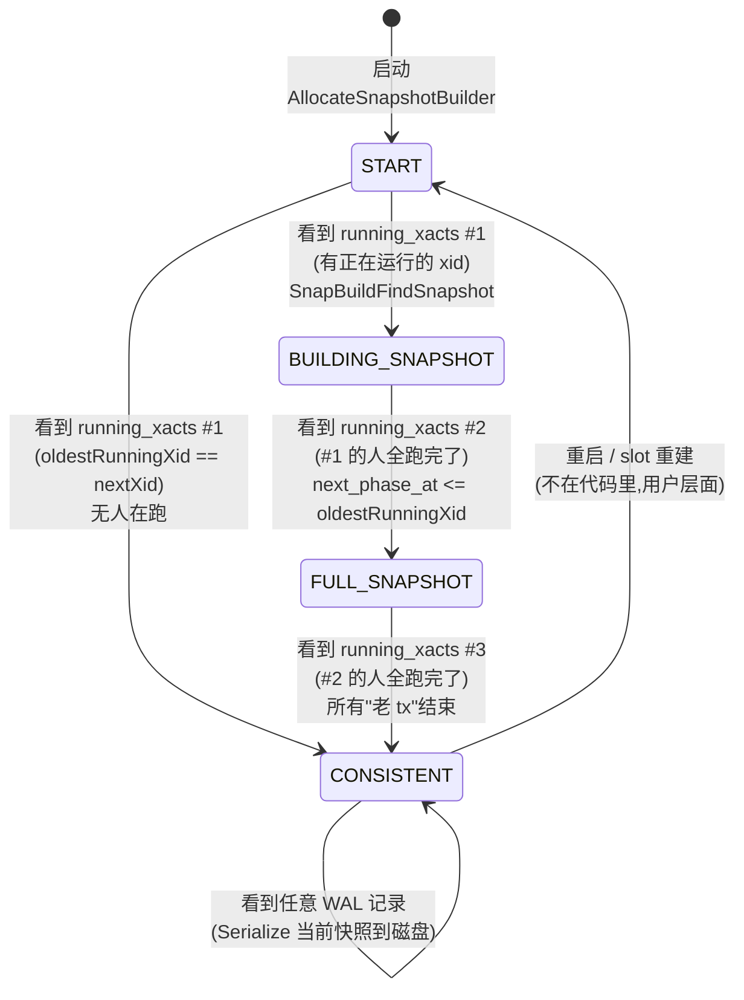

### 3.2 文字描述(对应 snapbuild.c:55-94 的图)

```
   +-----------------+
   |      START      |-----+
   +-----------------+     |
            |              |
            | running_xacts #1
            v              |
   +-----------------+     v
   | BUILDING_SNAPSHOT|--->|  (同状态退出)
   +-----------------+
            |
            | running_xacts #2, #1 的人都结束
            v
   +-----------------+
   |  FULL_SNAPSHOT  |----> (可解码, 但老 tx 还在跑)
   +-----------------+
            |
            | running_xacts with zero xacts
            v
   +-----------------+
   |    CONSISTENT   |<---+
   +-----------------+    | (如果 START 看到的是 empty running_xacts)
                          |
       ↑   saved snapshot at running_xacts's lsn
       |   (Serialize 到磁盘)
       +-----------+
```

**三个"阶段"的作用**:
- **START** → **BUILDING_SNAPSHOT**: 收集"我开始解码那一刻"之前所有正在运行的 xid 的提交信息
- **BUILDING_SNAPSHOT** → **FULL_SNAPSHOT**: 等 START 时的 xid 全部结束 → 此刻之后启动的事务都可解码
- **FULL_SNAPSHOT** → **CONSISTENT**: 等 FULL_SNAPSHOT 时的 xid 全部结束 → 此刻是"理想的初始 slot 位置"

> **关键洞察**:CONSISTENT 不是"能解码的开始",而是"可以安全导出快照给用户读 user data"的位置。在 FULL_SNAPSHOT 之后,新事务**已经可以**被解码并发送给订阅者,但**不能保证和 user data 的一致性**(因为 catalog 可能改过)。只有 CONSISTENT 才能 export snapshot 给 `pg_dump` 类工具。

---

## 四、模块文件位置与对外 API

| 文件 | 行数 | 作用 |
|------|------|------|
| `src/backend/replication/logical/snapbuild.c` | 2076 | 主实现 |
| `src/include/replication/snapbuild.h` | 80 | 对外 API 声明 |
| `src/include/replication/snapbuild_internal.h` | 174 | 内部结构 + 序列化 API |

**模块依赖**:

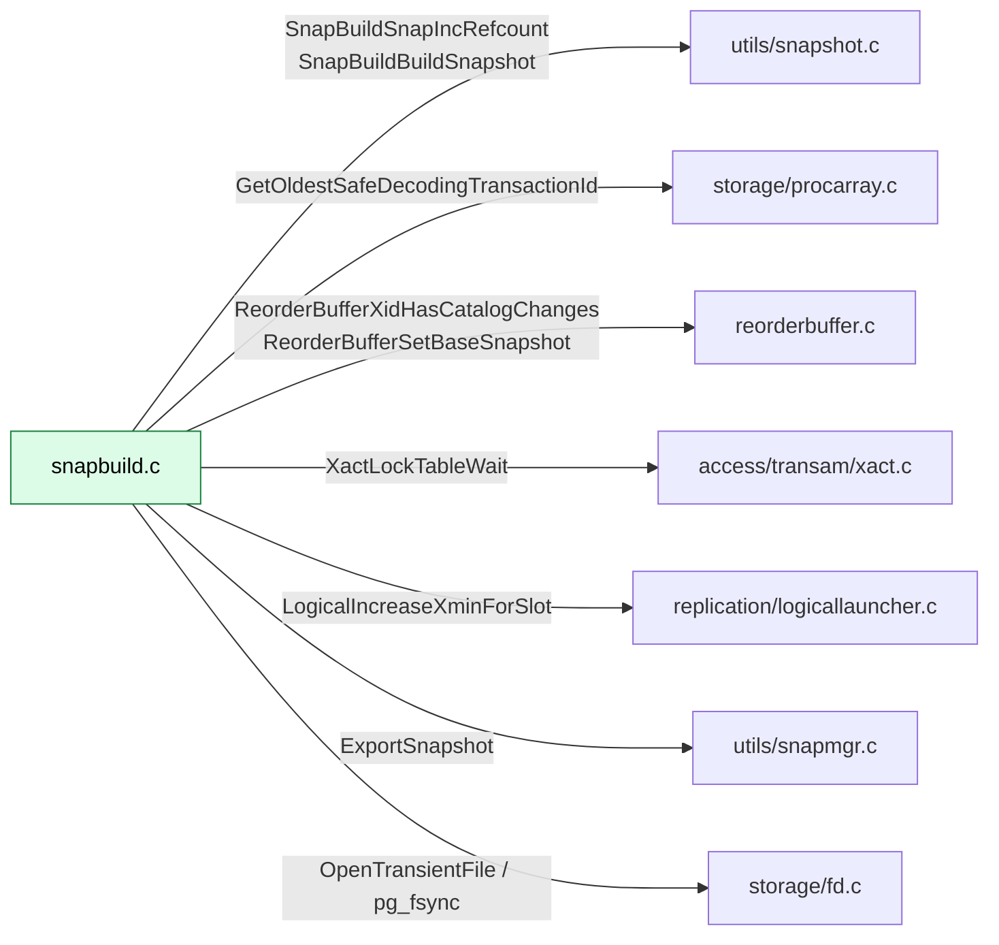

**对外 API 分类**(完整列表):

| 类别 | 函数 | 调用方 |
|------|------|--------|
| 生命周期 | `AllocateSnapshotBuilder` / `FreeSnapshotBuilder` | `ReorderBuffer` 创建时 |
| 状态查询 | `SnapBuildCurrentState` / `SnapBuildGetTwoPhaseAt` / `SnapBuildXactNeedsSkip` | reorder buffer / 主循环 |
| 快照构建 | `SnapBuildBuildSnapshot` / `SnapBuildGetOrBuildSnapshot` | reorder buffer |
| 快照导出 | `SnapBuildInitialSnapshot` / `SnapBuildExportSnapshot` / `SnapBuildClearExportedSnapshot` | SQL 函数 `pg_create_logical_replication_slot` |
| WAL 处理 | `SnapBuildProcessRunningXacts` / `SnapBuildCommitTxn` / `SnapBuildProcessChange` / `SnapBuildProcessNewCid` | 解码主循环 |
| 序列化 | `SnapBuildSerializationPoint` / `SnapBuildSnapshotExists` | `LogicalConfirmReceivedLocation` |
| 维护 | `CheckPointSnapBuild` | checkpointer |

---

## 五、生命周期管理(5 个函数)

### 5.1 `AllocateSnapshotBuilder`(snapbuild.c:185)

**作用**:创建一个新的 `SnapBuild` 上下文,初始化所有子结构。

```c
SnapBuild *AllocateSnapshotBuilder(ReorderBuffer *reorder,
                                    TransactionId xmin_horizon,
                                    XLogRecPtr start_lsn,
                                    bool need_full_snapshot,
                                    bool in_slot_creation,
                                    XLogRecPtr two_phase_at);
```

| 参数 | 含义 |
|------|------|
| `reorder` | 关联的 reorder buffer(所有 xid 走它跟踪) |
| `xmin_horizon` | slot 必须保留的 catalog 下界 |
| `start_lsn` | 解码起点 LSN(可由调用方指定) |
| `need_full_snapshot` | 是否要构造可导出的完整快照 |
| `in_slot_creation` | 是否还在 slot 创建阶段(影响是否尝试恢复) |
| `two_phase_at` | 两阶段解码启用点 |

**关键流程**(snapbuild.c:199-220):

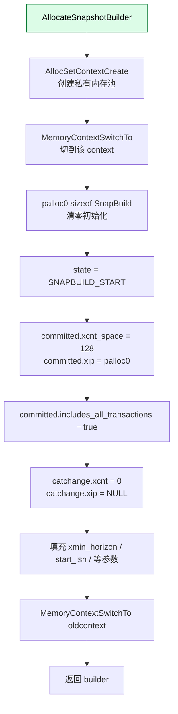

**初始容量**:`committed.xcnt_space = 128`(任意值,后续按需翻倍:`SnapBuildAddCommittedTxn` 里用 `xcnt_space * 2 + 1`)。

**`includes_all_transactions = true`** 的含义:在到达 CONSISTENT 之前,我们跟踪"所有"提交(为了能导出快照)。一旦放过一个不需要跟踪的提交,这个 flag 就变 false,**之后不能 export snapshot 了**。

### 5.2 `FreeSnapshotBuilder`(snapbuild.c:233)

**作用**:释放 `SnapBuild` 及其私有内存池。

```c
void FreeSnapshotBuilder(SnapBuild *builder);
```

**关键细节**(snapbuild.c:237-247):
- **先释放 snapshot**:调 `SnapBuildSnapDecRefcount` 触发 `SnapBuildFreeSnapshot`(含 `Assert(!snap->copied)`、`Assert(snap->active_count == 0)`、`Assert(snap->regd_count == 0)` 等不变性)
- **再删 context**:`MemoryContextDelete(context)` 会批量释放 builder 内部所有指针(包括 `committed.xip`、`catchange.xip`)

### 5.3 `SnapBuildCurrentState`(snapbuild.c:277)

```c
SnapBuildState SnapBuildCurrentState(SnapBuild *builder);
```

**作用**:单行返回 `builder->state`。**外部代码靠这个判断是否可以分发快照**(state >= SNAPBUILD_FULL_SNAPSHOT 才可)。

### 5.4 `SnapBuildGetTwoPhaseAt` / `SnapBuildSetTwoPhaseAt`(snapbuild.c:286-301)

**作用**:2PC(two-phase commit)解码启用点的 getter/setter。

`two_phase_at` 的语义:
- 若 LSN < `two_phase_at`:不发送 prepared 事务
- 若 LSN >= `two_phase_at`:完整发送 prepared + commit prepared

### 5.5 `SnapBuildXactNeedsSkip`(snapbuild.c:304)

```c
bool SnapBuildXactNeedsSkip(SnapBuild *builder, XLogRecPtr ptr);
```

**作用**:判断给定 LSN 处的事务是否需要被跳过(因为它早于 `start_decoding_at`)。

**实现**(snapbuild.c:309):
```c
return ptr < builder->start_decoding_at;
```

**调用场景**:reorder buffer 主循环在 `ReorderBufferProcessXactData` 里对每条事务的结束 LSN 调一次,决定是否 decode。

---

## 六、快照的构建与发布(6 个函数)

### 6.1 `SnapBuildBuildSnapshot`(snapbuild.c:360)

**作用**:**核心**。从 `builder` 当前的 `committed.xip` 构造一个 `SnapshotData`。

```c
static Snapshot SnapBuildBuildSnapshot(SnapBuild *builder);
```

**前提**:`builder->state >= SNAPBUILD_FULL_SNAPSHOT`(否则快照无效)。

**完整流程**(snapbuild.c:360-438):

```mermaid
flowchart TD
    A[SnapBuildBuildSnapshot] --> B[计算 ssize:<br/>sizeof SnapshotData + xcnt*sizeof(Xid) + 1*toplevel Xid]
    B --> C[MemoryContextAllocZero<br/>在 builder context 分配]
    C --> D[snapshot_type = SNAPSHOT_HISTORIC_MVCC]
    D --> E[xmin = builder->xmin<br/>xmax = builder->xmax]
    E --> F[xcnt = builder->committed.xcnt]
    F --> G[memcpy committed.xip]
    G --> H[qsort xip<br/>供 bsearch 用]
    H --> I[subxcnt = 0<br/>subxip = NULL<br/>初始 subxip 为空]
    I --> J[suboverflowed = false<br/>takenDuringRecovery = false<br/>copied = false]
    J --> K[curcid = FirstCommandId<br/>active_count = 0<br/>regd_count = 0]
    K --> L[返回 snapshot]
    style A fill:#dcfce7,stroke:#15803d,color:#000
```

**关键设计**:
- **`xip` 排序**:`qsort` 用 `xidComparator` 排序,后续 `bsearch` 可见性判断
- **`subxip` 延迟填充**:初始为 NULL,后续由 `ReorderBufferCopySnap()` 在事务改了 catalog、需要看到自己前面版本时才填入
- **私有内存池分配**:`builder->context`,free 时随 `FreeSnapshotBuilder` 一起释放

**调用方**:
- `SnapBuildInitialSnapshot`(导出快照)
- `SnapBuildGetOrBuildSnapshot`(分发)
- `SnapBuildProcessChange`(给 xid 装配 base snapshot)
- `SnapBuildCommitTxn`(commit 后重新构建)
- `SnapBuildRestore`(恢复后重新构建)

### 6.2 `SnapBuildInitialSnapshot`(snapbuild.c:440)

**作用**:**导出场景**。把 builder 持有的"反向 MVCC 快照"转换为"正向 MVCC 快照"。

```c
Snapshot SnapBuildInitialSnapshot(SnapBuild *builder);
```

**关键不变量**(`Assert` 在 snapbuild.c:446-462):
- 必须在 `XACT_REPEATABLE_READ` 隔离级
- `builder->building_full_snapshot` 必须为 true
- 状态必须 = `SNAPBUILD_CONSISTENT`
- `committed.includes_all_transactions` 必须为 true(否则漏了事务)
- `MyProc->xmin` 必须无效

**完整流程**:

```mermaid
flowchart TD
    A[SnapBuildInitialSnapshot] --> B[InvalidateCatalogSnapshot<br/>避免覆盖]
    B --> C{state == CONSISTENT?}
    C -->|否| ERR1[elog ERROR]
    C -->|是| D{includes_all_transactions?}
    D -->|否| ERR2[elog ERROR]
    D -->|是| E[LWLockAcquire ProcArrayLock]
    E --> F[GetOldestSafeDecodingTransactionId false]
    F --> G{safeXid follows snap.xmin?}
    G -->|是| ERR3[elog ERROR]
    G -->|否| H[MyProc->xmin = snap->xmin]
    H --> I[构造"反向"快照<br/>SnapBuildBuildSnapshot]
    I --> J[newxip = palloc GetMaxSnapshotXidCount]
    J --> K[遍历 xid from xmin to xmax]
    K --> L{xid 在 snap.xip 中?}
    L -->|是| SKIP[认为已 commit,跳过]
    L -->|否| ADD[加入 newxip]
    ADD --> M[TransactionIdAdvance]
    SKIP --> M
    M --> N{还有 xid?}
    N -->|是| L
    N -->|否| O[snap.snapshot_type = SNAPSHOT_MVCC]
    O --> P[snap.xcnt = newxcnt<br/>snap.xip = newxip]
    P --> Q[返回 snap]
    style A fill:#dcfce7,stroke:#15803d,color:#000
    style ERR1 fill:#fee2e2,stroke:#dc2626,color:#000
    style ERR2 fill:#fee2e2,stroke:#dc2626,color:#000
    style ERR3 fill:#fee2e2,stroke:#dc2626,color:#000
```

**核心转换**:
- snapbuild `xip` = "已提交且改 catalog 的 xid"
- 普通 MVCC `xip` = "正在运行的 xid"
- **遍历 `[xmin, xmax)`**,把 `xip` 里的 xid 排除掉,其余都视为"运行中"

**为什么这么慢**? 因为要遍历每一个 xid。在 xid 空间很大时很费时。

### 6.3 `SnapBuildExportSnapshot`(snapbuild.c:539)

**作用**:把快照**导出**为名称,供 `SET TRANSACTION SNAPSHOT 'xxx'` 引用。

```c
const char *SnapBuildExportSnapshot(SnapBuild *builder);
```

**完整流程**:

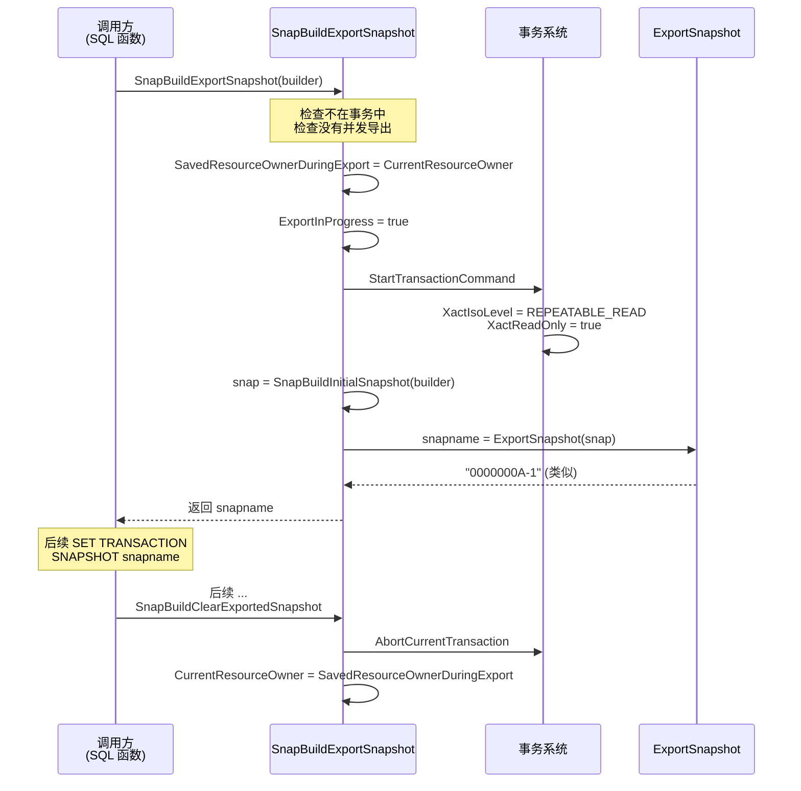

**关键设计**:
- **必须不在事务中**(`IsTransactionOrTransactionBlock()`)
- **`SavedResourceOwnerDuringExport`**:导出时要开新事务,会覆盖 `CurrentResourceOwner`,所以要先保存
- **必须 `REPEATABLE READ + READ ONLY`**:确保 import 端能在同一 xmin 下读一致视图

### 6.4 `SnapBuildClearExportedSnapshot`(snapbuild.c:600) / `SnapBuildResetExportedSnapshotState`(snapbuild.c:627)

**前者**:事务 abort 时清掉导出状态,恢复 `CurrentResourceOwner`。

**后者**:整个 session 失败 / 异常退出时重置(`SavedResourceOwnerDuringExport = NULL`, `ExportInProgress = false`)。

### 6.5 `SnapBuildGetOrBuildSnapshot`(snapbuild.c:579)

```c
Snapshot SnapBuildGetOrBuildSnapshot(SnapBuild *builder);
```

**作用**:**核心分发**。如果 `builder->snapshot == NULL`,构造一个并加 1 引用计数;否则复用。

**调用场景**:reorder buffer 在解码 DML 变更前,需要给事务装 base snapshot,统一通过此函数获取。

**Assert**:`builder->state == SNAPBUILD_CONSISTENT` —— 不在 CONSISTENT 状态不应该被调用(否则会构造出错误快照)。

### 6.6 `SnapBuildSnapIncRefcount` / `SnapBuildSnapDecRefcount`(snapbuild.c:316 / 328)

**作用**:快照引用计数管理(snapbuild 私有)。

**关键不变性**(snapbuild.c:331-340):
- `snap->snapshot_type == SNAPSHOT_HISTORIC_MVCC`
- `snap->curcid == FirstCommandId`(必须是"原始"快照,不是事务的"copy")
- `!snap->suboverflowed`
- `!snap->takenDuringRecovery`
- `snap->regd_count == 0`
- `!snap->copied`

`active_count--` 降到 0 时调 `SnapBuildFreeSnapshot(snap)`(pfree)。

---

## 七、commit / change / cid 处理(4 个函数)

### 7.1 `SnapBuildProcessChange`(snapbuild.c:639)

**作用**:处理单条 heap 变更,根据当前 builder 状态决定是否记录。

```c
bool SnapBuildProcessChange(SnapBuild *builder, TransactionId xid, XLogRecPtr lsn);
```

**返回值**:`true` = 这条 change 应该被保留;`false` = 应该丢弃。

**完整流程**(snapbuild.c:643-687):

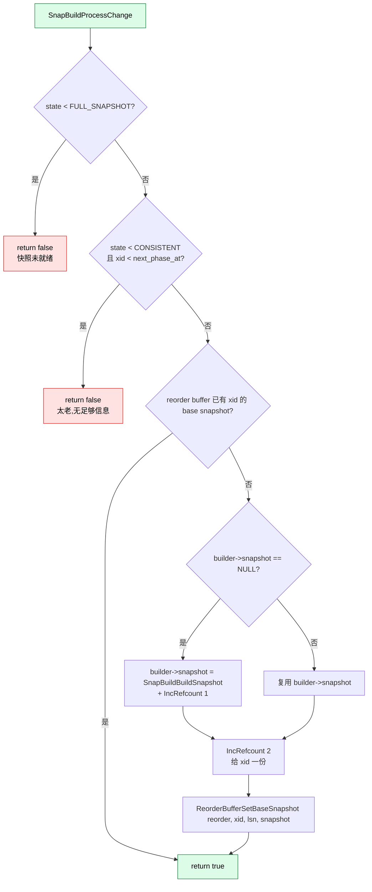

**两段式过滤逻辑**:
1. `state < FULL_SNAPSHOT`: 还没快照,直接返回 false
2. `state < CONSISTENT && xid < next_phase_at`: xid 早于"建立 FULL_SNAPSHOT 时记录的 xmin" —— 没有它的提交信息,无法判断可见性

**为什么要 IncRefcount 两次**? 一次给 builder 自己,一次给 reorder buffer 里的 xid。两个消费者各持一份。

### 7.2 `SnapBuildProcessNewCid`(snapbuild.c:689)

**作用**:处理 `XLOG_HEAP2_NEW_CID` 记录,把 catalog 改动的 cmin/cmax/combocid 信息存入 reorder buffer。

```c
void SnapBuildProcessNewCid(SnapBuild *builder, TransactionId xid,
                             XLogRecPtr lsn, xl_heap_new_cid *xlrec);
```

**完整流程**(snapbuild.c:691-728):

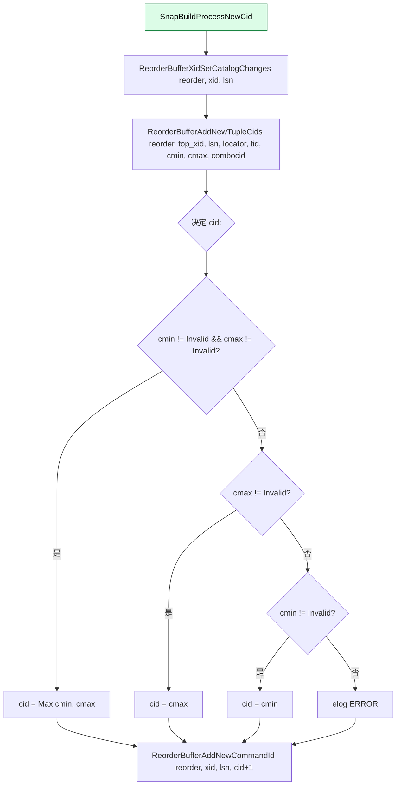

**关键背景**:
- `xl_heap_new_cid` 仅在 catalog 改动时记录(见 `heapam.c` 注释)
- `cmin/cmax` 不会记到普通 WAL(空间原因)
- `combocid` 只在原 backend 内存里,跨会话看不到
- 通过 `XLOG_HEAP2_NEW_CID` 显式记录 → 进入 reorder buffer 的 `tuplecids` 映射

**`cid + 1` 的含义**:`cid` 是"刚分配的命令 id",下一个命令用 `cid+1`。

### 7.3 `SnapBuildCommitTxn`(snapbuild.c:940)

**作用**:**最重要**的事务提交处理。判断事务是否改了 catalog,以及是否需要更新 builder。

```c
void SnapBuildCommitTxn(SnapBuild *builder, XLogRecPtr lsn, TransactionId xid,
                         int nsubxacts, TransactionId *subxacts, uint32 xinfo);
```

**完整流程**(snapbuild.c:940-1100):

```mermaid
flowchart TD
    A[SnapBuildCommitTxn] --> B{state == START OR<br/>(BUILDING_SNAPSHOT && xid &lt; next_phase_at)?}
    B -->|是| C1[start_decoding_at = max start_decoding_at, lsn+1]
    B -->|是| C2[return]
    B -->|否| D{state &lt; CONSISTENT?}
    D -->|是| E1[start_decoding_at = max start_decoding_at, lsn+1]
    D -->|是| E2{building_full_snapshot?}
    E2 -->|是| E3[needs_timetravel = true]
    E2 -->|否| E4[needs_timetravel = false]
    D -->|否| F[不做 start_decoding_at 推进]
    A --> G[遍历 nsubxacts]
    G --> H{子 xid 改了 catalog?}
    H -->|是| I1[sub_needs_timetravel = true<br/>needs_snapshot = true<br/>SnapBuildAddCommittedTxn subxid]
    H -->|否| I2{needs_timetravel?}
    I2 -->|是| I3[SnapBuildAddCommittedTxn subxid]
    H -->|否| J
    I1 --> J[xmax = max xmax, subxid]
    I2 -->|是| I3
    I3 --> J
    I2 -->|否| J
    J{主 xid 改了 catalog?}
    J -->|是| K1[needs_snapshot = true<br/>needs_timetravel = true<br/>SnapBuildAddCommittedTxn xid]
    J -->|否| K2{sub_needs_timetravel?}
    K2 -->|是| K3[needs_timetravel = true<br/>SnapBuildAddCommittedTxn xid]
    K2 -->|否| K4{needs_timetravel?}
    K4 -->|是| K5[SnapBuildAddCommittedTxn xid]
    K4 -->|否| K6[committed.includes_all_transactions = false]
    K1 --> L{needs_timetravel &&<br/>xmax &gt;= builder.xmax?}
    K3 --> L
    K5 --> L
    K6 --> L
    L -->|是| M[builder.xmax = xmax + 1]
    L -->|否| N
    M --> N{needs_snapshot?}
    N -->|是| O{state &lt; FULL_SNAPSHOT?}
    O -->|是| P[return<br/>快照未就绪]
    O -->|否| Q[builder.snapshot -> SnapBuildSnapDecRefcount]
    Q --> R[builder.snapshot = SnapBuildBuildSnapshot]
    R --> S{reorder 已有 base snapshot?}
    S -->|否| T1[SnapBuildSnapIncRefcount<br/>ReorderBufferSetBaseSnapshot]
    S -->|是| T2[跳过,reorder 已有]
    T1 --> U[SnapBuildSnapIncRefcount]
    T2 --> U
    U --> V[SnapBuildDistributeSnapshotAndInval]
    N -->|否| W[结束]
    P --> W
    style A fill:#dcfce7,stroke:#15803d,color:#000
```

**5 个 bool 变量的语义**(snapbuild.c:949-955):

| 变量 | 含义 |
|------|------|
| `needs_snapshot` | 是否需要重新构建快照并发给现有事务 |
| `needs_timetravel` | 是否需要"时间旅行"看见老 catalog(为了导出快照) |
| `sub_needs_timetravel` | 是否有子事务需要时间旅行 |
| `xmax` | 本次提交涉及的最大 xid(主+子) |

**关键决策逻辑**:
- 子事务改了 catalog → 主事务必须"也"加入 committed(否则主事务 commit 时它的 cmin/cmax 不可见)
- `building_full_snapshot` 阶段:即使主事务没改 catalog,只要有子事务改了,主也要 timetravel
- `includes_all_transactions = false`:**一旦放过一个非 catalog 改动的事务,就再也不能 export 快照**

**`xmax` 推进**:
```c
if (needs_timetravel && xmax >= builder->xmax)
    builder->xmax = xmax + 1;
```

**`needs_snapshot` 时的快照重建**:
- 释放旧 snapshot 引用
- 重新构建
- 分发给所有 in-progress 事务

### 7.4 `SnapBuildXidHasCatalogChanges`(snapbuild.c:1106)

```c
static inline bool SnapBuildXidHasCatalogChanges(SnapBuild *builder, TransactionId xid, uint32 xinfo);
```

**作用**:`SnapBuildCommitTxn` 的辅助判断。

**判断逻辑**(snapbuild.c:1108-1124):
1. **先查 reorder buffer**:`ReorderBufferXidHasCatalogChanges`(看是否有 `XLOG_HEAP2_NEW_CID` 记录)
2. **次查 xinfo**:`XACT_XINFO_HAS_INVALS` 位(commit 记录里有 invalidation 消息)
3. **最后查 catchange**:`bsearch` 在 `catchange.xip` 里找(从磁盘恢复时用)

三步依次 fallback,任一为真就认为改过 catalog。

### 7.5 `SnapBuildDistributeSnapshotAndInval`(snapbuild.c:731)

**作用**:把新快照 + invalidation 消息分发给所有 in-progress 事务(在 commit 后)。

**完整流程**:

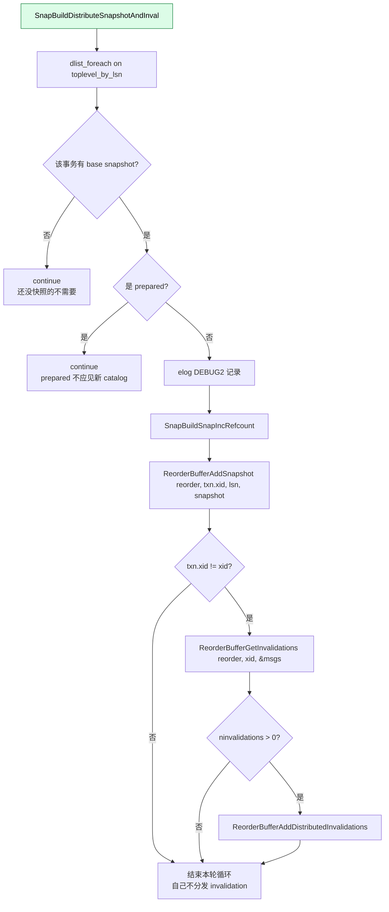

**为什么只发给非 prepared 事务**? prepared 事务的快照应该**冻结在 prepare 时**的状态,不能被并发 commit 影响。

**invalidation 分发逻辑**:
- **自己的 invalidation 在 commit 时已经处理**(本事务不需要发给自己)
- **别人的 invalidation 必须发给所有进行中事务**,否则会看到"过期"的 catcache

---

## 八、xl_running_xacts 推进与状态机驱动(3 个函数)

### 8.1 `SnapBuildProcessRunningXacts`(snapbuild.c:1136)

**作用**:**状态机的总驱动器**。每条 `xl_running_xacts` 记录都触发一次。

```c
void SnapBuildProcessRunningXacts(SnapBuild *builder, XLogRecPtr lsn, xl_running_xacts *running);
```

**完整流程**:

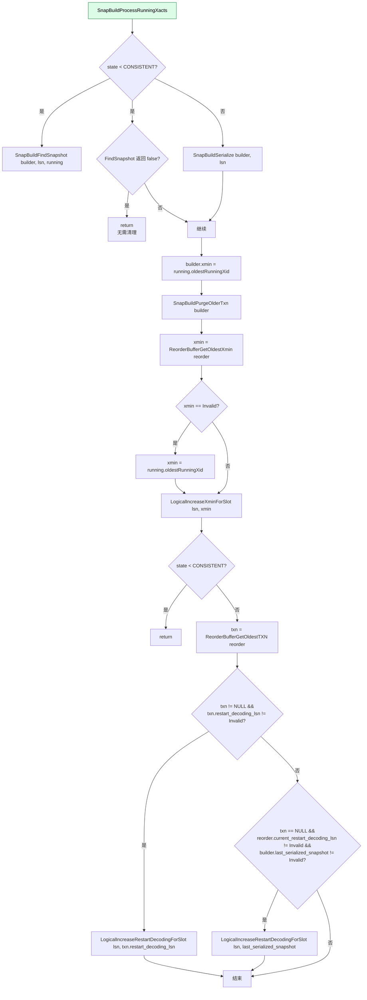

**关键设计**:

1. **`xmin` 更新**:`builder->xmin = running->oldestRunningXid`(即"现在的 oldestRunningXid,所有 < 它的都结束")
2. **清理**:`SnapBuildPurgeOlderTxn` 删掉 `committed.xip` 里 < 新 xmin 的 xid
3. **slot 的 catalog 保护**:`LogicalIncreaseXminForSlot` 通知 slot,xmin 已经推进 → vacuum 可以回收 catalog 行
4. **重启点**:取最早 in-progress 事务的 `restart_decoding_lsn` 作为下次重启时的起点

**`xmax` 不在这里推进**!因为 `xmax` 只在 `SnapBuildCommitTxn` 里推进(只关心 catalog 改动的事务)。这意味着 **`xmax` 可能 < `xmin`**,这是合法状态(见 snapbuild.c:1170-1177 的注释)。

### 8.2 `SnapBuildFindSnapshot`(snapbuild.c:1238)

**作用**:**核心状态转换**。看完一条 `xl_running_xacts`,决定如何推进。

**4 种路径**(snapbuild.c:1238-1430):

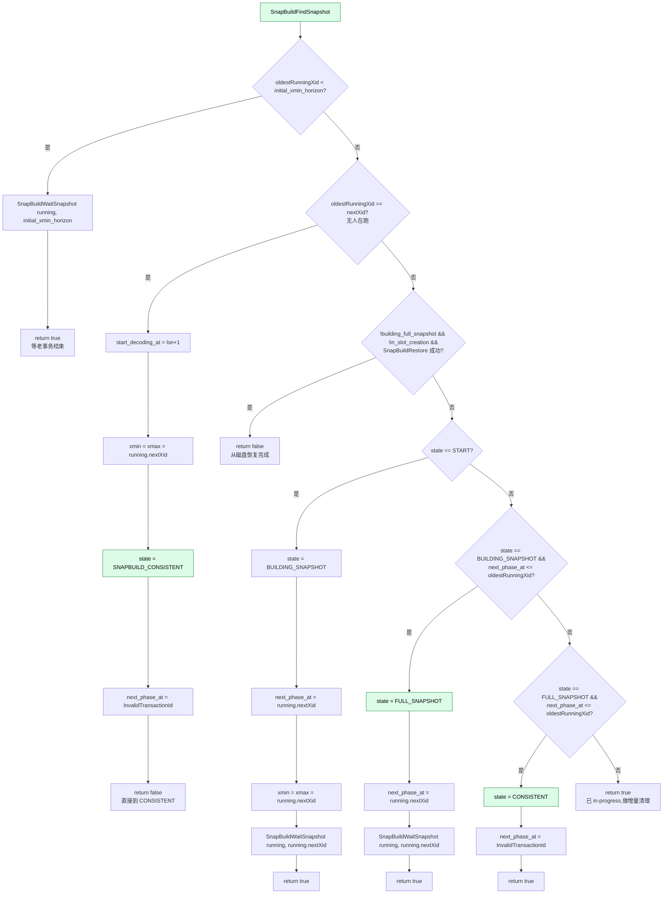

**4 条路径对应 4 种场景**:

| 路径 | 触发条件 | 结果 |
|------|----------|------|
| a) 直接到 CONSISTENT | 无人运行 | 跳过 BUILDING/FULL,直接稳态 |
| b) 磁盘恢复 | 不需要 full snapshot,不是 slot 创建 | 从已有 `.snap` 文件恢复 |
| c-1) START → BUILDING | state == START | 开始收集 |
| c-2) BUILDING → FULL | 老 xid 都跑完了 | 等待第二批 |
| c-3) FULL → CONSISTENT | 第二批老 xid 也都跑完了 | 完全一致 |

**`SnapBuildWaitSnapshot` 作用**:遍历 `running->xids[]`,对所有 < cutoff 的 xid 调 `XactLockTableWait`(等它们结束)。这**不强制要求**,但**触发 `LogStandbySnapshot` 让新 running_xacts 尽快生成**(避免在 bgwriter/checkpointer 之前卡太久)。

### 8.3 `SnapBuildWaitSnapshot`(snapbuild.c:1435)

```c
static void SnapBuildWaitSnapshot(xl_running_xacts *running, TransactionId cutoff);
```

**作用**:遍历 `running->xids[]`,等 < cutoff 的 xid 全部结束;结束后调 `LogStandbySnapshot()` 加速下一条 running_xacts 出现。

**关键约束**(`if (TransactionIdIsCurrentTransactionId(xid))`):**不能等当前事务自己**(会死锁)。

---

## 九、快照序列化与恢复(5 个函数)

### 9.1 `SnapBuildSerializationPoint`(snapbuild.c:1484)

**作用**:公共 API,根据状态决定是 serialize 还是 restore。

```c
void SnapBuildSerializationPoint(SnapBuild *builder, XLogRecPtr lsn);
```

**逻辑**:
```c
if (builder->state < SNAPBUILD_CONSISTENT)
    SnapBuildRestore(builder, lsn);
else
    SnapBuildSerialize(builder, lsn);
```

**调用场景**:`LogicalConfirmReceivedLocation` 在确认下游 LSN 后调一次。

### 9.2 `SnapBuildSerialize`(snapbuild.c:1497)

**作用**:把 builder 当前状态写到 `%X-%X.snap` 文件。

**完整流程**(snapbuild.c:1497-1740):

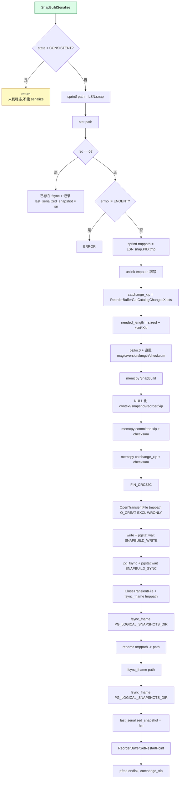

**关键设计**:
- **写临时文件 + fsync + rename**:保证 crash 后文件完整(要么存在要么不存在,不会损坏)
- **PID 后缀**:避免并发 serialize 冲突
- **checksum**:CRC32C,read 时校验
- **NULL 化内存指针**:`context`/`snapshot`/`reorder` 内存地址写到磁盘无用,留 NULL 避免反序列化时误用
- **性能**:`pgstat_report_wait_start(WAIT_EVENT_SNAPBUILD_WRITE/SYNC)` 让用户能监控延迟

### 9.3 `SnapBuildRestoreSnapshot`(snapbuild.c:1742)

**作用**:从磁盘 `.snap` 文件读出 `SnapBuildOnDisk`,验证魔数 / 版本 / checksum。

**流程**(snapbuild.c:1742-1839):

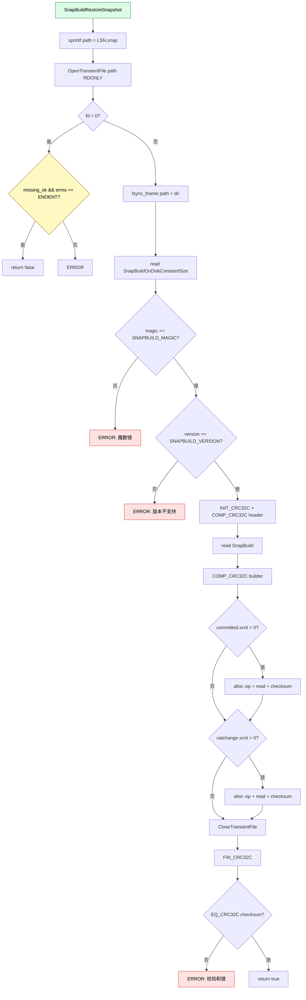

**校验流程**:
1. magic / version 必须匹配
2. 整个文件计算 CRC32C,与磁盘存的比较

### 9.4 `SnapBuildRestore`(snapbuild.c:1841)

**作用**:把磁盘文件恢复成 builder 状态。

**流程**(snapbuild.c:1841-1931):

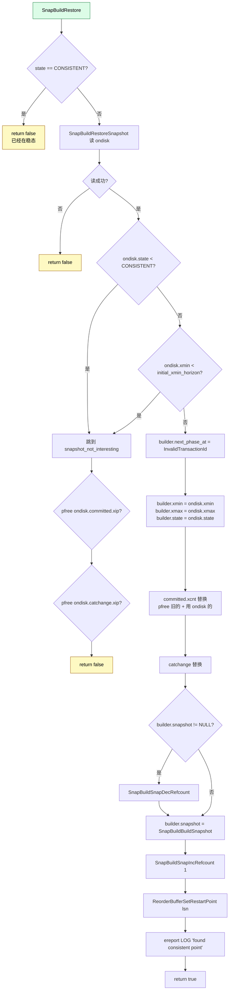

**关键决策**:
- **`xmin < initial_xmin_horizon` 的不要**:磁盘快照太老,catalog 行可能已经被 vacuum 删掉,无法保证可见性
- **只接受 CONSISTENT 快照**:避免复杂的"哪个快照更先进"判断
- **替换 committed.xip 时 pfree 旧数组**:但磁盘的 ondisk 数组"接管"(转移所有权)

### 9.5 `SnapBuildRestoreContents`(snapbuild.c:1933)

```c
static void SnapBuildRestoreContents(int fd, void *dest, Size size, const char *path);
```

**作用**:底层 read 封装,带 `pgstat_report_wait_start(WAIT_EVENT_SNAPBUILD_READ)` 和精确的 error 报告。

---

## 十、Checkpoint 与清理(2 个函数)

### 10.1 `CheckPointSnapBuild`(snapbuild.c:1970)

**作用**:checkpoint 时清理不需要的 `.snap` 文件。

**完整流程**(snapbuild.c:1970-2056):

```mermaid
flowchart TD
    A[CheckPointSnapBuild] --> B[redo = GetRedoRecPtr]
    B --> C[cutoff = ReplicationSlotsComputeLogicalRestartLSN]
    C --> D[cutoff = min redo, cutoff]
    D --> E[AllocateDir PG_LOGICAL_SNAPSHOTS_DIR]
    E --> F[ReadDir 循环]
    F --> G{skip . ..}
    G -->|是| F
    G -->|否| H[snprintf path]
    H --> I[get_dirent_type de_type]
    I --> J{de_type != ERROR && de_type != REG?}
    J -->|是| K1[elog DEBUG1 'not regular file']
    J -->|否| L[sscanf '%X-%X.snap']
    L --> M{解析成功?}
    M -->|否| N1[ereport LOG 'cannot parse name']
    M -->|是| O[lsn = hi &lt;&lt; 32 | lo]
    O --> P{lsn &lt; cutoff OR cutoff == Invalid?}
    P -->|是| Q1[unlink path]
    P -->|否| F
    Q1 --> Q2{unlink 失败?}
    Q2 -->|是| Q3[ereport LOG 'cannot remove']
    Q2 -->|否| F
    N1 --> F
    K1 --> F
    F --> R{ReadDir 结束?}
    R -->|否| F
    R -->|是| S[FreeDir]
    style A fill:#dcfce7,stroke:#15803d,color:#000
```

**清理规则**:
- **cutoff = min(redo_lsn, 所有 slot 的 restart_lsn)**
- LSN < cutoff 的 .snap 文件都删掉
- 临时文件 `.snap.PID.tmp` 也走相同路径(因为 sscanf %X-%X.snap 仍能解析)

**为什么 checkpoint 触发**? 因为这是 PG 标准的"周期性维护点",执行不阻塞核心路径(只遍历 + unlink)。

### 10.2 `SnapBuildSnapshotExists`(snapbuild.c:2058)

```c
bool SnapBuildSnapshotExists(XLogRecPtr lsn);
```

**作用**:`stat()` 检查指定 LSN 是否有 `.snap` 文件。

**用途**:`LogicalConfirmReceivedLocation` 在写 confirm 前快速判断。

---

## 十一、状态机全流程:从启动到稳态

下面这张图给出一个**完整生命周期**示例,假设 slot 创建后所有事务按时结束:

```mermaid
sequenceDiagram
    autonumber
    participant Caller as 调用方<br/>(CreateSlot)
    participant Decoding as 解码主循环
    participant WAL as WAL 流
    participant SB as SnapBuild
    participant RB as ReorderBuffer

    Note over Caller,RB: === 阶段 1:启动 + START ===
    Caller->>SB: AllocateSnapshotBuilder<br/>state=START
    Note over SB: xmin=Invalid, xmax=Invalid<br/>committed.includes_all_transactions=true

    Note over Caller,RB: === 阶段 2:看到 running_xacts #1 ===
    Decoding->>WAL: 读 xl_running_xacts #1
    Decoding->>SB: SnapBuildProcessRunningXacts
    SB->>SB: SnapBuildFindSnapshot
    Note over SB: state=START, running.xcnt > 0<br/>(有人跑)
    SB->>SB: state = BUILDING_SNAPSHOT<br/>next_phase_at = running.nextXid<br/>xmin = xmax = running.nextXid
    SB->>SB: SnapBuildWaitSnapshot
    Note over SB: 等 < nextXid 的 xid 跑完<br/>(或下一条 running_xacts 出现)

    Note over Caller,RB: === 阶段 3:看到 running_xacts #2 ===
    Decoding->>WAL: 读 xl_running_xacts #2
    Decoding->>SB: SnapBuildProcessRunningXacts
    SB->>SB: SnapBuildFindSnapshot
    Note over SB: state=BUILDING_SNAPSHOT<br/>#1 的 xid 都跑完了
    SB->>SB: state = FULL_SNAPSHOT<br/>next_phase_at = running.nextXid
    Note over SB: 此时 xid 起点 &gt;= FULL_SNAPSHOT<br/>的 next_phase_at 的事务可解码

    Note over Caller,RB: === 阶段 4:catalog 改动事务提交 ===
    Decoding->>SB: SnapBuildCommitTxn(xid=500, xinfo=HAS_INVALS)
    Note over SB: needs_snapshot = true<br/>(可能改 catalog)
    SB->>SB: SnapBuildAddCommittedTxn(500)
    SB->>SB: builder.xmax = max(builder.xmax, 500+1)
    SB->>SB: state >= FULL_SNAPSHOT
    SB->>SB: 重建 snapshot,IncRefcount
    SB->>RB: ReorderBufferSetBaseSnapshot(500, snapshot)
    SB->>RB: SnapBuildDistributeSnapshotAndInval
    Note over RB: 把 snapshot 分发给所有 in-progress<br/>事务的 reorder buffer entry

    Note over Caller,RB: === 阶段 5:看到 running_xacts #3 ===
    Decoding->>WAL: 读 xl_running_xacts #3
    Decoding->>SB: SnapBuildProcessRunningXacts
    SB->>SB: SnapBuildFindSnapshot
    Note over SB: state=FULL_SNAPSHOT<br/>#2 的 xid 也都跑完了
    SB->>SB: state = CONSISTENT<br/>next_phase_at = InvalidTransactionId
    SB->>SB: SnapBuildSerialize
    Note over SB: 写 %X-%X.snap 文件<br/>last_serialized_snapshot = lsn

    Note over Caller,RB: === 阶段 6:稳态 ===
    loop 后续每条 WAL 记录
        Decoding->>WAL: 读 record
        alt COMMIT
            Decoding->>SB: SnapBuildCommitTxn
            SB->>SB: 判断是否改 catalog
            opt 改了 catalog
                SB->>SB: 重建 snapshot + 分发
            end
        else HEAP2_NEW_CID
            Decoding->>SB: SnapBuildProcessNewCid
            SB->>RB: ReorderBufferXidSetCatalogChanges
        else CHANGE (INSERT/UPDATE/DELETE)
            Decoding->>SB: SnapBuildProcessChange
            SB->>SB: 必要时分发 snapshot
        else xl_running_xacts
            Decoding->>SB: SnapBuildProcessRunningXacts
            SB->>SB: SnapBuildPurgeOlderTxn
            SB->>SB: LogicalIncreaseXminForSlot
        end
    end
```

**关键状态跃迁的"lifecycle"**:

```
START (xmin/xmax 无效)
  ↓ 看到 running_xacts #1 (有 xid 在跑)
BUILDING_SNAPSHOT (next_phase_at = #1.nextXid)
  ↓ 看到 running_xacts #2 (#1 的 xid 都结束)
FULL_SNAPSHOT (next_phase_at = #2.nextXid)
  ↓ 看到 running_xacts #3 (#2 的 xid 都结束)
CONSISTENT (next_phase_at = Invalid)
  ↓ Serialize 一次
... 稳态
```

---

## 十二、典型场景与时序图

### 12.1 场景 1:slot 创建时直接恢复(快速启动)

```mermaid
sequenceDiagram
    participant Slot as slot 创建
    participant SB as SnapBuild
    participant Disk as 磁盘

    Slot->>SB: AllocateSnapshotBuilder<br/>(building_full_snapshot=true,<br/>in_slot_creation=true)
    Note over SB: state = START
    Slot->>SB: SnapBuildSerializationPoint(lsn)
    Note over SB: state &lt; CONSISTENT<br/>走 restore 路径
    SB->>Disk: SnapBuildRestore
    Note over SB: in_slot_creation=true<br/>不恢复!直接返回 false
    Slot->>SB: 下一条 xl_running_xacts
    SB->>SB: SnapBuildFindSnapshot<br/>(b 路径被 in_slot_creation 屏蔽,<br/>直接走 c-1)
```

**注意**:`in_slot_creation=true` 时 **不会**尝试从磁盘恢复(snapbuild.c:1300 的 `else if` 条件),因为创建 slot 时还没决定解码起点。

### 12.2 场景 2:catalog 改动事务的并发可见性

```mermaid
sequenceDiagram
    autonumber
    participant T1 as T1(改 catalog)
    participant T2 as T2(普通 DML,<br/>后启动)
    participant RB as ReorderBuffer
    participant SB as SnapBuild

    Note over T1,T2: 假设 SB 已到 FULL_SNAPSHOT

    T1->>T1: BEGIN<br/>改 pg_class
    T1->>T1: 写 XLOG_HEAP2_NEW_CID
    Note over T1,SB: snapbuild 收到 NEW_CID
    T1->>SB: SnapBuildProcessNewCid
    SB->>RB: ReorderBufferXidSetCatalogChanges(T1)

    T2->>T2: BEGIN
    Note over T2: T2 启动时,SB 已有 snapshot
    T2->>T2: INSERT ... user_table

    T1->>T1: COMMIT
    Note over T1,SB: snapbuild 收到 COMMIT
    T1->>SB: SnapBuildCommitTxn(T1.xid)
    SB->>SB: SnapBuildXidHasCatalogChanges(T1.xid) = true
    Note over SB: needs_snapshot = true
    SB->>SB: 重建 snapshot(包含 T1.xid in xip)
    SB->>SB: SnapBuildDistributeSnapshotAndInval
    SB->>RB: ReorderBufferAddSnapshot(T2.xid, new snapshot)
    SB->>RB: ReorderBufferAddDistributedInvalidations(T2.xid)
    Note over RB: T2 在 reorder buffer 中<br/>的 base snapshot 被更新

    T2->>T2: COMMIT
    Note over T2,SB: snapbuild 收到 T2 COMMIT
    T2->>SB: SnapBuildCommitTxn(T2.xid)
    Note over SB: T2 没改 catalog,<br/>committed.includes_all_transactions = false
    Note over SB: 不重建 snapshot
    Note over SB: T2 decode 时能看到 T1 的 catalog 改动
```

**关键洞察**:`SnapBuildDistributeSnapshotAndInval` **必须**在 commit 后立即触发,否则 T2 decode 时刻的 catalog 视图是"旧"的。

### 12.3 场景 3:reorder buffer xmin 推进

```mermaid
flowchart LR
    A1[所有 in-progress 事务结束] --> A2[reorder buffer<br/>xmin 推进到 current+1]
    A2 --> A3[下一条 WAL 记录时<br/>builder.xmin 也推进]
    A3 --> A4[SnapBuildPurgeOlderTxn<br/>删掉 < 新 xmin 的 committed xid]
    A4 --> A5[LogicalIncreaseXminForSlot<br/>slot xmin 同步]
    A5 --> A6[VACUUM 可回收<br/>老 catalog 行]
    style A1 fill:#dcfce7,stroke:#15803d,color:#000
    style A6 fill:#fce7f3,stroke:#be185d,color:#000
```

**xmin 链**:`reorder.xmin` ⊆ `builder.xmin` ⊆ `slot.xmin`

### 12.4 场景 4:重启时快速从磁盘恢复

```mermaid
sequenceDiagram
    participant Slot as 重启 slot
    participant SB as SnapBuild
    participant Disk as 磁盘

    Slot->>SB: AllocateSnapshotBuilder
    Note over SB: state = START
    Note over Slot: 已经知道 restart_lsn<br/>(从 slot state 读出)

    loop 读 WAL,直到 restart_lsn + 1
        Slot->>Slot: SnapBuildProcessRunningXacts
        Slot->>SB: SnapBuildProcessRunningXacts
    end

    Note over Slot: 到达 restart_lsn 后<br/>调用 SnapBuildSerializationPoint
    Slot->>SB: SnapBuildSerializationPoint(lsn=restart_lsn)
    SB->>SB: state &lt; CONSISTENT
    SB->>Disk: SnapBuildRestore
    Disk-->>SB: ondisk 读出,checksum OK
    SB->>SB: builder.state = ondisk.state = CONSISTENT
    SB->>SB: 重建 snapshot
    Note over SB: 一行代码:<br/>从磁盘恢复到 CONSISTENT!
    SB-->>Slot: return true
```

**性能优势**:不需要重新跑 2-3 条 running_xacts,直接跳到稳态。**这是 snapbuild 设计的精髓**。

---

## 十三、源码速查表

| 函数 | 文件位置 | 一句话职责 |
|------|----------|------------|
| `AllocateSnapshotBuilder` | snapbuild.c:185 | 分配 builder,初始化所有子结构 |
| `FreeSnapshotBuilder` | snapbuild.c:233 | 释放 builder + 私有内存池 |
| `SnapBuildFreeSnapshot` | snapbuild.c:252 | 释放快照(私有,断言完整) |
| `SnapBuildCurrentState` | snapbuild.c:277 | 读 state |
| `SnapBuildGetTwoPhaseAt` | snapbuild.c:286 | 读 two_phase_at |
| `SnapBuildSetTwoPhaseAt` | snapbuild.c:295 | 写 two_phase_at |
| `SnapBuildXactNeedsSkip` | snapbuild.c:304 | 判断事务 LSN 是否早于 start_decoding_at |
| `SnapBuildSnapIncRefcount` | snapbuild.c:316 | 快照引用 +1 |
| `SnapBuildSnapDecRefcount` | snapbuild.c:328 | 快照引用 -1,降到 0 时释放 |
| `SnapBuildBuildSnapshot` | snapbuild.c:360 | 从 committed.xip 构造 SNAPSHOT_HISTORIC_MVCC |
| `SnapBuildInitialSnapshot` | snapbuild.c:440 | 把 HISTORIC 转为普通 MVCC(导出) |
| `SnapBuildExportSnapshot` | snapbuild.c:539 | 开新事务,导出快照名 |
| `SnapBuildGetOrBuildSnapshot` | snapbuild.c:579 | 取或建快照(分发) |
| `SnapBuildClearExportedSnapshot` | snapbuild.c:600 | abort 导出事务,恢复 resource owner |
| `SnapBuildResetExportedSnapshotState` | snapbuild.c:627 | session 失败时重置导出状态 |
| `SnapBuildProcessChange` | snapbuild.c:639 | 处理单条 heap 变更,分发 snapshot |
| `SnapBuildProcessNewCid` | snapbuild.c:689 | 处理 NEW_CID 记录,入 reorder buffer |
| `SnapBuildDistributeSnapshotAndInval` | snapbuild.c:731 | 把新 snapshot 分发给 in-progress 事务 |
| `SnapBuildAddCommittedTxn` | snapbuild.c:829 | 加一个 xid 到 committed.xip(翻倍扩容) |
| `SnapBuildPurgeOlderTxn` | snapbuild.c:863 | 删掉 < xmin 的 committed/catchange xid |
| `SnapBuildCommitTxn` | snapbuild.c:940 | 处理 commit 记录,决定是否需要新快照 |
| `SnapBuildXidHasCatalogChanges` | snapbuild.c:1106 | 查 reorder/xinfo/catchange 三个数据源 |
| `SnapBuildProcessRunningXacts` | snapbuild.c:1136 | 状态机总驱动,每条 running_xacts 调一次 |
| `SnapBuildFindSnapshot` | snapbuild.c:1238 | 核心状态转换函数 |
| `SnapBuildWaitSnapshot` | snapbuild.c:1435 | 等老 xid 结束,触发新 running_xacts |
| `SnapBuildSerializationPoint` | snapbuild.c:1484 | 公共 API,决定 serialize 或 restore |
| `SnapBuildSerialize` | snapbuild.c:1497 | 写 %X-%X.snap 到磁盘 |
| `SnapBuildRestoreSnapshot` | snapbuild.c:1742 | 读 .snap 文件,验证魔数/version/checksum |
| `SnapBuildRestore` | snapbuild.c:1841 | 把磁盘状态恢复到 builder |
| `SnapBuildRestoreContents` | snapbuild.c:1933 | 底层 read 封装 |
| `CheckPointSnapBuild` | snapbuild.c:1970 | checkpoint 时清理旧 .snap 文件 |
| `SnapBuildSnapshotExists` | snapbuild.c:2058 | stat 检查 .snap 文件是否存在 |

**总函数数**:32 个(其中 5 个 `static` 内部函数 + 27 个对外 API 或辅助 API)。

**对应数据结构**:
- `SnapBuild`:`src/include/replication/snapbuild_internal.h:35-170`
- `SnapBuildOnDisk`:`src/include/replication/snapbuild_internal.h:194-211`
- `SnapBuildState`:`src/include/replication/snapbuild.h:23-49`

**关键宏**:
- `SNAPBUILD_MAGIC = 0x51A1E001`:snapbuild.c:1467
- `SNAPBUILD_VERSION = 6`:snapbuild.c:1469
- `SnapBuildOnDiskConstantSize`、`SnapBuildOnDiskNotChecksummedSize`:snapbuild.c:1461-1465

---

## 十四、参考

### 14.1 源码

- 配套源码:`~/cwork/postgresql/src/backend/replication/logical/snapbuild.c`(2076 行)
- 头文件:`src/include/replication/snapbuild.h`(80 行,对外 API)
- 头文件:`src/include/replication/snapbuild_internal.h`(174 行,数据结构)
- 协作模块:`src/backend/replication/logical/reorderbuffer.c`(reorder buffer)
- 系统层:`src/backend/storage/ipc/standby.c`(`XactLockTableWait` 实现)
- 文件:`src/backend/storage/file/fd.c`(`OpenTransientFile` 等)

### 14.2 站内文章

- PostgreSQL 逻辑复制 Stream Publisher: <../postgresql-logical-replication-stream-publisher/>
- PostgreSQL Reorder Buffer 源码分析: <../postgresql-reorder-buffer-code-analysis/>
- PostgreSQL 行锁机制深度解析: <../postgresql-row-lock/>
- PostgreSQL 共享内存机制: <../postgresql-shared-memory/>

### 14.3 官方文档

- [Logical Decoding](https://www.postgresql.org/docs/current/logicaldecoding.html) — 概念入门
- [Logical Replication](https://www.postgresql.org/docs/current/logical-replication.html) — 完整使用
- [System Views: pg_replication_slots](https://www.postgresql.org/docs/current/view-pg-replication-slots.html)
- [Chapter 49. Logical Decoding — Internals](https://www.postgresql.org/docs/current/logicaldecoding-explanation.html)

### 14.4 关键术语

- **`SNAPSHOT_HISTORIC_MVCC`**:snapbuild 专用快照类型(`utils/snapshot.h`)
- **`xl_running_xacts`**:`access/xact.h`,WAL 中记录当前运行 xid 的结构
- **`xl_heap_new_cid`**:`access/heapam_xlog.h`,catalog 改动时额外记录的 cmin/cmax
- **`XLOG_HEAP2_NEW_CID`**:`access/rmgrlist.h`,rmgr ID = `RM_HEAP2`
- **`LogicalIncreaseXminForSlot`**:`replication/slot.h`,防止 catalog 被 vacuum

---

> **更新日志**
>
> - 2026-10-16:初版发布。覆盖 32 个函数、4 态状态机、序列化/恢复/导出全流程,含 12 张架构图 + 时序图。
