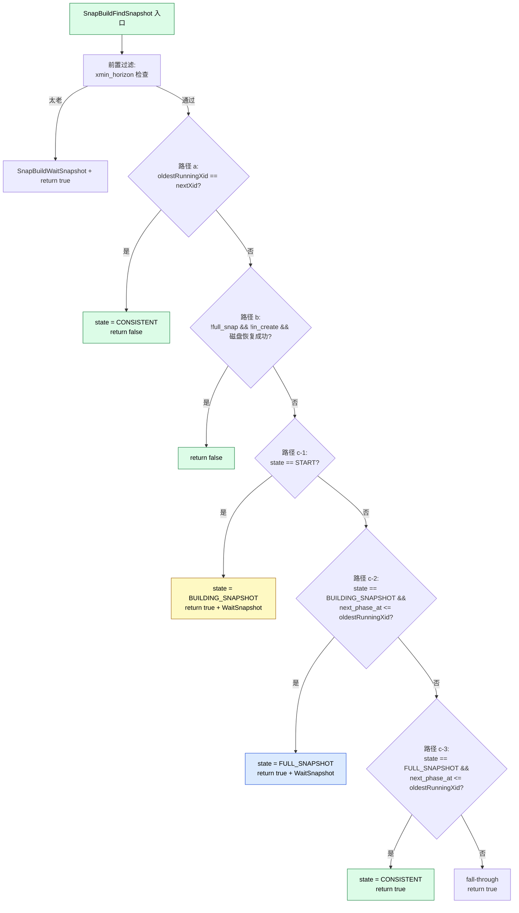
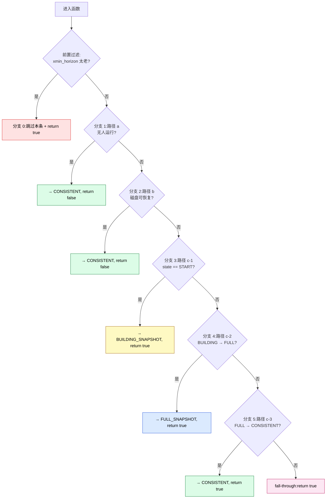
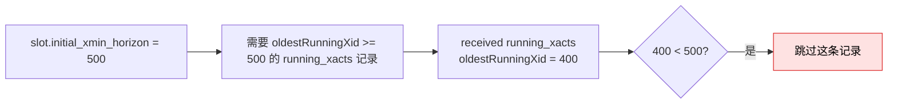
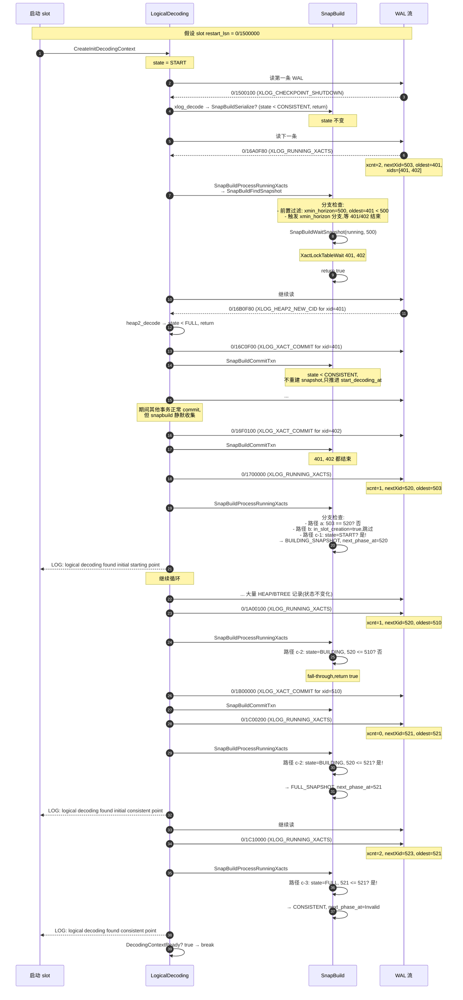

# PostgreSQL SnapBuildFindSnapshot 深度拆解:每条状态转换路径的具体 WAL 日志与前提条件

> 配套源码:`~/cwork/postgresql/src/backend/replication/logical/snapbuild.c:1238-1430`(193 行)
>
> 配套结构:`src/include/storage/standbydefs.h:47-58`(`xl_running_xacts` 定义)
>
> 读完本文你会理解:
> 1. **5 个分支的精确选择顺序**(为什么 a 优先于 b 优先于 c-1)
> 2. **每条路径的前提条件**:`builder->state`、`running->oldestRunningXid`、`builder->initial_xmin_horizon`、`builder->building_full_snapshot`、`builder->in_slot_creation`
> 3. **每条 `xl_running_xacts` WAL 记录** 的字段如何被 `SnapBuildFindSnapshot` 消费
> 4. **具体的状态机迁移**:START → BUILDING_SNAPSHOT → FULL_SNAPSHOT → CONSISTENT,每步由哪条 WAL 触发
> 5. **每个 `return true / false` 的语义差异**:为什么有些路径让 `DecodingContextFindStartpoint` 立即 break,有些却继续循环
> 6. **`SnapBuildWaitSnapshot` 的作用**:为什么 `LOG: Waiting for transactions ...` 会触发

---

## 目录

- [一、函数总览与定位](#一函数总览与定位)
- [二、`xl_running_xacts` WAL 记录格式](#二xl_running_xacts-wal-记录格式)
- [三、5 个分支的执行顺序](#三5-个分支的执行顺序)
- [四、前置过滤:xmin_horizon 检查](#四前置过滤xmin_horizon-检查)
- [五、路径 a:无 running xact → 直接 CONSISTENT](#五路径-a无-running-xact--直接-consistent)
- [六、路径 b:从磁盘恢复 → CONSISTENT](#六路径-b从磁盘恢复--consistent)
- [七、路径 c-1:START → BUILDING_SNAPSHOT](#七路径-c-1start--building_snapshot)
- [八、路径 c-2:BUILDING_SNAPSHOT → FULL_SNAPSHOT](#八路径-c-2building_snapshot--full_snapshot)
- [九、路径 c-3:FULL_SNAPSHOT → CONSISTENT](#九路径-c-3full_snapshot--consistent)
- [十、fall-through:已在推进中](#十fall-through已在推进中)
- [十一、`SnapBuildWaitSnapshot` 详解](#十一snapbuildwaitsnapshot-详解)
- [十二、5 个分支的对比表](#十二5-个分支的对比表)
- [十三、完整时序举例:从启动到稳态](#十三完整时序举例从启动到稳态)
- [十四、边角情况](#十四边角情况)
- [十五、源码速查表](#十五源码速查表)
- [十六、参考](#十六参考)

---

## 一、函数总览与定位

### 1.1 函数签名

```c
/* snapbuild.c:1238 */
static bool SnapBuildFindSnapshot(SnapBuild *builder, XLogRecPtr lsn,
                                   xl_running_xacts *running);
```

**3 个参数**:
- `builder`:状态机实例
- `lsn`:`xl_running_xacts` WAL 记录的 LSN
- `running`:已经从 WAL 解析出的 `xl_running_xacts` 结构

**返回值**:`bool`
- `true` = 需要继续循环读 WAL 推进
- `false` = 已经到达稳态,主循环可以 break

### 1.2 调用链

```mermaid
flowchart TD
    A[DecodingContextFindStartpoint<br/>(logical.c:635)] --> B[XLogReadRecord]
    B --> C[LogicalDecodingProcessRecord<br/>(decode.c:88)]
    C -->|rmgr=RM_STANDBY_ID<br/>info=XLOG_RUNNING_XACTS| D[standby_decode<br/>(decode.c:359)]
    D --> E["SnapBuildProcessRunningXacts<br/>(snapbuild.c:1136)"]
    E --> F{state &lt; CONSISTENT?}
    F -->|是| G[SnapBuildFindSnapshot]
    F -->|否| H[SnapBuildSerialize]
    G --> I{return value}
    I -->|true| A
    I -->|false| J[DecodingContextReady → break]
    style A fill:#dbeafe,stroke:#1d4ed8,color:#000
    style D fill:#fce7f3,stroke:#be185d,color:#000
    style G fill:#dcfce7,stroke:#15803d,color:#000
```

### 1.3 函数整体结构(193 行,5 个分支)



**关键观察**:**只有路径 a 和路径 b 返回 false**(立即 break);**路径 c-1、c-2、c-3 都返回 true**(需要继续循环)。这是 snapbuild 的"快路径"与"慢路径"之分。

---

## 二、`xl_running_xacts` WAL 记录格式

### 2.1 结构定义(`standbydefs.h:47-58`)

```c
typedef struct xl_running_xacts
{
    int             xcnt;               /* # of xact ids in xids[] */
    int             subxcnt;            /* # of subxact ids in xids[] */
    bool            subxid_overflow;    /* snapshot overflowed, subxids missing */
    TransactionId   nextXid;            /* xid from TransamVariables->nextXid */
    TransactionId   oldestRunningXid;   /* *not* oldestXmin */
    TransactionId   latestCompletedXid; /* so we can set xmax */
    TransactionId   xids[FLEXIBLE_ARRAY_MEMBER];
} xl_running_xacts;
```

### 2.2 字段含义

| 字段 | 含义 |
|------|------|
| `xcnt` | 主事务 xid 数量 |
| `subxcnt` | 子事务 xid 数量(可选) |
| `subxid_overflow` | 子事务数组溢出标志 |
| `nextXid` | **当前 PG 全局 nextXid** —— 即"下一个要被分配的 xid",等于"已分配的最大 xid + 1" |
| `oldestRunningXid` | 当前正在运行的最老 xid(不是 oldestXmin) |
| `latestCompletedXid` | 最后一个已完成的 xid |
| `xids[]` | 实际运行中的 xid 列表(前 xcnt 个主事务,后 subxcnt 个子事务) |

### 2.3 生成者

由 `LogStandbySnapshot()`(`standby.c:1282`)周期生成:
- bgwriter 周期 15s(默认)
- checkpointer 在 CHECKPOINT 之前
- `SnapBuildWaitSnapshot` 等老 xid 结束后主动调一次

### 2.4 WAL 记录二进制布局

```
+--------------------+
|  xlog_header       |  (24B 标准 WAL header)
|  xl_prev/next/...  |
+--------------------+
|  info = XLOG_RUNNING_XACTS |  (1B,这里 = 0x30)
|  rmgr = RM_STANDBY_ID       |  (1B,这里 = 0x04)
+--------------------+
|  xcnt (4B)        |  假设 = 2
|  subxcnt (4B)     |  假设 = 0
|  subxid_overflow(1B) |  假设 = false
|  padding(3B)      |
|  nextXid (4B)     |  假设 = 503
|  oldestRunningXid (4B) | 假设 = 401
|  latestCompletedXid (4B) | 假设 = 400
+--------------------+
|  xids[0] = 401 (4B) |  第一个 running xid
|  xids[1] = 402 (4B) |  第二个 running xid
+--------------------+
```

**总大小**:`MinSizeOfXactRunningXacts(固定部分) + (xcnt + subxcnt) * sizeof(TransactionId) = 28 + 8 = 36 字节`。

### 2.5 pg_waldump 风格的输出示例

```text
rmgr: Standby   (0x04), len (rec/tot): 36/ 36, lsn: 0/016A0F80, prev 0/016A0F40, desc: RUNNING_XACTS nextXid 503 oldestRunningXid 401 latestCompletedXid 400; 2 xacts: 401 402
```

每个字段都在 desc 里清晰可见。

---

## 三、5 个分支的执行顺序

**5 个分支按代码顺序**(`if` / `else if` / `else if` ... 链),**前一个不满足才检查后一个**。



**关键观察**:
1. **路径 a 最优先**:即便是 state=START,只要没人跑就直接稳态
2. **路径 b 第二优先**:但**只在不是 slot 创建阶段、不是全快照**时
3. **路径 c 是兜底**:c-1 → c-2 → c-3 按状态顺序检查
4. **fall-through** 才是最后

---

## 四、前置过滤:xmin_horizon 检查

### 4.1 代码(snapbuild.c:1262-1278)

```c
if (TransactionIdIsNormal(builder->initial_xmin_horizon) &&
    NormalTransactionIdPrecedes(running->oldestRunningXid,
                                builder->initial_xmin_horizon))
{
    ereport(DEBUG1,
            (errmsg_internal("skipping snapshot at %X/%X while building logical decoding snapshot, xmin horizon too low",
                             LSN_FORMAT_ARGS(lsn)),
             errdetail_internal("initial xmin horizon of %u vs the snapshot's %u",
                                builder->initial_xmin_horizon, running->oldestRunningXid)));


    SnapBuildWaitSnapshot(running, builder->initial_xmin_horizon);

    return true;
}
```

### 4.2 触发条件

**两个条件同时满足**才进入此分支:
1. `TransactionIdIsNormal(builder->initial_xmin_horizon)` —— slot 持有非法的 xmin_horizon(非 InvalidTransactionId)
2. `NormalTransactionIdPrecedes(running->oldestRunningXid, builder->initial_xmin_horizon)` —— 收到的 `oldestRunningXid` 比 slot 的 xmin_horizon **更老**

### 4.3 物理含义



**为什么?** slot 已经声明"我需要看到 xid >= 500 的所有 catalog 行"。如果现在看到的 running_xacts 里 `oldestRunningXid = 400`,说明这条记录生成时,xid 400 还在运行。**这些 xid < 500 的事务的 catalog 修改可能被 vacuum 删掉了**。snapbuild 等于"来晚了"。

### 4.4 后果

```c
SnapBuildWaitSnapshot(running, builder->initial_xmin_horizon);
return true;
```

- **等待**:`XactLockTableWait` 等 < `initial_xmin_horizon` 的 xid 全部结束
- **return true**:**继续循环**读下一条 `xl_running_xacts`

### 4.5 具体日志输出

```text
DEBUG1: skipping snapshot at 0/016A0F80 while building logical decoding snapshot, xmin horizon too low
DETAIL: initial xmin horizon of 500 vs the snapshot's 400
```

---

## 五、路径 a:无 running xact → 直接 CONSISTENT

### 5.1 代码(snapbuild.c:1291-1308)

```c
if (running->oldestRunningXid == running->nextXid)
{
    if (builder->start_decoding_at == InvalidXLogRecPtr ||
        builder->start_decoding_at <= lsn)
        /* can decode everything after this */
        builder->start_decoding_at = lsn + 1;

    /* As no transactions were running xmin/xmax can be trivially set. */
    builder->xmin = running->nextXid;	/* < are finished */
    builder->xmax = running->nextXid;	/* >= are running */

    /* so we can safely use the faster comparisons */
    Assert(TransactionIdIsNormal(builder->xmin));
    Assert(TransactionIdIsNormal(builder->xmax));

    builder->state = SNAPBUILD_CONSISTENT;
    builder->next_phase_at = InvalidTransactionId;

    ereport(LOG,
            (errmsg("logical decoding found consistent point at %X/%X",
                    LSN_FORMAT_ARGS(lsn)),
             errdetail("There are no running transactions.")));

    return false;
}
```

### 5.2 触发条件

**唯一条件**:`running->oldestRunningXid == running->nextXid`

**物理含义**:当时刻生成 `xl_running_xacts` 时,**没有人持有 xid**。`oldestRunningXid` 是 running 中的最老,`nextXid` 是"下一个要分配的"。如果两者相等,**说明没有 running 事务**(因为 running 一定 >= nextXid 才合理)。

### 5.3 状态变化

| 字段 | 变化 |
|------|------|
| `builder->start_decoding_at` | `lsn + 1`(从这条 LSN 之后所有 WAL 都可解码) |
| `builder->xmin` | `running->nextXid`(所有 < nextXid 的已结束) |
| `builder->xmax` | `running->nextXid`(所有 >= nextXid 的视为 running) |
| `builder->state` | `→ SNAPBUILD_CONSISTENT` |
| `builder->next_phase_at` | `InvalidTransactionId`(不再需要等) |

### 5.4 返回值

**`return false`** —— 主循环 `DecodingContextFindStartpoint` 立即 break。

### 5.5 具体例子

```text
WAL record @ LSN 0/016A0F80:
  rmgr: Standby (0x04)
  info: XLOG_RUNNING_XACTS (0x30)
  data:
    xcnt = 0
    subxcnt = 0
    subxid_overflow = false
    nextXid = 503
    oldestRunningXid = 503   ← 与 nextXid 相等
    latestCompletedXid = 502
    xids[] = (empty)

pg_log 输出:
  LOG: logical decoding found consistent point at 0/016A0F80
  DETAIL: There are no running transactions.
```

**状态机**:`START` → `CONSISTENT`(一步完成,**跳过 BUILDING 和 FULL**)

### 5.6 重要不变量

```c
Assert(TransactionIdIsNormal(builder->xmin));
Assert(TransactionIdIsNormal(builder->xmax));
```

`xmin == xmax == nextXid` 是合法状态(`xmax < xmin` 状态机中也合法,见 snapbuild.c:1170-1177 注释)。这意味着快照为空(没有任何 committed tx),但状态是 CONSISTENT。

### 5.7 何时发生

**典型场景**:
- publisher 刚启动、还没人用
- 凌晨低峰期,所有连接都 idle
- 紧急停库后刚恢复
- **`pg_basebackup` 期间的辅助 slot**

---

## 六、路径 b:从磁盘恢复 → CONSISTENT

### 6.1 代码(snapbuild.c:1317-1321)

```c
else if (!builder->building_full_snapshot &&
         !builder->in_slot_creation &&
         SnapBuildRestore(builder, lsn))
{
    /* there won't be any state to cleanup */
    return false;
}
```

### 6.2 触发条件(3 个 AND)

| 条件 | 含义 |
|------|------|
| `!builder->building_full_snapshot` | 不需要 user data 全快照 |
| `!builder->in_slot_creation` | **不在** slot 创建阶段 |
| `SnapBuildRestore(builder, lsn) == true` | 磁盘上有对应 LSN 的 `.snap` 文件且成功恢复 |

### 6.3 为什么这两个条件是"非"

**`building_full_snapshot = true`**:需要导出快照给 user data 读,但磁盘恢复的快照只包含 catalog modifying 事务,**不满足"全快照"要求**(见 snapbuild.c:1248-1252 注释)。

**`in_slot_creation = true`**:slot 创建阶段还没有 restart_lsn,不应该"穿越"到磁盘快照(否则会跳过重要的状态机推进)。

### 6.4 `SnapBuildRestore` 的工作

详见 snapbuild.c:1841-1931。核心逻辑:

```c
if (!SnapBuildRestoreSnapshot(&ondisk, lsn, builder->context, true))
    return false;  /* 磁盘无文件 → 返回 false,继续往下走 */
```

**磁盘有文件**:
- 读取 `.snap` 文件(CRC32C 校验)
- 把 `ondisk.builder` 的 xmin/xmax/state/catchange 全部拷贝到当前 builder
- **直接 state = CONSISTENT**(从磁盘恢复的快照必须是 CONSISTENT)
- 调用 `SnapBuildBuildSnapshot` 重建 in-memory snapshot

**磁盘无文件**:`SnapBuildRestoreSnapshot` 返回 false,`SnapBuildRestore` 返回 false,**继续走 c 路径**。

### 6.5 状态变化

由 `SnapBuildRestore` 内部完成,**不修改 `state` 字段**(在恢复过程中已经是 CONSISTENT)。

**关键不变量**:`builder->state == SNAPBUILD_CONSISTENT`(见 snapbuild.c:1927 `Assert(builder->state == SNAPBUILD_CONSISTENT)`)

### 6.6 返回值

**`return false`** —— 主循环 break。

### 6.7 适用场景

| 场景 | 是否走路径 b |
|------|------------|
| **restart_lsn 已知 + 磁盘有 .snap** | ✅ |
| 创建 slot(`in_slot_creation=true`) | ❌(走 c-1) |
| 导出快照(`building_full_snapshot=true`) | ❌(走 c) |
| 磁盘无 .snap | ❌(走 c) |
| 磁盘有 .snap 但 checksum 错 | ❌(走 c) |

### 6.8 具体日志

```text
LOG: logical decoding found consistent point at 0/01D00000
DETAIL: Logical decoding will begin using saved snapshot.
```

---

## 七、路径 c-1:START → BUILDING_SNAPSHOT

### 7.1 代码(snapbuild.c:1336-1358)

```c
else if (builder->state == SNAPBUILD_START)
{
    builder->state = SNAPBUILD_BUILDING_SNAPSHOT;
    builder->next_phase_at = running->nextXid;

    /*
     * Start with an xmin/xmax that's correct for future, when all the
     * currently running transactions have finished. We'll update both
     * while waiting for the pending transactions to finish.
     */
    builder->xmin = running->nextXid;	/* < are finished */
    builder->xmax = running->nextXid;	/* >= are running */

    /* so we can safely use the faster comparisons */
    Assert(TransactionIdIsNormal(builder->xmin));
    Assert(TransactionIdIsNormal(builder->xmax));

    ereport(LOG,
            (errmsg("logical decoding found initial starting point at %X/%X",
                    LSN_FORMAT_ARGS(lsn)),
             errdetail("Waiting for transactions (approximately %d) older than %u to end.",
                       running->xcnt, running->nextXid)));

    SnapBuildWaitSnapshot(running, running->nextXid);
}
```

### 7.2 触发条件(精确)

**唯一条件**:`builder->state == SNAPBUILD_START`(`-1`)

**隐含前提**:路径 a 不满足(`oldestRunningXid != nextXid`,即**有人运行**),路径 b 不满足(磁盘无可用或不允许恢复)

### 7.3 状态变化

| 字段 | 变化 |
|------|------|
| `builder->state` | `START` → `BUILDING_SNAPSHOT` |
| `builder->next_phase_at` | `running->nextXid`(本批 running xid 的"下一个") |
| `builder->xmin` | `running->nextXid` |
| `builder->xmax` | `running->nextXid` |

### 7.4 `next_phase_at` 的语义

**这是状态机的"门槛"**:
- 到达 `BUILDING_SNAPSHOT` 时,记录 `next_phase_at = 502`(假设)
- **当** 之后看到的 `running->oldestRunningXid >= 502`,意味着"START 时的 xid 都结束了"
- 此时进入 c-2(`BUILDING_SNAPSHOT` → `FULL_SNAPSHOT`)

### 7.5 `SnapBuildWaitSnapshot` 调用的作用

```c
SnapBuildWaitSnapshot(running, running->nextXid);
```

遍历 `running->xids[]`,**对每个 < nextXid 的 xid 调 `XactLockTableWait`**(等它结束)。

**目的**:
1. 加速状态机推进(不等 bgwriter 的下一个 running_xacts)
2. 让 isolationtester 能感知"snapshot builder 在等"
3. 等结束后,主动 `LogStandbySnapshot()` 写一条新的

### 7.6 返回值

**`return true`** —— 主循环继续。

### 7.7 具体例子

```text
WAL record @ LSN 0/016A0F80:
  xcnt = 2
  nextXid = 503
  oldestRunningXid = 401
  xids[] = {401, 402}

pg_log 输出:
  LOG: logical decoding found initial starting point at 0/016A0F80
  DETAIL: Waiting for transactions (approximately 2) older than 503 to end.
```

**状态机**:`START` → `BUILDING_SNAPSHOT`,`next_phase_at = 503`

### 7.8 必须有人运行(否则会走路径 a)

**反例**:
- 如果 `oldestRunningXid == nextXid`,进路径 a
- 如果 `oldestRunningXid != nextXid` 但 `xcnt == 0`(数据异常),会进入路径 c-1,`SnapBuildWaitSnapshot` 立即返回(空循环)

### 7.9 c-1 之后的"等"是异步还是同步?

```c
SnapBuildWaitSnapshot(running, running->nextXid);  // 同步等待
return true;                                        // 继续循环
```

**`SnapBuildWaitSnapshot` 内部**:
- `XactLockTableWait`:**同步等待**,在等的过程中 `WaitLatch` 让出 CPU
- 等完后调 `LogStandbySnapshot()` 触发新 running_xacts

**所以**:**等本批 xid 结束后,大概率下一条 `xl_running_xacts` 已经在 WAL 末尾**,snapbuild 读下一条记录继续推进。

---

## 八、路径 c-2:BUILDING_SNAPSHOT → FULL_SNAPSHOT

### 8.1 代码(snapbuild.c:1368-1379)

```c
else if (builder->state == SNAPBUILD_BUILDING_SNAPSHOT &&
         TransactionIdPrecedesOrEquals(builder->next_phase_at,
                                       running->oldestRunningXid))
{
    builder->state = SNAPBUILD_FULL_SNAPSHOT;
    builder->next_phase_at = running->nextXid;

    ereport(LOG,
            (errmsg("logical decoding found initial consistent point at %X/%X",
                    LSN_FORMAT_ARGS(lsn)),
             errdetail("Waiting for transactions (approximately %d) older than %u to end.",
                       running->xcnt, running->nextXid)));

    SnapBuildWaitSnapshot(running, running->nextXid);
}
```

### 8.2 触发条件(精确 AND)

| 条件 | 含义 |
|------|------|
| `builder->state == SNAPBUILD_BUILDING_SNAPSHOT` | 已经在 c-1 走过 |
| `TransactionIdPrecedesOrEquals(builder->next_phase_at, running->oldestRunningXid)` | **next_phase_at <= oldestRunningXid** |

### 8.3 第二个条件的精确含义

```c
next_phase_at <= oldestRunningXid
```

- `next_phase_at`:c-1 时记录的 running->nextXid(本批 xid 的"门")
- `running->oldestRunningXid`:当前 running_xacts 记录里的"最老运行中 xid"

**`oldestRunningXid >= next_phase_at`** = "现在 running 中的最老 xid >= c-1 时的 nextXid" = **"c-1 时记录的 xid 全部结束了"**

### 8.4 状态变化

| 字段 | 变化 |
|------|------|
| `builder->state` | `BUILDING_SNAPSHOT` → `FULL_SNAPSHOT` |
| `builder->next_phase_at` | `running->nextXid`(本批 xid 的"门") |
| `builder->xmin` | (由 `SnapBuildProcessRunningXacts` 后置更新,见下) |
| `builder->xmax` | (同上) |

**注意**:`xmin`/`xmax` 在这里**不立即更新**。是 `SnapBuildProcessRunningXacts` 函数末尾统一更新:
```c
builder->xmin = running->oldestRunningXid;
SnapBuildPurgeOlderTxn(builder);
```

### 8.5 物理含义

`FULL_SNAPSHOT` 状态的含义:**从此刻起,所有新启动的事务都有"目录快照"可用,可以 decode**。

- 此时 snapbuild 已经记录了 #1 批 xid 的 commit/abort 信息
- 之后启动的事务(>= #2 批的 nextXid)**可解码**
- 但 #1 和 #2 期间已经 running 的事务**仍然不可解码**(它们可能改了 catalog,我们还没收集到 commit 信息)

### 8.6 返回值

**`return true`** —— 主循环继续(还要等 #2 批 xid 结束)。

### 8.7 具体例子

```text
Step 1: (c-1)
  WAL @ 0/016A0F80:
    xcnt = 2, nextXid = 503, oldestRunningXid = 401
    xids[] = {401, 402}
  → state = BUILDING_SNAPSHOT, next_phase_at = 503

(等待 401, 402 结束)

Step 2: (c-2)
  WAL @ 0/01A00100:
    xcnt = 1, nextXid = 520, oldestRunningXid = 503  ← 503 >= next_phase_at(503)
    xids[] = {510}
  → state = FULL_SNAPSHOT, next_phase_at = 520
```

**注意**:`oldestRunningXid = 503` 恰好等于 `next_phase_at = 503`,**条件是 `<=`**(`PrecedesOrEquals`),所以也满足。

### 8.8 状态不变量

```c
Assert(builder->state == SNAPBUILD_FULL_SNAPSHOT);
```

后续 `SnapBuildProcessChange` 等函数会用到这个不变量:

```c
/* snapbuild.c:643-647 */
if (builder->state < SNAPBUILD_FULL_SNAPSHOT)
    return false;  /* FULL 之前不能发 change */
```

---

## 九、路径 c-3:FULL_SNAPSHOT → CONSISTENT

### 9.1 代码(snapbuild.c:1388-1400)

```c
else if (builder->state == SNAPBUILD_FULL_SNAPSHOT &&
         TransactionIdPrecedesOrEquals(builder->next_phase_at,
                                       running->oldestRunningXid))
{
    builder->state = SNAPBUILD_CONSISTENT;
    builder->next_phase_at = InvalidTransactionId;

    ereport(LOG,
            (errmsg("logical decoding found consistent point at %X/%X",
                    LSN_FORMAT_ARGS(lsn)),
             errdetail("There are no old transactions anymore.")));
}
```

### 9.2 触发条件(精确 AND)

| 条件 | 含义 |
|------|------|
| `builder->state == SNAPBUILD_FULL_SNAPSHOT` | 已经在 c-2 走过 |
| `TransactionIdPrecedesOrEquals(builder->next_phase_at, running->oldestRunningXid)` | next_phase_at <= oldestRunningXid |

**与 c-2 的条件完全相同**,只是 `state` 不同。

### 9.3 状态变化

| 字段 | 变化 |
|------|------|
| `builder->state` | `FULL_SNAPSHOT` → `CONSISTENT` |
| `builder->next_phase_at` | `InvalidTransactionId`(不再需要门) |

### 9.4 为什么这一步**不调** `SnapBuildWaitSnapshot`

```c
/* 路径 c-2 */ SnapBuildWaitSnapshot(running, running->nextXid);
/* 路径 c-3 */ /* 不调用 */
```

**含义**:**c-3 进入 CONSISTENT 后,所有现存 running tx 都可解码**(因为它们都从 BUILDING_SNAPSHOT 之后启动,我们已经有了它们的 catalog 快照)。

**不需要再等**。`SnapBuildWaitSnapshot` 是在等"老 xid"(改变 committed.xip 集合),c-3 时刻这些都搞定了。

### 9.5 返回值

**`return true`** —— 主循环**还会再循环一次**(因为 `DecodingContextReady` 检查见下)。

### 9.6 实际效果:`DecodingContextReady`

`SnapBuildFindSnapshot` 返回 true,但**主循环怎么退出**?答案是 `DecodingContextReady` 检查:

```c
/* logical.c:626-629 */
bool DecodingContextReady(LogicalDecodingContext *ctx)
{
    return SnapBuildCurrentState(ctx->snapshot_builder) == SNAPBUILD_CONSISTENT;
}
```

`SnapBuildProcessRunningXacts` 调用 `SnapBuildFindSnapshot` 之后,主循环在 `DecodingContextFindStartpoint` 末尾检查 `DecodingContextReady` → break。

### 9.7 具体例子

```text
Step 1: (c-1) @ 0/016A0F80
  xcnt=2, nextXid=503, oldestRunningXid=401
  → BUILDING_SNAPSHOT, next_phase_at=503

Step 2: (c-2) @ 0/01A00100
  xcnt=1, nextXid=520, oldestRunningXid=503
  → FULL_SNAPSHOT, next_phase_at=520

Step 3: (c-3) @ 0/01C00200
  xcnt=0, nextXid=521, oldestRunningXid=521  ← 521 >= 520
  → CONSISTENT
```

### 9.8 关键洞察:c-3 的日志与 c-1/c-2 不同

```text
路径 c-1: "logical decoding found initial starting point at ..."
路径 c-2: "logical decoding found initial consistent point at ..."
路径 c-3: "logical decoding found consistent point at ..."  (无 "initial")
```

**`initial` 只在前两阶段出现**。c-3 是真正的"稳态"。

---

## 十、fall-through:已在推进中

### 10.1 代码(snapbuild.c:1409-1412)

```c
/*
 * We already started to track running xacts and need to wait for all
 * in-progress ones to finish. We fall through to the normal processing of
 * records so incremental cleanup can be performed.
 */
return true;
```

### 10.2 触发场景

**所有 5 个分支都不满足**,即:
- 不走前置过滤
- 路径 a 不满足(有人跑)
- 路径 b 不满足(磁盘无 / 条件不允许)
- 路径 c-1 不满足(state 已经 != START)
- 路径 c-2 不满足(还没到 BUILDING → FULL 条件)
- 路径 c-3 不满足(还没到 FULL → CONSISTENT 条件)

**典型场景**:`state == BUILDING_SNAPSHOT`,但本条 running_xacts 里的 `oldestRunningXid < next_phase_at`(老 xid 还没跑完)。

### 10.3 返回值与作用

**`return true`** —— 主循环**继续**读下一条 WAL。

`DecodingContextFindStartpoint` 主循环收到 true 后:
1. 回到 `for (;;)` 顶端
2. `CHECK_FOR_INTERRUPTS()`
3. `XLogReadRecord` 读下一条

**注意**:`SnapBuildWaitSnapshot` 已经在 c-1 / c-2 调过,fall-through 时不会再调(代码里没有)。这意味着**fall-through 路径完全靠 bgwriter 周期**(默认 15s)。

### 10.4 为什么 fall-through 是必要的

如果某条 `xl_running_xacts` 记录出现,但**老 xid 还没结束**,snapbuild:
- 不能推进状态机(状态条件不满足)
- **仍然需要重置** xmin(下次 `SnapBuildProcessRunningXacts` 末尾会更新)
- 仍然需要 `SnapBuildPurgeOlderTxn` 清理老 committed xid

这些都在 `SnapBuildProcessRunningXacts` 中处理,与 `SnapBuildFindSnapshot` 无关。

---

## 十一、`SnapBuildWaitSnapshot` 详解

### 11.1 函数签名

```c
/* snapbuild.c:1435 */
static void SnapBuildWaitSnapshot(xl_running_xacts *running, TransactionId cutoff);
```

**2 个参数**:
- `running`:当前 `xl_running_xacts` 记录
- `cutoff`:等待门槛

### 11.2 完整源码

```c
static void
SnapBuildWaitSnapshot(xl_running_xacts *running, TransactionId cutoff)
{
    int         off;

    for (off = 0; off < running->xcnt; off++)
    {
        TransactionId xid = running->xids[off];

        /*
         * Upper layers should prevent that we ever need to wait on ourselves.
         * Check anyway, since failing to do so would either result in an
         * endless wait or an Assert() failure.
         */
        if (TransactionIdIsCurrentTransactionId(xid))
            elog(ERROR, "waiting for ourselves");

        if (TransactionIdFollows(xid, cutoff))
            continue;

        XactLockTableWait(xid, NULL, NULL, XLTW_None);
    }

    if (!RecoveryInProgress())
    {
        LogStandbySnapshot();
    }
}
```

### 11.3 4 个关键逻辑

1. **遍历**:`for (off = 0; off < running->xcnt; off++)`,只遍历**主事务** xids(不遍历子事务)
2. **跳过自己**:`if (TransactionIdIsCurrentTransactionId(xid))` —— 不能等自己
3. **条件等待**:`if (TransactionIdFollows(xid, cutoff)) continue` —— `xid > cutoff` 的不需等
4. **同步等待**:`XactLockTableWait` 阻塞等
5. **触发新记录**:等完后调 `LogStandbySnapshot` 主动写新 running_xacts(只在非 recovery 时)

### 11.4 `cutoff` 的两种用法

| 调用位置 | cutoff 含义 |
|----------|------------|
| 路径 c-1: `SnapBuildWaitSnapshot(running, running->nextXid)` | 等 < nextXid 的 xid 结束 |
| 前置过滤: `SnapBuildWaitSnapshot(running, builder->initial_xmin_horizon)` | 等 < initial_xmin_horizon 的 xid 结束 |
| 路径 c-2: `SnapBuildWaitSnapshot(running, running->nextXid)` | 同 c-1 |

### 11.5 `LogStandbySnapshot` 的副作用

```c
if (!RecoveryInProgress())
{
    LogStandbySnapshot();
}
```

`LogStandbySnapshot` 会:
1. 写一条新的 `XLOG_RUNNING_XACTS` 到 WAL
2. 触发 `DecodingContextFindStartpoint` 立刻读到新记录
3. 加速状态机推进

**但 recovery 期间不能调**(`LogStandbySnapshot` 在 recovery 时会触发写 WAL,这是不允许的)。

---

## 十二、5 个分支的对比表

| 分支 | 触发条件 | 状态变化 | next_phase_at | WaitSnapshot? | return | 适用场景 |
|------|----------|----------|---------------|---------------|--------|----------|
| **0. 前置过滤** | xmin_horizon < oldestRunningXid | 不变 | 不变 | ✅(等老 xid) | true | 启动晚了,看到的 running 太老 |
| **1. 路径 a** | oldestRunningXid == nextXid | START → CONSISTENT | → Invalid | ❌ | **false** | publisher 空闲 / 启动时无人 |
| **2. 路径 b** | !full_snap && !in_create && 磁盘恢复成功 | 直接 CONSISTENT(由 Restore 内部) | 不变(已是 Invalid) | ❌ | **false** | restart 阶段、磁盘有 .snap |
| **3. 路径 c-1** | state == START | START → BUILDING | → running->nextXid | ✅(等本批) | true | 启动时有人跑,首次推进 |
| **4. 路径 c-2** | state == BUILDING && next_phase_at <= oldestRunningXid | BUILDING → FULL | → running->nextXid | ✅(等本批) | true | 老 xid 跑完 |
| **5. 路径 c-3** | state == FULL && next_phase_at <= oldestRunningXid | FULL → CONSISTENT | → Invalid | ❌ | true | 第二批老 xid 跑完 |
| **6. fall-through** | 其他 | 不变 | 不变 | ❌ | true | 中间等待状态 |

**关键观察**:
- **返回 false 的只有 1 和 2**(a 和 b)
- **return true 的所有路径都会让主循环继续** —— 路径 c-3 虽然到达 CONSISTENT,但仍返回 true,由 `DecodingContextReady` 在循环末尾判断
- **fall-through 完全不做事**,只 return true

---

## 十三、完整时序举例:从启动到稳态

### 13.1 场景设定

- publisher 跑了一周,有 5 个 long-running 事务
- bgwriter 周期 15s
- checkpointer 周期 5min
- slot 创建时 `start_lsn = 0/1500000`

### 13.2 WAL 序列与状态推进



### 13.3 推进摘要

| 步骤 | LSN | running.xcnt | oldestRunningXid | nextXid | 路径 | 状态 | next_phase_at |
|------|-----|--------------|------------------|---------|------|------|---------------|
| 1 | 0/16A0F80 | 2 | 401 | 503 | 0(过滤) | START | Invalid |
| 2 | 0/1700000 | 1 | 503 | 520 | **c-1** | START→BUILDING | 520 |
| 3 | 0/1A00100 | 1 | 510 | 520 | fall-through | BUILDING | 520 |
| 4 | 0/1C00200 | 0 | 521 | 521 | **c-2** | BUILDING→FULL | 521 |
| 5 | 0/1C10000 | 2 | 521 | 523 | **c-3** | FULL→CONSISTENT | Invalid |

**注意步骤 2**:**503 == 503 → 路径 a 触发?** 不!因为 503 != 520(`nextXid`),所以走 c-1。

**步骤 4 与 5 看似重复**(`oldestRunningXid = 521`),但因为 `state` 不同,触发不同分支。

---

## 十四、边角情况

### 14.1 启动时 `restart_lsn` 已是 CONSISTENT 之后

```text
slot.data.restart_lsn = 0/1D00000
对应的 .snap 文件已存在
```

**状态**:
- `state = START`(新建 builder 总是 START)
- `builder->initial_xmin_horizon = xmin_horizon`(来自 `CreateInitDecodingContext`)

**读第一条 `xl_running_xacts` @ 0/1D00080**:
- xmin_horizon 检查:假设不通过(老于 oldestRunningXid),等
- 路径 a:不通过(有人跑)
- **路径 b**:`!in_slot_creation` (false,刚 in_create=true) → **跳过**
- 路径 c-1:state=START,**走 c-1**
- 然后 c-2、c-3 走完

**所以即便磁盘有 .snap,创建 slot 时仍要完整走 c 路径**(因为 `in_slot_creation=true`)。

### 14.2 publisher 一直无活动

**场景**:publisher 没有用户连接,bgwriter 持续发 `XLOG_RUNNING_XACTS`。

```text
running_xacts @ T0: xcnt=0, oldest=503, nextXid=503
running_xacts @ T1: xcnt=0, oldest=503, nextXid=503
...
```

**步骤**:
- T0: 路径 a,直接 CONSISTENT
- T1+: `DecodingContextFindStartpoint` 看到 `DecodingContextReady` → 立即 break

**snapbuild 永远在 T0 就 break,根本不会读到 T1+ 的 running_xacts**。

### 14.3 跨 long-running 事务

**场景**:`xid=400` 跑了一天(正在跑大事务)。

**启动时看到的 running_xacts**:
- `oldestRunningXid = 400`,`nextXid = 502`
- `xcnt = 1`,`xids[] = {400}`

**步骤**:
- 路径 a:400 != 502,跳过
- 路径 b:`in_slot_creation=true`,跳过
- 路径 c-1:state=START → **BUILDING_SNAPSHOT**,`next_phase_at = 502`
- `SnapBuildWaitSnapshot(running, 502)`:等 xid 400
- **同步阻塞**等 1 天
- 之后 xid 400 commit/abort,自动触发 `LogStandbySnapshot`
- 路径 c-2 → c-3 完成

**slot 创建会卡 1 天,直到大事务结束**。这是 snapbuild 的一个"陷阱",需要 DBA 提前规划。

### 14.4 `xmin_horizon` 检查的边界

**条件**:`NormalTransactionIdPrecedes(running->oldestRunningXid, builder->initial_xmin_horizon)`

```c
#define NormalTransactionIdPrecedes(id1, id2) \
    (NormalTransactionIdPrecedes_real(id1, id2))
```

**精确语义**:`id1 < id2`(考虑 32 位 wraparound)。

**陷阱**:
- `xmin_horizon = 500`,`oldestRunningXid = 500` → 不满足 `<`,不进入分支
- `xmin_horizon = 500`,`oldestRunningXid = 501` → 不满足
- `xmin_horizon = 500`,`oldestRunningXid = 499` → 满足!

所以 `oldestRunningXid = xmin_horizon - 1` 触发。

### 14.5 `LogStandbySnapshot` 的递归调用

`SnapBuildWaitSnapshot` 末尾会调 `LogStandbySnapshot`,这会:
1. **获取 ProcArrayLock**(excl)
2. **写新 running_xacts** 到 WAL

**潜在死锁**?不,因为 snapbuild 不持有 ProcArrayLock,只持有 `slot->mutex` 短时间。

---

## 十五、源码速查表

### 15.1 函数签名

```c
/* snapbuild.c:1238 */
static bool SnapBuildFindSnapshot(SnapBuild *builder, XLogRecPtr lsn,
                                   xl_running_xacts *running);
```

### 15.2 5 个分支速查

| 行号 | 分支 | 关键条件 | 状态变化 | return |
|------|------|----------|----------|--------|
| 1262-1278 | 0: xmin_horizon 过滤 | `NormalTransactionIdPrecedes(oldestRunningXid, xmin_horizon)` | 不变 | true |
| 1291-1308 | 1: 路径 a | `oldestRunningXid == nextXid` | → CONSISTENT | **false** |
| 1317-1321 | 2: 路径 b | `!full_snap && !in_create && SnapBuildRestore OK` | 不变(由 Restore 内部) | **false** |
| 1336-1358 | 3: 路径 c-1 | `state == START` | → BUILDING_SNAPSHOT | true |
| 1364-1379 | 4: 路径 c-2 | `state == BUILDING && next_phase_at <= oldestRunningXid` | → FULL_SNAPSHOT | true |
| 1384-1400 | 5: 路径 c-3 | `state == FULL && next_phase_at <= oldestRunningXid` | → CONSISTENT | true |
| 1409-1412 | 6: fall-through | 其他 | 不变 | true |

### 15.3 关键宏 / 函数

| 名称 | 位置 | 作用 |
|------|------|------|
| `NormalTransactionIdPrecedes(a, b)` | `access/transam.h` | 考虑 wraparound 的 `<` |
| `TransactionIdPrecedesOrEquals(a, b)` | `access/transam.h` | `<=` |
| `TransactionIdFollows(a, b)` | `access/transam.h` | `>` |
| `XactLockTableWait(xid, ...)` | `storage/lmgr/proc.c` | 同步等待 xact 结束 |
| `LogStandbySnapshot()` | `storage/ipc/standby.c:1282` | 主动生成新 `xl_running_xacts` |
| `SnapBuildRestore` | `snapbuild.c:1841` | 路径 b 的磁盘恢复 |

### 15.4 状态不变量

| 状态 | 不变量 |
|------|--------|
| START | `next_phase_at = InvalidTransactionId` |
| BUILDING_SNAPSHOT | `next_phase_at != InvalidTransactionId`(c-1 设的) |
| FULL_SNAPSHOT | `next_phase_at != InvalidTransactionId`(c-2 设的) |
| CONSISTENT | `next_phase_at = InvalidTransactionId` |
| CONSISTENT | 必有 `last_serialized_snapshot` 或被 Serialize 准备 |

### 15.5 关键日志消息

```text
DEBUG1: skipping snapshot at 0/016A0F80 while building logical decoding snapshot, xmin horizon too low
DETAIL: initial xmin horizon of 500 vs the snapshot's 400

LOG: logical decoding found consistent point at 0/016A0F80
DETAIL: There are no running transactions.

LOG: logical decoding found initial starting point at 0/016A0F80
DETAIL: Waiting for transactions (approximately 2) older than 503 to end.

LOG: logical decoding found initial consistent point at 0/01A00100
DETAIL: Waiting for transactions (approximately 1) older than 520 to end.

LOG: logical decoding found consistent point at 0/01C10000
DETAIL: There are no old transactions anymore.

LOG: logical decoding found consistent point at 0/01D00000
DETAIL: Logical decoding will begin using saved snapshot.
```

每条日志对应一个分支,顺序即状态机推进历史。

---

## 十六、参考

### 16.1 源码

- 主函数:`src/backend/replication/logical/snapbuild.c:1238-1430`(`SnapBuildFindSnapshot`)
- 结构定义:`src/include/storage/standbydefs.h:47-58`(`xl_running_xacts`)
- 生成者:`src/backend/storage/ipc/standby.c:1282-1335`(`LogStandbySnapshot`)
- WAL 写入:`src/backend/storage/ipc/standby.c:1338-`(`LogCurrentRunningXacts`)
- 等老 xid:`src/backend/replication/logical/snapbuild.c:1435-1482`(`SnapBuildWaitSnapshot`)
- 状态机装配:`src/backend/replication/logical/snapbuild.c:1136-1236`(`SnapBuildProcessRunningXacts`)
- 磁盘恢复:`src/backend/replication/logical/snapbuild.c:1841-1931`(`SnapBuildRestore`)
- 主循环:`src/backend/replication/logical/logical.c:635-665`(`DecodingContextFindStartpoint`)
- 推进判断:`src/backend/replication/logical/logical.c:626-629`(`DecodingContextReady`)
- WAL 处理:`src/backend/replication/logical/decode.c:359-403`(`standby_decode`)

### 16.2 站内文章

- snapbuild.c 深度解析(32 个函数逐个源码分析): <../postgresql-snapbuild-deep-dive/>
- 逻辑复制端到端: <../postgresql-logical-replication-end-to-end/>
- CREATE_REPLICATION_SLOT 端到端: <../postgresql-create-replication-slot-deep-dive/>
- PostgreSQL 行锁机制深度解析: <../postgresql-row-lock/>

### 16.3 官方文档

- [Replication Slots](https://www.postgresql.org/docs/current/warm-standby.html#STREAMING-REPLICATION-SLOTS)
- [Logical Decoding Concepts](https://www.postgresql.org/docs/current/logicaldecoding-explanation.html)
- [pg_replication_slots](https://www.postgresql.org/docs/current/view-pg-replication-slots.html)
- [WAL Internals](https://www.postgresql.org/docs/current/wal-internals.html)

### 16.4 关键术语

- **`xl_running_xacts`**:WAL 中记录当前 running xid 的结构,逻辑解码状态机的"驱动信号"
- **`oldestRunningXid`**:running xid 中最老的(不是 oldestXmin)
- **`nextXid`**:PG 全局下一个要分配的 xid
- **`latestCompletedXid`**:最后已完成的 xid
- **`subxid_overflow`**:running xids 数组溢出(子事务丢失,需要在主事务 commit 时重查)
- **`LogStandbySnapshot`**:周期性生成 `xl_running_xacts` 的函数(bgwriter / checkpointer / `SnapBuildWaitSnapshot` 都调)

---

> **更新日志**
>
> - 2026-10-19:初版发布。覆盖 `SnapBuildFindSnapshot` 全部 5 个分支 + 1 个前置过滤 + fall-through,每个分支配具体 `xl_running_xacts` WAL 记录例子、状态变化、返回值、典型场景,12 张架构/流程/时序图。
