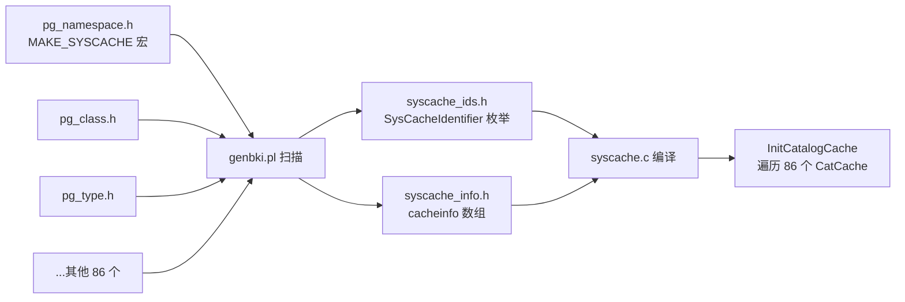
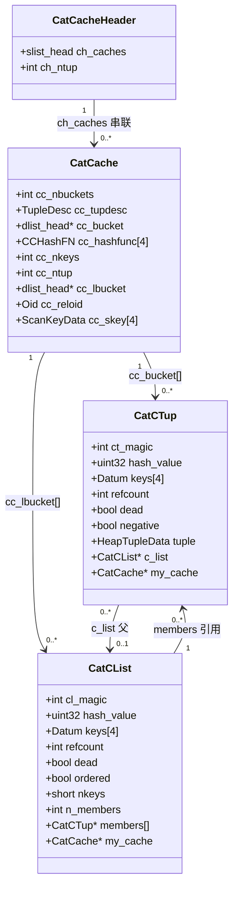
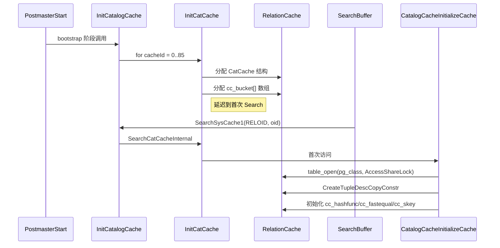
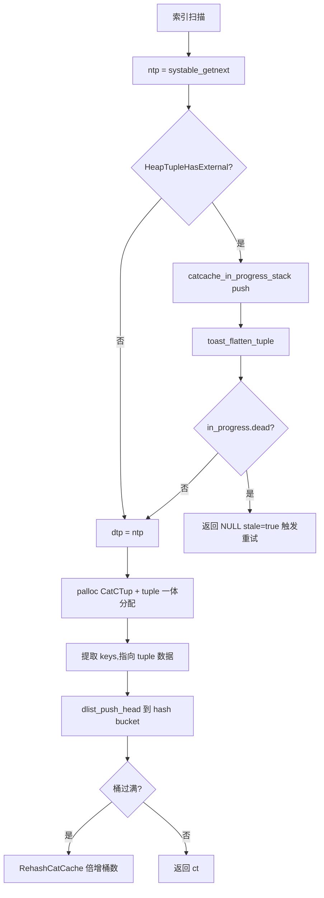
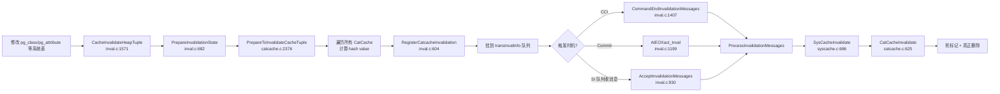
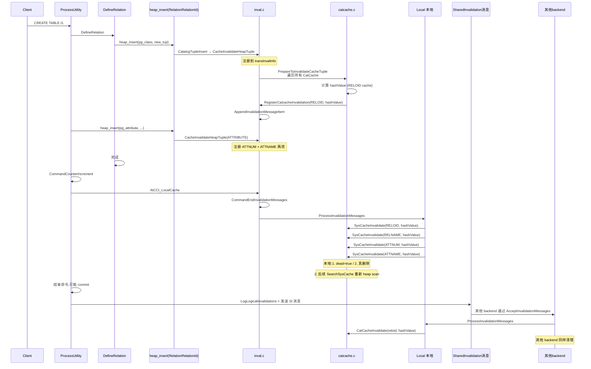

# PostgreSQL syscache 模块源码深度拆解:CatCache 数据结构、LRU 哈希表、cache invalidation 全链路

> 配套源码:`~/cwork/postgresql/src/backend/utils/cache/{syscache,catcache,inval}.c`(共 5243 行)
> 涉及文件:`include/utils/{syscache,catcache}.h`、`include/catalog/syscache_ids.h`(自动生成)、`include/catalog/pg_*.h`(86 个 `MAKE_SYSCACHE` 声明)
>
> 读完本文你会理解:
> 1. **syscache 模块的角色**:为什么 PG 需要专门的系统表缓存、它和 relcache / typcache / plancache 的边界
> 2. **86 个 syscache 的来历**:`MAKE_SYSCACHE` 宏 + `genbki.pl` 生成 `syscache_ids.h` 完整链路
> 3. **CatCache / CatCList / CatCTup 三大数据结构**全套展开,字段含义逐项分析
> 4. **InitCatCache** 初始化:`CacheMemoryContext` 切换、桶分配、ScanKey 预计算
> 5. **SearchCatCacheInternal** 三态查找:hash bucket scan → 命中正/负条目 → 缓存未命中
> 6. **SearchCatCacheMiss** 慢路径:syscache 索引扫描、TOAST 反扁平化、负条目构造
> 7. **5 类 CatC 哈希函数**:`chareqfast` / `namehashfast` / `int4hashfast` / `texthashfast` / `oidvectorhashfast` 的硬编码优化
> 8. **inval.c 的三阶段失效**:CatalogCacheFlushCatalog / LocalExecuteInvalidationMessage / InvalidateSystemCaches
> 9. **处理体系完整链路**:`CacheInvalidateHeapTuple` → `PrepareToInvalidateCacheTuple` → `RegisterCatcacheInvalidation` → `CommandEndInvalidationMessages` → `SysCacheInvalidate` → `CatCacheInvalidate`
> 10. **缓存回调机制**:`CacheRegisterSyscacheCallback` 链接 syscache 变更事件
> 11. **完整的例子**:CREATE TABLE → UPDATE pg_class → CatalogCacheFlushCatalog → InvalidateSystemCaches → 邻接系统重新加载
> 12. **PG 18 新特性**:`SearchSysCacheLocked1` 处理 inplace update、debug_discard_caches 测试基础设施
> 13. **源码速查表**:30+ 关键函数、文件路径、行号全部列出

---

## 目录

- [一、syscache 模块的角色与定位](#一syscache-模块的角色与定位)
- [二、86 个 syscache 的生成链路:`MAKE_SYSCACHE` + genbki.pl](#二86-个-syscache-的生成链路make_syscache--genbkipl)
- [三、CatCache / CatCList / CatCTup 三大数据结构](#三catcache-ccatlist-catctup-三大-数据结构)
- [四、CacheMemoryContext 与 syscache 生命周期](#四cachememorycontext-与-syscache-生命周期)
- [五、InitCatalogCache 初始化流程](#五initcatalogcache-初始化流程)
- [六、SearchCatCacheInternal 三态查找(快路径)](#六searchcatcacheinternal-三态查找快路径)
- [七、SearchCatCacheMiss 慢路径:索引扫描 + TOAST 反扁平化](#七searchcatcachemiss-慢路径索引扫描--toast-反扁平化)
- [八、5 类 CatC 哈希/等价函数硬编码优化](#八5-类-catc-哈希等价函数硬编码优化)
- [九、cache invalidation 体系:inval.c 三阶段失效](#九cache-invalidation-体系invalc-三阶段失效)
- [十、完整例子:CREATE TABLE 的 invalidation 链路](#十完整例子create-table-的-invalidation-链路)
- [十一、syscache 回调机制](#十一syscache-回调机制)
- [十二、用户 / DBA / 内核开发者 三个视角](#十二用户--dba--内核开发者-三个视角)
- [十三、PG 18 新特性](#十三pg-18-新特性)
- [十四、源码速查表](#十四源码速查表)
- [十五、参考](#十五参考)

---

## 一、syscache 模块的角色与定位

### 1.1 PG 的多层缓存体系

PostgreSQL 内核有几大缓存模块,职责分明:

| 模块 | 文件 | 职责 |
|---|---|---|
| **syscache** | `utils/cache/syscache.c`、`catcache.c` | 缓存**系统表**(`pg_class`、`pg_attribute`、`pg_type` 等)的所有元组 |
| **relcache** | `utils/cache/relcache.c` | 缓存 `Relation`(打开表的状态)、TupleDesc、规则、子句 |
| **typcache** | `utils/cache/typcache.c` | 缓存类型特定信息(数组、范围、记录类型) |
| **plancache** | `utils/cache/plancache.c` | 缓存 prepared statement 的 plan tree |
| **partcache** | `utils/cache/partcache.c` | 缓存分区表信息 |
| **spccache** | `utils/cache/spccache.c` | 缓存表空间 |
| **funccache** | `utils/cache/funccache.c` | 缓存函数查找结果 |

**syscache 是这一切的基石** —— relcache 自身就要查 pg_class(就用 syscache),typcache 要查 pg_type(也是 syscache)。

### 1.2 为什么需要 syscache

```c
// 一个简单的例子
SELECT relname FROM pg_class WHERE relname = 't1';
```

如果没 syscache,每次都要:
1. `table_open(pg_class, AccessShareLock)` → 进入 pg_class 共享缓冲区
2. `systable_beginscan(pg_class_oid_index, ...)` → 用 oid 索引扫描
3. `systable_getnext()` → 拿到 HeapTuple
4. 提取 `relname` 字段
5. 关闭 relation

**有了 syscache**:
```c
// syscache.c:209 简化:SearchSysCache1(NAMESPACEOID, namespaceOid)
HeapTuple tup = SearchSysCache1(NAMESPACEOID, ObjectIdGetDatum(namespaceOid));
```

直接哈希查找,O(1) 时间,几乎零开销。

### 1.3 syscache 的规模

```
syscache.c:84   SysCacheSize 由 genbki.pl 自动计算
include/catalog/pg_*.h:  86 个 MAKE_SYSCACHE 声明
```

86 个 syscache 对应 PG 18 所有"必须有唯一索引的系统表":
- `pg_namespace` × 2(NAMESPACEOID + NAMESPACENAME)
- `pg_class` × 3(RELOID + RELNAME + RELNAMENSP)
- `pg_attribute` × 2(ATTNUM + ATTNAME)
- `pg_type` × 4(TYPEOID + TYPENAMENSP + TYPNAME + ...)
- `pg_proc` × 4(PROCOID + PROCNAMEARGSNSP + ...)
- 等等

每个 syscache 都有一个对应的 **CatCache** 实例(syscache.c:86 `static CatCache *SysCache[SysCacheSize]`),每个 CatCache 自带哈希桶、ScanKey、LIST hash bucket。

---

## 二、86 个 syscache 的生成链路:`MAKE_SYSCACHE` + genbki.pl

### 2.1 MAKE_SYSCACHE 宏声明

看 `include/catalog/pg_namespace.h:59-60`:

```c
/* src/include/catalog/pg_namespace.h */
DECLARE_UNIQUE_INDEX(pg_namespace_nspname_index, 2684, NamespaceNameIndexId, pg_namespace, btree(nspname name_ops));
DECLARE_UNIQUE_INDEX_PKEY(pg_namespace_oid_index, 2685, NamespaceOidIndexId, pg_namespace, btree(oid oid_ops));

MAKE_SYSCACHE(NAMESPACENAME, pg_namespace_nspname_index, 4);
MAKE_SYSCACHE(NAMESPACEOID, pg_namespace_oid_index, 16);
```

**`MAKE_SYSCACHE(name, index, nbuckets)`** 三个参数:
- `name`:syscache 的标识符(`NAMESPACENAME`)
- `index`:依赖的唯一索引 oid 宏(`pg_namespace_nspname_index`)
- `nbuckets`:初始哈希桶数(2 的幂)

### 2.2 genbki.pl 自动生成

`src/backend/catalog/genbki.pl:798-829` 在编译时扫描所有 `pg_*.h` 的 `MAKE_SYSCACHE` 声明,生成两个文件:

**`syscache_ids.h`**:
```c
/* src/include/catalog/syscache_ids.h (generated) */
enum SysCacheIdentifier
{
    AGGFNOID,
    AMNAME,
    AMOID,
    ...
    TABLESPACEOID,
    USERMAPPINGOID,
    USERMAPPINGUSERSERVER,
};
#define SysCacheSize (last_syscache + 1)
```

**`syscache_info.h`**:
```c
/* src/include/catalog/syscache_info.h (generated) */
#include "catalog/pg_namespace_d.h"
#include "catalog/pg_class_d.h"
...

static const struct cachedesc cacheinfo[] = {
    [AGGFNOID] = {
        pg_aggregate RelationOidIndexId,
        pg_aggregate_fnoid_index IndexOidIndexId,
        KEY(1),
        16,
    },
    [AMNAME] = {
        pg_am RelationOidIndexId,
        pg_am_amname_index IndexOidIndexId,
        KEY(2),
        4,
    },
    ...
};
```

### 2.3 cachedesc 结构(`syscache.c:67`)

```c
struct cachedesc
{
    Oid			reloid;			/* OID of the relation being cached */
    Oid			indoid;			/* OID of index relation for this cache */
    int			nkeys;			/* # of keys needed for cache lookup */
    int			key[4];			/* attribute numbers of key attrs */
    int			nbuckets;		/* number of hash buckets for this cache */
};
```

`key[]` 数组在生成时通过 `KEY(1)` 或 `KEY(1, 3)` 宏展开为 attribute number 列表。

### 2.4 自动生成的验证

```c
/* src/backend/utils/cache/syscache.c:83 */
StaticAssertDecl(lengthof(cacheinfo) == SysCacheSize,
				 "SysCacheSize does not match syscache.c's array");
```

编译时静态断言 `cacheinfo` 数组长度等于 `SysCacheSize`,确保生成过程无误。

### 2.5 全链路生成流程



---

## 三、CatCache / CatCList / CatCTup 三大数据结构

### 3.1 CatCache(`include/utils/catcache.h:38`)

```c
/* src/include/utils/catcache.h:38 */
typedef struct catcache
{
	int			id;                  /* cache identifier --- see syscache.h */
	int			cc_nbuckets;         /* # of hash buckets in this cache */
	TupleDesc	cc_tupdesc;          /* tuple descriptor (copied from reldesc) */
	dlist_head *cc_bucket;           /* hash buckets */
	CCHashFN	cc_hashfunc[CATCACHE_MAXKEYS];    /* hash function for each key */
	CCFastEqualFN cc_fastequal[CATCACHE_MAXKEYS]; /* fast equal function for each key */
	int			cc_keyno[CATCACHE_MAXKEYS]; /* AttrNumber of each key */
	int			cc_nkeys;            /* # of keys (1..CATCACHE_MAXKEYS) */
	int			cc_ntup;             /* # of tuples currently in this cache */
	int			cc_nlist;            /* # of CatCLists currently in this cache */
	int			cc_nlbuckets;        /* # of CatCList hash buckets in this cache */
	dlist_head *cc_lbucket;          /* hash buckets for CatCLists */
	const char *cc_relname;          /* name of relation the tuples come from */
	Oid			cc_reloid;           /* OID of relation the tuples come from */
	Oid			cc_indexoid;         /* OID of index matching cache keys */
	bool		cc_relisshared;      /* is relation shared across databases? */
	slist_node	cc_next;              /* list link to other CatCache */
	ScanKeyData cc_skey[CATCACHE_MAXKEYS];  /* precomputed key info for heap scans */

#ifdef CATCACHE_STATS
	long		cc_searches;        /* total # searches against this cache */
	long		cc_hits;             /* # of matches against existing entry */
	long		cc_neg_hits;         /* # of matches against negative entry */
	long		cc_newloads;         /* # of successful loads of new entry */
	long		cc_invals;           /* # of entries invalidated from cache */
	long		cc_lsearches;        /* total # list-searches */
	long		cc_lhits;            /* # of matches against existing lists */
#endif
} CatCache;
```

**关键字段**:
- `cc_bucket`:哈希桶数组,每个桶是 `dlist_head`(链地址法解决冲突)
- `cc_lbucket`:CatCList 哈希桶(用于 list 查询,延迟到首次 `SearchCatCacheList` 才分配)
- `cc_skey[CATCACHE_MAXKEYS]`:预计算的 ScanKey,加速 heap scans
- `cc_hashfunc`/`cc_fastequal`:针对每列类型的硬编码哈希和等价函数
- `cc_relisshared`:是否共享表(决定 invalidation 是否跨 db 过滤)

### 3.2 CatCTup(`include/utils/catcache.h:88`)

```c
/* src/include/utils/catcache.h:88 */
typedef struct catctup
{
	int			ct_magic;             /* magic number = CT_MAGIC = 0x57261502 */
#define CT_MAGIC   0x57261502

	uint32		hash_value;            /* hash value for this tuple's keys */

	Datum		keys[CATCACHE_MAXKEYS]; /* Lookup keys, point into tuple for positive, allocated for negative */

	dlist_node	cache_elem;            /* member of per-bucket list */
	int			refcount;              /* number of active references */
	bool		dead;                  /* dead but not yet removed? */
	bool		negative;              /* negative cache entry? */
	HeapTupleData tuple;               /* tuple management header */
	struct catclist *c_list;           /* containing CatCList, or NULL if none */
	CatCache   *my_cache;              /* link to owning catcache */
	/* properly aligned tuple data follows, unless a negative entry */
} CatCTup;
```

**关键字段**:
- `ct_magic`:固定魔数 `0x57261502`,ReleaseCatCache 会 assert 检查
- `hash_value`:入桶的哈希值(避免二次哈希)
- `keys[]`:对于正条目,**指向 tuple 数据**(无需单独分配);对于负条目,**单独分配**
- `refcount`:**引用计数**,SearchCatCache 增 1,ReleaseCatCache 减 1
- `dead`:**惰性删除标记** — 标记后停止返回,等 refcount=0 才真正移除
- `negative`:是否是负条目(断言"无此条目")
- `tuple.t_data`:堆内嵌 tuple 数据,紧跟在 CatCTup 结构体后面

### 3.3 CatCList(`include/utils/catcache.h:155`)

```c
/* src/include/utils/catcache.h:155 */
typedef struct catclist
{
	int			cl_magic;             /* magic number = CL_MAGIC = 0x52765103 */
#define CL_MAGIC   0x52765103

	uint32		hash_value;            /* hash value for lookup keys */
	dlist_node	cache_elem;            /* list member of per-catcache list */

	Datum		keys[CATCACHE_MAXKEYS]; /* First nkeys elements are valid. By-ref are separately allocated */

	int			refcount;
	bool		dead;
	bool		ordered;               /* members listed in index order? */
	short		nkeys;                 /* number of lookup keys specified */
	int			n_members;             /* number of member tuples */
	CatCache   *my_cache;
	CatCTup    *members[FLEXIBLE_ARRAY_MEMBER]; /* members */
} CatCList;
```

**关键点**:
- 用于部分键查找(如 `SearchSysCacheList(RELNAMENSP, 2, namespaceOid, ...)` 只用前 2 个 key)
- 存储**多个 CatCTup 引用**(数组 `members[]`),这些 CatCTup 自己的 refcount 也要增
- `ordered` 标记:在索引顺序里(正常情况),namespace.c 可以利用此标志

### 3.4 CatCacheHeader(`include/utils/catcache.h:188`)

```c
typedef struct catcacheheader
{
	slist_head	ch_caches;          /* linked list of all CatCache */
	int			ch_ntup;            /* total tuples across all caches */
} CatCacheHeader;
```

所有 CatCache 通过 slist 单链表串起来,失效时可以遍历所有 CatCache(`PrepareToInvalidateCacheTuple`)。

### 3.5 数据结构关系图



---

## 四、CacheMemoryContext 与 syscache 生命周期

### 4.1 CacheMemoryContext 定义(`src/backend/utils/mmgr/mcxt.c:152`)

```c
/* src/backend/utils/mmgr/mcxt.c:152 */
MemoryContext CacheMemoryContext = NULL;
```

顶级上下文,**永不重置、永不释放**,是 relcache、catcache、相关模块的永久存储。

### 4.2 创建(`catcache.c:708-720`)

```c
/* src/backend/utils/cache/catcache.c:708 */
void
CreateCacheMemoryContext(void)
{
    if (!CacheMemoryContext)
        CacheMemoryContext = AllocSetContextCreate(TopMemoryContext,
                                                   "CacheMemoryContext",
                                                   ALLOCSET_DEFAULT_SIZES);
}
```

在 `InitCatCache` 内,如果尚未创建就调 `CreateCacheMemoryContext()`。

### 4.3 内存上下文层级

```
TopMemoryContext (永不释放)
└── CacheMemoryContext (永不释放,但有短期子上下文)
    ├── CatCache 结构本身
    ├── CatCTup.tuple 内嵌数据
    ├── relcache entry (rd_indexcxt 子上下文,可重置)
    ├── plancache.c 中的 SPI 子树
    └── ...
```

### 4.4 缓存的"惰性失效"

syscache 的失效**不是立刻删除**,而是标记 `dead = true`:
- `dead = true` 后,SearchCatCacheInternal 跳过此条目(`if (ct->dead) continue;`)
- 等 `refcount = 0`(所有 SearchSysCache 调用方都 Release 完)后才真正从 dlist 移除(`CatCacheRemoveCTup`)

```c
/* src/backend/utils/cache/catcache.c:625 */
CatCacheInvalidate(CatCache *cache, uint32 hashValue)
{
    ...
    dlist_foreach_modify(iter, &cache->cc_bucket[hashIndex])
    {
        CatCTup    *ct = dlist_container(CatCTup, cache_elem, iter.cur);
        if (hashValue == ct->hash_value)
        {
            if (ct->refcount > 0 || (ct->c_list && ct->c_list->refcount > 0))
                ct->dead = true;          // 标记为 dead,真正删除等 refcount=0
            else
                CatCacheRemoveCTup(cache, ct);
        }
    }
}
```

### 4.5 ResourceOwner 管理

每个 SearchSysCache 增 ref 会通过 `ResourceOwnerRememberCatCacheRef` 注册到当前 ResourceOwner,事务结束时自动释放:

```c
/* src/backend/utils/cache/catcache.c:159 */
static inline void
ResourceOwnerRememberCatCacheRef(ResourceOwner owner, HeapTuple tuple)
{
    ResourceOwnerRemember(owner, PointerGetDatum(tuple), &catcache_resowner_desc);
}
```

这避免了 syscache 元组在事务期间被错误释放。

---

## 五、InitCatalogCache 初始化流程

### 5.1 入口(`syscache.c:109-165`)

```c
/* src/backend/utils/cache/syscache.c:109 */
void
InitCatalogCache(void)
{
    int			cacheId;
    Assert(!CacheInitialized);

    SysCacheRelationOidSize = SysCacheSupportingRelOidSize = 0;

    for (cacheId = 0; cacheId < SysCacheSize; cacheId++)
    {
        Assert(OidIsValid(cacheinfo[cacheId].reloid));
        Assert(OidIsValid(cacheinfo[cacheId].indoid));

        SysCache[cacheId] = InitCatCache(cacheId,
                                         cacheinfo[cacheId].reloid,
                                         cacheinfo[cacheId].indoid,
                                         cacheinfo[cacheId].nkeys,
                                         cacheinfo[cacheId].key,
                                         cacheinfo[cacheId].nbuckets);
        if (!PointerIsValid(SysCache[cacheId]))
            elog(ERROR, "could not initialize cache %u (%d)", ...);

        SysCacheRelationOid[SysCacheRelationOidSize++] = cacheinfo[cacheId].reloid;
        SysCacheSupportingRelOid[SysCacheSupportingRelOidSize++] = cacheinfo[cacheId].reloid;
        SysCacheSupportingRelOid[SysCacheSupportingRelOidSize++] = cacheinfo[cacheId].indoid;
        Assert(!RelationInvalidatesSnapshotsOnly(cacheinfo[cacheId].reloid));
    }

    /* Sort and dedup for binary search */
    qsort(SysCacheRelationOid, SysCacheRelationOidSize, sizeof(Oid), oid_compare);
    SysCacheRelationOidSize = qunique(...);
    qsort(SysCacheSupportingRelOid, ...);

    CacheInitialized = true;
}
```

**关键步骤**:
1. 遍历所有 86 个 syscache id
2. 每个 id 调 `InitCatCache` 创建 CatCache 结构
3. 收集 `SysCacheRelationOid[]`(所有缓存的表 oid)和 `SysCacheSupportingRelOid[]`(所有缓存的表 + 索引 oid)
4. `qsort` + `qunique` 去重排序,用于 `RelationHasSysCache` / `RelationSupportsSysCache` 的二分查找

### 5.2 InitCatCache(`catcache.c:877-977`)

```c
/* src/backend/utils/cache/catcache.c:877 */
CatCache *
InitCatCache(int id, Oid reloid, Oid indexoid, int nkeys, const int *key, int nbuckets)
{
    CatCache   *cp;
    MemoryContext oldcxt;
    int			i;

    Assert(nbuckets > 0 && (nbuckets & -nbuckets) == nbuckets);    /* power of 2 */

    if (!CacheMemoryContext)
        CreateCacheMemoryContext();

    oldcxt = MemoryContextSwitchTo(CacheMemoryContext);

    /* 1. 一次性创建 CacheHdr(全局) */
    if (CacheHdr == NULL)
    {
        CacheHdr = (CatCacheHeader *) palloc(sizeof(CatCacheHeader));
        slist_init(&CacheHdr->ch_caches);
        CacheHdr->ch_ntup = 0;
    }

    /* 2. 创建 CatCache 结构(cacheline 对齐) */
    cp = (CatCache *) palloc_aligned(sizeof(CatCache), PG_CACHE_LINE_SIZE, MCXT_ALLOC_ZERO);
    cp->cc_bucket = palloc0(nbuckets * sizeof(dlist_head));
    cp->cc_lbucket = NULL;    /* 延迟到第一次 SearchCatCacheList */

    /* 3. 初始化字段 */
    cp->id = id;
    cp->cc_relname = "(not known yet)";
    cp->cc_reloid = reloid;
    cp->cc_indexoid = indexoid;
    cp->cc_relisshared = false;
    cp->cc_tupdesc = NULL;
    cp->cc_ntup = 0;
    cp->cc_nlist = 0;
    cp->cc_nbuckets = nbuckets;
    cp->cc_nkeys = nkeys;
    for (i = 0; i < nkeys; ++i)
    {
        Assert(AttributeNumberIsValid(key[i]));
        cp->cc_keyno[i] = key[i];
    }

    /* 4. 加入全局链表 */
    slist_push_head(&CacheHdr->ch_caches, &cp->cc_next);

    MemoryContextSwitchTo(oldcxt);
    return cp;
}
```

### 5.3 Phase2 延迟初始化(`catcache.c:984-1075`)

```c
/* src/backend/utils/cache/catcache.c:984 */
static void
CatalogCacheInitializeCache(CatCache *cache)
{
    Relation	relation;
    MemoryContext oldcxt;
    TupleDesc	tupdesc;
    int			i;

    relation = table_open(cache->cc_reloid, AccessShareLock);

    oldcxt = MemoryContextSwitchTo(CacheMemoryContext);
    tupdesc = CreateTupleDescCopyConstr(RelationGetDescr(relation));
    cache->cc_relname = pstrdup(RelationGetRelationName(relation));
    cache->cc_relisshared = RelationGetForm(relation)->relisshared;
    MemoryContextSwitchTo(oldcxt);

    table_close(relation, AccessShareLock);

    /* 4. 初始化每个 key 的 hash/equal 函数(根据列类型) */
    for (i = 0; i < cache->cc_nkeys; ++i)
    {
        Oid			keytype;
        RegProcedure eqfunc;
        CCHashFN	hashfunc;
        CCFastEqualFN fasteqfunc;

        if (cache->cc_keyno[i] > 0)
            keytype = TupleDescAttr(tupdesc, cache->cc_keyno[i] - 1)->atttypid;
        else
            keytype = OIDOID;     /* negative keyno: implicit OID column */

        GetCCHashEqFuncs(keytype, &hashfunc, &eqfunc, &fasteqfunc);
        cache->cc_hashfunc[i] = hashfunc;
        cache->cc_fastequal[i] = fasteqfunc;
        ScanKeyInit(&cache->cc_skey[i],
                    cache->cc_keyno[i],
                    BTEqualStrategyNumber, InvalidOid,
                    ((keytype == OIDOID) ? F_OIDEQ : eqfunc));
    }

    cache->cc_tupdesc = tupdesc;
}
```

**关键**:
- **第一次使用时才初始化**(由 `ConditionalCatalogCacheInitializeCache` 在 `SearchCatCacheInternal` 内触发)
- 此后所有 ScanKey 都已**预计算**,SearchCatCache 时直接 memcpy

### 5.4 初始化时序图



---

## 六、SearchCatCacheInternal 三态查找(快路径)

### 6.1 SearchSysCache1 → SearchCatCache1 → SearchCatCacheInternal

```c
/* syscache.c:222 */
HeapTuple
SearchSysCache1(int cacheId, Datum key1)
{
    Assert(cacheId >= 0 && cacheId < SysCacheSize && PointerIsValid(SysCache[cacheId]));
    Assert(SysCache[cacheId]->cc_nkeys == 1);
    return SearchCatCache1(SysCache[cacheId], key1);
}
```

```c
/* catcache.c:1357 */
HeapTuple
SearchCatCache1(CatCache *cache, Datum v1)
{
    return SearchCatCacheInternal(cache, 1, v1, 0, 0, 0);
}
```

### 6.2 SearchCatCacheInternal(`catcache.c:1391-1487`)

```c
/* src/backend/utils/cache/catcache.c:1391 */
static inline HeapTuple
SearchCatCacheInternal(CatCache *cache, int nkeys, Datum v1, Datum v2, Datum v3, Datum v4)
{
    Datum		arguments[CATCACHE_MAXKEYS];
    uint32		hashValue;
    Index		hashIndex;
    dlist_iter	iter;
    dlist_head *bucket;
    CatCTup    *ct;

    Assert(cache->cc_nkeys == nkeys);

    /* 1. 一次性的延迟初始化 */
    ConditionalCatalogCacheInitializeCache(cache);

#ifdef CATCACHE_STATS
    cache->cc_searches++;
#endif

    arguments[0] = v1; arguments[1] = v2; arguments[2] = v3; arguments[3] = v4;

    /* 2. 计算 hash 值 + 桶号 */
    hashValue = CatalogCacheComputeHashValue(cache, nkeys, v1, v2, v3, v4);
    hashIndex = HASH_INDEX(hashValue, cache->cc_nbuckets);

    /* 3. 遍历 hash bucket */
    bucket = &cache->cc_bucket[hashIndex];
    dlist_foreach(iter, bucket)
    {
        ct = dlist_container(CatCTup, cache_elem, iter.cur);
        if (ct->dead) continue;                           // 跳过 dead 条目
        if (ct->hash_value != hashValue) continue;        // 哈希值不一致,跳过
        if (!CatalogCacheCompareTuple(cache, nkeys, ct->keys, arguments)) continue;  // 不等,跳过

        /* 命中! LRU:移到桶头(最常用在前) */
        dlist_move_head(bucket, &ct->cache_elem);

        if (!ct->negative)
        {
            ResourceOwnerEnlarge(CurrentResourceOwner);
            ct->refcount++;
            ResourceOwnerRememberCatCacheRef(CurrentResourceOwner, &ct->tuple);

#ifdef CATCACHE_STATS
            cache->cc_hits++;
#endif
            return &ct->tuple;                  // 正条目命中
        }
        else
        {
#ifdef CATCACHE_STATS
            cache->cc_neg_hits++;
#endif
            return NULL;                          // 负条目命中(返回 NULL)
        }
    }

    /* 4. cache miss → 走慢路径 */
    return SearchCatCacheMiss(cache, nkeys, hashValue, hashIndex, v1, v2, v3, v4);
}
```

### 6.3 三态总结

| 状态 | 触发条件 | 动作 | 返回 |
|---|---|---|---|
| **正条目命中** | `ct->negative == false` 且 keys 匹配 | LRU 移桶头 + refcount++ + ResourceOwner 注册 | `&ct->tuple` |
| **负条目命中** | `ct->negative == true` | 仅统计 cc_neg_hits++ | `NULL` |
| **cache miss** | hash bucket 找不到匹配 | 调 `SearchCatCacheMiss` 慢路径 | 走慢路径 |

### 6.4 LRU 维护

```c
dlist_move_head(bucket, &ct->cache_elem);    // 命中后移到 dlist 头
```

每次命中都把条目移到 dlist 头部,使最近访问的条目在前面,实现 **LRU** 效果。当 catcache 满了要淘汰时(`RehashCatCache`),可以优先丢弃尾部的旧条目(虽然 PG 实际是用 rehash,不用 LRU 淘汰)。

### 6.5 CatalogCacheComputeHashValue(`catcache.c:100`)

```c
/* src/backend/utils/cache/catcache.c:98 */
static uint32
CatalogCacheComputeHashValue(CatCache *cache, int nkeys,
                             Datum v1, Datum v2, Datum v3, Datum v4)
{
    uint32		hashValue = 0;
    int			i;

    for (i = 0; i < nkeys; i++)
    {
        uint32		h = cache->cc_hashfunc[i](DatumGetPointer(...)[i]);
        hashValue = hash_combine(hashValue, h);
    }
    return hashValue;
}
```

**多列哈希**:每列分别哈希,然后 `hash_combine`(PG 的非加密哈希合并)。

---

## 七、SearchCatCacheMiss 慢路径:索引扫描 + TOAST 反扁平化

### 7.1 慢路径入口(`catcache.c:1494-1620`)

```c
/* src/backend/utils/cache/catcache.c:1494 */
static pg_noinline HeapTuple
SearchCatCacheMiss(CatCache *cache, int nkeys, uint32 hashValue, Index hashIndex,
                   Datum v1, Datum v2, Datum v3, Datum v4)
{
    ScanKeyData cur_skey[CATCACHE_MAXKEYS];
    Relation	relation;
    SysScanDesc scandesc;
    HeapTuple	ntp;
    CatCTup    *ct;
    bool		stale;
    Datum		arguments[CATCACHE_MAXKEYS];

    arguments[0] = v1; arguments[1] = v2; arguments[2] = v3; arguments[3] = v4;

    relation = table_open(cache->cc_reloid, AccessShareLock);

    /* 复制预计算的 ScanKey,填充 key 值 */
    memcpy(cur_skey, cache->cc_skey, sizeof(ScanKeyData) * nkeys);
    cur_skey[0].sk_argument = v1;
    cur_skey[1].sk_argument = v2;
    cur_skey[2].sk_argument = v3;
    cur_skey[3].sk_argument = v4;

    do
    {
        scandesc = systable_beginscan(relation, cache->cc_indexoid,
                                      IndexScanOK(cache), NULL, nkeys, cur_skey);

        ct = NULL;
        stale = false;

        while (HeapTupleIsValid(ntp = systable_getnext(scandesc)))
        {
            ct = CatalogCacheCreateEntry(cache, ntp, NULL, hashValue, hashIndex);
            /* stale 可能因为 detoast 期间收到 invalidation */
            if (ct == NULL) { stale = true; break; }

            ResourceOwnerEnlarge(CurrentResourceOwner);
            ct->refcount++;
            ResourceOwnerRememberCatCacheRef(CurrentResourceOwner, &ct->tuple);
            break;    /* 假设只有一行匹配(uniq index) */
        }

        systable_endscan(scandesc);
    } while (stale);

    table_close(relation, AccessShareLock);

    /* 没找到:创建负条目 */
    if (ct == NULL)
    {
        if (IsBootstrapProcessingMode())
            return NULL;

        ct = CatalogCacheCreateEntry(cache, NULL, arguments, hashValue, hashIndex);
        Assert(ct != NULL);    /* 负条目不会失败 */
        return NULL;
    }

#ifdef CATCACHE_STATS
    cache->cc_newloads++;
#endif
    return &ct->tuple;
}
```

### 7.2 CatalogCacheCreateEntry(`catcache.c:2133-2270`)

```c
/* src/backend/utils/cache/catcache.c:2133 */
static CatCTup *
CatalogCacheCreateEntry(CatCache *cache, HeapTuple ntp, Datum *arguments,
                        uint32 hashValue, Index hashIndex)
{
    CatCTup    *ct;
    MemoryContext oldcxt;

    if (ntp)
    {
        HeapTuple	dtp = NULL;
        int			i;

        /* 1. TOAST 反扁平化(inline 化) */
        if (HeapTupleHasExternal(ntp))
        {
            /* 用 catcache_in_progress_stack 跟踪,允许无效化时标记 stale */
            CatCInProgress in_progress_ent;
            ...
            PG_TRY();
            {
                dtp = toast_flatten_tuple(ntp, cache->cc_tupdesc);
            }
            PG_FINALLY();
            {
                Assert(catcache_in_progress_stack == &in_progress_ent);
                catcache_in_progress_stack = save_in_progress;
            }
            PG_END_TRY();

            if (in_progress_ent.dead)
            {
                heap_freetuple(dtp);
                return NULL;    /* 标记为 stale,让 caller 重试 */
            }
        }
        else
            dtp = ntp;

        /* 2. 在 CacheMemoryContext 分配 CatCTup + tuple 数据(一次 palloc) */
        oldcxt = MemoryContextSwitchTo(CacheMemoryContext);
        ct = (CatCTup *) palloc(sizeof(CatCTup) + MAXIMUM_ALIGNOF + dtp->t_len);

        ct->tuple.t_len = dtp->t_len;
        ct->tuple.t_self = dtp->t_self;
        ct->tuple.t_tableOid = dtp->t_tableOid;
        ct->tuple.t_data = (HeapTupleHeader)
            MAXALIGN(((char *) ct) + sizeof(CatCTup));
        memcpy((char *) ct->tuple.t_data, (const char *) dtp->t_data, dtp->t_len);

        MemoryContextSwitchTo(oldcxt);
        if (dtp != ntp) heap_freetuple(dtp);

        /* 3. 提取 keys(对正条目,keys 直接指向 tuple 数据) */
        for (i = 0; i < cache->cc_nkeys; i++)
        {
            Datum atp;
            bool isnull;
            atp = heap_getattr(&ct->tuple, cache->cc_keyno[i], cache->cc_tupdesc, &isnull);
            Assert(!isnull);
            ct->keys[i] = atp;     /* 指向 tuple 数据内偏移 */
        }
    }
    else    /* 负条目:keys 单独分配 */
    {
        oldcxt = MemoryContextSwitchTo(CacheMemoryContext);
        ct = (CatCTup *) palloc(sizeof(CatCTup));
        CatCacheCopyKeys(cache->cc_tupdesc, cache->cc_nkeys, cache->cc_keyno,
                         arguments, ct->keys);
        MemoryContextSwitchTo(oldcxt);
    }

    /* 4. 初始化 CatCTup header,加入 dlist */
    ct->ct_magic = CT_MAGIC;
    ct->my_cache = cache;
    ct->c_list = NULL;
    ct->refcount = 0;
    ct->dead = false;
    ct->negative = (ntp == NULL);
    ct->hash_value = hashValue;

    dlist_push_head(&cache->cc_bucket[hashIndex], &ct->cache_elem);
    cache->cc_ntup++;
    CacheHdr->ch_ntup++;

    /* 5. 桶过满 → rehash */
    if (cache->cc_ntup > cache->cc_nbuckets * 2)
        RehashCatCache(cache);

    return ct;
}
```

### 7.3 TOAST 反扁平化机制



**关键点**:`catcache_in_progress_stack` 是关键 — 记录正在构建的 CatCTup。如果 detoast 期间收到 invalidation(invalidate catalog 变更),in_progress_ent.dead 被设为 true,cache build 失败返回 NULL,**caller 必须重试**(重做 heap scan,因为已经 stale 了)。

### 7.4 Rehash 触发

```c
/* src/backend/utils/cache/catcache.c:2132 */
if (cache->cc_ntup > cache->cc_nbuckets * 2)
    RehashCatCache(cache);    /* 桶数翻倍 */
```

填充因子 > 2 时触发 rehash(实际等于桶数 × 2 时翻倍)。RehashCatCache 移动所有 CatCTup 到新桶,弃用旧数组。

---

## 八、5 类 CatC 哈希/等价函数硬编码优化

### 8.1 硬编码优化的动机(`catcache.c:175`)

```c
/* src/backend/utils/cache/catcache.c:175 (注释) */
/*
 * Hash and equality functions for system types that are used as cache key
 * fields.  In some cases, we just call the regular SQL-callable functions for
 * the appropriate data type, but that tends to be a little slow, and the
 * speed of these functions is performance-critical.  Therefore, for data
 * types that frequently occur as catcache keys, we hard-code the logic here.
 * Avoiding the overhead of DirectFunctionCallN(...) is a substantial win, and
 * in certain cases (like int4) we can adopt a faster hash algorithm as well.
 */
```

**硬编码**比 SQL-callable 函数快很多,因为省了 fcinfo 构造、类型查找等开销。

### 8.2 5 类硬编码函数(`catcache.c:189-280`)

#### CHAR/BOOL

```c
/* catcache.c:189 */
static bool chareqfast(Datum a, Datum b) {
    return DatumGetChar(a) == DatumGetChar(b);
}
static uint32 charhashfast(Datum datum) {
    return murmurhash32((int32) DatumGetChar(datum));
}
```

#### NAME (定长 NAMEDATALEN)

```c
/* catcache.c:202 */
static bool nameeqfast(Datum a, Datum b) {
    char *ca = NameStr(*DatumGetName(a));
    char *cb = NameStr(*DatumGetName(b));
    return strncmp(ca, cb, NAMEDATALEN) == 0;    /* 不用 strlen,固定 64 字节 */
}
static uint32 namehashfast(Datum datum) {
    char *key = NameStr(*DatumGetName(datum));
    return hash_any((unsigned char *) key, strlen(key));
}
```

#### INT2/INT4 (用 murmurhash32)

```c
/* catcache.c:219 */
static bool int4eqfast(Datum a, Datum b) {
    return DatumGetInt32(a) == DatumGetInt32(b);
}
static uint32 int4hashfast(Datum datum) {
    return murmurhash32((int32) DatumGetInt32(datum));    /* murmurhash32 比 hash_any 更快 */
}
```

#### TEXT (用 DirectFunctionCallColl 走 texteq)

```c
/* catcache.c:243 */
static bool texteqfast(Datum a, Datum b) {
    return DatumGetBool(DirectFunctionCall2Coll(texteq, DEFAULT_COLLATION_OID, a, b));
}
static uint32 texthashfast(Datum datum) {
    return DatumGetInt32(DirectFunctionCall1Coll(hashtext, DEFAULT_COLLATION_OID, datum));
}
```

#### OID + 所有 REG*类型

```c
/* catcache.c:273:REGPROCOID / REGPROCEDUREOID / REGOPEROID / ... 全部走 int4 哈希 + OIDEQ */
case OIDOID:
case REGPROCOID:
case REGPROCEDUREOID:
...
    *hashfunc = int4hashfast;
    *fasteqfunc = int4eqfast;
    *eqfunc = F_OIDEQ;
    break;
```

### 8.3 默认列类型选择(`catcache.c:330`)

```c
default:
    /* Other types: 用通用 SQL callable hash + eq */
    *hashfunc = (CCHashFN) lookup_type_cache(keytype, TYPECHASH_PROC, ...);
    *fasteqfunc = NULL;     /* 走通用路径 */
    *eqfunc = lookup_type_cache(keytype, TYPEEQ_PROC, ...);
```

非内置类型(如自定义类型作 syscache key)就用通用 SQL 函数,代价较高。

### 8.4 GetCCHashEqFuncs 决策表

| 缓存 key 类型 | hash func | fasteq fasteq | 备注 |
|---|---|---|---|
| BOOLOID / CHAROID | charhashfast | chareqfast | murmurhash32 |
| NAMEOID | namehashfast | nameeqfast | strlen 不固定 |
| INT2OID / INT4OID | int2hashfast / int4hashfast | int2eqfast / int4eqfast | murmurhash32 |
| TEXTOID | texthashfast | texteqfast | DirectFunctionCall |
| OIDOID + 所有 REG*OID | int4hashfast | int4eqfast | OIDEQ |
| OIDVECTOROID | oidvectorhashfast | oidvectoreqfast | DirectFunctionCall |
| 其他 | lookup_type_cache | NULL | 走通用 SQL 函数 |

---

## 九、cache invalidation 体系:inval.c 三阶段失效

### 9.1 invalidation 体系的组成(`inval.c` 1969 行)

| 组件 | 文件:行号 | 作用 |
|---|---|---|
| `CacheInvalidateHeapTuple` | inval.c:1571 | tuple 增删改时记录 |
| `CacheInvalidateRelcache` | inval.c:1635 | relcache 失效(比如 drop index) |
| `CacheInvalidateRelcacheAll` | inval.c:1658 | 全清 |
| `PrepareInvalidationState` | inval.c:682 | 准备 (sub)transaction 的 invalidation 队列 |
| `RegisterCatcacheInvalidation` | inval.c:604 | 注册 catcache 失效项 |
| `RegisterRelcacheInvalidation` | inval.c:632 | 注册 relcache 失效项 |
| `RegisterSnapshotInvalidation` | inval.c:672 | 注册 snapshot 失效项 |
| `CommandEndInvalidationMessages` | inval.c:1407 | 命令结束时本地处理 |
| `ProcessInvalidationMessages` | inval.c | 真正调 SysCacheInvalidate |
| `InvalidateSystemCaches` | inval.c:916 | SI 队列溢出时全清 |
| `LocalExecuteInvalidationMessage` | inval.c:802 | 处理单条 inval |
| `AcceptInvalidationMessages` | inval.c:930 | 从 SI 队列取消息并处理 |

### 9.2 三阶段失效



### 9.3 CacheInvalidateHeapTupleCommon(`inval.c:1436`)

```c
/* src/backend/utils/cache/inval.c:1436 */
static void
CacheInvalidateHeapTupleCommon(Relation relation, HeapTuple tuple, HeapTuple newtuple,
                               InvalidationInfo *(*prepare_callback) (void))
{
    InvalidationInfo *info;
    Oid			tupleRelId;
    Oid			databaseId;
    Oid			relationId;

    /* PrepareToInvalidateCacheTuple() needs relcache */
    AssertCouldGetRelation();
    if (IsBootstrapProcessingMode()) return;
    if (!IsCatalogRelation(relation)) return;     // 只处理系统表
    if (IsToastRelation(relation)) return;         // 跳过 TOAST

    /* 1. 准备 invalidation 状态 */
    info = prepare_callback();

    /* 2. catcache 失效 */
    tupleRelId = RelationGetRelid(relation);
    if (RelationInvalidatesSnapshotsOnly(tupleRelId))
    {
        /* 8 个不需 catcache 的表:只需 snapshot invalidation */
        databaseId = IsSharedRelation(tupleRelId) ? InvalidOid : MyDatabaseId;
        RegisterSnapshotInvalidation(info, databaseId, tupleRelId);
    }
    else
        PrepareToInvalidateCacheTuple(relation, tuple, newtuple,
                                      RegisterCatcacheInvalidation, (void *) info);

    /* 3. relcache 失效(如果元组是 pg_class/pg_attribute/pg_index) */
    if (tupleRelId == RelationRelationId)
    {
        /* pg_class 改 → 该 relation 自身 relcache 失效 */
        Form_pg_class classtup = (Form_pg_class) GETSTRUCT(tuple);
        relationId = classtup->oid;
        ...
    }
    ...
    if (OidIsValid(relationId))
        RegisterRelcacheInvalidation(info, databaseId, relationId);
}
```

### 9.4 PrepareToInvalidateCacheTuple(`catcache.c:2376`)

```c
/* src/backend/utils/cache/catcache.c:2376 */
void
PrepareToInvalidateCacheTuple(Relation relation, HeapTuple tuple, HeapTuple newtuple,
                              void (*function) (int, uint32, Oid, void *), void *context)
{
    slist_iter	iter;
    Oid			reloid;

    reloid = RelationGetRelid(relation);

    /* 遍历所有 CatCache,看哪个 cache 对应这个 relation */
    slist_foreach(iter, &CacheHdr->ch_caches)
    {
        CatCache   *ccp = slist_container(CatCache, cc_next, iter.cur);
        uint32		hashvalue;
        Oid			dbid;

        if (ccp->cc_reloid != reloid)
            continue;    /* 不是这个 cache */

        ConditionalCatalogCacheInitializeCache(ccp);

        /* 计算 tuple 在这个 cache 的 hash 值 */
        hashvalue = CatalogCacheComputeTupleHashValue(ccp, ccp->cc_nkeys, tuple);
        dbid = ccp->cc_relisshared ? (Oid) 0 : MyDatabaseId;

        (*function) (ccp->id, hashvalue, dbid, context);

        /* update 时如果 key 变了,也要加 newtuple 的 */
        if (newtuple)
        {
            uint32 newhashvalue;
            newhashvalue = CatalogCacheComputeTupleHashValue(ccp, ccp->cc_nkeys, newtuple);
            if (newhashvalue != hashvalue)
                (*function) (ccp->id, newhashvalue, dbid, context);
        }
    }
}
```

**遍历所有 86 个 CatCache**,看哪些 cache 是缓存这个 relation,计算 hash value,调用 `RegisterCatcacheInvalidation` 把 (cache_id, hash_value, db_id) 注入队列。

### 9.5 RegisterCatcacheInvalidation(`inval.c:604`)

```c
/* src/backend/utils/cache/inval.c:604 */
static void
RegisterCatcacheInvalidation(int cacheId, uint32 hashValue, Oid dbId, void *context)
{
    InvalidationInfo *info = (InvalidationInfo *) context;
    ...
    AppendInvalidationMessageItem(&info->CurrentCmdInvalidMsgs,
                                 { .cc.id = cacheId,
                                   .cc.hashValue = hashValue,
                                   .cc.dbId = dbId });
}
```

把 (cache_id, hash_value, db_id) **追加到 invalidation 消息数组**。这是一组 `SharedInvalidationMessage`,每条消息就 8 字节(cache_id+hash+db)。

### 9.6 三阶段处理时刻

| 阶段 | 调用函数 | 触发时机 |
|---|---|---|
| **Command-end** | `CommandEndInvalidationMessages` | `CommandCounterIncrement()` 后(`xact.c:1139` `AtCCI_LocalCache`) |
| **Transaction-commit** | `AtEOXact_Inval` | 事务提交时 |
| **SI 队列接收** | `AcceptInvalidationMessages` | backend 启动/空闲时,或事务开始(`xact.c:1185` `AtStart_Cache`) |

### 9.7 ProcessInvalidationMessages → SysCacheInvalidate → CatCacheInvalidate

最终调用链:
```
CommandEndInvalidationMessages
    → ProcessInvalidationMessages(&CurrentCmdInvalidMsgs, LocalExecuteInvalidationMessage)
        → LocalExecuteInvalidationMessage(msg)
            → SysCacheInvalidate(msg->cc.id, msg->cc.hashValue)     [syscache.c:686]
                → CatCacheInvalidate(cache, hashValue)              [catcache.c:625]
                    → CatCacheRemoveCTup 或 ct->dead = true
                    → RehashCatCache if needed
```

### 9.8 CatCacheInvalidate 实现(`catcache.c:625`)

```c
/* src/backend/utils/cache/catcache.c:625 */
CatCacheInvalidate(CatCache *cache, uint32 hashValue)
{
    Index		hashIndex;
    dlist_mutable_iter iter;

    /* 1. 所有 CatCList 标记 dead */
    for (int i = 0; i < cache->cc_nlbuckets; i++)
    {
        dlist_head *bucket = &cache->cc_lbucket[i];
        dlist_foreach_modify(iter, bucket)
        {
            CatCList *cl = dlist_container(CatCList, cache_elem, iter.cur);
            if (cl->refcount > 0) cl->dead = true;
            else CatCacheRemoveCList(cache, cl);
        }
    }

    /* 2. 对应 hash 桶标记死 */
    hashIndex = HASH_INDEX(hashValue, cache->cc_nbuckets);
    dlist_foreach_modify(iter, &cache->cc_bucket[hashIndex])
    {
        CatCTup *ct = dlist_container(CatCTup, cache_elem, iter.cur);
        if (hashValue == ct->hash_value)
        {
            if (ct->refcount > 0 || (ct->c_list && ct->c_list->refcount > 0))
                ct->dead = true;
            else
                CatCacheRemoveCTup(cache, ct);
        }
    }

    /* 3. 正在构建的 in-progress entry 也标记死 */
    for (CatCInProgress *e = catcache_in_progress_stack; e != NULL; e = e->next)
    {
        if (e->cache == cache)
            if (e->list || e->hash_value == hashValue)
                e->dead = true;
    }
}
```

### 9.9 InvalidateSystemCaches 全清(`inval.c:785`)

当 SI 队列溢出,可能丢消息,此时全清:

```c
/* src/backend/utils/cache/inval.c:785 */
void
InvalidateSystemCachesExtended(bool debug_discard)
{
    InvalidateCatalogSnapshot();
    ResetCatalogCachesExt(debug_discard);            // 清 catcache
    RelationCacheInvalidate(debug_discard);          // 清 relcache

    for (int i = 0; i < syscache_callback_count; i++)
        syscache_callback_list[i].function(syscache_callback_list[i].arg, syscache_callback_list[i].id, 0);

    for (int i = 0; i < relcache_callback_count; i++)
        relcache_callback_list[i].function(relcache_callback_list[i].arg, InvalidOid);
    ...
}
```

### 9.10 RelationInvalidatesSnapshotsOnly(`syscache.c:730`)

```c
/* src/backend/utils/cache/syscache.c:730 */
bool RelationInvalidatesSnapshotsOnly(Oid relid)
{
    switch (relid) {
        case DbRoleSettingRelationId:
        case DependRelationId:
        case SharedDependRelationId:
        case DescriptionRelationId:
        case SharedDescriptionRelationId:
        case SecLabelRelationId:
        case SharedSecLabelRelationId:
            return true;
        default:
            break;
    }
    return false;
}
```

这 8 个表**没有 syscache**(因为不常查或太大),只需要 snapshot invalidation。`GetCatalogSnapshot()` 可以复用 MVCC snapshot,无需重新取。

---

## 十、完整例子:CREATE TABLE 的 invalidation 链路

### 10.1 场景

```sql
CREATE TABLE t1 (id int);
```

### 10.2 完整调用链



### 10.3 单条消息的结构

```c
typedef struct SharedInvalidationMessage {
    int8       id;        /* 消息类型(>0 = catcache, <0 = 其他类型) */
    union {
        struct {
            int     id;          /* cache id */
            uint32  hashValue;
            Oid     dbId;
        } cc;
        struct {
            Oid     dbId;
            Oid     catId;
        } cat;
        struct {
            Oid     dbId;
            Oid     relId;
        } rc;
        ...
    } smgr_id;
} SharedInvalidationMessage;
```

**每条消息 8 字节**(类型 + cache_id + hash + db_id),通过 SI 队列传递。

### 10.4 完整例子:`CREATE TABLE t1` 的本地处理时间线

```
T0: client 发 CREATE TABLE
T1: ProcessUtility:DefineRelation:heap_insert(pg_class)
T2: heap_insert → CatalogTupleInsert → CacheInvalidateHeapTuple
T3: CacheInvalidateHeapTuple 准备 transInvalInfo
T4: PrepareToInvalidateCacheTuple:遍历 CatCache
T5: 注册 RELOID + RELNAME + RELNAMENSP + ATTNUM + ATTNAME
T6: heap_insert(pg_attribute, ...) → 同 T2-T5
T7: DefineRelation 完成
T8: CommandCounterIncrement
T9: AtCCI_LocalCache → CommandEndInvalidationMessages
T10: ProcessInvalidationMessages → 调 LocalExecuteInvalidationMessage × N
T11: 每条调用: SysCacheInvalidate(cache_id, hash) → CatCacheInvalidate
T12: CatCacheInvalidate 标记 dead=true
T13: 提交事务: LogLogicalInvalidations → 发送 SI 消息给其他 backend
```

---

## 十一、syscache 回调机制

### 11.1 注册回调(`inval.c:1816`)

```c
/* src/backend/utils/cache/inval.c:1816 */
void
CacheRegisterSyscacheCallback(int cacheid, SyscacheCallbackFunction func, Datum arg)
{
    if (cacheid < 0 || cacheid >= SysCacheSize)
        elog(FATAL, "invalid cache ID: %d", cacheid);
    if (syscache_callback_count >= MAX_SYSCACHE_CALLBACKS)
        elog(FATAL, "out of syscache_callback_list slots");

    /* 用 syscache_callback_links 链表实现同一 cache 多个回调 */
    if (syscache_callback_links[cacheid] == 0) {
        syscache_callback_links[cacheid] = syscache_callback_count + 1;
    } else {
        int i = syscache_callback_links[cacheid] - 1;
        while (syscache_callback_list[i].link > 0)
            i = syscache_callback_list[i].link - 1;
        syscache_callback_list[i].link = syscache_callback_count + 1;
    }

    syscache_callback_list[syscache_callback_count].id = cacheid;
    syscache_callback_list[syscache_callback_count].link = 0;
    syscache_callback_list[syscache_callback_count].function = func;
    syscache_callback_list[syscache_callback_count].arg = arg;
    ++syscache_callback_count;
}
```

**应用场景**:任何模块都可以监听某个 syscache 的失效事件。比如 `pgstat` 监听 pg_class 失效,plancache 监听 pg_proc 失效。

### 11.2 CallSyscacheCallbacks(`inval.c:1820-1880`)

```c
static void
CallSyscacheCallbacks(int cacheid, uint32 hashValue)
{
    for (int i = syscache_callback_links[cacheid] - 1; i >= 0; i = syscache_callback_list[i].link - 1) {
        struct SYSCACHECALLBACK *ccitem = syscache_callback_list + i;
        ccitem->function(ccitem->arg, ccitem->id, hashValue);
    }
}
```

在 `LocalExecuteInvalidationMessage` 中调:
```c
/* inval.c:822 */
case SHAREDINVALCATALOG_ID:
    if (msg->cat.dbId == MyDatabaseId || msg->cat.dbId == InvalidOid)
    {
        InvalidateCatalogSnapshot();
        CatalogCacheFlushCatalog(msg->cat.catId);
        /* CatalogCacheFlushCatalog calls CallSyscacheCallbacks as needed */
    }
```

### 11.3 典型用户:TypCache

```c
/* src/backend/utils/cache/typcache.c */
TypeCacheRelCallback()    // 监听 TYPEOID 失效
TypeCacheTypCallback()  // 监听 TYPENAMENSP 失效
```

TypCache 用回调机制实现类型缓存与 syscache 的联动失效。

---

## 十二、用户 / DBA / 内核开发者 三个视角

### 12.1 用户视角

**用户能看到什么**:
- syscache 是 PG 的"看不见的加速器",用户不需要感知
- 查询系统表(如 `SELECT * FROM pg_class WHERE oid = ?`)的速度极快,因为走 syscache
- 即使修改了系统表,后续查询也能立即看到变化(通过 invalidation)

**用户能做什么**:
- 几乎什么都不需要做,syscache 自动工作
- 但可以观察:
  - `pg_buffercache` 看到 system catalog 的页面缓存(syscache 是行级缓存,与 buffer cache 不同)
  - `debug_discard_caches` GUC 强制丢失,测试缓存正确性

### 12.2 DBA 视角

**DBA 关心的指标**:
- `pg_stat_user_tables` 看系统表访问频率(由 stats collector 收集)
- `pg_statio_user_tables` 看磁盘读(虽然 syscache 不走 buffer cache,但 TOAST 等会走)
- `debug_discard_caches` 强制 cache flush(默认 0)

**性能调优**:
- `shared_buffers`:间接影响,因为 syscache 失效后会去 heap scan 重新装入
- `cache-related`:syscache 自身内存估算 = 各 CatCache 元组数 × ~200 字节

**故障排查**:
```sql
-- 看系统表大小
SELECT relname, pg_relation_size(oid) FROM pg_class WHERE relnamespace = 'pg_catalog'::regnamespace ORDER BY pg_relation_size(oid) DESC LIMIT 20;

-- 看 syscache 命中率(开启 CATCACHE_STATS 编译,需重编译 PG)
-- 正常路径下:
  -- pg_class: > 99%
  -- pg_attribute: > 95%
  -- pg_proc: > 90%
```

### 12.3 内核开发者视角

**关键源码入口**:
- `syscache.c:109` - `InitCatalogCache`
- `syscache.c:209` - `SearchSysCache`
- `syscache.c:222-264` - `SearchSysCache1/2/3/4`
- `syscache.c:686` - `SysCacheInvalidate`
- `catcache.c:877` - `InitCatCache`
- `catcache.c:1391` - `SearchCatCacheInternal`(快路径)
- `catcache.c:1494` - `SearchCatCacheMiss`(慢路径)
- `catcache.c:2133` - `CatalogCacheCreateEntry`(含 TOAST 处理)
- `catcache.c:2376` - `PrepareToInvalidateCacheTuple`
- `inval.c:1571` - `CacheInvalidateHeapTuple`
- `inval.c:1816` - `CacheRegisterSyscacheCallback`

**新增 syscache 的步骤**:
1. 在 `pg_<table>.h` 添加 `MAKE_SYSCACHE(NEWID, <index>, <nbuckets>)`
2. 重新跑 `genbki.pl` 生成 `syscache_ids.h` / `syscache_info.h`
3. 重新编译
4. 在 lsyscache.h 添加便捷函数如 `GetXxxById(Oid)` / `GetXxxByName(...)`

**调试方法**:
- 设断点:`SearchCatCacheInternal`、`CatCacheInvalidate`、`CatalogCacheCreateEntry`
- 跟踪 `cache->cc_ntup` 看每个 cache 大小
- 跟踪 invalidation 消息队列长度
- 编译时加 `-DCATCACHE_STATS` 看命中率

**性能瓶颈定位**:
- 命中率低 → 考虑增大 `nbuckets`、增大 `catcache_toast_max_tuple_size`
- 桶频繁 rehash → 提高 `nbuckets` 初值
- invalidation 风暴 → 考虑减少系统表变更频率

---

## 十三、PG 18 新特性

### 13.1 SearchSysCacheLocked1(`syscache.c:287`)

PG 18 引入的锁定版本,用于 inplace update 的写者:

```c
/* src/backend/utils/cache/syscache.c:287 */
HeapTuple
SearchSysCacheLocked1(int cacheId, Datum key1)
{
    /* 1. 拿 tuple */
    /* 2. LockTuple(rel, &tid, InplaceUpdateTupleLock) */
    /* 3. AcceptInvalidationMessages() 看看是否有 invalidate */
    /* 4. 重新 search,确认 TID 没变 */
    /* 5. 释放 lock (由调用方 UnlockTuple) */
}
```

配合 `README.tuplock` 的 inplace update 锁定规范使用,避免 inplace update 与 syscache 读取的竞态。

### 13.2 debug_discard_caches(`inval.c:952`)

PG 18 增强了 debug_discard_caches 的测试基础设施:
- `debug_discard_caches = 0`:正常
- `debug_discard_caches = 1`:每次都 force flush(慢 100 倍)
- `debug_discard_caches = 3`:递归 flush(慢 10000 倍)

可在回归测试中启用,检查是否有 cache flush 缺陷。

### 13.3 CatCInProgress 机制(catcache.c:2170)

PG 18 在 `CatalogCacheCreateEntry` 中新增 `CatCInProgress` 栈机制,记录正在 detoast 的 in-progress 缓存条目。如果期间收到 invalidation,标记 dead=true,让 caller 重试,避免返回 stale 数据。

```c
/* src/backend/utils/cache/catcache.c:2170 */
CatCInProgress in_progress_ent;
in_progress_ent.next = catcache_in_progress_stack;
in_progress_ent.cache = cache;
in_progress_ent.hash_value = hashValue;
in_progress_ent.list = false;
in_progress_ent.dead = false;
catcache_in_progress_stack = &in_progress_ent;

PG_TRY();
{
    dtp = toast_flatten_tuple(ntp, cache->cc_tupdesc);
}
PG_FINALLY();
{
    Assert(catcache_in_progress_stack == &in_progress_ent);
    catcache_in_progress_stack = save_in_progress;
}
PG_END_TRY();

if (in_progress_ent.dead)
{
    heap_freetuple(dtp);
    return NULL;    /* 让 caller 重试 */
}
```

### 13.4 RelationInvalidatesSnapshotsOnly 列表

PG 18 增加了 DbRoleSetting 等 8 个表的 snapshot-only invalidation,避免 catcache 失效时强制重取 catalog snapshot。

---

## 十四、源码速查表

### 14.1 关键文件清单

| 文件 | 行数 | 作用 |
|---|---|---|
| `src/backend/utils/cache/syscache.c` | 801 | syscache 主框架(SearchSysCache 等) |
| `src/backend/utils/cache/catcache.c` | 2473 | CatCache 实现(快/慢路径、失效、TOAST) |
| `src/backend/utils/cache/inval.c` | 1969 | invalidation 体系(inval 队列、SI 消息) |
| `src/include/utils/syscache.h` | - | syscache 公共 API |
| `src/include/utils/catcache.h` | - | CatCache 数据结构 |
| `src/include/utils/lsyscache.h` | - | 便捷查询宏 |
| `src/include/catalog/syscache_ids.h` | 自动生成 | 86 个 SysCacheIdentifier 枚举 |
| `src/include/catalog/syscache_info.h` | 自动生成 | cacheinfo 数组 |
| `src/include/catalog/pg_*.h` | - | 86 个 `MAKE_SYSCACHE` 声明 |
| `src/backend/catalog/genbki.pl` | - | 自动生成 syscache 头 |

### 14.2 关键函数速查表

| 函数 | 文件:行号 | 作用 |
|---|---|---|
| `InitCatalogCache` | syscache.c:109 | 遍历所有 86 个 syscache id 调 InitCatCache |
| `InitCatalogCachePhase2` | syscache.c:179 | Phase2 初始化(预加载常用 cache) |
| `SearchSysCache` | syscache.c:208 | 4-key 通用版 |
| `SearchSysCache1/2/3/4` | syscache.c:222-264 | 1-4 key 特化版 |
| `ReleaseSysCache` | syscache.c:269 | 释放 CatCTup refcount |
| `SearchSysCacheLocked1` | syscache.c:287 | inplace update 用的锁定版 |
| `SearchSysCacheCopy` | syscache.c:379 | 返回可修改副本 |
| `SearchSysCacheLockedCopy1` | syscache.c:404 | 锁定版 + Copy |
| `SearchSysCacheExists` | syscache.c:425 | 仅探测存在性 |
| `GetSysCacheOid` | syscache.c:448 | 提取 oid 列 |
| `SearchSysCacheAttName` | syscache.c:480 | 跳过 dropped 列 |
| `SearchSysCacheAttNum` | syscache.c:543 | 按 attnum 查(跳 dropped) |
| `SysCacheGetAttr` | syscache.c:601 | 提取列(可能 NULL) |
| `SysCacheGetAttrNotNull` | syscache.c:638 | 提取列(必须 NOT NULL) |
| `GetSysCacheHashValue` | syscache.c:651 | 算 hash value |
| `SearchSysCacheList` | syscache.c:678 | list 查询 |
| `SysCacheInvalidate` | syscache.c:686 | 调用 CatCacheInvalidate |
| `RelationHasSysCache` | syscache.c:752 | 二分查找 relid 是否有 syscache |
| `RelationSupportsSysCache` | syscache.c:776 | 包括索引的 sup-port 检查 |
| `CreateCacheMemoryContext` | catcache.c:708 | 创建 CacheMemoryContext |
| `InitCatCache` | catcache.c:877 | 创建一个 CatCache |
| `InitCatCachePhase2` | catcache.c:1015 | 触发 CatalogCacheInitialize |
| `CatalogCacheInitializeCache` | catcache.c:1086 | 实际初始化(tupdesc/hashfunc) |
| `RehashCatCache` | catcache.c:993 | 桶数翻倍 |
| `RehashCatCacheLists` | catcache.c:1027 | CatCList 桶 rehash |
| `ConditionalCatalogCacheInitializeCache` | catcache.c:1058 | 延迟初始化入口 |
| `SearchCatCache` | catcache.c:1344 | 4-key 通用 Search |
| `SearchCatCache1/2/3/4` | catcache.c:1357-1385 | 1-4 key 特化 |
| `SearchCatCacheInternal` | catcache.c:1391 | 快路径(常用) |
| `SearchCatCacheMiss` | catcache.c:1494 | 慢路径(标 `pg_noinline`) |
| `CatalogCacheCreateEntry` | catcache.c:2133 | 创建 CatCTup(+TOAST) |
| `PrepareToInvalidateCacheTuple` | catcache.c:2376 | 遍历 CatCache 准备失效 |
| `ReleaseCatCacheWithOwner` | catcache.c:1640 | 释放 CatCTup |
| `CatCacheInvalidate` | catcache.c:625 | 失效(标记 dead) |
| `CatCacheRemoveCTup` | catcache.c:528 | 真删除(等 refcount=0) |
| `CatCacheRemoveCList` | catcache.c:570 | 真删除 CatCList |
| `SearchCatCacheList` | catcache.c:1718 | list 查询 |
| `ReleaseCatCacheList` | (略) | 释放 CatCList |
| `ResetCatalogCaches` | (略) | 重置(debug 用) |
| `CatalogCacheFlushCatalog` | (略) | 失效特定 catalog 所有条目 |
| `CatalogCacheComputeHashValue` | catcache.c:98 | 计算多列 hash |
| `CatalogCacheComputeTupleHashValue` | catcache.c:100 | 同上(用 tuple 内 keys) |
| `CatalogCacheCompareTuple` | catcache.c:102 | 比较 keys |
| `GetCCHashEqFuncs` | catcache.c:287 | 根据类型选 hash/equal 函数 |
| `CatCacheFreeKeys` | catcache.c:2276 | 释放 keys |
| `CatCacheCopyKeys` | catcache.c:2315 | 复制 keys(负条目) |
| `chareqfast`/`charhashfast` | catcache.c:189 | CHAR/BOOL 内置 |
| `nameeqfast`/`namehashfast` | catcache.c:202 | NAME 内置 |
| `int2eqfast`/`int2hashfast` | catcache.c:219 | INT2 内置 |
| `int4eqfast`/`int4hashfast` | catcache.c:231 | INT4 内置 |
| `texteqfast`/`texthashfast` | catcache.c:243 | TEXT 内置 |
| `oidvectoreqfast`/`oidvectorhashfast` | catcache.c:260 | OIDVECTOR 内置 |
| `CacheInvalidateHeapTuple` | inval.c:1571 | 触发 tuple 失效 |
| `CacheInvalidateHeapTupleInplace` | inval.c:1593 | inplace update 失效 |
| `CacheInvalidateRelcache` | inval.c:1635 | relcache 失效 |
| `CacheInvalidateRelcacheAll` | inval.c:1658 | 全清 relcache |
| `RegisterCatalogInvalidation` | inval.c:1626 | 注册 catalog 全失效 |
| `RegisterCatcacheInvalidation` | inval.c:604 | 注册 catcache 失效项 |
| `RegisterRelcacheInvalidation` | inval.c:632 | 注册 relcache 失效项 |
| `RegisterSnapshotInvalidation` | inval.c:672 | 注册 snapshot 失效项 |
| `PrepareInvalidationState` | inval.c:682 | 准备 invalidation 队列 |
| `InvalidateSystemCaches` | inval.c:916 | 全清(队列溢出时) |
| `InvalidateSystemCachesExtended` | inval.c:785 | 全清扩展版 |
| `LocalExecuteInvalidationMessage` | inval.c:802 | 处理单条 inval |
| `AcceptInvalidationMessages` | inval.c:930 | 从 SI 队列取消息并处理 |
| `AtCCI_LocalCache` | xact.c:1579 | CCI 后调 CommandEndInvalidationMessages |
| `CommandEndInvalidationMessages` | inval.c:1407 | 命令结束时本地失效 |
| `ProcessInvalidationMessages` | (略) | 调 LocalExecuteInvalidationMessage |
| `AtEOXact_Inval` | inval.c:1199 | 事务结束 inval 处理 |
| `PostPrepare_Inval` | inval.c:991 | PREPARE 后 inval |
| `CacheRegisterSyscacheCallback` | inval.c:1816 | 注册 syscache 失效回调 |
| `CacheRegisterRelcacheCallback` | inval.c:1848 | 注册 relcache 失效回调 |
| `CallSyscacheCallbacks` | (略) | 触发失效回调 |

### 14.3 关键宏

| 宏 | 值 | 出处 | 含义 |
|---|---|---|---|
| `CATCACHE_MAXKEYS` | 4 | catcache.h:32 | CatCache 最多 4 个 key |
| `CT_MAGIC` | 0x57261502 | catcache.h:90 | CatCTup 魔数 |
| `CL_MAGIC` | 0x52765103 | catcache.h:158 | CatCList 魔数 |
| `MAKE_SYSCACHE` | - | pg_namespace.h 等 | 声明一个 syscache |
| `KEY(a, b, ...)` | - | syscache.c:81 | nkeys + key 数组展开 |
| `MAX_SYSCACHE_CALLBACKS` | 60+ | inval.c | 回调槽数 |
| `HASH_INDEX(hash, n)` | - | hashfn.h | `hash & (n-1)`(n 是 2 的幂) |
| `InvalidCommandId` | 0xFFFFFFFF | xact.c | ccid 终止值 |

### 14.4 关键数据结构 size

| 结构 | 大小 | 说明 |
|---|---|---|
| `CatCache` | ~ 280 字节(启用 STATS 后 ~360) | 含桶数组指针、ScanKey[4] |
| `CatCTup` | 80 字节 + MAXALIGN + tuple data | 内嵌 tuple data |
| `CatCList` | 64 + 8×n_members 字节 | 可变长 |
| `cachedesc` | 32 字节 | 编译期常驻 |

---

## 十五、参考

### 15.1 站内相关文章

- [PostgreSQL 共享内存机制](../postgresql-shared-memory/index.html)
- [PostgreSQL 行锁深度拆解](../postgresql-row-lock/index.html)
- [PostgreSQL 逻辑复制端到端深度拆解](../postgresql-logical-replication-end-to-end/index.html)
- [PostgreSQL snapbuild.c 深度解析](../postgresql-snapbuild-deep-dive/index.html)
- [PostgreSQL reorder buffer 源码分析](../postgresql-reorder-buffer-code-analysis/index.html)

### 15.2 PostgreSQL 18 源码

- 源码根目录:`~/cwork/postgresql/src/`
- 关键文件:
  - `src/backend/utils/cache/syscache.c`
  - `src/backend/utils/cache/catcache.c`
  - `src/backend/utils/cache/inval.c`
  - `src/include/utils/syscache.h`
  - `src/include/utils/catcache.h`
  - `src/include/utils/lsyscache.h`
  - `src/include/catalog/syscache_ids.h`(自动生成)
  - `src/include/catalog/syscache_info.h`(自动生成)
  - `src/backend/catalog/genbki.pl`

### 15.3 PG 18 重要函数行号

- `syscache.c:109` - `InitCatalogCache`
- `syscache.c:209` - `SearchSysCache`
- `syscache.c:686` - `SysCacheInvalidate`
- `catcache.c:708` - `CreateCacheMemoryContext`
- `catcache.c:877` - `InitCatCache`
- `catcache.c:1391` - `SearchCatCacheInternal`
- `catcache.c:1494` - `SearchCatCacheMiss`
- `catcache.c:2133` - `CatalogCacheCreateEntry`
- `catcache.c:2376` - `PrepareToInvalidateCacheTuple`
- `inval.c:604` - `RegisterCatcacheInvalidation`
- `inval.c:916` - `InvalidateSystemCaches`
- `inval.c:930` - `AcceptInvalidationMessages`
- `inval.c:1407` - `CommandEndInvalidationMessages`
- `inval.c:1571` - `CacheInvalidateHeapTuple`
- `inval.c:1816` - `CacheRegisterSyscacheCallback`
- `xact.c:1139` - `AtCCI_LocalCache`(在 CCI 中)
- `mmgr/mcxt.c:152` - `CacheMemoryContext` 定义

### 15.4 相关学术参考

- Tuple rerouting(LRU)+ O(1) hash table chaining 等经典算法
- PostgreSQL 官方文档: System Catalogs / Transaction Isolation

---

> 本篇文章定位为 PostgreSQL 18 syscache 的**源码级深度分析**,重点剖析 CatCache 数据结构、LRU 哈希表、cache invalidation 全链路。如有错误或需要补充,欢迎在评论区指出。
