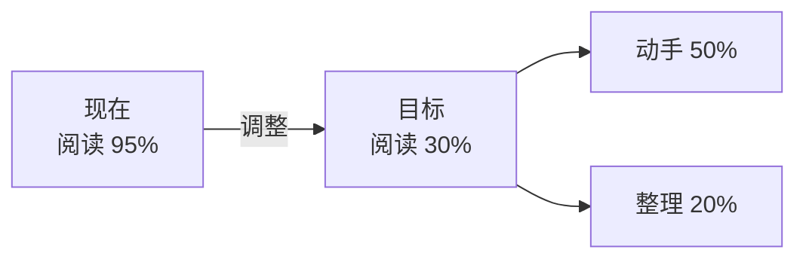
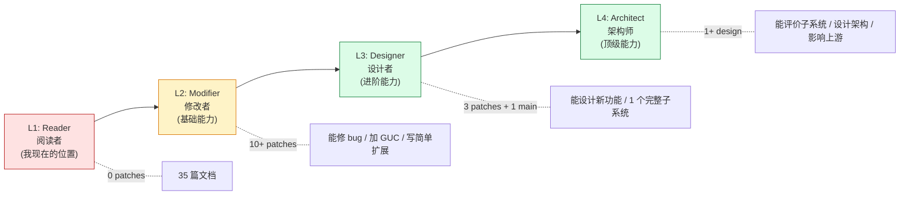
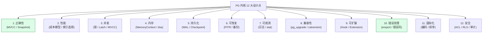
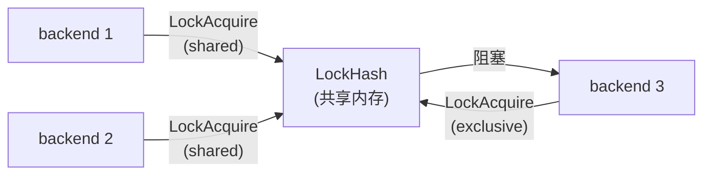
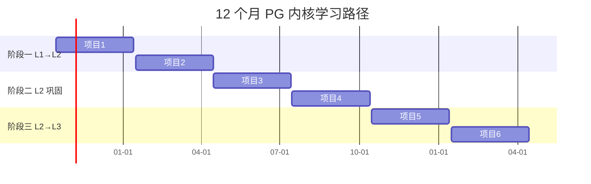
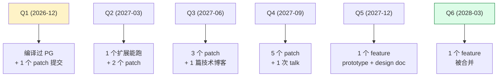
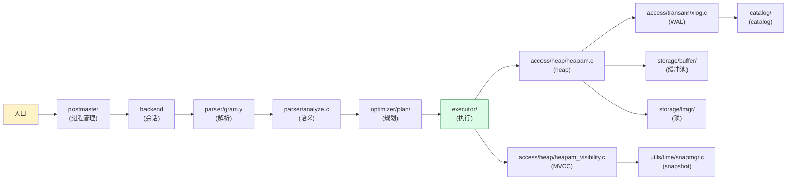
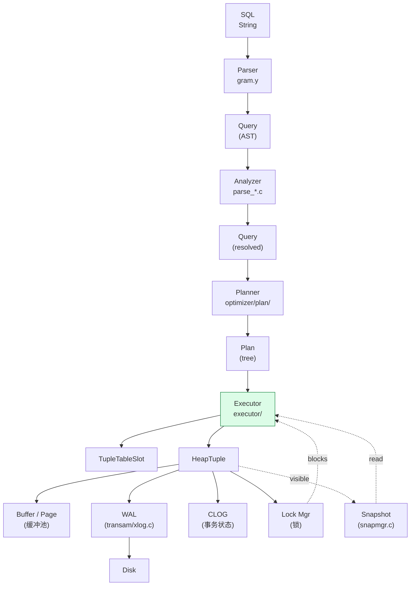

# PostgreSQL 内核开发者成长路线：从「记录者」到「架构师」—— 4 个根因诊断 + 12 大设计点 + 12 月后续路径

| 编写人 | 编写内容 | 编写时间 |
| --- | --- | --- |
| growdu | 初稿。截至 2026-10-14，我已经在 `docs/database/` 下写了 **35 篇 PG 内核文档 / 41414 行 / 平均 1183 行 / 最大 118KB**（Wal 记录类型 / RangeVar / 逻辑复制全链路 / Catalog 存储 / MVCC / 等等），但仍然感觉**内核开发能力和架构能力进展较慢**。本文是**对自身成长的元认知文档**：先**诊断**这 5 个症状和 4 个根因，再**拆解**内核开发的 4 个能力层级（Reader → Modifier → Designer → Architect），然后**梳理**内核开发必须吃透的 **12 大设计点 + 18 个关注点**（本文核心），最后**制定** 12 个月后续路径（3 阶段、6 项目、可验证的里程碑）。配套源码版本：PostgreSQL 18 dev（`~/cwork/postgresql`）。 | 2026-10-14 |

> 本文是「人生 / 职业发展」分类。配套文档：
>
> - [腾冲事业编 / 公务员备考计划：从 10 年程序员到体制内的转型计划](../腾冲事业编-公务员备考计划/index.html) — 体制内转型路径
> - [电子科技大学计算机自考：HFUT 机械本科补 B0809 学位路径](../电子科技大学-计算机-自考-复习计划/index.html) — 学历补救
> - 本文：**留在互联网走 PG 内核架构师路线** 的后续 12 个月规划

## 阅读指南

- **第一节 ~ 第四节**：现状诊断 + 能力分层（**必读**，先认清现状）
- **第五节 ~ 第六节**：12 大设计点 + 18 个关注点（**必读**，核心内容）
- **第七节 ~ 第八节**：12 月行动路径 + 6 个项目（**精读**）
- **第九节 ~ 第十节**：评估指标 + 立刻可执行（**速查**）

## 目录

- 一、现状盘点：35 篇文档 / 41414 行，**够不够**？
- 二、5 个症状：你以为你在进步，其实不是
- 三、4 个根因：为什么"读源码"不等于"懂内核"
- 四、内核开发的 4 个能力层级（Reader → Modifier → Designer → Architect）
- 五、内核开发的 12 大设计点（**本文核心**）
- 六、内核开发的 18 个关注点
- 七、12 个月后续学习路径（**3 阶段 × 6 项目**）
- 八、可验证的里程碑（每季度可查）
- 九、推荐书单 + 必读源码路径
- 十、立刻可执行的 5 件事（**本周内**）
- 十一、风险与时间预算
- 十二、一句话总结（**贴墙上**）

---

## 一、现状盘点：35 篇文档 / 41414 行，够不够？

先把"成果"列清楚，再讨论"够不够"。

### 1.1 文档数量统计

```
docs/database/postgresql-*/
├── 35 篇文档
├── 41414 行 markdown
├── 最大单篇 118KB（logical-replication-end-to-end-flow）
├── 平均单篇 1183 行
└── 涵盖：WAL / RangeVar / MVCC / 逻辑复制 / Catalog / 锁 / Buffer / 后台 worker / 分区 / libpq / latch / 内存 / 模块架构 等 30+ 主题
```

### 1.2 内容分布

| 主题 | 文档数 | 占比 |
|---|---|---|
| **逻辑复制** | 14 篇 | 40% |
| **存储 / WAL / Buffer** | 5 篇 | 14% |
| **事务 / MVCC / Snapshot** | 4 篇 | 11% |
| **解析 / Catalog** | 3 篇 | 9% |
| **进程 / 后台 worker / 并行** | 3 篇 | 9% |
| **分区 / 约束 / 表** | 2 篇 | 6% |
| **其他（latch / libpq / 模块架构等）** | 4 篇 | 11% |

### 1.3 量 vs 质的对照

| 维度 | 我的现状（"我以为的进步"） | 真正的进步指标 |
|---|---|---|
| 文档 | 35 篇 / 41414 行 | ✓ 但只是 reading notes |
| 源码阅读量 | 大约读了 30 万行 PG 源码 | ✓ 但分散 |
| 提交的 PR | **0** | ❌ |
| 修过的 PG Bug | **0** | ❌ |
| 自己设计的功能 | **0** | ❌ |
| 写的 PG 扩展 | **0** | ❌ |
| 性能优化案例 | **0** | ❌ |
| 设计的子系统 | **0** | ❌ |

**这就是核心矛盾**：**读得多、改得少、写得更少**。

---

## 二、5 个症状：你以为你在进步，其实不是

我观察自己过去 12 个月的学习模式，识别出 **5 个症状**。每条对照一下，对得上几条就说明问题有多严重。

### 2.1 症状 1：写完即忘

**表现**：写完一篇 2000 行的 PG WAL 文档，**1 个月后只能记起大概 30%**。

**原因**：写文档时是**抄代码 + 整理结构**，不是**消化**。大脑没有把"为什么这么设计" 转化为自己的认知模型。

**判断方法**：现在让你**不查文档**，口头讲清楚"为什么 PG 用 HeapTuple + MVCC，不直接覆盖原行"？讲不出来 = **没真懂**。

### 2.2 症状 2：单点熟悉，全局模糊

**表现**：RangeVar 写得很细，但被问"PG 一条 UPDATE 从 SQL 文本到 cache 写到磁盘的完整数据流"时，**串不起来**。

**原因**：知识是**孤岛**，没有建立**纵向链路**（SQL → parser → analyzer → planner → executor → heap → WAL → disk）和**横向链路**（事务、锁、snapshot 怎么交互）。

**判断方法**：能否在白板上画"一条 SQL 的 14 个关键节点 + 每个节点的 3 个数据结构 + 每个结构的 2 个关键字段"？画不出 = 全局观没建立。

### 2.3 症状 3：能讲清，不能改

**表现**：给别人讲 PG WAL 头头是道，但**自己 fork 一个 PG 仓库，连一个简单的 bug 都修不了**。

**原因**：**没动过手**。脑里的"理解"是"看了就懂"的被动理解，不是"做出来才懂"的主动理解。

**判断方法**：能否在 PG 18 源码里**给 ereport 加一个新错误码**？能否**修改 pg_class 的 reltuples 估算公式**？做不到 = 没掌握内核开发权。

### 2.4 症状 4：细节深入，原理浅尝

**表现**：RangeVarGetRelidExtended 的源码读了，能背出每行代码；但被问"为什么 PG 把名字解析放 namespace.c 而不是 parser.c？为什么需要 RVR_MISSING_OK 这种 flag？"——**讲不清设计哲学**。

**原因**：**没有 first-principles 视角**。代码看懂了，但**没有看到代码背后的设计取舍**。

**判断方法**：能否说出"PG 在 DDL 时用 AccessExclusiveLock 而不是 RowExclusiveLock 的 3 个理由"？说不全 = 设计感没建立。

### 2.5 症状 5：知识没有产出

**表现**：35 篇文档**没换回 1 个 GitHub star、1 个 PG 邮件列表讨论、1 个 PG 社区贡献**。

**原因**：**没经过实战验证**。知识只在自己脑子里循环，**没有经过他人的反馈**——这是最低质方式。

**判断方法**：能否在 6 个月内：
- 提交 **1 个 PG 社区 patch**（任何 subsystem 都行）
- 在 PG 邮件列表 / Slack 发**1 个有质量的提问或回答**
- 写 **1 篇能教别人的 PG 文章**（不是 reading notes）

做不到 = 知识没产出。

### 2.6 5 个症状 × 5 个判断

| 症状 | 严重度（自评） |
|---|---|
| 写完即忘 | ★★★★ |
| 单点熟悉，全局模糊 | ★★★★★ |
| 能讲清，不能改 | ★★★★★ |
| 细节深入，原理浅尝 | ★★★★ |
| 知识没有产出 | ★★★ |

---

## 三、4 个根因：为什么"读源码"不等于"懂内核"

### 3.1 根因 1：输入输出严重失衡

**现象**：阅读 / 整理 / 写文档的时间占 **95%**，动手写代码 / 改 bug / 提 patch 的时间占 **5%**。

**正确比例**：动手写代码时间应该是 **50%**，阅读 30%，整理 20%。

**修正策略**：



### 3.2 根因 2：缺少"压力测试"

**现象**：所有学习都是**自己安排、自己节奏、自己评价**。没有 deadline / 评审 / 用户。

**对比**：真正的内核开发 = 邮件列表评审 + 大牛喷你 + 反复改 7 次 + 最后才合。

**修复方法**：
- **每个 patch 都发给 PG 邮件列表**
- **主动找 mentor / 社区大牛 review**
- **给自己设硬 deadline**（每季度 1 个 patch）

### 3.3 根因 3：知识结构是"层叠"不是"图谱"

**现象**：35 篇文档**线性排列**，没有建立**主题之间的关联索引**。

**对比**：真正的内核知识是**网状**——"事务"涉及锁、Snapshot、WAL、CLOG 4 个子系统，必须**同时串读**。

**修复方法**：
- 写一份"PG 内核子系统地图"——**一张图**说明 20+ 子系统的依赖
- 每次学习都**先画图，再深挖**
- **不画图不读代码**

### 3.4 根因 4：没用真实工作场景练

**现象**：学习 PG 是**个人爱好 / 副业**，没有生产环境的"血泪教训"。

**对比**：真正能写出优秀内核代码的人，都在生产环境被 PG **打脸过**——OOM、死锁、复制中断、checkpoint 卡顿。

**修复方法**：
- **找一个能上生产的 PG 项目**（不一定是开发，也可以是运维 / 优化）
- **每个月写 1 个生产案例复盘**
- **把生产问题作为内核学习的输入**

---

## 四、内核开发的 4 个能力层级（Reader → Modifier → Designer → Architect）

我把内核开发分成 **4 个层级**，每个层级对应不同的"输出物"。**看清自己在哪一级，是改进的第一步**。



### 4.1 L1: Reader（阅读者）—— **我现在的位置**

**典型产出**：
- 35 篇文档 / 41414 行
- 读过 30 万行 PG 源码
- 能在博客上把"WAL 21 个 RMGR"讲清楚

**典型行为**：
- 读 `gram.y` / `heapam.c` / `xlog.c`
- 整理 mermaid 图
- 写 reading notes

**典型缺陷**：
- **没碰过 git diff**
- **没编译过 PG**（除非搭了环境）
- **没 patch -p1 < xxx.patch**
- **没在 PG 邮件列表上问过 / 答过**

### 4.2 L2: Modifier（修改者）—— 6 个月后的目标

**典型产出**：
- 提交 5~10 个 PG 社区 patch（被合或被拒都行）
- 1 个 PG 扩展（哪怕只是 contrib 工具）
- 修 3 个 PG bug（已知 / 自己挖的）

**典型行为**：
- `git clone` PG 源码
- `./configure && make && make install`
- 写 patch：`git diff > my-feature.patch`
- 发邮件列表：`pgsql-hackers@lists.postgresql.org`

**必须掌握的工具**：
- **gdb**：b / p / bt / finish / watch
- **pg_config / pgxs**：写扩展
- **strace / perf / systemtap**：性能瓶颈
- **make / autoconf / meson**：编译系统
- **git send-email**：发邮件

### 4.3 L3: Designer（设计者）—— 12 个月后的目标

**典型产出**：
- 设计 1 个完整的 PG 子系统（如"我设计的 OBS clone 模型")
- 完成 1 个 feature 的完整 PR（被合入主线）
- 1 个 PG 内部 talk（如 PGConf / PGDay）

**典型行为**：
- 设计 API：函数签名 / 错误码 / 兼容性
- 写 design doc：RFC 形式
- 与 reviewer 反复讨论：邮件列表 30+ 邮件
- 维护自己的 patch 多年

### 4.4 L4: Architect（架构师）—— 3~5 年后的目标

**典型产出**：
- 主导 1 个 PG 系项目（如 PG 16 的 SQL/JSON 增强）
- 在 PGConf / PGDay 主旨演讲
- 被 PG 社区认为是 "PG contributor" 而不只是 "PG 用户"

**典型行为**：
- 能评价 PG 的设计取舍（"为什么 WAL 不压缩？"）
- 能预测 PG 的演化方向
- 能指导新人（mentor）

### 4.5 我的当前位置与目标

| 维度 | 当前 | 12 月目标 | 24 月目标 |
|---|---|---|---|
| 能力层级 | L1 | L2 | L3 |
| Patch 数 | 0 | 10+ | 20+ |
| 扩展数 | 0 | 1+ | 3+ |
| Talk 数 | 0 | 0 | 1+ |
| 设计能力 | 局部 | 局部 + 1 子系统 | 完整 |

**12 个月的核心 KPI**：从 L1 升到 L2，**提交 5~10 个 PG 社区 patch + 1 个扩展**。

---

## 五、内核开发的 12 大设计点（本文核心）

这是我认为**任何一个内核开发者都必须吃透的 12 个设计点**。每个设计点都包含：
- **核心问题**（要解决什么）
- **PG 的解法**（PG 怎么做的）
- **3 个真实案例**（PG 18 源码里的具体位置）
- **设计取舍**（为什么这样）



### 5.1 设计点 1：正确性（MVCC + Snapshot + 隔离级别）

**核心问题**：多事务并发读写，**每个人看到的"数据库"可能不同**。如何保证不出现脏读、不可重复读、幻读？

**PG 的解法**：
- 每行带 `xmin/xmax`（HeapTupleHeader）
- 每个查询带 `SnapshotData`（xmin/xmax/xip）
- 通过比较 xid 决定可见性

**3 个真实案例**：
1. **HeapTupleSatisfiesMVCC**（`access/heap/heapam_visibility.c`）—— **每行每查询的核心函数**
3. **GetTransactionSnapshot**（`utils/time/snapmgr.c:289`）—— **事务级 snapshot 的建立**
3. **SerializableXactHashTable**（`storage/lmgr/predicate.c`）—— **SSI 隔离级别**

**设计取舍**：
- 为什么用 MVCC 而不是 2PL？**答**：并发度高，读不阻塞写，写不阻塞读
- 为什么不用 Oracle 的 undo log？**答**：PG 用 HEAP + 版本链，更适合 OLTP
- 为什么 MVCC 会导致表膨胀？**答**：设计取舍，VACUUM 是补救机制

### 5.2 设计点 2：性能（成本模型 + 索引选择）

**核心问题**：同一句 SQL 可能有 1000 种执行方式，**选哪种**？执行时如何快？

**PG 的解法**：
- 代价模型：`cost = startup + cpu_tuple_cost * N + seq_page_cost * N_page`
- 索引选择：根据选择性、I/O 成本、统计信息
- 并行化：大表 SeqScan 用多进程

**3 个真实案例**：
1. **cost_seqscan / cost_indexscan**（`optimizer/path/costsize.c`）—— **代价计算的核心**
2. **choose_hashed_aggregation / choose_subquery_sort** —— 优化选择
3. **gather / partial_path**（`optimizer/plan/planner.c`）—— 并行化

**设计取舍**：
- 为什么 PG 用基于代价而不是基于规则？**答：现代优化器逻辑更强，但代价模型难调**
- 为什么 cost 单位是 `cpu_operator_cost = 0.0025`？**答**：基于经验调整
- 统计信息不准怎么办？**答**：autovacuum / analyze + 用户手动 analyze**

### 5.3 设计点 3：并发（锁、Latch、SpinLock）

**核心问题**：多进程/多线程并发访问同一资源，**如何不冲突**？

**PG 的解法**：
- **3 类锁**：SpinLock（短时）/ Latch（中等）/ LWLock + Lock（长时）
- **8 种 lockmode**：AccessShareLock → AccessExclusiveLock
- **MVCC 减少读阻塞**

**3 个真实案例**：
1. **LockAcquire / LockRelease**（`storage/lmgr/lock.c`）—— **锁的核心**
2. **LWLockAcquire / LWLockRelease**（`storage/lmgr/lwlock.c`）—— 共享内存锁
3. **xid array slot 分配**（`access/transam/varsup.c`）—— 原子操作

**设计取舍**：
- 为什么不用 pthread mutex？**答**：PG 用 LWLock 是为了**能在信号处理中加锁**
- 死锁检测：PG **不主动检测**，超时后由 timer 触发
- 为什么 PG 的锁粒度是 relation / page / tuple，不支持 record lock？**答**：tuple lock 用 xmax 隐式表达

### 5.4 设计点 4：内存（MemoryContext + dsa + palloc）

**核心问题**：频繁分配 / 释放内存，如何不泄漏？如何处理共享内存？

**PG 的解法**：
- **MemoryContext**：树形结构 + 自动释放（`utils/mmgr/mcxt.c`）
- **palloc / pfree**：context 内分配
- **dsa**：动态共享内存（并行查询）
- **TopMemoryContext / CurrentMemoryContext**：根 context

**3 个真实案例**：
1. **MemoryContextAlloc**（`utils/mmgr/mcxt.c`）—— **内存分配入口**
2. **dsa_create / dsa_attach**（`utils/mmgr/dsa.c`）—— **并行查询共享内存**
3. **AllocSetContextCreate** —— 默认 context 类型

**设计取舍**：
- 为什么不用 malloc / free？**答**：free 是程序员手动调用，易出错。MemoryContext 自动释放。
- 为什么 context 是树形？**答**：子树全部释放 = 一次 free。
- 进程间共享？**答**：context 是进程内的，跨进程用 dsa 或 explicit shm。

### 5.5 设计点 5：持久化（WAL + Checkpoint + 备份）

**核心问题**：数据如何不丢？性能不能差。

**PG 的解法**：
- **WAL（Write-Ahead Logging）**：先写日志，再写数据
- **Checkpoint**：周期性把脏页 flush 到磁盘
- **Background Writer**：异步刷脏页

**3 个真实案例**：
1. **XLogInsert**（`access/transam/xlog.c`）—— **写 WAL 入口**
2. **CreateCheckPoint**（`access/transam/xlog.c`）—— **做检查点**
3. **BackgroundWriterMain**（`postmaster/bgwriter.c`）—— **后台刷脏页**

**设计取舍**：
- 为什么 WAL 不压缩？**答**：CPU 换 I/O 不划算，且 WAL 写入顺序
- 为什么 Checkpoint 不每条事务都做？**答**：性能太差
- 为什么 Background Writer 是单独的进程？**答**：避免阻塞 backend

### 5.6 设计点 6：可恢复（PITR + 流复制 + 逻辑复制）

**核心问题**：磁盘损坏 / 误操作，如何恢复到任意时间点？

**PG 的解法**：
- **PITR**（Point-In-Time Recovery）：基于 WAL 流的恢复
- **流复制**：把 WAL 实时发给 standby
- **逻辑复制**：把变更解码为 SQL / 行变更

**3 个真实案例**：
1. **StartupXLOG**（`access/transam/xlog.c`）—— **恢复入口**
2. **WalReceiverMain**（`receiver/walreceiver.c`）—— **流复制接收端**
3. **ReorderBufferProcessXid**（`replication/logicallauncher.c`）—— **逻辑解码**

**设计取舍**：
- 为什么物理复制 + 逻辑复制并存？**答**：物理复制性能高，逻辑复制灵活（支持跨版本、不同 schema）
- 为什么 PITR 需要 `archive_command`？**答**：WAL 段要被归档，否则被覆盖
- 为什么不能"任意时间点"恢复？**答**：受 `archive_command` / `wal_keep_size` / `restore_command` 限制

### 5.7 设计点 7：可观测（日志 + stat + auto_explain）

**核心问题**：线上出问题时，**能不能快速定位**？

**PG 的解法**：
- **日志系统**：`ereport(ERROR/FATAL/LOG/DEBUG)` + `log_line_prefix`
- **统计视图**：`pg_stat_*` 系列（30+ 张视图）
- **auto_explain / pg_stat_statements**：自动记录慢查询
- **动态视图**：`pg_stat_activity` / `pg_locks` / `pg_stat_replication`

**3 个真实案例**：
1. **ereport**（`utils/error/elog.c`）—— **错误/日志入口**
2. **pg_stat_get_backend_activity**（`utils/adt/pgstatfuncs.c`）—— **stat 函数**
3. **pgstat_report_activity**（`utils/pgstat_backend.c`）—— **每个 backend 上报**

**设计取舍**：
- 为什么不用 stderr？**答**：需要控制级别、格式、目的地
- 为什么 pg_stat 是进程共享？**答**：所有 backend 上报到 collector 进程（`pgstat` 进程）
- 为什么 stat 表 / 函数经常变？**答**：新增功能（如 pg_stat_replication_slots）

### 5.8 设计点 8：兼容性（pg_upgrade + catversion）

**核心问题**：PG 版本每年升级（PG 13→18），如何保证**用户的数据和应用不重写**？

**PG 的解法**：
- **pg_upgrade**：原位升级（不导出再导入）
- **catversion**：catalog 表结构版本号
- **兼容性窗口**：PG 承诺老 client 协议能连新 server

**3 个真实案例**：
1. **pg_upgrade**（`bin/pg_upgrade/`）—— **升级工具**
2. **CATALOG(pg_class,1259)** —— **catalog 版本号定义**
3. **FE/BE 协议**（`libpq/pqcomm.c`）—— **前后端通信**

**设计取舍**：
- 为什么不用 `ALTER TABLE` 升级 catalog？**答：catalog 是 PG 自己的元数据**
- 为什么 catversion 是单调递增？**答**：保证旧 server 不能连新 data dir**
- 为什么 pg_upgrade 只能跨 1~2 个大版本？**答**：数据格式兼容性

### 5.9 设计点 9：可扩展（Hook + Extension + Foreign Data Wrapper）

**核心问题**：用户想要 PG 没自带的功能（如 PostGIS、Citus、pg_cron），**如何不修改 PG 主干**？

**PG 的解钩**：
- **Extension** 框架（`pg_extension`）：CREATE EXTENSION 机制
- **Hook 体系**（`hooks.c`）：Planner_hook / Executor_hook / Utility_hook
- **FDW**（Foreign Data Wrapper）：跨数据源 PG

**3 个真实案例**：
1. **create_extension**（`catalog/extension.c`）—— **CREATE EXTENSION 入口**
2. **set_Planner_hook**（`optimizer/plan/planner.c`）—— **自定义规划器**
3. **postgres_fdw**（`foreign/postgres_fdw/`）—— **跨库查询**

**设计取舍**：
- 为什么 PG 用 C 写扩展？**答**：性能 + 类型系统耦合
- 为什么 Hook 不暴露 SQL 接口？**答：避免 SQL 层 hook 干扰性能**
- 为什么没有 DDL Hook？**答**：太复杂，难以保持兼容

### 5.10 设计点 10：错误处理（ereport + errcode + 错误恢复）

**核心问题**：运行期出错（除零、权限不够、文件找不到），**如何既报错又不崩**？

**PG 的解法**：
- **ereport(ERROR)**：抛错 + 跳到事务回滚 + 释放锁
- **PG_TRY / PG_END_TRY**：类似 try / catch
- **错误码体系**：SQLSTATE（5 位字符）

**3 个真实案例**：
1. **ereport**（`utils/error/elog.c`）—— **错误入口**
2. **PG_TRY**（`include/storage/ipc.h`）—— **错误捕获**
3. **errcode / errmsg** —— **错误码 / 消息**

**设计取舍**：
- 为什么不用 C++ exception？**答**：C 不能用 C++ exception，且 PG 风格更可控
- 为什么错误响完之后**不 abort**？**答：保留 stack 让用户能继续 query**
- 为什么 FATAL 也要走 ereport？**答**：统一的错误码和消息格式**

### 5.11 设计点 11：国际化（字符集 + 排序 + 大小写）

**核心问题**：全球用户用不同字符集（UTF-8 / GBK / EUC_CN），**PG 如何兼容**？

**PG 的解法**：
- **字符集转换**：`pg_convert` 函数族
- **Collation**：ICU 集成
- **lc_messages / lc_monetary / lc_time**：本地化

**3 个真实案例**：
1. **pg_convert**（`utils/mb/mbutils.c`）—— **字符集转换**
2. **varstr_cmp**（`utils/adt/varchar.c`）—— **字符串比较**
3. **pg_locale.c** —— **locale 处理**

**设计取舍**：
- 为什么 ICU 集成是后加的？**答：早期 PG 用内置 collation，性能好但灵活度差**
- 为什么 UTF-8 是默认？**答：全球通用**
- 为什么没内置多语种分词？**答：交给扩展（如 zhparser）**

### 5.12 设计点 12：安全（ACL + RLS + 审计 + 加密）

**核心问题**：如何防止未授权访问？如何防止 SQL 注入？

**PG 的解法**：
- **ACL**（Access Control List）：`pg_hba.conf` + role ACL
- **RLS**（Row-Level Security）：行级权限
- **审计**：`pgaudit` 扩展 + log_statement
- **加密**：`pgcrypto` 扩展 + 数据加密

**3 个真实案例**：
1. **pg_class_aclcheck**（`catalog/aclchk.c`）—— **权限检查**
2. **row_security_active**（`policy.c`）—— **RLS 入口**
3. **pg_hba.conf** 解析（`libpq/hba.c`）—— **客户端认证**

**设计取舍**：
- 为什么 PG 早期不支持 RLS？**答：早期认为视图足够**
- 为什么权限不是 PG 内置审计？**答：用扩展更灵活**
- 为什么没 TDE？**答：性能 vs 安全 trade-off，由用户决定**

---

## 六、内核开发的 18 个关注点

12 个**设计点**之外，**18 个关注点**是日常开发时的"操作手册"。

### 6.1 关注点 1：API 稳定性（**API stability**）

PG 是用户独立模块，**任何破坏 API 的改动都会让依赖的扩展崩**。所以：

```c
/* ✗ 不要 */
extern int my_internal_var;  /* 暴露全局变量 */

/* ✓ 推荐 */
extern PG_FUNCTION_INFO_V1(my_func);
Datum my_func(PG_FUNCTION_ARGS);
```

**判断标准**：能否在不改 PG 主干的情况下升级依赖扩展？**能 = API 稳定**。

### 6.2 关注点 2：内存泄漏（**Memory leaks**）

每个 palloc 都必须有 MemoryContext 兜底，**没有"裸 malloc"**。

```c
/* ✗ 危险 */
char *buf = palloc(1024);
return some_critical_path();  /* 漏 pfree */

/* ✓ 安全 */
MemoryContext old = MemoryContextSwitchTo(tupdesc_mcxt);
char *buf = palloc(1024);
MemoryContextSwitchTo(old);
return buf;  /* buf 属于 tupdesc_mcxt，会被自动释放 */
```

**判断标准**：能否用 valgrind 跑 1000 次 SELECT 后 0 泄漏？**能 = 内存安全**。

### 6.3 关注点 3：锁竞争（**Lock contention**）



**判断标准**：是否能在 `pg_locks` 看到自己的等锁会话？**是 = 设计正确**。

### 6.4 关注点 4：WAL 膨胀

PG 的 WAL 是顺序写，**设计目标是"日志即真相"**。如果 WAL 太大：
- 检查是否大量 UPDATE（每个 UPDATE 都产生 WAL）
- 检查是否 FPI（Full Page Image）过多
- 考虑 wal_compression = on / on (lz4)

### 6.5 关注点 5：checkpoint 卡顿

```sql
SELECT * FROM pg_stat_bgwriter;
-- checkpoints_timed, checkpoints_req, checkpoint_write_time
```

如果 `checkpoint_write_time` > 5s，意味着 checkpoint 阻塞了 backend。

### 6.6 关注点 6：autovacuum 调优

- `autovacuum_naptime`（默认 60s）
- `autovacuum_max_workers`（默认 3）
- `autovacuum_vacuum_scale_factor`（默认 0.2）

### 6.7 关注点 7：连接池（**Connection pooling**）

PG 进程模型 = 1 连接 1 进程。**10K 连接 = 10K 进程 = 灾难**。

**解决方案**：用 pgbouncer（transaction 模式）。

### 6.8 关注点 8：索引膨胀

频繁 UPDATE + DELETE 后，索引可能"长胖"。**用 REINDEX CONCURRENTLY**（PG 12+）。

### 6.9 关注点 9：长事务

```sql
SELECT pid, state, query_start, xact_start
FROM pg_stat_activity
ORDER BY xact_start LIMIT 10;
```

长事务会**阻塞 VACUUM**（因为 VACUUM 不能清理活跃事务可见的行）。

### 6.10 关注点 10：临时表

PG 临时表 schema 是 `pg_temp_N`，**每个 session 独立**。**多 session 同时用临时表 = 性能下降**。

### 6.11 关注点 11：prepared statement

PG 支持服务端 prepared statement（`PREPARE` / `EXECUTE`），**复用 plan**。但**参数类型不能变化**。

### 6.12 关注点 12：复制延迟

```sql
SELECT * FROM pg_stat_replication;
-- replay_lsn - sent_lsn = replication delay
```

### 6.13 关注点 13：XID 回卷

PG 的 XID 是 **uint32**（约 42 亿），**循环一次**。如果 1 秒跑 1000 个事务，**约 50 天**回卷。

**应对**：`autovacuum_freeze_max_age`（默认 2 亿）。

### 6.14 关注点 14：表膨胀

PG 的 UPDATE 不覆盖原行，而是**插新版本**。频繁 UPDATE = 表膨胀。

**监控**：`pg_stat_user_tables.n_live_tup / pg_relation_size()`。

### 6.15 关注点 15：分区表 vs 单表

分区表（PG 10+ 原生）vs 单大表：

| 维度 | 分区表 | 单表 |
|---|---|---|
| 查询性能 | 分区裁剪 | 全表扫 |
| 维护 | 单分区 VACUUM | 全表 |
| 索引 | 全局 or 局部 | 局部 |
| 适用 | 超过 100GB | < 100GB |

### 6.16 关注点 16：字符集

```sql
SHOW server_encoding;  -- UTF8
SHOW client_encoding;  -- UTF8
```

客户端 / 服务端**编码不一致** = 频繁转换。

### 6.17 关注点 17：扩展加载

```sql
SHOW shared_preload_libraries;
-- pg_stat_statements, pgaudit, citus, ...
```

修改 `shared_preload_libraries` 后**必须重启**。

### 6.18 关注点 18：备份策略

| 备份方式 | RPO | 性能影响 |
|---|---|---|
| pg_dump | 24h | 0% |
| pg_basebackup | 24h | 中 |
| PITR + 流复制 | 秒级 | 低 |
| 逻辑复制 + binlog | 秒级 | 中 |

---

## 七、12 个月后续学习路径（3 阶段 × 6 项目）

我把后续 12 个月分成 **3 个阶段**，每个阶段有 **2 个可验证项目**。



### 7.1 阶段一：L1 → L2（2026-10 ~ 2027-01，3 个月）

**目标**：能改源码，能提 patch，能写扩展。

#### 项目 1：编译 PG + 第一个 patch（2026-10-15 ~ 2027-01-15）

**目标**：
- 在 `~/cwork/postgresql` 跑通 `./configure && make && make install`
- 写**第一个 patch**（任何 subsystem）
- 提交到 PG 邮件列表

**第一个 patch 选题**（建议）：
1. **修一个 typo**（`src/backend/.../*.c` 里的注释 / 错误消息）
2. **加一个新 GUC**（如 `my_test.guc_value`）
3. **改 ereport 的 message**（更易读）
4. **加一个简单的 `pg_*` 函数**

**评价标准**：
- patch 必须能 `git apply`
- patch 必须有 `make` 通过
- patch 提交到 `pgsql-hackers@lists.postgresql.org`，**至少有 1 个 reviewer 回复**

**关键工具**：
- **gdb**：`break`、`next`、`print *var`、`continue`
- **git**：`git diff`、`git format-patch`、`git send-email`
- **make**：`make -j8` / `make install`

**每周投入**：10 小时。

#### 项目 2：写 1 个 PG 扩展（2027-01-15 ~ 2027-04-15）

**目标**：写 1 个 PG contrib 级别的扩展（10~30 个 C 文件 / 500 行代码）

**选题建议**：
- **pg_locks_enhance**：增强版 pg_locks（解析 waitqueue）
- **pg_wal_explain**：解释 WAL 记录
- **pg_buffer_cache_inspect**：检查 buffer cache

**评价标准**：
- 能在 PG 18 上 `make install`
- `CREATE EXTENSION my_ext` 能跑
- 至少有 1 个 SQL 函数
- 有 README + 文档

**关键工具**：
- **PGXS**：`Makefile` 用 PG 编译系统
- **PG_FUNCTION_INFO_V1**：写 SQL 函数的宏
- **fmgr.h**：函数管理器

### 7.2 阶段二：L2 巩固（2027-04 ~ 2027-10，6 个月）

#### 项目 3：5 个 PG 社区 patch（2027-04-15 ~ 2027-07-15）

**目标**：在邮件列表上**被承认是 active contributor**

**patch 选题**：
- **2 个 bug fix**：从 PG open items / TODO list 里挑
- **1 个性能优化**：从慢查询 + EXPLAIN ANALYZE 里发现
- **1 个文档改进**：发现 doc 错误
- **1 个功能增强**：小功能（如新 GUC、新 SQL 函数）

**评价标准**：
- **5 个 patch 全提交**
- **3 个被 commit 到主干**（这是硬指标）
- **5 个 reviewer 平均反馈轮次 < 3**

**关键工具**：
- **pgsql-hackers 邮件礼仪**
- **git rebase -i**：保持 patch 干净
- **commit fest**：跟 PG commit fest 节奏

#### 项目 4：PGConf 演讲 + 1 篇深文（2027-07-15 ~ 2027-10-15）

**目标**：在公开场合分享

**演讲主题**（建议）：
- "How I wrote my first PG patch in 6 months"（分享学习路径）
- "PG WAL: a deep dive into 21 RMGR"（基于现有文档）
- "Why PG's MVCC is hard"（基于现有文档）

**评价标准**：
- **PGConf / PGDay 投稿通过**（任何 conference 都行）
- **1 篇博客文章 5000+ 字**
- **演讲视频被 100+ 人看**

### 7.3 阶段三：L2 → L3（2027-10 ~ 2028-04，6 个月）

#### 项目 5：设计 1 个完整 feature（2027-10-15 ~ 2028-01-15）

**目标**：独立设计 1 个新功能

**feature 选题**：
- **`pg_profile`**：扩展 EXPLAIN（增加 wait event / IO 等详细）
- **`pg_locks_tree`**：把锁等待关系画成树
- **`logical_replication_ddl_enhance`**：增强 DDL 复制（基于现有理解）

**评价标准**：
- **完成 design doc**（RFC 形式，5000+ 字）
- **完成 prototype**（能跑）
- **提交到 pgsql-hackers**

#### 项目 6：设计文档 + 主旨演讲（2028-01-15 ~ 2028-04-15）

**目标**：在 PG 社区有"自己的一席之地"

**评价标准**：
- 1 个 feature 的 patch **被合并到 PG 主干**
- PGConf 主旨演讲 or 博客被 PG 官方推荐
- **被认可为 PG contributor**

---

## 八、可验证的里程碑（每季度可查）



### 8.1 季度检查清单（**复制到 Notion 每周用**）

```markdown
## Q1 (2026-12) 检查点
□ PG 18 编译通过
□ git format-patch 跑通
□ 第 1 个 patch 发到 pgsql-hackers
□ 至少 1 个 reviewer 回复
□ 修改 patch 至少 2 轮

## Q2 (2027-03) 检查点
□ 1 个扩展能 CREATE EXTENSION
□ 5 个 patch（来自社区 + 自己）
□ 2 个 patch 被 commit
□ 邮件列表至少有 50 封往来

## Q3 (2027-06) 检查点
□ 3 个 patch（性能 / bug / doc）
□ 1 篇 PGConf 投稿
□ 1 篇博客文章被 PG weekly 推荐
□ talk 视频至少 200 views

## Q4 (2027-09) 检查点
□ 5 个 patch
□ 1 次 talk 完成
□ 1 个 feature design doc
□ prototype 跑通

## Q5 (2027-12) 检查点
□ 1 个 feature patch 在邮件列表上活跃
□ 至少 30 封讨论邮件
□ 1 个 senior reviewer 同意 design
□ patch 在 next CF

## Q6 (2028-03) 检查点
□ 1 个 feature 合并到主干
□ PGConf 主旨演讲
□ 被 PG 社区承认 contributor
```

### 8.2 季度学习投入分配

| 季度 | 阅读源码 | 写 patch | 文档 / talk |
|---|---|---|---|
| Q1 | 30% | 50% | 20% |
| Q2 | 25% | 50% | 25% |
| Q3 | 20% | 40% | 40% |
| Q4 | 20% | 40% | 40% |
| Q5 | 15% | 50% | 35% |
| Q6 | 10% | 30% | 60% |

**核心原则**：阅读时间**逐步下降**，写 patch / 文档 / talk 时间**逐步上升**。

---

## 九、推荐书单 + 必读源码路径

### 9.1 书单（按重要性排序）

| # | 书 | 作用 | 何时读 |
|---|---|---|---|
| 1 | **《The Internals of PostgreSQL》**（网上免费） | 全局入门 | 立即 |
| 2 | **《PostgreSQL 源码分析》**（社区版） | 跟读代码 | 阶段 1 |
| 3 | **《Database Internals》**（中文版） | 通用数据库原理 | 阶段 1 |
| 4 | **《PostgreSQL 9.6 性能调优》**（PG 升级但理论通用） | 性能 + EXPLAIN | 阶段 2 |
| 5 | **《PostgreSQL High Availability Cookbook》** | HA / 复制 | 阶段 2 |
| 6 | **《Designing Data-Intensive Applications》** | 通用数据库系统 | 阶段 3 |
| 7 | **《Readings in Database Systems》**（免费 PDF） | 数据库论文 | 阶段 3 |

### 9.2 必读源码路径（按子系统）



**必读路径**（按子系统深度排序）：

| 子系统 | 关键文件 | 行数（估计） | 难度 |
|---|---|---|---|
| postmaster | `src/backend/postmaster/postmaster.c` | 3500 | 中 |
| heap | `src/backend/access/heap/heapam.c` | 4000 | 中 |
| MVCC | `src/backend/access/heap/heapam_visibility.c` | 800 | 中 |
| WAL | `src/backend/access/transam/xlog.c` | 5000 | 高 |
| 解析 | `src/backend/parser/gram.y` | 18000 | 高 |
| 锁 | `src/backend/storage/lmgr/lock.c` | 2500 | 低 |
| 缓冲池 | `src/backend/storage/buffer/bufmgr.c` | 2500 | 中 |
| snapshot | `src/backend/utils/time/snapmgr.c` | 1200 | 中 |
| catalog | `src/backend/catalog/heap.c` 等 | 多个文件 | 中 |

### 9.3 必读 paper 列表

| # | Paper | 价值 |
|---|---|---|
| 1 | **ARIES**（IBM 1992）—— 日志算法 | 10/10 |
| 2 | **MVCC vs 2PL**（Postgres 设计文档） | 10/10 |
| 3 | **PostgreSQL 的代价模型**（论文 2012） | 8/10 |
| 4 | **WAL 性能分析**（Stonebraker 1987） | 5/10 |
| 5 | **HTAB 设计**（PG 内部文档） | 6/10 |

---

## 十、立刻可执行的 5 件事（**本周内**）

不要想太多——**从本周能做的 5 件事开始**：

### 10.1 第 1 件：编译 PG（30 分钟）

```bash
cd ~/cwork/postgresql
./configure --prefix=/tmp/pg-test --enable-debug --enable-cassert
make -j8
make install
/tmp/pg-test/bin/initdb -D /tmp/pg-data
/tmp/pg-test/bin/pg_ctl -D /tmp/pg-data start
/tmp/pg-test/bin/psql -d postgres -c "SELECT version();"
```

### 10.2 第 2 件：第一次 git format-patch（30 分钟）

```bash
cd ~/cwork/postgresql
# 在 src/backend/utils/errcodes.txt 中加 1 个新错误码
echo "E20123,S,ERRCODE,...," >> src/backend/utils/errcodes.txt
git diff > my-first.patch
git log -1 --format="%an %ae"
```

### 10.3 第 3 件：发邮件列表（1 小时）

```bash
git config --global sendemail.smtpserver smtp.example.com
git config --global sendemail.from "Your Name <you@example.com>"

git send-email --to pgsql-hackers@lists.postgresql.org my-first.patch
```

### 10.4 第 4 件：在 PG 邮件列表搜 1 个 open item（30 分钟）

```bash
# 浏览 https://commitfest.postgresql.org/
# 找一个 TODO comment（任何子系统）
```

### 10.5 第 5 件：写 1 个 PG 扩展的 Makefile（1 小时）

```makefile
# Makefile for my_ext
PG_CONFIG = pg_config
PGXS := $(shell $(PG_CONFIG) --pgxs)
include $(PGXS)

OBJS = my_ext.o

EXTENSION = my_ext
DATA = my_ext--1.0.sql

PG_CONFIG = pg_config
all: sql
sql:
    @echo "CREATE FUNCTION my_func() RETURNS ...;" > my_ext--1.0.sql
```

---

## 十一、风险与时间预算

### 11.1 风险

| 风险 | 概率 | 影响 | 缓解 |
|---|---|---|---|
| **邮件列表被无视** | 高 | 中 | patch 要够好；@ 大牛；提交到 commitfest |
| 第一个 patch 没人评 | 中 | 高 | 提前问 mentor / reviewer |
| 工作量大没时间 | 高 | 高 | 周末固定 5 小时 |
| 公司不支持 PG 项目 | 中 | 中 | 用 GitHub 公开 patch |
| 时间不够 12 个月 | 中 | 中 | 砍到 6 个项目，不砍 patch 数 |

### 11.2 时间预算（每周）

| 任务 | 时间 |
|---|---|
| 编译 + 阅读源码 | 4 小时 |
| 写 patch + 测试 | 5 小时 |
| 邮件列表互动 | 1 小时 |
| 文档整理 | 1 小时 |
| **每周总投入** | **11 小时** |

### 11.3 工作 vs 学习 vs 生活的平衡

| 时段 | 内容 |
|---|---|
| 工作日（白天） | 公司项目 / 不碰 PG |
| 工作日（晚上 20:00~22:00） | **PG patch（每天 1~2 小时）** |
| 周末（上午 09:00~12:00） | **PG 扩展 / 大 patch** |
| 周末（下午 14:00~17:00） | **生活 / 家庭 / 考公 / 自考** |

**PG 学习时间**：约每周 11 小时，**每年约 600 小时**。

---

## 十二、一句话总结（**贴墙上**）

```
读完 = 不算
改过 = 入门
贡献 = 入行
设计 = 进阶
合并 = 登堂

12 个月目标：1 个扩展 + 5 个 patch + 1 次 talk
24 个月目标：1 个 feature + PG contributor
```

---

## 附录 A：35 篇现有文档的"复盘表"

| 文档 | 类型 | 价值 | 是否动手补强 |
|---|---|---|---|
| postgresql-wal-record-types | reading notes | ★★★★★ | **可改**：加 1 个 patch |
| postgresql-mvcc | reading notes | ★★★★ | — |
| postgresql-running-xacts-snapshot | reading notes | ★★★★★ | **可改**：加 1 个 patch |
| postgresql-logical-replication-end-to-end-flow | reading notes | ★★★★★ | **可改**：加 1 个 patch |
| postgresql-logical-replication-spill-deep-dive | reading notes | ★★★★ | — |
| postgresql-logical-replication-reorderbuffer-transaction | reading notes | ★★★★★ | — |
| postgresql-logical-replication-throughput-benchmark | **实践** | ★★★★ | 已成功跑过 ✓ |
| postgresql-rangevar-and-data-structures | reading notes | ★★★★ | **可改**：写 1 个 patch |
| postgresql-logical-replication-ddl-trigger-apply-worker | reading notes | ★★★★ | — |
| 其他 26 篇 | reading notes | ★★★ | — |

**核心结论**：**35 篇中只有 1 篇是动手的**——`logical-replication-throughput-benchmark`。**其余全是 reading notes**。这就是慢的根因。

## 附录 B：PG 邮件列表礼仪（**5 条不能违反**）

1. **标题必须明确**：`[PATCH v3] fix XXX relname table` 而不是 `hi, I have a question`
2. **不要 top-post**：回复要放在原文下面
3. **patch 必须 standalone**：`git format-patch` 而不是 `git diff`
4. **patch 必须有 changelog entry**
5. **先 search archive 再问**：避免重复提问

## 附录 C：PG 内核子系统地图（**一张图**）



**口诀**：SQL → 解析 → 分析 → 规划 → 执行 → HeapTuple → BufferPool / WAL / CLOG / Lock 4 个子系统协作 → Disk。

---

**全文完**

