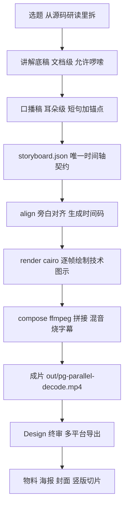

# AIV 视频生产线：九个环节、唯一契约与入库边界

> 本目录存放的是这条线的**可评审资产**：口播稿、分镜脚本、海报文案、字幕工程、`storyboard.json` 契约，以及渲染引擎的代码。
> **音视频成片一律不入库**，只留在本机磁盘上——原因见 §3。

AIV 是我给这条线起的名字：**AI Video**。它要解决的问题只有一个：

> **怎么把已经写过的源码文档，变成一条能持续产出、还能被复现的成片流水线。**

这条线上现在有两个分支，**流程共用、素材隔离、口径分离**：

| 分支 | 讲什么 | 物料归属 | 口吻 |
| --- | --- | --- | --- |
| **成片线**（在产） | 产品能力讲解片：逻辑复制并行解码 | **归雇主** | "我们支持了 X" |
| **独立号线** | 开源实现 / 通用机制 / 源码原理 | **我个人** | "这件事是这样运作的" |

独立号那一线的完整运营方法论在《[数据库技术自媒体运营手册](../media-account/index.html)》，本文只讲生产线本身。

---

## 一、一条视频的九个环节



| # | 环节 | 产物 | 谁来做 | 是否入库 |
| --- | --- | --- | --- | --- |
| 1 | 选题 | 一句话钩子 + 关联文档 | 我 | 写进题库 |
| 2 | 讲解底稿 | 源码路径、函数名、行号、异常分支 | 我 | **入库**（可复用） |
| 3 | 口播稿 | 每行一个意群、每 15~20 秒一个锚 | 我 | **入库** |
| 4 | 契约 | `storyboard.json`：时间码、字幕、场景 | 脚本生成 | **入库**（唯一事实来源） |
| 5 | 画面 | 各场景片段 `build/s01.mp4 … s06.mp4` | 代码渲染 | ❌ 不入库 |
| 6 | 配音 | `pa_decode_v2.mp3` | 录 / 合成 | ❌ 不入库 |
| 7 | 字幕 | `build/subtitles.ass` | 脚本生成 | ❌ 不入库（样式参数入库） |
| 8 | 成片 | `out/pg-parallel-decode.mp4` | ffmpeg | ❌ 不入库 |
| 9 | 物料与分发 | 海报、封面、竖版切片、发布文案 | 我 + 工具 | 文案入库，图片不入库 |

**关键设计：把"文案"和"契约"从"产物"里拆出来。**

前四步是**人写的内容**，体积小、可评审、可版本化，所以入库；后五步是**机器生成的产物**，体积大、不可读、不可评审，所以不入库。这条界线划在 §3。

---

## 二、技术画面为什么不用模型生成

这条线最早的做法是整片交给视频模型生成。核算下来，H3 方案 34 秒要 4200 积分（约 120 积分/秒），而**技术讲解片的主体恰恰是技术图示**——reader 到 worker 的数据流、32 核、2~5 倍、commit 顺序一致性。这些东西：

- 用规则描述最准确，用模型生成最容易出错
- 文字和数字一旦生成错，**没法撤回**
- 改一句话要重生成整段，成本按秒计

所以改成"**技术图示全代码绘制，模型只做质感片头**"：

| 项 | 原方案（全模型生成） | 现方案（代码渲染） |
| --- | --- | --- |
| 积分消耗 | 4200 | **≤ 450**（降 ≥ 89%） |
| 画面准确性 | 文字、数字由模型生成 | **文字、数字、机制图示零模型生成** |
| 改一处 | 重生成整段 | 只重渲一个场景 |
| 返修粒度 | 整片 | 单场景（`build/s03.mp4` 单独重出） |

实现落在 `pipeline/pyv/`：`draw.py` 是 cairo 绘制封装，`scenes/s01…s06.py` 一个场景一个模块，场景是纯函数 `render(ctx, t, w, h)`，`t ∈ [0,1]`，无全局状态——**所以它可单测、可重放、可并发**。

视觉规格是写死在 `palette.py` 里的常量，启动时校验字体可加载，**缺失即报错退出，不静默降级**（避免跨机渲染结果不一致）：

| 项 | 值 |
| --- | --- |
| 画布 | 1920×1080 / 24fps / H.264 (yuv420p) / AAC 48kHz |
| 时长 | 29.625 秒（旁白 29.599 秒，视频按整帧对齐到 711 帧） |
| 背景 / 主色 | `#FFFFFF` / `#2B4C7E` |
| 强调 / 次强调 / 问题段 | `#F5A623` / `#4FD1C5` / `#F6AD55` |
| 字体 | `PingFang SC`（启动即校验） |
| 字幕 | 底部居中，深蓝字 `#1B2A47` + 白描边，每行 **≤ 14 字**，无底板 |

---

## 三、为什么音视频不入库

根目录 `.gitignore` 和本目录 `.gitignore` 都把媒体挡在仓库外。这不是洁癖，是算过账的：

| 理由 | 说明 |
| --- | --- |
| **体积** | 单条成片 15~35 MB，一期含旁白、片段、成片、竖版切片约 60 MB。100 期就是 6 GB |
| **不可读** | 二进制在 diff 里永远是 "Binary files differ"，评审和回溯都失效 |
| **CI 成本** | 每次部署都要 checkout 整个仓库，媒体会让 clone 时间线性膨胀 |
| **不可重建** | 成片是**产物**，不是**事实来源**。真正的事实来源是 `storyboard.json` + 文案 + 引擎代码，它们才入库 |
| **归属风险** | 媒体里带着雇主 logo、吉祥物、品牌色和内部机型，把它们塞进公开仓库，是把公司资产放到个人名下 |

所以规则很简单：

> **入库的是"事实"，不入库的是"产物"。**

- 入库：`storyboard.json`、口播稿、分镜、海报文案、`.ass` 样式参数、渲染引擎与测试
- 不入库：`*.mp4`、`*.mp3`、`*.wav`、`*.mov`、`*.png`、`*.jpg`，以及 `build/`、`out/`、`frames/`

需要成片时，本机跑 `make all` 重新生成即可——**这才是"可复现"的真正含义**。

---

## 四、目录结构与唯一契约

```text
docs/life/aiv/
├── 字幕-并行解码.md           # 口播稿 + 禁止项（文案的事实来源）
├── 字幕-并行apply.md          # 上一条片子的口播稿
├── 字幕.md                    # DDL 同步讲解口播稿
├── storyboard.json            # ★ 唯一时间轴契约（入库）
├── 01-poster.md               # 海报文案
├── 01-poster-html.html        # 海报预览（带样式，可直接浏览器打开）
├── 02-video-script.md         # 30 秒短视频分镜脚本
├── ddl-title-top.ass          # 字幕样式参考
├── Design-导入与终审说明.md    # 成片导入 Design 的操作指引
└── pipeline/
    ├── Makefile               # make test / validate / align / render / compose / all
    ├── pyv/                   # 渲染引擎（cairo + ffmpeg）
    ├── tests/                 # pytest：单测 + 集成
    ├── 2026-11-09-pg-parallel-decode-explainer-design.md   # 设计文档
    └── plans/2026-11-09-pg-parallel-decode-explainer.md     # 实施计划
```

**`storyboard.json` 是唯一契约**，其他所有环节都从它派生：

| 字段来源 | 谁在用 |
| --- | --- |
| 时间码 / 场景序列 | `render` 逐帧绘制、`compose` 拼接 |
| 字幕文本与断行 | `subtitle` 生成 `.ass` |
| 音频时长 | `align` 校准（旁白变了，重新对齐生成契约） |
| 禁止词表 | `validate` 校验（契约里出现品牌词直接失败） |

命令入口：

```bash
cd docs/life/aiv/pipeline
make test       # 跑全部测试
make validate   # 校验契约：时间码、字幕宽度、禁止词、字体
make align      # 按旁白重新对齐生成 storyboard.json
make render     # 渲染各场景片段（增量，未过期的片段直接复用）
make compose    # 拼接 + 混音 + 出片
make all        # validate → render → compose
```

**先 validate 再 render** 是这条流水线最值钱的一步：把"字幕超宽""出现禁止词""时间码对不齐"这类问题挡在渲染之前，而不是在成片里返工。

---

## 五、命名规范

成片文件名里**必须带 slug**。这条不是审美问题，是三个月后你自己都认不出来的问题：

| ✅ 好 | ❌ 坏 |
| --- | --- |
| `pg-parallel-decode.mp4` | `最终成片.mp4` |
| `pg-parallel-decode-9x16.mp4` | `最终成片-修复音频.mp4` |
| `pa_decode_v2.mp3` | `9-16-提高+logo尾版.mp4` |

规则：

1. **英文小写连字符**做 slug，不用中文、不用空格
2. **版本号写进文件名**（`v2`），不要靠"最新"这种词
3. **画幅写进文件名**（`-9x16` / `-16x9`），不要靠目录区分
4. 目录按期分：`<episode-slug>/` 里放这一期的全部产物

---

## 六、口径与品牌禁令

这条线的产物里有雇主物料，也有个人内容，两者的边界必须写进流水线本身，而不是靠记性：

| 禁止项 | 规则 |
| --- | --- |
| 品牌词 | 口播稿与字幕里**禁止出现**：产品名、智库名、"原生集成"、"内核原生"、吉祥物英文名 |
| 术语 | 统一用 **reader**（不用 leader）；画面标注 `Reader (WALSender)` |
| 形象 | 只用团队共用的形象原图，**禁止**引用其他目录下的任何图片 |
| 旁白 | 只读指定音轨，不重录、不变速、不加 BGM |
| 素材来源 | 只允许相对项目根的路径，**禁止**引用应用目录（如 `~/Movies/...`） |

这五条不是"合规洁癖"，是**让成片能被独立复现**：换个人、换台机器、半年后重跑，出来的片子必须一样。

> 详细的口径边界（公司号 vs 独立号怎么说话、哪些物料归谁、变现红线）见《[数据库技术自媒体运营手册](../media-account/index.html)》§1.4 与 §8。

---

## 七、相关阅读

- 《[数据库技术自媒体运营手册](../media-account/index.html)》——独立号的完整运营方法论：资产盘点、平台分工、选题金矿、冷启动、三层变现、合规红线、90 天计划
- 《[从 Hexo 博客到公众号与视频号](../blog-to-wechat/index.html)》——出片之后的分发链路：Markdown 转公众号 HTML、`draft/add` + `freepublish/submit` 状态机、视频号的三条路线与自动出片落点
- [PostgreSQL 逻辑复制 Stream 执行逻辑源码级拆解](../../db/postgresql/postgresql-logical-replication-stream-publisher/index.html)——本条片子的源码底稿
- [如何成为资深的 PostgreSQL 内核开发者](../../database/postgresql-senior-kernel-developer/index.html)——36 个内核主题地图，就是现成的选题库
