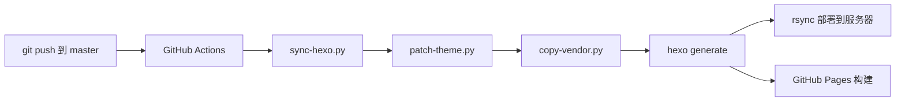
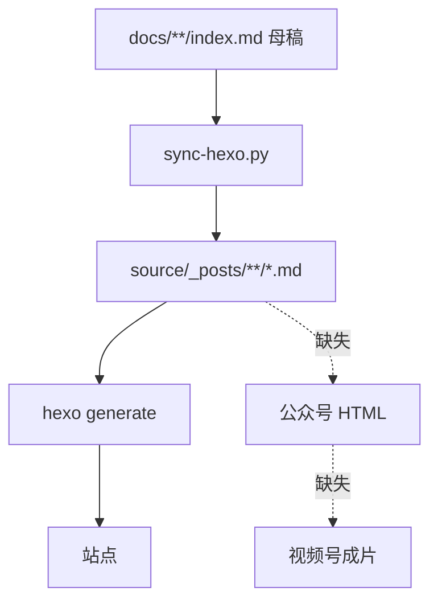
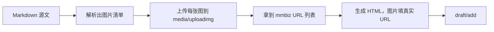
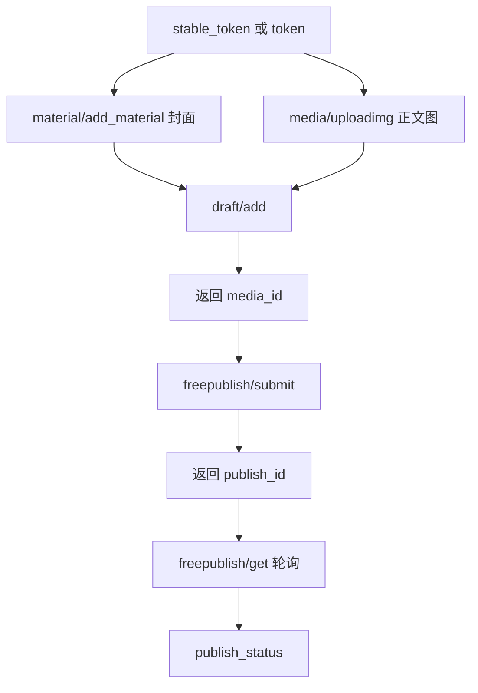
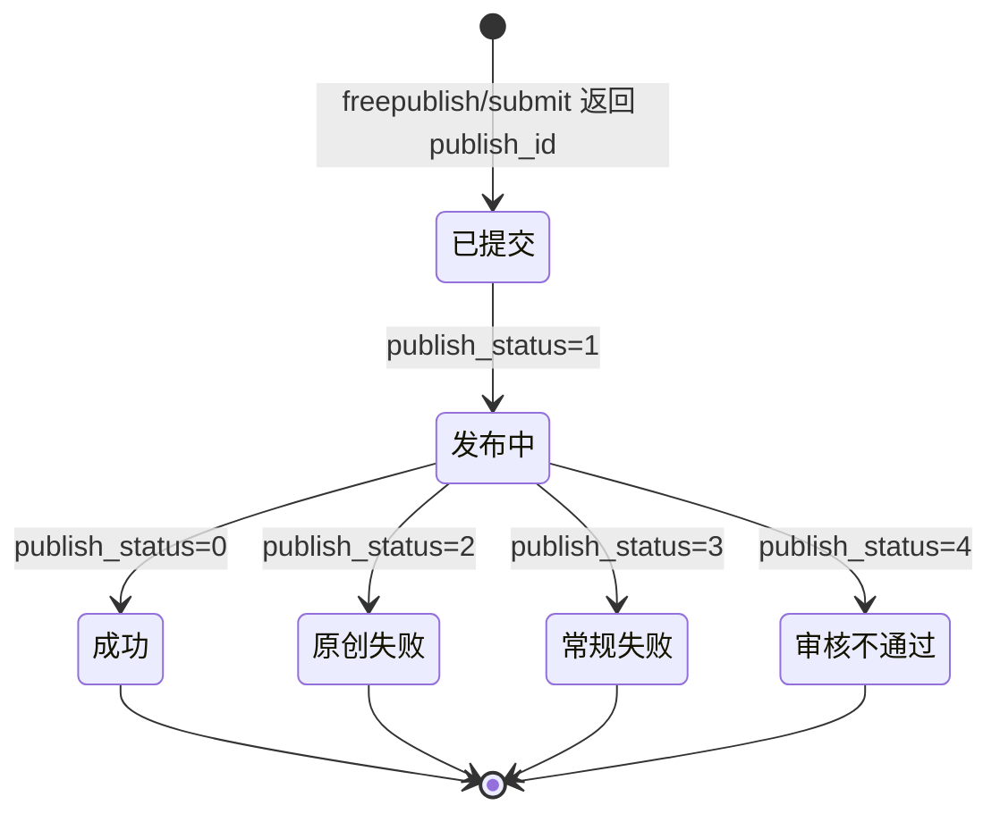
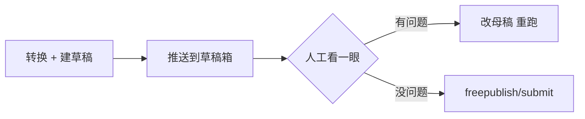
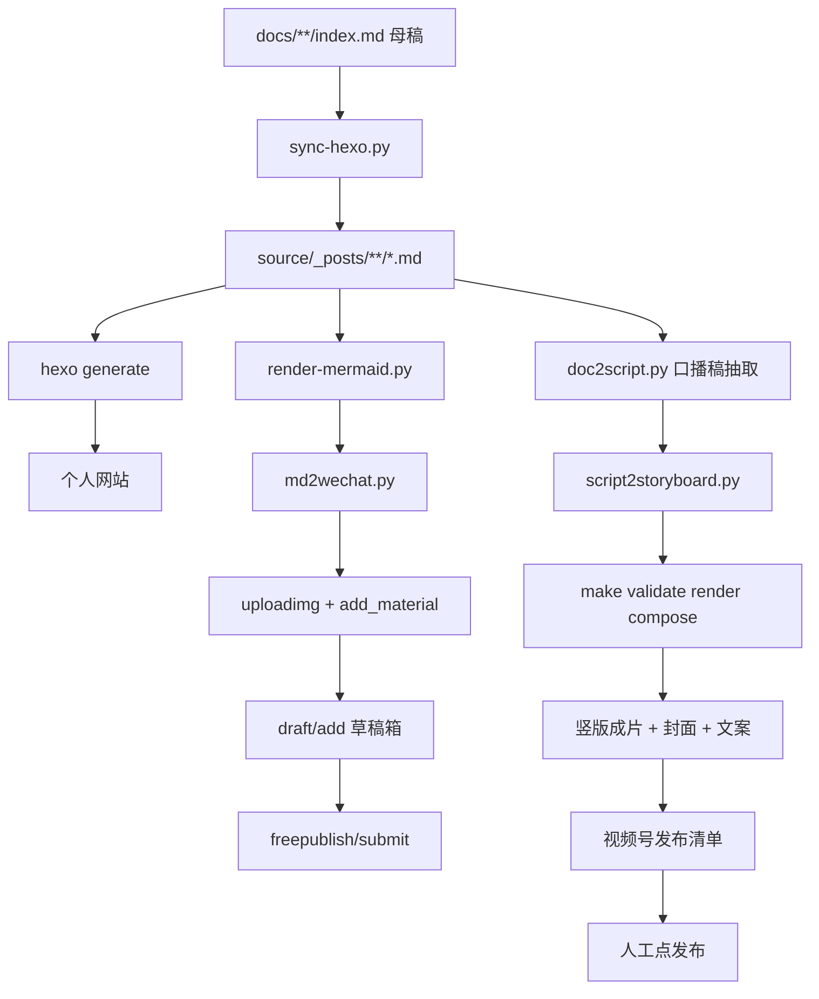

# 从 Hexo 博客到公众号与视频号：一次发布，自动分发两个平台

| 编写人 | 编写内容 | 编写时间 |
| --- | --- | --- |
| growdu | 分析**当前博客仓库**怎么改造成「一份文档 → 公众号 + 视频号」自动分发，重点回答两个问题：**公众号能不能全自动发**、**视频号能不能全自动发**。结论先给：公众号**能**，但要过一道权限闸门；视频号**不能全自动**，最稳的形态是「自动出片 + 人工点发布」。 | 2026-11-09 |

> **先说结论**：
>
> 1. **博客这一侧早就自动化了**，而且自动化得很彻底——`git push` 一次，站点就更新了。缺的不是发布能力，是**第二个发布目标**。
> 2. **公众号可以做到「文档一提交就自动出现在草稿箱」**，这是纯 API 能力，稳定、可长期跑。
> 3. **公众号的「自动发表」要看账号资质**：2025 年 7 月起官方收回了部分账号类型的发布接口权限，个人主体/未认证企业调用会拿 `48001`。这个必须**拿自己的号实测一次**，别照抄别人的成功教程。
> 4. **视频号没有面向普通账号的、可上传并发布的公开 API**。市面上所有"全自动发视频号"方案，本质都是浏览器自动化驱动网页后台，**有风控和协议风险**。我的默认方案是 **B：自动出片 + 自动填表 + 人工点发布**，把不确定性留在最后 1 步。
> 5. **视频素材不用从零造**——仓库里 [AIV 视频生产线](../aiv/index.html) 已经跑通了「口播稿 → storyboard → 代码渲染 → ffmpeg 出片」，还带了时间码校验、字幕宽度校验、禁止词校验。**缺的只是"文章 → 口播稿"这一个抽取器**。
>
> 本文所有仓库相关的判断都来自**读源码**，不是凭印象；涉及微信/视频号官方接口的部分，我会**明确标注哪些是稳定能力、哪些必须实测**。

---

## 一、先看清现状：博客这一侧早就自动化了

改造之前，得先承认一件事：**这个博客的发布链路已经是一条完整的 CI 流水线**，不是"手动 hexo g"。搞清楚了这一点，才知道该往哪里接。

### 1.1 现在的发布链路（读 `.github/workflows/hexo.yml` 得到的）



触发条件是 `push: branches: [master]`，另外留了 `workflow_dispatch` 手动触发。关键步骤：

| 步骤 | 做什么 | 为什么重要 |
| --- | --- | --- |
| `actions/checkout@v5` + `fetch-depth: 0` | 完整历史 | 因为 `git_date()` 要在**所有分支**上找最早提交时间 |
| `python3 tools/sync-hexo.py` | `docs/` → `source/` 的**全量转换** | 这是内容处理的**唯一入口** |
| `python3 tools/patch-theme.py` | 打主题补丁 | 定制渲染逻辑 |
| `python3 tools/copy-vendor.py` | 复制 vendor 静态资源 | |
| `npx hexo generate` | 生成 `public/` | |
| Verify rendered HTML body tags | 校验渲染结果 | 防止主题改坏 |
| rsync / Pages build | 两路分发 | 服务器为主，Pages 为辅 |

**所以「文档一发布就上线」这件事，博客已经做到了。** 问题不是"怎么自动发布"，是"自动发布的**目标只有一个**"。

### 1.2 `tools/sync-hexo.py` 是整条链路的CPU

这个文件是整个博客的**内容编译器**，纯标准库（`os / re / shutil / subprocess / sys / json`），没有 `requirements.txt`，也没有 `pyproject.toml`。它干的事：

| 函数 | 职责 | 对公众号改造的意义 |
| --- | --- | --- |
| `read_section_categories()` | 读 `docs/<section>/_index.md` 拿顶级分类名 | 分类名可以直接复用 |
| `read_cascade_categories()` | 遍历 `docs/**/_index.md` 收 `cascade.categories` | 同上 |
| `resolve_post_categories()` | 合成最终分类（顶级在前，cascade 去重追加） | 公众号可以按分类批量发 |
| `git_date()` | 跨**所有分支**取该路径**最早提交时间**，兜底 `2024-01-01` | **permalink 的日期来源** |
| `rewrite_images()` | `` → 站点内绝对路径 | 公众号要换成 mmbiz URL |
| `rewrite_links()` | 相对链接 → 绝对 permalink（如 `/2026/11/09/life/aiv/`） | **「阅读原文」的链接可以直接复用** |
| `process()` | 剥首个 H1、重生成 front-matter、决定输出路径 | **公众号转换器应该吃它的输出** |
| `collect_database_posts()` | 挑出数据库相关文章汇总到落地页 | 批量选题的来源 |

`process()` 生成的 front-matter 是固定的一套：

```text
---
title: "<从 H1 或 front-matter 取>"
date: <git_date()>
author: growdu
categories:
  - <顶级分类>
tags:
  - <分类 + 推断主题>
---
```

注意一个细节：**`process()` 会把原 front-matter 整个丢掉再重建**，所以文章里写的 `tags:` 不会进最终站点——最终 `tags` 是「分类 + `infer_topics()` 推断出的主题」的并集。这一点在设计公众号转换器时必须知道：**别指望从 front-matter 读元数据，要从 `process()` 的输出读。**

### 1.3 还有一个 CI 守卫值得抄

`sync-hexo.py` 里有一条硬校验：

> 同一个目录下，如果一个 `.html` 和一个 `.md` **同名**（且 `.html` 不以 `-html` 结尾），CI 直接打印 ERROR 并 `sys.exit(2)`。

这是踩过坑之后加的——`01-poster.md` 和 `01-poster.html` 同名时，Hexo 会把它们写进同一个 `source/_posts/` 目录，产物互相覆盖。

**做自动发布也一样**：同名冲突必须是**构建期硬失败**，不能靠人眼发现。公众号这边对应的坑是**重复发布**（见 §4.4）。

### 1.4 结论：缺口在哪



缺的是从 `source/_posts/**/*.md` 出发的那两条支线。

**为什么不直接从 `docs/` 再解析一遍？** 因为会立刻产生"两份真相"：`sync-hexo.py` 已经处理掉了图片路径、相对链接、H1、permalink——公众号再写一套解析器，等于把它的 bug 再复制一份，还多一份要维护。**正确做法是复用 `sync-hexo.py` 的输出**。

---

## 二、一个母稿，三个平台：形态差异是硬约束

《[数据库技术自媒体运营手册](../shehui/media-account/index.html)》里已经定过原则：**网站是母版，其他是切片**。这篇要补的是**技术层面的差异**——哪些差异是"改改文字"能解决的，哪些是**必须换渲染方式**的。

### 2.1 三个平台的硬约束对照

| 维度 | 个人网站（Hexo） | 微信公众号 | 视频号 |
| --- | --- | --- | --- |
| 内容形态 | 完整技术长文 | 图文长文，正文 ≤ 20000 字 | 竖版短视频，1~3 分钟 |
| 标题长度 | 无硬限制 | ≤ 64 字符 | 前 3 秒决定完播，标题 ≤ 22 字（超长截断） |
| 摘要 | 自动生成（`smart_summary`） | ≤ 120 字符 | 一句话钩子 |
| 图片 | 相对/绝对路径都行 | **必须 mmbiz 域名**，否则不显示 | 必须抽帧 |
| mermaid | 客户端 JS 渲染（`scripts/mermaid.js`） | **不支持 JS，必须预渲染成图** | 必须预渲染成图 |
| 表格 | 完整 HTML | 支持，但窄屏横向溢出 | 必须转成图 |
| 代码块 | highlight.js 客户端高亮 | **外部 JS 无效，必须服务端高亮成内联 style** | 转成画面 |
| 外链 | 随便挂 | 正文内 H5 链接被拦，走**「阅读原文」** | 走主页/私信 |
| CSS / JS | 完整 | **只认 inline style，`class` 无效** | N/A |
| 封面 | 自动 | 必填 `thumb_media_id`（2.35:1 + 1:1 两张） | 必填，影响完播 |
| 发布方式 | `git push` | `draft/add` → `freepublish/submit` | **无公开发布 API**（见 §5） |

**这张表的价值在于：右两列的"不支持"，不是"我懒得做"，是平台技术栈决定的。** 做自动化的全部难点，都来自这些不支持项。

### 2.2 公众号正文的"降级三原则"

从站点 HTML 转公众号 HTML，不是换个壳，是**三次降级**：

1. **渲染降级**：`mermaid` / `highlight.js` / 图表 → 预渲染成静态图（PNG）。
2. **样式降级**：外部 CSS、class 选择器 → inline style。
3. **链接降级**：正文内 H5 外链 → 「阅读原文」+ 文末「参考链接」文字块。

**降级必须在转换器里一次性做完，不能留到发布后人工修**——否则自动化就退化成半自动。

### 2.3 视频号的形态定位

视频号不是"把公众号文章读一遍"，它是**另一个内容品类**：

- 公众号是**可检索、可收藏、可复制代码**的深度载体 → 吃长尾和信任。
- 视频号是**社交推荐** → 吃前 3 秒和转发。

所以同一次发布，**公众号拿"技术深度"，视频号拿"一个反直觉的结论"**。这决定了：视频号内容**必须从母稿里再抽一层**，而不是把公众号正文压缩——见 §6.2。

---

## 三、公众号：从 Markdown 到可发布 HTML 的转换器

### 3.1 转换器要处理的构造清单

以仓库里真实出现过的 Markdown 元素为准，逐项定映射规则：

| Markdown 构造 | 站点产物 | 公众号产物 | 处理方式 |
| --- | --- | --- | --- |
| `# H1` 标题 | 被 `process()` 剥掉 | 进 `title` 字段 | 剥离 |
| `## / ###` 标题 | `<h2> / <h3>` | `<h2>` / `<h3>` + inline style | 保留 + 注入字号/颜色 |
| 段落 | `<p>` | `<p style="...">` | 行高 1.75，字号 15~16px |
| 表格 | `<table>` | `<section>` 包裹 + `overflow-x: auto` | 窄屏可横向滚动 |
| 代码块 | `<pre><code>` + JS 高亮 | `<pre>` + **服务端高亮的内联 span** | 需要 Pygments 或 `pygments` 离线产物 |
| 行内代码 | `<code>` | `<code style="background:...">` | |
| `> 引用块` | `<blockquote>` | 带左边框的 `<section>` | |
| 列表 | `<ul> / <ol>` | `<ul> / <ol>` + 内边距 | |
| 图片 | `` | `` | **两段式**：先上传后替换 |
| mermaid | `<div class="mermaid">` | ``（PNG） | **预渲染** |
| 相对链接 | 绝对 permalink | 文末「参考链接」 | **降级** |
| 绝对外链 | 原样 | 文末「参考链接」 | **降级** |
| 分割线 | `<hr>` | `<hr style="...">` | |
| 脚注 / 引用清单 | `<ul>` | 保留 | |

### 3.2 转换器的接口设计

关键设计原则：**纯函数、可测试、不碰网络**。网络部分（上传图片、拿 token）单独一层。

```python
# tools/publish/md2wechat.py

def to_wechat_html(markdown: str, assets: AssetResolver) -> tuple[str, list[str]]:
    """把一篇 Markdown 转成公众号可用的 HTML。

    返回 (html, image_placeholders)
    - html 里凡是本地图片先用占位符 {{img:0}} {{img:1}} 占位
    - image_placeholders 按出现顺序列出本地图片的相对路径
    调用方负责把占位符换成 mmbiz URL。
    """
```

**为什么要占位符？** 因为图片 URL 只有在**上传之后**才知道，而 HTML 结构依赖这些 URL 的宽高（`width` 属性影响排版）。两段式的正确顺序是：



如果反过来（先生成 HTML 再上传），你就得做两遍 HTML 生成，或者在 HTML 里留占位符再二次替换。**占位符方案更简单，而且顺带解决了"同一张图被引用两次只上传一次"的问题**——用 URL 做 key 缓存。

### 3.3 图片处理：两张不同的图

公众号有两处图片，处理方式不同：

| 用途 | 接口 | 关键约束 | 用途字段 |
| --- | --- | --- | --- |
| 正文插图 | `POST /cgi-bin/media/uploadimg` | **JPG/PNG**，单张 ≤ 1MB；返回 `url`（mmbiz 域名） | 正文 `` |
| 封面图 | `POST /cgi-bin/material/add_material?type=image` | 永久素材，返回 `media_id` | `thumb_media_id` |

封面还要提供两张裁剪：`pic_crop_235_1`（2.35:1）和 `pic_crop_1_1`（1:1）。**这两个字段是可选的**，不传就用原图裁，但排版会难看。

**≤1MB 这个限制是实战中最容易翻车的地方**：站点上的 PNG 截图经常 2~5MB，直接传会报 `40005` 之类的错。所以转换器里必须带一步**降质**：

```python
def shrink_for_wechat(path: str, limit_bytes: int = 1024 * 1024) -> bytes:
    """把图片压到微信能接受的体积。超出 1MB 时先降 PNG 量化，
    再退到 JPEG（正文图 JPEG 完全可接受）。"""
```

**顺手说一个选题规则**：公众号正文图最好**宽度 ≤ 1080px**（公众号正文宽度就是 1080 逻辑像素），超宽图会被缩放，文字类截图缩放后基本看不清。所以"截图时按正文宽度截"应该写进写稿规范里，而不是事后补救。

### 3.4 mermaid 必须预渲染

这是整条链路里最容易被忽略、但又最致命的一项。

站点的 mermaid 是**客户端渲染**的——`scripts/mermaid.js` 在 `before_post_render` 把 ```` ```mermaid ```` 围栏换成 `<div class="mermaid">`，主题在 `layout.ejs` 里加载 mermaid 库并调用 `mermaid.run()`。

**公众号没有 JS。** 所以 `<div class="mermaid">` 在公众号里就是一个**空 div**——文章里那些架构图、时序图会**静默消失**。

解决方案有两条：

| 方案 | 做法 | 评价 |
| --- | --- | --- |
| **A. CI 预渲染（推荐）** | 用 `mermaid-cli`（`@mermaid-js/mermaid-cli`，走 puppeteer）把每个 `.mmd` 渲染成 PNG，产物进 `source/images/` | 一次性、可缓存、CI 里跑得动；缺点是 mermaid-cli 依赖 chromium |
| B. 站点页面上手动导出 | 人工截图 | 不可持续 |

方案 A 的落点很自然：**`sync-hexo.py` 之后、`md2wechat.py` 之前**加一步 `render-mermaid`：

```text
docs/**/index.md
  → sync-hexo.py           # 图片、链接、H1、permalink
  → render-mermaid.py      # 扫 ```mermaid 围栏 → 渲染 PNG → 替换围栏为图片引用
  → md2wechat.py           # 转公众号 HTML
```

**注意一个联动**：如果 mermaid 图被预渲染成 PNG 放进 `source/images/`，站点侧**也应该用这张 PNG**（不然站点渲染一次、公众号渲染一次，两边可能不一致）。所以这一步应该做成"**渲染一次，两边共用**"，而不是只服务公众号。

顺带说一句：仓库里目前 `docs/` 下有多少张 mermaid 图、渲染一次要多久，我没有实测数字——**这是第一个该测的基准**，因为它直接决定 CI 时长。

### 3.5 外链降级策略

公众号正文里的 H5 外链，用户点了会跳到"非微信环境"的提示页，体验很差，且**很多平台会直接拦截**。标准做法：

```text
正文里的外链  →  保留文字，但不加链接
             →  全部收集到文末「参考链接」区块
             →  区块开头注明：「完整原文链接见阅读原文」
```

而**「阅读原文」**（`content_source_url`）是唯一可以放外链的地方，它指向的是**你的网站那篇文章**——所以站点必须是**唯一母版**，公众号是它的投影。这和《运营手册》§2.2 的原则完全一致。

`content_source_url` 的值可以直接从 `sync-hexo.py` 的 permalink 规则算出来：`/{YYYY}/{MM}/{DD}/{section}/{slug}/`。

---

## 四、公众号自动发布：接口链路与状态机

### 4.1 完整链路



逐个说：

| # | 接口 | 作用 | 关键字段 |
| --- | --- | --- | --- |
| 1 | `POST /cgi-bin/stable_token` | 取 access_token | **推荐**：不会顶掉已有 token，支持 `force_refresh` |
| 1' | `GET /cgi-bin/token?grant_type=client_credential` | 老接口 | 每次调用会让旧 token 失效，多 worker 并发时**会互相踩** |
| 2 | `POST /cgi-bin/material/add_material?type=image` | 上传封面 | multipart，字段名 `media`，返回 `media_id` |
| 3 | `POST /cgi-bin/media/uploadimg` | 上传正文图 | multipart，字段名 `media`，返回 `url` |
| 4 | `POST /cgi-bin/draft/add` | 建草稿 | `articles[].title/author/digest/content/content_source_url/thumb_media_id/need_open_comment/only_fans_can_comment` |
| 5 | `POST /cgi-bin/freepublish/submit` | 发表 | body `{media_id}`，返回 `publish_id`（**异步**） |
| 6 | `POST /cgi-bin/freepublish/get` | 查状态 | body `{publish_id}`，返回 `publish_status` + `article_id` |

**`stable_token` 比 `token` 强在哪？** 老 `token` 接口每次调用都**作废**上一个 token（同一账号只能有一个有效 token）。如果你在 CI 里同时跑两个 job，或者两个 job 重叠，**后一个会让前一个正在用的 token 立刻 40001**。`stable_token` 加了 5 分钟内的复用窗口，天然适合并发。

### 4.2 `publish_status` 状态机



`freepublish/submit` 是**异步**的：它返回 `publish_id` 时文章可能还没发出去。必须轮询 `freepublish/get` 直到 `publish_status` 落定。

| `publish_status` | 含义 | 处理 |
| --- | --- | --- |
| `0` | 发布成功 | 写回状态，结束 |
| `1` | 发布中 | 继续轮询 |
| `2` | 原创失败 | 告警 + 保留草稿 |
| `3` | 常规失败 | 告警 + 保留草稿 |
| `4` | 平台审核不通过 | 人工看内容，**不要自动重试** |

**轮询的三个细节**：

1. **必须有超时上限**。`publish_status` 卡在 `1` 是有可能的（审核排队）。建议 30 分钟超时，超时按"待人工确认"处理，不要无限重试。
2. **轮询间隔别太密**。1~2 分钟一次足够，微信接口有频率限制。
3. **状态要落盘**。轮询状态写进一个 `.publish/wechat/status.json`，让下次 CI 知道自己该干什么（见 §4.4）。

### 4.3 一个必须实测的权限闸门

> **这是本文最需要你去验证的一条。**

据公开资料，**2025 年 7 月起官方收回了部分账号类型的「发布能力」接口权限**：`freepublish/submit` 对**个人主体、不支持认证的企业、未认证企业**这类账号会返回：

```text
errcode: 48001
errmsg: api unauthorized
```

同时**草稿接口 `draft/add` 通常仍然可用**。

**这件事对个人自媒体的含义非常直接：**

| 你的公众号类型 | 能不能自动进草稿箱 | 能不能自动发表 |
| --- | --- | --- |
| 订阅号 · 个人主体 | 大概率能 | **大概率不能**（48001） |
| 订阅号 · 企业主体 · 已认证 | 能 | 能 |
| 服务号 · 已认证 | 能 | 能 |

**所以「文档一发布就自动发到公众号」这个需求，在不同账号下的答案是不同的：**

- **如果发表接口不可用** → 自动化做到「**自动生成 + 自动进草稿箱 + 推送通知**」，最后"点一下发表"由人完成。
- **这仍然值 90% 的工**。原来从"一篇文档"到"一篇公众号草稿"要手工改格式、传图、调样式，30~60 分钟；自动化之后是 **0 分钟人工 + 5 秒点击**。
- **而且草稿箱天然是一个审批闸门**——这反而是好事（见 §4.5）。

**行动项**：拿你自己的号调一次 `freepublish/submit`（哪怕发一篇测试草稿），把 `errcode` 记下来。**不要照抄任何教程，包括这篇**——我给的是链路，不是你这个号的结论。

### 4.4 幂等与重试：自动发布最容易翻车的地方

自动发布的经典事故是**同一篇文章发了两遍**。原因通常有三个：CI 重跑、推送时手快推了两次、轮询超时后误判为失败又重试。

**解法是三层幂等键**：

| 层 | 键 | 存哪 | 作用 |
| --- | --- | --- | --- |
| 内容层 | `sha256(markdown 正文)` | `.publish/wechat/fingerprint.json` | 正文没变就不重新生成草稿 |
| 发布层 | `media_id`（draft 返回） | `.publish/wechat/status.json` | 有了 `media_id` 就说明草稿建过，不要重复 `draft/add` |
| 状态层 | `publish_id` + `publish_status` | 同上 | 已经在发布中的，`submit` 不重复发 |

伪代码：

```python
def publish(md_path: Path, state: State) -> Result:
    body = read(md_path)
    fp = sha256(body)

    if state.get('fingerprint') == fp and state.get('publish_id'):
        # 已经处理过这个版本，只查状态
        return poll(state['publish_id'])

    if not state.get('media_id'):
        html, images = to_wechat_html(body)
        urls = upload_images(images)           # 两段式：先上传再生成 HTML
        html = html.replace_placeholders(urls)
        cover = upload_cover(md_path)
        state['media_id'] = draft_add(html, cover)

    state['fingerprint'] = fp
    state['publish_id'] = freepublish_submit(state['media_id'])
    return poll(state['publish_id'])
```

**注意 `state` 要提交进 git**（或者放 CI artifact + 一个持久化分支）。GitHub Actions 的 artifact 不是跨运行的持久存储，**每次 workflow 都是干净环境**——这个坑我见过太多人在 `if: always()` 的 job 里栽。

### 4.5 人工闸门：草稿箱就是审批点

即使发表接口可用，我**依然建议保留一个人工确认环节**，位置放在 `draft/add` 之后：



理由有三个：

1. **公众号文章是公开可搜索的**，发错一版删掉很难受（虽然可以删，但链接已经被人转出去了）。
2. **平台审核不通过（`publish_status=4`）会浪费一整轮**，而内容有争议往往在人工那一眼就能看出来。
3. **每天发一篇 vs 每天发三篇**，前者对个人号更健康。多发一篇错的，收益抵不过掉粉。

自动化到**草稿箱**为止，**发布这一步由人按一个按钮**——这是投入产出比最高的切法。

### 4.6 CI 里的落地形态

```yaml
# .github/workflows/publish-wechat.yml（新增，独立于 hexo.yml）
name: Publish to WeChat

on:
  push:
    branches: [master]
    paths:
      - 'docs/**/*.md'
  workflow_dispatch:
    inputs:
      post_path:
        description: '只发这一篇（docs 相对路径）'
        required: false

jobs:
  wechat:
    runs-on: ubuntu-latest
    steps:
      - uses: actions/checkout@v5
        with: { fetch-depth: 0 }
      - uses: actions/setup-python@v5
        with: { python-version: '3.11' }
      - name: Sync content to Hexo
        run: python3 tools/sync-hexo.py
      - name: Convert markdown to WeChat HTML
        run: python3 tools/publish/md2wechat.py --out .publish/wechat/
      - name: Push to draft box
        run: python3 tools/publish/wechat_push.py --state .publish/wechat/state.json
        env:
          WX_APPID: ${{ secrets.WX_APPID }}
          WX_APPSECRET: ${{ secrets.WX_APPSECRET }}
          WX_SOURCE_URL: https://growdu.github.io/blog
```

**几个 CI 实践要点**：

| 要点 | 原因 |
| --- | --- |
| **单独一个 workflow，不塞进 `hexo.yml`** | 站点构建和内容分发是**两件事**，一个失败不该拖垮另一个 |
| **`paths` 过滤** | 不是每次 push 都要发公众号 |
| **`fetch-depth: 0`** | `git_date()` 依赖完整历史 |
| **Secrets 用 environment secret** | 公众号的 `appsecret` 泄露 = 账号被接管 |
| **IP 白名单** | 调用接口的机器出口 IP 必须加进公众号后台白名单，否则 `40164` / `61004`。**CI 的 IP 是动态的** → 需要固定 runner 或走自建 runner / 云函数固定出口 |
| **失败要告警** | 接企业微信/飞书机器人推一条「公众号草稿生成失败」 |

**IP 白名单这一条是 CI 方案的最大坑**：GitHub 托管 runner 的出口 IP 每次可能不同。解法有三个：固定 IP 的自建 runner、固定出口的云函数、或者**把发布动作放在有固定 IP 的机器上**（我更倾向后者——反正发布频率是每天一次，不需要 CI 的弹性）。

---

## 五、视频号：先把话说清楚

### 5.1 结论：没有稳定开放的上传发布 API

**这一节我写得很直白，因为市面上这块的"教程"水分太大。**

截至目前，微信视频号**没有面向普通个人账号的、公开文档化的「上传视频并发布」开放接口**。

| 官方开放能力的方向 | 覆盖什么 | 覆盖"发短视频"吗 |
| --- | --- | --- |
| 视频号开放能力 | 直播（开播/推流/评论/连麦） | ❌ |
| 视频号小店 / 电商 | 商品、订单、橱窗 | ❌ |
| 留资组件 | 表单收集线索 | ❌ |
| 数据能力 | 数据罗盘、观众分析 | ❌ |
| 视频号助手（网页后台） | 发布视频、定时发布、草稿箱、数据分析 | ✅ **但是网页，不是 API** |

腾讯云侧暴露过一些 `/channels/ec/...` 形态的接口（`EC` 指的是**电商**方向），它们是**视频号小店**相关的，也不是"发视频"。

**所以结论是：视频号的"自动发布"只能走网页自动化，没有正规开放接口可依赖。**

### 5.2 三条路线对比

| 路线 | 做法 | 自动化程度 | 稳定性 | 风险 | 适合 |
| --- | --- | --- | --- | --- | --- |
| **A. 浏览器自动化全流程** | Playwright / CDP 驱动视频号助手网页，上传 + 发布 | 高（无人值守） | 低 | **高**：违反平台协议、私有接口变更即失效、登录态过期、账号风控 | 有富余精力、能接受风控、做实验 |
| **B. 半自动（推荐默认）** | 自动出片 → 自动填表 → **人工点发布** | 中（最后 1 步人工） | **高** | 低 | **绝大多数人** |
| **C. 公众号 ↔ 视频号联动** | 公众号为主阵地，视频号做引流；公众号发文时插入视频号视频 | — | 高 | 低 | 已有公众号阵地 |

**我把 B 定为默认路线**，理由是投入产出比：

- 人工的那一步是**点一次发布**（10 秒），而自动化的价值在**前面的 90%**——出片、填标题、写简介、选封面。
- B 不会因为平台改版而全线崩掉。
- B 不需要处理登录态、验证码、风控这些不可控因素。
- **每天 10 秒 × 365 天 = 1 小时**。这是可以接受的成本。

### 5.3 路线 B 的具体形态

人工那一步之前，自动化要做到这个程度：

```text
[自动] 从母稿抽口播稿 → storyboard → 渲染 → 出片（竖版 1080x1920）
[自动] 生成视频号发布文案：标题（≤22 字）、简介、话题标签
[自动] 生成封面帧（从成片里抽最有信息量的一帧）
[自动] 把成片 + 文案 + 封面 + 一条可勾选的发布清单，写到一个本地目录
[人工] 打开视频号助手 → 上传成片 → 粘贴文案 → 发布
```

**"发布清单"是这个方案的关键产物**。它应该长这样：

```markdown
# 待发布：openGauss 的并行逻辑解码

- 成片：./out/pg-parallel-decode-9x16.mp4
- 封面：./out/cover.jpg
- 标题：openGauss 并行解码，并行在哪一层
- 简介：解码端只有一条流的时候，并行毫无意义。这一期拆开讲。
- 话题：#openGauss #数据库内核 #逻辑复制
- 母稿：https://growdu.github.io/blog/2026/11/09/db/...
- [ ] 已上传成片
- [ ] 已填写标题与简介
- [ ] 已发布
```

人工只需要对着清单打勾，不用回忆"这一期叫什么名字、简介怎么写的"。

### 5.4 路线 A 的技术要点与红线

如果确实要试 A（我不反对，只是不建议作为主线），技术上的真实难点是：

| 难点 | 说明 |
| --- | --- |
| 登录态 | 需要长期有效的 cookie / token，过期就要人工扫码。**这是自动化最大的摩擦点** |
| 上传控件 | 文件选择控件在 **Shadow DOM** 里，Playwright 的 `setInputFiles` 直接找不到元素，得用 CDP 注入 |
| 私有接口 | 上传走的是网页内部私有端点，微信没有兼容性承诺，**改版即失效** |
| 发布确认 | 提交后有二次确认弹窗 / 风控校验 |
| 风控 | 高频、规律性极强的操作极易被识别 |

**红线**（不是技术问题，是"值不值得"和"安不安全"）：

1. **不做多账号批量**——风控识别的是行为模式。
2. **不做定时群发**——一天一次以内。
3. **必须有失败人工接管**——任何一个异常都停下来叫人，不要自动重试。
4. **先跑通 B 再考虑 A**——B 能覆盖 80% 的收益。

### 5.5 路线 C：公众号 ↔ 视频号联动

除了两条主线，还有一条"加法"值得做：

**公众号发文时插入视频号视频。** 公众号后台支持插入视频号内容（有视频号内容 ID 时）。这意味着：

- 公众号图文 = 深度内容 + 一条视频
- 视频号 = 从同一条母稿抽出来的短版本
- **一次研读，两处曝光**

这条路的关键约束是：**视频必须先在视频号存在**（拿到 ID），公众号才能引用。所以顺序是**先视频号、后公众号**，或者公众号用**占位链接**、发完再补。

---

## 六、自动生成视频：复用 AIV 流水线

### 6.1 已有的资产（不用重造）

仓库里 [AIV 视频生产线](../aiv/index.html) 已经跑通了整条出片链路，代码在 `aiv/pipeline/`：

| 组件 | 位置 | 作用 |
| --- | --- | --- |
| 契约 | `storyboard.json` | **唯一真相**：视频规格、音频、字幕样式、场景序列 |
| 编排 | `Makefile` | `test` / `validate` / `align` / `render` / `compose` / `all` |
| 入口 | `pyv/cli.py` | `validate` / `align` / `render` / `compose` / `probe` |
| 时间轴 | `pyv/timeline.py` | `Storyboard.load()` + `validate()` |
| 旁白对齐 | `pyv/align.py` | 按音频时间码切视觉段 + 生成字幕事件 |
| 渲染 | `pyv/render.py`、`pyv/draw.py`、`pyv/scenes/` | cairo 逐帧绘制 |
| 字幕 | `pyv/subtitle.py` | 烧字幕 |
| 合成 | `pyv/compose.py` | ffmpeg 拼接 + 混音 |
| 校验 | `pyv/palette.py` | 字体可用性、禁止词 |

`storyboard.json` 的结构（实际文件节选）：

```json
{
  "version": 1,
  "video": { "width": 1920, "height": 1080, "fps": 24, "duration": 38.102 },
  "audio": { "narration": "narration_pg-parallel-decode.mp3", "bgm": null },
  "subtitle_style": { "primary": "#1B2A47", "outline": "#FFFFFF", "position": "bottom-center" },
  "scenes": [
    {
      "id": "s01",
      "start": 2.833,
      "end": 8.654,
      "type": "code",
      "subtitle": "关注数据库内核的独立开发者\nopenGauss 并行逻辑解码",
      "renderer": "pyv.scenes.s01_intro",
      "params": {
        "title": "openGauss",
        "subtitle": "并行逻辑解码",
        "tagline": "reader 读 WAL · worker 池并行 · walsender 收口"
      },
      "sentences": [0, 1]
    }
  ]
}
```

> 这份节选取自 EP01 当前真实的时间轴文件（2026-11-12）。
> 早先这里引的是一份更早的样例，旁白文件名与时长都过期了。

**这套契约有一个非常值钱的特点：它是「声明式」的。** 视频长什么样，完全由 `storyboard.json` 决定，渲染引擎只是执行器。

**这意味着"换平台"不是改代码，是改 JSON。**

### 6.2 需要新增的三件事

| # | 新增 | 输入 | 输出 | 难度 |
| --- | --- | --- | --- | --- |
| 1 | **文章 → 口播稿抽取器** | `source/_posts/**/index.md` | `script.md`（口播稿） | 中：这是**内容判断**，不是代码判断 |
| 2 | **竖版出片** | `storyboard.json` | 1080×1920 成片 | 低：改 `video` 段 + 场景布局 |
| 3 | **发布文案生成** | 母稿 + 成片 | 标题/简介/话题 | 低：模板 + 抽取 |

**第 1 件是唯一的硬骨头。** 为什么不能全自动？因为口播稿的规则里有大量语义判断：

《运营手册》§3.2 定的那几条规则：

- 句子短，每句 ≤ 25 字
- 每 15~20 秒有一个"锚"（一个数字、一个对比、一个结论）
- 删掉所有"如图所示"（视频里没有图）
- 开头 15 秒必须出现**最反直觉的那个结论**

这些规则**可以部分自动化**，但"最反直觉的结论是哪个"需要判断。所以合理的设计是**半自动抽取**：

```text
母稿
  → 规则抽取器（找数字、找对比、找 Q&A 结构、找带源码路径的段落）
  → 候选口播稿（每行一个意群、带 [问题]/[解决] 标签）
  → 人工改 5 分钟（开头钩子 + 选锚点）
  → 锁定
```

**注意这里的"人工改 5 分钟"不是自动化失败，是正确的分工。** 视频号的成败取决于前 3 秒，这个判断值得花 5 分钟。

**自动部分能覆盖多少？** 我估计 60~70%——段落切分、数字提取、术语简称化（`leader` → `leader`、`apply worker` → `apply worker`）这些都能做。但**钩子**和**锚点选择**必须人来定。

### 6.3 竖版：改 JSON 而不是改代码

视频号是 9:16，现在的流水线是 1920×1080。`storyboard.json` 的 `video` 段已经把规格声明化了，所以：

```json
{ "video": { "width": 1080, "height": 1920, "fps": 24, "duration": 29.599 } }
```

然后场景渲染器要适配竖屏布局。**这一步的工作量取决于场景类型**：纯文字/代码的场景改起来快，需要大画布的场景（架构图）要重新排版。

**建议**：先做**纯代码 + 纯文字**的竖版（技术视频最容易的就是这种），复杂的架构图场景**竖版直接降级成"横版画面 + 上下留白"**，不要硬排。硬排的结果通常是字太小。

### 6.4 目录结构与边界

《运营手册》§3.4 已经定过规矩：**个人号的物料单独建仓，不进公司仓库**。这条在这里继续适用——而且现在仓库里的 `aiv/` 目录里**躺着一堆公司物料**（`海量数据库DDL同步.mp4`、`海量智库 片头.mp4`、吉祥物图、配色），虽然已经被 `.gitignore` 的 `*.mp4` / `*.mp3` 规则挡住了二进制，但**文案脚本和分镜还在**。

**做自动发布之前，先把边界划清楚**：

```text
个人号仓库（独立）
  <episode-slug>/
    00-source.md          # 源码笔记
    01-poster.md          # 海报文案
    02-script.md          # 口播稿（人工确认过的最终版）
    03-storyboard.json    # 分镜契约
    04-subtitle.srt       # 字幕
    05-cover.jpg          # 封面
    06-desc.md            # 各平台文案
    out/
      final-16x9.mp4
      final-9x16.mp4
    publish/
      wechat.md           # 公众号发布清单
      channels.md         # 视频号发布清单
```

**技术资产（流水线代码、`storyboard` 契约、校验规则）可以复用；内容资产（脚本、分镜、吉祥物、配色）必须独立。**

---

## 七、整体架构

### 7.1 全景图



**注意两条支线是**并列**的，不是串联的。** 它们共享上游（母稿 → `sync-hexo.py`），但下游完全解耦：公众号挂了不影响视频，视频挂了不影响公众号。

### 7.2 一次发布的数据流

| 阶段 | 产物 | 谁消费 | 是否可重放 |
| --- | --- | --- | --- |
| 1 | `source/_posts/**/index.md` | 站点 / 公众号 / 视频 | ✅ 纯函数，重放无副作用 |
| 2 | `source/images/*.png`（mermaid 预渲染） | 站点 + 公众号 | ✅ 同上 |
| 3 | `.publish/wechat/article.json` | 微信 API | ✅ 同上 |
| 4 | `.publish/wechat/state.json`（`media_id` / `publish_id` / 指纹） | 微信 API | ❌ **有状态，幂等靠它** |
| 5 | `.publish/channels/storyboard.json` | 渲染引擎 | ✅ 同上 |
| 6 | `.publish/channels/out/*.mp4` | 人 / 视频号 | ✅ 同上（但很慢，应缓存） |
| 7 | `.publish/channels/publish.md` | 人 | ✅ 同上 |

**这个"可重放 vs 有状态"的分界线，就是整个系统可靠性的关键。** 阶段 1/2/3/5/6/7 全都可以随便重跑，阶段 4 必须小心。

---

## 八、分阶段落地清单

### Phase 0：打地基（1 天，不发布任何东西）

- [ ] 拿自己的公众号调一次 `stable_token`，确认能拿 token
- [ ] 调一次 `media/uploadimg` 传一张图，确认返回 mmbiz URL
- [ ] 调一次 `draft/add` 建一篇测试草稿，**看 `freepublish/submit` 返回什么 `errcode`** ← **这一步决定后面所有设计**
- [ ] 把结论写进仓库：`docs/life/blog-to-wechat/_index.md` 里加一节"接口实测结论"
- [ ] 在 `tools/publish/` 下建目录，约定 `md2wechat.py` / `wechat_push.py` 的签名

### Phase 1：公众号只到草稿箱（3~5 天）

- [ ] `md2wechat.py`：Markdown → 公众号 HTML（先支持标题/段落/列表/引用/代码/表格/图片，**mermaid 先跳过**）
- [ ] 图片两段式上传 + 占位符替换
- [ ] `wechat_push.py`：token → 上传图 → `draft/add` → 写 state
- [ ] 加一个 `--dry-run`：只产出 HTML 到本地，人工看一遍再发
- [ ] 拿 3 篇历史文章回测，逐篇和站点版对比

### Phase 2：加 mermaid 和发表（2~3 天）

- [ ] `render-mermaid.py`：CI 里预渲染 mermaid → PNG，**站点和公众号共用**
- [ ] 代码块服务端高亮（离线 Pygments 产物）
- [ ] `freepublish/submit` + `freepublish/get` 轮询 + 状态机
- [ ] 幂等 state 落盘（`fingerprint` / `media_id` / `publish_id`）
- [ ] 失败告警（飞书/企微机器人）
- [ ] 接进 CI：独立 workflow + `paths` 过滤

### Phase 3：视频号（1~2 周）

- [ ] `doc2script.py`：规则抽取口播稿候选（数字、对比、Q&A）
- [ ] `script2storyboard.py`：口播稿 → `storyboard.json`
- [ ] 竖版适配：`video` 段改 1080×1920，纯代码/文字场景先跑通
- [ ] `make validate` 加**品牌禁令自动校验**（把禁止词列表做成机器可读）
- [ ] 出片 + 抽封面帧 + 生成发布文案 → 输出 `publish.md` 清单
- [ ] 人工发布，跑满 10 期再评估要不要上路线 A

### Phase 4：规模化（1 个月后）

- [ ] 批量回填：把 2026 年已写的文章按分类批量进草稿箱（**人工抽查**）
- [ ] 数据回流：公众号阅读量 / 视频号播放量 → 回写到选题库
- [ ] 决定要不要做路线 A（**先有 30 期数据再决定**）

---

## 九、风险与兜底

| 风险 | 概率 | 影响 | 兜底 |
| --- | --- | --- | --- |
| **发布接口权限被回收** | 高 | 公众号只能到草稿箱 | 这不算失败——草稿箱流程价值仍有 90% |
| **IP 白名单挡住 CI** | 高 | 全部接口调用失败 | 把发布动作移到固定 IP 的机器；或自建 runner |
| **token 并发互相顶掉** | 中 | 随机 `40001` | 用 `stable_token`；单 worker 串行 |
| **重复发布** | 中 | 账号刷屏、掉粉 | 三层幂等键（§4.4） |
| **微信接口返回码变了** | 中 | 链路静默失败 | `errcode` 不为 0 时**必须 fail 掉**，不吞异常 |
| **mermaid 预渲染 CI 超时** | 中 | 站点发布被拖垮 | mermaid 渲染单独 job + 缓存；不阻塞主流程 |
| **视频号平台改版** | 高（走 A 时） | 全线失效 | 默认走 B；A 视为实验，随时可弃 |
| **内容违规 / 审核不过** | 中 | 文章发不出去 | `publish_status=4` 不重试，转人工 |
| **把公司物料带进个人号** | 中 | 信任受损 | CI 里跑禁止词校验；物料独立仓库 |
| **母稿改了导致旧视频过时** | 高 | 内容自相矛盾 | 母稿是唯一真相；视频挂母稿链接 |

**一条通用原则：自动化流水线的每一个"成功"，都必须是"显式确认过成功"，不能是"没报错就算成功"。** 这条在发布场景里尤其重要——公众号发重了比发慢了糟糕得多。

---

## 十、速查

### 10.1 环境变量

```text
WX_APPID           公众号 AppID
WX_APPSECRET       公众号 AppSecret（secret，别进仓库）
WX_SOURCE_URL      站点根 URL，用于拼「阅读原文」
WX_COVER_DIR       封面图目录
WX_DRY_RUN=1       只产出 HTML 不调接口
```

### 10.2 常见错误码

| 错误码 | 含义 | 处理 |
| --- | --- | --- |
| `40001` | access_token 无效或已过期 | 重新取 token；检查是否用了老 `token` 接口被顶掉 |
| `40164` | IP 不在白名单 | 加出口 IP |
| `45009` / `45011` | 接口调用超过限制 | 退避重试；减少轮询频率 |
| `48001` | api unauthorized | **发布接口权限被回收**（见 §4.3） |
| `40007` | media_id 不合法 | 素材没传成功或已过期 |

> 错误码以官方文档和实际返回为准。**这张表是排查起点，不是权威定义。**

### 10.3 发布前 checklist

**公众号**

- [ ] 标题 ≤ 64 字符，摘要 ≤ 120 字符，正文 ≤ 20000 字符
- [ ] 所有图片都是 mmbiz 域名，没有本地相对路径
- [ ] 没有 mermaid 空 div、没有未渲染的代码块
- [ ] 外链都在文末「参考链接」，`content_source_url` 已填
- [ ] 封面 `thumb_media_id` 已设，两张裁剪都给了
- [ ] 在手机上预览一遍（**公众号后台有手机预览**）
- [ ] 稿件里没有公司名/产品名/内部代号

**视频号**

- [ ] 成片是 1080×1920，封面 1080×1440 左右
- [ ] 前 3 秒有结论
- [ ] 字幕 ≤ 14 字/行，字体存在
- [ ] 禁止词校验通过
- [ ] 标题 ≤ 22 字，简介不超过 100 字
- [ ] 母稿链接可访问

---

## 附：本文引用的仓库现状

| 事实 | 出处 |
| --- | --- |
| CI 触发条件 `push: master`，含 `workflow_dispatch` | `.github/workflows/hexo.yml:3` |
| `sync-hexo.py` 是唯一内容转换入口，纯标准库 | `tools/sync-hexo.py:1` |
| front-matter 被 `process()` 整体重建 | `tools/sync-hexo.py:959` |
| `git_date()` 跨所有分支取最早提交时间 | `tools/sync-hexo.py:304` |
| md/html 同名冲突 → `sys.exit(2)` | `tools/sync-hexo.py:1207` |
| 相对链接重写为绝对 permalink | `tools/sync-hexo.py:873` |
| mermaid 围栏 → `<div class="mermaid">`（客户端渲染） | `scripts/mermaid.js` |
| 主题客户端调 `mermaid.run()` | `themes/matery/layout/layout.ejs:25` |
| 出片流水线目标：`test/validate/align/render/compose` | `aiv/pipeline/Makefile` |
| `storyboard.json` 是唯一契约 | `aiv/storyboard.json` |
| 音视频不入库 | `.gitignore`（`*.mp4` / `*.mp3` 等） |
| `source/` 由 CI 生成，不入库 | `.gitignore`（`/source/`） |

**相关阅读**

- [数据库技术自媒体运营手册](../shehui/media-account/index.html) —— 内容侧的母版/切片原则、平台分工、选题方法
- [AIV 视频生产线：九个环节、唯一契约与入库边界](../aiv/index.html) —— 出片流水线的九个环节与边界
- [PostgreSQL 逻辑复制 Stream 执行逻辑源码级拆解](../../db/postgresql/postgresql-logical-replication-stream-publisher/index.html) —— 拿来做端到端试跑的那一篇
