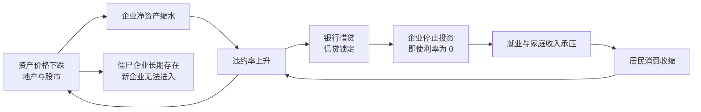
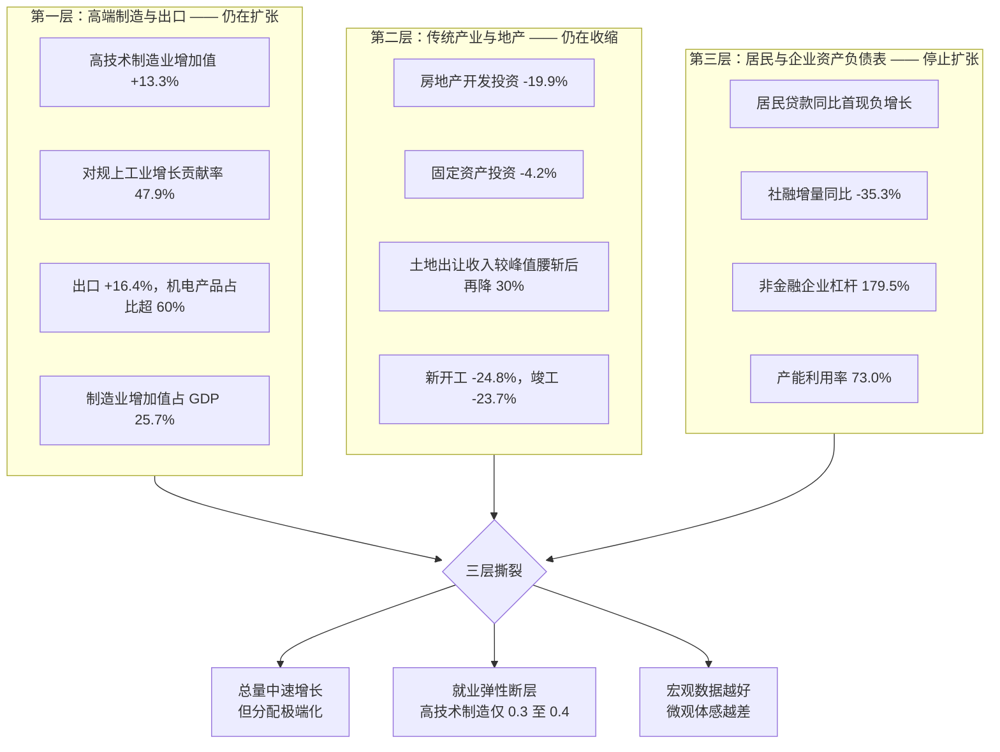
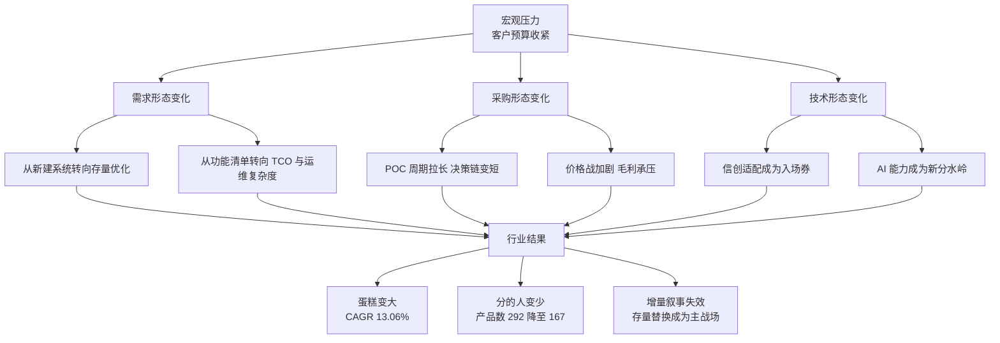
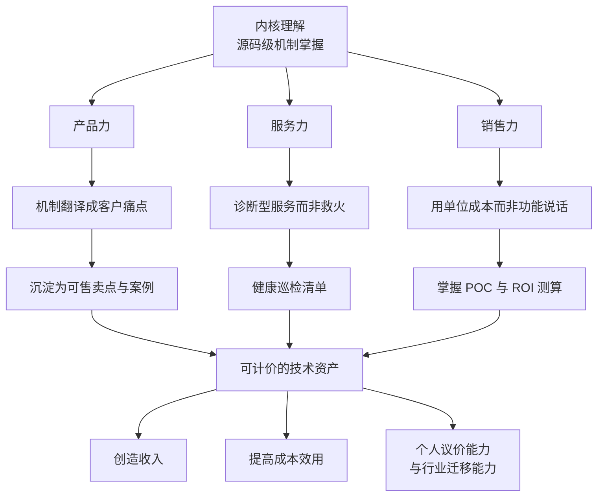
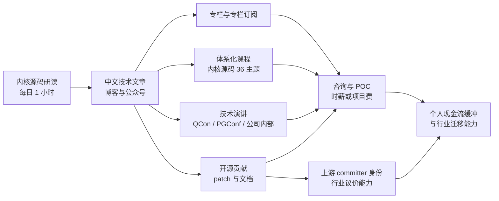

# 经济下行周期下的数据库内核工程师：深度版 —— 十四项关键读数、八条建议与指标看板

| 编写人 | 编写内容 | 编写时间 |
| --- | --- | --- |
| growdu | 深度版（配套精简版《大环境之下：一个数据库内核开发工程师的思考、建议与自处》，那篇 304 行、只讲结论；本篇 1200 行，展开全部推演过程与数据口径）。以数据库内核开发工程师的视角，对 **2026 年中国经济的结构性矛盾**做出研判，并以上世纪 **1929—1939 大萧条** 与 **1990—2010 日本失去的二十年** 为参照系，依次输出四层结论：**对经济现状的判断**、**给公司的八条建议**、**我作为内核高级工程师的成长与变现路径**（产品力 / 销售力 / 服务力 / 创造收入 / 成本效用）、**作为个人面对衰退要守住的四条防线**。附第十一章「指标看板」，给出可观测、可证伪的触发阈值。数据取自国家统计局、世界银行、中国信通院、Gartner、纽约联储、McKinsey 及公开财报，每条结论均标注口径与来源，并区分「事实 / 推论 / 假设」。 | 2026-10-28 |

> **本文是「深度版」。** 如果你只想看结论，请读配套的**精简版**——
> [《大环境之下：一个数据库内核开发工程师的思考、建议与自处》](../economic-downturn-strategy/index.html)
> （304 行，三个部分：我怎么看大环境 / 给公司的三条建议 / 我自己的策略）。
>
> 本篇展开的是精简版里被压缩掉的部分：**十四项关键读数的完整数据与口径**、**大萧条与日本二十年各自的机制拆解**、**给公司的八条建议（含可度量指标）**、**成本效用测算模板与家庭资产负债表模板**、以及第十一章那张**可观测、可证伪的指标看板**（24 个指标带阈值和触发动作）。
>
> **读法建议**：想快速对齐观点读精简版；想做决策、想引用数据、或想自己复算这套判断，看本篇。

> **TL;DR**
>
> **一句话**：这一轮不是 1929，而是 **2015 年供给侧改革 + 2018 年去杠杆 + 2020 年疫情 + 2021 年地产断供 + 2024—2026 财政与信用收缩** 五次叠加出来的**资产负债表衰退**；它不会像大萧条那样摧毁生产，但它会像日本那样**摧毁价格、消灭岗位、冻结阶层的收入预期**。
>
> **四个核心判断**：
>
> 1. **总量与结构在撕裂。** 2026 前三季度 GDP +4.6%、高技术制造业增加值 +13.3%（对规上工业增长贡献 47.9%），但房地产开发投资 **-19.9%**、固定资产投资 **-4.2%**、社零 **+1.1%**、16—24 岁（不含在校生）失业率 **18.0%**。这不是「整体下行」，而是**高端制造在扩张、传统产业在收缩**的双轨运行。
> 2. **高技术产业的就业吸纳能力远不足以消化传统产业的失业人口**（高技术制造业就业弹性仅 **0.3—0.4**，地产建筑鼎盛期是 0.7—0.8）。所以「新质生产力拉动增长」和「年轻人找不到工作」可以**同时为真**，宏观数据越好，微观体感越差。
> 3. **企业（尤其非金融企业杠杆 179.5%）和地方政府（债务余额 59.24 万亿）仍在加杠杆扩张，而居民在去杠杆**（债务收入比从 2021 年 124% 降至 2026 年中 118%）。**负债端与收入端错配**，这正是辜朝明「资产负债表衰退」的定义。
> 4. **数据库行业不会消失，但会剧烈洗牌。** 蛋糕还在长（2025 年国内数据库市场约 678 亿元，2028 年预计 979.74 亿元，CAGR 13.06%），但**分蛋糕的人从 292 款产品收缩到 167 款，超四成出局**。数据库人的机会不在「等风来」，在于**成为客户削减 IT 成本时唯一敢用的人**。
>
> **给公司的核心建议**：把销售 KPI 从「签约额」改成「客户 12 个月 TCO 承诺」；把「降本增效」从售后工单升级为**独立产品线**；把 POC 沉淀为**可复用资产**；用「替代成本」而非「功能对比」定价；把「存量替换」当成唯一增长入口；现金优先于规模。
>
> **给我自己的核心建议**：内核工程师的抗周期能力来自 **可迁移的底层知识 + 可计价的诊断能力 + 低固定成本的个人资产负债表**。产品力 = 把内核机制翻译成可售卖点；销售力 = 能算清「省了多少钱」；服务力 = 从救火升级为诊断；创造收入 = 把理解变成文档 / 方案 / POC / 课程 / 咨询；成本效用 = 单位查询成本、单位事务成本、单位运维成本。
>
> **给个人的核心建议**：守住**现金流安全垫（6 个月必要开支）**、**收入韧性（主业 + 副业双引擎）**、**资产防线（不加杠杆）**、**健康与关系**四条防线。日本的教训是：**居民 30 年工资累计只涨了 6%**，抗周期靠的是资产与现金流，不是薪水。

---

## 目录

- [第 1 章 引子：一个内核工程师为什么要写经济研判](#第-1-章-引子：一个内核工程师为什么要写经济研判)
- [第 2 章 数据摊开：2026 年中国经济的十四个关键读数](#第-2-章-数据摊开：2026-年中国经济的十四个关键读数)
- [第 3 章 参照系一：大萧条 1929 至 1939](#第-3-章-参照系一：大萧条-1929-至-1939)
- [第 4 章 参照系二：日本失去的二十年](#第-4-章-参照系二：日本失去的二十年)
- [第 5 章 核心判断：不是大萧条，而是三层撕裂](#第-5-章-核心判断：不是大萧条，而是三层撕裂)
- [第 6 章 传导到数据库行业：蛋糕还在长，分的人从 292 变 167](#第-6-章-传导到数据库行业：蛋糕还在长，分的人从-292-变-167)
- [第 7 章 给公司的八条建议](#第-7-章-给公司的八条建议)
- [第 8 章 我自己要怎么做：产品力、销售力、服务力](#第-8-章-我自己要怎么做：产品力、销售力、服务力)
- [第 9 章 创造收入与成本效用：把内核理解变成可计价的资产](#第-9-章-创造收入与成本效用：把内核理解变成可计价的资产)
- [第 10 章 作为个人：面对可能的萧条，我要守住的四条防线](#第-10-章-作为个人：面对可能的萧条，我要守住的四条防线)
- [第 11 章 指标看板：出现哪些信号时我必须改主意](#第-11-章-指标看板：出现哪些信号时我必须改主意)
- [第 12 章 结语：内核工程师的抗周期能力来自哪里](#第-12-章-结语：内核工程师的抗周期能力来自哪里)
- [附录：数据来源与口径说明](#附录：数据来源与口径说明)

---

## 第 1 章 引子：一个内核工程师为什么要写经济研判

写经济分析不是我的专业。写内核才是。

但如果一个数据库内核工程师完全不懂客户所处的宏观环境，他会犯三个非常具体的错误。

### 1.1 错误一：把「公司增长」误当成「技术景气度」

数据库产品部的年度规划写的是「明年营收增长 40%」。这句话背后的客户现实可能是：制造业客户的新建系统预算被砍掉 60%，只剩下运维预算；金融客户把 3 个系统合并成 1 个；政务客户在做信创适配的排期压缩。

**这三种客户对内核研发的需求完全不同**：

| 客户状态 | 真实诉求 | 对内核研发的影响 |
| --- | --- | --- |
| 新建预算被砍 | 存量系统的稳定与降本 | 不需要新特性，需要不添乱 |
| 系统合并 | 异构数据迁移与一致性 | 需要成熟稳定的迁移工具链 |
| 排期压缩 | 快速适配与快速交付 | 需要降低适配成本的技术抽象 |

如果研发排期还是按「客户要什么新特性」来排，交付出去的东西就会错配。**经济研判的第一层用途，是校准需求来源。**

### 1.2 错误二：看不见自己的仪表盘

内核工程师有一个宏观数据研究者没有的优势：**我们能直接看到客户业务在数据库上的投影**。

- `pg_stat_wal_receiver` 的字节增量 → 客户写入量的真实变化
- `pg_stat_replication` 的 lag → 客户核心业务的同步压力
- `pg_stat_database` 的 `xact_commit` / `xact_rollback` 比值 → 客户应用是否开始出现事务回滚（典型的「业务跑不动了改逻辑」的信号）
- `pg_stat_bgwriter` 的 `checkpoints_timed` / `checkpoints_req` 比值 → 客户 IO 是否恶化
- `pg_stat_all_tables` 的 `n_dead_tup` 与表大小的比值 → 客户是否已经放弃做归档与分区
- `pg_stat_user_tables` 的 `seq_scan` 占比 → 客户是否在业务高峰退化成全表扫描
- WAL 速率与 `pg_stat_replication` 的 LSN 差 → 客户备份与容灾的真实投入

**这些指标比 PMI、CPI 领先业务景气度，也比它们更贴近「客户是否还有钱花在数据库上」。** 一个高技术制造业客户和一个濒临破产的地产客户，其数据库的 WAL 速率曲线完全不同。

### 1.3 错误三：把个人职业路径押在单一周期上

公司给我资源（培训、差旅、外派、奖金）的能力，取决于公司的现金流；公司的现金流，取决于客户的预算；客户的预算，取决于宏观周期。

**我无法控制周期，但可以控制自己在周期中的位置**：是做一个「任何公司都需要、所有公司都认」的内核工程师，还是做一个「只有某类客户在扩产时才会需要」的专家？

这两者在扩张期收入差不多，在收缩期差距是数量级的。

### 1.4 本文的方法论与边界

既然是工程师写的经济研判，就必须用工程师的标准来做：

| 原则 | 具体要求 |
| --- | --- |
| **区分事实与推论** | 每个数字标注来源与口径；每个推论标注它依赖的假设 |
| **可观测、可证伪** | 每个判断都配一个能在公开数据或生产系统里读到的指标（见第十一章） |
| **主动寻找反面证据** | 每个结论都问一句「什么数据出现时，说明我错了」 |
| **拒绝单点预测** | 给概率区间与触发条件，不给「明年 GDP 增速是 4.2%」这种伪精确 |

**边界声明**：
- 本文不是宏观研究报告，数据来自公开来源，可能存在口径差异与修订；
- 本文不是投资建议，不构成任何买卖建议；
- 本文是**职业决策与家庭财务的思考框架**，不是精确预测。

---

## 第 2 章 数据摊开：2026 年中国经济的十四个关键读数

不做预测，先看事实。下面十四组数字来自国家统计局、世界银行、中国人民银行、财政部与公开市场报道，口径已在注释中说明。

### 2.1 总览表

| # | 维度 | 最新读数 | 同比 / 环比 | 一句话判读 |
| --- | --- | --- | --- | --- |
| 1 | GDP | 2026 前三季度 107.1 万亿元 | **+4.6%**（Q3 +4.5%，Q2 +4.3%），环比 +1.2% | 增速在下台阶，但仍是全球主要经济体最高梯队 |
| 2 | 城镇调查失业率 | 均值 5.2% | 16—24 岁（不含在校生）**18.0%**（9 月）、18.9%（8 月）；25—29 岁 7.5%；30—59 岁 3.9% | 总量平稳，青年端剧烈分化 |
| 3 | CPI | +0.9% | 核心 CPI +1.1% | 通缩风险已解除，但居民体感仍偏冷 |
| 4 | PPI | **+2.3%** | 9 月单月 +5%，连续 7 个月同比上涨 | 上游涨价，正在挤压中下游利润 |
| 5 | 规上工业企业利润 | 1—8 月 **+15.7%** | — | 总量改善，但高度集中于上游与高技术 |
| 6 | 房地产开发投资 | 1—8 月 **-19.9%** | 新开工 -24.8%，竣工 -23.7% | 仍在缩表，尚未见底 |
| 7 | 商品房销售 | 销售面积 -12.1%，销售额 -13.0% | 70 城新房价格 -3.3% | 成交量约为 2021 年中峰值一半，实际房价较峰值约 -23% |
| 8 | 社会消费品零售总额 | 1—8 月 **+1.1%** | — | 消费极弱；同期居民净存款每年仍增 11—14 万亿 |
| 9 | 固定资产投资 | 1—8 月 **-4.2%** | — | 投资负增长，在统计史上极为罕见 |
| 10 | 土地出让收入 | 2021 峰值 8.7 万亿 → 2025 年 **4.15 万亿** | 2026 年 1—7 月同比再降约 30% | 财政端持续失血，去化周期约 30 个月 |
| 11 | 社融 | 存量 +7.2% | 增量当期同比 **-35.3%** | 信用扩张几乎停滞 |
| 12 | 货币 | M1 +4.1%、M2 +7.5% | 10 年期国债收益率 **1.68%** | 大型商业银行净息差已降至 **1.309%**（2026Q2） |
| 13 | 杠杆 | 非金融企业 **179.5%**、居民 57.7%、政府（推算）约 71.0% | 实体经济整体 308.2%（2026Q2） | 企业在加杠杆，居民在去杠杆 |
| 14 | 人口与就业 | 总和生育率 2025 年约 **1.0**；灵活就业 2026 年预计 **3.2 亿**（约 40% 就业人口） | 每年 800—1000 万劳动年龄人口净减少 | 供给端长期承压 |

> 数据口径说明：GDP、失业率、CPI、PPI、固投、社零、房地产数据为 2026 年前三季度或 1—8 月累计同比；杠杆率为 2026Q2 金融资产负债表推算值（居民杠杆为占比口径、非金融企业与政府为债务 / GDP 口径）；土地出让为财政部口径；人口与灵活就业为多方公开研究汇总估算。

### 2.2 三类读数：扩张的、收缩的、停滞的

把十四组数字按方向分成三组，撕裂就显形了。

**第一组：明确在扩张的**

- 高技术制造业增加值 2026 上半年 **+13.3%**，对规上工业增长贡献率 **47.9%**
- 2025 年货物贸易总额 +18.8%、出口 **+16.4%**，机电产品出口占比超 60%
- 制造业增加值占 GDP 达 **25.7%**
- PPI 连续 7 个月同比上涨（9 月单月 +5%）
- 规上工业企业利润 1—8 月 +15.7%

**第二组：明确在收缩的**

- 房地产开发投资 **-19.9%**，新开工 -24.8%，竣工 -23.7%
- 固定资产投资累计 **-4.2%**
- 土地出让收入较 2021 年峰值腰斩后再降约 30%
- 社融增量同比 **-35.3%**
- 居民贷款 2026 年 3 月同比增速**历史首现负值**
- 短期消费贷同比约 -10%
- 房贷年偿还额从 2023 年约 7 万亿降至约 5 万亿

**第三组：表面平稳、内里停滞的**

- GDP 增速 4.6%（仍在下台阶）
- 城镇调查失业率均值 5.2%（但青年段 18.0%）
- 产能利用率 2026Q2 为 **73.0%**，制造业 73.5% —— 显著低于 75%—80% 的荣枯线区间
- 居民收入：2025 年名义 +5.0%，但**中位数 +4.4%，连续三年慢于平均数**
- 居民债务收入比从 2021 年 124% 降至 2026 年中 118%（去杠杆，但幅度有限）

### 2.3 最关键的一个数字：就业弹性

前面所有数据都可以用「经济还在增长」来解释，唯独就业弹性不能。

**高技术制造业的就业弹性只有 0.3—0.4**（即产出增长 1%，就业只增长 0.3%—0.4%），而地产建筑鼎盛期是 **0.7—0.8**。

这个数字的含义是：

> **制造业的产值增长确实在发生，但它的就业吸纳能力，比它替代掉的那些岗位的消失速度，还要慢。**

这解释了一个看起来矛盾的现象：

- 宏观上：GDP 4.6%、高技术制造 +13.3%、工业利润 +15.7%，「新质生产力」的叙事完全成立；
- 微观上：16—24 岁失业率 18.0%，青年体感是「日子越来越难」。

**两者可以同时为真，因为它们说的不是同一批人。** 高技术制造吃的是工程师、数据分析师、产线自动化岗；收缩的是建筑、装修、地产营销、教培、传统零售。

### 2.4 第二组关键读数：居民端在做什么

2022—2025 年中国居民**每年净存款 11—14 万亿**，累计超额储蓄约 **6 万亿**。这是一笔沉睡的、随时可能重新进入消费的现金池。

但它没有进入消费，因为：

- 一年期定存基准利率约 1.5%，大额存单 3 个月期跌破 1%
- 2026 年 5 月沪深股息率约 2.06%—2.09%
- 房价预期尚未修复（实际房价较峰值约 -23%）
- 就业预期尚未修复（青年失业率 18.0%）

**居民在等一个信号。** 利率已经低到极致（10 年期国债 1.68%），但没人敢消费，因为担心明天的工作和明天的房价。

这形成一个典型的**流动性陷阱 + 预期崩塌**组合：低利率无法撬动被悲观预期锁住的储蓄。

### 2.5 第三组关键读数：负债端在哪里

辜朝明在《大衰退》中定义资产负债表衰退的核心特征是：**所有部门同时收缩负债**。用这个尺子量一量今天的中国：

| 部门 | 状态 | 证据 |
| --- | --- | --- |
| **居民** | 收缩负债 | 债务收入比 124%（2021）→ 118%（2026 中）；居民贷款同比首现负增长；房贷偿还额 7 万亿 → 5 万亿；短期消费贷 -10% |
| **非金融企业** | **仍在扩张负债** | 杠杆率 **179.5%** |
| **地方政府** | **仍在扩张负债** | 债务余额 **59.24 万亿**（2026-07），土地出让收入持续下滑 |
| **金融体系** | 收缩表 | 社融增量同比 -35.3%；大行净息差 1.309% |

**这和 1997—1998 年亚洲金融危机期间的中国是镜像**：1997 年前企业高负债、政府高负债、银行体系脆弱；当时的对策是**大规模债转股 + 银行重组 + 行政性收缩信贷**。今天的企业与地方政府杠杆结构，与当时高度相似。

### 2.6 本章小结

三句话：

1. **总量不缺增长，缺的是增长的分配结构**——增长在高技术制造，失业在传统产业与青年群体，两者不共享同一个水池。
2. **通缩风险解除，但通缩的分配后果已经形成**——PPI 转正利好的是上游资源与设备，中下游毛利被吃掉，终端消费却只增长 1.1%。
3. **私人部门在去杠杆，公共部门在加杠杆**——这种错配是本轮周期最核心的结构性特征，也是理解后续一切行业传导的钥匙。

---

## 第 3 章 参照系一：大萧条 1929 至 1939

选参照系不是为了套模板，而是为了**提取机制**。大萧条是唯一一次现代经济「需求崩塌 + 金融体系失灵 + 政策犯错」三者叠加的样本，它留下的机制至今有效。

### 3.1 事实：崩塌的幅度

| 指标 | 1929 → 1933 变化 |
| --- | --- |
| 工业生产 | **-47%** |
| GDP | 约 **-30%** |
| 失业率 | 峰值约 **25%** |
| 银行倒闭 | 1930—1933 约 **9000 家**（占全美银行 20%） |
| 物价水平 | 1930—1932 累计 **-30%** |
| M2 货币存量 | 1929—1933 收缩约 **1/3**（Friedman & Schwartz） |

一个 25% 的失业率，意味着四分之一的劳动力没有任何生产性工作。这不是「增长放缓」，这是**社会生产网络的物理性收缩**。

### 3.2 四个成因，缺一不可

1. **股市崩盘摧毁信心**：1929 年 10 月崩盘，随后道琼斯指数多年不回原点。财富效应消失 → 消费塌陷。
2. **银行恐慌**：9000 家银行倒闭 → 货币创造机制失灵 → 即使利率降到 0，信贷也不扩张（凯恩斯称之为「流动性陷阱」的原型）。
3. **金本位约束**：美国必须用黄金支付国际债务，这把货币政策的自主权交给了外部。
4. **Smoot-Hawley 关税（1930）**：对 20000 多种商品加征关税，引发贸易伙伴报复，把国内萧条变成全球萧条。

### 3.3 最致命的细节：政策犯错

这是大萧条最值得数据库行业记住的部分。

> **1931 年 10 月，在英国脱离金本位之后，美联储反而把贴现率从 1.5% 上调至 3.5%。**

美联储本该在危机中提供流动性，实际却选择了紧缩。直到 **1932 年 6 月**才开始降息。同时胡佛政府推行财政紧缩并加税。

**大萧条的深度，很大程度上是政策失误造成的，而不是市场必然。** 1933 年罗斯福新政的三大动作——「3R」（Relief 救济、Recovery 复苏、Reform 改革）、放弃金本位、银行休假制度 +  FDIC 保险——都指向同一个认知：

> **名义变量（价格、工资、汇率）可以调整，但资产负债表和预期一旦崩溃，需要的是「重置预期 + 重建金融中介的信用」，而不是让市场自己修复。**

### 3.4 可迁移的三个机制

| 机制 | 定义 | 本轮是否出现 |
| --- | --- | --- |
| **债务—通缩螺旋**（Fisher） | 债务过重 → 债务人抛售资产偿债 → 价格下跌 → 实际债务上升 → 继续抛售 | **是**。居民去杠杆、房企与地方债高企并存 |
| **信贷锁定**（credit crunch） | 坏消息导致银行同时收贷，不管借款人好坏 | **是**。社融增量 -35.3%，居民贷款同比首现负值 |
| **预期崩塌** | 未来收入的不确定性 > 当前价格低 → 即使便宜也不买 | **是**。6 万亿超额储蓄沉淀，1.68% 国债利率撬不动消费 |

### 3.5 不可迁移的三个条件

| 条件 | 大萧条 | 今天 | 差异后果 |
| --- | --- | --- | --- |
| **金本位约束** | 有。美国货币政策被黄金锁死 | **无**。但有**房地产 + 土地财政**这个新的硬约束 | 央行仍有空间，但财政与地产链条的自我强化机制同样僵硬 |
| **全球贸易依赖** | 低。1930 年美国贸易占 GDP 比重远低于今天 | **高**。2025 年出口 +16.4%，机电产品占比超 60% | 今天的收缩会通过外需反向传导，缓冲空间更大但外溢更快 |
| **人口与年龄结构** | 生育率下降刚起步 | 总和生育率已降至约 1.0，劳动年龄人口每年净减 800—1000 万 | 内需端是**长期收缩**，不是周期波动 |

**结论：大萧条的「病因」部分可迁移，但「病程」不会重演。** 用它来推演今天，最有价值的不是「会不会崩」，而是「**哪些环节会因为政策失误而被放大**」。

---

## 第 4 章 参照系二：日本失去的二十年

日本更贴近今天：同样是**资产负债表衰退**，同样是**生产体系完好但需求塌陷**，同样经历了**长达二十年的低通胀与低增长**。

### 4.1 事实：二十年有多长

| 维度 | 峰值 | 谷底 / 现状 | 跌幅或变化 |
| --- | --- | --- | --- |
| 日经指数 | 1989 年底 | 2009 年 | **-60%** |
| 东京住宅价格指数 | 1990 年初 324.8 | 1999 年末 134.6 | **-58.6%** |
| 六大都市商业地价 | 1980s 后期 | 2005 年 | **-87%** |
| GDP 增速中枢 | 1960—1980 年代 **5.2%** | 1990 年代至今 **约 1%** | 增速中枢塌陷 |
| CPI / PPI 中枢 | 5.0% / 1.4% | **0% 附近** | 长期通缩 |
| 非金融企业杠杆率 | 1993 年 **144.9%** | 2015 年才降到 94.4% | **花了 22 年** |
| 居民工资 | 1990—2020 | 30 年累计仅 **+6%** | 薪资购买力停滞 |
| 政府债务 / GDP | 1990 年 67% | 2012 年 **237%** | 公共部门接棒加杠杆 |
| 日本 GDP 全球占比 | 1990 年 **18%** | 今天 **<4%** | 相对衰退 |
| 人均 GDP / 美国 | 1990 年 1.54 倍 | 今天 **0.6 倍** | 人口结构 + 汇率双重作用 |

辜朝明测算：**股市与地产下跌造成的损失约 1500 万亿日元，相当于三年的 GDP**。

### 4.2 核心机制：资产负债表衰退

这是日本案例对今天最有价值的部分。

在正常年份，企业目标是**利润最大化**；在资产负债表衰退中，企业目标变成**债务最小化**。于是：



辜朝明的原话是：

> **问题的 80% 还是来源于所有人同时开始修复资产负债表。**

这句话对今天的中国有直接映射：

- 居民在还房贷（房贷偿还额从 7 万亿降到 5 万亿）
- 房企在保交付（竣工 -23.7%）
- 地方政府在化债（59.24 万亿余额，土地出让收入腰斩）
- 企业在降杠杆（但非金融企业杠杆仍 179.5%，说明**企业还没开始真正修复**）

**这既是好消息也是坏消息**：

- 坏消息：只要大家还在修复资产负债表，需求就起不来。日本花了 22 年才把企业杠杆从 144.9% 降到 94.4%。
- 好消息：企业杠杆还在 179.5%，意味着**还没修完**；一旦进入真正修复期，企业会从「扩产」转向「还债」，同时低利率 + 低通胀会**抬高真实债务负担的实际价值**，还债动力反而更强。

### 4.3 辜朝明的「人口论」：中间那 19 年

辜朝明在《 Japan's Great Depression》有一个反直觉的论证：

- 泡沫破裂：**1990 年**
- 人口开始萎缩：**2009 年**
- 中间 19 年，正是失去的二十年

也就是说，**人口结构不能解释日本的失去的二十年**，真正的原因只有一个：**资产负债表衰退**。人口只是让衰退无法通过人口自然增长被稀释。

> 辜朝明的核心论点：**所有的失败都源于我们相信「因果关系」是稳定的。当因果关系发生改变时，过去的经验就不再适用。**

对今天的中国，这句话的含义是：**「过去 40 年增长经验」这套因果链（基建 → 地产 → 财政 → 就业 → 消费 → 再投资）已经断了。** 在因果链断裂后，继续用旧经验做决策，是最大的风险。

### 4.4 日本的三个「错过」

| 错过 | 时间 | 代价 |
| --- | --- | --- |
| **互联网** | 1990 年代 | 大量传统企业（制造业银行）因无法转型而崩溃，僵尸企业固化 |
| **移动互联网** | 2000 年代 | 制造业与服务业数字化转型滞后 |
| **AI** | 2010 年代至今 | 在「失去的二十年」里失去的不是窗口期，而是**组织能力**——当增长停止时，组织会先失去冒险的勇气 |

**最后一条对数据库公司尤其重要**：周期下行期，公司会本能地砍掉「创新投入」，因为它的 ROI 最难证明。结果是**衰退期反而是技术差距拉大最快的时期**——因为领先者还在投。

### 4.5 一个容易被忽略的数字

**日本居民 30 年工资累计只增长 6%。**

这个数字是整篇文章的支点。它说明：

> **在长期低增长环境中，普通劳动者的收入曲线是平的。抗周期能力不来自薪水，来自资产结构、现金流安全垫和不可替代性。**

---

## 第 5 章 核心判断：不是大萧条，而是三层撕裂

### 5.1 先给结论

**我不认为中国正在经历 1929 式的大萧条，也还没进入 1990 式日本的长期资产负债表衰退的尾声。更准确的定位是：**

> **中国正处在「1970 年代滞胀」与「1997—1998 年亚洲金融危机」的复合体上，叠加了一层 2021 年后从未在发达经济体出现过的「地产—土地财政断链」。**

三者的合成：

| 参照 | 特征 | 中国的对应 |
| --- | --- | --- |
| 1970s 滞胀 | 增长停滞 + 通胀上行 + 政策两难 | GDP 下台阶到 4.x%，PPI 却转正 +2.3%，CPI +0.9% |
| 1997 亚洲金融危机 | 企业与政府高杠杆 + 银行体系脆弱 + 外需依赖 | 非金融企业杠杆 179.5%、地方债 59.24 万亿、出口占比高 |
| 2021 后中国特有 | 地产与土地财政同时失速 | 开发投资 -19.9%、土地出让较峰值腰斩 |

### 5.2 「三层撕裂」模型



**这个模型解释了三组看似矛盾的现象：**

1. **GDP +4.6% 与青年失业率 18.0% 并存** —— 因为增长发生在不需要那么多人的地方。
2. **PPI +2.3% 与社零 +1.1% 并存** —— 上游涨价吃掉中下游毛利，终端却提不动价。
3. **M1 +4.1% 与社融增量 -35.3% 并存** —— 钱在账上，但没有信用扩张。

### 5.3 K 型分化：理解一切的钥匙

把社会切成两块：

| | **高端制造 / 出口 / AI 相关** | **地产链 / 传统零售 / 低端服务** |
| --- | --- | --- |
| 增长 | 高技术制造 +13.3%，出口 +16.4% | 地产投资 -19.9%，固投 -4.2% |
| 就业吸纳 | 弹性 0.3—0.4 | 弹性 0.7—0.8（正在消失） |
| 利润 | 规上工业利润 +15.7%，集中在上游与高技术 | 中下游被上游成本挤压 |
| 融资 | 政策与资本市场倾斜 | 信用收缩，社融增量 -35.3% |
| 家庭体感 | 收入分化，中位数增速连续三年慢于平均数 | 收入停滞、房贷占收入比高 |

**K 型分化的关键在于：分叉的两侧不是「好」和「坏」，而是「增长的承载能力不同」。** 上侧创造 GDP 的能力在增强，但它吸纳就业、拉动内需的能力在减弱。

**这是本轮周期与 2008 年最不同的地方**：2008 年是「总量下滑 + 普跌」，今天总量还在正增长，因此**总量数据完全无法反映普通人的处境**。

### 5.4 概率判断（不是单点预测）

| 情景 | 概率区间 | 特征 | 对数据库行业的影响 |
| --- | --- | --- | --- |
| **A. 分化延续（基准）** | 55%—65% | GDP 维持 4.0%—4.5%，PPI 温和正增长，失业率结构性高企 | 存量替换为主，价格战加剧，头部集中 |
| **B. 二次探底** | 20%—30% | 地产投资继续深跌，信用收缩扩散，GDP 跌破 4% | IT 预算腰斩，数据库项目大面积延期，头部出清加速 |
| **C. 强刺激反转** | 10%—15% | 财政大规模扩张 + 地产企稳 | 增量市场重启，但会加剧本已过剩的产能竞争 |

**世界银行预测 2026 / 2027 / 2028 年中国增速为 4.4% / 4.3% / 4.2%**，与基准情景一致。

### 5.5 我的判断怎么被证伪

按第 1.4 节的方法论，明确列出反面证据：

| 如果出现 | 说明我错了 |
| --- | --- |
| 16—24 岁失业率连续两个季度回落至 13% 以下 | 撕裂在收敛，不是扩大 |
| 民间投资与制造业投资转正，且高技术制造就业弹性升至 0.6 以上 | 增长开始真正传导到就业 |
| 社融增量同比转正并持续 3 个季度以上 | 信用扩张重启，资产负债表修复提前结束 |
| 居民短贷与中长贷同步转正 | 居民预期修复，超额储蓄开始回流 |
| PPI 转正但下游工业企业利润同步改善 | 不是「上游涨价挤压」，而是需求端全面回暖 |

**只要这五条中有三条不成立，我就必须修正判断。**

---

## 第 6 章 传导到数据库行业：蛋糕还在长，分的人从 292 变 167

### 6.1 宏观如何传导到数据库采购



### 6.2 蛋糕还在长

据中国信通院数据：

| 指标 | 数值 |
| --- | --- |
| 2025 年中国数据库市场规模 | 94.9 亿美元，约 **678 亿元** |
| 占全球数据库市场比重 | **7.2%** |
| 2028 年预计规模 | **979.74 亿元** |
| 2025—2028 CAGR | **13.06%** |
| 2025 年公有云数据库规模 | 442.65 亿元，占 **65.3%** |
| 2026 年公有云占比预计 | **66.2%** |
| 信创产业 2026 年规模 | 2.65—3.21 万亿元 |
| 信创人才缺口 | **超过 200 万** |

**结论一：数据库行业不是一个萎缩的行业。** 一个 13% 复合增速的行业，在宏观下行期反而可能因为「国产替代 + 云化」双重需求而跑赢 GDP。

### 6.3 但分蛋糕的人从 292 变 167

这是本文对行业最重要的一条判断：

> **国产数据库产品数从 292 款的峰值收缩到 167 款，超过四成的产品已经退出市场。**

同期：

- 全球数据库产品提供商 394 家，中美两国合计 150 / 94 家
- 国产数据库市占率在不同口径下分别为 26.89%、突破 50%，本地部署细分达 71%
- 关系型国产份额：达梦 13.2%、人大金仓 11.5%、OceanBase 10.8%
- 分布式事务数据库：OceanBase 20.2%、阿里云 17.9%、腾讯云 16.5%、华为云 14.3%，**Top5 占 82.5%**

**头部与尾部的财务表现已经分化**：

| 公司 | 2026H1 表现 |
| --- | --- |
| 达梦数据 | 营收 7.13 亿元，**+36.27%** |
| 电科金仓 | 营收 1.80 亿元，净利 751.77 万元（微利） |
| 中尾部厂商 | 亏损收窄，但尚未形成规模盈利 |

**这组数字的含义**：行业总盘子还在长，但**长的是头部，长尾在死**。四成产品退出不是「行业衰退」，而是**行业在完成一次供给侧出清**。

**对我个人的直接含义**：如果我在一家尾部公司做内核，那么「公司活下来」本身就是最大的风险；如果我在头部或接近头部的公司，机会来自「客户从长尾迁移过来」。

### 6.4 客户的选择标准变了

> **企业选型正在从「看价格」转向看 TCO（总拥有成本）、运维复杂度与业务连续性。**

这不是偏好，而是必然：

- 需求萎缩 → 采购方必须为「买错了」付更多代价 → 更看重决策正确性
- 运维人力昂贵且不可裁（裁员成本高） → 自动化程度与故障自愈能力权重上升
- 业务连续性要求提高 → 数据兼容性与迁移风险权重上升

**信创适配的经济账也变了**：单客户适配成本 80—200 万元、周期 3—6 个月。对客户来说，这是**必须付的门票**，不是可选项。

### 6.5 FinOps：一条正在形成的预算线

 Gartner 在 2026 年 9 月的判断值得完整引用其方向：

> **优化成本应聚焦于「为增长提供资金」，而不是无差别削减；目标是找到 5%—15% 的可寻址年度软件支出。**

与之对应的行业数据：

| 现象 | 数据 |
| --- | --- |
| 云支出浪费在过度配置与闲置资源上 | **30%—35%** |
| Savings Plans / 预留实例可优化幅度 | 10%—30% |
| Right-sizing 可优化幅度 | 10%—25% |
| 组织技术债显著上升的比例 | McKinsey：**60%** |
| 遗留系统造成的年损失（单组织） | 3.7 亿美元 |

**这条预算线的意义**：

> 在增长放缓时，**节省下来的每一分钱都可以说成「为增长提供资金」**。这是财务总监最愿意批的预算科目，也是数据库厂商在增量市场萎缩后最现实的增长来源。

技术路线上，Strangler Fig（绞杀者模式）渐进式替换正在取代 Big Bang 式整体替换——这直接利好兼容性好、迁移工具链完整的国产数据库。

### 6.6 技术竞争焦点

| 层次 | 内容 | 状态 |
| --- | --- | --- |
| **基本功** | 兼容性、性能 | **已经卷成入场券**，只是及格线 |
| **真实差距** | 综合成本 + AI 能力 | 原生向量检索、库内推理、HTAP 能力 |
| **加分项** | 自治化（自愈、自动调优、无人值守） | 与 FinOps 预算线直接对接 |

**内核工程师的机会在这里**：AI 能力的底层是执行器、索引、MVCC、存储引擎——这些都是内核活，不是应用层活。

### 6.7 内核工程师的观测优势

最后回到我的本行。上面所有宏观判断，在生产数据库里都有对应的可观测量：

```sql
-- 客户写入量与增长趋势：WAL 速率是业务活动最诚实的投影
SELECT slot_name,
       pg_size_pretty(pg_wal_lsn_diff(pg_current_wal_lsn(), restart_lsn)) AS retained_wal,
       confirmed_flush_lsn,
       write_lag, flush_lag, replay_lag
FROM pg_replication_slots;
```

```sql
-- 客户是否在经历「业务跑不动」的阶段：回滚率上升 = 应用在改逻辑兜底
SELECT datname,
       xact_commit,
       xact_rollback,
       round(100.0 * xact_rollback / NULLIF(xact_commit + xact_rollback, 0), 2) AS rollback_pct,
       deadlocks
FROM pg_stat_database
WHERE datname NOT IN ('template0', 'template1')
ORDER BY xact_commit DESC;
```

```sql
-- 客户是否在放弃治理：死元组占比与膨胀率
SELECT schemaname, relname,
       n_live_tup,
       n_dead_tup,
       round(100.0 * n_dead_tup / NULLIF(n_live_tup + n_dead_tup, 0), 2) AS dead_pct,
       pg_size_pretty(pg_total_relation_size(relid)) AS total_size
FROM pg_stat_user_tables
WHERE n_dead_tup > 10000
ORDER BY pg_total_relation_size(relid) DESC
LIMIT 20;
```

```sql
-- 客户是否在经历 IO 恶化：被迫触发 checkpoint 的比例上升
SELECT datname,
       checkpoints_timed,
       checkpoints_req,
       round(100.0 * checkpoints_req / NULLIF(checkpoints_timed + checkpoints_req, 0), 2) AS req_pct,
       buffer_checkpoint,
       buffers_backend
FROM pg_stat_bgwriter;
```

**这四个查询，是我在客户现场最有说服力的开场白。** 它们不讲技术，只讲对方的业务现在痛不痛、成本高不高。

> **在客户预算收紧的周期里，「能帮客户算出钱」的工程师，比「能帮客户写新功能」的工程师，好卖一百倍。**

---

## 第 7 章 给公司的八条建议

以下建议的对象是「一家中国数据库产品公司」的董事会与产品线负责人。每条都给出**判断依据 → 具体动作 → 可度量指标**，避免正确的废话。

### 7.1 建议一：把销售 KPI 从「签约额」改成「客户 12 个月 TCO 承诺」

**判断依据**：企业选型标准已从价格转向 TCO、运维复杂度与业务连续性。签约额驱动的销售模式会系统性地把公司带向低毛利、过度承诺、交付期压缩的深渊——而这在收缩期是自杀。

**具体动作**：
1. 销售的考核里引入「**交付后 12 个月的客户实际 TCO 承诺达成率**」，与签约额同权重；
2. 报价环节强制附带一份《客户 TCO 测算表》（硬件 + 许可 + 人力 + 运维工时 + 迁移成本），由售前与客户共同填写；
3. 把「**替代成本**」（客户若不迁移，未来的扩容费、故障损失、人力成本）写进报价单首页，而不是只写折扣。

**可度量指标**：报价单含 TCO 测算表比例 ≥ 90%；交付后 12 个月实际 TCO 达成率 ≥ 85%；因「承诺过高」导致的续约流失率下降。

### 7.2 建议二：把「降本增效」从售后工单升级为独立产品线

**判断依据**：Gartner 明确指出优化成本应「为增长提供资金」；FinOps 相关浪费（过度配置、闲置资源）占云支出的 30%—35%。**这是唯一一条在增量市场萎缩时还能增长的收入线。**

**具体动作**：
1. 成立「成本体检」服务线：交付一份《数据库成本诊断报告》，包含**单位事务成本、单位查询成本、单位存储成本、单位运维成本**四项基线；
2. 把体检工具产品化（一条命令跑完、生成可视化对比），这是内核团队的天然优势——我们比任何人都清楚成本花在哪儿；
3. 定价策略：**首次体检免费或低价引流 → 优化方案按节省额分成或打包进订阅**。

**可度量指标**：体检报告交付数；由体检转化成的优化项目金额；老客户续约率中「因成本优化而续约」的比例。

### 7.3 建议三：把 POC 从「一次性消耗」变成「可复用资产」

**判断依据**：宏观下行情景 B（概率 20%—30%）下，**POC 周期拉长会杀死大量项目**。每来一个客户就重写一遍压测脚本，是纯亏损。

**具体动作**：
1. 建立**标准化压测场景库**（电商大促、IoT 高频写入、OLTP 混合负载、批量 ETL、地理空间），每个场景含数据集生成脚本、负载模型、指标采集、判定阈值；
2. 建立**公开可下载的基准报告模板**，每个客户的项目自动生成一页「你的负载 vs 行业基线 vs 我们的结果」；
3. POC 从「定制开发」改成「**配置 + 少量适配**」，目标：新客户 POC 的适配工作量 ≤ 3 人日。

**可度量指标**：标准场景复用率 ≥ 70%；POC 平均周期从 X 天压到 X/2；POC → 签约转化率。

### 7.4 建议四：用「替代成本」定价，而不是用「功能对比」定价

**判断依据**：292 → 167 的出清说明功能已经严重同质化。在功能可比时，客户必然比价，价格战不可持续。

**具体动作**：
1. 销售材料的主线从「我们有多少功能」改成「**不迁移你的三年 TCO 是多少**」；
2. 建立**迁移成本量化工具**：扫描源库的表数量、数据量、存储格式、专有语法、触发器、存储过程、字符集、时区语义，输出迁移工时评估；
3. 对国产替代项目，把「替换风险」明确标价（**风险定价**，而不是藏在免费服务里）。

**可度量指标**：报价单中「替代成本对比」出现率 100%；价格战中成交均价降幅收窄；毛利率环比改善。

### 7.5 建议五：把「存量替换」当成唯一的增长入口，做深客户覆盖

**判断依据**：地产投资 -19.9%、固投 -4.2%，**新建系统市场在萎缩**。但存量市场有多大？2025 年公有云数据库已占 65.3%，传统部署仍占 34.7%，这部分里有大量「License 到期未替换 + 运维成本过高 + 国产化要求」三重驱动。

**具体动作**：
1. 建立**存量客户地图**：每个客户的数据库版本、部署形态、License 到期时间、运维人力投入、痛点排序；
2. 定义三个进攻剧本：**成本剧本**（你的 IO 成本还能降 30%）、**稳定性剧本**（你的备份恢复演练从没做过）、**合规剧本**（你的库还在老版本，审计过不了）；
3. 把「License 续约前 12 个月」设为销售的强制介入节点——**这是存量市场唯一可预测的窗口**。

**可度量指标**：存量客户渗透率（单客户产品数）；续约前 12 个月介入率 100%；老客户增购率。

### 7.6 建议六：把交付与运维成本压下去——这是 FinOps 的公司内部版

**判断依据**：Gartner 的 5%—15% 可寻址软件支出，对应到我们自己身上就是**每个客户的支持成本**。中国数据库厂商普遍面临「客户多、单客户支持重」的结构。

**具体动作**：
1. 交付标准化：信创适配从 80—200 万 / 3—6 个月，目标是做成**模板化适配包**，新客户适配 ≤ 2 周；
2. 运维自动化：巡检、备份校验、慢 SQL 治理、容量预测全部工具化，减少人工介入；
3. 内部把「**单位客户支持工时**」纳入研发与支持团队的考核。

**可度量指标**：单客户年度支持工时下降 30%；适配周期从周级到天级；客服工单密度下降。

### 7.7 建议七：在 AI 上做「嵌入式」而不是「重构式」

**判断依据**：数据库行业的 AI 差距已经不在「有没有向量检索」，而在**能不能把模型推理放进事务路径**。而这件事的底层是内核：执行器扩展、索引、MVCC 可见性、存储引擎、HTAP。

**具体动作**：
1. 优先做**内核级原生能力**：原生向量索引与 ANN 检索、库内函数调用模型、向量与事务表混合查询；
2. 不做「把数据库改造成 AI 平台」的大重构——那是应用层的事，且会把 167 → 更少的出清再加速一遍；
3. 把 AI 能力**纳入成本效用口径**：例如「单位推理成本」「每次检索的 CPU 成本」，让 AI 能力也能被算成钱。

**可度量指标**：原生向量检索可用性；AI 场景 TCO 对比数据；AI 特性带动的 POC 数量。

### 7.8 建议八：现金优先于规模，活过冬天比赢在春天重要

**判断依据**：日本 1990—2010 的教训不是「要保守」，而是「**当增长停止时，组织会先失去冒险的勇气，然后失去创新能力**」。同时，中国数据库行业正在出清（292 → 167），头部集中的窗口就在未来 2—3 年。

**具体动作**：
1. 设**现金安全线**：经营性现金流可覆盖固定成本 ≥ 12 个月，超过线才谈新投入；
2. 把「投入」分三类：**保命类**（收入直接相关）、**延命类**（降低单位成本）、**赌未来类**（AI、新架构）。在情景 B 下只保前两类；
3. **保留研发火种**：即使要缩编，也要保住一个能持续输出的内核小组。周期结束时，公司能拿到的市场份额，是低谷期保住的技术能力决定的。

**可度量指标**：现金可覆盖月数；单位研发投入带来的收入；低谷期核心技术资产（补丁数、上游贡献、新特性）不下降。

### 7.9 八条建议的一句话汇总

| # | 建议 | 对应周期逻辑 |
| --- | --- | --- |
| 1 | 销售 KPI 改 TCO | 从「抢增量」到「守存量」 |
| 2 | 降本增效独立产品线 | FinOps 是唯一增长线 |
| 3 | POC 可复用资产化 | 缩短周期、降低交付成本 |
| 4 | 替代成本定价 | 功能同质化后停止价格战 |
| 5 | 存量客户深度覆盖 | 新建市场萎缩，存量是主战场 |
| 6 | 压交付与运维成本 | 自己的 FinOps |
| 7 | AI 做嵌入式 | 差距在综合成本 + AI |
| 8 | 现金优先于规模 | 活过冬天比赢在春天重要 |

---

## 第 8 章 我自己要怎么做：产品力、销售力、服务力

前面是给公司的。这一章是给自己的，也是全文最实操的部分。

### 8.1 先认清我的起点

数据库内核高级工程师的典型处境：

| 优势 | 劣势 |
| --- | --- |
| 懂系统底层，能定位别人定位不了的问题 | 离客户远，不知道问题值多少钱 |
| 技术深度可迁移到任何数据库产品 | 深度不等于广度，跨品类可能清零 |
| 能做「只有我们能做的深度优化」 | 深度优化常常无法被客户感知 |
| 上游社区影响力可积累 | 在公司内部可能是「最忙但最不显眼」的人 |

**关键认知**：内核工程师的默认路径是「技术越来越深，商业价值越来越远」。必须**主动把深度翻译成客户能听懂的价值**。

### 8.2 产品力：把内核理解变成可售卖点

产品力对内核工程师来说，不是「做更多功能」，而是**给已有能力找到对的叙事**。

我的翻译表（持续增补）：

| 内核机制 | 技术说法 | 客户听得懂的说法 | 对应场景 |
| --- | --- | --- | --- |
| MVCC 可见性 + `n_dead_tup` | 死元组需要 VACUUM 回收，长事务会阻塞清理 | **「你的表为什么越跑越大、查询越跑越慢」** | 表膨胀、索引膨胀、IO 上升 |
| ReorderBuffer 的 stream 模式 | 大事务超过内存阈值时进入磁盘重排 | **「你的复制延迟为什么只在每天业务高峰炸一次」** | 复制延迟、备库积压、RPO 告警 |
| WAL / Checkpoint 机制 | `checkpoints_req` 上升代表 checkpoint 被 IO 压力挤占 | **「你的 IO 抖动不是磁盘坏了，是 checkpoint 在跟你抢」** | IO 毛刺、写入延迟 |
| 逻辑复制的 slot 与保留量 | 未被消费完的 WAL 会一直占着磁盘 | **「你的备库删不掉，是被复制槽卡住了」** | 磁盘满、备库不可删 |
| 分区表与 DDL 锁 | 高并发 DDL 会等待锁并阻塞读写 | **「你的发布为什么每次都要停机十分钟」** | 发布窗口、在线 DDL |
| 统计信息与执行计划 | 统计信息陈旧导致计划跳变 | **「你的 SQL 昨天还好好的，今天突然全表扫」** | 计划突变、抖动 |

**这个翻译表的本质，是把「机制」翻译成「钱」。** 例如最后一条，客户听到的不是「统计信息」，而是「**昨晚那条慢 SQL 今天早上把 CPU 打满了，扩容花了 3 万块**」。

**产品力 = 机制 → 症状 → 成本 → 方案 的翻译链条完整度。**

### 8.3 销售力：内核工程师最缺的三样东西

内核工程师通常有技术表达力，但缺：

| 缺什么 | 具体表现 | 怎么补 |
| --- | --- | --- |
| **讲价值** | 讲「我实现了什么」而不是「你省了什么」 | 每个技术点强制加一句「所以你能少花 X」 |
| **算钱** | 说不清省多少 | 学会用「单位事务成本 / 每万元硬件承载 QPS」说话 |
| **做 POC** | 实验室里很行，客户环境跑不通 | 主动参与客户 POC，把实验室环境搬到现场 |

**具体训练方法（可执行）**：

1. **每周一次「价值翻译」练习**：从本周的代码提交里挑 1 个技术点，写成「客户痛点 → 你的能力 → 量化收益」三句话，发到团队 wiki；
2. **建立个人案例库**：每个现场问题记录「现象 / 根因 / 定位过程 / 解决方案 / 量化收益」，一年后这就是**可对外销售的案例集**；
3. **强制参与 POC**：把「进客户现场做 POC」写进年度目标，而不是只写「提交 patch」；
4. **学习财务语言**：至少能说清「TCO」「单位事务成本」「ROI 回收期」「CapEx 与 OpEx」四个词在客户财务总监那里的含义。

### 8.4 服务力：从「救火」升级为「诊断」

服务力的本质不是响应速度，是**客户对你的依赖形态**。

| 服务形态 | 客户关系 | 可替代性 | 收入属性 |
| --- | --- | --- | --- |
| 救火型（出问题我来修） | 项目制 | **高**（换一个便宜） | 一次性收入 |
| 交付型（按计划上线） | 项目制 | 中 | 一次性收入 |
| **诊断型（我告诉你哪里有病、怎么治、治完省多少）** | **顾问制** | **低** | **经常性收入** |
| 托管型（我替你看着） | 运营制 | 低 | 经常性收入 |

**内核工程师天然适合做「诊断型」**：客户愿意为「准确的根因定位」付费，但不愿意为「响应工单」付高价。

**具体动作**：建立一份《数据库健康巡检清单》，覆盖八大项：

1. **容量**：表 / 索引膨胀率、分区裁剪率、增长斜率
2. **事务**：长事务分布、冲突率、回滚率
3. **性能**：Top 慢 SQL 的变化趋势、计划跳变次数
4. **复制**：延迟分布、slot 保留量、备库健康
5. **备份**：备份成功率、恢复演练次数、恢复点目标达成率
6. **安全**：权限审计、审计日志覆盖
7. **版本**：版本落后度、已知缺陷暴露面
8. **成本**：单位事务成本、存储成本比、闲置资源

**这八项就是我的「产品」**。每一项都可以量化成客户省下的钱。

### 8.5 三力模型



**注意最后一条**：`个人议价能力与行业迁移能力` 也是三力的产出物。**产品力、销售力、服务力不是公司的资产，首先是我个人的资产。**

---

## 第 9 章 创造收入与成本效用：把内核理解变成可计价的资产

### 9.1 先纠正一个概念：收入不只有一种

很多内核工程师把「创造收入」理解为「多卖 license」。这个理解在收缩期是危险的——因为 license 收入是公司的事，不是我的事，且高度依赖销售与市场。

我说的「创造收入」是**四层递进**：

| 层级 | 收入形态 | 周期敏感度 | 对我的意义 |
| --- | --- | --- | --- |
| **L1 产品收入** | 公司卖产品，我拿工资 | 高 | 最不稳定，且不由我控制 |
| **L2 方案收入** | 我能独立交付的咨询 / POC / 实施 | 中 | 依赖公司平台，但价值由我创造 |
| **L3 知识资产收入** | 文档 / 专栏 / 课程 / 演讲 / 开源 | **低** | 一次生产、多次变现，且不依赖单一雇主 |
| **L4 议价能力** | 跳槽溢价 / 行业话语权 / 机会主动权 | **负相关**（经济差时更值钱） | 周期越差，稀缺性越值钱 |

**核心判断：L1 随周期剧烈波动，L3 与 L4 与周期弱相关甚至负相关。** 一个在收缩期还在做 L3 和 L4 的人，比一个只在 L1 上出力的人，处境好一个量级。

### 9.2 L3：技术资产的变现路径

内核知识天然适合「一次生产，多次变现」：



**具体规划**（按优先级）：

| 优先级 | 动作 | 判据 | 周期 |
| --- | --- | --- | --- |
| P0 | 保持**每月 1 篇源码级文章**的产出 | 已在做（见站内 PostgreSQL 内核系列） | 持续 |
| P0 | 把已有 35+ 篇文档整理成**体系化课程** | 学习路径已成型（见《如何成为资深的 PostgreSQL 内核开发者》） | 6 个月 |
| P1 | 做一个**可运行的诊断工具**并开源 | 第 8.4 节的巡检清单可直接产品化 | 3 个月 |
| P1 | 争取在公司内部做**成本顾问** | 把 L2 收入搬到公司内部，同时锻炼 L2 | 立即 |
| P2 | 参与 **PGConf / QCon** 等会议 | 议价能力的最短路径 | 12 个月 |
| P2 | 向上游提交 patch | 上游身份是行业迁移的硬通货 | 持续 |

**特别强调「诊断工具开源」这一条**：它同时满足 L3（知识资产）、L4（行业话语权）与 L2（咨询引流），而且它是**唯一一条既能帮客户省钱、又能给自己加分的路径**。

### 9.3 成本效用：四个可计算的指标

「提高成本效用」如果不落到可计算的指标上，就是口号。我用四个指标定义：

| 指标 | 定义 | 客户视角 | 提升手段 |
| --- | --- | --- | --- |
| **单位查询成本** | 每万元硬件成本承载的 QPS / TPS | 「同样的机器能多扛多少流量」 | 执行器优化、索引、并行度、缓存策略 |
| **单位事务成本** | 每万元硬件成本完成的 commit 数 | 「同样的机器能多跑多少业务」 | 组提交、WAL 批量、锁优化、MVCC 可见性开销 |
| **单位存储成本** | 每万元存储成本保存的有效数据量 | 「你的数据每年花多少钱」 | TOAST 压缩、列存、分区归档、统计信息治理 |
| **单位运维成本** | 每 TB 数据 / 每万次事务消耗的人工工时 | 「这个库每年要几个人来管」 | 自动化巡检、慢 SQL 治理、容量预测、故障自愈 |

**这四个指标是我在客户现场最有杀伤力的语言。** 因为它们直接对应客户 CFO 的三个问题：**花了多少钱、产出了多少、还要投多少人。**

### 9.4 一个可复用的成本效用测算模板

给客户（也给公司）用的表格骨架：

```markdown
| 维度 | 现状 | 优化后 | 变化 | 年化影响 |
| --- | --- | --- | --- | --- |
| 硬件规模 | N 台 × M 核 × K GB | N' 台 × M' 核 × K' GB | -30% | 节省 CapEx X 万元 |
| 单位事务成本 | A 元 / 万次事务 | B 元 / 万次事务 | -25% | 年节省 Y 万元 |
| 存储年增 | Z TB / 年 | Z' TB / 年 | -40% | 年节省 W 万元 |
| 人工投入 | P 人月 / 年 | P' 人月 / 年 | -1.5 人月 | 年节省 V 万元 |
| 故障与恢复 | M 次 / 年，平均 N 小时 | M' 次 / 年，N' 小时 | -60% | 减少业务损失 S 万元 |
| **合计** | | | | **年化收益 T 万元，回收期 U 个月** |
```

**关键在于最后一行。** 「回收期 U 个月」是唯一能穿透采购决策链的语言——比「性能提升 30%」有用一百倍。

### 9.5 在公司内部先练这条路径

不要一开始就想着变现，先在公司内部成为「最会算账的内核工程师」：

1. **主动做成本体检**：不等销售叫你，自己对高价值客户跑一遍巡检清单，出报告；
2. **把体检结果转成销售弹药**：报告里的「年化收益 T 万元」直接进报价单；
3. **跟踪落地效果**：跟踪一年，算出「体检 → 续约 / 增购」的转化率。

**这一步同时达成三件事**：为公司创造可证明的收入、为自己积累可展示的案例、为自己练出 L2 能力。

### 9.6 上游贡献与「不可替代性」

在周期下行时，公司最先砍的是「看起来不产生收入」的投入——而这往往包含开源贡献与社区影响力。

**我的立场**：即使在公司层面这种投入被压缩，个人也应该保持最低限度的高质量上游贡献。理由：

- 上游 committer 身份是**行业内最硬的信用背书**，它的周期不敏感度最高；
- 它是「我的知识被外部世界验证」的机制，比公司内部好评更有说服力；
- 它让我在需要换工作时有**主动选择权**（对应 `docs/life/_index.md` 里的「路径 B」）。

---

## 第 10 章 作为个人：面对可能的萧条，我要守住的四条防线

前面三章都是「如何创造更多」。这一章是「如何避免归零」。

### 10.1 日本的教训：工资不是防线

**日本居民 30 年工资累计只增长 6%。**

这条数据必须反复咀嚼。它意味着在长期低增长中，**劳动收入的增长接近于零**。因此任何把「薪水会涨」写进长期规划的方案，都是脆弱的。

个人抗周期的能力只有三个来源：

1. **现金流安全垫**（出事时不用在最差的时候做最差的选择）
2. **不可替代性**（收入不完全依赖于单一雇主的景气度）
3. **资产结构**（不对单一资产类别下重注）

这三条构成下面四道防线。

### 10.2 防线一：现金流安全垫

**定义**：可立即动用的流动资产 ≥ **6 个月必要开支**（必要开支 = 房租房贷 + 饮食 + 通勤 + 保险 + 赡养 + 债务利息 + 基础水电通信，**不含任何可选消费**）。

| 层级 | 门槛 | 用途 |
| --- | --- | --- |
| 底线 | 3 个月 | 勉强维持续命 |
| **标准** | **6 个月** | 有选择权（可以拒绝bad fit 的机会） |
| 上限期 | 9—12 个月 | 周期底部可主动出击（收购资产、换工作、创业试水） |

**关键纪律**：
- **零高息负债**。任何年化 > 6% 的消费贷，优先偿还——它是「用未来的选择权换现在的消费」；
- **不抵押房产做消费**。用杠杆消费是最典型的「把资产负债表交给宏观」；
- 应急金**不追求收益**，追求的是「随时能取出来」；
- **应急金不是投资账户**：放在货币基金 / 活期 / 短期存款，不要放在任何有波动、有锁定期的产品里。

**当前宏观下这条尤其重要**：10 年期国债 1.68%、大额存单 3 个月跌破 1%——**现金的机会成本已经降到历史低位**，这意味着「持有现金」的相对成本是三十年来最低的。这是防守的黄金窗口。

### 10.3 防线二：收入韧性

**核心问题不是「我的公司好不好」，而是「如果我明天失业，多久能恢复到同等收入」。**

**四个指标**：

| 指标 | 目标 | 检验方法 |
| --- | --- | --- |
| **收入集中度** | 单一雇主 / 单一客户 ≤ 总收入 60% | 算一下自己收入的最大来源占比 |
| **技能可迁移度** | 核心技能在 ≥ 3 家目标公司的 JD 中出现 | 拿自己的简历去搜 10 个岗位，看命中率 |
| **副业/第二收入占比** | ≥ 20%（理想 30%） | 过去 12 个月非工资收入 ÷ 总收入 |
| **被动收入覆盖力** | 被动收入 ≥ 每月必要开支的 30% | 利息 + 租金 + 版税 + 分成 |

**对内核工程师的具体动作**：

1. **保持「内核深度 + 通用工程广度」的双栖**：内核深度决定天花板，广度决定地板。PG 内核 + 分布式 + 存储 + 云原生，这四块的组合在数据库厂商、互联网公司、云厂商三类雇主那里都值钱；
2. **不把技能绑死在单一产品上**：懂 PG 内核的人，同时也懂 MySQL、opengauss、TiDB 的价值远大于只懂 PG 的人；
3. **第二收入从 L3 开始**（专栏 / 课程 / 咨询），而不是从「副业项目」开始——前者可复用、可累积、不占用主业时间；
4. **每季度更新一次「失业演练」**：更新简历、投递两个岗位、约一个行业朋友吃饭。**定期测试自己能不能被雇佣，是一种低成本的风险对冲。**

### 10.4 防线三：资产防线

**三条铁律**：

| 铁律 | 内容 | 理由 |
| --- | --- | --- |
| **不加杠杆** | 不用房贷、杠杆、借贷加仓任何单一资产 | 杠杆 = 把自己的生存交给宏观与市场情绪 |
| **不单一押注** | 任何单一资产类别不超过家庭净资产的 50% | 日本教训：居民 30 年工资涨 6%，靠的是资产结构而非收入 |
| **不做看不懂的投资** | 只投「能用自己的专业判断其价值」的东西 | 在收缩期，最危险的不是亏钱，是**在不懂的东西上亏了还加仓** |

**关于房产的特殊提醒**：中国居民家庭净资产中房产占比极高，而当前房地产处在**缩表未出清**阶段——开发投资 -19.9%、新开工 -24.8%、去化周期约 30 个月、实际房价较峰值约 -23%。

**这意味着：个人的家庭资产负债表，正在被动承受宏观下行的全部重量。** 具体建议：

- **不要用个人资产负债表去赌宏观**（加杠杆买房、抄底抄到一半被套）；
- 已有房产：**降低杠杆率是当前最确定的动作**，而不是「等反弹」；
- 考虑分散：**流动性资产 + 长期权益 + 必要时适度配置防御性资产**，而不是把 90% 财富锁在一套房产里。

**关于「哑铃配置」**：一边是随时可用的现金与短债（防守端），一边是长期权益与能力资产（进攻端），中间尽量少。**极端时期，中间地带（低流动性、中等收益、需要择时的资产）是最容易被流动性危机杀死的。**

### 10.5 防线四：健康与关系（最被低估的一道）

这一条几乎没人写，但它可能是**最重要**的：

- 在收缩期，**身体是唯一不能降本增效的资产**。加班到 40 岁开始出现不可逆损伤，是职业生涯最贵的错误；
- **关系是衰退期唯一的零成本融资渠道**。Job referral、临时项目、行业引荐，90% 来自弱连接。**内推比海投效率高一个量级**；
- **心理状态决定判断质量**。长期焦虑会让一个人的判断力显著下降，而衰退期的每一个决策错误的代价都被放大。

**具体动作**：把「体检、运动、睡眠、社交」当成**技术债一样管理**——固定频率、可见度、可度量、可延期。

### 10.6 家庭资产负债表模板

建议自己填一份，每半年更新一次：

```markdown
## 家庭资产负债表（YYYY-MM）

### 资产
| 类别 | 金额 | 占比 | 流动性 | 备注 |
| --- | --- | --- | --- | --- |
| 现金与货币基金 | | | 高 | 应急金 |
| 存款与短债 | | | 高 | |
| 权益类资产 | | | 中 | |
| 自住房产 | | | 极低 | |
| 其他 | | | | |

### 负债
| 类别 | 金额 | 利率 | 月供 | 剩余年限 |
| --- | --- | --- | --- | --- |
| 房贷 | | | | |
| 车贷 | | | | |
| 消费贷 | | | | |
| 其他 | | | | |

### 关键指标
- 流动资产 / 月必要开支 = ____ 月（目标 ≥ 6）
- 净负债率 = (负债 - 流动资产) / 净资产 = ____ %（目标 < 30%）
- 房产占净资产比 = ____ %（建议 < 60%）
- 被动收入 / 月必要开支 = ____ %（目标 ≥ 30%）
- 单一雇主收入占比 = ____ %（目标 < 60%）
```

### 10.7 行动清单

**30 天内**

- [ ] 算清「月必要开支」，确定 6 个月安全垫的目标金额与当前缺口
- [ ] 列出所有负债，标出年化利率 > 6% 的部分，制定还款顺序
- [ ] 计算收入集中度（最大单一来源占比）
- [ ] 补齐家庭资产负债表模板的第一版
- [ ] 建立 8 项数据库健康巡检清单的文档骨架

**90 天内**

- [ ] 产出 2 篇「机制 → 症状 → 成本 → 方案」的价值翻译文章
- [ ] 完成一次公司内部客户成本体检，并出一份报告
- [ ] 上线一个可运行的开源诊断工具（哪怕只是几个 pg_stat 查询的封装）
- [ ] 更新简历并投递 2 个岗位做「失业演练」
- [ ] 体检一次，并把运动与睡眠纳入固定日程

**12 个月内**

- [ ] 把已有内核文档整理成体系化课程大纲
- [ ] 至少 1 次公开技术演讲 / 行业分享
- [ ] 至少 1 个上游 patch 被接受
- [ ] 被动收入覆盖月必要开支 30%
- [ ] 家庭资产负债表连续两个季度净负债率 < 30%

---

## 第 11 章 指标看板：出现哪些信号时我必须改主意

研判的最大风险不是判断错，而是**判断错了却不知道**。本章给出可观测、可阈值触发的监控面板。

### 11.1 宏观指标

| # | 指标 | 当前读数 | 警戒阈值 | 触发后我的动作 |
| --- | --- | --- | --- | --- |
| 1 | 16—24 岁（不含在校生）失业率 | 18.0% | 连续 2 季度 > 19% | 情景 B 概率上调至 40%，启动现金保全方案 |
| 2 | 社融增量同比 | -35.3% | 连续 3 季度 < -30% | 公司：收紧投入；个人：提前 6 个月储备 |
| 3 | 房地产开发投资累计同比 | -19.9% | 跌破 -25% | 地产链客户项目全部转为「维护级」预算假设 |
| 4 | 固定资产投资累计同比 | -4.2% | 跌破 -8% | 全行业新建预算假设再下调 20% |
| 5 | PPI 同比 | +2.3% | 回落至 0 以下 | 重新评估「上游挤压中下游」假设，关注通缩风险 |
| 6 | 居民中长期贷款同比 | 首现负增长 | 连续 3 季度负增长 | 居民端需求持续疲弱，降低消费类客户预期 |
| 7 | 产能利用率 | 73.0% | 跌破 71% | 制造业客户扩产意愿归零，运维预算优先于新建 |
| 8 | 10 年期国债收益率 | 1.68% | 突破 2.5% | 机会成本上升，现金垫改为短债 / 债基配置 |
| 9 | 城镇调查失业率均值 | 5.2% | 突破 5.8% | 全面进入收缩情景 B 对策 |
| 10 | 民间投资增速 | 尚未单独列示 | 由正转负 | 确认「预期崩塌」进入第二阶段 |

### 11.2 行业指标（数据库 / 企业软件）

| # | 指标 | 当前读数 | 警戒阈值 | 触发动作 |
| --- | --- | --- | --- | --- |
| 1 | 国产数据库产品数量 | 167 款 | 跌破 130 款 | 行业出清进入尾声，尾部不可投 |
| 2 | 信创适配平均周期 | 3—6 个月 | 拉长至 9 个月以上 | 交付成本上升，强化模板化适配优先级 |
| 3 | Top5 分布式事务数据库份额 | 82.5% | 升至 88% | 头部优势固化，创业型数据库公司窗口关闭 |
| 4 | 客户 POC 周期 | — | 平均 > 8 周 | 第 7.3 条建议升为 P0 |
| 5 | 数据库岗位招聘量 | — | 同比降幅 > 30% | 个人：L3 路径提前启动 |
| 6 | 主流国产数据库厂商毛利率 | — | 同比下滑 > 5pt | 确认价格战失控，公司需调整定价策略 |

### 11.3 个人与公司指标

| # | 指标 | 目标值 | 触发动作 |
| --- | --- | --- | --- |
| 1 | 流动资产 / 月必要开支 | ≥ 6 个月 | 低于 4 个月：停止一切非必要支出 |
| 2 | 单一雇主收入占比 | ≤ 60% | 超过 70%：启动副业与外部机会 |
| 3 | 被动收入 / 月必要开支 | ≥ 30% | 低于 15%：L3 内容生产提级为每日任务 |
| 4 | 净负债率 | < 30% | 超过 40%：优先还贷，暂停新增杠杆 |
| 5 | 房产占净资产比 | < 60% | 超过 70%：停止加仓，评估置换 |
| 6 | 年度体检完成 | 每年 1 次 | 逾期 3 个月：视为防线四失效，立即补做 |
| 7 | 技术文章产出 | 每月 ≥ 1 篇 | 连续 2 月断更：L3 路径失效，重新排期 |
| 8 | 客户成本体检报告数 | 每季度 ≥ 3 份 | 低于 1 份：销售素材断供，向团队主动申请一线机会 |

### 11.4 复盘节奏

| 频率 | 动作 |
| --- | --- |
| **每月** | 更新 11.1 宏观指标（前 4 项即可）与 11.3 个人指标 |
| **每季度** | 全文重读本文，做一次「判断修正」；更新家庭资产负债表 |
| **每年** | 重写第 5 章的概率分布；复核三类参照系是否仍然适用 |

---

## 第 12 章 结语：内核工程师的抗周期能力来自哪里

### 12.1 三句话总结全文

1. **对经济**：这一轮不是 1929 大萧条，是**高技术产业繁荣、传统产业收缩、资产负债表停止扩张**的三层撕裂；可迁移的是大萧条的债务—通缩螺旋与日本的资产负债表衰退，不可迁移的是金本位、贸易依赖结构与人口年龄结构。**它不会摧毁生产，但会摧毁价格、岗位和阶层的收入预期。**

2. **对行业**：数据库行业仍在长（CAGR 13.06%），但分的人从 292 变 167。**从「等增量」到「抢存量」，从「拼功能」到「拼 TCO」，从「拼关系」到「拼可验证的成本收益」**——这是数据库公司唯一还能赢的方式。

3. **对自己**：内核工程师的抗周期能力来自三样东西——**可迁移的底层知识、可计价的诊断能力、低固定成本的个人资产负债表**。前两样在职业上，第三样在生活上。**两者缺一，都会在下行期被打回原形。**

### 12.2 一个反直觉的结论

写下这些之后，我最想强调的不是「要节约」或「要多元化」，而是：

> **周期的本质不是消灭人，而是消灭杠杆。**

- 大萧条消灭的是**信用的杠杆**（银行体系倒闭 → 信用消失）；
- 日本消灭的是**资产价格的杠杆**（1500 万亿日元的资产缩水 → 债务实际负担上升）；
- 中国这一轮正在消灭的是**居民、政府与企业之间错配的杠杆**（居民去杠杆、地方政府加杠杆、企业高杠杆未修复）。

**任何把自己绑定在杠杆上的人，都会被周期清算：**

- 用房贷加杠杆消费的人，被消费疲软清算；
- 用股权激励绑定单一公司的人，被行业出清清算；
- 用「我所在行业很好」定义自己价值的人，被技术断层清算。

**而内核工程师有一个天然优势：我们做的是「让别人的系统不要出事」的工作。**

经济越差，客户越不敢出事，**可靠性的价值就越高**。这不是鸡汤，这是资产负债表逻辑：

> 在收缩期，客户削减的第一项是「增长型支出」（新功能、新系统、新市场），**最后削减的是「风险规避型支出」（稳定性、备份、容灾、审计）**。**因为砍掉增长只是少赚钱，砍掉稳定性是可能死掉。**

**数据库内核工程师恰好站在「不会被砍」的那一项上。**

### 12.3 最后的三件事

如果只能做三件事，我会做这三件：

1. **把「机制 → 症状 → 成本 → 方案」的翻译能力练到炉火纯青**，并用「单位事务成本 / 单位运维成本」作为唯一的计价语言；
2. **把 8 项健康巡检清单做成可运行的工具并开源**，让它成为我在行业里的名片；
3. **把家庭流动资产补到 6 个月必要开支**，把被动收入做到月必要开支的 30%，把收入集中度降到 60% 以下。

前两件是**职业上的不可替代性**，第三件是**生活上的选择权**。

> **周期不会因为你准备好了就绕开你。它只会因为你准备好了，而不再伤害你。**

---

## 附录：数据来源与口径说明

| 数据类别 | 主要来源 | 口径与时点 |
| --- | --- | --- |
| GDP、失业率、CPI、PPI、固投、社零、房地产、产能利用率 | 国家统计局 | 2026 年前三季度或 1—8 月累计同比 |
| 社融、M1/M2、杠杆率、居民存贷款 | 中国人民银行 | 2026Q2 金融资产负债表 / 社融存量与增量 |
| 土地出让收入、地方政府债务余额 | 财政部 | 2026-07 余额，2026 年 1—7 月土地收入同比 |
| 10 年期国债收益率、商业银行净息差、股息率 | 公开市场数据 | 2026 年内时点值 |
| 居民收入与中位数、人口与灵活就业 | 公开统计与研究汇总 | 2025 年及 2026 年初估算 |
| 中国数据库市场规模、国产产品数量、公有云占比、厂商份额 | 中国信通院 | 2025 年数据 / 2028 年预测 |
| 数据库厂商营收与利润 | 上市公司定期报告 | 2026H1 |
| Gartner 成本优化建议 | Gartner（2026-09） | 5%—15% 可寻址软件支出 |
| FinOps 浪费比例、技术债影响 | FinOps Foundation、McKinsey | 行业横截面 |
| 美国失业率、裁员、纽约联储 SCE | U.S. BLS、NY Fed、企业公告 | 2026 年 |
| 大萧条数据 | NBER、Friedman & Schwartz、historical statistics | 1929—1939 |
| 日本数据 | 辜朝明《资产负债表衰退》《大衰退》、日本统计局 | 1990—2010 |

**免责说明**：本文数据取自公开渠道，不同来源的统计口径可能存在差异；概率分布为个人基于上述公开数据的判断，不构成投资建议或任何形式的预测承诺。文中所有关于个人职业与财务的建议，仅供读者参考，具体决策请结合自身实际情况。
