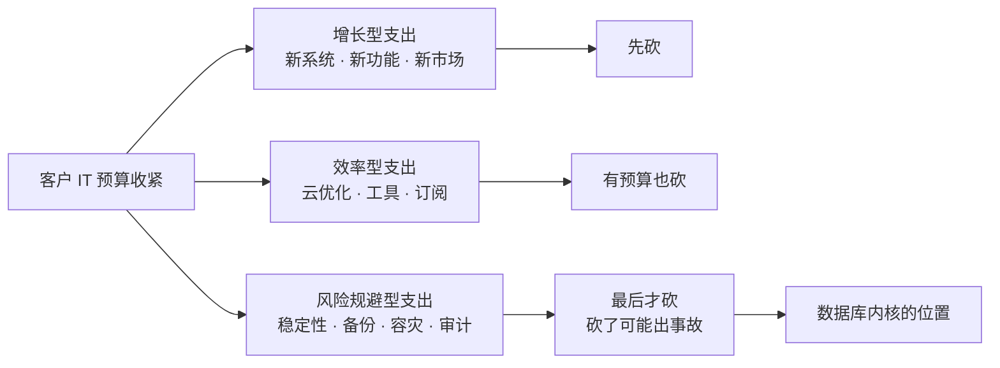

# 大环境之下：一个数据库内核开发工程师的思考、建议与自处

| 编写人 | 编写内容 | 编写时间 |
| --- | --- | --- |
| growdu | 精简版。删掉长稿里的数据堆砌与章节装置，只留三件事：**我怎么看现在的大环境**（七个数字 + 一个机制）、**给公司的三条建议**、**我自己的策略**（内核工程师的观测优势 + 三力模型 + 四层收入 + 三条个人底线）。面向同行读者，默认读者知道 MVCC、WAL、逻辑复制是什么。 | 2026-10-28 |

> **TL;DR**
>
> **我的判断**：这一轮不是 1929，是**撕裂**——高技术制造在扩张、地产与传统产业在收缩、居民和企业在停止扩张负债。最锋利的证据不是 GDP 增速，而是**高技术制造业的就业弹性只有 0.3—0.4**（地产建筑鼎盛期 0.7—0.8）：产值在涨，岗位在消失，所以「宏观数据好」和「年轻人找不到工作」可以同时为真。
>
> **给公司的建议**：**第一，客户收缩时最后砍的是稳定性支出，不是增长支出——我们天然站在「不会被砍」的位置，要做的是把这个位置变成议价能力**；**第二，把「降本增效」从售后工单做成独立产品线**，这是增量市场萎缩后唯一还长的收入线；**第三，停止价格战，用「替代成本」定价**，功能已经同质化，再比价就是自杀。
>
> **我自己的策略**：**把内核理解翻译成客户听得懂的成本**（机制 → 症状 → 成本 → 方案）；**用 pg_stat_* 当客户景气的仪表盘**（内核工程师独有的观测优势）；**收入结构从 L1 往 L3/L4 走**（技术资产与行业议价能力，周期不敏感）；**个人守三条底线**——6 个月现金安全垫、收入集中度不超过 60%、不加杠杆。


> **配套深度版**：本文只给结论。需要全部推演过程、十四项关键读数的完整数据口径、大萧条与日本的机制拆解、给公司的八条建议、成本效用与家庭资产负债表模板，以及一张 24 项指标的可证伪看板，请看
> [《经济下行周期下的数据库内核工程师：深度版》](../economic-downturn-deep-dive/index.html)（1200 行）。

---

## 目录

- [一、我怎么看现在的大环境](#一、我怎么看现在的大环境)
- [二、给公司的三条建议](#二、给公司的三条建议)
- [三、我自己的策略](#三、我自己的策略)
- [结语](#结语)
- [附：本文数据口径](#附：本文数据口径)

---

## 一、我怎么看现在的大环境

### 1.1 先说结论：不是大萧条，是撕裂

我不想预测 GDP 明年是 4.2% 还是 3.8%，那种精确度是假的。我只说我能观察到的结构。

2026 年最反直觉的一组数据是这两行：

| | 读数 |
| --- | --- |
| 高技术制造业增加值 | **+13.3%**，对规上工业增长贡献率 **47.9%** |
| 房地产开发投资 | **-19.9%**，固定资产投资 **-4.2%** |

再配上第三个数字：**16—24 岁（不含在校生）失业率 18.0%**。

一个 GDP 还在 4.6%、工业利润还在涨、制造业产出两位数增长的年份，同时出现 18% 的青年失业率——这两件事怎么同时成立？

答案在第四个数字里：

> **高技术制造业的就业弹性只有 0.3—0.4**（产出增长 1%，就业只增长 0.3%—0.4%）。而地产建筑鼎盛期是 0.7—0.8。

**换句话说：产值确实在涨，但这份增长吸纳就业的能力，比它替代掉的那些岗位消失的速度还慢。** 新质生产力拉动增长和年轻人找不到工作，本来就是同一件事的两面。

第五个数字补上另一侧：**居民债务收入比从 2021 年的 124% 降到 2026 年中的 118%**，房贷年偿还额从 2023 年约 7 万亿降到约 5 万亿，居民贷款 2026 年 3 月同比增速历史首现负值。

居民在去杠杆。同时，**非金融企业杠杆率 179.5%**，地方政府债务余额 59.24 万亿。

**这就是撕裂的全貌：私人部门在收缩负债，公共部门和企业还在加杠杆。** 辜朝明在《大衰退》里给这种状态起的名字叫资产负债表衰退——企业从「利润最大化」转向「债务最小化」，于是利率再低也不投资，居民再便宜也不消费。

### 1.2 大萧条和日本，我只留三件事

两个参照系我读过不少，但每次真正用上的只有三条：

**第一，债务—通缩螺旋是活的。** 资产价格跌 → 净资产缩水 → 抛售还债 → 价格再跌。今天中国的居民去杠杆、房企保交付、地方化债，是同一套机制的不同表现。

**第二，预期崩塌比价格更致命。** 1929—1933 年物价累计跌 30%、工业生产跌 47%，直接原因是人们不相信明天还能找到工作。日本居民 2022—2025 年每年净存款 11—14 万亿，累计超额储蓄约 6 万亿——**钱在那儿，利率 1.68%，就是不进消费**。低利率撬不动被悲观预期锁住的储蓄，这是流动性陷阱最真实的形态。

**第三，也是我最想记住的一条：日本的居民工资，30 年累计只涨了 6%。** 抗周期能力不来自薪水，来自资产负债表。

至于金本位、全球贸易依赖度、人口年龄结构——这三个 1929 和 1990 的条件今天都不成立，所以我判断**不会重演大萧条**。但机制会重演，路径会更长。

### 1.3 行业层面：蛋糕还在长，但分的人少了

数据库行业的数据比宏观经济体面得多：

| | 读数 |
| --- | --- |
| 市场规模 | 2025 年约 678 亿元，2028 年预计 979.74 亿元，**CAGR 13.06%** |
| 但供给端 | 国产数据库产品数 **292 款峰值 → 167 款**，超四成退出 |
| 头部 | 达梦 2026H1 营收 7.13 亿元，**+36.27%**；而电科金仓 1.80 亿元、净利 751.77 万元 |

**一个还在长 13% 的行业，同时有四成产品死掉，同时头部和尾部拉开 20 倍以上的差距** —— 这不是衰退，这是**出清**。

出清意味着两件事，对我这种在产品公司做内核的人尤其重要：

1. **别在尾部公司做内核。** 「公司能不能活过这两年」本身就是最大的个人风险，而内核研发在公司内部恰恰是最容易被砍的投入（因为它的 ROI 最难证明）。
2. **头部的机会来自长尾的迁移。** 客户会从「够用就行」转向「TCO 和运维复杂度优先」，这恰好是内核能力最能变现的地方。

### 1.4 落到我自己身上

所以这轮环境对我意味着什么？三句话：

1. **我的价值会被重新定价。** 过去客户扩产，数据库是「买来就能用」的商品；现在客户缩表，数据库变成「每一分钱都要解释」的成本项。**能帮客户算账的工程师，和只能交付功能的工程师，差距是数量级的。**
2. **我的位置其实是安全的，但需要我主动站过去。** 收缩期客户先砍增长型支出（新系统、新功能、新市场），最后砍稳定性支出（备份、容灾、审计）——因为砍增长只是少赚钱，砍稳定性是可能死掉。**我们做的正是后者。**
3. **但公司会不会把这份安全传导给我，取决于公司自己活得好不好。** 这就引出第二部分。

---

## 二、给公司的三条建议

### 2.1 第一条：把「不会被砍」变成议价能力

**判断**：客户预算收紧时，削减顺序是**增长型支出 → 效率型支出 → 风险规避型支出**。数据库的稳定性、备份、容灾能力属于最后一类——**这意味着我们天然处在一个预算的尾部保护位**。

但「位置好」不等于「生意好」。如果不主动做点什么，这个位置只会保住存量，不会带来增量。




**具体动作**：

1. **把内核能力翻译成客户的成本语言**，做进报价单和售前材料：不是「我们的 MVCC 性能好」，而是「**你的表因为膨胀涨了 3 倍 IO，扩容每年多花 X 万**」；
2. **做一份《数据库成本诊断报告》作为标准物料**，用 `pg_stat_*` 采集，八项指标（容量、事务、性能、复制、备份、安全、版本、成本），每项给出可量化的年化影响；
3. **把「减少业务损失」写进价值主张**——RTO/RPO 达标一次，省下的是客户一整年的收入损失，这是当前预算环境里最硬的付款理由。

**可度量指标**：报价单含成本诊断章节的比例 ≥ 80%；由诊断报告直接转化的项目金额；因「稳定性价值」成交（而非价格）在总成交中的占比。

### 2.2 第二条：把「降本增效」做成产品线，而不是售后工单

**判断**：增量市场在萎缩，但有一条线在稳定生长——**FinOps**。行业数据里 30%—35% 的云支出浪费在过度配置和闲置资源上；Gartner 2026 年 9 月的判断是，优化成本应当聚焦于「**为增长提供资金**」，可寻址目标是年度软件支出的 5%—15%。

这个措辞很重要：**「为增长提供资金」的预算，比「削减成本」的预算好批得多。** 前者客户 CFO 愿意签字，后者要过三道阻力。

**具体动作**：

1. **产品化**：把成本体检做成一条能重复交付的产品线——不是送客户的赠品，是有明确定价、有交付清单、有验收标准的服务产品；
2. **定价模式**：首次体检低价引流 → 优化方案按**节省额分成**或打包进订阅。**按节省额分成，客户几乎没有拒绝的理由，因为它直接对账他自己的报表。**
3. **内部先跑通**：我们自己就是最好的客户——用同一套巡检清单体检自己的测试环境和预发环境，先练出手感。

**可度量指标**：体检报告交付数；体检转优化项目的金额与转化率；「因成本优化而续约」的老客户占比。

### 2.3 第三条：停止价格战，用「替代成本」定价

**判断**：292 → 167 说明功能已经严重同质化。在功能可比的前提下客户必然比价，而价格战的结果是**全行业毛利一起承压，然后一起被裁**——这对任何一家公司都不是好结局。

**具体动作**：

1. **做「替代成本量化工具」**：扫描源库的表数量、数据量、存储格式、专有语法、触发器与存储过程、字符集与时区语义，输出「不迁移你的三年 TCO 是多少」。**把客户的迁移风险明码标价，而不是藏在免费服务里。**
2. **销售材料的叙事从「我们有多少功能」改成「**你三年要花多少**」**；
3. **把「续约前 12 个月」设为销售的强制介入节点**——存量市场里唯一可预测的窗口就是 License 到期。

**可度量指标**：报价单中「替代成本对比」出现率 100%；价格战成交均价降幅收窄；老客户增购率。

### 2.4 补充一条：现金优先于规模

日本失去的二十年中，最要命的企业教训不是「要保守」，而是**当增长停止时，组织会先失去冒险的勇气，然后失去创新能力**。而日本在这二十年里失去的恰恰是互联网、移动互联网和 AI 三个窗口期——**不是没赶上，是组织在低谷期不敢投了**。

所以：设一条现金安全线（经营性现金流可覆盖固定成本 ≥ 12 个月），超过线才谈新投入；把投入分成「保命 / 延命 / 赌未来」三类，低谷期只保前两类，但**始终保留一个能持续输出的内核小组**——**周期结束时公司能拿到的份额，是低谷期保住的技术能力决定的。**

---

## 三、我自己的策略

给公司的建议说完了，说我自己。

### 3.1 先用起来：pg_stat_* 是客户业务景气的仪表盘

我们这行有个别人没有的优势：**我们能直接看到客户业务在数据库上的投影。**

下面是两个我常在客户现场先跑的查询。它们不讲技术，只讲对方的业务痛不痛、成本高不高。

```sql
-- 客户是不是已经在放弃治理了：死元组占比 + 表膨胀
SELECT schemaname, relname,
       n_live_tup,
       n_dead_tup,
       round(100.0 * n_dead_tup / NULLIF(n_live_tup + n_dead_tup, 0), 2) AS dead_pct,
       pg_size_pretty(pg_total_relation_size(relid)) AS total_size
FROM pg_stat_user_tables
WHERE n_dead_tup > 10000
ORDER BY pg_total_relation_size(relid) DESC
LIMIT 20;
```

```sql
-- 客户是不是已经「跑不动」了：回滚率上升 = 应用在改逻辑兜底
SELECT datname,
       xact_commit,
       xact_rollback,
       round(100.0 * xact_rollback / NULLIF(xact_commit + xact_rollback, 0), 2) AS rollback_pct,
       deadlocks
FROM pg_stat_database
WHERE datname NOT IN ('template0', 'template1')
ORDER BY xact_commit DESC;
```

这两个结果不是技术指标，是**业务体检报告**。「你最大的三张表里 40% 是死元组，膨胀导致 IO 成本翻倍」——这句话比任何 benchmark 都有说服力。

同理还有 `pg_replication_slots` 的 WAL 保留量（客户写入量与备库积压）、`pg_stat_bgwriter` 的 `checkpoints_req` 占比（IO 是不是被 checkpoint 抢了）、`pg_stat_wal_receiver` 的延迟分布。

**结论：内核工程师天然离「客户的钱」很近，只是平时用错了语言。**

### 3.2 产品力：把内核机制翻译成客户听得懂的成本

产品力对内核工程师来说，不是「做更多特性」，而是**给已有能力找到对的叙事**。我的翻译表长这样：

| 内核机制 | 客户听得懂的说法 | 对应客户的成本 |
| --- | --- | --- |
| MVCC 可见性 + `n_dead_tup` | 「你的表为什么越跑越大、查询越跑越慢」 | 表膨胀 → IO 与存储成本 |
| ReorderBuffer 的 stream 模式 | 「你的复制延迟为什么只在每天业务高峰炸一次」 | 备库积压 → RPO 风险 |
| WAL / Checkpoint 机制 | 「你的 IO 抖动不是磁盘坏了，是 checkpoint 在跟你抢」 | 写入延迟 → 业务超时 |
| 复制槽与 WAL 保留 | 「你的备库删不掉，是被复制槽卡住了」 | 磁盘满 → 容量事故 |
| 统计信息与计划跳变 | 「你这条 SQL 昨天还好好的，今天突然全表扫」 | CPU 暴涨 → 临时扩容 |

**产品力 = 「机制 → 症状 → 成本 → 方案」这条链的完整度。** 缺了「成本」那一环，技术就变不成生意。

### 3.3 销售力：用「单位成本」说话

内核工程师通常技术表达力不缺，缺三样：**讲价值、算钱、做 POC。**

只有「算钱」是必须自己解决的，因为它是唯一能穿透采购决策链的语言。四个指标就够：

| 指标 | 怎么讲 |
| --- | --- |
| **单位查询成本** | 「同样的机器能多扛多少流量」 |
| **单位事务成本** | 「同样的机器能多跑多少业务」 |
| **单位存储成本** | 「你的数据每年花多少钱」 |
| **单位运维成本** | 「这个库每年要几个人来管」 |

这四个指标的共同点是：**它们都不是技术指标，客户 CFO 一眼看懂。**

练法也很简单：每做一次客户现场，就强迫自己产出一页「年化收益 T 万元，回收期 U 个月」。**做不满十页就不算做完这个项目。**

### 3.4 服务力：从救火型升级到诊断型

服务力的本质不是响应速度，是**客户对你的依赖形态**：

| 形态 | 可替代性 | 收入属性 |
| --- | --- | --- |
| 救火型（出问题我来修） | 高 | 一次性 |
| 交付型（按计划上线） | 中 | 一次性 |
| **诊断型（我告诉你哪里有病、怎么治、治完省多少）** | **低** | **经常性** |
| 托管型（我替你看着） | 低 | 经常性 |

内核工程师天然适合诊断型——**客户愿意为「准确的根因定位」付高价，不愿意为「响应工单」付高价。**

所以我给自己的日常动作是：维护一份巡检清单，每接一个客户就把它跑一遍，产出一份成本诊断报告。**这份清单是资产，不是任务。**

### 3.5 创造收入：四层结构，只往上走

很多内核工程师把「创造收入」等同于「多卖 license」。这个理解在收缩期很危险——**license 收入是公司的事，不是我的事**。

| 层级 | 形态 | 周期敏感度 |
| --- | --- | --- |
| **L1 产品收入** | 公司卖产品，我拿工资 | 高 |
| **L2 方案收入** | 我能独立交付的咨询 / POC / 实施 | 中 |
| **L3 知识资产收入** | 文档 / 专栏 / 课程 / 演讲 / 开源 | **低** |
| **L4 议价能力** | 行业话语权、机会主动权 | **负相关** |

**L1 随周期剧烈波动，L3 和 L4 跟周期弱相关甚至负相关。** 一个只在 L1 上出力的人，和一个同时在做 L3/L4 的人，处境差一个量级。

而 L3 对内核工程师几乎是最顺的路：**一次生产，多次变现**。我已经写了三十多篇内核文档，下一步不是继续写，是**把它们变成体系化课程、开源诊断工具、行业演讲和上游贡献**——这四件事同时产出 L3 收入和 L4 议价能力。

顺带说一句：**即使公司层面砍掉了开源投入，个人也应该保住最低限度的高质量上游贡献。** 上游身份是行业内最硬的信用背书，它的周期不敏感度最高，也是我换工作时唯一的主动权来源。

### 3.6 个人层面：三条不可让步的底线

回到那句最扎心的话——**日本居民 30 年工资累计只涨 6%**。抗周期能力不来自薪水。

| 底线 | 指标 | 为什么 |
| --- | --- | --- |
| **现金流安全垫** | 流动资产 ≥ **6 个月必要开支**，零高息负债 | 有了它，我可以在最差的时点拒绝最差的机会。10 年期国债 1.68%、大额存单跌破 1%——**持有现金的机会成本降到历史最低，这是防守的黄金窗口** |
| **收入韧性** | 单一雇主 / 单一客户 ≤ 总收入 **60%**；被动收入 ≥ 月必要开支 **30%** | L3 资产是唯一能在失业期间自动产生现金流的东西 |
| **不加杠杆** | 不用房贷、杠杆加仓任何单一资产；房产占净资产 < 60% | **周期的本质不是消灭人，是消灭杠杆。** 任何把自己绑在杠杆上的人都会被清算 |

还有一条容易忽略但我认为是**最不可替代**的：**健康与关系**。收缩期身体是唯一不能降本增效的资产；而内推、临时项目、行业引荐，90% 来自弱连接——**定期测试自己还能不能被雇佣，是一种低成本的风险对冲。**

---

## 结语

写完这三条，我最想留一句的不是「要节约」也不是「要多元化」，而是这个：

> **数据库内核工程师的位置是好的——在客户削减预算的顺序里，我们是最后被砍的那一项，因为我们卖的是「不出事」。**
>
> **但位置不会自己变成生意。要让它变成生意，需要有人肯做那个最不性感的动作：把最复杂的东西，翻译成客户听得懂的成本数字。**

这件事没有人会替我们做，公司不会，销售不会，PM 也不会。**它是内核工程师在收缩期唯一能自己掌握、且一旦掌握就复利累积的杠杆。**

---

## 附：本文数据口径

| 数据 | 来源 | 时点与口径 |
| --- | --- | --- |
| GDP、失业率、房地产、固投 | 国家统计局 | 2026 年前三季度或 1—8 月累计同比；失业率为 16—24 岁不含在校生口径 |
| PPI、CPI、工业利润、产能利用率 | 国家统计局 | 2026 年内 |
| 非金融企业杠杆、居民债务收入比、社融 | 中国人民银行 | 2026Q2 金融资产负债表 |
| 地方政府债务余额 | 财政部 | 2026-07 |
| 居民净存款、超额储蓄、国债收益率 | 公开市场数据 | 2022—2026 年 |
| 就业弹性 | 公开研究汇总估算 | 高技术制造 0.3—0.4，地产建筑鼎盛期 0.7—0.8 |
| 数据库市场规模、产品数量、厂商份额 | 中国信通院 | 2025 年数据，2028 年预测 |
| 厂商营收与利润 | 上市公司定期报告 | 2026H1 |
| FinOps 浪费比例、Gartner 成本优化建议 | FinOps Foundation、Gartner | Gartner 2026-09，5%—15% 可寻址软件支出 |
| 日本数据 | 辜朝明《资产负债表衰退》《大衰退》、日本统计局 | 1990—2010 |

**免责说明**：数据取自公开渠道，不同来源口径可能存在差异；文中的概率判断与建议仅为个人思考，不构成投资建议或任何形式的预测承诺。涉及个人职业与财务的部分仅供读者参考。
