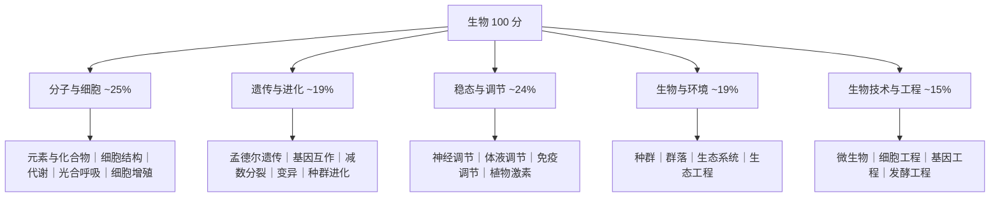

# 高考生物：模块化记忆与实验探究应答（2026 云南卷口径）

| 编写人 | 编写内容 | 编写时间 |
| --- | --- | --- |
| growdu | 面向**中等水平**（60~75 分）的考生，目标是**稳定到 85 分以上**。生物和物理、化学都不一样：**它是省命题、它是赋分科目、它的 52 分非选择题全是"写文字"**。本文讲清三件事：**2026 云南卷生物的结构与模块分布**、**等级赋分对生物意味着什么**、**图表题和实验探究题怎么答才能拿到要点分**。 | 2026-11-11 |

> **TL;DR**
>
> **生物非选择题的 52 分，本质上是一场"写作考试"。**
>
> 物理有"步骤分"、化学有"给分点"，**生物非选择题的给分方式是"要点式"**——阅卷人拿着评分细则，一句一句对。所以：
> ① **要点必须写全**，写对一句得一点，写对两句得两点，**漏掉一个要点就是漏掉一分**，不看你答得对不对；
> ② **术语必须准**——"细胞呼吸"不能写成"细胞获得能量"，"降低有机物的氧化分解"不能写成"减少有机物"；
> ③ **因果链必须成串**——"原因 → 过程 → 结果"，只写结果是拿不到分的。
>
> **2026 云南卷生物的三个硬数字**：
> - **100 分 / 75 分钟 / 21 题**：选择 16×3 = **48 分**，非选择 5 题 = **52 分**（17~20 各 10 分、21 题 12 分）；
> - **模块分布**：稳态与调节约 **24%**（第 8、9、10、19 题）、生物与环境约 **19%**（第 11、12、13、20 题）、生物技术与工程约 **15%**（第 14、15、21 题）——**分子与细胞、遗传与进化两章合计占比最大**；
> - **试卷特质**：**情境真实多元 + 图文表信息密集 + 重过程推理 + 实践导向突出**。2026 卷至少有 5 道题用表格或图示给条件（猕猴桃储藏条件表、ARF3 基因作用图、杜鹃花属分布表、温度对水稻产量影响表）。
>
> **生物和化学最大的不同**：化学的难点在**"陌生"**（新物质、新工艺），生物的难点在**"琐碎"**（概念辨析、表格判读、实验设计）。**化学要练"面对陌生"，生物要练"面对细节"。**
>
> **一句话**：高考生物拼的不是背得多全，而是**在限定条件下把话说到点上**。

> **口径说明**：题型、题量、分值、模块分布、逐题情境与答案来自 **2026 年云南省普通高中学业水平选择性考试·生物学**原卷及配套评析（省自主命题，2026-06-09 17:00—18:15 考试）。**逐题答案为考生回忆版整理结果，仅用于讲解例题**，正式答案以省招考院发布为准。

---

## 目录

- [一、先定位：生物的三个特殊性](#一、先定位：生物的三个特殊性)
- [二、卷面结构：48 : 52 与模块分布](#二、卷面结构：48-52-与模块分布)
- [三、等级赋分：生物的分数也不完全由你决定](#三、等级赋分：生物的分数也不完全由你决定)
- [四、学习方法：模块化 + 图表 + 实验](#四、学习方法：模块化-图表-实验)
- [五、考试技巧：分题型的破题动作](#五、考试技巧：分题型的破题动作)
- [六、2026 云南卷逐题拆解](#六、2026-云南卷逐题拆解)
- [七、六个生物专属陷阱](#七、六个生物专属陷阱)
- [八、给自己的行动清单](#八、给自己的行动清单)
- [九、一页纸速查表](#九、一页纸速查表)

---

## 一、先定位：生物的三个特殊性

### 1.1 生物科目的三个特殊性

| | 数学 | 物理 | 化学 | **生物** |
| --- | --- | --- | --- | --- |
| **谁命题** | 全国卷 | 云南省 | 云南省 | **云南省** |
| **怎么算分** | 原始分 150 | 原始分 100 | 等级赋分 | **等级赋分** |
| **非选择题占比** | ~53% | 38% | **58%** | **52%** |
| **非选择题的形态** | 推导 | 步骤分 | 给分点 + 步骤分 | **要点式文字表达** |
| **主要失分** | 算错 | 模型认错 | 情境没读懂 | **要点漏写、术语不准、因果不完整** |
| **能力的底座** | 运算 | 建模 | 反应原理 | **概念的精确性** |

**第三行和第六行是这一篇的核心**：

> **生物的非选择题占 52 分，超过一半，且全部以"写文字"给分。** 这意味着生物是六门里**对表达能力要求最高**的一科——**你懂，不代表你能写对分。**

### 1.2 生物的三张失分表

| 类型 | 判定标准 | 典型表现 | 对应动作 |
| --- | --- | --- | --- |
| **A. 概念失分** | 概念本身理解错 | "环状 DNA 只存在于拟核"（原核才有拟核，真核有染色质） | **概念辨析清单**（见 §4.2） |
| **B. 图表失分** | 条件在表/图里，**没读出来** | 表格给了三个储藏温度，没看出低温下呼吸酶活性低 | **图表四步法**（见 §4.3） |
| **C. 表述失分** | **意思对了，但没踩到给分点** | 答了"减少有机物分解"，评分细则要"降低呼吸作用强度" | **要点式书写**（见 §5.3） |

> **生物和物理篇的关键差异**：物理的失分主力是"模型认错"，化学是"情境没读懂"，**生物是"其实懂了，但写不到点子上"**。这一类失分**是最可惜的**，也**最容易补**——因为它靠的是规范训练，不是理解力。

### 1.3 2026 云南卷生物的分数拆解

| 题型 | 题号 | 题量 | 分值 | 中等生典型得分 | 中等生典型丢分点 |
| --- | --- | ---: | ---: | ---: | --- |
| 单项选择题 | 1~16 | 16 | 48 | 30~39 | 后面几题（遗传推理、免疫、基因工程）连着崩 |
| 非选择题（光合 + 表格） | 17 | 1 | 10 | 4~7 | 不会从表格算总光合速率 |
| 非选择题（遗传 + 基因） | 18 | 1 | 10 | 4~8 | 突变基因的显隐性判断错 |
| 非选择题（免疫治疗） | 19 | 1 | 10 | 4~7 | 免疫过程原理答不全 |
| 非选择题（生态恢复） | 20 | 1 | 10 | 4~8 | 只写现象不写原理 |
| 非选择题（基因工程） | 21 | 1 | 12 | 4~8 | 筛选原理、检测方法答不全 |
| **合计** | — | **21** | **100** | **50~77** | — |

**两条关键读数**：

1. **中等生的实际区间是 50~77 分**——**选择题拿到 34 分（16 题里对 11 题）就已经是及格线附近**，非选择题再拿 20 分就是 54。
2. **非选择题 52 分，每题 10~12 分，密度极高**。生物的非选择题**一题要写 3~5 个要点**，**漏一个要点就是漏 1~2 分**。这和物理"第 (1) 问白送 5 分"完全不同——**生物没有白送的分，只有踩准的点和漏掉的点**。

---

## 二、卷面结构：48 : 52 与模块分布

### 2.1 题型结构

**2026 云南卷生物原卷口径**：

> **一、选择题：本题共 16 小题，每小题 3 分，共 48 分。** 在每小题给出的四个选项中，只有一项是符合题目要求的。
> **二、非选择题：本题共 5 小题，共 52 分。** 其中**第 17 题 10 分、第 18 题 10 分、第 19 题 10 分、第 20 题 10 分、第 21 题 12 分**。

| 题型 | 题量 | 分值 | 占比 |
| --- | ---: | ---: | ---: |
| 单项选择题 | 16 | 48 | **48%** |
| 非选择题 | 5 | 52 | **52%** |
| **合计** | **21** | **100** | 100% |

**与化学卷对照**：化学是 42 : 58，生物是 48 : 52。**生物的选择题比化学多 6 分，但两道都超过一半**。

**这带来一个直接的时间结论**：**生物的 75 分钟里，选择题应该只花 28 分钟**——16 道 3 分的选择题，**平均每题 105 秒**。省下的 47 分钟全给非选择题，因为**非选择题的"单位时间得分"远高于选择题**。

### 2.2 模块分布：决定复习时间怎么分

| 模块 | 涉及题号 | 分值（约） | 占比 | 云南卷的落点 |
| --- | --- | ---: | ---: | --- |
| **分子与细胞** | 1、2、3、4、17 | ~25 | ~25% | 黏菌、细胞结构、储藏条件、酒精用途、光合作用 |
| **遗传与进化** | 5、6、18 | ~19 | ~19% | 红花 13:3 分离比、纺锤体异常、突变基因分析 |
| **稳态与调节** | 8、9、10、19 | **24** | **~24%** | 神经调节与成语、胰岛素、脂肪肝、基因治疗、ARF3 |
| **生物与环境** | 11、12、13、20 | **19** | **~19%** | 种植密度、杜鹃花分布、珊瑚礁、荒滩恢复 |
| **生物技术与工程** | 14、15、21 | **15** | **~15%** | 肉类发酵、组织培养、基因工程 |
| **实验探究** | 贯穿全卷 | — | 贯穿 | 储藏分析、试剂选择、免疫实验、基因筛选 |

**这张表的两个读法**：

1. **稳态与调节是最大模块（24%）**，而且**它的 4 道题分布在两个批次**——选择题第 8、9、10 题和非选择题第 19 题。**说明这一章既考"识记"也考"综合"。**
2. **"实验探究"不是一个独立章节，而是贯穿全卷的一种能力**。2026 卷第 3 题（储藏条件分析）、第 4 题（酒精在实验中的用途）、第 19 题（免疫治疗实验设计）、第 21 题（基因工程筛选）**都是实验探究题**，分值散落在各处。**你没法用"复习完实验探究这一章"来覆盖它。**

### 2.3 75 分钟时间分配

```mermaid
gantt
    title 高考生物 75 分钟时间分配（中等水平）
    dateFormat  mm:ss
    axisFormat  %M:%S
    section 选择区
    选择题 1-8 基础区      :a1, 00:00, 780s
    选择题 9-16 拉分区     :a2, 13:00, 900s
    section 写作区
    非选择 17 光合与表格   :a3, 28:00, 600s
    非选择 18 遗传与基因   :a4, 38:00, 600s
    非选择 19 免疫治疗     :a5, 48:00, 600s
    非选择 20 生态恢复     :a6, 58:00, 600s
    非选择 21 基因工程     :a7, 68:00, 600s
    section 兜底
    涂卡 + 回头检查        :a8, 73:00, 120s
```

| 阶段 | 用时 | 硬性纪律 | 中断条件 |
| --- | --- | --- | --- |
| 选择题 1~8 | **13 min** | 每题 ≤ 100 秒；这 24 分是基本盘 | 超 2 分钟 → 标记 |
| 选择题 9~16 | **15 min** | 每题 ≤ 110 秒；**遗传/免疫题单独放最后做** | 2 分钟无进展 → 走 |
| 非选择 17 | **10 min** | 表格题先算，再写 | — |
| 非选择 18 | **10 min** | **先判断基因型，再推表型** | — |
| 非选择 19 | **10 min** | 免疫题按"识别→应答→效应"三段写 | — |
| 非选择 20 | **10 min** | 生态题按"现象→原理→措施"写 | — |
| 非选择 21 | **10 min** | 基因工程按"工具→步骤→原理→检测"写 | 最后一问允许空 |
| 涂卡 + 检查 | **2 min** | 只查：是否漏要点、术语是否用对 | 不重做大题 |

> **和化学篇的关键差异**：化学的非选择题**没有"只做第一问"的止损结构**，但**生物有**——因为生物非选择题的每一问往往是**独立的知识点**（第 19 题免疫、第 20 题生态、第 21 题基因工程）。**一题卡住就跳到下一题，不要在一题上死磕 15 分钟。**

---

## 三、等级赋分：生物的分数也不完全由你决定

生物是**再选科目**，走**等级赋分**——和化学同一套规则。

| 等级 | 考生比例 | 赋分区间 |
| --- | ---: | --- |
| A | 15% | 100 ~ 86 |
| B | 35% | 85 ~ 71 |
| C | 35% | 70 ~ 56 |
| D | 13% | 55 ~ 41 |
| E | 2% | 40 ~ 30 |

**三条铁律**：

1. **原始分不公布**——你只能看到卷面分和最终赋分，**中间那段差距永远看不见**；
2. **赋分是"排位"**——你的卷面分决定你在**选生物的全体考生**里的百分位；
3. **四门再选科目同位次赋分相同**。

### 生物场景下的三条策略

**策略一：估分估等级，不估分数。**

> 模考卷面 72 分，不等于最终 72 分。正确的问题是：**"我在选生物的人里排前百分之几？"** 前 15% 是 A 档（86~100）——**你的最终分可能比卷面分高十几分**；后 35% 是 C 档（70~56）——**可能比卷面分低十几分**。

**策略二：生物的赋分策略与化学"同向不同量"。**

化学和生物都赋分，但**两科的难度分布和竞争强度不同**，所以同一个卷面分的含义不同：

| | 化学 | 生物 |
| --- | --- | --- |
| 2026 卷非选择题占比 | 58% | 52% |
| 题型 | 大量计算、方程式书写 | 大量文字表达、概念辨析 |
| 常见赋分体感 | **"会算但写不全"容易掉档** | **"知识点没背全"容易掉档** |
| 提分杠杆 | 解答题的书写规范 | **基础概念的覆盖率** |

> **推论**：生物赋分要稳，**优先保证"该背的都背到了"**，而不是"难题会做"。因为在赋分制的赛道上，**基础题的覆盖面比难题的攻坚更能改变你的等级**。

**策略三：选科时把赋分和选科要求一起算。**

| 你想报的专业 | 常见选科要求 | 赋分提示 |
| --- | --- | --- |
| 临床医学 / 药学 / 生物工程 | **物理 + 化学 + 生物** | 生物是硬门槛，**赋分策略在这里无效** |
| 农学 / 生态学 / 食品科学 | 物理 或 历史 + **化学或生物** | **赋分策略起作用**：选你相对强的那门 |
| 生物教育 / 生物学类师范 | **生物** 常被要求 | 同上 |
| 经济 / 管理 / 法学 | 物理 或 历史，再选不限 | **赋分腾挪空间最大** |

> **和化学篇同一个结论**：**当一门课是"必选"时，赋分策略对它无效。赋分只在"你有选择权"的地方才是一张牌。**

> 完整赋分规则见 [《云南高考：政策与科目划分（2026 官方口径）》 §三](../yunnan-policy/index.html)。

---

## 四、学习方法：模块化 + 图表 + 实验

### 4.1 生物的知识是"结构化"的，不是"线性"的

生物的特点是**知识点之间联系紧、但不是推导关系**。所以复习的组织方式应该是**六张模块地图**，而不是一条时间线：



**每张地图的画法**（这是生物复习最有效的单一动作）：

| 层级 | 写什么 | 例（稳态与调节） |
| --- | --- | --- |
| **一级：概念** | 每个概念的**一句话定义** | 神经调节 = 神经系统对机体的调节，**基本方式是反射** |
| **二级：结构** | 概念之间的**层级/组成关系** | 反射弧 = 感受器 → 传入神经 → 神经中枢 → 传出神经 → 效应器 |
| **三级：过程** | **流程箭头** | 兴奋在神经纤维上以**电信号**传导；突触处**化学信号** |
| **四级：辨析** | **易混对照** | 神经调节**快速、精确、持续时间短**；激素调节**缓慢、广泛、持续时间长** |

> **第三层"过程"是生物高考的主战场**。2026 卷第 19 题（PD-1/PD-L1 免疫治疗）、第 10 题（ARF3 与雌花形成）问的都是**过程**，不是定义。

### 4.2 概念辨析清单：生物最高性价比的投入

**生物选择题丢分，八成不是"不会"，是"以为会"。** 下面是 2026 云南卷直接考到的易错点——**背下来就是白捡的分**：

| # | 辨析 | 正确说法 | 对应题 |
| --- | --- | --- | --- |
| 1 | **环状 DNA 在哪** | **原核生物**的拟核里是环状 DNA；**真核**是线性 DNA + 染色质 | 1 |
| 2 | **染色体高度螺旋化利于什么** | 利于**遗传信息的复制和传递**，**不利于**转录（转录时需解旋） | 2 |
| 3 | **有氧呼吸的水** | 产生水在第三阶段，消耗水在第二阶段，**消耗大于产生** | 2 |
| 4 | **线粒体是"消化车间"吗** | **不是**。线粒体是有氧呼吸主要场所；**"消化车间"是溶酶体** | 2 |
| 5 | **酒精在生物实验中的用途** | ①**消毒**（使蛋白质变性）②**检测脂肪**（苏丹Ⅲ染液需酒精洗去浮色）③**低温诱导染色体加倍** | 4 |
| 6 | **13:3 分离比 = 自由组合吗** | **不一定**。13:3 提示**基因互作**（9:3:3:1 的变式），不是 9:3:3:1 | 5 |
| 7 | **面红耳赤 vs 怒发冲冠** | 面红耳赤 = **交感神经**兴奋；怒发冲冠 = **交感**占优势（不是副交感） | 8 |
| 8 | **胰岛素的靶细胞** | 几乎**全身细胞**；胰岛素**促进**合成、**抑制**分解 | 9 |
| 9 | **高密度种植一定好吗** | **不一定**。中密度冠层产量更高，是因为**低密度光能不足、高密度竞争加剧** | 11 |
| 10 | **生物入侵的防治** | 优先**本地物种**（防二次入侵）；人工拔除**无化学药剂残留**，属物理治理 | 20 |
| 11 | **无氧呼吸产物** | 酒精发酵产生 **CO₂ 和酒精**（消耗有机物、**不产生 ATP**）；产生 ATP 的是**第一阶段** | 14 |
| 12 | **组织培养的外植体脱分化** | 茎段**先脱分化形成愈伤组织，再诱导生芽**；**愈伤组织没有分化程度** | 15 |

> **这 12 条覆盖了 2026 云南卷 12 道选择题的失分点。** 把它们背下来，**选择题多对 3~4 题 = 多 9~12 分**——**这是全卷性价比最高的一笔投入**。

### 4.3 图表题的四步法

**2026 云南卷生物的图表密度很高**：第 3 题（猕猴桃储藏条件表）、第 10 题（ARF3 基因作用图）、第 12 题（杜鹃花属分布表）、第 17 题（温度对水稻产量影响表）、第 20 题（生态恢复曲线）。**这类题占了全卷相当大的分值。**

| 步骤 | 动作 | 以 2026 第 17 题（温度对水稻产量）为例 |
| --- | --- | --- |
| **① 读坐标轴** | 横轴是什么、纵轴是什么、**单位** | 横轴**温度**、纵轴**光合速率**（表里会给"总光合速率"和"净光合速率"两列） |
| **② 找极值** | 峰值/谷值在哪个条件 | **38 ℃ 时总光合速率最大**（原文答案要点） |
| **③ 联系原理** | 这个结果对应什么生理过程 | 高温干燥 → **气孔关闭** → **CO₂ 供应不足** → **暗反应速率下降** |
| **④ 形成结论** | 用学科术语写完整 | 温度过高时**气孔关闭导致 CO₂ 吸收减少，暗反应速率降低** |

> **第 ① 步是 2026 第 17 题的真正考点**：表格给的是**总光合速率**和**净光合速率**两列，**你需要用"总光合 = 净光合 + 呼吸速率"把呼吸速率算出来**。**不读清楚是哪一列，这题就做不出来。**

### 4.4 实验探究题：生物独有的一类

**实验探究贯穿 2026 全卷**：第 3 题（储藏条件分析）、第 4 题（试剂用途）、第 19 题（免疫治疗实验设计）、第 21 题（基因工程筛选）。

**四个必答维度**（漏一个就丢一个要点）：

| 维度 | 问什么 | 答题模板 |
| --- | --- | --- |
| **① 材料处理** | 对谁做什么处理、设什么对照 | "**将 X 组置于 A 条件，B 组置于相同但仅有 Y 差异的条件**" |
| **② 检测指标** | 测什么、怎么测 | "**测定并比较两组 X 的含量/活性/数量**" |
| **③ 重复与统计** | 几次、怎么处理数据 | "**多次测量取平均值**" |
| **④ 预期结果与结论** | 预期什么、说明什么 | "若 X 组 Y 显著高于 Z 组，则说明……" |

**以 2026 第 21 题（UW4 菌株基因工程改造）为例**，这类题的骨架是：

```
（1）目的基因获取：用什么方法、从什么材料
（2）基因表达载体构建：核心酶 + 启动子 + 标记基因
（3）将载体导入受体菌：用什么方法
（4）筛选与检测：★ 挑"含目的基因的"用什么依据？★ 挑"能表达出来的"用什么依据？
（5）原理解释：为什么要这么做
```

> **★ 标记的两处是生物实验题最高频的给分点**，因为它们考的是"你知不知道抗性标记和检测的分工"：
> - **筛选含目的基因的受体** → 抗性标记（如抗生素抗性基因）
> - **检测目的基因是否表达** → **分子水平检测（PCR / DNA 分子杂交）或抗原—抗体杂交**，**不是**用抗生素

### 4.5 错题本怎么记

和化学篇同理，**记"概念"不记"题"**。三行格式：

| 行 | 内容 | 例（第 2 题） |
| --- | --- | --- |
| **① 我错在哪** | 概念 / 图表 / 表述 / 推理 | **概念**：把线粒体当成"消化车间" |
| **② 正确说法** | 一句话，可直接背 | 溶酶体是"消化车间"；线粒体是有氧呼吸主要场所 |
| **③ 触发条件** | 看到什么词要警觉 | 看到"**消化车间/合成车间/动力车间**" → 先问是哪个细胞器 |

**归并规则**：**连续 4 道错题在同一模块 → 回去补那一整张模块地图**，而不是继续刷题。

---

## 五、考试技巧：分题型的破题动作

### 5.1 选择题（16 题 / 48 分）：**读选项，不读题干**

生物选择题的题干常常是一段长叙述，**真正给信息的是选项**。所以：

| 步骤 | 动作 | 耗时 |
| --- | --- | --- |
| 1 | **读题干末句**——问的是"错误的是"还是"正确的是" | 5 秒 |
| 2 | **看选项**：四个选项往往是**同一知识点的四种说法**，比较它们比推理快 | 20 秒 |
| 3 | **逐项判断**，用 §4.2 的辨析清单对照 | 每项 10~15 秒 |
| 4 | 拿不准 → **先排除有明确硬伤的**，再在剩下两项中选 | — |

**以 2026 第 1 题（黏菌）为例**：

> 黏菌是一类特殊的真核微生物，主要以土壤中的细菌和酵母菌为食，环境胁迫使黏菌由单细胞聚集形成多细胞聚集体（具有孢子囊结构）。关于黏菌，下列说法**错误**的是
> A. C、H、O、N 四种元素含量很高
> B. **环状 DNA 分子存在于拟核中**
> C. 单细胞生活阶段主要以…（细菌和酵母菌）为食
> D. 多细胞聚集体具有孢子囊结构

**逐项判断**：A 对（组成细胞的四种基本元素）；**B 错——黏菌是真核生物，真核细胞没有拟核**（拟核是原核细胞的）；C 对（题干直给）；D 对（题干直给）。
**答案：B**。

**这题只用了 §4.2 的第 1 条辨析，40 秒解决。** 而如果你去逐字读题干然后推理，会花 3 分钟。

### 5.2 选择题的时间纪律：最后 4 题单独放

2026 卷的第 13~16 题（珊瑚礁生态、菊花组织培养、内含肽基因工程）**难度明显高于前 12 题**。正确做法：

> **先做 1~12 题（约 20 分钟），再回头做 13~16 题（约 8 分钟）。** 前 12 题是"读选项就能判断"的区，**先把确定分拿稳**，再把时间投给需要推理的题。

### 5.3 非选择题（5 题 / 52 分）：**要点式书写的五条纪律**

| # | 纪律 | 反例 | 正例 |
| --- | --- | --- | --- |
| 1 | **要点分行写，一条一行** | "温度升高使酶失活所以呼吸作用减弱" | "**温度升高，酶活性降低**\n**呼吸作用强度下降**" |
| 2 | **用学科术语，不用口语** | "细胞获得的能量变少了" | "**ATP 的合成减少，有机物的氧化分解速率下降**" |
| 3 | **因果成串：原因→过程→结果** | "气孔关闭，暗反应变慢" | "**高温干燥→气孔关闭→CO₂ 吸收减少→暗反应速率下降→净光合速率降低**" |
| 4 | **问"为什么"必须给目的** | "用酒精处理" | "**用酒精处理细胞，使蛋白质变性，**从而**破坏细胞膜的通透性**，**使染色质中的 DNA 与蛋白质分离**" |
| 5 | **"实验方案"要写全四要素** | "观察根尖分生区" | "**解离→漂洗→染色→制片**" |

**第 3 条是生物非选择题拿分的核心**，也是最容易偷懒省略的。阅卷人给的是"因果链完整"的整点分，**你只写"结果"，通常这 2 分里只能拿 1 分，甚至 0 分**。

### 5.4 三类高频非选择题的专门打法

#### 遗传与进化题（2026 第 18 题，水稻黄叶突变型）

```
第一步：判断显隐
  看题干"野生型×突变型，F₁ 全为 X" → X 为显性
  或看"杂交子代性状分离比" → 反推基因型
第二步：写基因型
  常用格式：Aa、A_、aa
第三步：算比例 → 答表型概率
第四步：★ 突变基因是显性还是隐性？→ 要结合"若为隐性则需…才能表现"这类条件判断
```

> **第 18 题的 10 分里，比例计算通常只占 4~5 分，其余是"解释为什么"**——**必须写出推理过程，不能只给结果**。

#### 免疫调节题（2026 第 19 题，PD-1/PD-L1 与肿瘤免疫治疗）

```
按三段写：
  ① 识别阶段：抗原被吞噬细胞处理 → 呈递给 T 细胞
  ② 应答阶段：T 细胞活化增殖 → 效应 T 细胞
  ③ 效应阶段：效应 T 细胞识别并裂解靶细胞
★ PD-1/PD-L1 的作用：PD-1 抑制 T 细胞活性 → 肿瘤细胞通过表达 PD-L1 逃避免疫监视
  → 治疗思路：阻断 PD-1/PD-L1，恢复 T 细胞的杀伤功能
```

> **最后一问"该疗法的原理"是拉分点**，必须写清"**谁抑制谁、阻断后恢复了什么**"这三层。

#### 生态工程题（2026 第 20 题，海滨荒滩生态恢复）

```
四类答案，每类都可能有给分点：
  ① 原理：物种多样性 → 抵抗力稳定性↑；负反馈调节
  ② 措施：引入本地物种 / 人工种植 / 物理治理（人工拔除）
  ③ 理由：★ 引入外来植物可能造成二次入侵；人工拔除无化学药剂残留
  ④ 价值：固碳（温室效应）、蓄洪防旱、净化水质
```

> **第 ③ 项"理由"是纯记忆得分点**——不推演，直接背。2026 原卷答案里就有"引入新的外来植物可能造成二次入侵，加剧破坏本地生态平衡""人工拔除属于物理治理手段，无化学药剂残留"。

### 5.5 基因工程题（2026 第 21 题，UW4 菌株改造，12 分）

**这是分值最高的一题，也是最模板化的一题。** 四个必写模块：

| 模块 | 内容 | 关键词 |
| --- | --- | --- |
| **目的基因获取** | 从 cDNA 文库 / 基因组 DNA 中获取 | **逆转录**、PCR |
| **载体构建** | 目的基因 + **启动子** + **终止子** + **标记基因** | 限制酶、DNA 连接酶 |
| **导入受体** | 转化 | Ca²⁺ 法、电击、显微注射 |
| **筛选与检测** | **两级筛选** | 见下 |

> **★ 两级筛选必须分清（最高频给分点）**：
> - **筛出"含有目的基因"的受体** → 抗性标记（如抗生素抗性基因）**能生长**
> - **筛出"目的基因已表达"的个体** → **抗原—抗体杂交**（蛋白质水平）或 **PCR / DNA 分子杂交**（核酸水平）
>
> **用抗生素筛不出"表达了"的那一批**——这是最常见的错误。

---

## 六、2026 云南卷逐题拆解

### 6.1 二十一道题的情境、考点与答案

> **答案来源**：考生回忆版整理，**仅用于讲解例题**。**难度**：2026 云南卷生物整体难度**适中**，注重基础知识的考查和核心素养渗透。

| 题号 | 分值 | 情境 | 考查内容 | 答案 |
| --- | ---: | --- | --- | --- |
| 1 | 3 | **黏菌**（单细胞聚集形成多细胞聚集体） | 细胞元素组成、真核细胞结构、拟核 | **B** |
| 2 | 3 | 结构与功能相适应 | 染色质与染色体、线粒体、细胞膜、小肠上皮细胞 | **A** |
| 3 | 3 | **猕猴桃鲜果储藏条件表** | 细胞呼吸与酶活性、温度与储存 | **D** |
| 4 | 3 | 酒精在生物学实验中的用途 | 蛋白质变性、酒精消毒与染色 | **A** |
| 5 | 3 | 红花分枝类型遗传（**13:3**） | 自由组合定律、基因互作、遗传推理 | **C** |
| 6 | 3 | 纺锤体异常与减数分裂 | 减数分裂 I 过程、纺锤体、染色体行为 | **A** |
| 7 | 3 | **长臂猿基因组分析**（云南高黎贡山天行长臂猿） | 种群、遗传多样性、进化 | **C** |
| 8 | 3 | 成语与神经调节 | 神经中枢、分级调节、交感/副交感 | **A** |
| 9 | 3 | 胰岛素与脂肪肝 | 激素调节、靶细胞、反馈 | **B** |
| 10 | 3 | **黄瓜雌花形成**与基因 ARF3 | 植物激素（乙烯、生长素）、基因表达调控 | **B** |
| 11 | 3 | 水稻种植密度与产量 | 群落、种间竞争、光能利用 | **A** |
| 12 | 3 | **云南高山杜鹃花属植物分布** | 生物与环境、群落垂直结构 | **B** |
| 13 | 3 | 全球珊瑚礁生态系统退化 | 生物多样性价值、生态系统稳定性、生态工程 | **D** |
| 14 | 3 | 肉类高盐腌制、晾挂、发酵 | 渗透压、微生物、发酵工程 | **D** |
| 15 | 3 | **菊花组织培养** | 植物组织培养、灭菌、激素配比 | **C** |
| 16 | 3 | 内含肽（Int）自我催化与融合蛋白 | 蛋白质结构、基因表达、翻译 | **C** |
| 17 | 10 | **探究温度对水稻产量的影响** | 光合作用、总/净光合速率、气孔、表格数据处理 | — |
| 18 | 10 | **水稻黄叶突变型的遗传与基因分析** | 显隐性判断、基因型、变异 | — |
| 19 | 10 | **PD-1/PD-L1 与肿瘤免疫治疗** | 免疫调节、细胞免疫、实验设计 | — |
| 20 | 10 | **海滨荒滩生态恢复实验** | 生态工程、生物多样性、原理与措施 | — |
| 21 | 12 | **UW4 菌株的基因工程改造** | 基因工程工具、步骤、筛选与检测原理 | — |

### 6.2 走完三道题

#### 6.2.1 第 1 题（3 分）——**读选项，不读题干**

```
问什么：下列说法「错误」的是       ← 先圈限定词
逐项：
  A C、H、O、N 含量很高     对（组成细胞的基本元素）
  B 环状 DNA 存在于拟核中   错 ★（黏菌是真核，真核无拟核）
  C 单细胞阶段以细菌酵母菌为食  对（题干直给）
  D 多细胞聚集体有孢子囊      对（题干直给）
答案：B
```

**40 秒，零推导。** 这就是生物选择题的主战场——**题干给现象，选项考概念**。

#### 6.2.2 第 5 题（3 分）——**13:3 告诉你这是基因互作**

```
题干：F₁ 全为分散型；F₁ 自交，F₂ 中 分散型 : 紧密型 = 13 : 3
关键：★ 13:3 ≠ 9:3:3:1 的自由组合比例 → 这是「基因互作」
经典模型：9 A_B_ : 3 A_bb : 3 aaB_ : 1 aabb  →  13 : 3
  即双显性表型 = 9 + 3（A_bb 与 aaB_ 表现同一性状）→ 13
  剩余单显性 = 3 → 3
所以：分散型 = A_B_ 或 A_bb 或 aaB_（即至少有一个 A）
     紧密型 = aabb（双隐性）
答：是否遵循自由组合 → 是（A/a 与 B/b 独立遗传，但存在互作）
```

**这题 3 分，核心动作只有一个：看到 13:3 就想到基因互作。** **背下 13:3 这个模型，2026 第 5 题白送。**

#### 6.2.3 第 17 题（10 分）——**表格题的完整走法**

```
读表：温度 × 总光合速率 × 净光合速率
  ★ 关键：呼吸速率 = 总光合 − 净光合（这一列需要自己算）
找极值：38 ℃ 时水稻总光合速率最大（原文答案要点）
解释：
  高温 → 蒸腾强 → 失水 → 气孔关闭 → CO₂ 吸收减少
       → 暗反应速率下降 → 净光合速率降低
  ★ 另一侧（低温）：酶活性降低 → 光合与呼吸都减弱
```

**这题 10 分，其中"算呼吸速率"和"解释机理"是两个独立的给分块。** **只写"38 ℃ 时总光合速率最大"只能拿一半分——必须写出气孔关闭这一环。**

---

## 七、六个生物专属陷阱

| # | 陷阱 | 典型表现 | 防御动作 |
| --- | --- | --- | --- |
| 1 | **拟核 vs 染色质** | 认为真核细胞也有拟核 | **拟核 = 原核专有**；真核是染色质 |
| 2 | **"消化车间"张冠李戴** | 把线粒体当消化车间 | 溶酶体 = 消化车间；线粒体 = 动力车间；核糖体 = 合成车间 |
| 3 | **遗传比例不会用** | 看到 13:3 还在套自由组合 | **13:3 / 15:1 / 12:3:1 = 基因互作**；9:3:3:1 才是自由组合 |
| 4 | **只写现象不写原因** | "气孔关闭，暗反应变慢" | **原因 → 过程 → 结果**，三段都要 |
| 5 | **实验方案写不全** | 只写"观察根尖"不写步骤 | **解离→漂洗→染色→制片**，四步写全 |
| 6 | **基因工程两级筛选混淆** | 用抗生素筛"表达了目的基因"的 | **抗性标记筛"含基因"；抗原—抗体杂交/PCR 筛"已表达"** |

> **第 6 条值得单独强调**：它同时出现在第 21 题（12 分）和各类模拟题里，**是生物实验题最高频的拉分点**，也是最容易用"感觉对"蒙混过去的地方。

---

## 八、给自己的行动清单

| 时间 | 动作 | 为什么必须是现在 |
| --- | --- | --- |
| **现在** | **背下 §4.2 的 12 条概念辨析** | **最高性价比**：覆盖 2026 卷 12 道选择题的失分点，多对 3~4 题 = 9~12 分 |
| **现在** | 画 §4.1 的**六张模块地图**（尤其稳态与调节、遗传与进化） | 生物是"结构化"的，**不画地图就是散点复习** |
| **现在** | 把自己的模考位次换算成**赋分等级区间** | 赋分策略只有在"知道自己在哪一档"时才有用 |
| **每周** | 按模块分类刷题，**不按套卷刷** | 一轮必须一模块一模块平推 |
| **每周** | 专项练**图表题**：至少 2 道表格题 + 1 道曲线题 | 2026 图表密度高，**这是生物选择题与实验题共同的失分源** |
| **每周** | **限时 75 分钟**做一套云南真题 | 生物学答题必须练"在 10 分钟内写 4 个要点"的手速 |
| **每套卷后** | 按 §1.2 三张失分表归类；**非选择题逐条比对评分细则找漏掉的要点** | **非选择题的提分靠"找漏"，不靠"重做"** |
| **每 4 道错题** | 同模块错 ≥4 道 → **回去补那张模块地图** | 生物知识是网状的，地图比错题有用 |
| **考前 8 周** | 开始练**要点式书写**：一行一个要点、术语精确、因果成串 | **非选择题 52 分全靠这个** |
| **考前 4 周** | 背**实验题模板**：四要素、基因工程两级筛选、免疫三段、生态四类答案 | 这些是**纯记忆得分点** |
| **考前 2 周** | 只做**本省真题**（2025、2026 云南卷） | 云南卷情境化强、模块分布有本地特色 |
| **考前 1 周** | 只回看**概念辨析清单 + 模块地图 + 实验模板** | 最后一周的边际收益在"熟练" |

---

## 九、一页纸速查表

```
【科目】云南卷 100 分 / 75 分钟 / 省自主命题 / 再选科目·等级赋分
【结构】选择 48（16×3）+ 非选择 52（17-20 各 10，21 题 12）= 100
【模块】稳态与调节 ~24%（8/9/10/19）｜生物与环境 ~19%（11/12/13/20）
        分子与细胞 ~25%｜遗传与进化 ~19%｜生物技术与工程 ~15%（14/15/21）
        实验探究：贯穿全卷，不是独立章节
【时间】选择 1-8 13min｜9-16 15min｜非选择 5×10min｜检查 2min
        选择题每题 ≤100 秒；非选择题一题卡住就跳

【赋分】A 15%→100-86 ｜ B 35%→85-71 ｜ C 35%→70-56 ｜ D 13%→55-41 ｜ E 2%→40-30
        原始分不公布；四门再选科目同位次赋分相同
        估分估等级不估分数；选科看相对水平；必选科目赋分策略无效

【要点式书写】一行一个要点 ｜ 学科术语 ｜ 因果成串（原因→过程→结果）
        问"为什么"要给目的 ｜ 实验方案写全四要素（材料/对照/检测/重复）
        宁可写得啰嗦，不要写得干净

【选择题打法】读题干末句定问法 → 比选项 → 逐项判断 → 拿不准先排硬伤
        最后 4 题（13-16）单独放最后做

【高频模型】13:3/15:1/12:3:1 = 基因互作（不是自由组合）
        总光合 = 净光合 + 呼吸速率
        基因工程两级筛选：抗性标记筛「含基因」，抗原—抗体杂交/PCR 筛「已表达」

【易错辨析 12 条】拟核属原核｜染色体螺旋利于复制不利转录｜有氧呼吸耗水>产水
        线粒体≠消化车间｜酒精三用途｜13:3 是互作｜面红耳赤/怒发冲冠属交感
        胰岛素靶细胞广｜中密度产量最高｜防二次入侵用本地种｜无氧呼吸不产 ATP
        组织培养先脱分化再生芽

【生物专属陷阱】拟核 vs 染色质｜消化车间张冠李戴｜遗传比例不会用
        只写现象不写原因｜实验方案写不全｜两级筛选混淆

【底线】生物是再选科目，等级赋分；估分即估等级，不要按卷面分报志愿
```

---

## 相关阅读

- [云南高考：政策与科目划分（2026 官方口径）](../yunnan-policy/index.html) —— **赋分规则的原文出处**：3+1+2 科目切分 → 等级赋分五档 → 选科四类要求 → 2025/2026 分数线
- [高考化学：云南卷的结构、赋分策略与考场操作（2026 口径）](../chemistry-methods/index.html) —— **姊妹篇**：化学与生物**同属赋分科目**，但化学的难点是"陌生"、生物的难点是"琐碎"，两篇的答题规范对照着看
- [高考物理：模型方法与考场操作（2026 云南卷口径）](../physics-methods/index.html) —— **首选科目、原始分计入**，与本文的赋分逻辑正好相反
- [云南高考报考指南：选校、选专业与各类特殊计划](../yunnan-apply/index.html) —— **下游**：**选科不匹配则志愿根本填不进去**

---

## 资料来源与核对入口

| 内容 | 来源 |
| --- | --- |
| 2026 云南卷生物的题型、题量、分值、注意事项原文、21 题情境 | 《云南省 2026 年普通高中学业水平选择性考试·生物学》原卷（2026-06-09 17:00—18:15 考试） |
| 考试安排、卷面结构、考查内容清单、非选择题分值（17~21 各 10/10/10/10/12） | 百度百科《2026 年普通高等学校招生全国统一考试云南卷生物试题》条目（引高考直通车、优志愿等） |
| 试卷亮点、模块占比（稳态调节 24%、生物与环境 19%、生物技术 15%）、考点细目表 | 2026 年高考生物真题完全解读（云南卷）——学科网 / 七彩学科网 |
| 逐题答案 | 考生回忆版整理（**非官方发布，仅用于讲解例题**） |
| 第 17 题答案要点（38 ℃ 总光合速率最大、气孔关闭致暗反应下降） | 美考网《2026 年云南高考生物考试答案及真题整理》（引 21 世纪教育网） |
| 生物为再选科目、等级赋分、75 分钟 100 分 | 《云南省 2025 年普通高校招生考试安排和录取工作实施方案》、2026 网上填报志愿考生须知 |

> **核对入口**：[云南省招考频道](https://www.ynzs.cn) ｜ [教育部阳光高考平台](https://gaokao.chsi.com.cn) ｜ 考生服务平台 <https://gk.ynzs.cn>
>
> **时效提醒**：本文取自 **2026 年**云南卷。题型结构通常延续，但**模块占比、情境与难度分布会变**。方法论部分（模块地图、概念辨析、图表四步法、要点式书写）**与具体年份无关**。

---

| 编写人 | 校验内容 | 时间 |
| --- | --- | --- |
| growdu | 题型、题量、分值、注意事项、21 题情境逐条对照 2026 云南卷生物原卷及解读；模块占比与考点细目对齐试卷解读；第 17 题答案要点对照公开整理的参考答案；赋分规则与《政策篇》交叉核对；答案数据已标注为回忆版 | 2026-11-11 |
