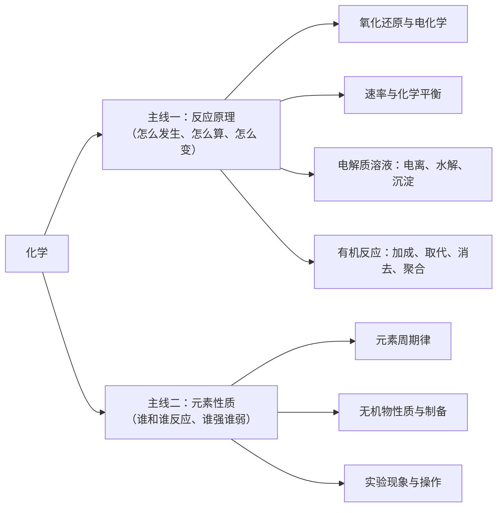
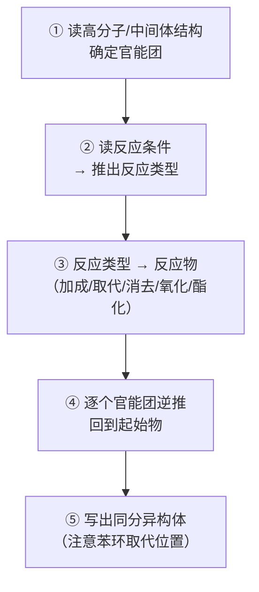

# 高考化学：云南卷的结构、赋分策略与考场操作（2026 口径）

| 编写人 | 编写内容 | 编写时间 |
| --- | --- | --- |
| growdu | 面向**中等水平**（60~75 分）的考生，目标是**稳定到 85 分以上**。化学和物理、数学都不一样：**它是省命题、它是赋分科目、它高度情境化**。本文讲清三件事：**2026 云南卷到底长什么样**、**等级赋分怎么反过来影响你的选科和估分**、**每一类题的破题动作与给分规则**。 | 2026-11-11 |

> **TL;DR**
>
> **化学最容易被忽略的一条：你的化学分，一半不由你决定。**
>
> 化学是**再选科目，走等级赋分**——卷面 85 分可能赋成 71 分，也可能赋成 78 分，**取决于你在选化学的那群人里排第几**。这带来三个直接后果：
> ① **估分要估等级，不能估分数**——估"我大概在 B 档"比估"我大概 78 分"有用得多；
> ② **选科要看"相对水平"而不是"绝对分数"**——同样的 80 分，在选化学的人里可能是 C 档，在选生物的人里可能是 A 档；
> ③ **三门赋分科目是此消彼长的**——一门从 A 掉到 B 就是 15 分，比一道大题多得多。
>
> **2026 云南卷化学的三个硬数字**：
> - **100 分 / 75 分钟 / 18 题**：选择 14×3 = **42 分**，非选择 4 题 = **58 分**。**非选择占了近六成**（2025 年是 55%）——**这和物理（选择题 46%）正好相反**；
> - **模块占比**：有机化学基础 24%、物质及其变化 21%、化学反应原理 20%、实验与探究 14%、物质结构与性质 12%、物质结构与能量 9%——**选必三册合计 56%**，区域特色是**"重有机、重元素"**；
> - **难度分布**：基础题 65% / 中档 25% / 拔高 10%，**情境化覆盖率 92%**。
>
> **三个核心动作**：① **把化学读成"反应原理 + 元素性质"两条主线**，而不是一堆孤立的反应方程式；② **情境题按四步读**（圈情境 → 挖信息 → 挂模型 → 落答案）；③ **解答题踩点写**，**写全式、写状态、写条件，比只写结论值钱得多**。
>
> **一句话**：高考化学拼的不是背得多，而是**在陌生情境里把已知的东西认出来**。

> **口径说明**：题型、题量、分值、模块占比、逐题难度系数与情境表来自 **2026 年云南省普通高中学业水平选择性考试·化学**原卷及其配套评析（省自主命题）。**逐题答案为网络收集版 / 考生回忆版整理结果，仅用于讲解例题**，正式答案以省招考院发布为准。2027 届请以当年卷面为准。

---

## 目录

- [一、先定位：化学和物理、数学到底哪里不一样](#一、先定位：化学和物理、数学到底哪里不一样)
- [二、卷面结构：42 : 58 的强非选择版式](#二、卷面结构：42-58-的强非选择版式)
- [三、等级赋分：你的化学分有一半不由你决定](#三、等级赋分：你的化学分有一半不由你决定)
- [四、学习方法：把化学读成两条主线](#四、学习方法：把化学读成两条主线)
- [五、考试技巧：分题型的破题动作](#五、考试技巧：分题型的破题动作)
- [六、2026 云南卷逐题拆解](#六、2026-云南卷逐题拆解)
- [七、六个化学专属陷阱](#七、六个化学专属陷阱)
- [八、给自己的行动清单](#八、给自己的行动清单)
- [九、一页纸速查表](#九、一页纸速查表)

---

## 一、先定位：化学和物理、数学到底哪里不一样

### 1.1 化学科目的三个特殊性

| | 数学 | 物理 | **化学** |
| --- | --- | --- | --- |
| **谁命题** | 全国卷 | 云南省命题 | **云南省命题** |
| **怎么算分** | 原始分 150 | 原始分 100 | **等级赋分**（再选科目） |
| **卷面特征** | 21 题，长计算多 | 15 题，图像多 | **18 题，非选择占 58%** |
| **核心能力** | 运算与推理 | **建模** | **在陌生情境里识别已知** |
| **主要失分** | 算错、写不清 | 模型认错 | **情境没读懂 / 表述不踩点** |

**第三行是这一篇最该记住的**：**化学的非选择题占 58 分，接近六成**。这意味着——

> **化学是一场"写作考试"，不是一场"选择考试"。** 你在选择题上拼命的每一分，都不如在解答题上多写对一行方程式值钱。

### 1.2 化学的三张失分表

| 类型 | 判定标准 | 典型表现 | 对应动作 |
| --- | --- | --- | --- |
| **A. 情境失分** | 题目是新包装的，**信息没挖出来** | 读了三遍不知道在问什么；工艺流程图看不懂 | **四步读题法**（见 §4.3） |
| **B. 模型失分** | 情境读懂了，**但没找到对应反应/规律** | 知道要写方程式，写不出来；不知道用守恒还是平衡 | **反应原理模型库**（见 §4.2） |
| **C. 表述失分** | **做对了，但没给分** | 方程式漏条件；配平错；单位漏写；有机结构式画错 | **踩点式书写**（见 §5.2） |

**和数学篇的关键差异**：数学文档里失分主力是"运算性"，物理篇是"建模性"，**化学篇是"情境性 + 表述性"**——这三者的解法完全不同：

- 情境失分 → **练读题**，不是练计算；
- 模型失分 → **练反应原理**，不是背方程式；
- 表述失分 → **练书写规范**，不是多做题。

### 1.3 2026 云南卷化学的分数拆解

| 题型 | 题号 | 题量 | 分值 | 中等生典型得分 | 中等生典型丢分点 |
| --- | --- | ---: | ---: | ---: | --- |
| 单项选择题 | 1~14 | 14 | 42 | 27~36 | 后面几题（元素推断、晶胞、溶解平衡）连着崩 |
| 解答题（工业流程） | 15 | 1 | 14 | 6~10 | 流程读不懂，只写出第一问 |
| 解答题（实验探究） | 16 | 1 | 12 | 5~9 | 装置设计答非所问 |
| 解答题（反应原理） | 17 | 1 | 12 | 5~9 | 计算式列不出 |
| 解答题（有机推断） | 18 | 1 | 12 | 3~7 | 信息给予读不懂 |
| **合计** | — | **18** | **100** | **46~71** | — |

**两条关键读数**：

1. **中等生的实际区间是 46~71 分**——下限比大多数人以为的低。**选择题拿到 30 分、解答题拿到 20 分，总分就是 50**，这已经是一个需要认真诊断的位置。
2. **选择题 42 分才是基本盘**。2026 卷的选择题难度系数从 0.85 一路降到 0.35，**前 6 题（0.85→0.60）是"送分题区"，中间的 7~10 题（0.63→0.62）是"磨合区"，11~14 题（0.42→0.35）是"劝退区"**。

> **这就是"放弃策略"的数学依据**：2026 卷选择题第 14 题（Cu²⁺ 与 C₂O₄²⁻ 溶解平衡）难度系数 **0.35**，全卷选择题最低；非选择题第 18 题（有机推断）**0.38**。**这两题加起来 26 分，但典型中等生只能拿 5~7 分。** 把这两题的时间还给前面的题，期望收益高得多。

---

## 二、卷面结构：42 : 58 的强非选择版式

### 2.1 题型结构与 2025 → 2026 的变化

**2026 云南卷化学原卷口径**：

> **一、选择题：本题共 14 小题，每小题 3 分，共 42 分。** 在每小题给出的四个选项中，只有一项是符合题目要求的。
> **二、非选择题：本题共 4 小题，共 58 分。**

| 题型 | 题量 | 分值 | 占比 | 2025 年对比 |
| --- | ---: | ---: | ---: | --- |
| 单项选择题 | 14 | 42 | **42%** | 15 题 / 55% 非选择 → **2026 减了 1 道单选** |
| 非选择题 | 4 | 58 | **58%** | 非选择分值 **55% → 58%**，提升 3 分 |
| **合计** | **18** | **100** | 100% | — |

**这个变化的含义**：**云南卷正在把分值往"深度思维"上挪**。多出来的 3 分不是加在新题上，是**非选择题变难了**——第 18 题有机推断（0.38）就是那个更难的 3 分。

> **别记题号**。题号年年换，**记"哪个模块在哪个分段"才有用**——比如"云南卷最后一道大题一定是信息给予型有机推断"，这个结构比"第 18 题考有机"稳定得多。

### 2.2 模块占比：为什么云南卷"重有机、重元素"

| 内容模块 | 2026 年分值 | 2026 占比 | 2025 占比 | 云南卷的特点 |
| --- | ---: | ---: | ---: | --- |
| **选择性必修 3 · 有机化学基础** | 24 | **24%** | 22% | **最大模块**，逐年上升 |
| **必修 1 · 物质及其变化** | 21 | **21%** | 22% | 第二大模块 |
| **选择性必修 1 · 化学反应原理** | 20 | **20%** | 20% | 稳态，涵盖速率、平衡、电化学 |
| 实验与探究 | 14 | 14% | 18% | 逐年下降但仍是必拿分 |
| **选择性必修 2 · 物质结构与性质** | 12 | 12% | 10% | 晶胞、配合物是硬骨头 |
| 必修 2 · 物质结构与能量 | 9 | 9% | 8% | 周期性、电化学、原子结构 |
| **选择性必修合计** | **56** | **56%** | 52% | **选必占比过半** |

**这张表直接决定复习时间怎么分配**：

> **如果你时间只有 100 小时，云南卷的性价比排序是：有机化学基础（24 分）> 物质及其变化（21 分）> 化学反应原理（20 分）> 实验探究（14 分）> 物质结构与性质（12 分）> 物质结构与能量（9 分）。**
>
> 而**选必三册占 56 分**这一条更关键——它意味着**如果你只学必修（30 分内容），你天然丢掉 56 分里的大部分**。这是"选了化学却按必修复习"的典型致命伤。

**与全国卷的差异**：云南卷在**物质结构（12%）和实验探究（14%）**上略低于黑吉辽蒙卷，但在**有机（24%）和元素化合物（21%）**上明显更高——**这就是"重有机、重元素"的区域命题特色**。

### 2.3 75 分钟时间分配

```mermaid
gantt
    title 高考化学 75 分钟时间分配（中等水平）
    dateFormat  mm:ss
    axisFormat  %M:%S
    section 基本盘
    选择题 1-6 送分区   :a1, 00:00, 660s
    选择题 7-10 磨合区  :a2, 11:00, 600s
    选择题 11-14 劝退区 :a3, 21:00, 600s
    section 写作区
    解答 15 工业流程     :a4, 31:00, 720s
    解答 16 实验探究     :a5, 43:00, 660s
    解答 17 反应原理     :a6, 54:00, 660s
    解答 18 有机推断     :a7, 65:00, 540s
    section 兜底
    涂卡 + 回头检查      :a8, 74:00, 60s
```

| 阶段 | 用时 | 硬性纪律 | 中断条件 |
| --- | --- | --- | --- |
| 选择题 1~6（0.85~0.60） | **11 min** | 每题 ≤ 100 秒；**这 18 分必须全拿** | 超 2 分钟 → 标记跳过 |
| 选择题 7~10（0.63~0.62） | **10 min** | 每题 ≤ 150 秒；写选项的依据再选 | — |
| 选择题 11~14（0.42~0.35） | **10 min** | **先易后难，一题不超过 3 分钟** | 3 分钟无进展 → 立刻走 |
| 解答 15 工业流程 | **12 min** | 按问作答，**(1) 必拿** | 流程读不懂 → 先写能写的 |
| 解答 16 实验探究 | **11 min** | 装置题先画图再答 | — |
| 解答 17 反应原理 | **11 min** | 计算式先写符号再代数 | — |
| 解答 18 有机推断 | **9 min** | **只做 (1)(2)，(3) 允许空** | 10 分钟推不出结构 → 走 |
| 涂卡 + 检查 | **1 min** | 只查：方程式配平、单位、状态条件 | 不重做大题 |

> **和物理篇的关键差异**：化学的解答题**没有"第 (1) 问白送"的结构**。物理第 15 题第 (1) 问是纯机械能守恒 + 弹性碰撞，5 分白送；**化学的 15~18 题每一问都咬死在新信息上**。所以化学**不存在"只做第一问"的止损策略**，只能"按问拿分"——**写出 (1) 的部分结论也得分**。

---

## 三、等级赋分：你的化学分有一半不由你决定

**这一节是化学篇和物理篇最大的区别，也是最容易被忽略、代价最大的一节。**

### 3.1 赋分怎么算

化学、生物、思想政治、地理是**再选科目**，成绩按**等级赋分**计入总分：

| 等级 | 考生比例 | 赋分区间 |
| --- | ---: | --- |
| A | 15% | 100 ~ 86 |
| B | 35% | 85 ~ 71 |
| C | 35% | 70 ~ 56 |
| D | 13% | 55 ~ 41 |
| E | 2% | 40 ~ 30 |

**三条铁律**：

1. **原始分不公布**——你考完只知道自己卷面多少分和最终赋分多少，**中间那 40 分的差距你永远看不见**；
2. **赋分是"排位"不是"换算"**——你的卷面分决定你在**选这门课的全体考生**里的百分位，百分位决定等级；
3. **四门再选科目在同一位次上赋分相同**——同一个位次，赋出来的分是一样的。

> 完整的赋分规则与首考年的实测数据见 [《云南高考：政策与科目划分（2026 官方口径）》 §三](../yunnan-policy/index.html)。

### 3.2 化学的赋分策略：四条推论

**推论一：估分要估等级，不估分数。**

你模考卷面 78 分，不等于最终 78 分，更不等于"我大概 70 分所以报这个志愿"。**正确做法是问："在我这所学校选化学的人里，我大概排前百分之几？"** 如果你在年级里化学稳定在前 20%，那是 B 档（85~71），最终就是 71~85 分——**比你的卷面分高**；如果你在前 5%，那是 A 档，86~100。

**推论二：选科要看"相对水平"，不是"绝对分数"。**

这是最反直觉、也最值钱的一条：

> **同样的卷面 80 分，在"选化学的都是高手"的学校里，你可能只有 C 档（70~56）；在"选生物的都不太卷"的学校里，你可能是 A 档（86~100）。**

所以——**"我化学比生物考得好"这句话本身没有意义**，有意义的是：**"我在选化学的人里，比在选生物的人里更靠前吗？"**

**推论三：三门赋分科目是"此消彼长"的。**

你有三门赋分科目。一门从 A 档掉到 B 档 = 少 15 分；掉到 C 档 = 少 30 分。**这比一道大题多得多（化学最大一道题 14 分）。**

**推论四：赋分科目要"押注"，但押的是位次不是分数。**

| 情况 | 建议 |
| --- | --- |
| 三门赋分科目**水平相当** | 选**你最稳的那门**做赋分主力，另外两门保底 |
| 某门**明显强于**其他两门 | 让它做主力，**但注意赋分后差距会被压缩**（85 和 71 之间只差 14 分，不是 40 分） |
| 某门**明显弱** | **别选**。赋分会把你的绝对短板暴露在同位次竞争里 |
| 选考科目**要能报你想去的专业** | 赋分再高，**选科不匹配也报不了**——赋分策略永远让位于选科要求 |

### 3.3 赋分视角下的选科决策表

| 你想报的大学专业 | 云南常见选科要求 | 赋分策略提示 |
| --- | --- | --- |
| 计算机 / 电子信息 / 机械 | **物理 + 化学** | 化学是硬门槛，**必须选**，赋分策略服从选科 |
| 临床医学 / 药学 / 麻醉 | **物理 + 化学 + 生物** | 三门都是必选，**没有赋分腾挪空间** |
| 经济学 / 金融 / 会计 | 物理 或 历史 均可，**再选不限**（部分院校限 2 门） | **这里赋分策略起作用**：选你相对强的两门 |
| 汉语言 / 法学 / 教育学 | **历史**（部分院校物理可） | 历史是首选科目，**原始分计入**，不赋分 |
| 土木 / 建筑 / 材料 | **物理 + 化学** | 同上 |

> **结论**：**当一门课是"必选"时（化学之于理科医工），赋分策略对它无效；只有当你有选择权时，赋分策略才是你手里的牌。**

---

## 四、学习方法：把化学读成两条主线

### 4.1 化学的核心资产：反应原理 + 元素性质

化学知识看着碎，其实是**两条主线**：



**用 2026 卷第 8 题（水滑石阻燃剂）说明这两条线怎么合用**：

> 题目给出 U、V、W、X、Y、Z 六种原子序数依次增大的前 20 号主族元素，其中：U 是原子半径最小的元素；V 的 p 轨道电子数是 s 轨道电子数的一半；X 的最外层电子数与其 K 层电子数相等；Y 的氧化物具有两性；X 和 Z 同主族；Z 的原子序数等于 W 和 X 的原子序数之和。

**解法就是"两条线交替用"**：

| 条件 | 推出 | 用的是哪条线 |
| --- | --- | --- |
| U 是原子半径最小的元素 | U = H | 元素性质线（常识） |
| X 最外层电子数 = K 层电子数（=2） | X 是第 2 族元素（Be 或 Mg） | 元素性质线 |
| V 的 p 电子数 = s 电子数的一半 | V 是 O（1s²2s²2p⁴）或 C（1s²2s²2p²） | 元素性质线（原子结构） |
| Y 的氧化物有两性 | Y = Al 或 Be | 元素性质线 |
| Z 的原子序数 = W + X | 用于定位与排除 | 元素性质线 + 数学 |
| **选项判断** | A. 最简单氢化物沸点 V>W｜B. 最高价氧化物水化物碱性 X>Z｜C. 第一电离能 X>Z｜D. … | **反应原理线（氢键、周期性、离子半径）** |

**这个题 4 分，用时 3 分钟，但它同时考了两条主线。** 化学的核心能力就是**在陌生情境里把这两条线接上**。

### 4.2 必背模型清单（按云南卷模块占比排序）

| # | 模型 | 触发关键词 | 核心工具 | 云南卷题号（2026） |
| --- | --- | --- | --- | --- |
| 1 | **有机官能团性质** | 碳碳双键、羟基、醛基、酯基、羧基 | 加成 / 取代 / 酯化 / 皂化 / 消去；溴水、NaOH 消耗量 | 4、6、18 |
| 2 | **氧化还原与配平** | 化合价升降、得电子失电子 | 电子守恒；得失电子守恒配平 | 7、15、17 |
| 3 | **化学平衡移动** | 恒温恒容、压强、浓度、催化剂 | 勒夏特列；K 的表达式与计算 | 17 |
| 4 | **速率与速率方程** | 反应速率、速率常数 k | v = k·cⁿ；影响因素 | 17 |
| 5 | **电解质溶液三平衡** | 电离、水解、沉淀、离子浓度比较 | 电荷守恒、物料守恒、质子守恒 | 14 |
| 6 | **Ksp 与沉淀转化** | 溶度积、沉淀溶解、Q 与 K 比较 | Ksp 表达式；沉淀转化方向 | 14 |
| 7 | **元素周期律** | 原子序数递增、最外层电子数 | 半径、金属性/非金属性、电离能第一电离能 | 8 |
| 8 | **原电池与电解池** | 正负极、阴阳极、离子迁移、放电量 | 电子流向；电极反应式；Q = It | 13 |
| 9 | **晶体与晶胞计算** | 晶胞、分数坐标、配位数、密度 | 粒子数 = 各位置贡献；ρ = m/V | 11 |
| 10 | **工艺流程（除杂、分离）** | 流程图、滤液、滤渣、母液 | 分离提纯：萃取分液、过滤、重结晶 | 15、16 |
| 11 | **滴定与定量** | 滴定管、指示剂、滴定曲线 | c·V 关系；滴定突跃 | 15 |
| 12 | **配合物与配位** | 中心离子、配体、配位数 | 配位数 = 配体数 × 配位原子数 | 12、16 |
| 13 | **实验装置评价** | 装置图、能否达到目的 | 装置 + 试剂 + 操作三要素 | 5 |
| 14 | **物质结构与轨道** | 空间结构、杂化、轨道表示式 | VSEPR；杂化类型判断 | 2 |
| 15 | **热化学与盖斯定律** | 反应热、ΔH、燃烧热 | ΔH = 断键吸热 − 成键放热；盖斯定律 | 17 |

> **和物理篇的用法完全一致**：每个模型配 3~5 道基础题，**一轮一模型平推**，不要一上来就做综合题。

### 4.3 情境题的通用四步读法

**2026 云南卷化学的情境化覆盖率达 92%**——几乎每道题都是新包装。四步法是唯一能稳定复用的动作：

| 步骤 | 动作 | 以 2026 第 3 题（合成氨工艺）为例 |
| --- | --- | --- |
| **① 圈情境** | 划出这段文字在讲什么**行业/工艺/研究** | "合成氨工艺沿革"——**工业生产**情境 |
| **② 挖信息** | 把题目给的**具体数据、图示、陌生名词**单独列出来 | 图示给出几种固氮方式；选项涉及 NO 颜色气味、NH₄HCO₃ 电离、循环操作、催化剂与反应热 |
| **③ 挂模型** | 这段信息对应哪个模型？ | **模型 2（氧化还原）+ 模型 3（平衡移动）+ 催化剂不改变 ΔH** |
| **④ 落答案** | 每个选项单独判断，**用一句话说清依据** | A：NO 是无色气体，**不是红棕色** → 错；B：NH₄HCO₃ 电离应写成 NH₄⁺ + HCO₃⁻，**不能拆到 H⁺ 和 CO₃²⁻** → 错；C：循环操作提高原料利用率 → 对；D：催化剂改变路径不改变 ΔH → 错 |

> **④ 这一步是化学选择题的核心动作**：**每个选项都要能独立说出一句依据**。说不出依据的选项，就是拿不准的选项——**用排除法把它排掉**。

### 4.4 错题本怎么记：记"反应"不记"题"

化学的错题本**尤其不要抄题**。三行格式：

| 行 | 内容 | 例（第 3 题 B 项） |
| --- | --- | --- |
| **① 错在哪** | 概念 / 反应 / 计算 / 表述 | **概念**：强电解质的电离方程式拆错 |
| **② 正确依据** | 一句话 + 一个反例 | 多元弱酸电离**分步写**，一步到底会破坏电荷守恒 |
| **③ 触发条件** | 看到什么词要警觉 | 看到**"电离方程式"** → 先问：是完全电离还是分步电离？ |

**化学特有的归并规则**：**连续 5 道错题指向同一个模块 → 回去重建那个模块的模型表**。化学的知识是网状的，模型表比错题有用得多。

---

## 五、考试技巧：分题型的破题动作

### 5.1 单项选择题（14 题 / 42 分）：**难度分区，各有各的打法**

2026 云南卷选择题的难度系数是**分三档**的，这决定了完全不同的三套打法：

| 区间 | 题号 | 难度系数 | 打法 | 时间 |
| --- | --- | --- | --- | --- |
| **送分区** | 1~6 | 0.85~0.60 | **定性判断，不动笔算**。每题读完 + 逐项判断即可 | 每题 ≤100 秒 |
| **磨合区** | 7~10 | 0.63~0.62 | 元素推断、实验评价。**先写出你推出来的结论，再去看选项** | 每题 ≤150 秒 |
| **劝退区** | 11~14 | 0.42~0.35 | 晶胞、配位、溶解平衡。**会做就做，不做就走** | 每题 ≤180 秒 |

**送分区的标准动作（以 2026 第 1 题为例）**：

> 题干：化学强国，筑梦未来。下列说法**错误**的是
> A. "雪豹"6×6 轮式载具耐寒轮胎，属**特种橡胶**
> B. "北脑一号"脑机系统手术用**钛板**，属**陶瓷材料**
> C. "天舟七号"石英加速度计，核心部件含**二氧化硅**
> D. "深海一号"储油平台聚酯系泊缆绳，主要成分为**有机高分子**

**逐项一句话判断**：

| 选项 | 判断 | 依据 |
| --- | --- | --- |
| A | 对 | 轮胎用橡胶是**有机高分子**，属**合成材料**中的特种橡胶 |
| B | **错** | **钛是金属**，钛板属**金属材料**，不是陶瓷 |
| C | 对 | 石英主要成分是 **SiO₂**，属无机非金属材料 |
| D | 对 | 聚酯是**有机高分子**（合成纤维） |

**这题 3 分，用了不到 60 秒，零计算。** 答案：C（选"错误"的那个）。

> **这四个选项对应的是"无机非金属 / 金属 / 有机高分子"三类材料的基本归类**——**这就是送分区的定义：你掌握了一句话常识，不需要推理。**

**劝退区的弃题标准**：第 11 题（晶胞，第 6 张图题）**画不出圆心与配位数就立刻走**；第 14 题（溶解平衡曲线）**读不懂曲线就立刻走**。**这四题合计 12 分，你的目标是拿到其中 2~4 分，不是全拿。**

### 5.2 解答题（4 题 / 58 分）：**踩点给分与表达规范**

**化学解答题的给分逻辑**：**按给分点给分，一个点一分（或几分）**。常见的给分点类型：

| 给分点类型 | 判分方式 | 写法要求 |
| --- | --- | --- |
| **化学方程式** | 方程式**配平 + 条件 + 状态**都写对才给分 | **必须写配平号、条件（催化剂/加热/△）、↑↓（气体/沉淀）** |
| **离子方程式** | 同上，且**拆写规则正确** | 弱电解质不拆、气体/沉淀拆 |
| **计算结果** | 数值 + **单位** | 漏单位常扣分 |
| **实验现象** | 关键词匹配 | 如"溶液由无色变蓝色"、"产生白色沉淀" |
| **实验结论** | 要有因果 | **不能只写现象不写结论** |
| **理由 / 解释** | 关键得分点 | **用学科术语**，不口语化 |

**一条必须记住的规矩**：

> **答案错了但步骤对，步骤分照给；结论对了但没写过程，过程分不给。**
>
> 所以化学解答题的正确策略是：**宁可写得啰嗦，也不要写得干净。** 把"我看到了什么 → 我据此判断 → 所以结论是"这三层都写出来。

**以 2026 第 15 题（废弃印刷电路板回收）为例**，这类工业流程题的通用答题顺序是：

```
① 先读流程图：原料 → 各步操作（浸取/过滤/洗涤/灼烧）→ 各步产物
② 逐问圈出问的是哪一步的哪个物质
③ 写离子方程式 / 平衡常数 / 质量分数
④ 最后一问往往是"为什么加 X 试剂"——答案是"除去 Y 杂质"或"防止 Z 损失"
```

**④ 是最容易拿分的**，因为它只需要你把流程图读懂，**不需要任何计算**。2026 第 15 题的第 (5)(6) 问就是这类。

### 5.3 实验题与工艺流程题（15、16 题）

| 环节 | 动作 | 注意 |
| --- | --- | --- |
| **读装置图** | 看清：发生装置 → 净化 → 收集/反应 → 尾气 | **尾气处理**是常考点，漏答必丢分 |
| **判断操作顺序** | 洗气、干燥、检验的先后 | **先验后洗**、**先净化后干燥**（看要检验什么） |
| **答"为什么"** | 写清目的：除杂、防止倒吸、增大接触面积 | **"增大接触面积"要写出具体做法**（如"用多孔球泡"） |
| **答"操作"** | 过滤、洗涤、结晶、萃取的具体步骤 | 洗涤写"**洗涤至最后一次洗涤液中无…**" |
| **答"误差"** | 偏大/偏小 + 原因 | 必须**成对出现**，只写"有误差"不给分 |

### 5.4 有机推断题（18 题，2026 难度系数 0.38）

**这是全卷最难的题，但它的结构是固定的**：



**三个高频丢分点**：

1. **同分异构体的苯环取代位置**——邻、间、对**三种都要写**，且**不能重样**（1,2-二取代和 1,4-二取代不是同一个）；
2. **没有写官能团名称**——题目问"含氧官能团的名称"，只写结构式不给分；
3. **漏掉"能发生取代反应的苯环上的氢"**——这类问法要**明确写出苯环上剩余的 H 数目**。

**"信息给予"的新物质**：2026 第 18 题给了题干没见过的物质，**处理办法是：把它当成已知结构的"黑箱"，只看它和已知物质怎么反应，反推结构**。不要试图背这个新物质——**它只出现一次**。

### 5.5 计算题（17 题，反应原理）

云南卷的计算题**几乎不考纯粹的"套公式"**，考的是**两个知识点叠加**。2026 第 17 题考的是**速率常数 + 化学平衡常数 + 盖斯定律**三合一。

**三条通用纪律**：

| 纪律 | 说明 |
| --- | --- |
| **先写符号式再代数** | `k = c(B)/c(A)` 先写清楚再代数字；直接写数字会丢过程分 |
| **单位必须带** | `mol·L⁻¹·s⁻¹`、`kJ·mol⁻¹` |
| **平衡常数要带表达式** | 只写"6.2"不给分，要写"**K = 6.2**" |

---

## 六、2026 云南卷逐题拆解

### 6.1 十八题的情境、考点与难度

> **数据来源**：2026 云南卷化学原卷 + 配套评析。**难度系数**：0.85 最易 → 0.35 最难。**答案**：网络收集版 / 回忆版，仅用于讲解。

| 题号 | 分值 | 情境 | 考查内容 | 难度 | 答案 |
| --- | ---: | --- | --- | ---: | --- |
| 1 | 3 | 化学强国筑梦未来（脑机手术钛板、石英加速度计、深海平台聚酯缆绳） | 化学材料分类（金属/无机非金属/有机高分子） | 0.85 | C |
| 2 | 3 | 化学用语与图示 | 同素异形体、分子极性、空间结构、轨道表示式 | 0.70 | D |
| 3 | 3 | 合成氨工艺沿革 | NO 性质、电离方程式、循环操作、催化剂与 ΔH | 0.70 | A |
| 4 | 3 | 化学与生活常识 | 石油分馏、蔗糖水解、明矾净水、NaHCO₃ 分解 | 0.82 | D |
| 5 | 3 | 实验装置与试剂 | 蛋白质变性、中和热测定、Fe(OH)₃ 胶体、氯气制备 | 0.65 | B |
| 6 | 3 | **云南四季花卉**有机物 | 分子式、官能团性质、加成与水解、Br₂ 消耗量 | 0.60 | D |
| 7 | 3 | **水电站坝体维护** | 水泥原料、氧化还原、聚四氟乙烯、牺牲阳极 | 0.63 | C |
| 8 | 3 | 水滑石阻燃剂（元素推断） | 氢化物沸点、碱性比较、第一电离能、原子结构 | 0.55 | D |
| 9 | 3 | 铁粉与硫粉反应探究 | 黑色固体成分、Fe 与 S 燃烧产物、煮沸硫酸目的、H₂S 检验 | 0.62 | C |
| 10 | 3 | Ni@ZnInS 纳米催化剂 | 光能转化、空穴氧化性、共价键变化 | 0.62 | A |
| 11 | 3 | 新型固态电解质晶胞 | 分数坐标、配位数、投影图、晶胞参数计算 | 0.42 | D |
| 12 | 3 | 大环化合物与 C₆₀ 超分子 | 晶体类型、分子间作用力、杂化方式 | 0.62 | B |
| 13 | 3 | 双模式锂电池 | 充电反应、电子转移、离子迁移、放电量比较 | 0.48 | — |
| 14 | 3 | Cu²⁺ 与 C₂O₄²⁻ 溶解平衡 | 曲线判断、平衡常数计算、物料守恒 | **0.35** | — |
| 15 | 14 | 废弃印刷电路板回收 | 滴定、工艺流程、方程式书写、产率计算 | 0.56 | — |
| 16 | 12 | 镍配合物合成与纯化 | 分离提纯、萃取分液、配合物结构、实验探究 | 0.55 | — |
| 17 | 12 | 反应原理综合（速率 + 平衡 + 热化学） | 速率常数、化学平衡常数计算、盖斯定律 | 0.57 | — |
| 18 | 12 | 有机合成（信息给予） | 同分异构体书写、信息给予的有机合成、原子共面判断 | **0.38** | — |

**从这张表能读出四件事**：

1. **送分区就是 1~6 题（18 分）**——全是"读一遍就能判断"的常识题；
2. **最难的三题是 11、14、18**（0.42 / 0.35 / 0.38），**合计 26 分**，典型中等生只能拿 5~7 分；
3. **非选择题 15、16、17 难度都在 0.55~0.57**，**非常均匀**——这说明云南卷的非选择题**没有"送分大题"**，必须靠平时积累；
4. **本土情境至少 3 处**：四季花卉（第 6 题）、水电站坝体（第 7 题）、云南锡铟式的材料/工业素材（第 1、15 题）。

### 6.2 走完三道题

#### 6.2.1 第 1 题（3 分）——**定性判断，一分钟**

```
读题干：找限定词「下列说法错误的是」     ← 必须先圈出来
逐项判断：
  A 轮胎-特种橡胶      → 有机高分子，合成材料      对
  B 钛板-陶瓷          → 钛是金属，属金属材料      错 ★
  C 石英加速度计-SiO₂  → 无机非金属材料            对
  D 聚酯缆绳-有机高分子 → 合成纤维                  对
答案：C
```

**零计算、零公式、60 秒。** 这就是送分区的正确打开方式。

#### 6.2.2 第 8 题（3 分）——**两条线交替用**

```
条件拆解：
  U 原子半径最小        → U = H
  X 最外层电子数 = K 层 (2) → X 是第 2 族元素
  V 的 p 电子数 = s 电子数一半 → V 的电子排布形如 2s²2p⁴ 或 2s²2p²
  Y 氧化物有两性        → Y = Al（或 Be）
  Z 原子序数 = W + X   → 用于定位与排除
逐项判断（用反应原理线）：
  A 最简单氢化物沸点 V>W   → 取决于氢键/相对分子质量
  B 最高价氧化物水化物碱性 X>Z
  C 第一电离能 X 与 Z 比较
  D …
答案：D
```

**这题考的是"读条件 → 定位元素 → 调性质"的三段式**。**三个给分点分别是"推出元素""比较性质""得出结论"**——**只写结论不给分**。

#### 6.2.3 第 18 题（12 分）——**有机推断的分层取舍**

```
(1) 信息给予的新物质 → 只能当黑箱，靠"和已知物质怎么反应"反推结构
(2) 同分异构体书写    → 苯环取代位置：邻/间/对 三种都要，且不能重样
    ★ 这是最稳的得分点：结构确定后，纯靠"数 C 原子 + 分配 H"就能写
(3) 官能团名称 / 原子共面判断 → 需要空间结构想象，最容易空
```

**取舍策略**：
- **(1)(2) 必须做**——分值占大头，且 (2) 是"套规则题"，不需要理解新物质；
- **(3) 允许空**——2026 第 18 题难度系数 0.38，投入 9 分钟期望收益不到 2 分。

---

## 七、六个化学专属陷阱

| # | 陷阱 | 典型表现 | 防御动作 |
| --- | --- | --- | --- |
| 1 | **方程式漏条件、漏状态** | `2NaHCO₃ = Na₂CO₃ + CO₂ + H₂O` 少了 △ 和 ↑ | **写完方程式回头扫三样：配平号、条件、↑↓** |
| 2 | **离子方程式拆错** | 多元弱酸一步拆到底；弱电解质拆开 | 强电解质拆、弱电解质不拆、气体沉淀拆 |
| 3 | **"题给信息"没读全** | 题目特意给的"**已知**""**某小组**""**标准状况下**"被忽略 | **读题时圈出所有限定条件**（含"已知"两字） |
| 4 | **有机同分异构体重样** | 把 1,2- 与 1,4-二取代当成同一个；苯环位置只写一种 | **邻/间/对逐个列，写完检查有无重复** |
| 5 | **实验题只写现象不写结论** | 问"说明什么"只答了看到的颜色 | **现象 + 结论两句都要写** |
| 6 | **守恒用错** | 溶质微粒浓度比较时用错物料守恒对象 | **电荷守恒、物料守恒、质子守恒三个分清**（溶质 / 溶液 / 特定离子） |

> **第 1 条值得单独强调**：**方程式漏条件在化学里是高频扣分点，而且是可以零成本避免的**——写完每个方程式，**回头扫一眼"△、催化剂、↑↓"**。2026 卷第 4 题的 D 选项就是考 NaHCO₃ 分解方程式的规范写法。

---

## 八、给自己的行动清单

| 时间 | 动作 | 为什么必须是现在 |
| --- | --- | --- |
| **现在** | 列出 §4.2 的 **15 个模型**，标出自己不会的 | 化学的差距不在"方程式背了多少"，在**模型有没有覆盖到** |
| **现在** | 把**赋分规则**和自己的模考位次对一遍，算出自己大致在哪个等级 | **赋分策略只有在"知道自己在哪一档"时才有用** |
| **现在** | 对照 §2.2 的模块占比，**检查自己的复习有没有偏** | **选必三册占 56 分**，只学必修等于丢掉一半分值 |
| **每周** | 按模块分类刷题（有机 / 原理 / 元素化合物 / 实验），**不按套卷刷** | 一轮必须一模型一模型平推 |
| **每周** | **限时 75 分钟**做一套云南真题（答题卡、涂卡、2B 铅笔） | 化学的解答题**没有"只做第一问"的止损**，必须练全程时间 |
| **每套卷后** | 按 §1.2 三张失分表归类，**不写完整题解** | 化学错题本的价值在归因 |
| **每 5 道错题** | 同模块错 ≥5 道 → **回去重建该模块的模型表** | 化学知识是网状的，模型表比错题有用 |
| **考前 8 周** | 开始练**踩点书写**：方程式带条件和状态、单位、实验结论成对写 | **步骤分是化学的主要分值来源** |
| **考前 4 周** | 练**弃题**：11、14、18 三题各限时 3 分钟 | 难度系数 0.42/0.35/0.38，不弃就是送时间 |
| **考前 2 周** | 只做**本省真题**（2025、2026 云南卷） | 云南卷情境化率 92%、"重有机重元素"，外省卷没有参考价值 |
| **考前 1 周** | 只回看**模型表 + 方程式规范清单** | 最后一周的边际收益在"熟练"，不在"生疏" |

---

## 九、一页纸速查表

```
【科目】云南卷 100 分 / 75 分钟 / 省自主命题 / 再选科目·等级赋分
【结构】选择 42（14×3）+ 非选择 58（14+12+12+12）= 100
        2026 非选择占比 58%（2025 是 55%）→ 「重能力、重综合」
【模块】有机 24%｜物质及其变化 21%｜反应原理 20%｜实验探究 14%｜物质结构 12%｜物质结构与能量 9%
        选必三册合计 56% ← 只学必修 = 丢掉一半分值
【难度】基础 65% / 中档 25% / 拔高 10%；情境化覆盖率 92%
        选择题分区：1-6 送分(0.85-0.60)｜7-10 磨合｜11-14 劝退(0.42-0.35)
        非选择：15 流程 0.56｜16 实验 0.55｜17 原理 0.57｜18 有机 0.38
【时间】选择 1-6 11min｜7-10 10min｜11-14 10min｜解答 12+11+11+9min｜检查 1min

【赋分】A 15%→100-86 ｜ B 35%→85-71 ｜ C 35%→70-56 ｜ D 13%→55-41 ｜ E 2%→40-30
        原始分不公布；四门再选科目同位次赋分相同
        四条推论：① 估分估等级不估分数 ② 选科看相对水平不看绝对分
                  ③ 三门赋分此消彼长（一门掉一档 = 15 分）
                  ④ 赋分科目是必选时，赋分策略无效

【15 个模型】有机官能团｜氧化还原配平｜平衡移动｜速率方程｜三平衡(电离/水解/沉淀)
        Ksp 沉淀转化｜元素周期律｜原电池电解池｜晶胞计算｜工艺流程
        滴定定量｜配合物配位｜实验装置评价｜物质结构轨道｜热化学盖斯

【情境题四步】圈情境 → 挖信息 → 挂模型 → 落答案（每个选项都要能说出一句依据）

【解答题踩点】方程式：配平 + 条件(△/催化剂) + 状态(↑↓)，三个都要
        离子方程式：强电解质拆、弱电解质不拆、气体沉淀拆
        实验题：现象 + 结论成对写；误差必须成对（偏大/偏小 + 原因）
        宁可写得啰嗦，不要写得干净 ← 步骤错但过程对，照给步骤分

【有机】同分异构体：邻/间/对 三种都写且不重样
        官能团名称要写名称，不只画结构式
        信息给予的新物质只当黑箱，靠反应反推，不要背

【化学专属陷阱】漏条件漏状态｜离子方程式拆错｜漏读"已知"｜同分异构体重样
        只写现象不写结论｜守恒用错

【底线】化学是再选科目，等级赋分；估分即估等级，不要按卷面分报志愿
```

---

## 相关阅读

- [云南高考：政策与科目划分（2026 官方口径）](../yunnan-policy/index.html) —— **赋分规则的原文出处**：3+1+2 科目切分 → 等级赋分五档 → 选科四类要求 → 2025/2026 分数线
- [高考物理：模型方法与考场操作（2026 云南卷口径）](../physics-methods/index.html) —— **姊妹篇**：物理是**首选科目、原始分计入**，物理篇讲"建模"，化学篇讲"情境 + 赋分"
- [云南高考报考指南：选校、选专业与各类特殊计划](../yunnan-apply/index.html) —— **下游**：**选科不匹配则志愿根本填不进去**，赋分策略永远让位于选科要求
- [高考数学：中等水平者的做题方法与学习路径](../math-methods/index.html) —— 同一套"先诊断再动手"框架

---

## 资料来源与核对入口

| 内容 | 来源 |
| --- | --- |
| 2026 云南卷化学的题型、题量、分值、注意事项原文、18 题题干 | 《云南省 2026 年普通高中学业水平选择性考试·化学》原卷（2026-06-09 考试） |
| 模块占比（有机 24% / 必修一 21% / 原理 20% / 实验 14%）、2025→2026 结构变化、难度分层、关键能力层级 | 2026 高考化学试卷评析（云南卷）——七彩学科网 / 原创力文档 / 学科网 |
| 逐题难度系数、逐题情境与考点、核心素养落点 | 2026 高考化学试题评析及教学启示（云南卷）——二一教育 / 组卷网 |
| 逐题答案 | 网络收集版 / 考生回忆版整理（**非官方发布，仅用于讲解例题**） |
| 化学为再选科目、等级赋分、75 分钟 100 分 | 《云南省 2025 年普通高校招生考试安排和录取工作实施方案》、2026 网上填报志愿考生须知 |

> **核对入口**：[云南省招考频道](https://www.ynzs.cn) ｜ [教育部阳光高考平台](https://gaokao.chsi.com.cn) ｜ 考生服务平台 <https://gk.ynzs.cn>
>
> **时效提醒**：本文取自 **2026 年**云南卷。题型结构通常延续，但**模块占比、情境与难度分布会变**。本文的方法论部分（模型表、四步读题、踩点书写、弃题策略）**与具体年份无关**。

---

| 编写人 | 校验内容 | 时间 |
| --- | --- | --- |
| growdu | 题型、题量、分值、注意事项、18 题情境与难度系数逐条对照 2026 云南卷化学原卷及评析；模块占比与 2025→2026 结构变化对齐试卷评析；赋分规则与《政策篇》交叉核对；答案数据已标注为网络收集版 | 2026-11-11 |
