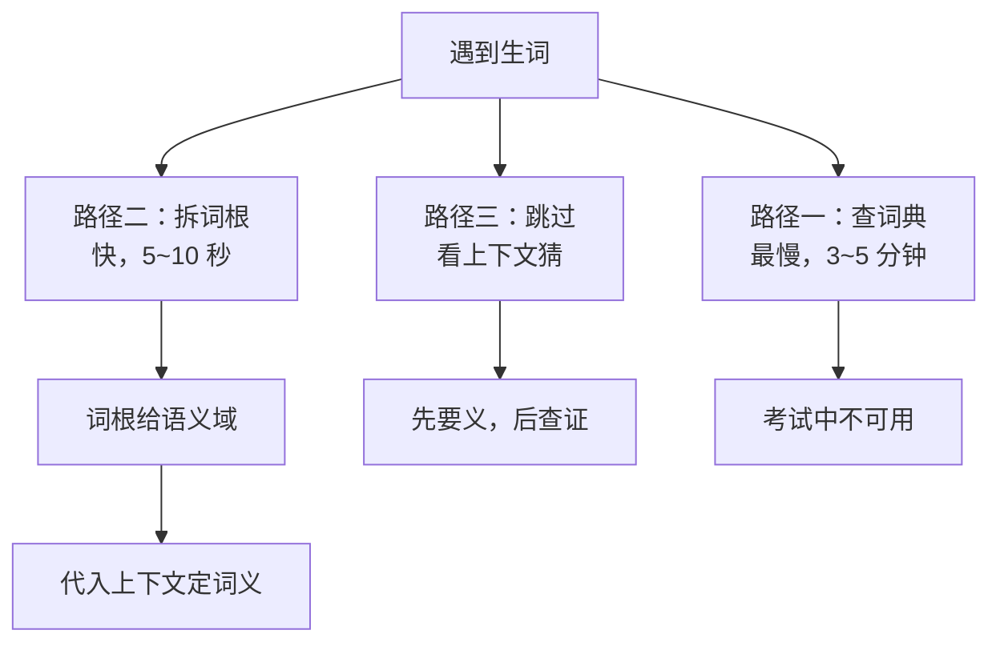

# 高考英语：用词根词缀把"猜词"变成"认词"

| 编写人 | 编写内容 | 编写时间 |
| --- | --- | --- |
| growdu | 面向**中等水平**（80~110 分）的考生，讲清三件事：**你的分丢在"词"上还是"语法"上**、**词根词缀到底能提多少分**、**怎么用 30 天把一个词族吃透**。不讲"多背单词"这种正确但无用的话。 | 2026-11-11 |

> **TL;DR**
>
> **高考英语最大的隐性失分，不是"不会的词"，是"本来会、但当场没认出来的词"。** 一篇阅读里卡住 3 个生词，20 分钟就没了；完形里 5 个近义词辨析错 3 个，一整块的分就没了。这些词的**长相你其实见过**——它们是同一批词根派生的。
>
> **词根词缀的三条硬结论**：
> ① 它是**加速器，不是替代品**——它不能替你背完 3000 词，但能让每个词的**记忆成本降到 1/5**，并让你**当场推断**生词含义；
> ② 它的**最高价值区不是阅读，而是完形和语法填空**——这两块加起来 30 分，考的恰恰是"同根近义词的精确差异"，而这正是词根词缀的主场；
> ③ 它**救不了语法和听力**——动词形式、时态、主谓一致、连读弱读，词根一个都帮不上。
>
> **一句话**：**用词根词缀把"我好像见过这个词"变成"我知道它什么意思、后面接什么"**，这是中等生在词汇上唯一能系统性拿到的确定性收益。

---

## 目录

- [一、先定位：你的分丢在"词"上，还是丢在"语法"上](#一、先定位：你的分丢在”词”上，还是丢在”语法”上)
- [二、为什么词根词缀对高考真的有用（机制）](#二、为什么词根词缀对高考真的有用（机制）)
- [三、工具箱 A：高考高频词根 64 个](#三、工具箱-A：高考高频词根-64-个)
- [四、工具箱 B：高频前缀与后缀](#四、工具箱-B：高频前缀与后缀)
- [五、真题里怎么用：四个场景](#五、真题里怎么用：四个场景)
- [六、怎么练：30 天词族计划](#六、怎么练：30-天词族计划)
- [七、五个常见误区](#七、五个常见误区)
- [八、边界：词根词缀救不了什么](#八、边界：词根词缀救不了什么)
- [九、一页纸速查表](#九、一页纸速查表)

---

## 一、先定位：你的分丢在"词"上，还是丢在"语法"上

### 1.1 一张卷子的分数拆解

以新高考卷结构为例（满分 150 分）：

| 板块 | 题号 | 分值 | 中等生典型得分 | 中等生典型丢分点 |
| --- | --- | ---: | ---: | --- |
| 听力 | 1~20 | 30 | 18~24 | 读题时生词多、来不及看选项；连读弱读听不懂 |
| 阅读理解 | 21~35 | 37.5 | 18~26 | **遇到生词停下 → 超时 → 后面题来不及做** |
| 七选五 | 36~40 | 7.5 | 3~5 | 段落逻辑 + 生词双重卡点 |
| 完形填空 | 41~45 | 15 | 6~10 | **近义词辨析错**（同根词）、逻辑连接词不会用 |
| 语法填空 | 46~50 | 15 | 6~11 | **派生词不会填**、时态/非谓语错、词性判断错 |
| 应用文写作 | 51 | 15 | 7~11 | 词汇贫乏、句式单一、要点不全 |
| 读后续写 | 52 | 25 | 11~17 | 情节不连贯、句式重复、字数勉强 |
| **合计** | — | **150** | **71~104** | — |

> ⚠️ **别记题号**。教育部对 2026 全国二卷的评析里明确写了"**打破题号定式，题目顺序可调整**"，所以"第 25 题必考推理"这种经验本身就不牢靠。**记板块比重记题号有用。**（与《全国卷二逐题拆解》同样的口径）

> **云南考生注意**：外语是**全国统考科目**（2026 年新课标II卷），满分 150 = **听力 30 + 笔试 120**，听力与笔试**同步进行**、**没有一年两考**。上表按"听力 1~20 题"编号只是卷面习惯，教育部已明确"打破题号定式，题目顺序可调整"，**别按题号背节奏**。完整口径见 [《云南高考：政策与科目划分（2026 官方口径）》](../yunnan-policy/index.html)。

### 1.2 三张失分表：把"英语差"拆成能动手的三种

拿最近 3 套真题（**不要用模拟题**），把每一道错题标上失分类型：

| 类型 | 判定标准 | 典型表现 | 词根词缀能帮上吗 |
| --- | --- | --- | --- |
| **A. 生词型失分** | 句子里有词不认识，导致整句读不懂 | 阅读读一半卡住；完形选了个"看起来像"的错项 | ✅ **主战场** |
| **B. 速度型失分** | 词其实认识，但当场反应慢、反应不出来 | 每个词都要想 2 秒；到完形时时间不够 | ✅ **有效**（靠词族整体记忆） |
| **C. 语法型失分** | 词都认识，但句子结构/时态/搭配错 | 语法填空 verb form 错；作文时态混乱；固定搭配记错 | ❌ **帮不上**（需单练语法） |

### 1.3 诊断结论（按分布选路径）

| 失分构成 | 你的画像 | 主攻方向 | 预期收益 |
| --- | --- | --- | --- |
| A > 50% | **生词型** | 词根词缀 + 3500 词全覆盖 | 中，慢但天花板高 |
| A + B 为主 | **词族型**（多数中等生） | **本文主线**：词族记忆 + 同根词辨析 | **快，4~6 周可见效** |
| C > 40% | **语法型** | 语法专项 + 搭配本 | 词根帮不上，单独练 |
| A/B/C 都不突出 | **写作/题型型** | 写作模板 + 读后续写结构 | 词根帮不上 |

> **给中等生的判断**：绝大多数中等生是 **A + B 混合型**——不是"英语差"，是**词汇是"点状记忆"而不是"网状记忆"**。每个词都见过，但每个词都是孤立的。**词根词缀的价值就是把点连成网。**

---

## 二、为什么词根词缀对高考真的有用（机制）

### 2.1 三个事实

**事实一：英语的派生是有规律的，不是随机的。**

现代英语约 60% 的词汇来自拉丁语和希腊语，共享同一批词根。同一个词根派生出的词，语义永远围绕同一个核心。举三个例子：

| 词根 | 核心义 | 派生 | 共同语义 |
| --- | --- | --- | --- |
| **spect** | 看 | inspect / respect / suspect / spectator | 都与"看"有关 |
| **duc/duct** | 引导 | introduce / conduct / produce / educate | 都与"引导"有关 |
| **viv/vit** | 生命 | survive / vivid / vitality / revive | 都与"生命"有关 |

**事实二：高考的"猜词"场景，天然要求"由形推义"。**

阅读生词、完形近义词、语法填空派生词——**这三类考的不是你记过没有，而是你能不能当场推出来**。而"由形推义"正是词根词缀唯一能干的事。

**事实三：同根词的细微差别，本身就是词汇量的核心难点。**

你认识 `expand`，但考试里考的是 `expand`（变大）/ `extend`（延伸）/ `explode`（爆炸）三选一。这三个词的差别**不在拼写，在词根**（`pand` = 展开）。**词根词缀直接瞄准的就是这类题。**

### 2.2 一张图：遇到生词的三条解法路径



**关键认知**：词根词缀不是让你**替代**上下文，而是让你**在"跳过"和"查词典"之间多了一个 5 秒选项**。阅读里 3 个生词，从"3×3 分钟"变成"3×10 秒 + 1 次回头验证"，一篇阅读能省下 5~8 分钟——**这往往就是及格线与优秀线的差距**。

### 2.3 它能提多少分：诚实的估算

| 板块 | 可提分 | 依据 |
| --- | ---: | --- |
| 完形填空 | **+2~4 分** | 15 题×1 分，同根近义词辨析题通常占 5~6 题，纠错一半即可 |
| 语法填空 | **+2~3 分** | 派生词题占 4~5 题（每题 1.5 分），这是纯送分题 |
| 阅读理解 | **+2~5 分** | 生词卡顿导致的连带失分，时间释放出来能多对 1~2 题 |
| 七选五 | +0~2 分 | 间接改善 |
| 听力 | **0 分** | 声音识别，词根帮不上 |
| 写作 | +0~2 分 | 词汇升级替换的边际收益，取决于句子功底 |
| **合计** | **+6~14 分** | 在"中等生原本 80~110 分"的地基上，这是**质变级别的增量** |

> **前提**：这套方法必须**和 3500 词覆盖同时进行**。只做词根不背词，是空中楼阁；只背词不做词根家族，是事倍功半。**两者是乘法关系，不是加法。**

---

## 三、工具箱 A：高考高频词根 64 个

按**语义场**分组记，比按字母表记强 3 倍——因为同组的词可以互相替换、互相辨析。

### 3.1 看 / 说 / 知

| 词根 | 核心义 | 高考高频派生词 | 语义指向 |
| --- | --- | --- | --- |
| **spect** | 看 | inspect 检查 / suspect 怀疑 / respect 尊敬 / prospect 前景 / spectator 观众 | "看"的不同态度 |
| **vis / vid** | 看 | visible 可见的 / vision 视力 / evident 明显的 / revise 修订 / video 视频 | 可见 / 看见 / 复看 |
| **aud** | 听 | audible 听得见的 / audience 听众 / audition 试音 / audio 音频 | 听觉 |
| **dict** | 说 | predict 预言 / contradict 反驳 / indicate 表明 / verdict 裁决 / dictionary 词典 | 说出 / 断定 |
| **log / loqu** | 说 | logic 逻辑 / dialogue 对话 / eloquent 雄辩的 / apologize 道歉 | 言辞 |
| **graph / gram** | 写、画 | paragraph 段落 / telegram 电报 / biography 传记 / diagram 图表 | 写下来 |
| **sign** | 记号 | signal 信号 / significant 重要的 / assign 分配 / design 设计 | 做记号 |
| **sens / sent** | 感觉 | sensitive 敏感的 / sensible 明智的 / sensory 感官的 / consent 同意 / sentiment 情绪 | 感觉与知觉 |
| **cogn** | 认识 | recognize 认出 / cognitive 认知的 / ignorant 无知的 / conscience 良心 | 认知 |
| **sci** | 知道 | science 科学 / conscious 有意识的 / conscience 良心 | 知晓 |

### 3.2 做 / 行动 / 力量

| 词根 | 核心义 | 高考高频派生词 | 语义指向 |
| --- | --- | --- | --- |
| **fac / fic / fect** | 做 | factory 工厂 / efficient 高效的 / affect 影响 / perfect 完美的 / defect 缺陷 | 施加动作 |
| **oper** | 工作 | operate 操作 / operation 手术 / cooperate 合作 / operator 操作者 | 运转 |
| **mit / miss** | 送 | transmit 传送 / submit 提交 / admit 承认 / miss 错过 / mission 使命 | 发出 / 交付 |
| **mov / mot / mob** | 动 | move 移动 / motion 运动 / motive 动机 / mobile 移动的 / remove 移除 | 移动 |
| **press** | 压 | pressure 压力 / express 表达 / impress 印象 / depress 压抑 / compress 压缩 | 压榨 |
| **tract** | 拉 | attract 吸引 / contract 合同 / extract 提取 / distract 分心 / tractor 拖拉机 | 拉拽 |
| **tend / tens / tent** | 伸展 | extend 延伸 / intense 强烈的 / attend 注意 / tend 倾向 / tent 帐篷 | 伸展与保持 |
| **vers / vict** | 转 | convert 转换 / diverse 多样的 / reverse 反转 / victory 胜利 / versatile 多才多艺的 | 转动 |
| **rupt** | 断 | interrupt 打断 / erupt 爆发 / disrupt 扰乱 / corrupt 腐化 | 断裂 |
| **cred** | 信 | credit 信用 / incredible 难以置信的 / credible 可信的 / accrue 积累 | 相信 |
| **flu / flux** | 流 | fluent 流利的 / influence 影响 / fluid 流体 / fluctuate 波动 / affluence 富足 | 流动 |
| **duc / duct** | 引导 | introduce 介绍 / conduct 实施 / produce 生产 / educate 教育 / deduce 推断 | 引导 |

### 3.3 生命 / 身体 / 疾病

| 词根 | 核心义 | 高考高频派生词 | 语义指向 |
| --- | --- | --- | --- |
| **viv / vit** | 生命 | survive 幸存 / vivid 生动的 / vitality 活力 / revive 复苏 / vitamin 维生素 | 生命 |
| **mort** | 死 | mortal 会死的 / mortality 死亡率 / immortal 不朽的 | 死亡 |
| **bio** | 生命 | biology 生物学 / biography 传记 / biodegradable 可生物降解的 | 生命 |
| **corp / cord** | 身体 | corporate 公司的 / corporation 公司 / body 身体 / concord 和谐 | 身体 / 团体 |
| **card** | 心 | cardiac 心脏的 / cardiovascular 心血管的 / courage 勇气 | 心脏 |
| **nerv** | 神经 | nerve 神经 / nervous 紧张的 / energetic 有活力的 | 神经 |
| **med** | 中间 | medium 中等 / medical 医学的 / immediate 立即的 / mediate 调解 | 中间 / 适中 |
| **path** | 感觉、痛苦 | patient 病人 / sympathy 同情 / pathetic 可怜的 / pathology 病理学 | 感受与病 |
| **san / salv** | 健康、救 | sane 理智的 / insane 疯狂的 / salvage 抢救 / salvation 拯救 | 健康与救赎 |

### 3.4 时间 / 顺序

| 词根 | 核心义 | 高考高频派生词 | 语义指向 |
| --- | --- | --- | --- |
| **temp** | 时间 | temporary 临时的 / contemporary 当代的 / temper 脾气 | 时间 |
| **chron** | 时间 | chronic 慢性的 / synchronize 同步 / chronology 编年史 | 时间 |
| **term** | 界限、期限 | determine 决定 / terminal 终端的 / terminology 术语 / terminate 终止 | 界限 |
| **junct** | 结合 | junction 交叉口 / conjunction 连词 | 联结 |
| **prior / post / ante / ult** | 前 / 后 | prior 先前的 / postpone 推迟 / anterior 前面的 / ultimate 最终的 | 先后 |
| **dur** | 持续 | endure 忍受 / durable 耐用的 / duration 持续时间 / endure 坚持 | 持续时间 |
| **rect** | 直、正确 | correct 正确的 / erect 直立的 / rectangle 矩形 / rectify 纠正 | 笔直 |
| **nov** | 新 | novel 新颖的 / novelty 新奇 / renovate 翻新 | 新 |

### 3.5 数量 / 程度 / 质量

| 词根 | 核心义 | 高考高频派生词 | 语义指向 |
| --- | --- | --- | --- |
| **quant** | 数量 | quantity 数量 / quantify 量化 / considerable 相当多的 | 量 |
| **qual** | 品质 | quality 质量 / qualify 使合格 / qualification 资格 | 质 |
| **mag / magn** | 大 | magnitude 巨大 / magnify 放大 / magnificent 壮丽的 | 大 |
| **minu / minu** | 小 | minimum 最小 / minute 分钟 / minor 次要的 / diminish 减少 | 小 |
| **multi** | 多 | multiply 乘 / multiple 多重的 / multitude 大量 / multitude 众多 | 多 |
| **sim / sem** | 相同、相似 | similar 相似的 / simple 简单的 / simultaneous 同时的 / assemble 集合 | 相似 |
| **simul** | 同时 | simultaneously 同时地 / simulate 模拟 | 同时 |
| **tot** | 全部 | total 总计 / entire 整个 / detail 细节 | 全部 |
| **ple / pli / ply** | 折叠、满 | complete 完成 / plenty 大量 / multiply 增多 / simple 简单 | 折叠与充满 |

### 3.6 空间 / 方向 / 位置

| 词根 | 核心义 | 高考高频派生词 | 语义指向 |
| --- | --- | --- | --- |
| **loc** | 地点 | local 当地的 / locate 定位 / allocate 分配 / dislocate 错位 | 位置 |
| **centr** | 中心 | centre 中心 / central 中心的 / concentrate 集中 / eccentric 古怪的 | 中心 |
| **medi** | 中间 | medium 中等 / immediate 立即 / intermediate 中级的 / Mediterranean 地中海 | 中间 |
| **inter** | 之间 | international 国际的 / interfere 干涉 / interval 间隔 / internal 内部的 | 之间 |
| **trans** | 横越、转移 | transport 运输 / transfer 转移 / translate 翻译 / transparent 透明的 | 横过 |
| **super / sur** | 超过、在上 | superior 优越的 / supervise 监督 / surplus 盈余 / surface 表面 | 超过 |
| **sub** | 下面 | subject 主题 / subordinate 下属 / submit 提交 / submarine 潜艇 | 下面 |
| **ex** | 向外、前任 | export 出口 / extend 延伸 / extraordinary 非凡的 / ex-president 前总统 | 向外 |
| **pro** | 向前 | progress 进步 / promote 晋升 / proportion 比例 / prospect 前景 | 向前 |

### 3.7 好 / 坏 / 正 / 价值

| 词根 | 核心义 | 高考高频派生词 | 语义指向 |
| --- | --- | --- | --- |
| **bon / bene** | 好 | benefit 好处 / beneficial 有益的 / bonus 奖金 / benevolent 仁慈的 | 好 |
| **mal** | 坏 | malfunction 故障 / malignant 恶性的 / malady 疾病 / malevolent 恶毒的 | 坏 |
| **virt** | 价值、德 | virtue 美德 / virtual 虚拟的 / virtuous 有道德的 / virus 病毒 | 价值 |
| **just / equ** | 公正 | justice 正义 / justify 证明…正当 / equal 平等的 / equity 公平 | 公正 |
| **integ** | 完整 | integrate 整合 / integrity 正直 / entire 整个 / integral 整体的 | 完整 |
| **pur** | 纯净 | pure 纯净的 / purify 净化 / pursuit 追求 / purple 紫色 | 纯净 |
| **cert** | 确定 | certain 确定的 / certify 认证 / certificate 证书 / ascertain 查明 | 确定 |
| **clar** | 清楚 | clarify 澄清 / clear 清楚的 / clarity 清晰 / clarify 阐明 | 清楚 |

### 3.8 自然 / 物质 / 物理

| 词根 | 核心义 | 高考高频派生词 | 语义指向 |
| --- | --- | --- | --- |
| **aqua** | 水 | aquatic 水生的 / aquarium 水族馆 / aqueduct 引水渠 | 水 |
| **terr / terra** | 土地 | terrain 地形 / territory 领土 / terrestrial 陆地的 / terrace 阶地 | 土地 |
| **aer** | 空气 | aerial 航空的 / atmosphere 大气 / aerobic 有氧的 / airport 空港 | 空气 |
| **therm / thermo** | 热 | thermal 热的 / thermometer 温度计 / global warming 变暖 / thermostat 恒温器 | 热 |
| **sol** | 太阳、单独 | solar 太阳的 / solitary 孤独的 / console 控制台 / solitude 孤独 | 太阳 |
| **mag**（磁） | 磁 | magnet 磁铁 / magnetic 有磁力的 | 磁 |
| **mech / mach** | 机械 | mechanism 机制 / machinery 机械 / mechanic 机械师 | 机械 |
| **lum / luc** | 光 | illuminate 照亮 / luminous 发光的 / lucid 清晰易懂的 / illuminate 启发 | 光 |

---

## 四、工具箱 B：高频前缀与后缀

### 4.1 前缀：改变词义方向

| 前缀 | 含义 | 高考高频词 | 注意 |
| --- | --- | --- | --- |
| **un-** | 否定 | unhappy, unexpected, unlikely, unburden | 多加**形容词**；动词多用 dis-/in- |
| **in- / im- / il- / ir-** | 否定（不、非） | impossible, impatient, illegal, irregular | **拼写随首字母变化**，是高考最爱考的拼写点 |
| **dis-** | 否定、分开 | dislike, disagree, disappear, distinguish | 也表"分散"：distribute |
| **mis-** | 错误 | mistake, misunderstand, mislead | 只表"错" |
| **non-** | 非 | nonsense, nonfiction, non-stop | 纯客观否定，不带"反义"色彩 |
| **anti-** | 反 | antibody, antisocial, anti-government | 抗…的 |
| **counter-** | 反、抵 | counterattack, counterpart, counterargument | **后接名词/动词** |
| **re-** | 再、回 | return, review, recover, replace, react | 也表"向后"：rear, retreat |
| **pre-** | 预先 | preview, predict, prepare, precaution | 与 post- 成对 |
| **post-** | 之后 | postpone, post-war, post-graduate | 与 pre- 成对 |
| **super- / sur-** | 超过 | supermarket, superior, supervise, surpass | 也表"在上"：surface, surge |
| **inter-** | 之间、在…中 | international, interfere, interval, intervene | 参与"之间" |
| **trans-** | 横过、转移、改变 | transport, transfer, translate, transform | transform = 完全改变形态 |
| **sub-** | 下面、次于 | subject, submit, subordinate, subtitle | 也表"地下"：subway |
| **over-** | 过度、在…之上 | overcome, overwork, overall, overlook | **overlook = 忽略**（看漏） |
| **under-** | 不足、在…之下 | underestimate, underlie, underline | **underestimate = 低估** |
| **co- / con- / com-** | 共同 | cooperate, coincide, combine, conduct | **con- 遇 r/l → cor-**：correspond, correct |
| **de-** | 向下、去除、相反 | decrease, defeat, delete, deform | **decrease = 减少**，descend = 下降 |
| **pro-** | 向前、支持 | progress, promote, proportion, prosper | **两种含义都要会** |
| **ex-** | 向外、前任 | exit, expand, extract, exaggerate, ex-wife | 也表"前任" |

**三个必考陷阱**：

1. **`in-` 的拼写变形**：in- → im-(p/b/m)、il-(l)、ir-(r)。`impossible / impatient / immobile / irregular`，**四个词一个套路**，考默写直接串。
2. **`un-` vs `in-` vs `dis-`**：`unhappy`（不开心）vs `inhospitable`（不好客）vs `dishonest`（不诚实）。**un- 偏"正常状态被否定"，in- 偏"性质相反"，dis- 偏"关系破裂/否定已有关系"**。
3. **`pro-` 的两义**：`progress`（向前走）/ `prosper`（支持、赞成）。同一个前缀两种意思，说明**前缀给的是语义域，不是精确词义**。

### 4.2 后缀：改变词性

| 词性 | 后缀 | 例词 | 高考价值 |
| --- | --- | --- | --- |
| **名词** | **-tion / -sion / -ment** | action, decision, education, movement, development | ⭐⭐⭐ 最高频，语法填空几乎必考 |
| 名词 | **-ness / -ity / -ance / -ence** | kindness, ability, importance, significance, independence | ⭐⭐⭐ |
| 名词 | **-ship / -hood / -dom** | friendship, childhood, freedom | ⭐⭐ |
| 名词 | **-ism / -ist / -er / -or / -ee** | realism, artist, teacher, actor, employee | ⭐⭐ 人物类高频 |
| **动词** | **-ize / -ise / -ify** | realize, organize, satisfy, identify | ⭐⭐⭐ |
| 动词 | **-en / -ate** | strengthen, widen, operate, create | ⭐⭐ |
| **形容词** | **-ous / -ive / -al** | dangerous, active, natural, national | ⭐⭐⭐ |
| 形容词 | **-able / -ible** | comfortable, possible, valuable, responsible | ⭐⭐⭐ |
| 形容词 | **-ful / -less** | careful, careless, useful, useless, harmless | ⭐⭐⭐ |
| 形容词 | **-ic / -ish / -y** | basic, childish, rainy | ⭐⭐ |
| 形容词 | **-ant / -ent** | important, different, patient | ⭐⭐ |
| **副词** | **-ly** | quickly, carefully, obviously | ⭐⭐⭐ |

**四个后缀陷阱**：

| 陷阱 | 规则 | 例子 |
| --- | --- | --- |
| **`-ful` vs `-less`** | 一个加"有"，一个加"无" | **useful**（有用）/ **useless**（无用）；**careful**（小心的）/ **careless**（粗心的） |
| **`-able` vs `-ible`** | 看词根以什么结尾：元音后用 **-able**（`use→usable`），辅音后用 **-ible**（`poss→possible`） | comfort**able**、poss**ible**、comfort**ible**(少) |
| **`-ly` 副词 vs 形容词** | 副词修饰动词/形容词/副词，形容词修饰名词 | a **careful** student（形容词） / he did it **carefully**（副词） |
| **`-en` 的重音与读音** | 加 `-en` 后重音常常前移，且尾音变 /n/ | strength → streng**th**en（重音前移） |

### 4.3 派生链：一张表打通语法填空

**语法填空最容易考的一类题就是"给一个词，要你填它的派生形式"**。下表是把常见词根和后缀串起来后的完整家族，背熟这张表，这类题基本送分：

| 动词 | 名词 | 形容词 | 副词 |
| --- | --- | --- | --- |
| succeed | success | successful | successfully |
| differ | difference | different | differently |
| compete | competition | competitive | competitively |
| produce | product / production | productive | productively |
| decide | decision | decisive | decisively |
| depend | dependence / dependency | dependent | dependently |
| explain | explanation | explanatory | — |
| satisfy | satisfaction | satisfactory / satisfied | satisfactorily |
| qualify | qualification | qualified / qualifying | — |
| analyse | analysis | analytic(al) | analytically |
| compare | comparison | comparable | comparably |
| consider | consideration | considerable / considerate | considerably |
| imagine | imagination | imaginative / imaginary | imaginatively |
| create | creation | creative / created | creatively |
| believe | belief | believable / believed | believably |
| achieve | achievement | achievable | — |
| improve | improvement | improved / improving | — |
| express | expression | expressive | expressively |
| conclude | conclusion | conclusive | conclusively |
| reduce | reduction | reductive / reduced | reductively |
| contribute | contribution | contributive | — |
| recognize | recognition | recognisable | recognisably |
| relieve | relief | relieved / relieving | — |
| reflect | reflection | reflective | reflectively |
| distinguish | distinction | distinct / distinguished | distinctly |

**记忆法**：**以词族为单位背**。上面这张表有 20 多个词族、100 多个词，但**你只需要记住 20 个"家族"**，而不是 100 个"单词"。这就是词根词缀最直接的效率收益。

---

## 五、真题里怎么用：四个场景

### 5.1 场景一：完形填空 —— 同根词辨析（**最高价值区**）

完形填空的 15 题里，通常有 **5~7 题考近义词辨析**，这些词的拼写相似、词根相同、意思不同。**这是词根词缀的主场。**

| 词族 | 各词的精确含义 | 高考陷阱 |
| --- | --- | --- |
| **adapt / adopt / adept / adjust** | adapt = 改编、适应（adapt to） / adopt = 采纳、收养（adopt a policy/a child） / adept = 熟练的（be adept at） / adjust = 调整（adjust to a camera） | 四词长得像，**只能靠"搭配"锁定**：搭配 a policy → adopt；搭配 to → adapt/adjust |
| **expand / extend / exaggerate / explode** | expand = 膨胀、扩大（体积变大） / extend = 延伸、延长（长度变长） / exaggerate = 夸大 / explode = 爆炸 | **expand vs extend** 是经典陷阱：**尺寸**用 expand，**长度/范围**用 extend |
| **describe / explain / illustrate / demonstrate / express** | describe = 描述（说是什么） / explain = 解释（说为什么） / illustrate = 说明、举例（配图） / demonstrate = 证明、演示 / express = 表达（观点、情感） | 五词都译"表达"，但**只有 explain 回答 why** |
| **consider / considerable / considerate / consideration** | consider = 考虑 / considerable = **相当大的**（数量） / considerate = **体贴的**（人品） / consideration = 考虑、体贴 | **considerable ≠ considerate**，一个说"多"，一个说"暖" |
| **imagine / imaginary / imaginative / imagination** | imagine = 想象（动词） / imaginary = 虚构的（不存在） / imaginative = 有想象力的（人） / imagination = 想象力 | 高考常考：**an imaginative writer**（有想象力的）vs **an imaginary friend**（虚构的） |
| **succeed / success / successful / successive / successor** | succeed = 成功于（in doing） / success = 成功（名词）/ successful = 成功的 / successive = **连续的**（successive days） / successor = 继任者 | **successive ≠ successful**：连续的 ≠ 成功的 |
| **distinct / distinguish / distinction / instinct** | distinct = 明显的、不同的 / distinguish = 区分 / distinction = 区别 / instinct = 本能 | distinct = **清楚分明的**（distinct from） |
| **reliable / rely / reliance / relief / relieve** | rely = 依赖（on） / reliable = 可靠的 / reliance = 依赖（名词）/ relief = 缓解、宽慰 / relieve = 减轻 | **reliable vs relief**，一个"可依赖"，一个"解脱" |
| **qualify / quality / qualification / quantity** | qualify（使）合格 / quality 质量 / qualification 资格 / quantity 数量 | **quality vs quantity** 高频陷阱：质量 vs 数量 |
| **conclude / conclusion / conclusive / conduct** | conclude = 得出结论 / conclusion = 结论 / conclusive = 决定性的（conclusive evidence） / conduct = 进行、实施；conduct 行为 | **conclusive ≠ conclusion** |

**解题动作（三步，10 秒内锁定）**：

1. **看空格前后的搭配**——这是最强信号。`adopt a policy`、`be adept at`、`in succession` 一出现，答案就锁死了。
2. **用词根缩小语义域**——看到 `pand` 就知道是"展开"类，四个选项里挑最贴合的。
3. **代入读一遍是否通顺**——不通顺就是它，别犹豫。

### 5.2 场景二：语法填空 —— 派生词（**纯送分题，必须满分**）

**典型题型**：括号里给一个原形或名词，要求填形容词/副词/名词/动词。

| 提示 | 要判断的词性 | 用什么 | 例子 |
| --- | --- | --- | --- |
| 空格修饰名词 | **形容词** | `-ous / -ive / -al / -able / -ful / -less` | success → **successful** |
| 空格修饰动词 | **副词** | `-ly` | success → **successfully** |
| 空格作主语/宾语 | **名词** | `-tion / -ment / -ness / -ity / -ance` | success → **success** |
| 空格是谓语/需被动 | **动词** | `-ize / -ify / -en` | 分析 → **analyze/analyse** |
| 空格里给了原形，要求变形 | **动词** | 三单、过去式、过去分词、现在分词 | 依赖 → **relying / relied** |

**真题风格实例**：

> The company was ___ (succeed) in expanding into new markets, and its profits ___ (increase) significantly.
> → **successful**（修饰名词 company）/ **increased**（过去式，与 was 时态一致）

**得分要领**：

1. **先判断词性，再想后缀**——不要拿到提示词就乱猜。
2. **形容词 vs 副词**：`-ed` 修饰人（interested），`-ing` 修饰事物（interesting）——这是高考的固定送分点。
3. **副词加 `-ly` 时注意去 e + y**：`easy → easily`、`happy → happily`、`ugly → uglily`。
4. **填完回读一遍**：这个词在句子里读起来通顺吗？不通顺就是词性错了。

### 5.3 场景三：阅读 —— 5 秒猜词流程

**不要查词典**。考场里唯一合法且高效的动作是"拆词 → 定语义域 → 代上下文 → 定词性"：

| 步骤 | 动作 | 例 |
| --- | --- | --- |
| 1. **拆结构** | 找前缀/词根/后缀 | un + pre + ced + ent → **unprecedented** |
| 2. **定语义域** | 词根给核心义 | `ced` = 走/行；`pre-` = 前；`un-` = 不 → "**从未走过的前路**" → 史无前例的 |
| 3. **定词性** | 后缀直接告诉你 | `-ent/-ance/-tion` → 名词；`-ous/-ive` → 形容词；`-ly` → 副词 |
| 4. **代入上下文** | 检查是否符合句子逻辑 | 上下文讲"这项政策是第一次出台" → unprecedented ✓ |

**五个考场高频词的现场拆解**：

| 词 | 拆解 | 考场推出的意思 |
| --- | --- | --- |
| **indispensable** | in-(不) + dis-(分开) + pens(称量/秤) + -able | "不能被分开的" → 不可或缺的 |
| **deteriorate** | de-(向下) + terior(更差) + -ate | "往更差的方向走" → 恶化 |
| **facilitate** | facil(容易) + -itate(使…) | 使…变得容易 → 促进 |
| **controversy** | contro-(相反) + vers(转) + -y | "转来转去的说法" → 争议 |
| **attribute** | at-(向) + tribute(给予) | 把…归因于 / 归功于（注意是 `a-` 不是 `at-` 变体） |

**时间纪律**：

- 猜词**最多 15 秒**。15 秒还没定，**先跳过**，用 `___` 标记，读完整篇再回来。
- 回头验证时**只验证一次**：看它是否符合句子的**逻辑方向**（褒/贬、因果方向），不需要精确到字典释义。

### 5.4 场景四：写作 —— 换词不是堆生词

**用词根词缀提分的关键不是"用难词"，是"用准"**。评分标准看的是**准确性和丰富度**，生造词和用错词**直接扣分**（低级词不扣分，但拿不到高档分）。

| 类型 | 普通表达 | 升级表达 | 词根提示 |
| --- | --- | --- | --- |
| 程度 | very important | **crucial / vital / essential** | `cruc` = 十字（关键处） |
| 数量 | many | **numerous / a multitude of / countless** | `numer` = 数 |
| 观点 | I think | **From my perspective / It is widely acknowledged that / I contend that** | — |
| 原因 | because | **owing to the fact that / due to the fact that / given that** | — |
| 结果 | so | **consequently / as a result / thereby** | `sequ` = 跟随 |
| 强调 | very | **remarkably / notably / strikingly** | `mark` = 标记 |
| 问题 | problem | **issue / challenge / obstacle / dilemma** | `obst` = 阻挡 |
| 提升 | improve | **enhance / boost / elevate / refine** | `elev` = 举起 |
| 下降 | decrease | **decline / diminish / deteriorate / plummet** | `deterior` = 更差 |
| 证明 | show | **demonstrate / indicate / reveal / illustrate** | `monstr` = 显示 |

**⚠️ 写作的红线**：

1. **只升级"确信"的词**——不确定的搭配不要换，否则从"低分但对"变成"错了还高级"。
2. **一篇文章里升级 3~5 处就够**——全篇高级词反而显得不真实。
3. **高级词必须搭配正确**：`crucial` 是形容词（不能当副词用），`consequently` 是副词（不能放句首单独用）。**这恰恰是词根词缀的用处：先看后缀定词性，再决定放哪。**

---

## 六、怎么练：30 天词族计划

### 6.1 每日固定动作（40 分钟）

| 时段 | 时长 | 动作 | 产出 |
| --- | ---: | --- | --- |
| **复习** | 10 min | 闪卡：只过**昨天和 3 天前**的卡 | 遗忘曲线拦截 |
| **新词族** | 15 min | 每天 5 个词族（每个族 4~6 个派生词） | 5 张新卡 |
| **真题回炉** | 10 min | 从近 3 套真题里挑 **3 个**做错的完形/阅读句子，用词根重解 | "重解笔记" |
| **输出** | 5 min | 用今天学的词族造 3 个句子（**必须合语法**） | 3 个例句 |


### 6.2 卡片怎么做（决定成败）

**错误做法**：正面写 `unprecedented`，背面写"史无前例的"。→ 这就是背单词，只是换了个本子。

**正确做法**（词族卡）：

| 字段 | 内容 | 例 |
| --- | --- | --- |
| **正面** | 词族核心（词根 + 语义域） | `pre-ced-`：走 / 之前 |
| **背面 1** | 派生链（带词性标注） | precede(v) → precedent(n) → unprecedented(adj) |
| **背面 2** | 每个词的中文 + **一个搭配** | unprecedented: 史无前例的 —— unprecedented demand |
| **背面 3** | 一个真题原句（抄下来，标出这个词） | 从近 5 年真题里挑 |

**为什么这么设计**：

- 看到**词族**能想起**族内所有词**——这就是网状记忆；
- **搭配**是考场唯一的解题依据，背单词义而不背搭配等于没背；
- **真题原句**提供语感锚点，比抽象中文更容易记住。

### 6.3 复习节奏

| 时间点 | 复习什么 | 时长 |
| --- | --- | ---: |
| 当天 | 新卡过一遍 | 2 min |
| +1 天 | 遮住背面自测 | 3 min |
| +3 天 | 只说中文，看词族能否推出英文 | 3 min |
| +7 天 | 完整重过 | 5 min |
| +21 天 | 只过"仍然错的" | 5 min |

**遗忘是必然的，重点是让遗忘发生在你主动复习的时刻，而不是考场上。**

### 6.4 每 10 天一次自测

拿近 10 年的真题，**只做完形填空**（15 题），限时 12 分钟：

| 自测结果 | 判断 | 下一步 |
| --- | --- | --- |
| ≥ 11 分 | 词族机制已生效 | 进入真题迁移阶段，重点攻阅读速度 |
| 8~10 分 | 有效但不稳 | 加大同根词辨析训练（§5.1） |
| ≤ 7 分 | **问题不在词根，在词量** | 停止扩词族，先补 3500 词覆盖 |

> **这一步不能省**。如果 30 天后完形还是没提分，说明你的瓶颈根本不在词汇，继续按这套方法练是浪费时间。

---

## 七、五个常见误区

| # | 误区 | 为什么错 | 正确做法 |
| --- | --- | --- | --- |
| 1 | **只背词根，不背具体词** | 你能推出"这是个跟'看'有关的词"，但推不出它到底是 `inspect` 还是 `suspect` | **词族为单位背**，一次记全 4~6 个词 + 搭配 |
| 2 | **用词根硬猜词义** | 词根给的是**语义域**，不是精确词义。`counter-` 是"反"没错，但 `counterpart` 是"对应物"，不是"反面" | 词根定域 → **上下文定义** → 必要时查证 |
| 3 | **用词根代替上下文** | 阅读理解考的就是上下文推理。跳过上下文直接拆词，是本末倒置 | **先读句子主干**，再看空格前后，再拆词根 |
| 4 | **一次背 100 个词根** | 记忆容量有限，30 天后 100 个里能记住 30 个就算正常 | 每天 **5 个词族**，一年 1800+ 个词，覆盖 3500 词绰绰有余 |
| 5 | **以为词根能解决全部英语问题** | 语法（时态、非谓语、主谓一致）、听力（连读弱读）、作文逻辑，词根一个都帮不上 | 词根只解决**词汇**这一块，其他板块单独练 |

---

## 八、边界：词根词缀救不了什么

**必须诚实地划清界限**，否则会误判复习优先级：

| 板块/能力 | 词根词缀能帮吗 | 真正要练的是什么 |
| --- | --- | --- |
| 完形填空 | ✅ 帮近义词辨析 | + 语篇逻辑、连接词 |
| 语法填空（派生词） | ✅ 直接送分 | — |
| 语法填空（时态/非谓语） | ❌ | 动词形式专项 |
| 阅读理解 | ✅ 帮猜词、提速度 | + 长难句结构分析 |
| 七选五 | ⚠️ 间接 | 段落逻辑、代词与重复 |
| 听力 | ❌ **完全帮不上** | 连读、弱读、语音识别 |
| 写作（应用文） | ⚠️ 只帮词汇升级 | 句式模板、要点覆盖 |
| 写作（读后续写） | ❌ 几乎帮不上 | 情节结构、句式变化 |

**优先级建议**（中等生 150 分的提分排序）：

1. **语法填空的派生词题**（+2~3 分，30 天内可拿满）
2. **完形的同根词辨析**（+2~4 分）
3. **阅读生词速度**（+2~5 分，副作用是省时间）
4. 听力专项（另开一条线）
5. 写作专项（另开一条线）

---

## 九、一页纸速查表

**打印出来贴在书桌前。**

### 9.1 必背词根速记（正文 64 个中的高频部分）

```
看    spect  vis/vid  aud        做   fac/fic  oper  press  tract
说    dict  log/loqu  sign       力   tend/tens  vers  rupt  flu
知    cogn  sci  sens/sent         生命 viv/vit  bio  mort  corp
行    mit/miss  mov/mot            时间 temp  chron  prior/post
量    quant  qual  multi  mag      空间 loc  inter  trans  sub/ex
质    sim  tot  dur                好坏 bon  mal  virt  just
```

### 9.2 必背前缀（19 个）

```
否定  un-  in-/im-  dis-  mis-  non-  anti-  counter-
再/回 re-            前/后  pre-  post-
方向  super-  inter-  trans-  sub-  over-/under-  co-/con-
其他  de-  pro-  ex-
```

### 9.3 必背后缀（21 个）

```
名词  -tion/-sion  -ment  -ness  -ity  -ance/-ence  -ship  -ism  -er/-or/-ee
动词  -ize/-ise  -ify  -en  -ate
形容词 -ous  -ive  -al  -able/-ible  -ful/-less  -ic  -ish  -ant/-ent
副词  -ly
```

### 9.4 10 组高频辨析（考场直接用）

```
adapt 改编/适应   adopt 采纳/收养   adjust 调整
expand 膨胀变大   extend 长度延伸   explode 爆炸
consider 考虑     considerable 相当多  considerate 体贴
imagine 想象      imaginative 有想象力的  imaginary 虚构的
succeed 成功      successful 成功的   successive 连续的
distinct 明显的   distinguish 区分   distinction 区别
rely 依赖         reliable 可靠的   reliance 依赖（名词）
quality 质量      quantity 数量
conclude 得出结论 conclusive 决定性的 conclusion 结论
express 表达      expression 表达（名词） expressive 富有表现力的
```

### 9.5 考场三句话

1. **先看搭配，再看词根**——搭配是硬信号，词根是软信号。
2. **词根定语义域，后缀定词性，上下文定词义**。
3. **15 秒定不下来就跳过**，标记回头，绝不停在原地。

---

## 相关阅读

- [高考数学：中等水平者的做题方法与学习路径](../math-methods/index.html) —— 同样的"先诊断丢分、再定方法"框架
- [全国卷二逐题拆解：一个普通高三学生的答题思路与考场操作](../math-paper2/index.html) —— 拿一套真实卷子走一遍
- [云南高考：政策与科目划分（2026 官方口径）](../yunnan-policy/index.html) —— 外语的科目口径、试卷来源与赋分规则

---

| 编写人 | 校验内容 | 时间 |
| --- | --- | --- |
| growdu | 词根词缀表与高考考纲对应性；同根词辨析按搭配锁定；30 天计划自测节点 | 2026-11-11 |
