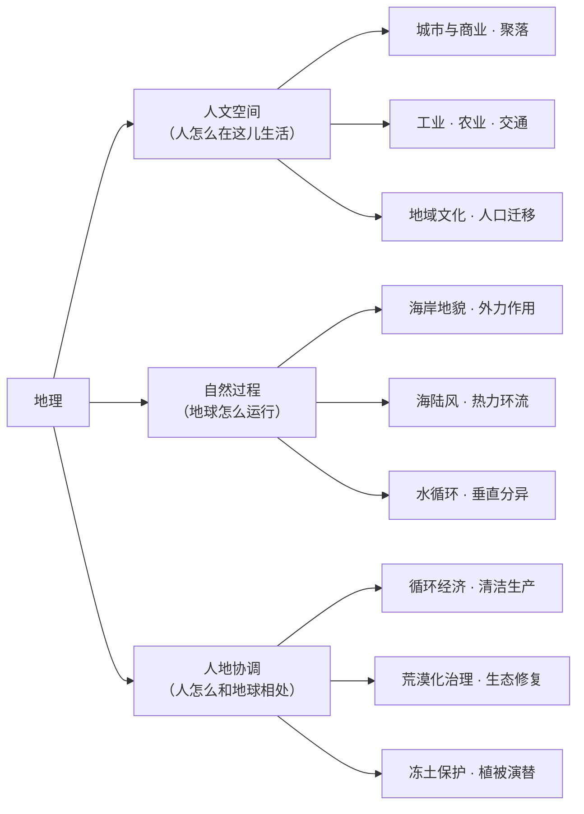
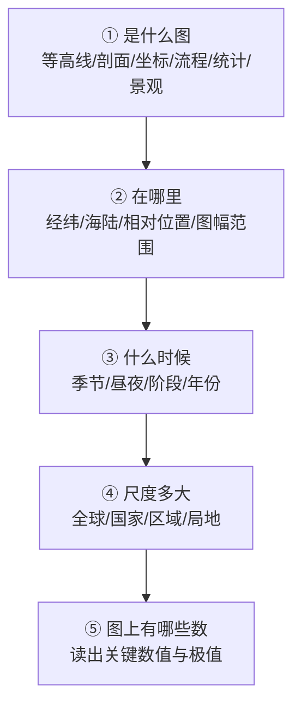

# 高考地理：情境判读与因果链作答（2026 云南卷口径）

| 编写人 | 编写内容 | 编写时间 |
| --- | --- | --- |
| growdu | 面向**中等水平**（60~75 分）的考生，目标是**稳定到 85 分以上**。地理和物理、化学、生物、政治都不一样：**它一半靠读图，一半靠把知识点串成一条因果链**。本文讲清三件事：**2026 云南卷地理到底长什么样**、**九大主题各占多少分、怎么分配复习时间**、**每一类题的破题动作与给分规则**。 | 2026-11-12 |

> **TL;DR**
>
> **地理最容易被忽略的一条：你的失分主力不是「不会」，是「链条断头」。**
>
> 数学的失分主力是运算，物理是建模，化学是陌生，生物是琐碎，政治是落点——**地理的失分主力是「因果链」**：你把知识点罗列了一堆（「降水少、地形平坦、多大风、风沙土广布」），但**没有把它们连成一条链**（「因为冬春降水少、植被稀疏，地表裸露；又因地势平坦开阔，风力长距离搬运沙粒；北边又紧邻科尔沁沙地，沙源充足，所以风沙土广布」）。阅卷按点给分，**链断在哪一环，那一环的分就没有**。
>
> 2026 云南卷地理的四个硬数字：
> - **100 分 / 75 分钟 / 19 题**：选择 16×3 = **48 分**，综合题 3 题 = **52 分**（17 题 18、18 题 16、19 题 18，各 3 问）。**综合题占了 52%**，是全卷最大的主观战场；
> - **九大主题**：地域文化 9 分、城市与商业 9 分、聚落与城市 6 分、海岸地貌 6 分、大气环流 9 分、水循环 9 分、工业 18 分、植被 16 分、区域发展 18 分。**选择部分人文占 24 分、自然占 24 分，正好对半**——「地理是理科」这个印象在 2026 云南卷已经不成立了；
> - **难度**：基础 65% / 中档 25% / 难题 10%；逐题难度系数 0.65 降到 0.54，**压轴的 19 题（0.54）是全卷最难**；
> - **最大变化：把学术论文搬进了地理卷**。第 1—3 题直接取材自《中国农史》的《大运河与淮扬饮食文化的融合与发展》，**考的是长文本阅读 + 跨学科理解**，不是模板。
>
> **三个核心动作**：① **任何题先定位**（这是哪儿、什么时间、什么尺度）；② **答案写成「条件 → 过程 → 影响」的因果链**；③ **开放题敢表态**，立场 + 理由 + 材料，比「两边都有道理」值钱得多。
>
> **一句话**：高考地理拼的不是背了多少知识点，而是**能不能把它们连成一条说得通的链**。

> **口径说明**：题型、题量、分值、注意事项原文、19 题题干来自 **2026 年云南省普通高中学业水平选择性考试·地理**原卷（省自主命题）。**逐题答案为网络收集版 / 考生回忆版整理结果，仅用于讲解例题**，正式答案以省招考院发布为准。九大主题分值、逐题难度系数、命题特点与学生失分分析，来自第三方试卷评析与讲评材料，已在《资料来源与核对入口》逐条标注。2027 届请以当年卷面为准。

---

## 目录

- [一、先定位：地理到底哪里不一样](#一、先定位：地理到底哪里不一样)
- [二、卷面结构：48 : 52 与九大主题](#二、卷面结构：48--52-与九大主题)
- [三、等级赋分：地理的分也不完全由你决定](#三、等级赋分：地理的分也不完全由你决定)
- [四、学习方法：把地理读成三条主线](#四、学习方法：把地理读成三条主线)
- [五、考试技巧：分题型的破题动作](#五、考试技巧：分题型的破题动作)
- [六、2026 云南卷逐题拆解](#六、2026-云南卷逐题拆解)
- [七、六个地理专属陷阱](#七、六个地理专属陷阱)
- [八、给自己的行动清单](#八、给自己的行动清单)
- [九、一页纸速查表](#九、一页纸速查表)

---

## 一、先定位：地理到底哪里不一样

### 1.1 地理科目的三个特殊性

**第一，它一科里有两门考试。**

选择 48 分考的是**读图与定位**：从等高线、剖面图、流程图、坐标图里抠出信息，判断「是什么、在哪里、为什么」。

综合 52 分考的是**因果链与书面表达**：把材料和图上的信息加工成一条说得通的逻辑链，写成规范的分点答案。

**这两半用的是不同的能力，但被很多人用同一种方式准备**——背知识点。结果就是：选择还能靠刷题提一点，综合题一直上不去。

**第二，它是「反模板」最狠的一科。**

2026 云南卷的第 1—3 题，材料**直接取自《中国农史》的专业论文《大运河与淮扬饮食文化的融合与发展》**——里面有学术摘要、古诗词、史料记载、区域物产分析。评析里把这一点称为 2026 卷的**最大创新**：「打通文史地学科边界」。

这意味着：

- 「大运河 → 沟通南北 → 物资交流 → 淮扬菜兼容并蓄」这种**背过就行的模板，在 2026 卷是失效的**——因为材料已经给到了这个层次，你要做的是**从材料里读出**它，而不是**从脑子里调出**它；
- 读长文本的能力，**第一次变成了地理的硬门槛**。

**第三，它是等级赋分 + 开放性设问已经常规化的科目。**

2026 卷的两个开放性设问：

- **第 17 题第 (2) 问**：除了说明成效，还要**提出对薄弱环节的改进设想**——这是「你发现了流程图里的问题，请给方案」；
- **第 18 题第 (3) 问**：**「你是否赞同」表明观点并说明理由**——给了「赞同」和「不赞同」两套标准答案，**你选哪边都行，但必须选**。

很多考生在开放题上不敢表态，写一句「这个问题要一分为二地看」就收尾，**这在按点给分里是 0 分**。

### 1.2 地理的三张失分表

| 失分表 | 考场上的表现 | 根因 | 修法 |
| --- | --- | --- | --- |
| **位置错** | 图没读准，判错了是哪个区域／哪个季节／哪个尺度 | 跳过了「定位」这一步，直接套知识 | 定位三要素（见 4.3） |
| **链条断** | 罗列了一堆正确的知识点，但彼此不连 | 只会「列点」，不会「串点」 | 因果链三段式（见 5.2） |
| **主体错** | 答成了别的区域／别的因素／错的时间尺度 | 没看清设问的限定词 | 划设问限定词 |

**这三张表要分开练**：

- **位置错**练的是**读图**：拿到任何图，先问三件事（是什么、在哪里、什么时候），**30 秒定位再动笔**。
- **链条断**练的是**书面表达**：每次综合题写完后，用红笔检查「我写的点之间有没有连接词和方向」（因为 → 所以 → 导致）。**只有名词罗列 = 断链**。
- **主体错**练的是**审题**：把设问里的限定词圈出来——「**自然**原因」「**与……相比**」「**从……角度**」「**该地**」「**本区域**」。

### 1.3 2026 云南卷地理的分数拆解

| 项目 | 2026 云南卷 | 说明 |
| --- | --- | --- |
| 满分 | 100 | 与其他再选科目一致 |
| 时长 | 75 分钟 | 四门再选科目同 |
| 命题 | **云南省自主命题** | 省外同组合卷子不能当标准答案用 |
| 计入方式 | **等级赋分** | 原始分不公布，只公布赋分 |
| 题量 | 19 题 | 选择 16 + 综合 3（每题 3 问，共 9 问） |
| 题型结构 | 48 : 52 | 选择 16×3；综合 18 + 16 + 18 |
| 情境数量 | 10 个真实情境 | 淮扬菜、新区商业、潼关古城、印尼海岸、海陆风、β 值流域、阿瓦萨、热融湖、彰武县等 |
| 难度梯度 | 基础 65% / 中档 25% / 难题 10% | 第三方评析口径 |
| 逐题难度系数 | 0.65 → 0.54 | 压轴 19 题最难 |

> **一个必须知道的事实：2026 云南地理卷几乎没有「云南本土题」。**
>
> 十个情境里，淮扬菜（江苏）、潼关古城（陕西）、印尼海岸、埃塞俄比亚阿瓦萨、阿拉斯加热融湖、辽宁彰武县——**没有一个是云南**。这和同年的政治卷（滇中引水、滇西「小切口」立法、澜湄合作）形成了鲜明对比。
>
> 这对你的复习意味着两件事：① **不要以为「云南卷就考云南」**；② **地域知识（区域认知）还是要积累**，因为题目会考「潼关为什么从关变成城」这种需要你事先知道一点背景常识的题——只是**不会考「云南有什么」**。

---

## 二、卷面结构：48 : 52 与九大主题

### 2.1 题型结构与分值

| 部分 | 题号 | 题数 | 分值 | 占比 | 考什么 |
| --- | --- | --- | --- | --- | --- |
| 单项选择 | 1—16 | 16 | 48 | 48% | 定位、读图、概念辨析 |
| 综合题 | 17（4+8+6） | 1 | 18 | 18% | 工业 / 循环经济 / 产业结构 |
| 综合题 | 18（4+6+6） | 1 | 16 | 16% | 植被演替 / 土壤 / 冻土 |
| 综合题 | 19（6+6+6） | 1 | 18 | 18% | 沙化耕地 / 农业 / 政策效益 |
| **合计** | 1—19 | **19** | **100** | 100% | — |

**每一问的分值是可以提前知道的**，这在所有选考科目里很少见：第 17 题 4+8+6，第 18 题 4+6+6，第 19 题 6+6+6。

**这个信息直接决定答题顺序**：

- 第 17(1) 只有 **4 分**（必要性分析），但它是整题的铺垫，**必须先写**；
- 第 17(2) **8 分**，是全卷分值最高的一问（说明成效 + 提出改进设想）；
- 第 18(1) **4 分**，纯读图描述，**最便宜的分**，必须拿；
- 第 18(3) **6 分**，开放表态题。

**时间不够时的取舍顺序**：先保 18(1)（4 分，纯读图）、再保 17(1)（4 分，两个角度就够）、然后 19(1)(2)(3) 各 6 分——**这五问加起来 28 分，是性价比最高的战场**。

### 2.2 九大主题的分布

| 题号 | 分值 | 主题 | 核心考点 | 难度系数 |
| --- | --- | --- | --- | --- |
| 1—3 | 9 | 地域文化 | 地域文化差异及形成原因、文化对城乡景观的影响、区域发展差异 | 0.65 |
| 4—6 | 9 | 城市与商业 | 服务业区位因素的变化、商业网点布局、集聚与流动 | 0.65 |
| 7—8 | 6 | 聚落与城市 | 城市功能区的分布和特征、居住街巷区位优势 | 0.65 |
| 9—10 | 6 | 海岸地貌 | 外力作用的表现形式与影响、地形地貌的演变 | 0.55 |
| 11—13 | 9 | 大气环流 | 热力环流、近地面风向判断、大气受热过程 | 0.55 |
| 14—16 | 9 | 水循环 | 蒸散发与水量平衡、径流来源、山地垂直地域分异 | 0.61 |
| 17 | 18 | 工业 | 工业对区域的影响、循环经济与清洁生产、产业结构 | 0.55 |
| 18 | 16 | 植被 | 植被演替与结构、植被对环境的影响、要素间相互作用 | 0.55 |
| 19 | 18 | 区域发展 | 荒漠化的原因与防治、农业区位因素与措施、政策效益 | 0.54 |

> **这张表的三个用法**：
> 1. **选择部分的分区很干净**：1—8 题是人文（24 分），9—16 题是自然（24 分）。**人文部分难度系数 0.65，自然部分 0.55**——**人文题比自然题更容易**，这是 2026 卷的一个反直觉之处。如果你选择题总丢分，先怀疑人文。
> 2. **三道综合题分别对应三块**：工业（18）、植被（16）、区域发展（18），**全是人文 / 人地协调方向**，没有一道是纯自然计算。**这意味着综合题的复习重心在人地关系，不在计算。**
> 3. **难度系数的排序告诉你要在哪用力**：19 题 0.54 最难，17、18 题 0.55，9—13 题 0.55，14—16 题 0.61，1—8 题 0.65 最易。**中档题（0.55—0.61）占了 52 分，是主战场。**

### 2.3 75 分钟时间分配

地理的时间分配和化学篇很像（**选择 33 分钟、综合 38 分钟、检查 4 分钟**），但有个关键区别：**地理的综合题读材料就要花时间**，所以检查时间要留够。

```mermaid
gantt
    title 高考地理 75 分钟时间分配（中等水平）
    dateFormat  mm:ss
    axisFormat  %M:%S
    section 选择区
    选择 1-8 人文送分   :a1, 00:00, 600s
    选择 9-13 自然磨合   :a2, 10:00, 540s
    选择 14-16 自然劝退  :a3, 19:00, 420s
    section 综合区
    解答 17 工业生态园   :a4, 26:00, 780s
    解答 18 热融湖植被   :a5, 39:00, 720s
    解答 19 彰武县沙化   :a6, 51:00, 840s
    section 收尾
    通读检查与补漏      :a7, 65:00, 600s
```

> **时间纪律三条**：
> 1. **选择 26 分钟封顶**。一道选择题超过 70 秒就**标记跳过**——地理选择题的干扰项往往是「相关但不是这一问」，硬算性价比极低。
> 2. **17 题给 13 分钟，它是全卷最值钱的 18 分**（4+8+6 的第 (2) 问 8 分，材料里的物质流动图信息密度极高）。
> 3. **最后 10 分钟分两段用**：**前 6 分钟通读三道综合题**，专找「断链」——某个点后面没有材料、某个点没有连接词；**后 4 分钟只做一件事**，看图上的数有没有抄错、设问的限定词有没有漏。地理丢分最冤的方式就是把「1000~3000 米」写成「1000 米以下」。

---

## 三、等级赋分：地理的分也不完全由你决定

地理和化学、生物、政治一样，是**再选科目、走等级赋分**。完整规则见《[云南高考：政策与科目划分](../yunnan-policy/index.html)》，这里只讲**对地理有特殊影响的三条**。

**第一条：地理的「刷题提分」在赋分制下性价比更低。**

赋分看的是**位次**。而地理卷的分差主要来自**表述**——同样的知识点，写成因果链的和写成名词罗列的，在原始分上可能差 4—5 分，在赋分上就体现为「掉一档」还是「不掉档」。

**结论：地理的提分重点不是多做题，是把已经会的东西写对。**同一个知识点，你已经有能力做对了，差别只在表述——**这部分是纯表达分，最容易捡回来**。

**第二条：地理和化学、生物、政治共享同一把尺子。**

四门再选科目同位次赋分相同。这意味着：如果你选「化学 + 生物 + 地理」，那么**你和所有同样选这三门的人，在三门上的位次是放在一起比的**。

**结论：选科组合要看你能不能一门拖后腿。**地理在四门里通常是**最容易赋到中高档**的（因为卷面表述分多、且人文题占一半），但前提是你**不在表述上丢分**。

**第三条：估分要估等级，不估分数。**

模考原始分和赋分之间没有可换算的关系。「我地理考了 80 分」这句话在云南没有意义，**你要知道的是这次模考你在选地理的人里排第几**。

---

## 四、学习方法：把地理读成三条主线

### 4.1 地理的三条主线

2026 云南卷评析把整卷概括为三条主线：**人文空间 — 自然过程 — 人地协调**。这个概括比「自然地理 / 人文地理」二分法有用得多，因为**高考题几乎都是三条线交叉的**。



**每道题都属于至少两条线。**看 2026 卷的三道综合题：

- **17 题**：自然过程（水资源有限）→ 人文空间（园区产业）→ 人地协调（循环经济）→ **三条全占**；
- **18 题**：自然过程（冻土融化）→ 人地协调（植被是否减缓融化）→ **两条**；
- **19 题**：自然过程（风沙土）→ 人文空间（作物选择）→ 人地协调（政策效益）→ **三条全占**。

**所以复习不能切成「自然」「人文」两本来做**，要按**链条**做。

### 4.2 必背清单：十二条核心因果链

**注意这里的单位是「链」不是「点」。**每条链都有条件、过程、结果，**背链不背模板**——模板是死的，链是活的，材料一变，链的每一环都要重新挂。

| # | 链条 | 条件 → 过程 → 结果 |
| --- | --- | --- |
| 1 | 热力环流 | 地面性质差异 → 昼夜冷热不均 → 气压差 → 水平气压梯度力 → 风向 |
| 2 | 海陆风 | 白天陆地升温快、气压低 → 海洋气压高 → 风由海吹向陆（海风）；夜间相反 |
| 3 | 水量平衡 | 降水量 = 蒸散发量 + 径流量 → 径流量 = 降水量 ×（1 − β） |
| 4 | 地形雨 | 湿润气流受地形抬升 → 冷却凝结 → 迎风坡降水多；越过山脊下沉增温 → 背风坡少 |
| 5 | 植被与蒸腾 | 植被覆盖高 → 根系深、可利用深层水分 → 干季仍能维持蒸腾 → β 值降幅小 |
| 6 | 风沙地貌 | 沙源（邻近沙地 / 河床裸露）+ 动力（冬春多大风）+ 条件（地表裸露、平坦开阔）→ 风沙土广布 |
| 7 | 河流地貌 | 上游流速快、下切为主 → V 形谷；下游流速慢、堆积为主 → 冲积平原 |
| 8 | 城市功能区 | 地租水平 + 交通通达度 → 商业居中、居住外围、工业沿交通线 |
| 9 | 商业网点类型 | 消费需求差异 + 人口分布 → 大型商超（服务半径大、一站式）与集市（低频、就近）并存 |
| 10 | 工业区位演进 | 原料动力 → 劳动力 → 市场交通 → 知识技术 → 区位因子随阶段变化 |
| 11 | 循环经济 | 资源约束 + 污染压力 → 废物资源化 → 降耗、减污、增效 |
| 12 | 植被的生态作用 | 遮阴降温 + 蒸腾降温 + 枯落物隔热 + 根系固土 → 减缓冻土融化、保护表土 |

**第 12 条要两面看。**2026 第 18(3) 问明确给了**两套答案**：

- **赞同**：植被阻挡阳光、削弱到达地面的太阳辐射；植被蒸腾吸收热量、降低温度；植被及枯落物隔绝热量交换，保护冻土；减弱表土侵蚀。
- **不赞同**：植被降低下垫面反射率、增大吸热；植被截留积雪、增强保温；根系改良土壤结构、增加孔隙度与下渗，促进热量传导；微生物分解枯落物释放热量。

**同一条链，两个方向。**这就是「敢表态」的技术依据：**你必须能同时说出正反两面，才敢选一边。**

### 4.3 读图五步法

地理选择题 48 分全靠读图。**30 秒定位法**，任何图都适用：



**第 ④ 步「尺度」是 2026 卷的隐形考点。**第 18 题问的是「非河漫滩型湖盆内 vs 周边」——**同一条曲线，内外两个尺度结论相反**。看错尺度，4 分的描述题就没了。

**第 ③ 步「什么时候」也是**。第 11—13 题问「海陆风日 14—17 时」（白天 = 海风）和「冬季海陆风日」，**季节和时段必须先锁定**。

**第 ⑤ 步「有哪些数」**在 14—16 题里是全部：β 值区间（10—30%）、海拔分带（1000 / 3000 / 5000 米），**这些数字在选项里直接对应**。

### 4.4 错题本怎么记：记「链」不记「题」

地理错题本和前几本都不重样：**化学记反应，生物记概念，政治记点，地理记链**。

**选择题错题本**（练位置错）：

```
【题号】2026-9（潮间带剖面）
【图】凸形 / 凹形两种剖面 + 平均大潮高潮线
【我选】B（沉积环境更加有利） 【对】D（海浪侵蚀作用更强）
【错因】位置错——我没读「水位达到平均大潮高潮线时」这个限定，
        直接按「凹 = 下凹 = 凹陷 = 沉积」选了
【教训】读设问限定词优先于读图
【同类题】2026-11、2026-13、2026-16 都是限定词题
```

**综合题错题本**（练链条断）：

```
【题号】2026-19(1) 彰武县风沙土分布广泛的自然原因（6 分）
【材料关键词】辽宁省彰武县北部 + 柳河沿岸 + 温带大陆性季风气候
【我写的】降水少、大风多、地形平坦
【漏的】① 紧邻科尔沁沙地 → 沙源充足  ② 柳河枯水期河床裸露 → 河流泥沙淤积
【链条还原】沙源（北邻沙地 + 河床裸露）
           + 动力（冬春多大风、地势平坦利于长距离搬运）
           + 条件（气候干旱、降水少、植被稀疏、地表裸露）
           → 风沙土分布广泛
【自查问题】我写的三点之间有没有连接词？→ 没有，都是并列名词 → 断链
```

**这个「链条还原」的动作是地理错题本的核心。**每次写完综合题，都要在错题本里**用箭头把点连一遍**。连不上，说明你在考场上也连不上。

---

## 五、考试技巧：分题型的破题动作

### 5.1 选择题（16 题 / 48 分）：**先定位，再排除**

2026 卷的选择题干扰项，主要是这四类：

**类型一：相关但不是这一问。**选项讲的是同一个区域、同一个主题的事，但不是设问问的那件事。

> 第 4 题：新区出现大型商超与周期性集市并存，主要原因是。A 同步规划 / B 人口居住分散且需求差异 / C 建设用地充足 / D 公共交通密集。答案 B。**A 和 C 都是关于「新区」的，C 甚至是真的（新区建设用地充足），但它们解释不了「两种业态同时存在」。**

**类型二：因果倒置。**把结果说成原因，或把原因说成结果。

> 第 10 题：潮间带剖面由凸变凹，反映海岸带可能存在。C 陆地地面沉降——地面沉降等效于海平面相对上升 → 海浪向岸侵蚀加剧 → 泥沙被冲刷 → 剖面由凸变凹。**因果链方向必须对。**

**类型三：条件错配。**原理对，但需要的条件在材料里不成立。

> 第 16 题：干季 β 值降幅，1000 米以下大于 1000—3000 米，原因是两地存在**植被覆盖差异**。若选「年均气温差异」，气温差异干湿季都存在，解释不了「降幅」的差异。

**类型四：范围与程度。**「主要」「直接」「根本」「唯一」。

> 第 19(3) 评分细则里有一句很硬的话：**「提升种植户技术专业化、抗风险能力提高、提高种植经验」不给分。**因为设问问的是「**效益**」，不是「能力的提升」——**能力提升不是效益**。

**破解动作**：读选项时逐个问「**这句话在材料里有对应吗？**」，而不是「这句话对吗？」。地理选择题八成的错，是**判据用错了**。

### 5.2 综合题（17、18、19 题 / 52 分）：**因果链三段式**

**标准答案的骨架永远是三段**：

```
【条件】材料给出的自然 / 经济 / 社会前提
   ↓
【过程】中间的物理、化学、生物、社会机制
   ↓
【影响】最终形成的结果
```

**以第 19(1)「彰武县风沙土分布广泛的自然原因」（6 分）为例**，参考答案是四条：

> ① **彰武县为温带大陆性季风气候，气候较为干旱**，降水少，植被稀疏，生态脆弱。（2 分）
> ② **北临科尔沁沙地**，河流枯水期河床裸露，**提供沙源**。（2 分）
> ③ **冬春季节多大风**，县域内地势平坦开阔，**利于风力长距离搬运沙粒**。（2 分）

**看这三条的顺序**：**先说本地气候（条件）→ 再说沙源（外部来源）→ 最后说风力与地形（搬运动力与通道）**。

**这不是随意的**，它对应风沙地貌的通用框架：**沙源 + 动力 + 条件**。**框架在这里的作用不是让你套模板，而是让你不漏项。**

**「自然原因」vs「人文原因」是 19 题的分水岭**：

| 问法 | 能写什么 | 不能写什么 |
| --- | --- | --- |
| **自然原因** | 气候、地形、水文、植被、土壤 | 政策、种植结构、经济效益 |
| 保护沙化耕地的**优势** | 作物的生物特性（植株高度、覆盖度、根系、收获方式） | 政策、工程 |
| 给种植户带来的**效益** | 经济收益、投入成本、示范带动 | 「技术专业化、抗风险能力提高」（评分细则明确不给分） |

**这一张表能救 6 分。**因为「自然 / 人文」「优势 / 效益」是最容易串味的两种设问。

### 5.3 开放性设问：敢表态，比表态得好更重要

2026 卷有两道开放题，规则完全不同。

**第 18(3)「你是否赞同植被增加有利于减缓冻土融化」（6 分）**

**规则：站哪边都满分，骑墙零分。**

- **赞同**要写：遮阴和蒸腾降温；枯枝落叶隔热、减少热量向下传递；减弱表土侵蚀、保护冻土层；光合固碳释氧、减缓全球变暖。
- **不赞同**要写：植被促进积雪堆积、增强冬季保温；植被降低地表反射率、吸收更多热量；微生物分解枯落物释放热量；根系增加孔隙度、促进下渗与热量传导。

**破题动作**：

1. **第一句必须表态**：「赞同。」「不赞同。」——**不要写「这个问题要一分为二」**；
2. **给 3—4 条理由**，每条是「机制 + 材料」；
3. **宁可少写一条也不要写错一条**——按点给分，写错的机制不倒扣，但也不给分，白占位置。

**第 17(2)「说明成效，并提出对薄弱环节的改进设想」（8 分）**

**这道题的结构是「3 + 1」**：说明成效 3 个点，改进设想 1—2 个点。

- **成效**按绿色生产的三个目标对号入座：**降耗**（废水经处理后回用于生产或绿化，减少取水量；污泥制成建材，节约天然资源）、**减污**（减少废水废渣直接排放）、**增效**（固体废弃物少量回收再利用，降低成本、额外产出产品）；
- **改进设想**要**从流程图里找薄弱环节**——图上明确标注「固体废弃物少量回收，大量填埋」，**这就是那个薄弱环节**：探索固体废弃物多元化利用途径（边角废料、包装材料转化为再生产品）、无法再利用的进行焚烧发电与无害化处理。

**「改进设想」的破题动作只有一个：去图里找那个「不太对」的标注。**命题人已经把薄弱环节画给你了，**不去找，就只能空泛地说「加强管理」**。

**参考评分细则里的一句话值得抄下来**：

> 水平 1（0—2 分）：未围绕绿色生产目标，或脱离试题情境；
> 水平 2（3—4 分）：能提到循环利用 1 个点；
> 水平 3（5—6 分）：2 个点 + 固废处理措施；
> 水平 4（7—8 分）：2 个点 + 具体措施。

**这是给分档位表，不是模糊评价。**它告诉你：只写「实现资源循环利用」是 0 分级别，**必须写清楚是哪两种循环、加上具体措施**。

### 5.4 三类高频综合题的专门打法

**打法一：材料分析型（17(1)、19(1)）—— 角度配比法。**

这类题问「为什么」，标准答案通常是**2—4 个并列角度**。破题动作：

1. **从材料里圈出所有「实体」**：气候、河流、沙地、作物、政策；
2. **每个实体问一句「它起什么作用」**；
3. **按「条件 / 来源 / 动力 / 结果」归类**，同类合并成一点。

第 19(1) 就是这么来的：气候 → 干旱（条件）；科尔沁沙地 + 河床 → 沙源（来源）；大风 + 平坦 → 搬运（动力）。**三句材料，三条答案。**

**打法二：影响评价型（17(3)、19(3)）—— 三层递进法。**

这类题问「带来什么影响 / 什么效益」。标准答案按**层次**递进：

> **比重变化 → 层次升级 → 体系完善**（第 17(3) 产业结构）
> **直接增产 → 降低成本 → 稳定长期收益**（第 19(3) 种植效益）

**不要只写第一层。**阅卷给分是分层给的，只写第一层通常只能拿一半。

**打法三：读图描述型（18(1)）—— 曲线三段式。**

这类题问「指出变化特征」，**答案 = 阶段 + 趋势 + 数值关系**：

> **湖盆内**：阶段 Ⅰ 快速增加，阶段 Ⅱ 增速减缓，超过湖盆周边，阶段 Ⅲ 趋于稳定。
> **湖盆周边**：增长缓慢，趋于稳定。

**三个要素缺一不可**：**哪一段、往哪个方向、有没有和另一条曲线交叉**。第 18(1) 只有 4 分，但漏掉「超过周边」这个交叉点关系就会丢 1 分。

---

## 六、2026 云南卷逐题拆解

### 6.1 十九道题的情境、考点与答案

| 题号 | 情境 | 主题 | 核心考点 | 难度 | 答案 |
| --- | --- | --- | --- | --- | --- |
| 1 | 淮扬菜的鲜美食材 | 地域文化 | 地域性食材与河湖水产 | 0.65 | B |
| 2 | 京杭大运河与淮扬菜 | 地域文化 | 交通通道与文化交流（贯通南北、精致选料） | 0.65 | C |
| 3 | 淮扬菜国际化 | 地域文化 | 柔性传播与文创符号 | 0.65 | A |
| 4 | 西南某省会城市新区的商超与集市 | 城市与商业 | 商业业态并存的原因 | 0.65 | B |
| 5 | 甲经营户流动销售路径 | 城市与商业 | 流动销售的经济动机 | 0.65 | D |
| 6 | 新建小区集市 vs 乡镇集市 | 城市与商业 | 服务业区位因素的变化 | 0.65 | A |
| 7 | 潼关从「关」到「城」 | 聚落与城市 | 城市功能区的演变（居住区扩张） | 0.65 | D |
| 8 | 潼关古城水坡巷 | 聚落与城市 | 居住街巷的区位优势 | 0.65 | B |
| 9 | 潮间带凸形 / 凹形剖面 | 海岸地貌 | 外力作用强度与剖面形态 | 0.55 | D |
| 10 | 印尼海岸剖面由凸变凹 | 海岸地貌 | 地面沉降与海平面相对上升 | 0.55 | C |
| 11 | 海陆风日 14—17 时近地面风向 | 大气环流 | 海陆风与近地面风向判断 | 0.55 | A |
| 12 | 0—6 时陆风环流顶部高度 | 大气环流 | 下垫面降温与环流高度 | 0.55 | D |
| 13 | 冬季海陆风日的天气 | 大气环流 | 大尺度背景风场弱 → 晴天 | 0.55 | A |
| 14 | 流域最北部高山区年 β 值高 | 水循环 | 蒸散发占降水比值大的原因 | 0.61 | B |
| 15 | 流域径流量的主要来源海拔 | 水循环 | 降水量 ×（1 − β）的判断 | 0.61 | B |
| 16 | 干季 β 值降幅的海拔差异 | 水循环 | 植被覆盖差异与蒸腾 | 0.61 | C |
| 17 | 埃塞俄比亚阿瓦萨生态工业园区 | 工业 | 必要性 / 循环成效与改进 / 产业结构 | 0.55 | （1）4（2）8（3）6 |
| 18 | 阿拉斯加热融湖植被覆盖度 | 植被 | 变化特征 / 变化缓慢原因 / 冻土表态 | 0.55 | （1）4（2）6（3）6 |
| 19 | 辽宁彰武县风沙土与玉米单产提升工程 | 区域发展 | 自然原因 / 作物优势 / 政策效益 | 0.54 | （1）6（2）6（3）6 |

> **答案口径**：以上为**网络收集版 / 考生回忆版**整理结果，用于讲解例题，**正式答案以省招考院发布为准**。难度系数来自第三方题库细目表。

### 6.2 走完三道题

#### 第一道：第 15 题（径流量主要来自哪个海拔）—— 一道题讲清「数据推理」

材料给了一张流域等高线 + 年 β 值分布图，定义 β = 实际蒸散发量 ÷ 年降水量，并说「迎风坡降水量随海拔升高先增加后减少」。

四个选项：1000 米以下 / 1000—3000 米 / 3000—5000 米 / 5000 米以上。

**破题动作**：

1. **写出公式**：多年平均水量平衡 → 降水量 = 蒸散发量 + 径流量 → **径流量 = 降水量 ×（1 − β）**；
2. **找两个极值**：降水量在 1000—3000 米最多（迎风坡先增后减），β 值在这个区间**最低（10%—30%）**；
3. **相乘**：降水量最大 ×（1 − β）最大 → **径流量最大**；
4. **逐项排除**：1000 米以下——气流抬升弱、降水少，且农业广布、蒸腾旺、β 高；3000—5000 米——水汽在 1000—3000 米已大量降落，降水少且 β 更高；5000 米以上——降水极少、几乎全被蒸散。

**答案 B（1000—3000 米地带）。**

**这道题教你的事**：**地理的选择题很多时候不是「判断对错」，是「算一个比值」。**但你不需要真算——**找两个极值同时出现在同一区间**，就是答案。**这比背「径流主要来自中上游」这种结论有用得多**，因为它在你没背过这个流域时也成立。

#### 第二道：第 18(2)（河漫滩型湖盆植被变化慢的原因）—— 因果链怎么写

材料说：热融湖干涸后被草本和矮灌木占据；**河漫滩型湖盆邻近河道，易受季节性洪水影响**，而非河漫滩型远离河道。

设问：相比非河漫滩型，河漫滩型湖盆内植被覆盖度变化缓慢的原因（6 分）。

**参考答案**：

> ① 季节性洪水淹没，**影响种子发育和幼苗生长**；
> ② 季节性洪水**降低土壤透气性**，不利于植物生长；
> ③ 洪水**带走土壤养分**，影响植被扩张。

**评分细则拆得更细**：答到植被 2 分、答到土壤 1 分、土壤含水量/透气性/过湿 1 分、土壤肥力/有机质/营养物质 1 分。

**破题动作**：

1. **只抓一个变量**：季节性洪水（材料给了，其它题没给）；
2. **问「洪水对植物做了什么」**：淹 → 影响种子和幼苗；泡 → 土壤过湿、透气性差；冲 → 带走养分；
3. **每一条都是「机制 + 对植被的影响」**，不是只写「洪水影响植物生长」。

**「只影响植物生长」和「降低土壤透气性，不利于植物生长」差 1—2 分。**这就是链条断头的代价。

#### 第三道：第 19(3)（玉米单产提升工程的效益）—— 设问限定词怎么读

材料：2023 年彰武县玉米种植 180 余万亩，其中 20.62 万亩实施首批**国家玉米单产提升工程**；在**国家政策、资金和技术扶持**下，项目区**平均每亩增产 680 斤以上**，为土壤沙化区玉米增产**提供示范**；此后几年持续推进。

设问：分析国家玉米单产提升工程给彰武县种植户带来的**效益**（6 分）。

**参考答案**：

> ① 农业技术的适应性应用，能有效提高生产效率、**抗风险能力**和玉米单产，**对其他种植户具有示范带动效应**。（2 分）
> ② 国家给予政策、资金扶持，**减少种植户生产投入**，提高种植积极性，降低成本。（2 分）
> ③ 玉米品质好、产量高，**增加种植户收入**（经济收入）。（2 分）

**评分细则明确写着：「提升种植户技术专业化、抗风险能力提高、提高种植经验」不给分。**

**这一条是本篇最值得你抄下来的一条。**它说明：

- 设问问的是**效益**（对农户的实际好处），**不是「能力提升」**——「抗风险能力提高」之所以给分，是因为它后面跟着「**和玉米单产**」并且服务的是「示范带动」这个**效益**；
- 设问问的是**给种植户的**，所以「国家政策扶持」要落到**「减少种植户生产投入」**上——写「国家重视农业」不给分。

**破题动作**：**把设问的限定词抄在草稿纸顶端**（本题：**效益**、**给彰武县种植户**），写每一句时都回头看一眼这两个限定。

---

## 七、六个地理专属陷阱

### 陷阱一：把名词罗列当成因果链

「降水少、大风多、地形平坦」——三个都对，但阅卷时看到的是**三个孤立的点**，不是一条链。凡是能加连接词的，**都要加**。

### 陷阱二：忽略设问的限定词

「自然原因」写政策、「效益」写能力提升、「与……相比」没做对比——**这是 2026 云南卷被评分细则点名的高频失分**（19(3) 明确写「不给分」）。

### 陷阱三：看错尺度

第 18 题考「湖盆内」和「湖盆周边」，**同一条曲线内外结论相反**。第 11—13 题考「近地面」和「环流顶部」，**风向判断完全相反**。**每题先问「这个设问限定的是哪一层」。**

### 陷阱四：把模板当答案

2026 卷明说「**反模板答题**」，第 1—3 题的论文材料就是在惩罚模板化作答。**模板能给你下限，给不了上限。**材料给到的层次，你必须答到那个层次。

### 陷阱五：开放题骑墙

「这个问题有利有弊，要一分为二」——**按点给分，0 分**。必须选一边、给理由。**选错边不倒扣，骑墙才倒扣。**

### 陷阱六：用模考原始分报志愿

地理是赋分科目。模考 78 分可能是 A 档也可能是 C 档。**估分估位次，不估分数**。

---

## 八、给自己的行动清单

### 立刻可以做的三件事

1. **做一张九主题表**，每格写「题号 + 分值 + 核心考点 + 难度系数」。今天做一半，明天做完。**这张表就是你的复习目录。**
2. **把 12 条因果链抄成一张卡片**，每条写成三行：条件 / 过程 / 结果。**不要抄成一段话。**
3. **找 5 张你做错过的地理图**（从错题本里翻），每张只用五步法重做一遍定位。**20 分钟，定位能力立刻见涨。**

### 一周内可以做的三件事

4. **专攻人文选择（1—8 题，24 分，难度 0.65）**。这部分最容易提分，而多数人因为「地理是理科」压根没复习。**把第 1—8 题的考点抄成 8 句话。**
5. **专攻读图描述（18(1)，4 分）**。曲线题的三段式：阶段 + 趋势 + 数值关系。**这是全卷最便宜的分之一。**
6. **专攻开放题**：把 18(3) 的赞同与不赞同两套答案**都背下来**。**背两套不是为了选边，是为了让自己敢选边。**

### 一个月内可以做的三件事

7. **建立「设问限定词」清单**：把近 20 道综合题的设问限定词抄下来（自然原因 / 优势 / 效益 / 与……相比 / 从……角度），归类。**你会发现自己有 3—4 个高频混淆。**
8. **给每道综合题加一条「链条还原」**：写完答案，用箭头把点连一遍，连不上就重写。**这一条做完，19(1)、19(2) 这类题的分会明显上一个台阶。**
9. **每周一次限时 75 分钟**，严格按上面的时间分配做一套卷，用红笔在检查环节只做两件事：核对数字、核对限定词。

### 考前一周

10. **只看九主题表 + 12 条因果链 + 自己的设问限定词清单**。不做新题、不碰压轴。**最后一周做新题，唯一效果是把你的自信搞没。**

---

## 九、一页纸速查表

```
【科目】云南卷 100 分 / 75 分钟 / 省自主命题 / 再选科目·等级赋分
【结构】选择 48（16×3）+ 综合 52（17: 4+8+6 / 18: 4+6+6 / 19: 6+6+6）= 100
        19 题 9 问，分值全部可提前预知 → 决定取舍顺序
【九主题】地域文化 9｜城市与商业 9｜聚落与城市 6｜海岸地貌 6｜大气环流 9
        水循环 9｜工业 18｜植被 16｜区域发展 18
        选择部分人文 24（1-8，难度 0.65）+ 自然 24（9-16，难度 0.55-0.61）
        综合三题全是人地协调方向，没有一道纯计算
【难度】基础 65% / 中档 25% / 难题 10%；逐题 0.65 → 0.54，19 题最难
【时间】选择 1-8 10min｜9-13 9min｜14-16 7min｜17:13min｜18:12min｜19:14min
        最后 10min：前 6 通读补链，后 4 只查数字与限定词

【三张失分表】位置错（没定位）→ 练读图五步法
            链条断（只列点）→ 练因果链三段式
            主体错（限定词没读）→ 练划限定词
【读图五步】是什么图 → 在哪里 → 什么时候 → 什么尺度 → 有哪些数
【因果三段】条件 → 过程 → 影响（风沙地貌 = 沙源 + 动力 + 条件）
【开放题】必须选边：先表态，再给 3-4 条「机制 + 材料」；骑墙 0 分
        17(2) 的薄弱环节在流程图里：图上标注了什么异常，就答什么
【必背 12 链】热力环流｜海陆风｜水量平衡｜地形雨｜植被与蒸腾｜风沙地貌
        河流地貌｜城市功能区｜商业网点｜工业区位演进｜循环经济｜植被生态作用

【地理专属陷阱】名词罗列冒充因果链｜漏看设问限定词｜看错尺度
        把模板当答案｜开放题骑墙｜用模考原始分报志愿
【底线】地理是赋分科目，估分即估位次；提分重点不是多做题，是把会做的写对
```

---

## 相关阅读

- [云南高考：政策与科目划分（2026 官方口径）](../yunnan-policy/index.html) —— **赋分规则的原文出处**：3+1+2 科目切分 → 六门选考全是省命题 → 等级赋分五档 → 选科四类要求 → 2025/2026 分数线
- [高考物理：模型方法与考场操作（2026 云南卷口径）](../physics-methods/index.html) —— **姊妹篇**：物理考建模，地理考建模之外还考**表达**；物理篇讲模型识别，地理篇讲因果链连接
- [高考化学：云南卷的结构、赋分策略与考场操作（2026 口径）](../chemistry-methods/index.html) —— **姊妹篇**：化学的难点是「陌生」，地理的难点是「链条」；两篇都先讲赋分策略
- [高考政治：七本教材定位与材料应答（2026 云南卷口径）](../politics-methods/index.html) —— **姊妹篇**：政治的失分在「落点」，地理的失分在「链条」；**同为云南省自主命题的省卷，本土素材密度差异极大**（政治考滇中引水、澜湄合作，地理几乎没有云南题）
- [云南高考报考指南：选校、选专业与各类特殊计划](../yunnan-apply/index.html) —— **下游**：地理是很多专业组的选科要求，**选科不匹配则志愿根本填不进去**
- [高考数学：中等水平者的做题方法与学习路径](../math-methods/index.html) —— 同一套「先诊断丢分在哪，再选方法」框架

---

## 资料来源与核对入口

| 内容 | 来源 |
| --- | --- |
| 2026 云南卷地理的题型、题量、分值、注意事项原文、19 题题干、逐问分值 | 《云南省 2026 年普通高中学业水平选择性考试·地理》原卷及配套解析（2026-06 考试） |
| 九大主题分值分布表、开放性设问（17(2) 改进设想、18(3) 辩证表态）、主题归纳 | 2026 年云南卷高考地理真题深度解析：命题风向与备考策略全梳理（讲评 PPT）——四季读书网 |
| 逐题难度系数与核心知识点细目表（1-3 0.65 / 4-6 0.65 / 7-8 0.65 / 9-10 0.55 / 11-13 0.55 / 14-16 0.61 / 17 0.55 / 18 0.55 / 19 0.54） | 2026 年高考云南卷地理高考真题（网络收集版）细目表——组卷网 |
| 难度梯度（基础 65% / 中档 25% / 难题 10%）、四大命题特征、跨学科论文入题、学生失分短板分析 | 2026 年云南省普通高中学业水平选择性考试地理试卷深度分析——网易（转《中国农史》论文视角解析） |
| 逐题答案与解析、参考答案评分细则（含「不给分」的具体条款） | 2026 年高考地理真题——云南卷答案解析——初高中地理网 |
| 地理为再选科目、等级赋分、75 分钟 100 分 | 《云南省 2025 年普通高校招生考试安排和录取工作实施方案》、2026 网上填报志愿考生须知 |

> **核对入口**：[云南省招考频道](https://www.ynzs.cn) ｜ [教育部阳光高考平台](https://gaokao.chsi.com.cn) ｜ 考生服务平台 <https://gk.ynzs.cn>
>
> **时效提醒**：本文取自 **2026 年**云南卷。**九大主题分布、逐题难度系数、情境选材逐年会变**，但方法论部分（读图五步法、因果链三段式、限定词纪律、开放题表态规则、12 条核心链）**与具体年份无关**。
>
> **一处需要自己核对的地方**：网上流传的一份「2026 云南地理真题指南」声称本题型结构是「选择题 11 道每题 4 分、综合题 2 大题共 56 分」，并引用了一个「云大招字〔2026〕5 号」文件、称首年情境为「滇西山地生态修复」。**这与原卷不符**——原卷是「16 小题 × 3 分 + 3 大题共 52 分」，情境是淮扬菜、潼关古城、印尼海岸、阿瓦萨生态工业园、阿拉斯加热融湖、彰武县，**没有一道是云南本土题**。本篇一律以原卷为准。看到具体数字时，先回去核对原卷。

---

| 编写人 | 校验内容 | 时间 |
| --- | --- | --- |
| growdu | 题型、题量、分值、注意事项、19 题题干与逐问分值分配逐条对照 2026 云南卷地理原卷及解析；九大主题分值、难度系数、命题特点对齐第三方试卷评析并标注来源；逐题答案与「不给分」条款已标注为网络收集版 | 2026-11-12 |
