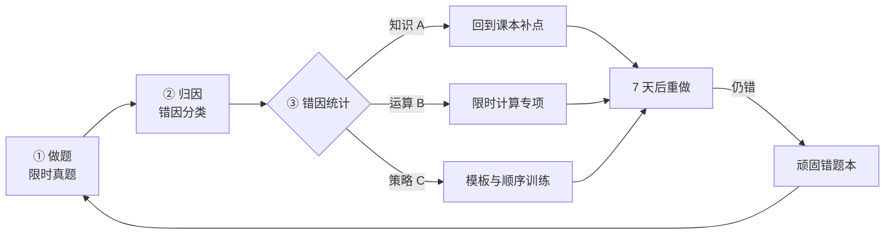

# 高考数学：中等水平者的做题方法与学习路径

| 编写人 | 编写内容 | 编写时间 |
| --- | --- | --- |
| growdu | 面向**中等水平**（90~115 分）的考生，目标是**稳定到 120 分以上**。不讲"多刷题"这类正确但无用的话，只讲三件事：**你的分数到底丢在哪**、**每类题的具体破题动作**、**怎么把非智力因素标准化**。 | 2026-11-06 |

> **TL;DR**
>
> **中等生的分数，不是"不会"丢的，是"会但拿不到分"丢的。** 一张 150 分的卷子，中等生通常有 25~35 分不是输在知识盲区，而是输在：算错（草稿）、看漏（审题）、写不完（时间）、答案对了但步骤不给分（书写）。
>
> **所以提分的第一优先级不是学新知识，是"止损"** —— 把已经会做的题的分**一分不少地拿回来**。这部分通常有 10~20 分，是**最快、最确定、不需要额外时间**的收益。
>
> **三个核心动作**：① **限时训练**（不计时等于没练）；② **错因归类**（错题本不抄题，抄错因）；③ **前 3 道解答题必满分**（它们的分是"最贵"的，也是最容易被放弃的）。
>
> **一句话**：高考数学拼的不是智商，是**在 120 分钟里，把会做的题干净地做完**。

---

## 一、先定位：你的"中等"是哪一种中等

"中等水平"不是一个统一的人，三种中等生的提分路径完全不同。**先做诊断，再选方法**，否则会用错力气。

### 1.1 三张失分表

拿最近 3 套真题（不要用模拟题），把每一道错题标上失分类型：

| 类型 | 判定标准 | 典型表现 | 对应动作 |
| --- | --- | --- | --- |
| **A. 知识性失分** | 看完题干就知道自己不会 | 完全没思路，看答案像看天书 | 补知识（最慢，见 §5.5） |
| **B. 运算性失分** | 方法对，算错了 | 思路正确但算错、符号错、算完没回代 | **限时 + 步骤规范化**（最快，见 §5.3、§5.4） |
| **C. 策略性失分** | 会做，但不该在这里做/不该这样做 | 会做但超时；填空精确度不够；分类讨论漏情况 | **做题顺序 + 模板化**（见 §2、§5.4） |

### 1.2 诊断结论表（按分布看方向）

| 失分构成 | 你的画像 | 提分主战场 | 预期收益 |
| --- | --- | --- | --- |
| A 为主（> 60%） | **基础不牢型** | 回归课本，扫盲知识点 | 慢，但天花板最高 |
| B 为主（> 50%） | **会做但拿不到分型** | 限时训练 + 步骤规范 | **最快，2~3 个月见效** |
| C 为主（> 40%） | **时间/策略型** | 做题顺序 + 答题模板 | 快，立竿见影 |
| 三者都 < 40% | **临场发挥型** | 压轴题专项 + 心态 | 慢，需要长期积累 |

> **给中等生的判断**：绝大多数中等生是 **B + C 混合型**，也就是"**不是不会，而是没做完、做错、写不清**"。这类人**不需要更多题，需要更严的流程**。本文的重点就在这里。

### 1.3 一张卷子的分数拆解（中等水平典型分布）

以 **2026 年新课标卷**（150 分 / 120 分钟 / 19 题）为例：

| 题型 | 题号 | 题量 | 分值 | 中等生典型得分 | 中等生典型丢分点 |
| --- | --- | --- | --- | --- | --- |
| 单选 | 1~8 | 8 | 40 | 32~37 | 会几道算几道，1~2 道卡住 |
| 多选 | 9~11 | 3 | 18 | 9~15 | **不敢多选**（见 §3.1.4） |
| 填空 | 12~14 | 3 | 15 | 10~15 | 会做但精确度不够、定义域漏写 |
| 解答题（前 3 道） | 15~17 | 3 | 43 | 30~36 | **写不完**、步骤分丢得多 |
| 解答题（后 2 道） | 18~19 | 2 | 34 | 8~12 | 只做出第 1 问就放弃 |
| **合计** | — | **19** | **150** | **89~115** | — |

**关键读数**：中等生的分数区间不是 90 分，而是 **89~115 分**——**下限比很多人以为的还低**。这也解释了为什么"感觉都会"却上不了 100。

> ⚠️ **别记题号**。教育部对 2026 全国二卷的评析里明确写了"**打破题号定式，题目顺序可调整**"，所以"第 8 题必考抽象函数"这种经验本身就不牢靠。**记分值比重记题号有用。** 想看一份真实卷子的逐题拆解，看 [《全国卷二逐题拆解：一个普通高三学生的答题思路与考场操作》](../math-paper2/index.html)。

---

## 二、卷面时间分配：120 分钟怎么花

**这是中等生收益最高的一张表。** 不会做的题死磕 = 送命。

```mermaid
gantt
    title 高考数学 120 分钟时间分配（中等水平）
    dateFormat  mm:ss
    axisFormat  %M:%S
    section 拿分区
    选择题 11 题     :a1, 00:00, 1800s
    填空题 3 题      :a2, 30:00, 900s
    section 保底区
    解答 15-17       :a3, 45:00, 2400s
    section 拉分区
    解答 18-19       :a4, 85:00, 1620s
    section 兜底
    涂卡 + 回头检查   :a5, 112:00, 480s
```

| 阶段 | 用时 | 硬性纪律 | 中断条件 |
| --- | --- | --- | --- |
| 选择题（8 单选 + 3 多选） | **30 min** | 单选每题 ≤ 90 秒；多选逐项验证，不缩答案 | 一道题卡 3 分钟 → 立刻标记跳过 |
| 填空题（3 题） | **15 min** | 每题 ≤ 5 分钟（填空比选择更耗时，正常） | 5 分钟没思路 → 空着，回头再来 |
| 解答 15~17 | **40 min** | 这 3 题（43 分）是**必争之地**，只做这 3 题 | 不允许提前往后跑 |
| 解答 18~19 | **27 min** | 前 2 问优先，压轴题最后一问**允许空** | — |
| 检查 | **8 min** | 只查：漏条件、抄错符号、漏写"解" | 不要重做大题 |

> **反直觉但正确**：压轴题（解答 19）的最后一问，**放弃是标准操作**。中等生在这上面平均投入 10 分钟、期望收益 1.5 分，性价比极低。把这 10 分钟还给解答 15~17，期望收益 3~4 分。

---

## 三、做题方法：分题型的破题动作

### 3.1 选择题（8 题 / 40 分）

#### 3.1.1 第一原则：**先排除，后求解**

中等生最大的时间黑洞是"看到式子就想算"。正确顺序是：

| 步骤 | 动作 | 耗时上限 |
| --- | --- | --- |
| 1 | 读问题：**问什么？求什么？有没有"正数""钝角""递增"这类限定词** | 10 秒 |
| 2 | 看选项：**选项透露信息**（特值法、量纲、数量级） | 10 秒 |
| 3 | 能否排除？→ 能排除就直接排除 | 30 秒 |
| 4 | 不能排除 → 用最快路径求解（特殊值、代入、图像） | 60 秒 |
| 5 | 仍无头绪 → 标记跳过 | — |

#### 3.1.2 **特值法**：选择题第一杀器

**适用**：方程 roots、不等式解集、函数零点、排列组合选项。

**例子**：已知 `f(x) = x³ - 3x + 1`，则 `f(1) = ?`
选项为 `A. -1  B. 1  C. -2  D. 2` → 直接代入 x=1：`1 - 3 + 1 = -1` → 选 A。**不用解方程。**

**要点**：选特值要满足题设所有限制（定义域、正负、范围），且**代入后能明显区分选项**（比如代入后得到 5 个选项里只有 2 个接近）。

#### 3.1.3 **代入排除法**：选项是"数值"时

当选项是具体数字，直接把选项**代回题目条件**验证，比正向求解快 3~5 倍。

**适用**：解方程、求参数范围、充要条件判断。

**纪律**：从"看起来最可能"的选项开始代，通常 2 次命中。

#### 3.1.4 多选题（3 题 / 18 分）：**"敢多选"是中等生的免费分**

多选题的规则是：**全部选对得满分，部分选对得部分分**（各省卷型略有差异，但都存在部分分）。这意味着：

| 错误策略 | 结果 |
| --- | --- |
| 只选 1 个最确定的 | **几乎必然 0 分**（多选至少 2 个选项） |
| 排除法排除到只剩 2 个就停 | 也可能 0 分 |
| **逐项验证，多选就多选** | 哪怕错 1 项也有部分分 |

**中等生最该改的习惯**：多选题**不要在"我不确定"时收缩答案**。正确的收缩原则只有一个：**当你能明确说出一个选项"一定错"时才排除它**；"我不确定它对"≠"它错"。

#### 3.1.5 什么时候该"蒙"

时间过半、还有 5 题未做：**必须蒙**。选择题每题期望 1/4 分，5 题 = 1.25 分，白给。

- 单选：随机选（**多选题排除后剩余选项**效果更好）。
- 多选：**永远填满能填的**（部分分制度下填满期望更高）。

### 3.2 填空题（3 题 / 15 分）：**会做就必须拿到**

填空题没有过程分，**对就是对、错就是错**，所以它的"止损"价值最高。

**三条纪律**：

1. **先判"这题值不值得死磕"**：填空平均每题 5 分钟。**卡到 4 分钟且毫无进展 → 立刻跳过**。中等生常见致命错误是在填空题上死磕 10 分钟，**剩下两题的分和后面大题的节奏一起赔进去**。
2. **答案必须"精确"**：
   - 填空结果带**根号、分数、对数**时，先代回原式**验算**（特别是解方程题，务必把答案代回检验）。
   - 有**多个解**时，**全部写上**（用顿号隔开），漏解直接 0 分。
   - 带**单位/范围限定**的题，答案要符合题意的规范形式（如"开区间"写成 `(1, 2)` 而不是 `1 < x < 2`）。
3. **定义域是最常见的 0 分元凶**：答案含 `log`、分式、偶次根号、反正弦时，**先写定义域再化简**。

### 3.3 解答题（5 题 / 77 分）：**"踩点给分"思维**

这是中等生**最被低估**的一块。很多中等生以为解答题要"全做对"才得分——**错**。高考是**步骤给分**：只要写出了踩点步骤，就给对应的分，哪怕最后结果错了。

**核心心法：把解答题当成"分块填空"，不是"一道大题"。**

| 做法 | 效果 |
| --- | --- |
| 硬扛整题，最后结果算错 | **全题 0 分**（白干 10 分钟） |
| 每问独立，能做第 1 问就交卷 | 至少拿到前 2 问的分（≈ 12~18 分） |

**具体执行**：
- **落笔先写"解"**，再写条件、结论。阅卷按步给分，格式不规范可能白丢步骤分。
- **每一问单独设目标**：这一问我要拿到哪几分？拿不到就跳。
- **卡住时往下看**：后面 2~3 小问往往和前面有公共部分，先做后面的，回头再补前面。
- **压轴题只做第 1 问**：第 1 问通常是"设出表达式/求导/求单调区间"的铺垫分，**相对独立、相对容易**，直接拿下。

### 3.4 "会做但拿不到分"的三种典型死法

| 死法 | 现象 | 根治方法 |
| --- | --- | --- |
| **算错** | 思路对，末步算错 | 草稿分区、关键步骤重算一遍（§5.3） |
| **漏条件** | 定义域、范围、参数非零、题目"至少/最多" | **草稿第一行抄条件**（§5.4） |
| **步骤分丢** | 过程跳步，结论对但没过程分 | 关键步骤**写出来**（§5.4） |

---

## 四、按模块的破题套路

> 这一节是"遇到什么题型，第一步干什么"的速查。**中等生不需要掌握所有技巧，只需要每个模块有一条**能走通**的主路 + 一条能保底的兜底路。

### 4.1 函数与导数（第 1 大题 / 最后一大题）

**主路：先求导，再看单调性**

| 步骤 | 动作 | 关键结论 |
| --- | --- | --- |
| 1 | 求导 `f'(x)` | 求导是**计算题不是证明题**，求错就全错，算完**代回去验一个点** |
| 2 | 解 `f'(x) > 0 / < 0` | 注意**定义域**和**导数不存在的点**（分段点常是单调性跳变点） |
| 3 | 写单调区间 | 区间端点用**闭区间**（导数在该点不存在时用开区间或分段写） |
| 4 | 求极值 | 极值点 = 导数变号处；**极值点处导数为 0 是必要不充分条件** |
| 5 | 求最值 | 闭区间上要**比较端点值和极值**（最容易漏的就是端点） |

**比较大小（三选一，不要硬算）**：

| 方法 | 适用 |
| --- | --- |
| 构造函数 `g(x) = f(x) - f(a)`，看单调性 | 通用首选 |
| 特殊值 / 零点法 | 有具体选项时最快（选择题） |
| 局部放缩（切线、放缩不等式） | 压轴题最后一问，中等生**可放弃** |

**导数压轴题的现实建议**：最后一问（证明不等式、讨论参数）**中等生直接放弃**，把时间给第 1 问。

### 4.2 三角函数与解三角形（第 2 大题）

**这是"送分题"，中等生必须 100% 拿下**，一道都不能丢。

| 题型 | 标准化简步骤 |
| --- | --- |
| 化简求值 | 先**降次**（`sin²x = (1-cos2x)/2`）→ 再**辅助角**（`a sinx + b cosx = √(a²+b²) sin(x+φ)`）→ 最后代入特殊角 |
| 图像与性质 | `y = A sin(ωx+φ)` → **五点法**定周期 → 平移看 `x` 的平移量是 `φ/ω`（**不是 φ**！最常错的点） |
| 解三角形 | 已知两边及夹角 → 余弦定理求第三边；已知两角一边 → 正弦定理；面积用 `S = ½ab sinC` |

**高频失分**：
- **图像平移方向搞反**（左加右减，且系数要除）。
- 解三角形**不讨论多解**（SSA 情形常有 2 个解，必须都写）。
- 面积公式里 `sinC` 用错角（要用**夹边**所夹的角）。

### 4.3 数列（第 3 大题）

**核心是"由递推求通项"的构造法。** 中等生只需要掌握 3 种构造：

| 递推形式 | 构造方法 | 例子 |
| --- | --- | --- |
| `a(n+1) = a(n) + f(n)` | **累加相消**（作差或直接求和） | `a(n+1) = a(n) + 2n` → `a(n) = a(1) + 2·(n-1)n/2` |
| `a(n+1) = p·a(n) + q` | **不动点构造** `b(n) = a(n) + q/(p-1)` | `a(n+1) = 2a(n) + 3` → 令 `b(n)=a(n)+3` → `b(n+1)=2b(n)` → 等比 |
| `a(n+1) = p·a(n) + q·n + r` | **待定系数法**：设 `a(n) = An + B`，代入解出 A、B | `a(n+1) = 2a(n) + n` → 设 `a(n)=An+B` → `A(n+1)+B = 2(An+B)+n` → 比较系数 |

**由 `S(n)` 求 `a(n)`**：`a(n) = S(n) - S(n-1)`（`n ≥ 2`），且 `a(1) = S(1)`。**这是送分题，但每年都有人空着。**

**数列大题的分块策略**：
- 第 1 问：求 `a(n)` → 必做（构造题，套路固定）
- 第 2 问：求 `S(n)` → 必做（错位相减 / 裂项 / 放缩）
- 第 3 问：不等式 / 恒成立 → 放缩，**可放弃**

### 4.4 立体几何（第 2 大题）

**中等生在这一题的目标：稳拿前 2 问。**

**万能钥匙：空间向量法。** 不要追求几何直观（那是尖子生的活），建系 + 算，是**可复制**的方法。

| 步骤 | 动作 | 细节 |
| --- | --- | --- |
| 1 | 建系 | 优先用**题干给的**坐标系；自己建系时，**找两个互相垂直的平面**，让两个坐标轴落在里面 |
| 2 | 写点坐标 | 找"正交三线"上的点，按"三线一定交于一点"写；一般点用"向量分解" |
| 3 | 求法向量 | 法向量 `(a,b,c)` 满足 `a·n = 0, b·n = 0`；**解出来后必须代回验证**（这是计算题，最容易算错） |
| 4 | 求线面角 / 二面角 | 化为**法向量夹角**：`cos θ = \|n₁·n₂\| / (\|n₁\|·\|n₂\|)`，注意**锐角取绝对值** |
| 5 | 求距离 | 点点距离用坐标公式；点线距离用**体积法**（等体积：`(1/3)S·h` 两边相等解 h） |

**更快的兜底**：**建系实在建不出来**，就用"**等体积法**"求距离、或直接用**几何法**（找等腰、等角、平行线）——但中等生建议**只用向量法一种**，把模板背熟。

**折叠问题**：这类题（正方体折叠）**中等生建议放弃最后一问**，第一问（不折叠时的基本量）必拿。

### 4.5 解析几何（第 5 大题）

**中等生的目标：第 1 问必拿（设线 + 联立 + 韦达），第 2 问争取，第 3 问放弃。**

**标准流程（背下来）**：

| 步骤 | 动作 | 关键细节 |
| --- | --- | --- |
| 1 | 设直线 | **斜率式** `y = kx + m`（需讨论斜率不存在）或**"x = my + n"**（垂直/水平时更省事）——**选错设法是第 1 问就崩的常见原因** |
| 2 | 联立消元 | 得关于 x（或 y）的一元二次方程 |
| 3 | **韦达定理** | `x₁+x₂ = -b/a`，`x₁x₂ = c/a` —— **整个解析几何的命脉** |
| 4 | 求弦长 | `\|AB\| = √(1+k²)·\|x₁-x₂\|`，`\|x₁-x₂\| = √(Δ)/\|a\|` |
| 5 | 求中点 | 中点坐标 = `((x₁+x₂)/2, (y₁+y₂)/2)`，直接用韦达，**不要解出 x₁, x₂** |
| 6 | 求距离 | 点到直线距离公式（**注意绝对值**） |

**中等生最容易崩的地方**：
- **设线时漏讨论**（斜率不存在、x = x₀ 的竖直线）——**这是第 1 问丢分的头号原因**。
- **联立后不判别式**：`Δ > 0` 要写出来，这是给分点。
- 硬解 `x₁, x₂` → 计算量爆炸 → 时间超了 → 后面全崩。**永远用韦达。**

### 4.6 概率与统计（趋势题）

新高考下，概率统计**越来越偏实际应用**（频率估计、决策分析），但**题干长、概念少**，是"读题分"的题型。

| 必背概念 | 内容 |
| --- | --- |
| 古典概型 | `P = 满足条件的基本事件数 / 总基本事件数`，**计数不能重、不能漏** |
| 分类加法 / 分步乘法 | 分类用加法，分步用乘法；**分类必须互斥** |
| 条件概率 | `P(B\|A) = P(AB)/P(A)`，注意**样本空间变了** |
| 全概率 / 贝叶斯 | 多种来源 → 先求全概率，再反推 |
| 二项分布 | 独立重复 `n` 次，成功 `k` 次：`P = C(n,k)p^k(1-p)^(n-k)` |
| 正态分布 | 对称性 `P(X < a) = P(X > 2μ-a)`，**标准化** `Z = (X-μ)/σ` |
| 回归与相关性 | 相关系数 `r ∈ [-1,1]`，**正相关 ≠ 因果**；回归直线必过 `(x̄, ȳ)` |

**最常见的两个 0 分**：
1. **"至少/至多"用对立事件算更快**：`P(至少1次) = 1 - P(0次)`。直接数"至少"极易漏情况。
2. **计数时把"有序"和"无序"搞混**：分配问题（分给不同人）用**插空法/捆绑法**；排成一排用**排列**；只选不排用**组合**。

---

## 五、学习方法：把"非智力因素"标准化

### 5.1 错题本：**不抄题，抄错因**

多数人的错题本是"题目 + 答案"的抄写本——**几乎没有用**，因为下次遇到同类题还是不会。

**中等生的错题本应该是"错因索引"**，每条只记 4 个字段：

| 字段 | 示例 | 为什么必须有 |
| --- | --- | --- |
| **题目来源** | 2024新课标I 卷 15 题 | 定位 |
| **错因标签** | `B-运算：解三角时符号错` | **核心字段**，用于统计 |
| **正确路径的一句话** | `先用余弦定理解出第三边，再正弦定理` | 下次看到能立刻想起套路 |
| **触发条件** | `看到"已知两边和夹角" → 先想余弦` | 把知识变成**条件反射** |

**周统计表**（每周末花 10 分钟填，这是错题本唯一有价值的用法）：

| 错因标签 | 本周次数 | 累计次数 | 处置 |
| --- | --- | --- | --- |
| 定义域漏写 | 3 | 7 | **立刻专项**：所有题先写定义域 |
| 分类讨论漏情况 | 2 | 2 | 专项：翻 10 道分类讨论题 |
| 计算失误 | 5 | 21 | **专项：限时计算训练**（§5.3） |

**核心逻辑**：错题本的价值不在"存"，在**"统计"**。同一类错因出现 3 次以上 → 它就不是"粗心"，是**方法缺陷**，必须专项训练。

### 5.2 三遍刷题法（比"多刷题"有效得多）

| 遍数 | 目标 | 做法 | 时间 |
| --- | --- | --- | --- |
| **第一遍** | 检验会不会 | **限时**做，模拟考场 | 按真实速度 |
| **第二遍** | 归因 | 不看答案重做；仍错的**当场归因**并记进错题本 | 只做错题 |
| **第三遍** | 固化 | **7 天后**只做第一遍做错且第二遍仍错的题 | 只做"顽固错题" |

> **为什么是 7 天**：遗忘曲线决定了 1 天后重做等于"抄答案"（还在短期记忆里），7 天后重做才检验出是否真的内化。

**最常见的错误：跳过第二遍。** 一遍刷完就以为会了——但一遍的完成率里，**"蒙对/看懂答案"占了 30%**。第二遍的"不看答案重做"是唯一能把这部分筛出来的动作。

### 5.3 限时训练：不会计时的练习等于没练

**中等生最大的幻觉是"我都会，就是没考好"。** 解题速度是**独立的技能**，不练就不会。

| 训练类型 | 怎么做 | 频次 |
| --- | --- | --- |
| **分段限时** | 选择题 11 题 30 分钟、填空 3 题 15 分钟，**从真题开始** | 每周 1 次 |
| **单题限时** | 选择题每题 90 秒、填空每题 5 分钟；超时立刻停笔标记 | 每天 15 分钟 |
| **计算专项** | 只做"算错型"错题的重算，限时 | 每天 10 分钟 |

**只练"分段限时"，不要一上来就全卷 120 分钟**——全卷限时会把"不会"和"慢"两种问题混在一起，看不出病灶。

### 5.4 答题模板：把阅卷标准变成自己的肌肉记忆

**中等生丢的"步骤分"是可以靠模板拿回来的**，而且**不需要多做题**。

**通用解答题模板**：

```
解：（1）由题设得 ...
     因为 ...，所以 ...
     所以 ...（结论）
（2）由（1）知 ...
     ...
```

**关键**：**结论一定要单独写一行并加标点**。阅卷按点给分，结论不写出来 = 踩点步骤可能不给。

**各模块的"必写项"清单**：

| 模块 | 必须写出来的东西（不写就可能丢分） |
| --- | --- |
| 导数题 | 求导结果、单调区间结论、**闭区间最值要比较端点** |
| 数列题 | 通项表达式、求和过程（等差/等比/错位相减的公式） |
| 立体几何 | 建系说明、点坐标、**法向量要验证垂直** |
| 解析几何 | **设线 + 讨论斜率不存在**、联立方程、判别式、韦达关系 |
| 概率题 | 事件定义、计数过程、**样本空间总数** |
| 三角题 | 化简过程、**角的取值范围讨论** |

### 5.5 复习节奏（中等生的 90 天）



| 阶段 | 周数 | 每周投入 | 唯一目标 |
| --- | --- | --- | --- |
| **诊断期** | 第 1~2 周 | 6 h | 做 3 套真题 → 出失分表 → 定主战场 |
| **止损期** | 第 3~8 周 | 8 h | **限时训练 + 错因归类**（不学新知识） |
| **补漏期** | 第 9~12 周 | 8 h | 按失分表补 A 类知识盲区 |
| **套卷期** | 第 13 周起 | 6 h | 全卷 120 分钟 + 稳定顺序 |

> **注意"诊断期"和"止损期"的顺序**：**先止损再补漏**。中等生如果一上来就狂补知识，会在"学新知识"的愉悦感里逃避"限时训练"的枯燥，结果是**会做的题照样丢分**——这是最常见的失败模式。

### 5.6 考前 30 天的取舍清单

| 该做 | 不该做 |
| --- | --- |
| 回归错题本，只做"顽固错题" | 做新题、碰新知识点 |
| 全卷限时，保持手感和顺序 | 刷模拟卷（难度不匹配，节奏乱） |
| 默写必背清单（公式、结论、模板） | 刷难题找打击感 |
| 固定做题顺序与时间分配 | 临时改顺序 |

---

## 六、中等生最常踩的 7 个坑

| # | 坑 | 表现 | 纠正动作 |
| --- | --- | --- | --- |
| 1 | **把"看懂答案"当"会做"** | 答案看懂了觉得自己也会 | 错题本第二遍必须**盖住答案重做** |
| 2 | **不计时** | 平时 5 分钟一题，考试 3 分钟一题就崩 | 所有练习**带秒表** |
| 3 | **多选不敢多选** | 只选 1 个 → 0 分 | 只排除"能明确说错"的，不确定就留着 |
| 4 | **定义域/范围不写** | 答案形式错、含 log 无真数、忘记"正数" | 草稿第一行抄题设条件 |
| 5 | **压轴题最后一问死磕** | 耗时 10 分钟拿 1.5 分，还拖累前面 | 明确**允许放弃**，先保必得分 |
| 6 | **解析几何硬解 x₁ x₂** | 计算爆炸，时间超了 | 永远用韦达定理 |
| 7 | **复习顺序反了** | 先补知识，后练速度 → 分数不动 | **先止损（限时），后补漏（知识）** |

---

## 七、一页纸速查表（考前 3 天只看这个）

**做题顺序**：选择（30m）→ 填空（15m）→ 解答 15~17（40m）→ 解答 18~19（27m）→ 检查（8m）

**每类题的"第一动作"**：

| 题型 | 第一动作 |
| --- | --- |
| 单选 | 先看选项，能否**排除/特值/代入** |
| 多选 | 逐项验证，**敢多选**，只排"确定错"的 |
| 填空 | 先写定义域；**验算**；多解要全写 |
| 解答 15~17 | 拿满必争分；**每问独立**，写"解" |
| 解答 18~19 | 只做前 1~2 问，**最后一问允许空** |
| 导数 | 求导 → 解不等式 → **闭区间要比较端点** |
| 三角 | 降次 → 辅助角 → **平移量是 φ/ω** |
| 数列 | 递推构造（累加/不动点/待定系数） |
| 立体 | 建系 → 点坐标 → 法向量 → **代回验证** |
| 解析 | 设线（**讨论斜率不存在**）→ 联立 → **韦达** |
| 概率 | 计数（**有序/无序**分清）→ "至少"用对立 |

**三个保命纪律**：
1. 卡 **3 分钟**（选择）/ **5 分钟**（填空）→ 跳过。
2. 解答题**每问单独设目标**，会几问交几问。
3. 最后 8 分钟只查**漏条件、抄错符号、漏写结论**。

---

## 八、迁移：对考公「数量关系」与「资料分析」的直接帮助

这套方法论和考公**共用同一套底层技能**，不是两件事：

| 高考数学能力 | 考公对应模块 | 共用点 |
| --- | --- | --- |
| 排列组合与概率 | **数量关系**（排列组合、概率问题） | 计数逻辑完全相同 |
| 方程与方程组 | **数量关系**（工程、行程、利润） | 建模 → 设未知数 → 列方程 |
| 函数图像与最值 | **数量关系**（最值优化） | 同一套"设变量 → 求范围" |
| 百分比/增长率/截位 | **资料分析** | 截位法、估算法几乎相同 |

**最直接的三条可迁移结论**：
1. **资料分析的本质是"读题 + 估算"**，和高考选择题的"排除优先"是同一种思维——**先看选项，看选项要什么**。
2. **数量关系不要追求通解**：考公是"选 8 题 + 蒙 7 题"的性价比策略（详见 [腾冲事业编/公务员备考计划](../../daxue/腾冲事业编-公务员备考计划/index.html) § 9.1.3），**放弃比死磕更划算**——和 § 2 的时间分配完全同源。
3. **数学基础差的人做数量关系没有优势，但做资料分析有**——资料分析靠的是**估算习惯和读题速度**，不是数学深度，**这是最容易补的分**。

---

## 九、最后的话

中等水平和优秀之间的差距，很多时候**不在智商，在流程**。

- 优秀的人：**做完还检查**，中等的人：**做完就交**。
- 优秀的人：**卡 3 分钟就跳**，中等的人：**死磕到崩溃**。
- 优秀的人：**错题本统计错因**，中等的人：**错题本抄题**。

这些动作都不需要更多天赋，只需要**被强制执行 90 天**。所以真正的问题不是"我数学能考多少分"，而是"**我能不能连续 90 天，每天 15 分钟，规规矩矩地限时做题 + 归因**"。

**把上面的表打印出来贴在书桌前。分数是结果，流程才是原因。**

---

## 附：本文引用的试卷结构说明

- 以 **2026 年新课标卷**（新课标 I / II 卷）为例：**19 题 / 150 分 / 120 分钟**——单选 8 题 40 分、多选 3 题 18 分、填空 3 题 15 分、解答 5 题 77 分。
- 多选计分规则：**全对 6 分、选对但不全 3 分、错选 0 分**。
- 各卷型在**分值细分**和**多选题部分分规则**上可能有细微差异，考前请以**本省考试院当年说明**为准。
- 配套逐题拆解见 [《全国卷二逐题拆解：一个普通高三学生的答题思路与考场操作》](../math-paper2/index.html)。
- 文中例题用于演示方法，不对应具体年份真题。
