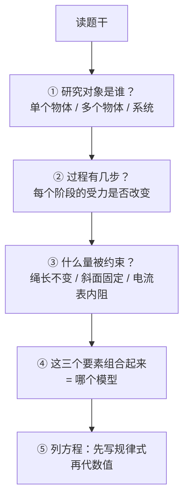
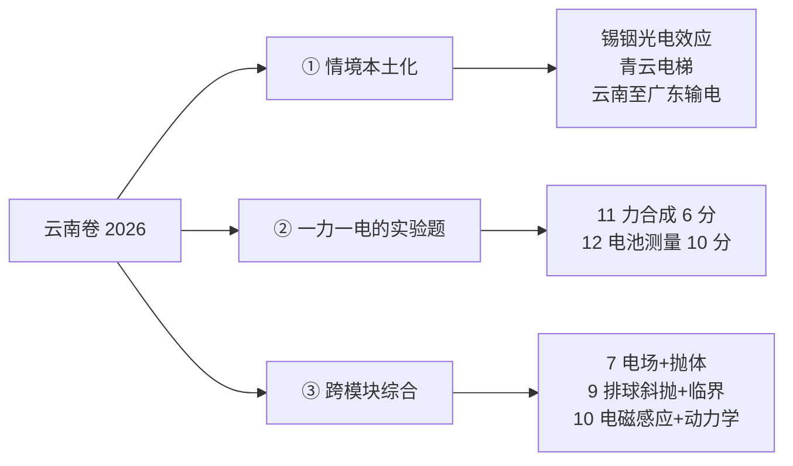

# 高考物理：模型方法与考场操作（2026 云南卷口径）

| 编写人 | 编写内容 | 编写时间 |
| --- | --- | --- |
| growdu | 面向**中等水平**（60~80 分）的考生，目标是**稳定到 85 分以上**。不讲"多刷题"这种正确但无用的话，只讲三件事：**物理的分数是怎么丢的**、**怎么把课本读成模型库**、**每一类题的破题动作和给分规则**。全部对照 **2026 年云南省卷物理真题**（原卷 100 分 / 75 分钟 / 省自主命题）的实际题型与逐题详解。 | 2026-11-11 |

> **TL;DR**
>
> **中等生的物理分，不是"公式不会"丢的，是"选错模型"丢的。** 物理和数学的根本差别在这里：数学是**给定解法求结果**，物理是**读懂情境、认出模型、再定规律**。一道题如果模型认错，后面列式再漂亮也是零分。
>
> **三个最贵的失分点**：
> ① **情境读不懂 → 模型认错**（如 2026 卷第 7 题，题目给的是"匀强电场中的抛体"，很多人当成平抛做，一步错步步错）；
> ② **过程分丢在表述上**——2026 云南卷的卷头明确写着"解答时请写出**必要的文字说明、方程式和重要的演算步骤**；有数值计算时，答案中必须明确写出**数值和单位**"。**漏单位直接扣分，这不是小事**；
> ③ **时间分配错**——75 分钟做 100 分物理，选择题和实验题是**必须拿满的基本盘**（46+16=62 分），压轴题是**期望收益最低的地方**。
>
> **三个核心动作**：① **模型清单化**（把物理从"知识点"重组成"模型库"）；② **错题本只记失效点**（记"我在哪一步错了"，不抄题）；③ **踩点式作答**（按给分点写，不按"我认为的完整过程"写）。
>
> **一句话**：高考物理拼的不是题做得多，是**读题时能不能一眼认出这是哪一类模型**。

> **口径说明**：本文的卷型、题量、分值、给分规则全部来自 **2026 年云南省普通高中学业水平选择性考试·物理**原卷及其官方评分口径（省自主命题）。**2027 届考生请以当年卷面为准**，但"模型库 + 踩点作答"这两条方法论与具体年份无关。

---

## 目录

- [一、先定位：物理的分数到底丢在哪](#一、先定位：物理的分数到底丢在哪)
- [二、卷面结构与 75 分钟怎么花](#二、卷面结构与-75-分钟怎么花)
- [三、学习方法：把课本读成模型库](#三、学习方法：把课本读成模型库)
- [四、考试技巧：分题型的破题动作](#四、考试技巧：分题型的破题动作)
- [五、2026 云南卷逐题拆解：一份真实卷子长什么样](#五、2026-云南卷逐题拆解：一份真实卷子长什么样)
- [六、六个物理专属陷阱](#六、六个物理专属陷阱)
- [七、给自己的行动清单](#七、给自己的行动清单)
- [八、一页纸速查表](#八、一页纸速查表)

---

## 一、先定位：物理的分数到底丢在哪

### 1.1 物理和数学的根本差别

这是本篇最重要的一句话，**不理解它，后面的方法全是隔靴搔痒**。

| | 数学 | 物理 |
| --- | --- | --- |
| 题目给你什么 | **解法基本确定**，你负责算对 | **只给现象**，解法（模型）要你自己找 |
| 核心能力 | 运算、推理、构造 | **建模**：把现实翻译成物理模型 |
| 典型失败 | 算错、审题漏条件 | **模型认错**，导致整题崩盘 |
| 提分抓手 | 限时 + 步骤规范 | **模型识别速度** + 踩点表述 |

**用 2026 云南卷第 7 题说明这个差别**：

> 题目给了：匀强电场（大小方向未知）、质量 0.1 kg、电荷 1.0×10⁻⁶ C 的正电小球、从 O 点抛出、1 s 后到 O 正上方 3 m 处的 M 点、再经 1 s 到 N 点、O 与 N 同一水平线且相距 3 m。问 E 和 φO、φN 的大小关系。

**物理的做法**（原文详解）：

1. 0~1 s 水平位移为 0 → `v₀x + 0.5aₓ = 0`；竖直位移 3 m → `v_y0 + 0.5a_y = 3`
2. 0~2 s 水平位移 3 m → `2v₀x + 2aₓ = 3`；竖直位移 0 → `2v_y0 + 2a_y = 0`
3. 解得 `aₓ = 3 m/s²`，`a_y = −6 m/s²`
4. 受力分析：`aₓ = qEₓ/m`，`a_y = −g + qE_y/m` → `Eₓ = 3.0×10⁵ V/m`，`E_y = 4.0×10⁵ V/m`
5. `E = √(Eₓ² + E_y²) = 5.0×10⁵ V/m`；Eₓ > 0 表明沿 x 轴正方向电势降低 → `φO > φN` → **选 C**

**注意第 1~2 步**：这里用的是**逐段位移方程**，不是"平抛"也不是"匀变速整体公式"。**如果你把它当成平抛做（只分解成 x、y 两个自由分运动且加速度恒为 g），第 3 步就算不出来。** 这就是"模型认错"的具体形态——**看起来像平抛，其实加速度在两个方向上都不是恒定的重力加速度**。

### 1.2 物理的四张失分表

拿最近 3 套云南真题（**不要用模拟题**），把每一道错题标上失分类型：

| 类型 | 判定标准 | 典型表现 | 对应动作 |
| --- | --- | --- | --- |
| **A. 知识性失分** | 公式、概念、规律本身不清楚 | 不知道该用哪条定律；实验原理说不出来 | 补知识（最慢，见 §3.6） |
| **B. 建模性失分** | 规律都会，**但没认出该用哪条** | 情境读完不知道从哪下手；误判为平抛/匀速/纯电学 | **模型库 + 情境关键词训练**（见 §3） |
| **C. 表述性失分** | **列式对了，但不给分** | 漏单位、没写文字说明、跳步、只写结果 | **踩点式作答**（见 §4.3、§4.4） |
| **D. 策略性失分** | 会做但不该在这里花时间 | 选择题死磕；压轴题投入 20 分钟只拿 2 分 | **时间分配 + 放弃策略**（见 §2） |

**和数学的关键差异**：数学文档里的失分主力是"运算性失分"，物理文档里的失分主力是 **B（建模性）+ C（表述性）**。

> **给中等生的判断**：物理是**B + C 混合型**。具体表现是——**"我看懂了题目，但不知道怎么下手"**（B），以及**"我算出来了，但只给了一半分"**（C）。这两类**都不需要你去做更多题**，需要的是**把题型归类、把给分点写全**。

### 1.3 2026 云南卷的分数拆解

| 题型 | 题号 | 题量 | 分值 | 中等生典型得分 | 中等生典型丢分点 |
| --- | --- | ---: | ---: | ---: | --- |
| 单项选择题 | 1~7 | 7 | 28 | 20~25 | 会几道算几道，1~2 道卡住 |
| 多项选择题 | 8~10 | 3 | 18 | 6~12 | **不敢多选**（见 §4.2） |
| 实验题（力） | 11 | 1 | 6 | 2~5 | 原理表述不全、图像刻度读错 |
| 实验题（电） | 12 | 1 | 10 | 4~8 | 电路设计错、图像面积算错 |
| 计算题 | 13 | 1 | 10 | 5~8 | 几何关系找错圆心 |
| 计算题 | 14 | 1 | 12 | 5~9 | 多问只做一问 |
| 计算题（压轴） | 15 | 1 | 16 | 2~7 | 只会第 (1) 问，后两问放弃 |
| **合计** | — | **15** | **100** | **44~74** | — |

**三条关键读数**：

1. **基本盘是 62 分**（选择 46 + 实验 16）。这 62 分是**必须拿满**的——它对应的是"物理观念"层面的基本功，不依赖难题技巧。
2. **压轴题 16 分是全卷最大的单题，但中等生的期望收益最低**。2026 卷第 15 题的难度系数是 **0.15**（全卷最低），意味着**绝大多数考生在这里只能拿 2~3 分**。
3. **中等生的实际区间是 44~74 分，不是 60 分**。下限比多数人以为的低得多——这恰恰是提分空间所在。

> ⚠️ **别记题号**。2026 云南卷第 15 题是弹球递推，第 14 题是气动装置——**但明年的题号会换**。记"**哪一类情境对应哪个模型**"比记"第几题考什么"有用得多。

> **云南考生注意（两条与其他科目不同）**：
> ① **物理是首选科目，以原始分计入总分**（100 分直接进 750），**不像化学/生物/政治/地理要经过等级赋分**。所以你的物理分**不会被赋分放大或压缩**，估分就是估分。
> ② **云南卷是省自主命题，不使用全国卷**。物理是**首选科目**，满 100 分、**75 分钟**。完整科目划分与赋分规则见 [《云南高考：政策与科目划分（2026 官方口径）》](../yunnan-policy/index.html)。

---

## 二、卷面结构与 75 分钟怎么花

### 2.1 2026 云南卷的题型与给分规则（卷面原文口径）

**一、选择题：本题共 10 小题，共 46 分。** 在每小题给出的四个选项中，**第 1~7 题**只有一项符合题目要求，**每小题 4 分**；**第 8~10 题**有多项符合题目要求，**每小题 6 分，全部选对的得 6 分，选对但不全的得 3 分，有选错的得 0 分**。

**二、非选择题：本题共 5 小题，共 54 分。** 其中 **13~15 题**解答时请写出**必要的文字说明、方程式和重要的演算步骤**；**有数值计算时，答案中必须明确写出数值和单位**。

| 段 | 题号 | 题量 | 分值 | 考查内容（2026 实际） |
| --- | --- | ---: | ---: | --- |
| 单选 | 1~7 | 7 | 28 | 光电效应、平均速度与超重失重、折射定律、开普勒第三定律、机械波、静力平衡图像、电场中的抛体 |
| 多选 | 8~10 | 3 | 18 | 远距离输电、排球斜抛运动、电磁感应中的线框运动 |
| 实验 | 11 | 1 | 6 | 力的平行四边形定则 |
| 实验 | 12 | 1 | 10 | 电池电动势与实际容量测量 |
| 计算 | 13 | 1 | 10 | 洛伦兹力演示仪（带电粒子在磁场中运动） |
| 计算 | 14 | 1 | 12 | 简易气动装置（理想气体状态方程 + 热力学第一定律） |
| 计算 | 15 | 1 | 16 | 弹球游戏装置（弹性碰撞 + 动量守恒 + 递推） |

**这张表里藏着一个高考物理特有的结构**：**实验题是"一力一电"**（2026 年是力的合成 + 电学测量），**计算题的三个梯度非常陡**（13 题 10 分、14 题 12 分、15 题 16 分），而且**14、15 题都不是纯力学**。

### 2.2 75 分钟时间分配

```mermaid
gantt
    title 高考物理 75 分钟时间分配（中等水平）
    dateFormat  mm:ss
    axisFormat  %M:%S
    section 基本盘
    选择题 10 题        :a1, 00:00, 1080s
    实验题 11-12        :a2, 18:00, 900s
    section 拉分区
    计算题 13           :a3, 33:00, 720s
    计算题 14           :a4, 45:00, 840s
    section 放弃区
    计算题 15 压轴      :a5, 59:00, 900s
    section 兜底
    涂卡 + 回头检查      :a6, 74:00, 60s
```

| 阶段 | 用时 | 硬性纪律 | 中断条件 |
| --- | --- | --- | --- |
| 选择题（7 单 + 3 多） | **18 min** | 单选每题 ≤ 90 秒；多选逐项验证 | 一题卡 2 分钟 → 标记跳过 |
| 实验题（11、12） | **15 min** | 11 题 6 分给 5 分钟，12 题 10 分给 10 分钟 | 实验题**不要空着交** |
| 计算题 13 | **12 min** | 只求"做对"，不求"做快" | — |
| 计算题 14 | **14 min** | **按问拿分**：第 (2) 问能列式就写 | 第 (3) 问允许空 |
| 计算题 15 | **15 min** | 只做第 (1) 问 + 第 (2)(i) 问 | 第 (2)(ii)(iii) **允许空** |
| 涂卡 + 检查 | **4 min** | 只查：单位、题号涂错、漏写文字说明 | 不重做大题 |

> **反直觉但正确**：2026 卷压轴题（15 题）的难度系数 **0.15**，全卷最低。典型中等生在这题投入 15 分钟、期望收益 **2~3 分**。把这 15 分钟里的 10 分钟还给实验题和第 14 题，期望收益 **3~4 分**。

### 2.3 物理的时间分配为什么和数学不一样

| 维度 | 数学（150 分 / 120 分钟） | 物理（100 分 / 75 分钟） |
| --- | --- | --- |
| 单位分值耗时 | 0.8 min/分 | **0.75 min/分**，差不多 |
| 图像/电路题的读图成本 | 低 | **高**（2026 卷第 5、6、10、12 题全是图像题） |
| 表述成本 | 低（写公式为主） | **高**（必须写文字说明 + 单位） |
| 单题不可逆性 | 有空检查 | **做完才能涂卡**，选择改选要擦干净 |
| 策略差异 | 压轴题是拉分项 | 压轴题**期望收益最低**，因为实验题和基础题更容易拿满 |

**三个物理专属的时间纪律**：

1. **实验题不许留到最后**。实验题分值固定（16 分），且**思考链比计算题短**——你缺的不是能力，是**时间**。
2. **图像题先看坐标轴**。2026 卷第 6 题问 `F_T/mg` 随 `x` 变化的图像，四个选项全是曲线。**先看纵轴是什么、横轴是什么、端点在哪**，往往 30 秒就能排除两个。
3. **选择 4 分题和多选 6 分题的时间权重不同**。多选每题 6 分但要逐项验证，**平均耗时应该比单选长，而不是短**——很多人按"选择题一视同仁"分配时间，在多选上草率丢分。

---

## 三、学习方法：把课本读成模型库

### 3.1 物理的核心资产是模型，不是公式

大部分学生的物理笔记是这样的：牛顿第一定律、第二定律、第三定律各一页，动量定理一页，动能定理一页……**这是按"知识点"组织的，问题是做题时你面对的是"情境"，不是知识点。**

**正确的组织方式是按模型**。一个模型 = **一个典型情境 + 一套固定的分析顺序 + 一组必写的方程**。

> **举例：模型「带电粒子在匀强磁场中做圆周运动」**
>
> | 要素 | 内容 |
> | --- | --- |
> | **情境关键词** | 磁场垂直纸面、带电粒子、初速度垂直于磁场、无其他力 |
> | **分析顺序** | ① 洛伦兹力做不做功？→ 不做功（速度大小不变）② 轨迹是圆 → 找圆心 ③ 由几何关系定半径 ④ 用 `evB = mv²/r` |
> | **必写方程** | `r = mv/(qB)`；`T = 2πm/(qB)`；`ω = qB/m`（注意 ω 与 q 无关） |
> | **常见失效点** | ① 忘了"洛伦兹力不做功" ② 圆心找错（应在洛伦兹力指向的一侧） ③ 把 `T` 和 `r` 弄混 |

**2026 卷第 13 题就是纯正的这个模型**：洛伦兹力演示仪，电子从 S 点水平向左射出，到达圆面最高点 P 点。原文详解：

> `evB = m v²/r` → `r = mv/(eB)`；几何关系给出 `r = (R + 0.8R)/2 = 9R/10` → **`B = 10mv/(9eR)`**，方向**垂直纸面向里**（左手定则）。
> `T = 2πr/v = 9πR/(5v)`；电子从 S 第一次到 P **转过 180°** → `t = ½T = 9πR/(10v)`。

**这就是一个模型打完一道 10 分题**——**没有一个公式是"这道题专属"的**。

### 3.2 必背模型清单（云南卷覆盖的）

2026 云南卷的模块占比是：**力学约 43%、电磁学约 35%、热学约 14%、光学约 4%、近代物理约 4%**——**力学 + 电磁学占 78%**。以下是按这个权重排的模型清单。

| # | 模型 | 触发关键词 | 核心方程 | 云南卷对应题 |
| --- | --- | --- | --- | --- |
| 1 | **匀变速直线运动** | 匀加速、刹车、电梯、斜坡 | `v=v₀+at`，`x=v₀t+½at²`，`v²−v₀²=2ax` | 2（电梯）、15（斜管） |
| 2 | **受力分析 + 平衡** | 静止、悬挂、斜面、锁定 | 隔离体 → 画受力图 → 分解 | 6（挎包）、11（力的合成） |
| 3 | **牛顿第二定律（矢量）** | 已知加速度求力 / 已知力求加速度 | `F=ma`，**先定正方向再分解** | 7（电场中的抛体） |
| 4 | **斜抛 / 平抛** | 抛球、跳远、排球、临界条件 | 水平：匀速；竖直：自由落体 | 9（排球）、7 |
| 5 | **圆周运动 + 万有引力** | 卫星、圆轨道、周期 | `v=√(GM/r)`，`T=2π√(r³/GM)` | 4（天宫 / 吉林一号） |
| 6 | **机械波** | 振动、波长、相位、波速 | `v=λf`，`Δt=Δx/v` | 5 |
| 7 | **动能定理 + 机械能守恒** | 高度差、绳、弹簧、粗糙面 | `W合=ΔEk`；`½mv²=mgΔh`（只有重力做功时） | 11、15 |
| 8 | **动量守恒与碰撞** | 碰撞、爆炸、反冲 | `m₁v₁+m₂v₂=m₁v₁'+m₂v₂'`；弹性碰撞加动能守恒 | 15（弹球） |
| 9 | **光学：折射与全反射** | 玻璃、树脂、光路 | `n₁sinθ₁=n₂sinθ₂`，`sinC=1/n` | 3（树脂砖） |
| 10 | **恒定电流 + 闭合电路** | 电路、电阻箱、电动势、伏安 | `E = U + Ir`；`U=E−Ir` | 12（电池测量） |
| 11 | **带电粒子在磁场中运动** | 磁场、带电粒子、圆轨迹 | `r=mv/(qB)`，`T=2πm/(qB)` | 13（洛伦兹力演示仪） |
| 12 | **电磁感应** | 磁通量变化、线框、感应电流 | `E=nΔΦ/Δt`；楞次定律定方向 | 8（输电）、10（线框） |
| 13 | **静电场与电势** | 电场强度、电势差、匀强电场 | `E=F/q`；`U=Ed`；`φ` 与电场方向相反 | 7、8 |
| 14 | **理想气体状态方程** | 气缸、活塞、密封气体 | `pV/T` 恒定；`ΔU=W+Q` | 14（气动装置） |
| 15 | **近代物理：光电效应** | 光子、逸出功、截止电压 | `E_photon ≥ W₀`；`E_kmax=hν−W₀` | 1（云南锡铟） |

> **这张表的用法**：每学完一个模型，在清单上**画一个勾**，并在自己的错题本上写**一行"这个模型的失效点"**。一轮复习结束时，**15 个模型 × 1 行失效点 = 15 行笔记**，比抄 200 道题的题解有用得多。

### 3.3 解剖模型的三要素

任何一个物理情境，问自己三个问题就能定位模型：



**用 2026 卷第 15 题（弹球）走一遍**：

| 要素 | 本题答案 |
| --- | --- |
| **研究对象** | 弹球 P（M = 4m） + 各球（m）——**先用单个球算，再找递推** |
| **过程分段** | ① 下滑到"倒 V"左端 ② 越过最高点 ③ 与下一球碰撞 ④ 重复 N 次 |
| **约束** | 管道光滑 → 无能量损失；碰撞为**对心弹性** → 动量守恒 + 动能守恒；且题目已给"每个弹球被上方碰撞后、与下方碰撞前不会被再次碰撞" |
| **对应模型** | 机械能守恒（下降）+ 动量守恒与弹性碰撞（碰撞）+ **等比数列递推** |

**第四步才是关键**：2026 这道 16 分题，原文详解的最后一步是——

> `v_Pk'² − (9/8)g(h₂−h₁)` 构成**等比数列**，公比 `q = 9/25`。
> 第 (iii) 问：要求 P 球每次都能越过最高点，即 `½Mv_Pk² > Mgh₁` 对任意 k 成立；`k→∞` 时 `(9/25)^(k-1) → 0`，于是化简为 `(9/8)g(h₂−h₁) ≥ 2gh₁` → **`h₁ ≤ (9/25)h₂`**。

**"从物理式子落到数学式子"这一步，就是压轴题与中档题的分水岭。** 中等生在这一步普遍卡住——**不是物理不会，是数学没跟上**。

### 3.4 通用三步法：画图 → 定规律 → 解方程

不管什么模型，考场上的动作是固定的三步：

| 步骤 | 动作 | 常见错误 |
| --- | --- | --- |
| **1. 画图** | 画受力图 / 画过程图（分几段）/ 画电路图 | **不画图**——尤其多物体题，不画图根本分不清谁是谁 |
| **2. 定规律** | 写**文字**："此过程动量守恒，因为系统不受外力" | 心里想了不写，判分点就没踩到 |
| **3. 解方程** | 先写符号式（`mg − F = ma`），**再代数值** | 直接把数字代进去，过程分全丢 |

**第 2 步为什么必须写出来**：2026 云南卷卷头要求"**写出必要的文字说明、方程式和重要的演算步骤**"。**"文字说明"是给分点的一部分**——阅卷老师要看的是你**知不知道**这条定律为什么能用。

### 3.5 错题本怎么记：只记失效点

**错题本不是题库，是失效点清单。** 每道错题只写三行：

| 行 | 内容 | 例子（2026 卷第 7 题） |
| --- | --- | --- |
| **① 模型** | 这题属于哪个模型 | 电场中的抛体（非平抛） |
| **② 我卡在哪一步** | 读题 / 画图 / 定规律 / 列式 / 算 / 表述 | **读题**：看到"抛出"就套平抛，没意识到 a_y ≠ g |
| **③ 下次的触发条件** | 看到什么词就必须警觉 | 看到"电场中的抛体"→ 先判断 a_y 是否等于 g |

**不抄题、不抄答案、不抄完整解析。** 抄完整解析的错题本，**第二遍复习时你会觉得自己都会了**——那是假的。

**每 10 道错题做一次归并**：如果 3 道以上错在同一个模型，说明**模型本身没建好**，要回去看课本，不是继续做题。

### 3.6 一轮复习与二轮复习的分工

| 阶段 | 时间 | 任务 | **不要做的事** |
| --- | --- | --- | --- |
| **一轮** | 高一~高三上 | **把模型建全**：按 §3.2 的清单，一个一个模型过；每个模型配 3~5 道基础题 | **不要**做难题；不要追求题量 |
| **二轮** | 高三上~下 | **把模型用熟**：真题 + 各地模拟题按模型分类刷；建立错题本的失效点清单 | **不要**再回去补知识盲区（除非一轮没覆盖） |
| **三轮** | 考前 4 周 | **把动作标准化**：限时套卷、练踩点表述、练放弃 | **不要**碰新题型（适应成本高于收益） |

> **一轮最容易走错的路**：一轮就开始刷综合题和压轴题。一轮的综合题会**同时暴露你三个模型的漏洞**，你分不清是哪个模型的问题，效率极低。**一轮必须一模型一模型地平推。**

---

## 四、考试技巧：分题型的破题动作

### 4.1 单项选择题（7 题 / 28 分）

**第一原则：先读问题，再看选项。**

| 步骤 | 动作 | 耗时上限 |
| --- | --- | --- |
| 1 | **读问题**：问什么？求什么？有无"正""负""增大""不变""可能"这类限定词 | 10 秒 |
| 2 | **圈出情境关键词**（见 §3.3）：是"光电效应"还是"光的反射"？是"匀强电场"还是"点电荷场"？ | 10 秒 |
| 3 | **看选项**：选项是**图像**还是**表达式**？图像题先看端点和极值 | 10 秒 |
| 4 | 套模型 → 列一行关系式 → 对比选项 | 60 秒 |
| 5 | 无头绪 → **标记跳过** | — |

**2026 卷第 1 题的标准动作（30 秒）**：

> 情境：锡、铟的光电效应。数据：W_锡 = 4.42 eV，W_铟 = 4.09 eV，光子能量 4.30 eV。
> 模型：光电效应发生条件 `E_photon ≥ W₀`。
> 比较：4.30 < 4.42 → **锡不能**；4.30 > 4.09 → **铟能**。
> 结论：**只有铟能发生光电效应 → B**。

**整个过程不需要任何计算，只需要一次大小比较。** 如果你在这题上花了 3 分钟，说明你在用"算最大初动能"的路径做题——**能用定性判断就不要动笔算**。

### 4.2 多项选择题（3 题 / 18 分）：**3 分的止损线**

2026 云南卷的给分规则是：**全部选对得 6 分，选对但不全得 3 分，有选错得 0 分**。

| 错误策略 | 典型结果 | 期望得分 |
| --- | --- | ---: |
| **只选最有把握的一个** | 选对 1 个但不全 → 3 分 | 3 |
| **该选的都选上** | 全对 → 6 分 | 6 |
| **乱选** | 有选错 → **0 分** | 0 |
| **干脆不选** | 未选 → 0 分 | 0 |

**多选的正确打法是"逐项独立判断"，而不是"整体感觉"**：

1. 读题干，把每个选项**单独**拿出来当成一道独立的判断题；
2. 每项给一个"确定 / 不确定 / 确定错"；
3. **确定错的坚决不选**——**这是保住 3 分的唯一保险丝**；
4. **不确定的放最后决定**，因为它同时影响"对不全"和"有错选"两种结果。

> **最关键的一条**：**多选题里，"选错一个"比"少选一个"贵 3 分**。所以当你不确定某一项时，**正确操作是放弃那一项**，而不是赌。2026 卷第 8 题（远距离输电）的正确答案就是 **BD**——只选 B 或只选 D 都能拿 3 分，多选一个错的 A 就归零。

**2026 卷第 8 题的完整推理（值得当模板背）**：

> 输电功率 `P = 2.6×10⁹ W`，输电电压 `U = 800×10³ V`。
> 输电电流 `I = P/U = 3.25×10³ A` → **A（电流更小）错**，**B 对**。
> 损耗功率 `P损 = I²R`；输送功率不变时提高 U → I 减小 → `P损` 减小 → **C 错**，**D 对**。
> 答案 **BD**。

### 4.3 实验题（11、12 题 / 16 分）：**踩点给分怎么拿满**

**实验题的分数是"踩点式"的**——阅卷老师按**给分点**给分，你踩到就有，踩不到就没有。**这意味着实验题是"写了就有分"的题型**，也是中等生最容易拿满的分数。

**2026 卷第 11 题（力的合成，6 分）给分点结构**：

| 小问 | 内容 | 给分点 | 原文答案 |
| --- | --- | --- | --- |
| (1)① | 调平装置的选择 | 水平仪气泡偏向高端 → 判断该调哪端 | **A 或 D** |
| (1)② | 读数 | `F₁ = 6 × 0.5 N` | **3.0 N** |
| (1)③ | 作图求合力 | 平行四边形 + 刻度换算 `8 × 0.5 N` | **4.0 N** |

**第 (1)① 问的"文字说明"就是一个给分点**：原文详解写的是"水平仪气泡会向较高的一端移动……所以要将台面调成水平，需要保持 M 和 N 高度不变，调高 L 或者保持 L 高度不变，同时调低 M 和 N，故选 A 或 D"。**这段话本身就是得分依据——只写"选 A"可能只给一半分。**

**2026 卷第 12 题（电池电动势与容量，10 分）给分点**：

| 小问 | 内容 | 关键动作 | 答案 |
| --- | --- | --- | --- |
| (1)① | 电流表选择 | 电池允许最大放电电流 80 mA → 选量程匹配的 A₂ | **A₂** |
| (1)② | 电路设计 | 只有电流表和电阻箱 → **安阻法** | 画出电路图 |
| (1)③ | 求电动势 | `E = IR₀ + Ir` → `1/I = R₀/E + r/E` → **斜率 = 1/E** | `k = (50−25)/(200−100) = 1/4` → **E = 4.0 V** |
| (2)① | 读输出电压 | t = 120 min 时的 U | **3.6 V** |
| (2)② | 估实际容量 | **i–t 图像的面积 = 电量**，做近似梯形 `Q = (39+34)×2/2` | **73 mA·h** |

**三个可直接复用的技术点**：

1. **安阻法测电动势**：题目只给电流表和电阻箱时，用 `E = IR₀ + Ir`，把 `1/I` 对 `R₀` 作图，**斜率的倒数就是 E**。这个套路**年年考、每次都是这几个字**。
2. **图像的斜率 = 某个量的倒数**：这类题的标准写法是"由图像可得，**斜率 k = …**，故 **E = 1/k = … V**"。**写出 k 的表达式再写 E**，是两个给分点，写一个只给一半。
3. **i–t 图像的面积 = 电量**。注意单位换算：120 min = 2 h。

**实验题的三条纪律**：

| 纪律 | 说明 |
| --- | --- |
| **原理必须写成文字** | 2026 卷卷头明确要求"写出必要的文字说明"。**原理表述本身就是给分点** |
| **图像题先标刻度** | 刻度换算错了，答案就错（如 `8 × 0.5 N = 4.0 N`，写成 `8 × 0.5 = 4` 就不给分） |
| **数值答案必须带单位** | 卷头原话："答案中必须明确写出**数值和单位**" |

### 4.4 计算题（13、14、15 题 / 38 分）：**步骤分是主战场**

**阅卷规则（2026 卷原文）**：

> "13~15 题解答时请写出必要的文字说明、方程式和重要的演算步骤；有数值计算时，答案中必须明确写出数值和单位。"

**这条规则的含义**：**计算题按步骤给分，不看最终答案对不对。** 原文详解在第 14 题第 (2) 问里给出的是一整串式子，最后答案是一个带 `Q` 的分式——**中间任何一步写对了都拿分**。

**因此中等生的计算题策略应该是**：

| 策略 | 说明 |
| --- | --- |
| **① 按问作答，一问一停** | 每问独立给分。第 (1) 问做不出来，**不要卡住，直接跳到第 (2) 问** |
| **② 宁可写全式，也不要只写结论** | 写 `½Mv² = Mgh₀` 得 1 分，写 `v = √(2gh₀)` 之后不写来源可能只有 0.5 分 |
| **③ 卡住时写"已知 + 所求 + 可用的规律"** | 阅卷时"文字说明"能给过程分。**哪怕做不出来，也把能写的写上去** |
| **④ 压轴题只做第 (1) 问** | 2026 卷 15 题第 (1) 问是标准弹性碰撞，5 分白送；第 (2)(ii)(iii) 是等比数列递推，**中等生投入产出比极低** |

**第 (1) 问白送的分数有多具体**（2026 卷 15 题）：

> P 球到达第 1 个平台：`Mgh₀ = ½Mv_P1²` → `v_P1 = √(2gh₀)`
> 与 1 球碰撞（动量守恒 + 动能守恒）：`v_P1' = 3/5 v_P1`，`v_11' = 8/5 v_P1`
> 答案：`3/5 √(2gh₀)`、`8/5 √(2gh₀)`

**这就是"机械能守恒 + 一维弹性碰撞"两个基础模型的组合**，没有数列。**5 分拿满只需要 5 分钟。**

### 4.5 图像题怎么读：三个动作

2026 卷的第 5、6、10、12 题都是图像题，**合计至少 16 分**。图像题的读法是固定的：

| 动作 | 要点 |
| --- | --- |
| **① 先读坐标轴** | **横轴是什么、纵轴是什么、单位是什么**。第 6 题的纵轴是 `F_T/mg`（**比值，无量纲**），不是 `F_T` |
| **② 再找特殊点** | 端点、极值、过零点。第 6 题解出 `F_T/mg = (4d−x) / (2√(3d(5d−2x)))`，代入 `x = 0 → 0.52`、`x = d → 0.5`、`x = 2d → 0.577`，**三个特殊点一比，选项就定了** |
| **③ 最后看趋势** | 单调增/减、有没有极值、在哪个区间有定义 |

> **第 6 题是全卷最漂亮的一道题，也是"特殊点法"的教科书案例**。原文详解的做法就是：解析式太丑 → **不解析，只代三个特殊值** → 排除四个选项。**这道题 4 分，用时不到 2 分钟。**

**第 5 题（机械波）也是这个套路**：f = 2 Hz，图中相邻两个波峰相距 λ = 2 m → `v = λf = 4 m/s`（A 错）；`T = 0.5 s`，`t = 0.125 s = T/4` → P 在平衡位置（B 错）；S 到 Q 距离 5 m，S 到 P 距离 2 m → 时间差 `(5−2)/4 = 0.75 s`（**C 对**）；P、Q 相距 3 m = 1.5λ → 位移始终**相反**（D 错）。

### 4.6 压轴题的取舍：什么时候该放弃

2026 卷第 15 题的难度系数是 **0.15**——**全卷最低**。它的结构是：

| 小问 | 内容 | 需要的模型 | 中等生建议 |
| --- | --- | --- | --- |
| (1) | 第一次碰撞后的速度 | 机械能守恒 + 一维弹性碰撞 | ✅ **必做**，5 分 |
| (2)(i) | 1 号球与 2 号球碰撞后 | 动能定理 + 弹性碰撞 | ⚠️ 尝试，5 分钟内无思路就停 |
| (2)(ii) | 第 k 次碰撞后的速度 | **等比数列递推** | ❌ 多数中等生放弃 |
| (2)(iii) | h₁ 与 h₂ 的关系 | **数列极限 + 不等式恒成立** | ❌ 放弃 |

**放弃的标准动作**：**在 (2)(ii) 上最多花 8 分钟**。8 分钟内没把 `v_Pk'² = (3/5)^{2k}·2gh₀ + (9/8)g(h₂−h₁)[1−(3/5)^{2(k−1)}]` 这个式子推出来，就跳到 (2)(iii) 看能不能用 (1) 的结论凑，最后交卷。

> **为什么可以放弃**：2026 卷 15 题的 (2)(iii) 答案 `h₁ ≤ (9/25)h₂` 是**由 k→∞ 的极限推出来的**。这是**高考物理压轴题的典型设计——最后一问考"极限意识"**。中等生如果没有把 (2)(ii) 推出来，(2)(iii) **必然做不出来**。这不是能力问题，是**依赖关系**问题。

---

## 五、2026 云南卷逐题拆解：一份真实卷子长什么样

### 5.1 十五道题的情境与考点

这张表来自 **2026 云南省卷物理真题原卷**（含官方答案），**不是抽象的知识点列表**——它告诉你云南卷**长什么样**。

| 题号 | 分值 | 情境（云南卷原文设定） | 考查模型 | 答案 |
| --- | ---: | --- | --- | --- |
| 1 | 4 | **云南锡、铟**有色金属，逸出功 4.42 / 4.09 eV，光子 4.30 eV | 光电效应条件 | **B** |
| 2 | 4 | **云南宣威尼珠河大峡谷"青云电梯"**上升 260 m / 100 s | 平均速度 + 超重失重 | **A** |
| 3 | 4 | 透明**树脂**折射率测量实验，四条出射光线 | 折射定律 + 平行砖 | **B** |
| 4 | 4 | **"天宫"空间站** 400 km 每 24 h 看 16 次日出；**"吉林一号"**卫星 535 km | 开普勒第三定律 | **B** |
| 5 | 4 | 均匀介质中 S、P、Q 三质点的机械波 | 波动 | **C** |
| 6 | 4 | **挎包**两挂钩，包带张力 `F_T/mg` 随 `x` 变化的图像 | 静力平衡 + 图像 | **D** |
| 7 | 4 | 未知大小方向的匀强电场中的带电小球抛体 | 电场 + 逐段位移 | **C** |
| 8 | 6 | **云南至广东**高压输电 2.6×10⁹ W / 800×10³ V | 输电损耗 | **BD** |
| 9 | 6 | **排球**斜抛过网，四个变化选项 | 斜抛 + 临界条件 | **AC** |
| 10 | 6 | **等腰梯形导线框**在斜面磁场中运动 | 电磁感应 + 动力学 | **AD** |
| 11 | 6 | **力的平行四边形定则**实验 | 实验 + 作图 | ①A 或 D ②3.0 ③4.0 |
| 12 | 10 | **蓝牙耳机电池**"80 mA·h"标称，测电动势与实际容量 | 安阻法 + 图像面积 | ①A₂ ②电路图 ③4.0 V；3.6 V、73 mA·h |
| 13 | 10 | **洛伦兹力演示仪**，电子束在圆面内运动 | 带电粒子磁场运动 | `B = 10mv/(9eR)`（向里）、`t = 9πR/(10v)` |
| 14 | 12 | **简易气动装置**，水平汽缸 A + 竖直汽缸 B | 理想气体 + 热力学第一定律 | ①mg ②… ③2mgH |
| 15 | 16 | **弹球游戏装置**，N 个"倒 V"形管道，M = 4m | 弹性碰撞 + **等比数列递推** | ①(3/5)√(2gh₀)、(8/5)√(2gh₀) ③h₁ ≤ (9/25)h₂ |

### 5.2 云南卷的三个命题特征

从这张表能读出**云南卷和全国卷最不一样的地方**：



**① 情境本土化**：2026 卷至少 4 道题用云南本地素材——**锡铟有色金属**（第 1 题）、**宣威尼珠河大峡谷青云电梯**（第 2 题）、**云南至广东高压输电**（第 8 题），加上天宫与"吉林一号"（第 4 题）。

**这意味着什么？** **背全国卷的"情境模板"在云南不灵**。云南卷喜欢把知识**包装进你没见过的故事里**——但**模型还是那几个模型**。所以正确的应对不是去搜集云南题，而是**练"从情境里剥出模型"的能力**。

**② 实验题是"一力一电"**：2026 年是**力的合成（6 分）** + **电池电动势与容量（10 分）**。实验题占 16 分，且**两题都是"教材实验 + 一点改动"**（电池容量测量是"伏安法测电源"的变体）。**实验题是云南卷最稳定、最该拿满的 16 分。**

**③ 跨模块综合**：第 7 题（电场 + 抛体）、第 9 题（斜抛 + 临界条件）、第 10 题（电磁感应 + 动力学）、第 15 题（碰撞 + 数列）——**云南卷的难题几乎都是"两个模块拼起来"**，而不是单模块深挖。

### 5.3 走完三道题：完整的解题流水

#### 5.3.1 第 1 题（4 分）——**定性判断优于动笔计算**

```
读题干 → 情境关键词「光电效应」「逸出功」
       → 模型：E_photon ≥ W₀ 才有光电效应
       → 比较：4.30 eV vs 4.42 eV（锡）→ 不满足
              4.30 eV vs 4.09 eV（铟）→ 满足
       → 结论：只有铟能发生 → B
```

**全题零计算，用时约 60 秒。** 对照一下：如果用"算最大初动能 `E_k = hν − W₀`"的路子，你要先确认普朗克常数值、光电子电荷，算了两个数再比大小——**多花 2 分钟，还多一个出错点**。

#### 5.3.2 第 12 题（10 分）——**实验题的标准三段式**

```
① 器材选择：最大放电电流 80 mA → 电流表量程必须匹配 → 选 A₂（0~100 mA）
   ⚠️ 不是"选量程大的更准"——选 0~0.6 A 的表，读数在满偏的 13% 处，读数误差被放大

② 电路设计：只有电流表 + 电阻箱 → 安阻法
   原理：E = IR₀ + Ir  →  1/I = R₀/E + r/E
   作 1/I–R₀ 图，斜率 k = 1/E

③ 数据处理：k = (50 − 25)/(200 − 100) = 1/4  →  E = 1/k = 4.0 V
   容量：i–t 图的面积 = 电量，Q = (39+34)×2/2 = 73 mA·h
```

**这道题 10 分，考的全部是"套路 + 规范"，不是灵感。** 中等生应该在这题上**投入最多时间**（10 分钟），因为它是**投入产出比最高**的题。

#### 5.3.3 第 15 题（16 分）——**压轴题的分层取舍**

```
(1) P 球下滑：Mgh₀ = ½Mv_P1²  →  v_P1 = √(2gh₀)          ← 机械能守恒
    P 与 1 碰撞：动量守恒 + 动能守恒（对心弹性）
                 v_P1' = 3/5 v_P1 = (3/5)√(2gh₀)
                 v_11' = 8/5 v_P1 = (8/5)√(2gh₀)          ← ✅ 必做，5 分

(2)(i) 1 球再下滑：mg(h₂−h₁) = ½m(v₁² − v_11'²)
      1 球与 2 球碰撞 → v_1' = 0, v_2' = √(128/25·g·h₀ + h₀ + 2g(h₂−h₁))
      关键发现：两球速度交换                                   ← ⚠️ 尝试

(2)(ii) 推出 25/9·v_Pk'² − v_P(k−1)'² = 2g(h₂−h₁)
      → v_Pk'² − (9/8)g(h₂−h₁) 是公比 q = 9/25 的等比数列
      → 通项公式                                              ← ❌ 多数中等生放弃

(2)(iii) 要求每次都越过最高点：½Mv_Pk² > Mgh₁ 对任意 k 成立
      k→∞ 时 (9/25)^(k−1) → 0
      → (9/8)g(h₂−h₁) ≥ 2gh₁  →  h₁ ≤ (9/25)h₂            ← ❌ 依赖 (ii)
```

**这就是"压轴题的正确打开方式"**：**先吃掉第 (1) 问的 5 分，再评估第 (2)(i)，最后才决定要不要碰数列。** 而不是从第一行开始死磕。

---

## 六、六个物理专属陷阱

这六条是物理特有的、数学里没有的失分点。

| # | 陷阱 | 典型表现 | 防御动作 |
| --- | --- | --- | --- |
| 1 | **受力分析漏力** | 漏掉绳的拉力、支持力、摩擦力中的某一个 | **隔离体**：先圈出研究对象，再逐个画受力；**不画受力图不列方程** |
| 2 | **"看起来像平抛"其实不是** | 2026 第 7 题：电场中的抛体，`a_y ≠ g` | **见到"抛体"先问加速度是不是恒为 g**，不是就逐段列位移方程 |
| 3 | **漏写单位与文字说明** | 卷头明确要求"写出数值和单位"，漏了直接扣分 | **每个数值答案后立刻补单位**；文字说明写在方程**上面** |
| 4 | **矢量方向搞反** | 左手定则用错、楞次定律方向错、速度方向与位移方向混 | **方向判断单独占一行写**：如"由左手定则，磁场方向垂直纸面向里" |
| 5 | **几何关系找错** | 2026 第 13 题：圆心半径 `r = (R + 0.8R)/2 = 0.9R`——**S 点到 O 是 0.8R，O 到 P 是 R，圆心在中间** | **先画图标数字**，再写几何关系式；**圆弧题一定先定圆心** |
| 6 | **过程分段漏情况** | 2026 第 10 题：线框进磁场、出磁场是**两个不同过程**，安培力方向相反 | **多过程题先分段编号**，每段单独写受力；线框题先画"进入 / 完全进入 / 离开"三态 |

> **第 5 条值得单独强调**：2026 第 13 题的 `r = 9R/10` 是**整道题的枢纽**——圆心找错，`B` 和 `t` 两个问全部作废。**画图 90 秒，能省下 8 分钟。**

---

## 七、给自己的行动清单

| 时间 | 动作 | 为什么必须是现在 |
| --- | --- | --- |
| **现在** | 列出 §3.2 的 15 个模型，**标出自己不会的** | 中等生的差距不在"不会的模型数量"，而在**不知道自己不会** |
| **现在** | 建一张**失效点表**：每个模型一行，写"我在哪一步会错" | 空白表 = 没诊断；写错的地方才是提分点 |
| **每周** | 按模型分类刷题（力学 / 电磁 / 热学 / 实验），**不按套卷刷** | 一轮必须一模型一模型平推（§3.6） |
| **每周** | **限时 75 分钟**做一套云南真题，**用考场规则**（答题卡、涂卡、2B 铅笔） | 不计时等于没练；涂卡和擦改也要练 |
| **每套卷后** | 按 §1.2 四张失分表**归类**，**不写完整题解** | 错题本的价值在归因，不在抄题 |
| **每 10 道错题** | 归并：3 道以上错在同一个模型 → **回去补模型** | 这时候做题量已经不重要了 |
| **考前 6 周** | 开始练**踩点表述**：原理写成文字、数值带单位 | 卷头明确要求，这是硬扣分点（§4.3） |
| **考前 4 周** | 练**放弃策略**：压轴题只做第 (1) 问 | 2026 卷 15 题难度系数 0.15，不放弃就是送时间 |
| **考前 2 周** | 只做**本省真题**（2025、2026 云南卷），**刷其他省的卷子没有用** | 云南卷是省自主命题，情境与设问方式都是本地风格 |
| **考前 1 周** | **停止做新题**，只回看失效点表和模型清单 | 最后一周的边际收益在"熟悉"，不在"生疏" |

---

## 八、一页纸速查表

```
【科目】云南卷 100 分 / 75 分钟 / 省自主命题 / 首选科目·原始分计入总分
【结构】选择 46（单选 7×4 + 多选 3×6）｜非选择 54（实验 6+10，计算 10+12+16）
        多选：全对 6 分，选对不全 3 分，有选错 0 分，未选 0 分
【时间】选择 18min｜实验 15min｜计算 13 题 12min｜14 题 14min｜15 题 15min｜检查 4min
        压轴难度系数 0.15 → 第 (1) 问必做，其余量力而行
【模块】力学 43%｜电磁 35%｜热学 14%｜光学 4%｜近代物理 4%

【15 个模型】匀变速｜受力平衡｜牛顿第二｜斜抛平抛｜圆周万有引力｜机械波
        动能定理与机械能｜动量碰撞｜折射全反射｜闭合电路｜磁场带电粒子
        电磁感应｜静电场电势｜理想气体｜光电效应

【三步】画图（受力图 / 过程分段图 / 电路图）→ 定规律（写成文字）→ 解方程（先符号后代数）
【错题本】只记三行：模型｜我卡在哪一步｜下次的触发条件。不抄题、不抄解析

【实验题】安阻法：E = IR₀ + Ir → 1/I = R₀/E + r/E → 斜率的倒数 = E
        i–t 图的面积 = 电量（注意 min→h 换算）
        三条纪律：原理写成文字｜图像先标刻度｜数值必须带单位

【判分规则】13~15 题：文字说明 + 方程式 + 重要演算步骤；有数值必须写数值和单位
        步骤分独立给分 → 宁可写全式，不要只写结论
        一问一停，第 (1) 问做不出直接跳下一问

【六个陷阱】漏力｜把电场抛体当平抛｜漏单位与文字说明｜方向搞反
        几何关系找错（先画图标数字）｜过程分段漏情况

【云南卷特色】情境本土化（锡铟 / 宣威青云电梯 / 云南至广东输电）
        实验题「一力一电」｜难题几乎都是两模块拼接
        → 刷本省真题，刷其他省卷子没有用

【底线】物理是首选科目·原始分计入总分，不赋分；估分即估分，不用看位次换算
```

---

## 相关阅读

- [云南高考：政策与科目划分（2026 官方口径）](../yunnan-policy/index.html) —— **坐标层**：3+1+2 科目切分 → 全国卷 vs 省卷 → 等级赋分 → 选科四类要求 → 院校专业组 → 一轮投档 → 2025/2026 分数线
- [高考数学：中等水平者的做题方法与学习路径](../math-methods/index.html) —— **姊妹篇**：同样的"先诊断再动手"框架，但数学的失分主力是运算，物理的失分主力是建模
- [全国卷二逐题拆解：一个普通高三学生的答题思路与考场操作](../math-paper2/index.html) —— **考场流水与踩点给分**，思路与本文的"三步法"同源
- [高考英语：用词根词缀把猜词变成认词](../english-roots/index.html) —— 外语单科的打法拆解
- [云南高考报考指南：选校、选专业与各类特殊计划](../yunnan-apply/index.html) —— **下游**：物理是**首选科目**，选科决定你能报哪些专业

---

## 资料来源与核对入口

| 内容 | 来源 |
| --- | --- |
| 2026 云南卷物理的题型、题量、分值、注意事项原文、全部 15 道题题干 | 《云南省 2026 年普通高中学业水平选择性考试·物理》原卷（2026-06-08 考试） |
| 全部 15 题的答案与逐题详解 | 同上原卷配套解析（安阻法斜率、碰撞速度交换、等比数列公比 9/25、极限不等式等） |
| 各模块占比、难度系数区间、本土化情境 | 2026 云南卷物理试题分析（教习网 / 组卷网 / 圆梦小灯塔） |
| 物理为首选科目、原始分计入总分、75 分钟 100 分 | 《云南省 2025 年普通高校招生考试安排和录取工作实施方案》、2026 网上填报志愿考生须知 |
| 2025 云南卷结构（首年新高考） | 2025 云南卷物理真题（考试卷网存档） |

> **核对入口**：[云南省招考频道](https://www.ynzs.cn) ｜ [教育部阳光高考平台](https://gaokao.chsi.com.cn) ｜ 考生服务平台 <https://gk.ynzs.cn>
>
> **时效提醒**：本文的卷型结构、题量、分值取自 **2026 年**云南卷。**2027 年请以当年卷面为准**（题型结构通常延续，但**情境、模块占比和难度分布会变**）。本文的方法论部分（模型库、失效点清单、踩点作答）**与具体年份无关**。

---

| 编写人 | 校验内容 | 时间 |
| --- | --- | --- |
| growdu | 题型、题量、分值、注意事项、15 道题题干与答案逐条对照 2026 云南卷物理原卷及解析；时间分配按 100 分 / 75 分钟反推；模型清单按 2026 卷实际模块占比排序；与《政策篇》交叉核对物理为首选科目·原始分计入总分 | 2026-11-11 |
